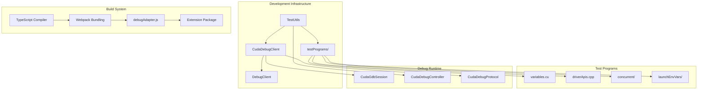
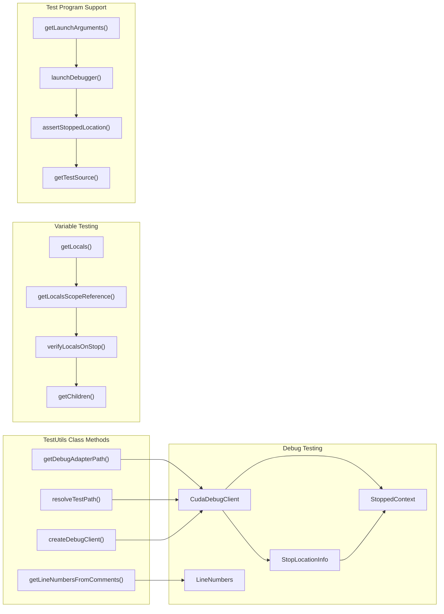
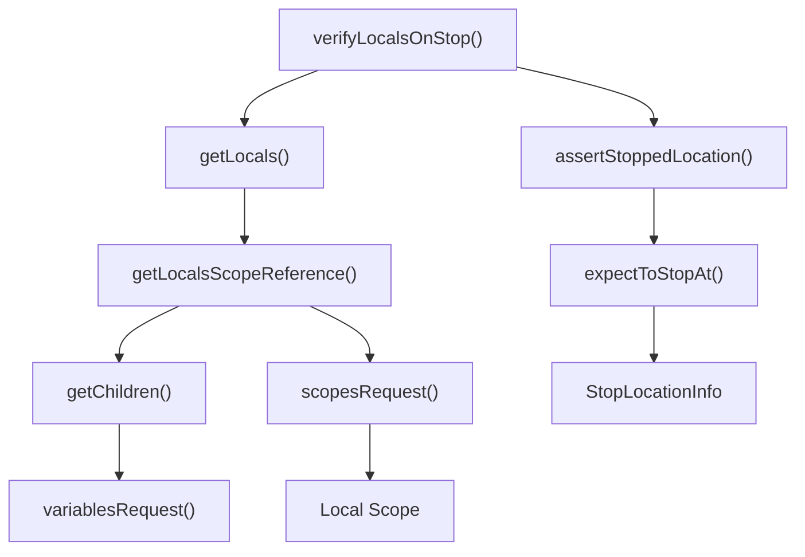

<!-- source: DeepWiki mcp.deepwiki.com · repo NVIDIA/nsight-vscode-edition · page 5 Development · fetched 2026-10-26 -->

# Development

<details>
<summary>Relevant source files</summary>

The following files were used as context for generating this wiki page:

- [.gitignore](.gitignore)
- [src/test/testUtils.ts](src/test/testUtils.ts)

</details>


This document provides guidance for developers working on the Nsight Visual Studio Code Extension. It covers the development workflow, testing infrastructure, build processes, and development environment setup required to contribute to the codebase.

For detailed information about specific development areas, see [Testing Framework](#5.1), [Build System](#5.2), and [Development Environment](#5.3).

## Development Workflow Overview

The Nsight VS Code Extension follows a standard TypeScript development workflow with specialized tooling for CUDA debugging. The development process involves building TypeScript sources, running comprehensive tests against CUDA test programs, and packaging the extension for distribution.

The extension generates several artifacts during development:
- Compiled JavaScript in `/out` and `/dist` directories
- Packaged extension files (`nsight-vscode-edition-*.vsix`)
- Test program binaries in various subdirectories
- Debug logs (`.rubicon_log`)

Sources: [.gitignore:1-16]()

## Development Architecture

The development infrastructure is built around a layered testing and build system that mirrors the runtime architecture:



Sources: [src/test/testUtils.ts:1-216](), [.gitignore:1-16]()

## Testing Infrastructure

The testing framework provides comprehensive utilities for validating CUDA debugging functionality:



The `TestUtils` class provides static methods for:
- **Debug Adapter Access**: `getDebugAdapterPath()` resolves the compiled debug adapter at `../../dist/debugAdapter.js`
- **Test Program Resolution**: `resolveTestPath()` searches multiple directories including `TEST_PROG_DIR` environment variable
- **Source Annotation**: `getLineNumbersFromComments()` extracts line markers from test files using `/*@marker*/` syntax
- **Client Creation**: `createDebugClient()` instantiates `CudaDebugClient` with proper initialization

Key testing interfaces include:
- `StoppedContext`: Contains `threadId`, `frameId`, and `actLocals` for breakpoint validation
- `LineNumbers`: Maps comment markers to line numbers for precise breakpoint placement
- `StopLocationInfo`: Provides stopped location details from `CudaDebugClient`

Sources: [src/test/testUtils.ts:35-131](), [src/test/testUtils.ts:24-32]()

## Test Program Management

The testing system supports multiple CUDA test programs located in subdirectories:

| Test Program | Purpose | Binary Location |
|--------------|---------|----------------|
| `variables` | Variable inspection and memory operations | `/src/test/testPrograms/variables/variables` |
| `driverApis` | CUDA driver API integration | `/src/test/testPrograms/driverApis/driverApis` |
| `concurrent` | Multi-threaded debugging scenarios | `/src/test/testPrograms/concurrent/concurrent` |
| `launchEnvVars` | Environment variable handling | `/src/test/testPrograms/launchEnvVars/launchEnvVars` |
| `registers` | GPU register inspection | `/src/test/testPrograms/registers/registers_test` |
| `varAssign` | Variable assignment operations | `/src/test/testPrograms/varAssign/varAssign` |
| `frames` | Stack frame navigation | `/src/test/testPrograms/frames/frames` |

The `resolveTestPath()` method searches for test programs in multiple locations, including environment-specified directories via `TEST_PROG_DIR`.

Sources: [.gitignore:8-15](), [src/test/testUtils.ts:45-64]()

## Launch Configuration Testing

The testing framework provides standardized launch configurations through `getLaunchArguments()`:

```typescript
// Standard test launch configuration
{
    program: testProgramPath,
    args: optionalArgs,
    verboseLogging: true,
    logFile: logFilePath,
    onAPIError: 'stop'
}
```

This configuration matches the `CudaLaunchRequestArguments` interface and enables:
- **Verbose Logging**: Detailed debug output for troubleshooting
- **Error Handling**: Stop on API errors for test validation
- **Log File Management**: Centralized logging to `.rubicon_log`

The `launchDebugger()` method combines client creation and launch configuration for streamlined test setup.

Sources: [src/test/testUtils.ts:111-131]()

## Variable Inspection Testing

The testing framework provides comprehensive variable inspection capabilities:



Key testing methods include:
- **`verifyLocalsOnStop()`**: Validates local variables at specific breakpoints with configurable timeout (default 120 seconds)
- **`getLocalsScopeReference()`**: Finds the "Local" scope reference for variable inspection
- **`getChildren()`**: Retrieves child variables as `Map<string, DebugProtocol.Variable>`
- **`getChildrenAsObject()`**: Alternative format returning plain object

The framework supports both strict validation (`allowOthers: false`) and flexible validation for dynamic variable sets.

Sources: [src/test/testUtils.ts:137-215](), [src/test/testUtils.ts:182-214]()

For detailed information about testing implementation, build processes, and development environment configuration, see the respective subsections: [Testing Framework](#5.1), [Build System](#5.2), and [Development Environment](#5.3).

---

