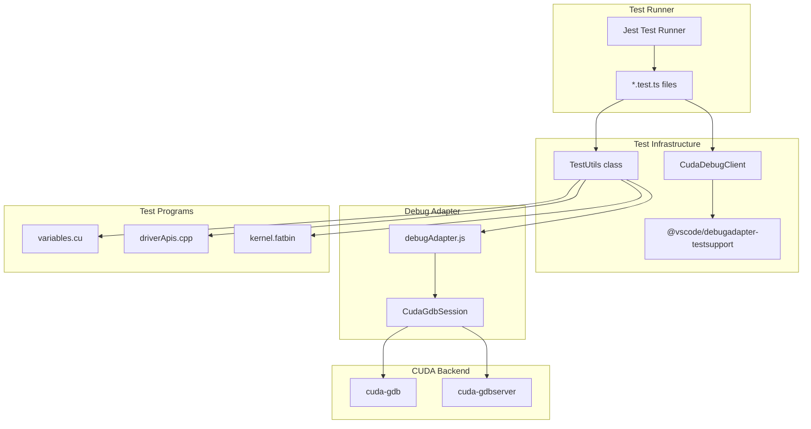
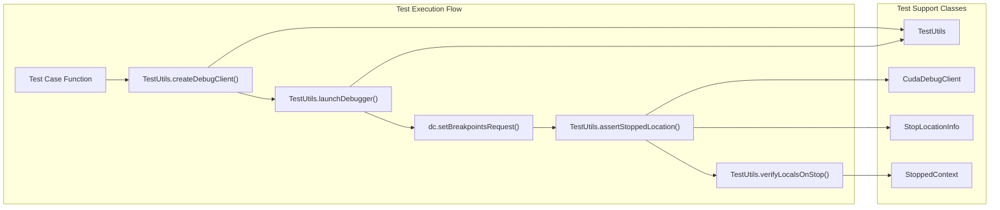
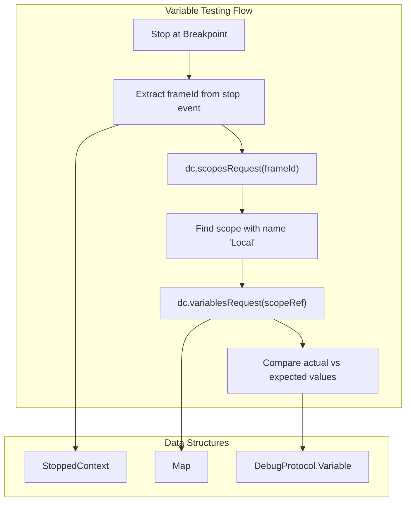

<!-- source: DeepWiki mcp.deepwiki.com · repo NVIDIA/nsight-vscode-edition · page 5.1 Testing Framework · fetched 2026-10-26 -->

# Testing Framework

<details>
<summary>Relevant source files</summary>

The following files were used as context for generating this wiki page:

- [src/test/advancedBreakpoints.test.ts](src/test/advancedBreakpoints.test.ts)
- [src/test/testPrograms/variables/variables.cu](src/test/testPrograms/variables/variables.cu)
- [src/test/testUtils.ts](src/test/testUtils.ts)

</details>


The Testing Framework provides comprehensive testing infrastructure for validating CUDA debugging functionality in the Nsight Visual Studio Code Extension. This framework includes test utilities, CUDA test programs, and specialized debug clients that enable automated testing of breakpoints, variable inspection, focus management, and debug protocol interactions.

For information about the build system and development environment setup, see [Build System](#5.2) and [Development Environment](#5.3). For details about the specific test programs, see [Test Programs](#6).

## Framework Architecture

The testing framework is built on Jest and VS Code's debug adapter test support, with custom extensions for CUDA-specific testing requirements.

### Test Framework Architecture



Sources: [src/test/testUtils.ts:1-216](), [src/test/advancedBreakpoints.test.ts:1-44]()

## Core Components

### TestUtils Class

The `TestUtils` class provides static utility methods for test setup, execution, and validation. It handles debug adapter initialization, test program resolution, and variable inspection.

| Method | Purpose | Key Functionality |
|--------|---------|------------------|
| `createDebugClient()` | Initialize debug client | Creates `CudaDebugClient` and starts debug adapter |
| `launchDebugger()` | Launch test program | Combines client creation and program launch |
| `resolveTestPath()` | Locate test programs | Searches multiple paths including `TEST_PROG_DIR` |
| `getLineNumbersFromComments()` | Extract test markers | Parses `/*@marker*/` comments for line references |
| `verifyLocalsOnStop()` | Validate variables | Checks variable values at breakpoints |

### CudaDebugClient

The `CudaDebugClient` extends VS Code's `DebugClient` with CUDA-specific testing capabilities, providing methods for focus management and enhanced stop location validation.

### Test Component Relationships



Sources: [src/test/testUtils.ts:35-215](), [src/test/cudaDebugClient.ts:1-100]()

## Test Program Management

### Test Path Resolution

The framework uses a flexible path resolution system that searches multiple locations for test programs:

1. `../../src/test/testPrograms` (relative to compiled output)
2. `../src/test/testPrograms` (alternative relative path)
3. `TEST_PROG_DIR` environment variable (custom path)

The `resolveTestPath()` method [src/test/testUtils.ts:45-64]() handles this resolution, throwing an error if the test program cannot be located.

### Line Marker System

Test programs use special comment markers to identify specific lines for breakpoint testing:

```cuda
/*@deviceCall*/ cudaComputeHashInner(input, results);
```

The `getLineNumbersFromComments()` method [src/test/testUtils.ts:76-87]() extracts these markers using regex pattern matching, returning a `LineNumbers` object that maps marker names to line numbers.

## Variable Testing Infrastructure

### Local Variable Inspection

The framework provides comprehensive support for testing variable values at breakpoints:

| Method | Return Type | Purpose |
|--------|-------------|---------|
| `getLocals()` | `Map<string, DebugProtocol.Variable>` | Get variables as map |
| `getLocalsAsObject()` | `{[name: string]: Variable}` | Get variables as object |
| `getLocalsScopeReference()` | `number` | Get scope reference ID |
| `verifyLocalsOnStop()` | `StoppedContext` | Validate variables at stop |

### Variable Verification Workflow



Sources: [src/test/testUtils.ts:137-214]()

## Debug Client Configuration

### Launch Arguments

The framework generates standardized launch configurations for test programs through `getLaunchArguments()` [src/test/testUtils.ts:111-122]():

```typescript
{
    program: testProgramPath,
    args: commandLineArgs,
    verboseLogging: true,
    logFile: logFilePath,
    onAPIError: 'stop'
}
```

### Debug Adapter Integration

Tests interact with the debug adapter through the path resolution in `getDebugAdapterPath()` [src/test/testUtils.ts:38-43](), which locates the compiled debug adapter at `../../dist/debugAdapter.js`.

## Test Examples

### Breakpoint Testing

The advanced breakpoints test [src/test/advancedBreakpoints.test.ts:23-43]() demonstrates testing breakpoints on CUDA kernels loaded via driver APIs:

```typescript
const bpResp = await dc.setBreakpointsRequest({
    source: TestUtils.getTestSource('driverApis/kernel.cu'),
    breakpoints: [{ line: bpLine }]
});
```

### Variable Testing Pattern

The framework supports comprehensive variable testing with expected value validation:

```typescript
await TestUtils.verifyLocalsOnStop(dc, 'variables.cu', 113, 'breakpoint', [
    { name: 'idx', value: '0' },
    { name: 'myInput' },
    { name: 'myResult', value: '0' }
]);
```

Sources: [src/test/testUtils.ts:184-214](), [src/test/advancedBreakpoints.test.ts:16-44]()

---

