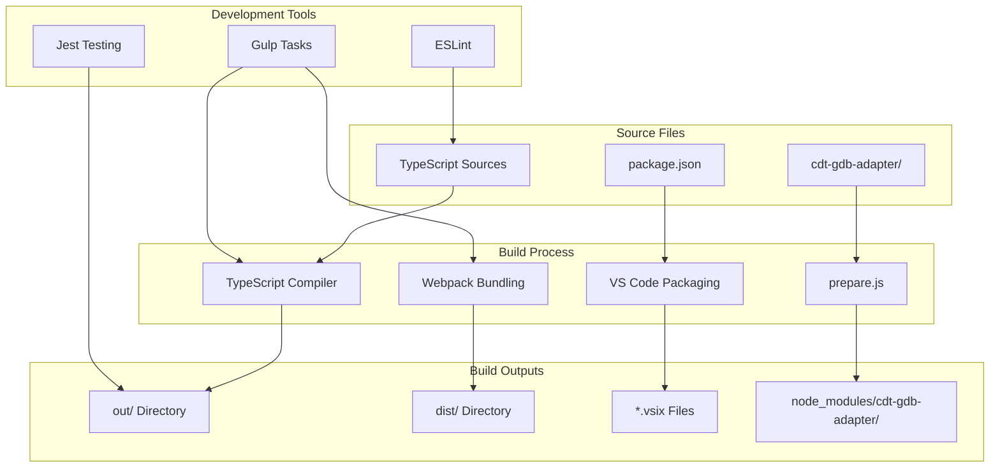
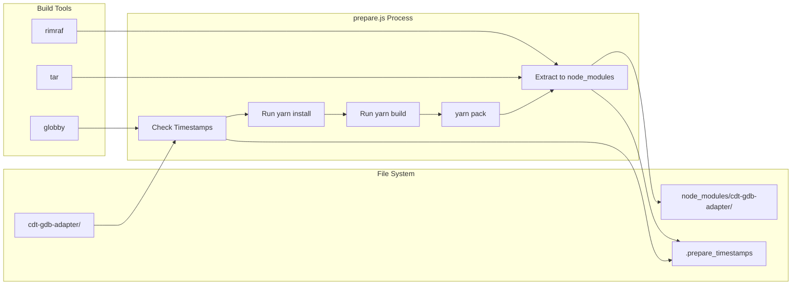
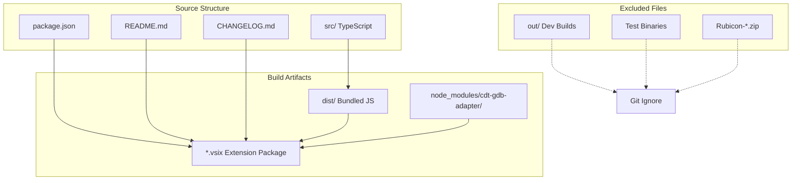
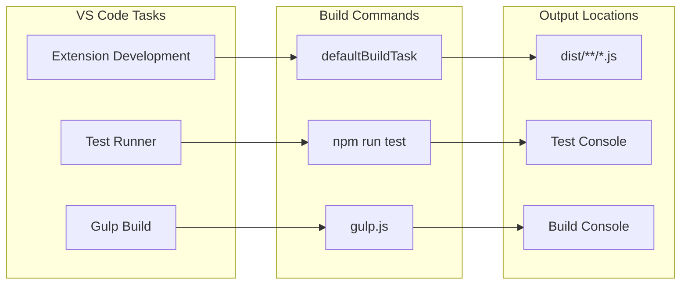

<!-- source: DeepWiki mcp.deepwiki.com · repo NVIDIA/nsight-vscode-edition · page 5.2 Build System · fetched 2026-10-26 -->

# Build System

<details>
<summary>Relevant source files</summary>

The following files were used as context for generating this wiki page:

- [.eslintignore](.eslintignore)
- [.gitignore](.gitignore)
- [.vscode/launch.json](.vscode/launch.json)
- [prepare.js](prepare.js)

</details>


The build system manages TypeScript compilation, dependency packaging, and VS Code extension artifact generation for the Nsight Visual Studio Code Edition. This document covers the build pipeline, dependency management with the `cdt-gdb-adapter`, and the development workflow for creating distributable extension packages.

For information about testing infrastructure, see [Testing Framework](#5.1). For development environment setup including linting and TypeScript configuration, see [Development Environment](#5.3).

## Build Pipeline Overview

The build system follows a multi-stage pipeline that handles TypeScript compilation, third-party dependency integration, and final packaging into distributable VS Code extension files.



Sources: [.gitignore:1-16](), [.eslintignore:1-10](), [.vscode/launch.json:33-46]()

## Dependency Management

The build system uses a custom dependency management approach for the `cdt-gdb-adapter` package through the `prepare.js` script, which implements a modified version of the relative-deps pattern.

### CDA Package Integration



The `prepare.js` script performs incremental building of the `cdt-gdb-adapter` dependency:

| Step | Function | Implementation |
|------|----------|----------------|
| **Change Detection** | Compares file timestamps | [prepare.js:61-79]() |
| **Dependency Install** | Runs `yarn install` if needed | [prepare.js:96-100]() |
| **Build Execution** | Runs `yarn run build` | [prepare.js:102-107]() |
| **Package Creation** | Creates tarball with `yarn pack` | [prepare.js:115]() |
| **Local Installation** | Extracts to `node_modules/` | [prepare.js:133-139]() |

Sources: [prepare.js:44-148]()

## TypeScript Compilation

The build system compiles TypeScript sources to JavaScript output in the `out/` directory for development and the `dist/` directory for production builds.

### Compilation Targets

| Output Directory | Purpose | Configuration |
|------------------|---------|---------------|
| `out/` | Development builds | Preserves source structure |
| `dist/` | Production bundles | Webpack optimized |
| Test programs | Native compilation | CUDA/C++ binaries |

The `.gitignore` configuration excludes both output directories and compiled test programs:

```
/out
/dist
/src/test/testPrograms/concurrent/concurrent
/src/test/testPrograms/driverApis/driverApis
/src/test/testPrograms/variables/variables
```

Sources: [.gitignore:3-4,8-15](), [.vscode/launch.json:12-14]()

## Bundling and Packaging

The build system creates VS Code extension packages (`.vsix` files) as the final distributable artifacts.

### Package Artifacts



The packaging process excludes development artifacts:
- `nsight-vscode-edition-*.vsix` - Previous builds
- `Rubicon-*.zip` - Development packages
- Test program binaries
- Source maps and intermediate files

Sources: [.gitignore:6-7,8-15]()

## Development Build Process

The development workflow integrates with VS Code's task system and provides multiple build configurations.

### VS Code Integration



Development build configurations include:

| Configuration | Type | Purpose | Output |
|---------------|------|---------|---------|
| **Extension** | `extensionHost` | Development testing | [.vscode/launch.json:12-14]() |
| **Tests** | `node` | Unit test execution | Console output |
| **Gulp Build** | `node` | Custom build tasks | Configurable |

The extension development configuration uses:
- `preLaunchTask: "${defaultBuildTask}"` for automatic building
- `outFiles: ["${workspaceFolder}/dist/**/*.js"]` for source mapping
- `--extensionDevelopmentPath` for VS Code extension host

Sources: [.vscode/launch.json:1-60]()

## Lint and Quality Control

The build system integrates code quality tools that exclude build outputs and third-party dependencies.

### ESLint Configuration

The `.eslintignore` file excludes build artifacts and dependencies:

```
node_modules
cdt-gdb-adapter
out
dist
```

This ensures linting focuses on source code while ignoring:
- Generated JavaScript files
- Third-party dependencies
- Build configuration files
- Test framework files

Sources: [.eslintignore:1-10]()

## Build Output Structure

The build system generates a structured output hierarchy optimized for different deployment scenarios.

| Directory/File | Purpose | Contents |
|----------------|---------|----------|
| `out/` | Development builds | TypeScript compilation output |
| `dist/` | Production bundles | Webpack optimized bundles |
| `node_modules/cdt-gdb-adapter/` | Integrated dependency | Built CDA package |
| `*.vsix` | Distribution packages | Complete extension artifacts |
| Test binaries | Validation programs | Compiled CUDA test programs |

The `.gitignore` patterns ensure clean repository state by excluding all generated artifacts while preserving source code and configuration files.

Sources: [.gitignore:1-16](), [prepare.js:110,146]()

---

