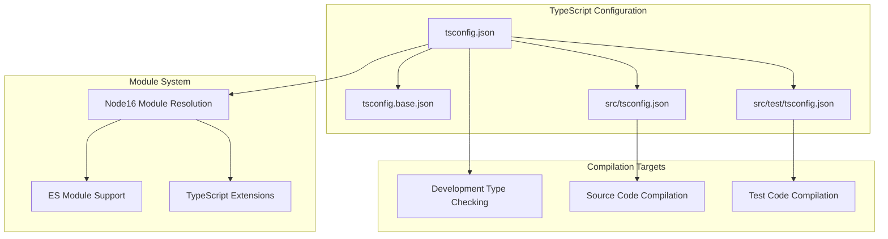
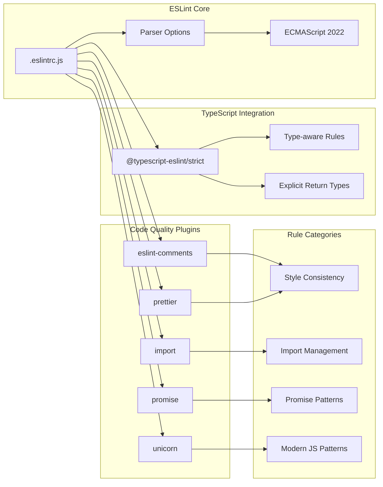
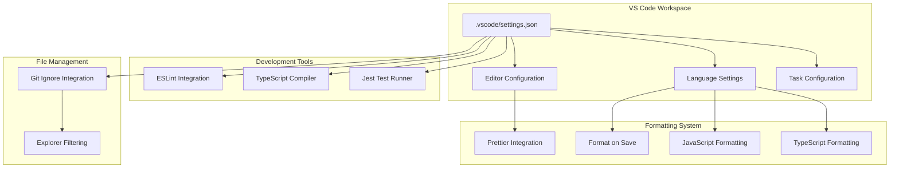
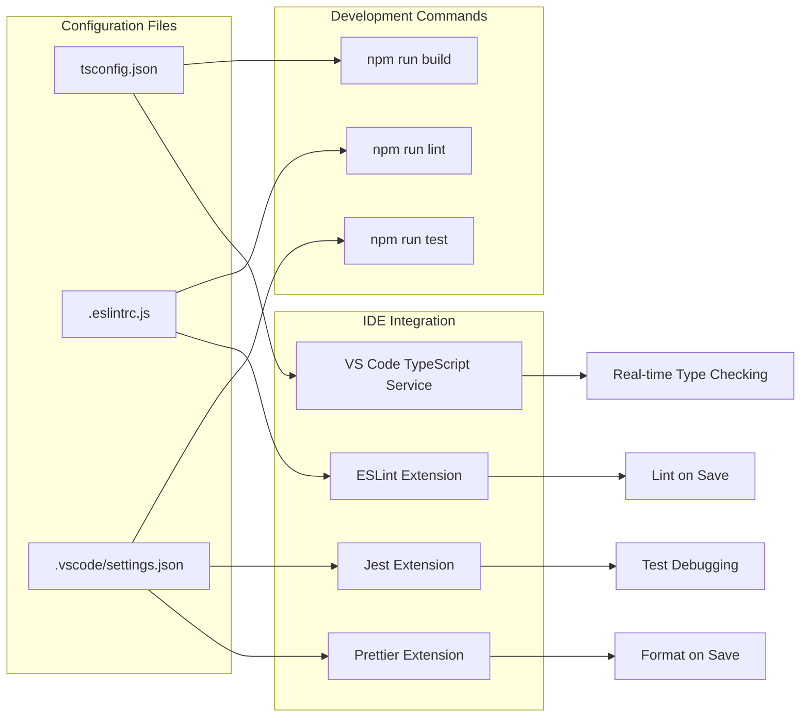

<!-- source: DeepWiki mcp.deepwiki.com · repo NVIDIA/nsight-vscode-edition · page 5.3 Development Environment · fetched 2026-10-26 -->

# Development Environment

<details>
<summary>Relevant source files</summary>

The following files were used as context for generating this wiki page:

- [.eslintrc.js](.eslintrc.js)
- [.vscode/settings.json](.vscode/settings.json)
- [tsconfig.json](tsconfig.json)

</details>


This document covers the development environment setup for contributors working on the Nsight Visual Studio Code Extension codebase. It details the TypeScript configuration, code quality tools, linting rules, and VS Code workspace settings that maintain code consistency and enable efficient development workflows.

For information about building and packaging the extension, see [Build System](#5.2). For details about the testing infrastructure, see [Testing Framework](#5.1).

## TypeScript Configuration

The extension uses a modular TypeScript configuration system with separate configurations for different compilation contexts. The main configuration extends a base configuration and is optimized for development with full type checking enabled.

### Configuration Structure



The root `tsconfig.json` is configured for development-time type checking with `noEmit: true` and allows importing TypeScript extensions for enhanced development experience [tsconfig.json:6-7](). The configuration uses Node16 module resolution to support modern ES module syntax [tsconfig.json:4-5]().

**Sources:** [tsconfig.json:1-21]()

### Project References

The TypeScript configuration employs project references to separate compilation contexts:

| Reference | Purpose | Configuration |
|-----------|---------|---------------|
| `src` | Main extension source code | Separate tsconfig for compilation |
| `src/test` | Test code and utilities | Isolated test configuration |

The main configuration excludes compiled output directories and third-party dependencies while including all TypeScript and JavaScript files for type checking [tsconfig.json:10-16]().

**Sources:** [tsconfig.json:17-20]()

## Code Quality and Linting

The extension enforces code quality through ESLint with multiple plugins and strict TypeScript rules. The configuration balances strict type safety with practical development needs.

### ESLint Plugin Architecture



**Sources:** [.eslintrc.js:12-26]()

### TypeScript-Specific Rules

The configuration includes several TypeScript-specific customizations:

- **Function Return Types**: Required for all functions except inline expressions [.eslintrc.js:76]()
- **Use Before Define**: Allows function hoisting but prevents variable and class hoisting [.eslintrc.js:32](), [.eslintrc.js:79]()
- **Explicit Any**: Disabled to allow `any` types during development [.eslintrc.js:81]()

### Development Dependencies

ESLint allows importing development dependencies in specific contexts:

```typescript
// Allowed in these file patterns:
'gulpfile*.*', 'webpack.*', 'src/test/**/*.ts', 'updateThirdPartyNotices.ts'
```

This ensures build tools and test utilities can access development dependencies while preventing their use in production code [.eslintrc.js:38-43]().

**Sources:** [.eslintrc.js:27-95]()

### Code Style Rules

The configuration includes practical style rules that prioritize readability:

| Rule | Setting | Rationale |
|------|---------|-----------|
| `no-underscore-dangle` | Off | Allows `_foo` for accessor-backing properties |
| `no-return-await` | Off | Explicit await improves stack traces |
| `unicorn/no-negated-condition` | Off | Negated conditions can be more readable |
| `unicorn/filename-case` | camelCase | Consistent with TypeScript conventions |

**Sources:** [.eslintrc.js:45-94]()

## VS Code Workspace Configuration

The workspace configuration optimizes the development experience for extension contributors with language-specific formatting, task management, and testing integration.

### Editor and Formatting Settings



The workspace disables automatic TypeScript task detection since build tasks are managed through npm scripts [.vscode/settings.json:5](). This prevents conflicts with the custom build system documented in [Build System](#5.2).

**Sources:** [.vscode/settings.json:1-27]()

### Language-Specific Configuration

Format-on-save is enabled selectively for JavaScript and TypeScript files while remaining disabled globally:

```json
{
    "editor.formatOnSave": false,
    "[javascript]": { "editor.formatOnSave": true },
    "[typescript]": { "editor.formatOnSave": true }
}
```

This configuration uses Prettier as the default formatter for consistent code style [.vscode/settings.json:17]().

**Sources:** [.vscode/settings.json:8-17]()

### Test Integration

The workspace configures Jest to run in on-demand mode rather than automatically:

```json
{
    "jest.runMode": {
        "type": "on-demand"
    }
}
```

This prevents automatic test execution since the debug tests are heavyweight and require full extension bundling [.vscode/settings.json:21-26](). For details about the testing framework, see [Testing Framework](#5.1).

**Sources:** [.vscode/settings.json:20-26]()

## Development Workflow Integration

The development environment configuration files work together to create a consistent workflow for contributors:

### Configuration Dependencies



The TypeScript configuration provides the foundation for both compilation and IDE integration. ESLint rules are enforced through both the command line and VS Code extension. The workspace settings ensure consistent formatting and prevent conflicting task detection.

**Sources:** [tsconfig.json:1-21](), [.eslintrc.js:1-97](), [.vscode/settings.json:1-27]()

### File Exclusions and Filtering

The configuration excludes various directories from different tools to optimize performance:

- **TypeScript**: Excludes `node_modules`, `out`, compiled directories [tsconfig.json:10-16]()
- **VS Code**: Enables git ignore integration for explorer filtering [.vscode/settings.json:2]()
- **ESLint**: Allows dev dependencies only in specific file patterns [.eslintrc.js:38-43]()

This ensures fast compilation, clean file navigation, and appropriate dependency usage across the development workflow.

**Sources:** [tsconfig.json:10-16](), [.vscode/settings.json:2](), [.eslintrc.js:38-43]()

---

