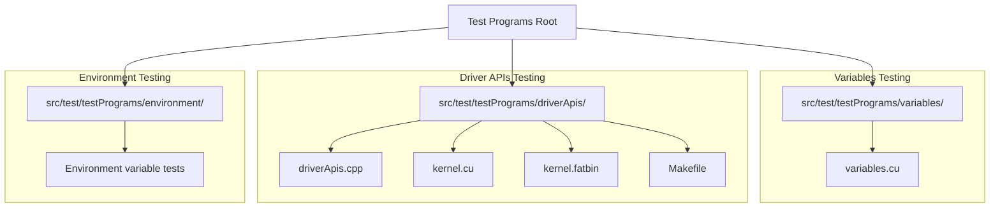
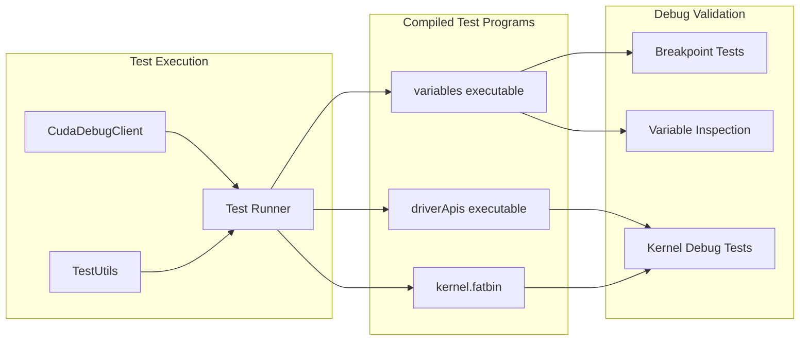
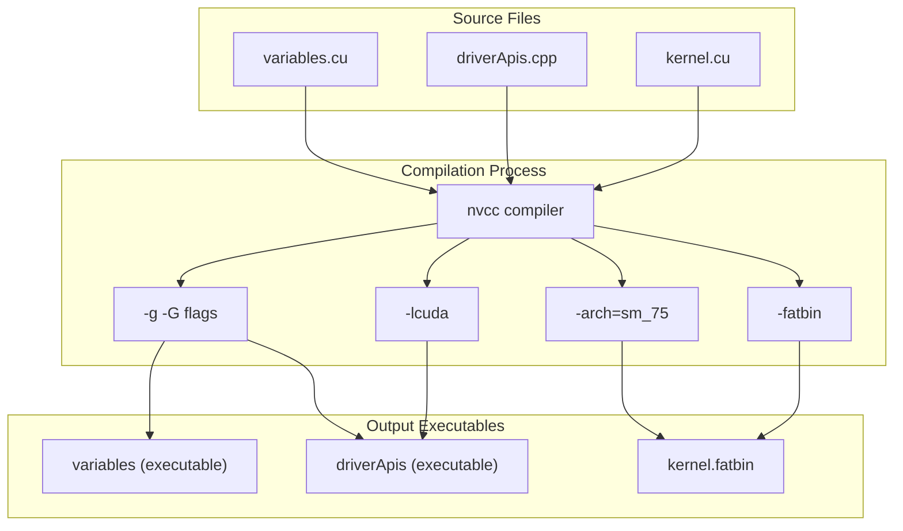

<!-- source: DeepWiki mcp.deepwiki.com · repo NVIDIA/nsight-vscode-edition · page 6 Test Programs · fetched 2026-10-26 -->

# Test Programs

Relevant source files

The following files were used as context for generating this wiki page:

- [src/test/testPrograms/driverApis/Makefile](src/test/testPrograms/driverApis/Makefile)
- [src/test/testPrograms/variables/variables.cu](src/test/testPrograms/variables/variables.cu)

## Purpose and Scope

This document covers the test programs used to validate and demonstrate CUDA debugging capabilities in the Nsight Visual Studio Code Extension. These test programs serve multiple purposes: automated testing of the debug adapter functionality, validation of CUDA-specific features like kernel debugging and variable inspection, and providing reference examples for developers.

The test programs are organized into distinct categories that exercise different aspects of CUDA debugging. For information about the testing framework infrastructure that runs these programs, see [Testing Framework](#5.1). For details about the build system that compiles these programs, see [Build System](#5.2).

## Test Program Categories

The extension includes several types of test programs designed to validate different debugging scenarios:

| Program Type | Purpose | Key Features |
|--------------|---------|--------------|
| Variables Test | Variable inspection and memory debugging | Complex data structures, unified memory, type validation |
| Driver APIs Test | CUDA driver API debugging | Low-level CUDA operations, fatbin loading, driver function calls |
| Environment Variables Test | Launch configuration validation | Environment setup, configuration testing |

## Test Program Architecture

The test programs are structured to provide comprehensive coverage of CUDA debugging scenarios while maintaining clear separation of concerns.

### Test Program Organization

Sources: `src/test/testPrograms/variables/variables.cu`, `src/test/testPrograms/driverApis/Makefile`

### Test Program Integration with Debug Framework

Sources: `src/test/testPrograms/variables/variables.cu`, `src/test/testPrograms/driverApis/Makefile`

## Core Test Program Components

### Variables Test Program Structure

The variables test program implements a comprehensive CUDA application that exercises complex data structures and memory operations.

#### Data Structure Validation

The `variables.cu` program defines a `TestType` struct [src/test/testPrograms/variables/variables.cu:62-83]() that includes:

- **Union types**: `takeYourPick` union with `halfAndHalf` struct and `whole` field
- **Array members**: `arr[5]` integer array and `structArr[5]` character struct array  
- **Floating-point types**: `theFloats[2]` float array and `theDouble` double field

#### CUDA Kernel Implementation

The test program implements both device and global functions:

- `cudaComputeHashInner`: Device function for inner computation logic [src/test/testPrograms/variables/variables.cu:85-108]()
- `cudaComputeHash`: Global kernel function that calls the inner function [src/test/testPrograms/variables/variables.cu:110-115]()

#### Memory Management Testing

The program validates unified memory operations using `cudaMallocManaged` [src/test/testPrograms/variables/variables.cu:128]() and tests both memory allocation and synchronization patterns with `cudaDeviceSynchronize` [src/test/testPrograms/variables/variables.cu:158]().

Sources: `src/test/testPrograms/variables/variables.cu:62-183`

### Driver APIs Test Program Structure

The driver APIs test demonstrates low-level CUDA driver interface debugging capabilities.

#### Build Configuration

The `Makefile` [src/test/testPrograms/driverApis/Makefile:1-16]() defines a two-stage build process:

- **Host program**: `driverApis.cpp` compiled with `-lcuda` linking [src/test/testPrograms/driverApis/Makefile:6]()
- **Device kernel**: `kernel.cu` compiled to `kernel.fatbin` format [src/test/testPrograms/driverApis/Makefile:9]()

#### Debug Target Architecture

The build targets SM 7.5 architecture with debug symbols enabled using `-g -G` flags [src/test/testPrograms/driverApis/Makefile:6,9](), ensuring compatibility with modern CUDA debugging tools.

Sources: `src/test/testPrograms/driverApis/Makefile:1-16`

## Test Program Compilation and Execution

### Compilation Targets and Debug Symbols

Sources: `src/test/testPrograms/variables/variables.cu`, `src/test/testPrograms/driverApis/Makefile:6-9`

### Error Handling and Validation

The test programs implement robust error handling through custom assertion macros:

- `assert(c)`: General condition validation [src/test/testPrograms/variables/variables.cu:36-43]()
- `assertSucceeded(c)`: CUDA error code validation [src/test/testPrograms/variables/variables.cu:45-53]()

These macros provide detailed error reporting with file location and error codes, enabling precise debugging validation during automated testing.

Sources: `src/test/testPrograms/variables/variables.cu:36-53`

## Integration with Debug Testing Framework

The test programs integrate with the broader testing infrastructure to validate debug adapter functionality, breakpoint handling, and variable inspection capabilities. They serve as both validation tools for the debug adapter implementation and reference examples for developers using the extension.

Sources: `src/test/testPrograms/variables/variables.cu`, `src/test/testPrograms/driverApis/Makefile`

---

