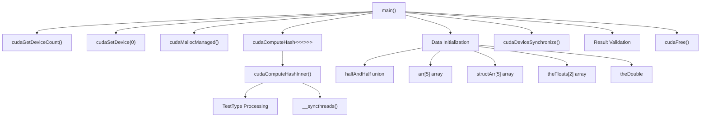
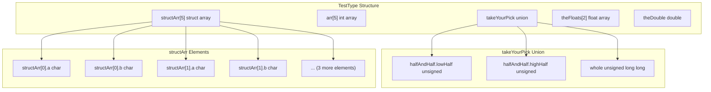
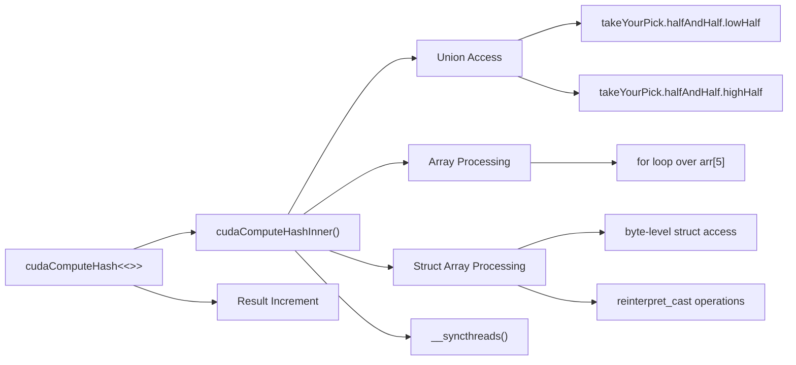
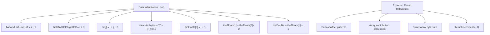

<!-- source: DeepWiki mcp.deepwiki.com · repo NVIDIA/nsight-vscode-edition · page 6.1 Variables Test · fetched 2026-10-26 -->

# Variables Test

Relevant source files

The following files were used as context for generating this wiki page:

- [src/test/testPrograms/variables/variables.cu](src/test/testPrograms/variables/variables.cu)

## Purpose and Scope

The Variables Test is a comprehensive CUDA test program designed to validate the debugging extension's ability to handle complex variable types, memory layouts, and data structures during GPU debugging sessions. This test program serves as both a validation tool for the debugging infrastructure and a reference implementation for testing variable inspection capabilities across different CUDA memory models and data types.

For information about other test programs in the testing framework, see [Test Programs](#6). For details about the broader testing infrastructure, see [Testing Framework](#5.1).

## Test Program Overview

The Variables Test program implements a structured approach to testing variable handling by creating complex data structures, performing GPU computations, and validating results. The program exercises managed memory allocation, kernel execution, and synchronization while providing rich debugging targets for variable inspection.

### Program Structure

Sources: [src/test/testPrograms/variables/variables.cu:117-182]()

## Data Structures and Types

### TestType Structure

The core of the variables test is the `TestType` structure, which demonstrates complex memory layouts that challenge debugging variable inspection:

| Field | Type | Purpose |
|-------|------|---------|
| `takeYourPick` | Union with `halfAndHalf` struct and `whole` field | Tests union member access and overlapping memory views |
| `arr[5]` | Integer array | Tests array indexing and iteration |
| `structArr[5]` | Array of structs with char fields | Tests nested structure arrays |
| `theFloats[2]` | Float array | Tests floating-point array handling |
| `theDouble` | Double | Tests double-precision floating-point variables |

### Memory Layout Diagram

Sources: [src/test/testPrograms/variables/variables.cu:62-83]()

## Kernel Implementation

### Device Function Architecture

The test implements a two-level kernel architecture that provides multiple debugging entry points:

Sources: [src/test/testPrograms/variables/variables.cu:85-115]()

### Hash Computation Logic

The kernel computes a hash value by processing different data types and memory access patterns:

1. **Union Member Access**: [src/test/testPrograms/variables/variables.cu:92-93]()
2. **Array Iteration**: [src/test/testPrograms/variables/variables.cu:95-98]()
3. **Byte-level Struct Processing**: [src/test/testPrograms/variables/variables.cu:100-103]()
4. **Thread Synchronization**: [src/test/testPrograms/variables/variables.cu:105]()

## Data Initialization and Validation

### Initialization Pattern

The test program initializes data using predictable patterns that enable deterministic validation:

Sources: [src/test/testPrograms/variables/variables.cu:131-150](), [src/test/testPrograms/variables/variables.cu:160-166]()

### Validation Logic

The program validates results using a mathematically computed expected value:

- Base values from union members: `1 + 3 = 4`
- Array contribution: `ARRAY_LENGTH * (ARRAY_LENGTH - 1) / 2 + ARRAY_LENGTH * 2`
- Struct array byte contribution: `sizeof * (sizeof - 1) / 2`
- Kernel increment: `+1`

Sources: [src/test/testPrograms/variables/variables.cu:160-174]()

## Debugging Integration

### Variable Inspection Points

The Variables Test provides multiple strategic breakpoint locations for testing debugger variable inspection:

1. **Device Function Entry**: `cudaComputeHashInner` function start
2. **Union Access Points**: During `takeYourPick` member access
3. **Array Processing**: Within array iteration loops
4. **Synchronization Points**: At `__syncthreads()` calls
5. **Host Validation**: During result checking loops

### Memory Management Testing

The program tests managed memory debugging capabilities through:

- `cudaMallocManaged()` allocation inspection
- Cross-device memory access patterns
- Memory initialization verification
- `cudaFree()` cleanup validation

Sources: [src/test/testPrograms/variables/variables.cu:128-129](), [src/test/testPrograms/variables/variables.cu:152-153](), [src/test/testPrograms/variables/variables.cu:176-177]()

## Configuration and Constants

### Program Parameters

| Constant | Value | Purpose |
|----------|-------|---------|
| `dataLength` | `1 << 5` (32) | Number of data elements |
| `threadsPerBlock` | `1 << 5` (32) | CUDA block size |
| `blocks` | `dataLength / threadsPerBlock` (1) | Number of CUDA blocks |

### Helper Macros

The program defines debugging-friendly assertion macros:

- `assert(c)`: Standard assertion with file/line reporting
- `assertSucceeded(c)`: CUDA error code validation
- `ARRAY_LENGTH(x)`: Compile-time array size calculation

Sources: [src/test/testPrograms/variables/variables.cu:36-55](), [src/test/testPrograms/variables/variables.cu:57-58]()

---

