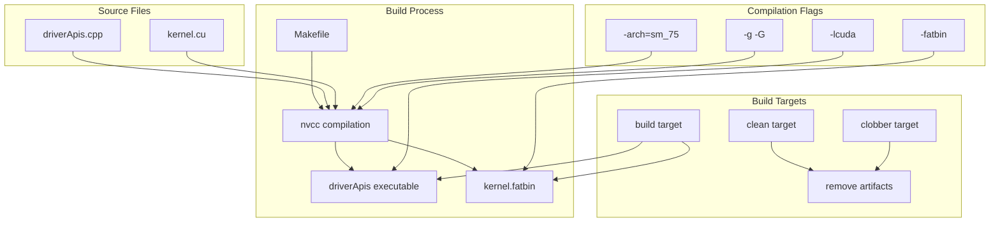
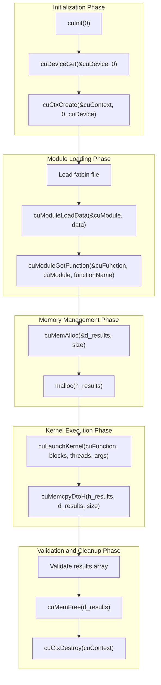
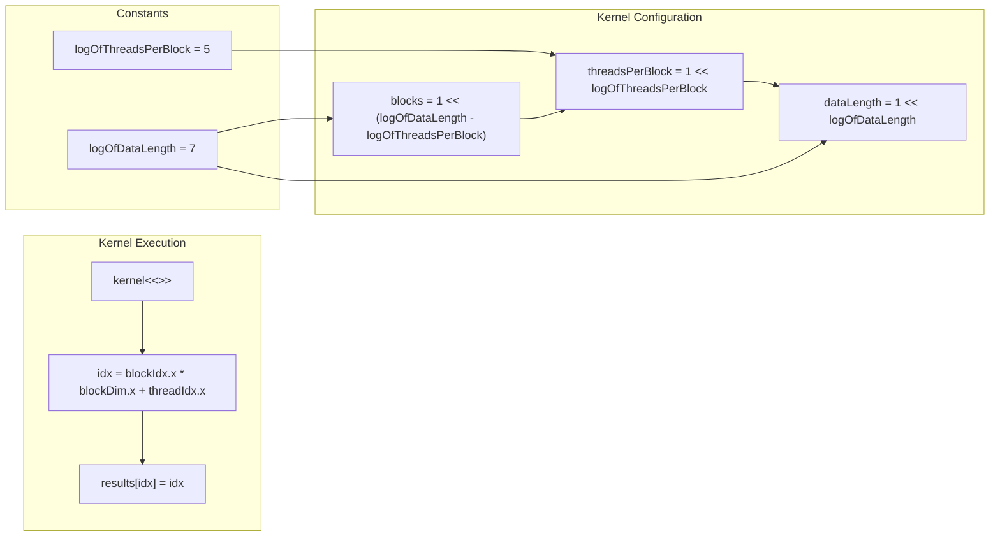

<!-- source: DeepWiki mcp.deepwiki.com · repo NVIDIA/nsight-vscode-edition · page 6.2 Driver APIs Test · fetched 2026-10-26 -->

# Driver APIs Test

Relevant source files

The following files were used as context for generating this wiki page:

- [src/test/testPrograms/driverApis/Makefile](src/test/testPrograms/driverApis/Makefile)
- [src/test/testPrograms/driverApis/driverApis.cpp](src/test/testPrograms/driverApis/driverApis.cpp)
- [src/test/testPrograms/driverApis/kernel.cu](src/test/testPrograms/driverApis/kernel.cu)

## Purpose and Scope

The Driver APIs Test is a validation program that tests CUDA Driver API integration within the Nsight Visual Studio Code debugging environment. This test program exercises low-level CUDA Driver API functions to ensure the debugger can properly handle device initialization, module loading, kernel execution, and memory operations when debugging applications that use the Driver API instead of the higher-level Runtime API.

For information about CUDA Runtime API testing, see [Variables Test](#6.1). For launch configuration testing, see [Environment Variables Test](#6.3).

## Program Overview

The Driver APIs Test consists of a host program written in C++ and a simple CUDA kernel. The test validates end-to-end CUDA Driver API functionality by performing device initialization, loading a precompiled kernel from a fatbin file, executing the kernel, and verifying results.

| Component | File | Purpose |
|-----------|------|---------|
| Host Program | `driverApis.cpp` | Main test logic using CUDA Driver API |
| Device Kernel | `kernel.cu` | Simple CUDA kernel for execution testing |
| Build Script | `Makefile` | Compilation and linking configuration |

Sources: [src/test/testPrograms/driverApis/driverApis.cpp:1-124](), [src/test/testPrograms/driverApis/kernel.cu:1-31](), [src/test/testPrograms/driverApis/Makefile:1-16]()

## Build System Architecture

The build system uses `nvcc` with specific flags to generate debuggable code. The `-g -G` flags enable host and device debug information, while `-arch=sm_75` targets compute capability 7.5. The kernel is compiled separately into a fatbin format for runtime loading.

Sources: [src/test/testPrograms/driverApis/Makefile:3-9]()

## Program Execution Flow

The program follows a structured execution pattern typical of CUDA Driver API applications. Each phase includes proper error checking using the `assertSucceeded` macro defined in [src/test/testPrograms/driverApis/driverApis.cpp:48-56]().

Sources: [src/test/testPrograms/driverApis/driverApis.cpp:66-123]()

## Kernel Implementation and Launch Parameters

The test kernel implements a simple indexing operation where each thread writes its global thread ID to the results array:

The kernel uses bit-shift operations for efficient power-of-2 calculations. With `logOfThreadsPerBlock = 5` and `logOfDataLength = 7`, the configuration results in 32 threads per block processing 128 total elements across 4 blocks.

Sources: [src/test/testPrograms/driverApis/driverApis.cpp:58-61](), [src/test/testPrograms/driverApis/driverApis.cpp:100-103](), [src/test/testPrograms/driverApis/kernel.cu:26-30]()

## Error Handling and Assertions

The test program implements comprehensive error checking through custom assertion macros:

| Macro | Purpose | Usage |
|-------|---------|-------|
| `assert(c)` | General condition checking | Validates argc and file operations |
| `assertSucceeded(c)` | CUDA API return code validation | Checks all CUDA Driver API calls |

The `assertSucceeded` macro specifically handles CUDA error codes, printing the failed operation name, error code, and source location before terminating with the error code as exit status. This enables detailed debugging when CUDA operations fail.

Sources: [src/test/testPrograms/driverApis/driverApis.cpp:39-56]()

## Debugging Validation Points

The Driver APIs Test provides multiple strategic debugging opportunities for validating Nsight VS Code debugging capabilities:

```mermaid
graph TD
    subgraph "Host-side Debugging Points"
        A["Device initialization"] --> B["Module loading from fatbin"]
        B --> C["Function symbol resolution"]
        C --> D["Memory allocation"]
        D --> E["Kernel launch parameters"]
        E --> F["Host-device memory transfer"]
        F --> G["Result validation loop"]
    end
    
    subgraph "Device-side Debugging Points"
        H["Kernel entry breakpoints"] --> I["Thread index calculations"]
        I --> J["Array write operations"]
        J --> K["Block/thread coordination"]
    end
    
    subgraph "Key Variables for Inspection"
        L["cuDevice, cuContext, cuModule"] --> M["cuFunction, d_results"]
        M --> N["h_results array contents"]
        N --> O["Block/thread dimensions"]
    end
```

The program is designed to test debugger capabilities at both host and device levels, with clear validation of results through the comparison loop in [src/test/testPrograms/driverApis/driverApis.cpp:108-114]().

Sources: [src/test/testPrograms/driverApis/driverApis.cpp:70-122](), [src/test/testPrograms/driverApis/kernel.cu:26-30]()

---

