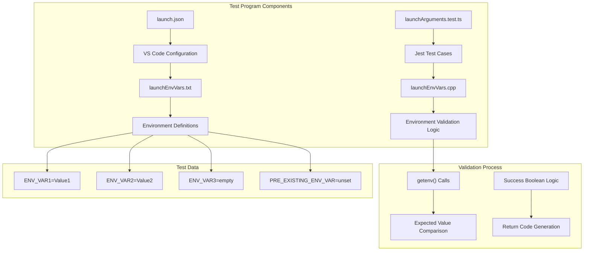
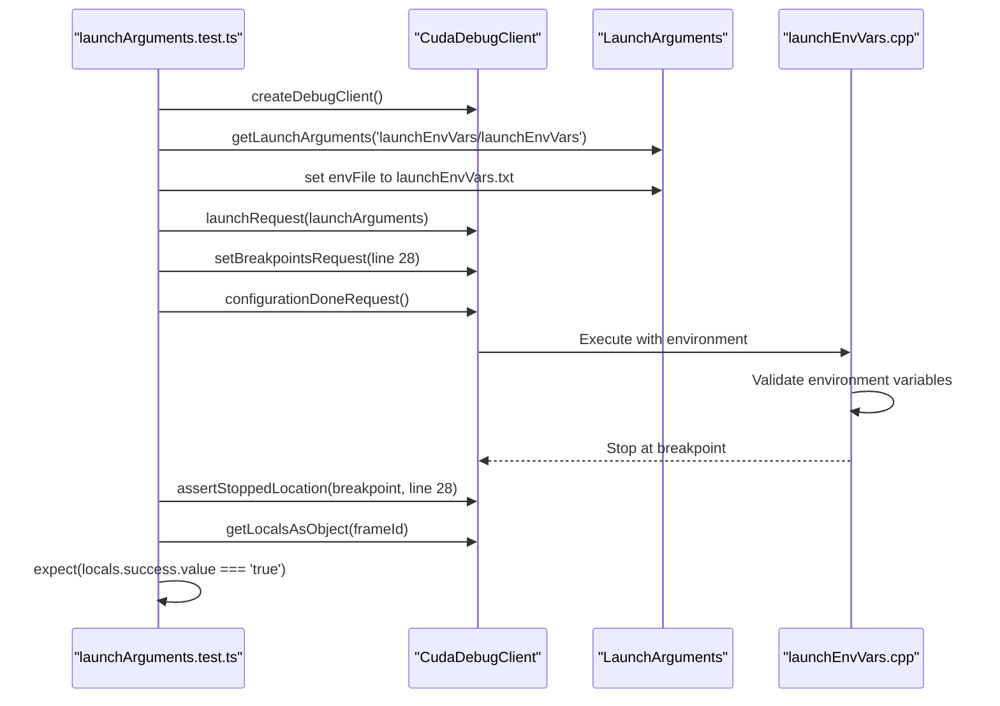
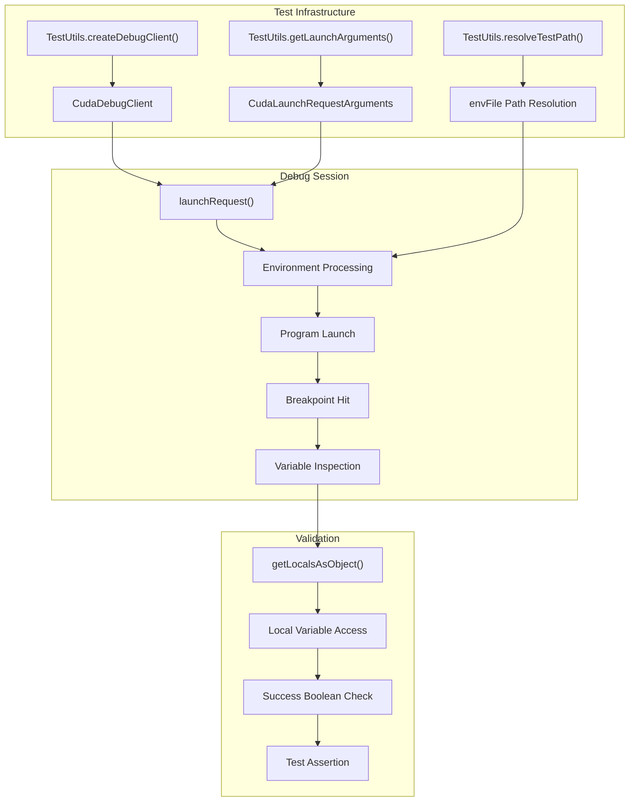

<!-- source: DeepWiki mcp.deepwiki.com · repo NVIDIA/nsight-vscode-edition · page 6.3 Environment Variables Test · fetched 2026-10-26 -->

# Environment Variables Test

<details>
<summary>Relevant source files</summary>

The following files were used as context for generating this wiki page:

- [src/debugger/processList.ts](src/debugger/processList.ts)
- [src/test/launchArguments.test.ts](src/test/launchArguments.test.ts)
- [src/test/testPrograms/launchEnvVars/.vscode/launch.json](src/test/testPrograms/launchEnvVars/.vscode/launch.json)
- [src/test/testPrograms/launchEnvVars/.vscode/tasks.json](src/test/testPrograms/launchEnvVars/.vscode/tasks.json)
- [src/test/testPrograms/launchEnvVars/launchEnvVars.cpp](src/test/testPrograms/launchEnvVars/launchEnvVars.cpp)
- [src/test/testPrograms/launchEnvVars/launchEnvVars.txt](src/test/testPrograms/launchEnvVars/launchEnvVars.txt)

</details>


This document covers the environment variables test program that validates the CUDA debugging extension's ability to parse and apply environment variable configurations during debug session launches. The test ensures that environment files (`.envFile`) are correctly processed and that environment variables are properly set in the target program's execution context.

For information about other CUDA test programs, see [Variables Test](#6.1) and [Driver APIs Test](#6.2). For details about the testing framework infrastructure, see [Testing Framework](#5.1).

## Purpose and Scope

The Environment Variables Test validates the CUDA debugging extension's environment variable handling capabilities. It specifically tests:

- Environment file parsing with various formatting scenarios
- Proper application of environment variables to debug targets
- Handling of malformed entries and comments in environment files
- Integration with VS Code launch configurations
- Validation that environment variables are accessible within the debugged program

The test program serves as both a validation tool and a reference example for users configuring environment variables in their CUDA debugging workflows.

Sources: [src/test/testPrograms/launchEnvVars/launchEnvVars.cpp:1-30](), [src/test/launchArguments.test.ts:42-85]()

## Test Program Structure

The environment variables test consists of several coordinated components that work together to validate environment variable processing:



The core test program [src/test/testPrograms/launchEnvVars/launchEnvVars.cpp:9-14]() defines a validation matrix of environment variables with their expected values. Each variable is tested using `std::getenv()` and compared against the expected result using string comparison logic [src/test/testPrograms/launchEnvVars/launchEnvVars.cpp:19-22]().

Sources: [src/test/testPrograms/launchEnvVars/launchEnvVars.cpp:9-24](), [src/test/testPrograms/launchEnvVars/.vscode/launch.json:1-18]()

## Environment File Format

The test validates parsing of various environment file formats and edge cases through the `launchEnvVars.txt` file:

| Line Content | Purpose | Parsing Behavior |
|--------------|---------|------------------|
| `ENV_VAR1=Value1` | Standard assignment | Sets ENV_VAR1 to "Value1" |
| `ENV_VAR2 = Value2` | Whitespace handling | Trims spaces, sets ENV_VAR2 to "Value2" |
| `ENV_VAR3 =` | Empty value | Sets ENV_VAR3 to empty string |
| `MISFORMED_LINE` | Invalid format | Should be ignored |
| `# A comment` | Comment line | Should be ignored |
| `=X` | Missing variable name | Should be ignored |
| `unset PRE_EXISTING_ENV_VAR` | Unset directive | Removes environment variable |

The format testing ensures robust parsing that handles real-world environment file variations while gracefully ignoring malformed entries.

Sources: [src/test/testPrograms/launchEnvVars/launchEnvVars.txt:1-9]()

## Test Validation Process

The Jest test framework executes a comprehensive validation sequence that verifies environment variable processing:



The test process [src/test/launchArguments.test.ts:44-85]() follows these steps:

1. **Setup**: Creates debug client and configures launch arguments with `envFile` pointing to the test environment file
2. **Launch**: Initiates debug session with environment variable processing
3. **Breakpoint**: Sets breakpoint at line 28 where validation results are available
4. **Validation**: Retrieves local variables and verifies the `success` boolean indicates all environment variables were correctly set

The test validates success by examining the `success` local variable [src/test/launchArguments.test.ts:78-84]() which reflects the cumulative result of all environment variable checks.

Sources: [src/test/launchArguments.test.ts:42-85](), [src/test/testPrograms/launchEnvVars/launchEnvVars.cpp:16-28]()

## VS Code Integration

The test program includes VS Code configuration files that demonstrate proper integration with the CUDA debugging extension:

The launch configuration [src/test/testPrograms/launchEnvVars/.vscode/launch.json:4-15]() specifies:

```json
{
    "name": "CUDA: Debug with CUDA-GDB",
    "type": "cuda-gdb",
    "request": "launch",
    "program": "${workspaceFolder}/launchEnvVars",
    "envFile": "${workspaceFolder}/launchEnvVars.txt",
    "initCommands": ["set env ENV_VAR1=Value3"],
    "stopAtEntry": true
}
```

Key configuration elements:
- **envFile**: References the environment variables file for processing
- **initCommands**: Demonstrates GDB command integration for additional environment setup
- **stopAtEntry**: Enables immediate debugging to verify environment state

The build configuration [src/test/testPrograms/launchEnvVars/.vscode/tasks.json:4-12]() provides a standard make-based build task for compiling the test program.

Sources: [src/test/testPrograms/launchEnvVars/.vscode/launch.json:4-15](), [src/test/testPrograms/launchEnvVars/.vscode/tasks.json:4-12]()

## Test Execution Flow

The environment variables test integrates with the broader CUDA debugging test infrastructure:



The execution flow leverages the testing framework's utilities:

- **TestUtils.createDebugClient()**: Establishes the debug client connection
- **TestUtils.getLaunchArguments()**: Loads base launch configuration for the test program
- **TestUtils.resolveTestPath()**: Resolves the environment file path [src/test/launchArguments.test.ts:45]()
- **TestUtils.assertStoppedLocation()**: Validates breakpoint execution [src/test/launchArguments.test.ts:75]()
- **TestUtils.getLocalsAsObject()**: Extracts local variables for validation [src/test/launchArguments.test.ts:77]()

The test demonstrates the complete environment variable processing pipeline from file parsing through runtime validation in the target program.

Sources: [src/test/launchArguments.test.ts:43-85](), [src/test/testPrograms/launchEnvVars/launchEnvVars.cpp:7-29]()

---

