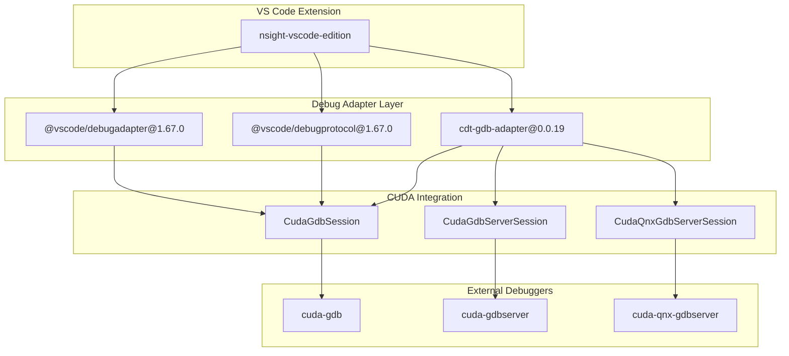
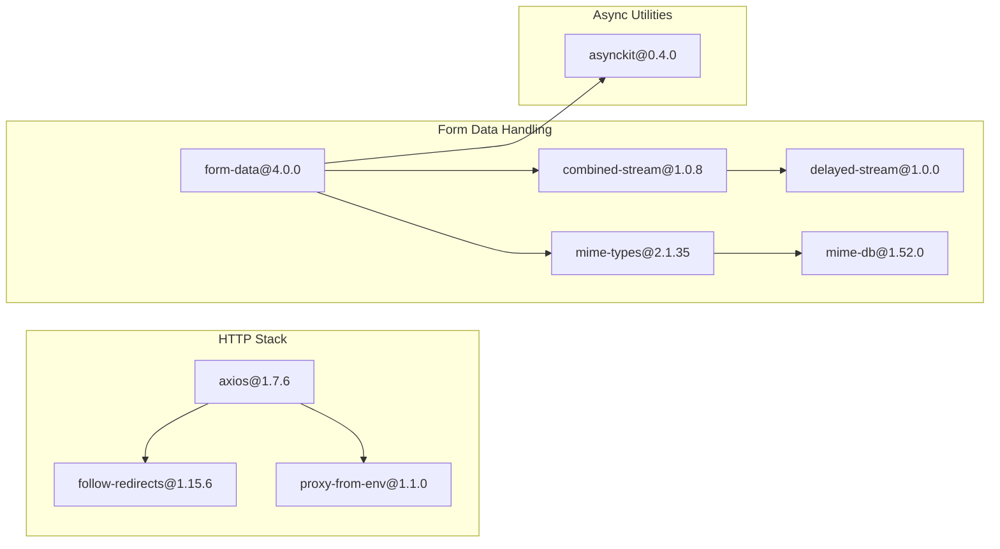
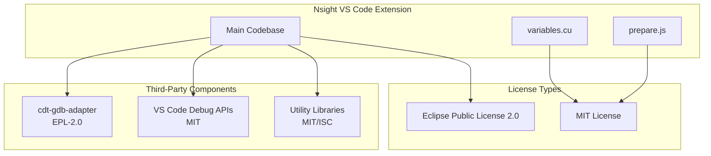
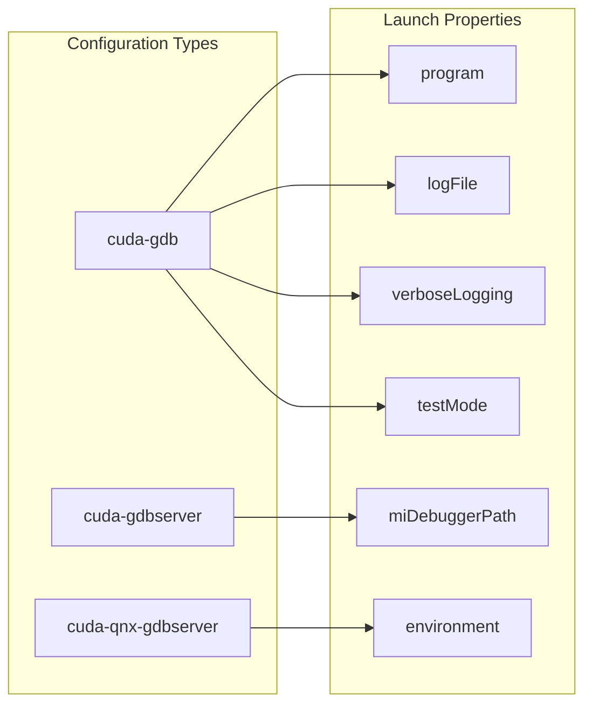

<!-- source: DeepWiki mcp.deepwiki.com · repo NVIDIA/nsight-vscode-edition · page 7 Reference · fetched 2026-10-26 -->

# Reference

<details>
<summary>Relevant source files</summary>

The following files were used as context for generating this wiki page:

- [LICENSE](LICENSE)
- [src/test/testPrograms/variables/.vscode/launch.json](src/test/testPrograms/variables/.vscode/launch.json)
- [third-party-notices.txt](third-party-notices.txt)

</details>


This page provides reference documentation for the Nsight Visual Studio Code Edition, including third-party dependencies, licensing information, and version details. This documentation covers the legal and technical foundation that supports the extension's functionality.

For information about building and development workflows, see [Development](#5). For details about the core debugging components, see [Core Components](#3).

## Dependencies Overview

The extension relies on several categories of dependencies that enable VS Code integration, CUDA debugging capabilities, and utility functions.

### Core Debug Dependencies

The most critical dependency is the Eclipse CDT project's GDB adapter, which provides the foundation for all debugging functionality.



**Key Dependencies:**
- `cdt-gdb-adapter@0.0.19` - Eclipse CDT's GDB adapter (EPL-2.0)
- `@vscode/debugadapter@1.67.0` - Microsoft's VS Code debug adapter framework (MIT)
- `@vscode/debugprotocol@1.67.0` - VS Code Debug Adapter Protocol definitions (MIT)

Sources: [third-party-notices.txt:125-408](), [LICENSE:14-22]()

### Network and HTTP Dependencies

The extension uses HTTP libraries primarily for telemetry and remote debugging communication.



**Network Dependencies:**
- `axios@1.7.6` - HTTP client for telemetry and API communication (MIT)
- `form-data@4.0.0` - Multipart form data handling (MIT)
- `follow-redirects@1.15.6` - HTTP redirect handling (MIT)
- `proxy-from-env@1.1.0` - Proxy configuration from environment (MIT)

Sources: [third-party-notices.txt:109-122](), [third-party-notices.txt:467-490](), [third-party-notices.txt:494-518](), [third-party-notices.txt:682-707]()

### File System and Utility Dependencies

Supporting utilities handle file operations, JSON processing, and system integration.

| Dependency | Version | License | Purpose |
|------------|---------|---------|---------|
| `fs-extra` | 11.2.0 | MIT | Enhanced file system operations |
| `graceful-fs` | 4.2.11 | ISC | Graceful file system handling |
| `jsonfile` | 6.1.0 | MIT | JSON file read/write operations |
| `universalify` | 2.0.1 | MIT | Promise/callback compatibility |
| `uuid` | 10.0.0 | MIT | UUID generation for session tracking |
| `which` | 3.0.1 | ISC | Executable path resolution |
| `isexe` | 2.0.0 | ISC | Executable detection |

Sources: [third-party-notices.txt:522-542](), [third-party-notices.txt:546-566](), [third-party-notices.txt:594-614](), [third-party-notices.txt:711-736](), [third-party-notices.txt:740-754](), [third-party-notices.txt:758-778](), [third-party-notices.txt:570-590]()

## License Structure

The extension uses a dual-licensing approach with specific exceptions for certain files.

### Primary License Framework



**License Distribution:**
- **Eclipse Public License 2.0 (EPL-2.0)**: Main extension code and integration with CDT components
- **MIT License**: Test files and build scripts with specific exceptions
- **ISC License**: Utility dependencies for file system operations

Sources: [LICENSE:1-12](), [LICENSE:29-48](), [LICENSE:52-132]()

### CDT-GDB-Adapter Integration

The extension uses a specialized NVIDIA fork of the Eclipse CDT GDB adapter to support CUDA-specific debugging features.

**Repository Sources:**
- Upstream: `https://github.com/eclipse-cdt/cdt-gdb-adapter`
- NVIDIA Fork: `https://github.com/NVIDIA/cdt-gdb-adapter`

The fork maintains EPL-2.0 licensing while adding CUDA-specific extensions for focus management, kernel debugging, and GPU state inspection.

Sources: [LICENSE:14-22](), [third-party-notices.txt:125-128]()

### Third-Party License Compliance

All third-party components maintain their original licensing terms as documented in the comprehensive notices file.

**License Categories:**
- **MIT (13 components)**: Most utility and framework dependencies
- **EPL-2.0 (1 component)**: Eclipse CDT GDB adapter
- **ISC (3 components)**: File system and executable utilities

The extension includes full license text and attribution for all dependencies to ensure compliance with open source licensing requirements.

Sources: [third-party-notices.txt:1-779](), [LICENSE:24-25]()

## Version Information

The extension integrates with specific versions of debugging components and VS Code APIs to ensure compatibility and functionality.

### Debug Protocol Versions

| Component | Version | Compatibility |
|-----------|---------|---------------|
| VS Code Debug Adapter | 1.67.0 | VS Code 1.74+ |
| Debug Adapter Protocol | 1.67.0 | Standard DAP compliance |
| CDT GDB Adapter | 0.0.19 | CUDA extensions |

### Configuration Schema

The extension supports standardized launch configuration formats compatible with VS Code's debugging infrastructure.



**Example Configuration:**
```json
{
    "name": "CUDA: Debug with CUDA-GDB",
    "type": "cuda-gdb", 
    "request": "launch",
    "program": "${workspaceFolder}/variables",
    "logFile": "${workspaceFolder}/.rubicon_log",
    "verboseLogging": true,
    "testMode": true
}
```

Sources: [src/test/testPrograms/variables/.vscode/launch.json:4-12]()

The reference documentation ensures users and developers have complete information about the extension's dependencies, licensing obligations, and version requirements for proper integration and compliance.

---

