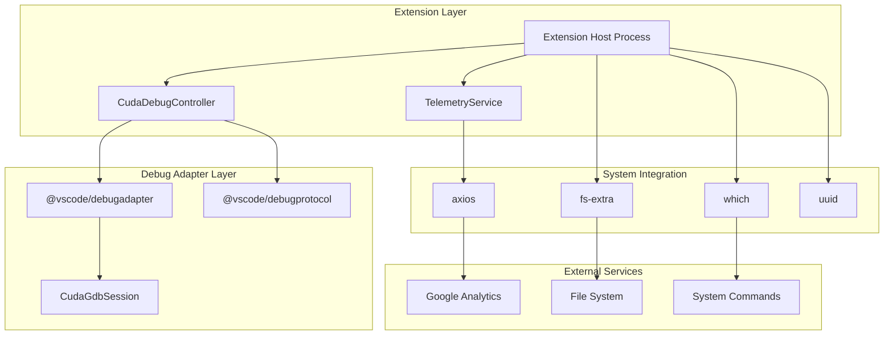
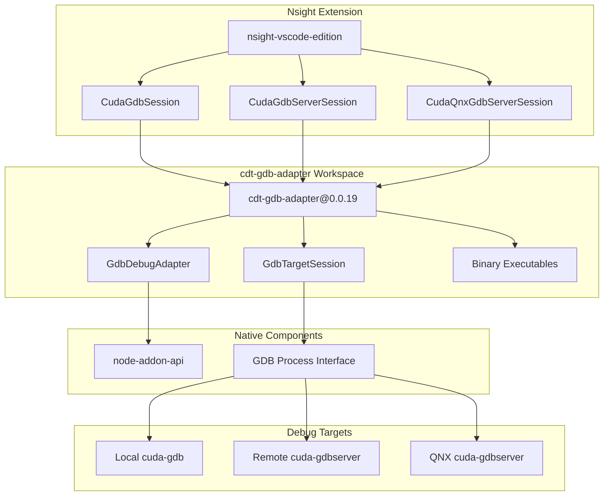
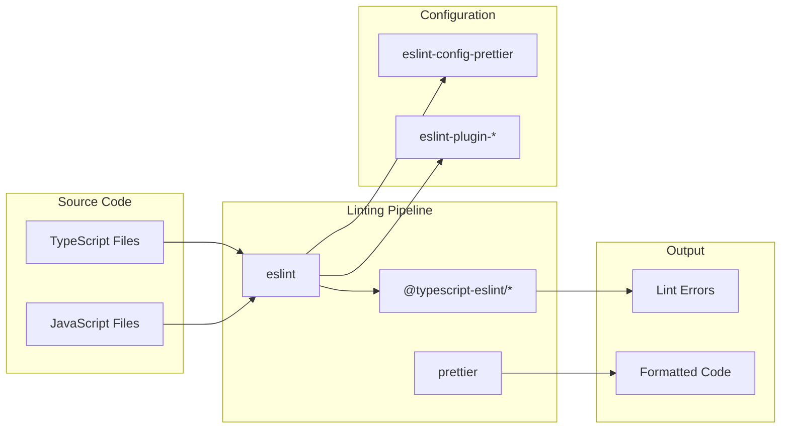
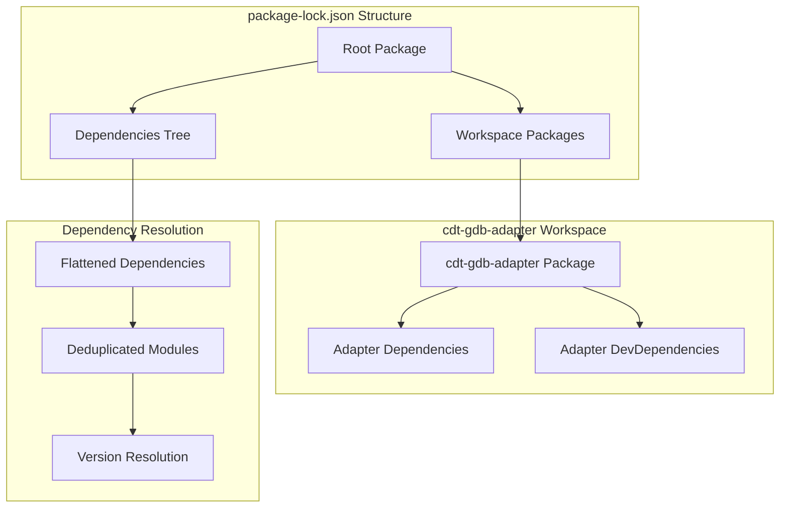

<!-- source: DeepWiki mcp.deepwiki.com · repo NVIDIA/nsight-vscode-edition · page 7.1 Dependencies · fetched 2026-10-26 -->

# Dependencies

Relevant source files

The following files were used as context for generating this wiki page:

- [.gitmodules](.gitmodules)
- [package-lock.json](package-lock.json)
- [src/test/testPrograms/variables/.vscode/launch.json](src/test/testPrograms/variables/.vscode/launch.json)
- [third-party-notices.txt](third-party-notices.txt)

This page documents the third-party dependencies used by the Nsight Visual Studio Code Extension, including runtime dependencies, development tools, and the integrated cdt-gdb-adapter. This covers dependency versions, licensing requirements, and the architectural relationship between dependencies and core extension functionality.

For information about the overall system architecture, see [Architecture](#2). For build system configuration, see [Build System](#5.2).

## Runtime Dependencies

The extension relies on several core runtime dependencies that provide essential functionality for VS Code integration, CUDA debugging, and HTTP communication.

### Core VS Code Integration Dependencies

| Dependency | Version | Purpose |
|------------|---------|---------|
| `@vscode/debugadapter` | ^1.66.0 | Debug adapter protocol implementation |
| `@vscode/debugprotocol` | ^1.66.0 | Debug protocol type definitions |
| `axios` | ^1.7.2 | HTTP client for telemetry and remote operations |
| `fs-extra` | ^11.0.4 | Enhanced filesystem operations |
| `uuid` | ^10.0.0 | Unique identifier generation |
| `which` | ^3.0.1 | Cross-platform executable discovery |

**Runtime Dependency Architecture**

Sources: [package-lock.json:13-21](), [third-party-notices.txt:5-21]()

## cdt-gdb-adapter Integration

The most critical dependency is `cdt-gdb-adapter`, which provides the core GDB debugging functionality. This dependency is managed as both an npm workspace and a git submodule.

### Integration Architecture

### Workspace Configuration

The cdt-gdb-adapter is configured as an npm workspace, allowing it to be developed and built alongside the main extension:

- **Workspace Declaration**: [package-lock.json:10-12]()
- **Submodule Configuration**: [.gitmodules:1-4]()
- **Binary Executables**: `cdtDebugAdapter` and `cdtDebugTargetAdapter`

Sources: [package-lock.json:86-122](), [.gitmodules:1-4](), [third-party-notices.txt:125-408]()

## Development Dependencies

The extension uses a comprehensive set of development tools for building, testing, and maintaining code quality.

### Build and Compilation Tools

| Category | Dependencies | Purpose |
|----------|-------------|---------|
| TypeScript | `typescript`, `ts-loader`, `ts-jest`, `ts-node` | TypeScript compilation and tooling |
| Bundling | `webpack`, `webpack-cli`, `webpack-merge` | Module bundling and optimization |
| Build Automation | `gulp`, `gulp-*` packages | Build task automation |

### Testing Infrastructure

| Tool | Purpose |
|------|---------|
| `jest`, `@jest/globals` | Unit testing framework |
| `mocha` | Alternative testing framework |
| `@vscode/test-electron` | VS Code extension testing |
| `@vscode/debugadapter-testsupport` | Debug adapter testing utilities |
| `chai`, `chai-string` | Assertion libraries |

### Code Quality Tools

Sources: [package-lock.json:22-84]()

## Licensing

All runtime dependencies use permissive licenses compatible with the extension's distribution requirements:

### License Summary

| License Type | Dependencies |
|-------------|-------------|
| **MIT** | `@vscode/debugadapter`, `@vscode/debugprotocol`, `axios`, `fs-extra`, `uuid`, `which` |
| **EPL-2.0** | `cdt-gdb-adapter` |
| **ISC** | `graceful-fs`, `isexe` |

### Eclipse Public License 2.0

The `cdt-gdb-adapter` dependency uses the Eclipse Public License 2.0, which requires:
- Source code availability for modifications
- Patent grant provisions
- Compatible secondary licensing options

**Key EPL-2.0 Requirements**:
- Distribution of source code with binary distributions
- Preservation of copyright and license notices
- Patent licensing commitments from contributors

Sources: [third-party-notices.txt:125-408]()

## Dependency Management

### Version Management Strategy

The extension uses semantic versioning ranges to balance stability and updates:

- **Caret Ranges** (`^`): Used for most dependencies to allow compatible updates
- **Exact Versions**: Used for `cdt-gdb-adapter` to ensure precise compatibility
- **Workspace Management**: npm workspaces coordinate cdt-gdb-adapter development

### Lock File Structure

The lock file ensures reproducible builds across development environments and CI/CD pipelines by locking specific dependency versions and resolution strategies.

Sources: [package-lock.json:1-12](), [package-lock.json:86-122]()

---

