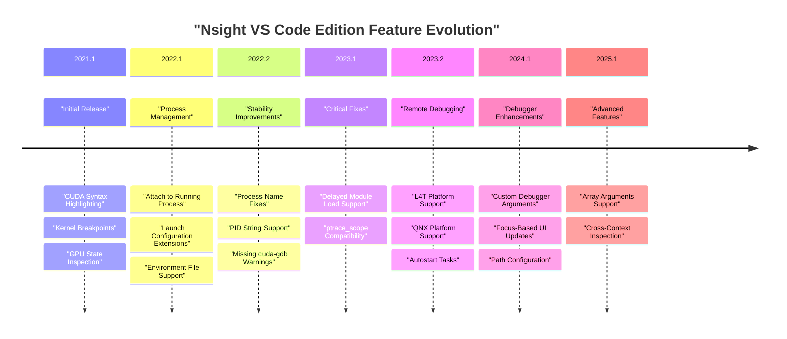
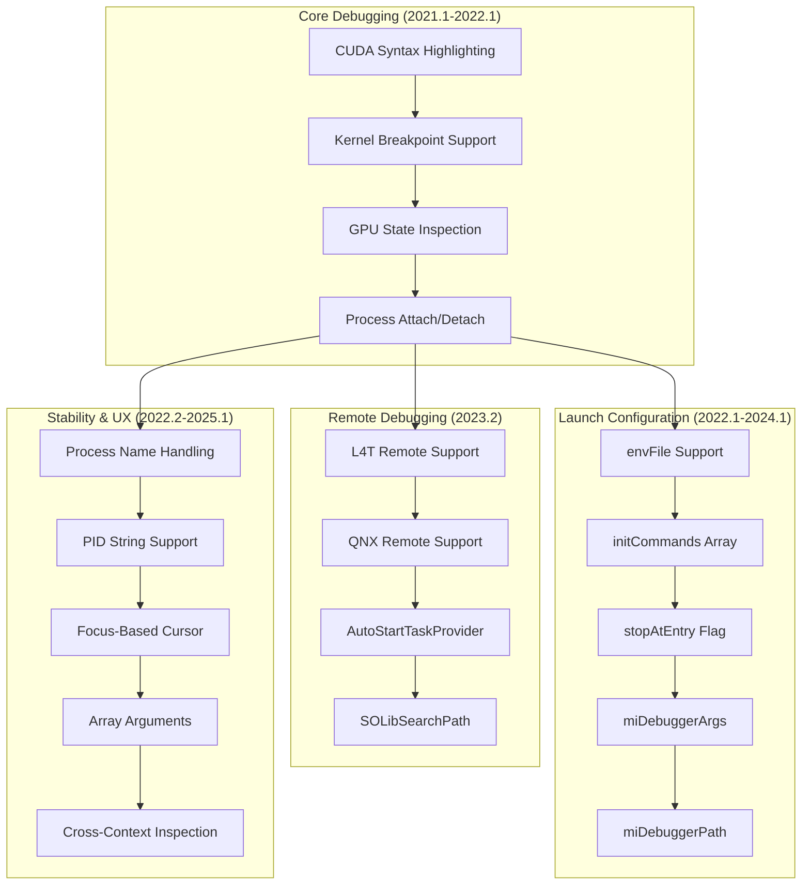
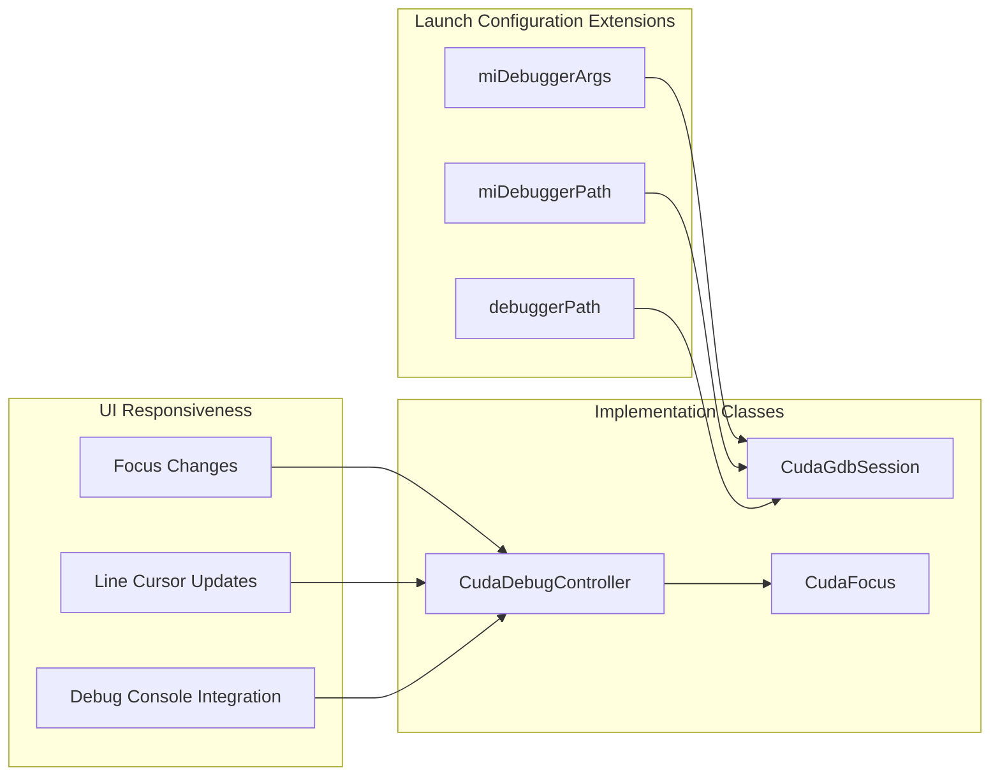
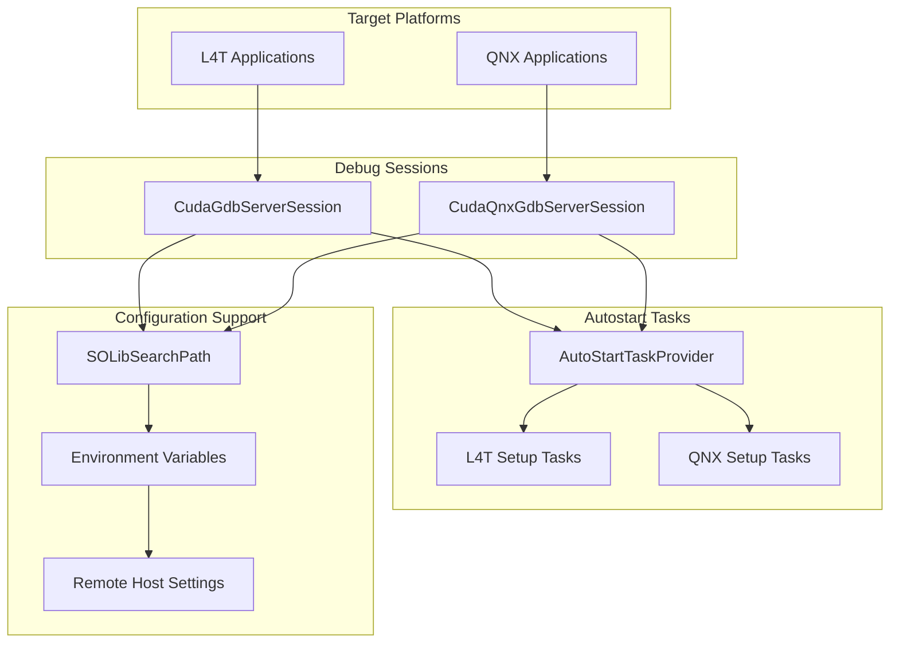
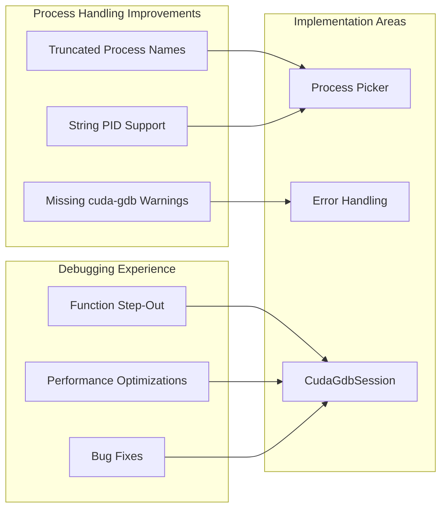
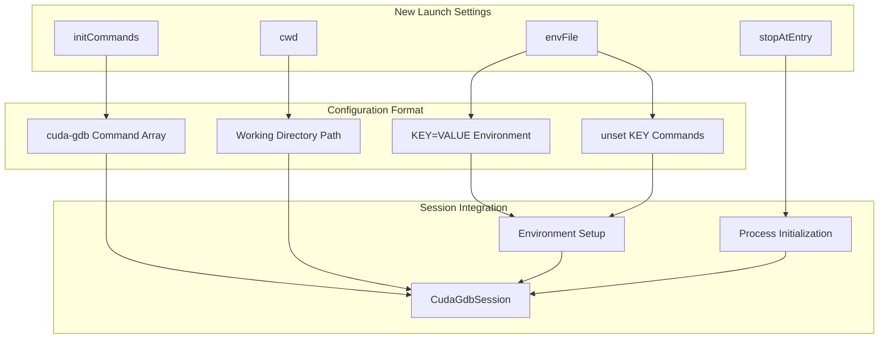
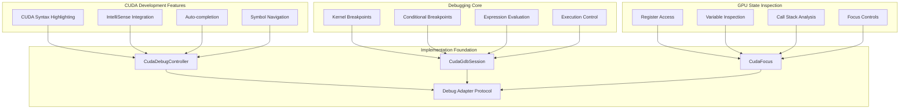
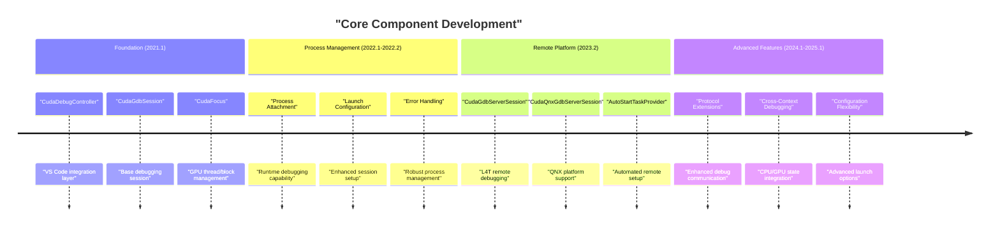

<!-- source: DeepWiki mcp.deepwiki.com · repo NVIDIA/nsight-vscode-edition · page 7.2 Changelog · fetched 2026-10-26 -->

# Changelog

Relevant source files

The following files were used as context for generating this wiki page:

- [CHANGELOG.md](CHANGELOG.md)

This document provides a complete version history and feature evolution of the Nsight Visual Studio Code Edition. It tracks the development of debugging capabilities, protocol extensions, remote debugging features, and user experience improvements across all released versions.

For information about the current architecture and how these features are implemented, see [Architecture](#2). For details about specific debugging capabilities, see [CUDA Features](#4).

## Version Evolution Overview

The Nsight Visual Studio Code Edition has evolved from a basic CUDA debugging extension to a comprehensive remote debugging platform supporting multiple target architectures.

### Version Timeline and Major Features

Sources: [CHANGELOG.md:1-155]()

### Feature Category Development

Sources: [CHANGELOG.md:4-155]()

## Version 2025.1 (Latest)

The latest release focuses on enhanced argument handling and cross-context debugging capabilities.

### Key Features

| Feature | Description | Implementation Impact |
|---------|-------------|----------------------|
| Array Arguments | `args` in launch.json supports string arrays | Enhanced `CudaGdbSession` parameter parsing |
| Cross-Context Inspection | CPU/GPU state inspection while stopped in either context | Extended debug protocol for context switching |

**CUDA Debugger Integration**: Compatible with NVIDIA CUDA Toolkit 12.6 Update 2 cuda-gdb improvements.

Sources: [CHANGELOG.md:4-13]()

## Version 2024.1

Enhanced debugger configuration and user interface responsiveness.

### Configuration Enhancements

**Key Improvements**:
- Custom debugger arguments via `miDebuggerArgs`
- Flexible debugger path specification with `miDebuggerPath`
- Real-time line cursor updates during focus switching

Sources: [CHANGELOG.md:14-25]()

## Version 2023.2 - Remote Debugging Platform

This version introduced comprehensive remote debugging capabilities for embedded platforms.

### Remote Platform Support

### Remote Debugging Features

| Component | Purpose | Implementation |
|-----------|---------|----------------|
| `CudaGdbServerSession` | L4T remote debugging | Extends base session with cuda-gdbserver |
| `CudaQnxGdbServerSession` | QNX remote debugging | QNX-specific gdbserver integration |
| `AutoStartTaskProvider` | Automated setup | Five preconfigured remote debugging tasks |
| `SOLibSearchPath` | Shared library discovery | Library path configuration for remote targets |

Sources: [CHANGELOG.md:26-44]()

## Version 2023.1 - Critical Stability Fixes

Addressed fundamental compatibility issues affecting debugging reliability.

### Major Bug Fixes

**Delayed Module Load Support**: Fixed breakpoint setting in CUDA Driver API applications where modules are loaded dynamically.

**System Compatibility**: Resolved `ptrace_scope` read attempts on systems without this security feature.

These fixes directly impacted the `CudaGdbSession` initialization and breakpoint management in driver API scenarios.

Sources: [CHANGELOG.md:45-57]()

## Version 2022.2 - User Experience Improvements

### Process Management Enhancements

Sources: [CHANGELOG.md:58-73]()

## Version 2022.1 - Process Attachment and Launch Extensions

Major expansion of debugging session management capabilities.

### Process Attachment Feature

The introduction of **attach to running CUDA process** functionality represented a significant architectural enhancement:

- Full debugging feature support when attached
- Detach capability before process completion  
- Dynamic Parallelism application support

### Launch Configuration Extensions

Sources: [CHANGELOG.md:74-104]()

## Version 2021.1 - Foundation Release

The initial release established the core architecture and fundamental CUDA debugging capabilities.

### Core Feature Architecture

### Key Benefits Delivered

| Benefit | Technical Implementation | User Impact |
|---------|-------------------------|-------------|
| Higher Productivity | Smart auto-completion via Language Server | Reduced development time |
| Interactivity | Full VS Code integration with `CudaDebugController` | Seamless debugging workflow |
| Remote Development | WSL and container support | Flexible development environments |
| Cost Efficiency | Free distribution model | Accessible to all developers |

Sources: [CHANGELOG.md:105-155]()

## Architecture Impact Timeline

The evolution of the codebase can be understood through the development of key architectural components:

This timeline shows how the extension evolved from a basic CUDA debugger to a comprehensive multi-platform debugging solution, with each version building upon the foundational architecture established in the initial release.

Sources: [CHANGELOG.md:1-155]()

---

