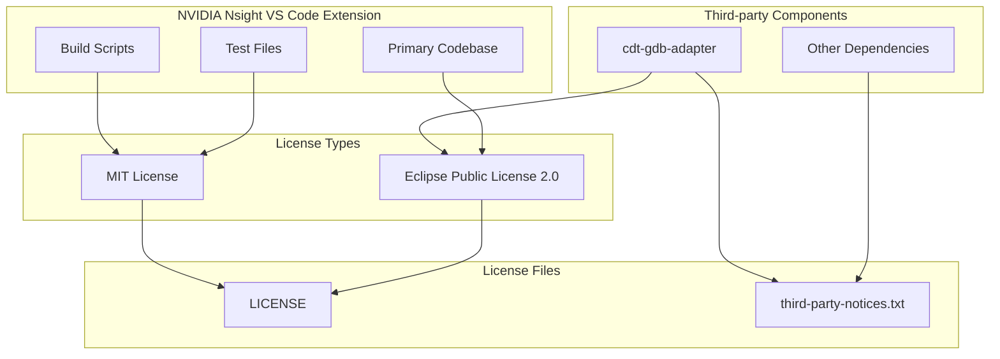
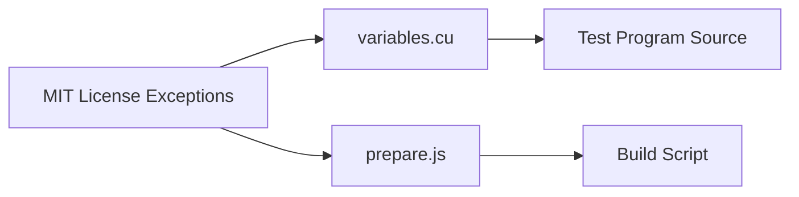
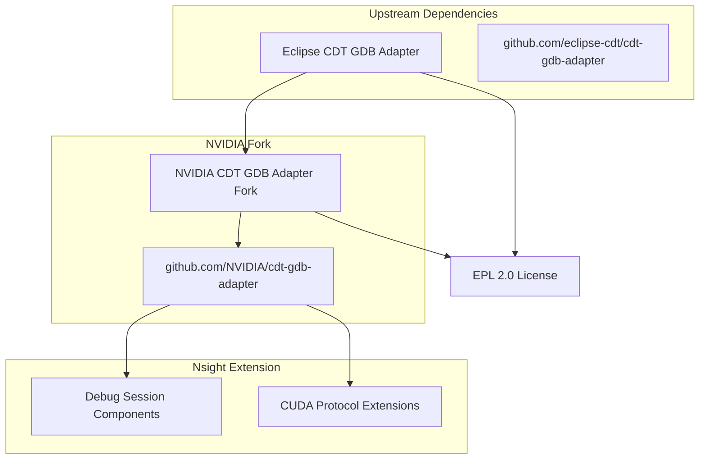
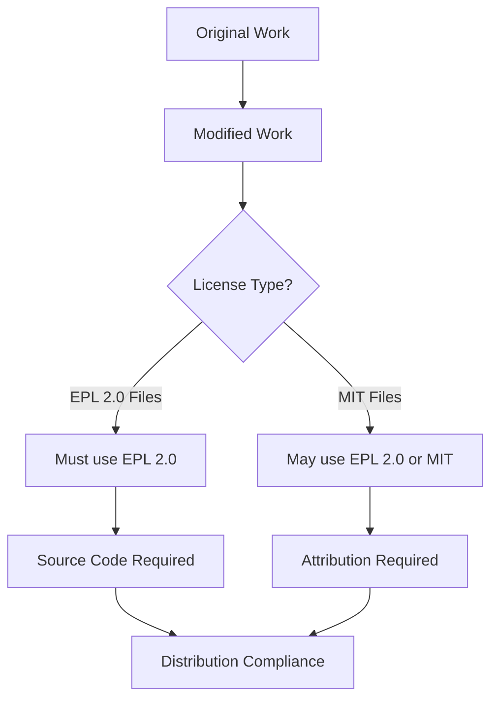

<!-- source: DeepWiki mcp.deepwiki.com · repo NVIDIA/nsight-vscode-edition · page 7.3 License · fetched 2026-10-26 -->

# License

Relevant source files

The following files were used as context for generating this wiki page:

- [LICENSE](LICENSE)

This page documents the licensing terms and intellectual property information for the Nsight Visual Studio Code Extension. It covers the primary Eclipse Public License 2.0 terms, MIT license exceptions for specific files, and third-party dependency licensing requirements.

For information about third-party dependencies and their integration, see [Dependencies](#7.1).

## Licensing Overview

The Nsight Visual Studio Code Extension uses a dual-license structure with the Eclipse Public License 2.0 as the primary license and specific MIT license exceptions for certain files. All licensing terms are governed by NVIDIA Corporation's copyright from 2021.

### License Distribution Structure

Sources: [LICENSE:1-133]()

## Primary License: Eclipse Public License 2.0

The main codebase is licensed under the Eclipse Public License 2.0 (SPDX-License-Identifier: EPL-2.0). This includes all TypeScript source files, configuration files, and documentation unless explicitly noted otherwise.

### Key EPL 2.0 Provisions

| Provision | Description |
|-----------|-------------|
| **Distribution Rights** | Grants non-exclusive, worldwide, royalty-free copyright and patent licenses |
| **Source Code Availability** | Requires source code availability when distributing the Program |
| **Derivative Works** | Allows creation and distribution of derivative works under EPL 2.0 terms |
| **Commercial Use** | Permits commercial distribution with indemnification requirements |
| **Patent Protection** | Includes patent grant and termination clauses for patent litigation |

The EPL 2.0 license text defines specific terms for Contributors, Recipients, and the Program itself, with detailed requirements for distribution and modification.

Sources: [LICENSE:52-133]()

## License Exceptions: MIT License

Two specific files are licensed under the MIT License instead of EPL 2.0:

### MIT Licensed Files

1. **Test Source File**: `./src/test/testPrograms/variables/variables.cu` - The CUDA test program source code
2. **Build Script**: `./prepare.js` - The project preparation script

The MIT license grants more permissive terms, allowing unrestricted use, modification, and distribution with only attribution requirements.

Sources: [LICENSE:6-11](), [LICENSE:29-49]()

## Third-party Dependencies

### CDT GDB Adapter Integration

The extension relies heavily on the Eclipse CDT GDB Adapter, which is also licensed under EPL 2.0:

**Key Information:**
- **Upstream Source**: `https://github.com/eclipse-cdt/cdt-gdb-adapter`
- **NVIDIA Fork**: `https://github.com/NVIDIA/cdt-gdb-adapter`
- **License**: Eclipse Public License 2.0
- **Integration**: Specialized fork with CUDA debugging enhancements

### Third-party Notices

All copyright notices for third-party dependencies are consolidated in `third-party-notices.txt` located at the repository root. This file contains the complete list of dependencies and their respective licensing terms.

Sources: [LICENSE:14-25]()

## License Compliance Requirements

### Distribution Requirements

When distributing the Nsight Visual Studio Code Extension:

1. **Source Code Availability**: Must provide access to source code under EPL 2.0 terms
2. **License Attribution**: Must include both EPL 2.0 and MIT license texts
3. **Copyright Notices**: Must preserve all copyright and attribution notices
4. **Third-party Notices**: Must include the complete third-party-notices.txt file

### Modification and Derivative Works

**EPL 2.0 Modified Works**: Any modifications to EPL 2.0 licensed files must be distributed under EPL 2.0 terms with source code availability.

**MIT Licensed Exceptions**: Modifications to MIT licensed files may be distributed under either MIT or EPL 2.0 terms, requiring only attribution.

Sources: [LICENSE:1-11](), [LICENSE:87-101]()

## Copyright and Warranty

The extension is provided under NVIDIA Corporation's copyright (2021) with the following key disclaimers:

- **No Warranty**: Software provided "AS IS" without warranties of any kind
- **Limitation of Liability**: Contributors disclaim liability for damages
- **Patent Protection**: Includes defensive patent termination clauses

These terms apply consistently across both EPL 2.0 and MIT licensed components within the project.

Sources: [LICENSE:1-2](), [LICENSE:107-111]()