# Page: Overview

# Overview

<details>
<summary>Relevant source files</summary>

The following files were used as context for generating this wiki page:

- [CHANGELOG.md](CHANGELOG.md)
- [README.md](README.md)
- [nsight-128.png](nsight-128.png)
- [package.json](package.json)
- [src/debugger/types.ts](src/debugger/types.ts)

</details>


## Purpose and Scope

This document provides an overview of the Nsight Visual Studio Code Edition, a comprehensive VS Code extension for CUDA development and debugging. The extension enables developers to debug CUDA applications with full GPU state inspection, kernel execution control, and support for multiple deployment platforms including local systems, remote L4T devices, and QNX embedded systems.

For detailed information about the extension's internal architecture, see [Architecture](#2). For CUDA-specific debugging features, see [CUDA Features](#4). For development and testing guidance, see [Development](#5).

## System Architecture

The Nsight Visual Studio Code Edition follows a layered architecture that extends the VS Code Debug Adapter Protocol with CUDA-specific capabilities:

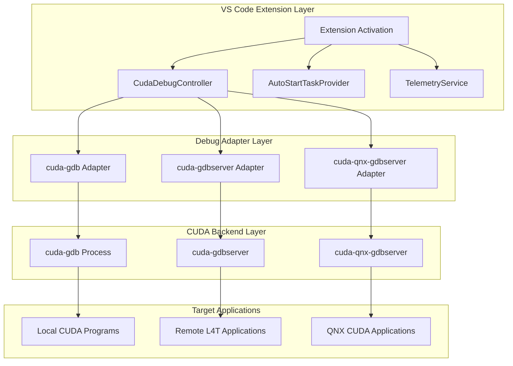

**Sources:** [package.json:1-1061](), [README.md:1-112]()

## Core Extension Components

The extension integrates with VS Code through several key mechanisms defined in the package manifest:

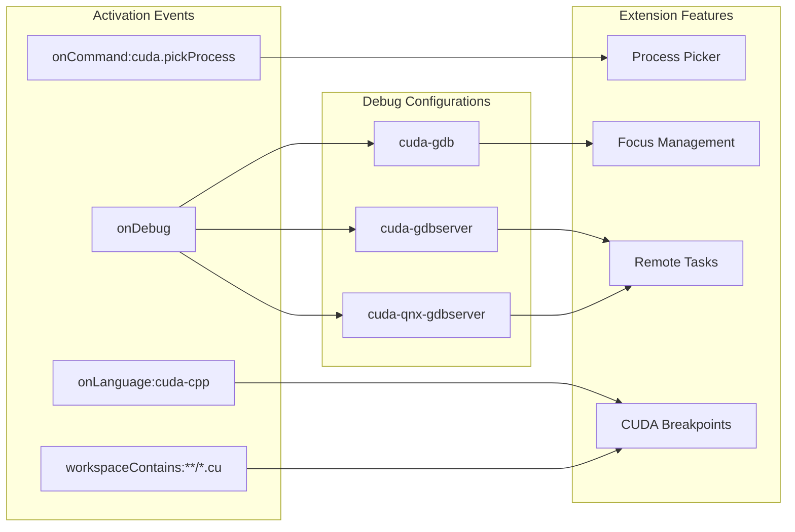

**Sources:** [package.json:38-44](), [package.json:124-691](), [package.json:100-109]()

## Debugging Configurations

The extension provides three distinct debugging configurations, each targeting different deployment scenarios:

| Debug Type | Target Platform | Backend | Configuration |
|------------|----------------|---------|---------------|
| `cuda-gdb` | Local Development | cuda-gdb binary | Launch/Attach |
| `cuda-gdbserver` | Remote L4T Systems | cuda-gdbserver | Remote Launch |
| `cuda-qnx-gdbserver` | QNX Embedded | cuda-qnx-gdbserver | Remote Launch |

### Launch Configuration Properties

Each debugger type supports extensive configuration through `launch.json`:

- **Program Execution**: `program`, `args`, `cwd`, `environment`
- **Debugger Control**: `debuggerPath`, `miDebuggerPath`, `miDebuggerArgs`
- **CUDA Features**: `breakOnLaunch`, `onAPIError`
- **Logging**: `verboseLogging`, `logFile`
- **Remote Settings**: `target`, `sysroot`, `additionalSOLibSearchPath`

**Sources:** [package.json:135-276](), [package.json:468-655](), [package.json:703-833]()

## CUDA-Specific Features

The extension extends standard debugging capabilities with CUDA-specific functionality:

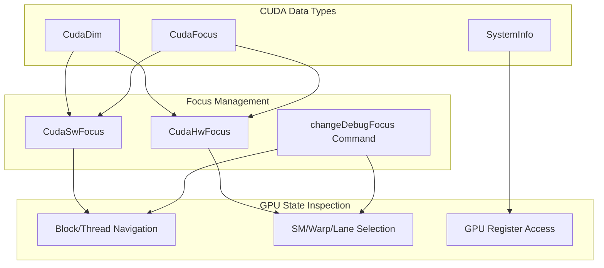

**Sources:** [src/debugger/types.ts:12-58](), [package.json:102-105]()

### CUDA Focus System

The extension implements a dual coordinate system for GPU debugging through the `CudaFocus` type:

- **Software Focus (`CudaSwFocus`)**: Uses `blockIdx` and `threadIdx` coordinates matching CUDA programming model
- **Hardware Focus (`CudaHwFocus`)**: Uses `sm`, `warp`, and `lane` for low-level hardware inspection

**Sources:** [src/debugger/types.ts:18-31]()

## Remote Debugging Capabilities

The extension provides comprehensive remote debugging support with automated setup tasks:

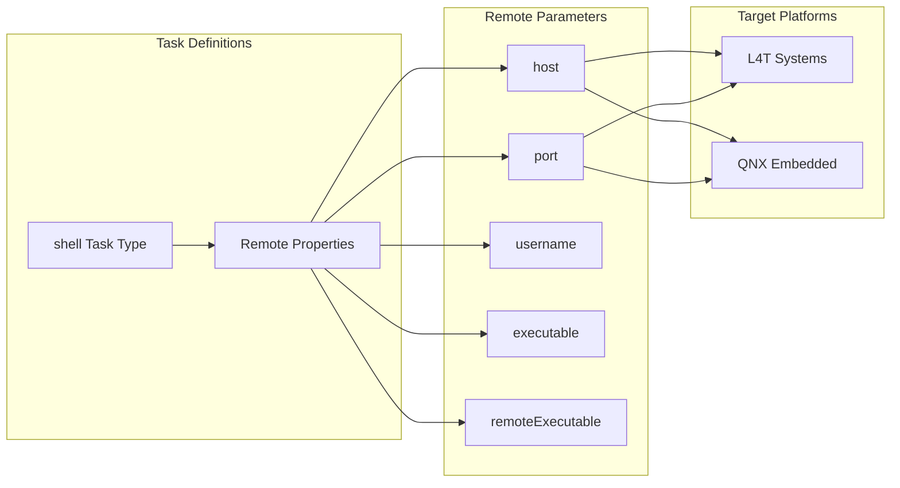

**Sources:** [package.json:64-98](), [package.json:593-622]()

## System Information Collection

The extension collects comprehensive system and GPU information for debugging sessions through the `SystemInfo` interface:

- **OS Information**: Platform, architecture, distribution details
- **GPU Information**: Device enumeration, current active device, SM type
- **Telemetry**: Usage data collection with privacy controls

**Sources:** [src/debugger/types.ts:33-58](), [README.md:108-112]()

## Extension Dependencies

The extension integrates with several external components:

- **Required Extension**: `ms-vscode.cpptools` for C++ IntelliSense support
- **CUDA Toolkit**: Provides `cuda-gdb` and related debugging tools
- **Workspace Integration**: `cdt-gdb-adapter` for GDB protocol support

**Sources:** [package.json:16-18](), [package.json:57-59](), [README.md:83-91]()

---

# Page: Architecture

# Architecture

<details>
<summary>Relevant source files</summary>

The following files were used as context for generating this wiki page:

- [package.json](package.json)
- [src/debugController.ts](src/debugController.ts)
- [src/extension.ts](src/extension.ts)

</details>


This document explains the overall system architecture of the Nsight Visual Studio Code Edition and how its components interact within the VS Code extension framework. It covers the layered architecture, extension lifecycle, debug adapter patterns, and integration points that enable CUDA debugging capabilities.

For details about the individual debug session implementations, see [Core Components](#3). For CUDA-specific protocol extensions and telemetry, see [CUDA Protocol Extensions](#2.3).

## System Overview

The Nsight Visual Studio Code Edition follows a layered architecture that integrates with VS Code's extension and debug adapter framework. The system provides CUDA debugging capabilities through three distinct debug session types, each targeting different deployment scenarios.

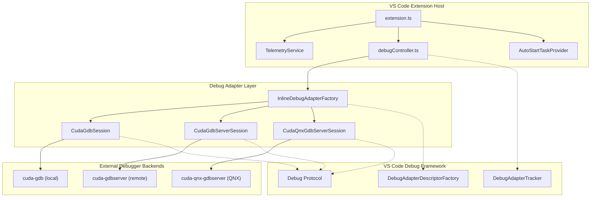

**System Architecture Overview**

Sources: [src/extension.ts:25-39](), [src/debugController.ts:33-47](), [package.json:124-931]()

The architecture consists of four primary layers:

| Layer | Components | Purpose |
|-------|------------|---------|
| **Extension Host** | `extension.ts`, `debugController.ts`, `TelemetryService` | VS Code integration, command registration, lifecycle management |
| **Debug Adapter** | `InlineDebugAdapterFactory`, session classes | Debug protocol implementation, session management |
| **Backend Integration** | Session-specific backends | Communication with CUDA debugger tools |
| **Framework Integration** | VS Code debug APIs, protocol handlers | Standard VS Code debug framework compliance |

## Extension Activation and Lifecycle

The extension follows VS Code's standard activation pattern with specific triggers for CUDA development scenarios.

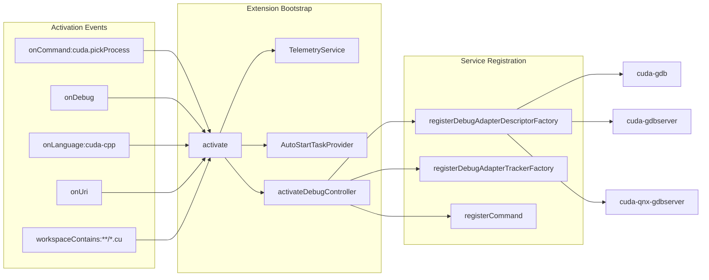

**Extension Activation Flow**

Sources: [package.json:38-44](), [src/extension.ts:25-39](), [src/debugController.ts:223-238]()

### Activation Triggers

The extension activates on multiple triggers defined in `package.json`:

- **Command Activation**: `onCommand:cuda.pickProcess` - When process picker is invoked
- **Debug Activation**: `onDebug` - When any debug session starts
- **Language Activation**: `onLanguage:cuda-cpp` - When CUDA C++ files are opened
- **URI Activation**: `onUri` - For protocol handler scenarios
- **Workspace Activation**: `workspaceContains:**/*.cu` - When CUDA source files are present

### Bootstrap Sequence

The `activate` function in [src/extension.ts:25-39]() orchestrates the initialization:

1. **Package Metadata Loading**: Reads version information from `package.json`
2. **Telemetry Initialization**: Creates `TelemetryService` with Google Analytics 4 integration
3. **System Information Collection**: Gathers host OS information for telemetry
4. **Task Provider Registration**: Registers `AutoStartTaskProvider` for remote debugging setup
5. **Debug Controller Activation**: Calls `activateDebugController` for debug framework integration

## Debug Adapter Factory Pattern

The extension implements VS Code's debug adapter factory pattern to support multiple CUDA debugging scenarios through a unified interface.

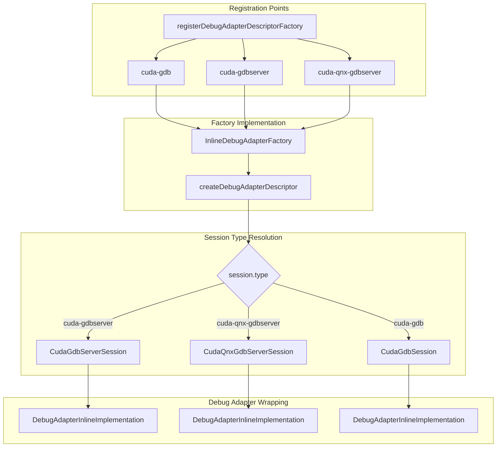

**Debug Adapter Factory Pattern**

Sources: [src/debugController.ts:33-47](), [src/debugController.ts:227-230]()

### Factory Implementation

The `InlineDebugAdapterFactory` class implements `vscode.DebugAdapterDescriptorFactory` and handles session type resolution:

- **Session Type Inspection**: Uses `session.type` to determine the appropriate session class
- **Inline Implementation**: Returns `vscode.DebugAdapterInlineImplementation` for in-process debugging
- **Session Instantiation**: Creates specific session instances based on debug configuration

### Debug Session Types

| Session Type | Class | Target Platform | Backend Tool |
|--------------|-------|----------------|--------------|
| `cuda-gdb` | `CudaGdbSession` | Local development | `cuda-gdb` |
| `cuda-gdbserver` | `CudaGdbServerSession` | Remote Linux/L4T | `cuda-gdbserver` |
| `cuda-qnx-gdbserver` | `CudaQnxGdbServerSession` | QNX embedded | `cuda-qnx-gdbserver` |

Each session type is registered with VS Code through `registerDebugAdapterDescriptorFactory` in [src/debugController.ts:227-230]().

## Debug Controller Integration

The `CudaDebugController` class serves as the primary integration point with VS Code's debug framework, managing UI state, command handling, and telemetry collection.

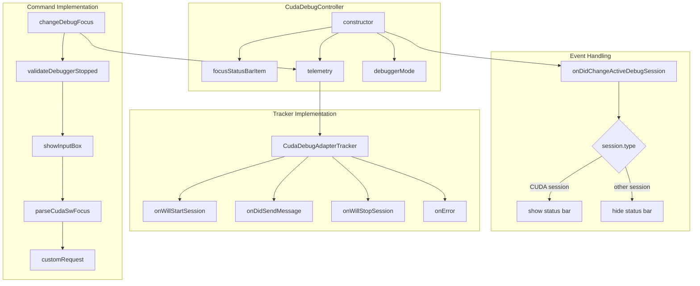

**Debug Controller Architecture**

Sources: [src/debugController.ts:135-221](), [src/debugController.ts:55-133]()

### State Management

The controller maintains several key state elements:

- **Focus Status Bar**: Displays current CUDA thread/block focus with command integration
- **Debugger Mode**: Tracks debug session state (`design`, `stopped`, `running`)
- **Session Tracking**: Monitors active debug sessions for CUDA-specific UI updates

### Tracker Integration

The `CudaDebugAdapterTracker` implements `vscode.DebugAdapterTracker` to intercept debug protocol messages:

- **Session Lifecycle**: Tracks session start/stop for telemetry collection
- **Protocol Message Interception**: Processes CUDA-specific events like focus changes
- **Error Handling**: Captures and reports debug adapter errors
- **State Synchronization**: Updates controller state based on debug events

### Command Registration

The controller registers several VS Code commands:

| Command | Function | Purpose |
|---------|----------|---------|
| `cuda.changeDebugFocus` | `changeDebugFocus()` | Interactive CUDA focus switching |
| `cuda.pickProcess` | `pickProcess()` | Process selection for attach scenarios |

Sources: [src/debugController.ts:235-236]()

## Protocol and Configuration Integration

The extension integrates deeply with VS Code's debug configuration system through comprehensive `package.json` contributions that define debug types, configuration schemas, and initial configurations.

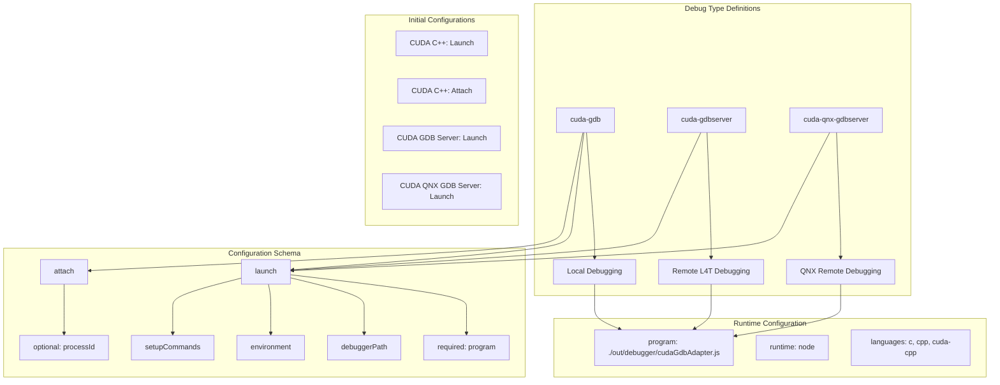

**Debug Configuration Architecture**

Sources: [package.json:124-931]()

### Debug Type Registration

Each debug type is comprehensively defined with:

- **Runtime Configuration**: Node.js runtime with specific adapter entry point
- **Language Support**: C, C++, and CUDA C++ language bindings
- **Configuration Attributes**: Separate schemas for `launch` and `attach` modes
- **Initial Configurations**: Ready-to-use templates for common scenarios

### Configuration Schema Structure

The configuration schemas provide extensive customization options:

| Category | Properties | Purpose |
|----------|------------|---------|
| **Core** | `program`, `debuggerPath`, `args` | Basic execution parameters |
| **Environment** | `environment`, `envFile`, `cwd` | Runtime environment setup |
| **Debug Control** | `stopAtEntry`, `breakOnLaunch`, `onAPIError` | Debug behavior configuration |
| **Remote** | `target`, `sysroot`, `additionalSOLibSearchPath` | Remote debugging setup |
| **Advanced** | `setupCommands`, `initCommands`, `preRunCommands` | GDB command customization |

### Task Provider Integration

The extension includes task definition support for automated remote debugging setup through `AutoStartTaskProvider`, enabling shell command execution with remote connection parameters.

Sources: [package.json:64-98](), [src/extension.ts:36]()

---

# Page: Extension Structure

# Extension Structure

<details>
<summary>Relevant source files</summary>

The following files were used as context for generating this wiki page:

- [package.json](package.json)
- [src/extension.ts](src/extension.ts)

</details>


This document details the VS Code extension structure for Nsight Visual Studio Code Edition, covering extension activation, registration, and core service initialization. It explains how the extension integrates with the VS Code framework through activation events, contribution points, and service setup.

For information about the debug adapter protocol implementation, see [Debug Adapter Protocol](#2.2). For details about the debug controller that manages VS Code integration, see [Debug Controller](#3.2). For task provider implementations, see [Task Providers](#3.3).

## Extension Metadata and Configuration

The extension is configured through [package.json:1-1019]() which defines the complete VS Code extension manifest. The extension identifies itself as `nsight-vscode-edition` with the display name "Nsight Visual Studio Code Edition" and is published by NVIDIA.

| Property | Value | Purpose |
|----------|-------|---------|
| `name` | `nsight-vscode-edition` | Extension identifier |
| `displayName` | `Nsight Visual Studio Code Edition` | User-visible name |
| `publisher` | `nvidia` | Publisher organization |
| `main` | `./dist/extension` | Entry point module |
| `engines.vscode` | `^1.91.0` | Minimum VS Code version |

The extension includes the `ms-vscode.cpptools` extension pack [package.json:16-18]() to provide C++ language support alongside CUDA debugging capabilities.

**Extension Activation Flow**
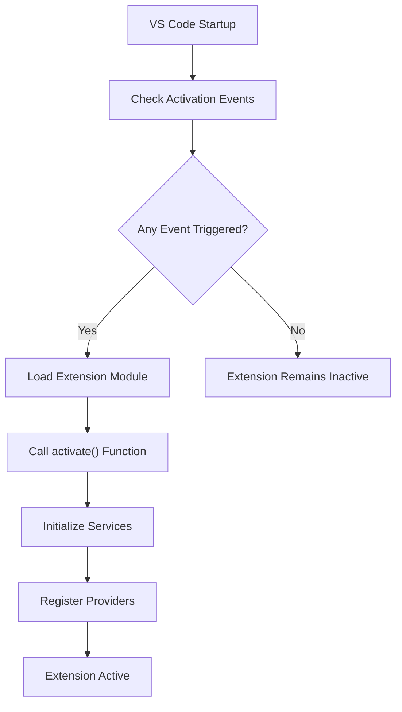

Sources: [package.json:1-1019](), [src/extension.ts:25-39]()

## Activation Events and Entry Points

The extension activates on multiple trigger conditions defined in [package.json:38-44]():

```typescript
"activationEvents": [
    "onCommand:cuda.pickProcess",
    "onDebug", 
    "onLanguage:cuda-cpp",
    "onUri",
    "workspaceContains:**/*.cu"
]
```

The main entry point is the `activate()` function in [src/extension.ts:25-39]() which performs initialization in this sequence:

1. Reads extension metadata from `package.json`
2. Creates `TelemetryService` instance  
3. Collects and tracks system information
4. Registers `AutoStartTaskProvider`
5. Activates debug controller

The extension also exports a `deactivate()` function [src/extension.ts:41]() for cleanup, though it currently contains no implementation.

Sources: [package.json:38-44](), [src/extension.ts:25-41]()

## Contribution Points

The extension contributes multiple capabilities to VS Code through the `contributes` section [package.json:63-932]():

**Debug Configuration Types**
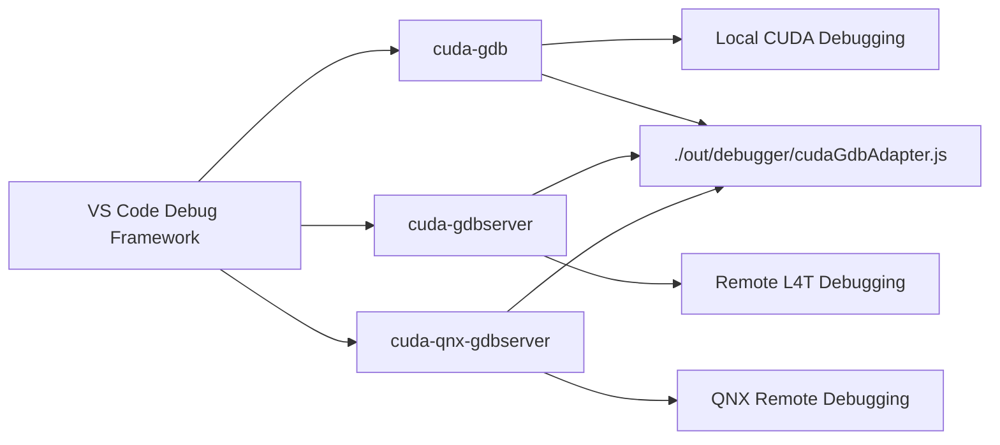

| Contribution Type | Configuration | Purpose |
|------------------|---------------|---------|
| Debuggers | `cuda-gdb` | Local CUDA debugging with cuda-gdb |
| Debuggers | `cuda-gdbserver` | Remote debugging via cuda-gdbserver |
| Debuggers | `cuda-qnx-gdbserver` | QNX embedded system debugging |
| Commands | `cuda.changeDebugFocus` | CUDA focus management |
| Variables | `cuda.pickProcess` | Process picker for attach scenarios |
| Breakpoints | `c`, `cpp`, `cuda`, `cuda-cpp` | Language breakpoint support |
| Task Definitions | `shell` with CUDA properties | Remote debugging task automation |

All three debugger types use the same adapter program `./out/debugger/cudaGdbAdapter.js` [package.json:133, 465, 700]() but with different configuration schemas for their specific use cases.

Sources: [package.json:63-932]()

## Service Initialization

The `activate()` function initializes core services in a specific order:

**Service Initialization Sequence**
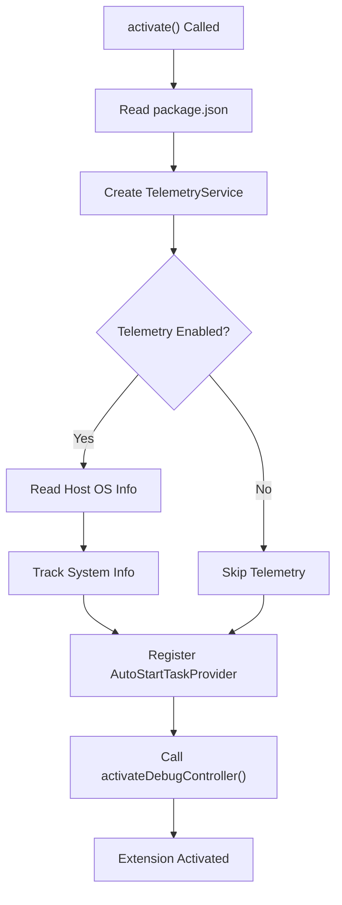

The `TelemetryService` is instantiated with Google Analytics 4 configuration using predefined API secrets and measurement IDs [src/extension.ts:22-23, 29](). If telemetry is enabled, the extension collects host operating system information using `readOsInfo()` and tracks it.

The `AutoStartTaskProvider` is registered with VS Code's task system [src/extension.ts:36]() to handle automated remote debugging setup tasks.

Finally, `activateDebugController()` is called [src/extension.ts:38]() to initialize the debug integration layer, passing both the extension context and telemetry service.

Sources: [src/extension.ts:25-39]()

## Extension Lifecycle

The extension follows VS Code's standard lifecycle pattern:

**Extension Lifecycle States**
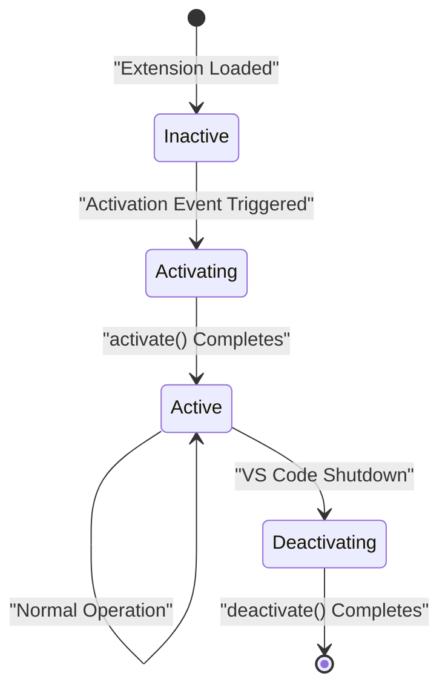

During the active state, the extension maintains:
- Debug adapter factories for all three debug types
- Command handlers for CUDA-specific operations  
- Task providers for remote debugging automation
- Telemetry collection for usage analytics
- Debug controller for VS Code integration

The extension remains active until VS Code shuts down, at which point the `deactivate()` function is called for cleanup, though no specific cleanup operations are currently implemented [src/extension.ts:41]().

Sources: [src/extension.ts:25-41](), [package.json:38-44]()

---

# Page: Debug Adapter Protocol

# Debug Adapter Protocol

<details>
<summary>Relevant source files</summary>

The following files were used as context for generating this wiki page:

- [src/debugger/cudaGdbSession.ts](src/debugger/cudaGdbSession.ts)
- [src/test/testPrograms/variables/.vscode/launch.json](src/test/testPrograms/variables/.vscode/launch.json)
- [third-party-notices.txt](third-party-notices.txt)

</details>


This document explains how the Nsight Visual Studio Code Extension implements and extends the VS Code Debug Adapter Protocol (DAP) to provide CUDA debugging capabilities. The implementation builds upon the standard DAP foundation while adding CUDA-specific protocol extensions for GPU thread management and debugging.

For information about the CUDA-specific protocol extensions and their data structures, see [CUDA Protocol Extensions](#2.3). For details about debug session types and backends, see [Debug Sessions](#3.1).

## Standard DAP Foundation

The extension implements the Debug Adapter Protocol by extending the `GDBDebugSession` class from the `cdt-gdb-adapter` library. The primary implementation is in the `CudaGdbSession` class, which serves as the main debug adapter for CUDA applications.

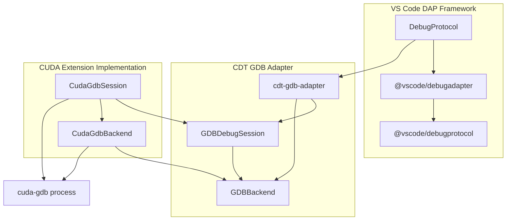

**DAP Implementation Architecture**

Sources: [src/debugger/cudaGdbSession.ts:15-28](), [third-party-notices.txt:5-8](), [third-party-notices.txt:59-62](), [third-party-notices.txt:125-128]()

The `CudaGdbSession` class implements the core DAP request handlers by overriding methods from the base `GDBDebugSession`:

| DAP Request | Method | Purpose |
|-------------|--------|---------|
| `launch` | `launchRequest` | Start debugging a CUDA application |
| `attach` | `attachRequest` | Attach to running CUDA process |
| `threads` | `threadsRequest` | List CPU threads and virtual CUDA thread |
| `stackTrace` | `stackTraceRequest` | Get stack frames for selected thread |
| `scopes` | `scopesRequest` | Get variable scopes for a frame |
| `variables` | `variablesRequest` | Get variables and CUDA registers |
| `evaluate` | `evaluateRequest` | Evaluate expressions and GDB commands |

Sources: [src/debugger/cudaGdbSession.ts:374-875]()

## CUDA Thread Virtualization

Since `cuda-gdb` does not treat GPU threads as first-class objects like CPU threads, the extension creates a virtual CUDA thread to satisfy DAP requirements that all frames must belong to a thread.

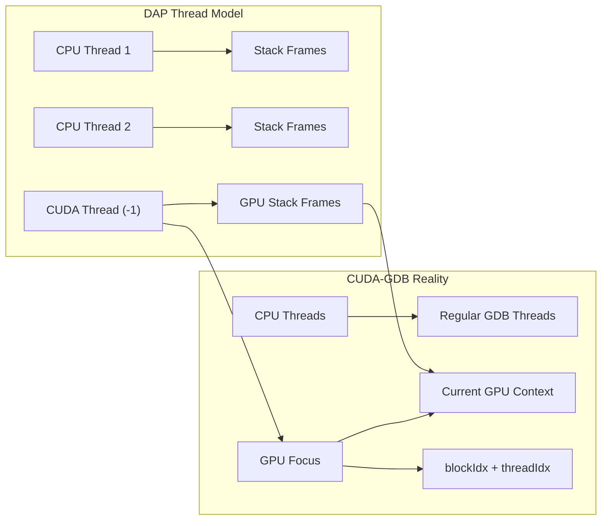

**CUDA Thread Virtualization Model**

The virtual CUDA thread uses a constant ID of `-1` and is dynamically mapped to the GPU thread currently in focus:

```typescript
const CUDA_THREAD = {
    ID: -1,
    NAME: '(CUDA)'
};
```

Sources: [src/debugger/cudaGdbSession.ts:43-46](), [src/debugger/cudaGdbSession.ts:380-381](), [src/debugger/cudaGdbSession.ts:795-810]()

## Request Processing Flow

The extension implements a sophisticated request processing flow that handles both standard DAP requests and CUDA-specific focus management.

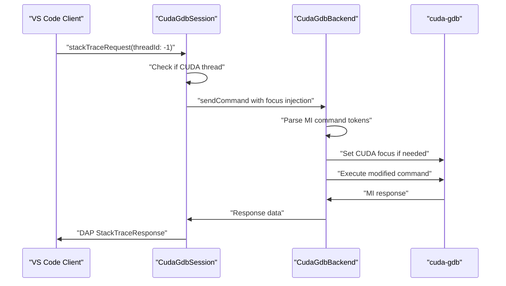

**DAP Request Processing with CUDA Focus Management**

The `CudaGdbBackend.sendCommand` method automatically injects CUDA focus commands when DAP requests target the virtual CUDA thread:

Sources: [src/debugger/cudaGdbSession.ts:205-232](), [src/debugger/cudaGdbSession.ts:234-308](), [src/debugger/cudaGdbSession.ts:276-304]()

## Launch and Attach Configuration

The extension supports both launch and attach scenarios with CUDA-specific configuration options that extend the standard DAP launch/attach arguments.

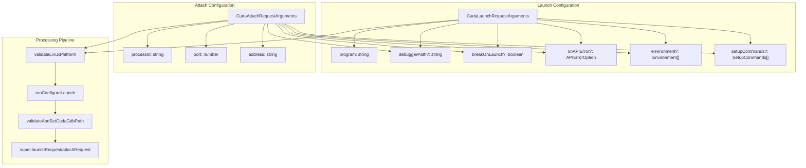

**Launch and Attach Configuration Flow**

The configuration process validates the platform, sets up CUDA-specific parameters, and locates the appropriate `cuda-gdb` binary:

Sources: [src/debugger/cudaGdbSession.ts:131-157](), [src/debugger/cudaGdbSession.ts:470-503](), [src/debugger/cudaGdbSession.ts:505-653](), [src/debugger/cudaGdbSession.ts:655-693]()

## Event System and Notifications

The extension extends the standard DAP event system with CUDA-specific events that notify clients about GPU state changes and system information.

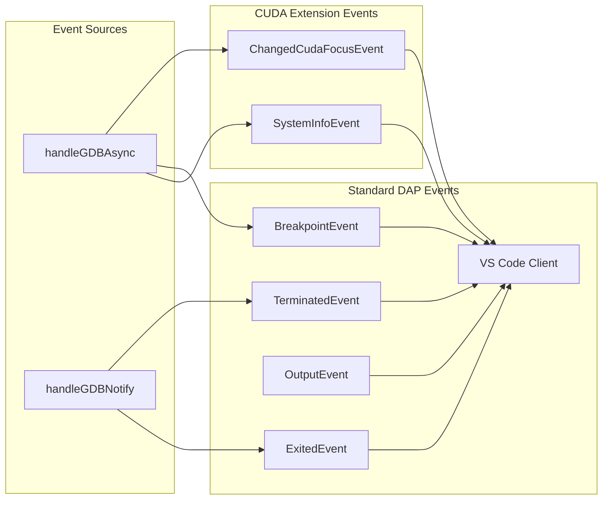

**DAP Event System with CUDA Extensions**

Custom event classes implement the CUDA Debug Protocol event interfaces:

- `ChangedCudaFocusEvent`: Notifies when GPU thread focus changes
- `SystemInfoEvent`: Provides GPU and system information for telemetry

Sources: [src/debugger/cudaGdbSession.ts:50-76](), [src/debugger/cudaGdbSession.ts:708-750](), [src/debugger/cudaGdbSession.ts:752-770]()

## Custom Request Handling

The extension handles CUDA-specific requests that are not part of the standard DAP specification through the `customRequest` method.

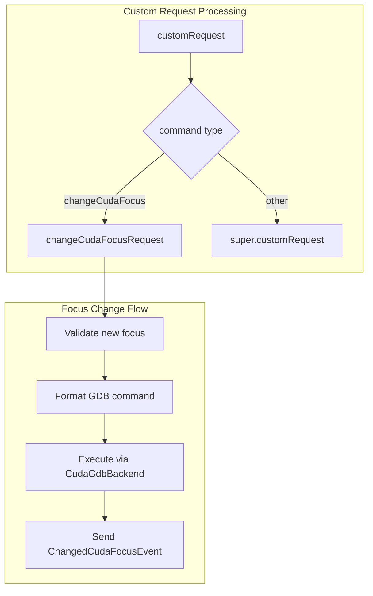

**Custom Request Handling for CUDA Operations**

The `changeCudaFocus` request allows clients to switch between different GPU threads programmatically:

Sources: [src/debugger/cudaGdbSession.ts:457-468](), [src/debugger/cudaGdbSession.ts:1435-1472]()

## Register and Variable Handling

The extension provides specialized handling for CUDA GPU registers and variables, extending the standard DAP variables interface.

Sources: [src/debugger/cudaGdbSession.ts:104-130](), [src/debugger/cudaGdbSession.ts:905-1071](), [src/debugger/cudaGdbSession.ts:942-1070]()

---

# Page: CUDA Protocol Extensions

# CUDA Protocol Extensions

<details>
<summary>Relevant source files</summary>

The following files were used as context for generating this wiki page:

- [src/debugger/cudaDebugProtocol.ts](src/debugger/cudaDebugProtocol.ts)
- [src/telemetryService.ts](src/telemetryService.ts)
- [src/test/breakpoints.test.ts](src/test/breakpoints.test.ts)
- [src/test/localsAndWatches.test.ts](src/test/localsAndWatches.test.ts)

</details>


This document covers the CUDA-specific extensions to the Visual Studio Code Debug Adapter Protocol implemented by the Nsight Visual Studio Code Extension. These extensions enable CUDA debugging capabilities such as focus management and system information collection that are not available in the standard debug protocol.

For information about the overall debug adapter architecture, see [Debug Adapter Protocol](#2.2). For details about CUDA focus management specifically, see [Focus Management](#4.1).

## Protocol Extension Overview

The CUDA protocol extensions add specialized requests and events to the standard VS Code Debug Adapter Protocol to support GPU debugging workflows. The extensions are implemented through the `CudaDebugProtocol` namespace which defines custom message types for CUDA-specific operations.

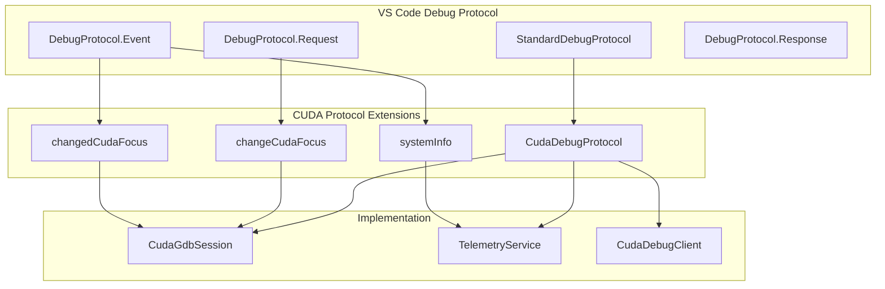

**CUDA Protocol Extension Architecture**

Sources: [src/debugger/cudaDebugProtocol.ts:16-55](), [src/telemetryService.ts:19-82]()

## Custom Requests

### changeCudaFocus Request

The `changeCudaFocus` request allows clients to change the current CUDA debugging focus to a specific thread, block, or coordinate system. This is essential for GPU debugging where thousands of threads may be executing simultaneously.

| Property | Type | Description |
|----------|------|-------------|
| `command` | `'changeCudaFocus'` | Request identifier |
| `arguments` | `ChangeCudaFocusArguments` | Focus change parameters |
| `arguments.focus` | `types.CudaFocus` | Target focus coordinates |

The request follows the standard debug protocol pattern but extends it with CUDA-specific focus management:

```mermaid
sequenceDiagram
    participant Client as "Debug Client"
    participant Adapter as "CudaGdbSession" 
    participant Backend as "cuda-gdb"
    
    Client->>Adapter: changeCudaFocusRequest
    Note over Client,Adapter: ChangeCudaFocusArguments
    Adapter->>Backend: focus command translation
    Backend-->>Adapter: focus change result
    Adapter-->>Client: ChangeCudaFocusResponse
    Adapter->>Client: changedCudaFocusEvent
```

**CUDA Focus Change Flow**

Sources: [src/debugger/cudaDebugProtocol.ts:27-40](), [src/test/localsAndWatches.test.ts:403]()

## Custom Events

### changedCudaFocus Event

The `changedCudaFocus` event is emitted when the CUDA focus changes, either due to a client request or internal debugger state changes. This allows the UI to update thread/block displays accordingly.

```typescript
interface ChangedCudaFocusEvent extends DebugProtocol.Event {
    body: {
        focus?: types.CudaFocus;
    };
}
```

### systemInfo Event

The `systemInfo` event provides detailed information about the debugging target's hardware and software environment. This information is crucial for understanding GPU capabilities and is also used for telemetry collection.

```typescript
interface SystemInfoEvent extends DebugProtocol.Event {
    body: {
        systemInfo?: types.SystemInfo;
    };
}
```

Sources: [src/debugger/cudaDebugProtocol.ts:42-54](), [src/telemetryService.ts:307-340]()

## Telemetry Integration

The protocol extensions integrate with the `TelemetryService` to collect usage analytics and system information. The telemetry system operates in two locations: 'host' (VS Code extension) and 'debug-adapter' (debug session).

```mermaid
graph LR
    subgraph "Telemetry Events"
        A[activity_start]
        B[activity_end] 
        C[adapter_exit]
        D[error]
        E[exec_command]
        F[gpu_info]
        G[os_info]
    end
    
    subgraph "Data Collection"
        H[TelemetryClient]
        I[Google_Analytics_4]
        J[SystemInfo]
    end
    
    subgraph "Privacy Controls"
        K[VS_Code_telemetryLevel]
        L[Environment_Variables]
        M[Debug_Mode_Detection]
    end
    
    A --> H
    B --> H
    C --> H
    D --> H
    E --> H
    F --> H
    G --> H
    
    H --> I
    J --> F
    J --> G
    
    K --> H
    L --> M
    M --> H
```

**Telemetry System Architecture**

The telemetry service tracks various debug session activities:

| Event Type | Purpose | Location |
|------------|---------|----------|
| `activity_start/end` | Session lifecycle tracking | Both |
| `adapter_exit` | Debug adapter termination | Debug-adapter |
| `error` | Error condition reporting | Both |
| `exec_command` | Command execution tracking | Debug-adapter |
| `gpu_info` | GPU hardware information | Both |
| `os_info` | Operating system details | Both |

Sources: [src/telemetryService.ts:21-82](), [src/telemetryService.ts:105-196](), [src/telemetryService.ts:307-340]()

## Implementation Details

### Protocol Message Flow

The CUDA protocol extensions follow the standard debug adapter message flow but add specialized handlers for CUDA-specific operations:

```mermaid
graph TD
    subgraph "Message Processing"
        A[VS_Code_Client]
        B[CudaDebugController]
        C[CudaGdbSession]
        D[Protocol_Translation]
    end
    
    subgraph "CUDA Operations"
        E[changeCudaFocus]
        F[Focus_Validation]
        G[GDB_MI_Commands]
        H[Response_Generation]
    end
    
    subgraph "Event Emission"
        I[changedCudaFocus]
        J[systemInfo]
        K[Telemetry_Collection]
    end
    
    A --> B
    B --> C
    C --> D
    D --> E
    E --> F
    F --> G
    G --> H
    H --> I
    H --> J
    I --> K
    J --> K
```

**Protocol Message Processing Flow**

### Type Definitions

The protocol extensions rely on custom types defined in the types module:

- `CudaFocus`: Represents thread/block coordinates for GPU debugging
- `SystemInfo`: Contains hardware and OS information for the target system
- `CudaDim`: Provides coordinate system utilities for CUDA dimensions

Sources: [src/debugger/cudaDebugProtocol.ts:13-14](), [src/debugger/cudaDebugProtocol.ts:32-54]()

## Usage in Testing

The test suite demonstrates how the protocol extensions are used in practice:

```typescript
// Example from test code showing changeCudaFocusRequest usage
await dc.changeCudaFocusRequest({ 
    focus: { 
        type: 'software', 
        blockIdx: { x: 0, y: 0, z: 0 }, 
        threadIdx: { x: 0, y: 0, z: 0 } 
    } 
});
```

This allows tests to verify that CUDA-specific debugging features work correctly across different thread and block configurations.

Sources: [src/test/localsAndWatches.test.ts:403](), [src/test/breakpoints.test.ts:44-60]()

## Configuration and Privacy

The telemetry component of the protocol extensions respects VS Code's telemetry settings and provides additional privacy controls:

| Setting | Purpose | Default |
|---------|---------|---------|
| `telemetry.telemetryLevel` | VS Code telemetry preference | Follows VS Code |
| `NV_DEVTOOLS_UXT_DEBUG` | Enable debug mode telemetry | Disabled |
| `NV_DEVTOOLS_UXT_ROLE` | Internal vs external usage | External |

The system automatically detects internal NVIDIA usage and tags telemetry data accordingly to separate development from customer usage patterns.

Sources: [src/telemetryService.ts:118-141](), [src/telemetryService.ts:342-345]()

---

# Page: Core Components

# Core Components

<details>
<summary>Relevant source files</summary>

The following files were used as context for generating this wiki page:

- [src/debugController.ts](src/debugController.ts)
- [src/debugger/cudaGdbSession.ts](src/debugger/cudaGdbSession.ts)

</details>


This document describes the main functional components that provide debugging capabilities in the Nsight Visual Studio Code Edition. These components form the core debugging infrastructure that enables CUDA debugging through VS Code's Debug Adapter Protocol.

For information about the overall system architecture, see [Architecture](#2). For details about CUDA-specific debugging features, see [CUDA Features](#4).

## Component Overview

The extension is built around several key functional components that work together to provide CUDA debugging capabilities:

```mermaid
graph TB
    subgraph "VS Code Integration Layer"
        CudaDebugController["CudaDebugController"]
        InlineDebugAdapterFactory["InlineDebugAdapterFactory"]
        CudaDebugAdapterTracker["CudaDebugAdapterTracker"]
    end
    
    subgraph "Debug Session Implementations"
        CudaGdbSession["CudaGdbSession"]
        CudaGdbServerSession["CudaGdbServerSession"]
        CudaQnxGdbServerSession["CudaQnxGdbServerSession"]
    end
    
    subgraph "Backend Communication"
        CudaGdbBackend["CudaGdbBackend"]
        GDBBackend["GDBBackend (cdt-gdb-adapter)"]
    end
    
    subgraph "VS Code APIs"
        DebugAPI["VS Code Debug API"]
        StatusBar["Status Bar"]
        Commands["Command System"]
    end
    
    CudaDebugController --> InlineDebugAdapterFactory
    CudaDebugController --> CudaDebugAdapterTracker
    CudaDebugController --> StatusBar
    CudaDebugController --> Commands
    
    InlineDebugAdapterFactory --> CudaGdbSession
    InlineDebugAdapterFactory --> CudaGdbServerSession
    InlineDebugAdapterFactory --> CudaQnxGdbServerSession
    
    CudaGdbSession --> CudaGdbBackend
    CudaGdbServerSession --> CudaGdbBackend
    CudaQnxGdbServerSession --> CudaGdbBackend
    
    CudaGdbBackend --> GDBBackend
    
    CudaDebugAdapterTracker --> DebugAPI
```

**Sources:** [src/debugController.ts:1-243](), [src/debugger/cudaGdbSession.ts:1-1708]()

## Debug Session Components

The debug session components handle the actual debugging protocol implementation and communication with CUDA debuggers:

### CudaGdbSession

The `CudaGdbSession` class is the primary debug session implementation that extends the CDT GDB adapter's `GDBDebugSession`. It provides CUDA-specific debugging capabilities including focus management and GPU thread handling.

| Component | Purpose | Key Methods |
|-----------|---------|-------------|
| `CudaGdbSession` | Main debug session for local debugging | `launchRequest()`, `attachRequest()`, `threadsRequest()` |
| `CudaGdbBackend` | CUDA-specific GDB backend communication | `sendCommand()`, `sendMICommand()` |
| Request Handlers | Protocol request processing | `changeCudaFocusRequest()`, `disassembleRequest()` |

```mermaid
graph LR
    subgraph "Session Types"
        CudaGdbSession["CudaGdbSession<br/>(Local Debugging)"]
        CudaGdbServerSession["CudaGdbServerSession<br/>(Remote L4T)"]
        CudaQnxGdbServerSession["CudaQnxGdbServerSession<br/>(QNX Remote)"]
    end
    
    subgraph "Backend Layer"
        CudaGdbBackend["CudaGdbBackend"]
        GDBBackend["GDBBackend<br/>(cdt-gdb-adapter)"]
    end
    
    subgraph "CUDA Debuggers"
        CudaGdb["cuda-gdb"]
        CudaGdbServer["cuda-gdbserver"]
        CudaQnxGdb["cuda-qnx-gdb"]
    end
    
    CudaGdbSession --> CudaGdbBackend
    CudaGdbServerSession --> CudaGdbBackend
    CudaQnxGdbServerSession --> CudaGdbBackend
    
    CudaGdbBackend --> GDBBackend
    
    CudaGdbBackend --> CudaGdb
    CudaGdbBackend --> CudaGdbServer
    CudaGdbBackend --> CudaQnxGdb
```

**Sources:** [src/debugger/cudaGdbSession.ts:374-1558](), [src/debugController.ts:35-46]()

### Key Session Features

The `CudaGdbSession` implements several CUDA-specific features:

- **CUDA Thread Management**: Creates a virtual CUDA thread (`CUDA_THREAD.ID = -1`) to represent GPU execution context [src/debugger/cudaGdbSession.ts:43-46]()
- **Focus Management**: Tracks current CUDA focus (block/thread coordinates) and synchronizes with cuda-gdb [src/debugger/cudaGdbSession.ts:391-402]()
- **Register Handling**: Provides specialized GPU register inspection through `RegisterData` and `RegisterGroup` classes [src/debugger/cudaGdbSession.ts:104-372]()
- **Command Processing**: Intercepts and modifies GDB MI commands to inject CUDA focus changes [src/debugger/cudaGdbSession.ts:234-308]()

**Sources:** [src/debugger/cudaGdbSession.ts:374-1558]()

## VS Code Integration Components

### CudaDebugController

The `CudaDebugController` serves as the main integration point between the extension and VS Code's debugging infrastructure:

```mermaid
graph TB
    subgraph "CudaDebugController"
        Controller["CudaDebugController"]
        StatusBarItem["focusStatusBarItem"]
        DebuggerMode["debuggerMode"]
        TelemetryRef["telemetry: TelemetryService"]
    end
    
    subgraph "VS Code Integration"
        DebugAPI["vscode.debug"]
        Commands["vscode.commands"]
        StatusBarAPI["vscode.window.StatusBar"]
    end
    
    subgraph "Factory & Tracker"
        Factory["InlineDebugAdapterFactory"]
        Tracker["CudaDebugAdapterTracker"]
    end
    
    Controller --> StatusBarItem
    Controller --> DebuggerMode
    Controller --> TelemetryRef
    Controller --> Factory
    Controller --> Tracker
    
    StatusBarItem --> StatusBarAPI
    Controller --> Commands
    Controller --> DebugAPI
    
    Factory --> DebugAPI
    Tracker --> DebugAPI
```

**Sources:** [src/debugController.ts:135-221]()

### Debug Adapter Factory

The `InlineDebugAdapterFactory` creates appropriate debug session instances based on the debug configuration type:

| Debug Type | Session Class | Purpose |
|------------|---------------|---------|
| `cuda-gdb` | `CudaGdbSession` | Local CUDA debugging |
| `cuda-gdbserver` | `CudaGdbServerSession` | Remote L4T debugging |
| `cuda-qnx-gdbserver` | `CudaQnxGdbServerSession` | QNX remote debugging |

**Sources:** [src/debugController.ts:33-47]()

### Debug Adapter Tracker

The `CudaDebugAdapterTracker` monitors debug session events and updates the extension state accordingly:

- **Mode Tracking**: Updates debugger mode (`design`, `stopped`, `running`) based on protocol events [src/debugController.ts:49-53]()
- **Focus Updates**: Handles `changedCudaFocus` events to update the status bar [src/debugController.ts:115-119]()
- **Telemetry**: Tracks session lifecycle and system information [src/debugController.ts:74-81]()

**Sources:** [src/debugController.ts:55-133]()

## Component Communication Flow

The following diagram shows how components communicate during a typical debugging operation:

```mermaid
sequenceDiagram
    participant VSCode as "VS Code UI"
    participant Controller as "CudaDebugController"
    participant Factory as "InlineDebugAdapterFactory"
    participant Session as "CudaGdbSession"
    participant Backend as "CudaGdbBackend"
    participant GDB as "cuda-gdb"
    
    VSCode->>Controller: Start Debug Session
    Controller->>Factory: createDebugAdapterDescriptor()
    Factory->>Session: new CudaGdbSession()
    Session->>Backend: createBackend()
    Backend->>GDB: spawn process
    
    VSCode->>Session: launchRequest()
    Session->>Backend: sendCommand()
    Backend->>GDB: MI command
    GDB-->>Backend: MI response
    Backend-->>Session: parsed response
    Session-->>VSCode: DAP response
    
    GDB->>Backend: async event (stopped)
    Backend->>Session: handleGDBAsync()
    Session->>Controller: ChangedCudaFocusEvent
    Controller->>VSCode: Update status bar
```

**Sources:** [src/debugController.ts:33-47](), [src/debugger/cudaGdbSession.ts:408-421](), [src/debugger/cudaGdbSession.ts:205-232]()

## Activation and Registration

The components are activated and registered through the `activateDebugController` function:

```mermaid
graph LR
    subgraph "Registration Process"
        Activate["activateDebugController()"]
        Factory["InlineDebugAdapterFactory"]
        Controller["CudaDebugController"]
    end
    
    subgraph "VS Code Registrations"
        DebugTypes["Debug Adapter Types<br/>cuda-gdb<br/>cuda-gdbserver<br/>cuda-qnx-gdbserver"]
        TrackerTypes["Tracker Factories"]
        CommandReg["Command Registration<br/>cuda.changeDebugFocus<br/>cuda.pickProcess"]
    end
    
    Activate --> Factory
    Activate --> Controller
    Factory --> DebugTypes
    Controller --> TrackerTypes
    Controller --> CommandReg
```

**Sources:** [src/debugController.ts:223-238]()

---

# Page: Debug Sessions

# Debug Sessions

<details>
<summary>Relevant source files</summary>

The following files were used as context for generating this wiki page:

- [src/autoStartTaskProvider.ts](src/autoStartTaskProvider.ts)
- [src/debugger/cudaGdbServerSession.ts](src/debugger/cudaGdbServerSession.ts)
- [src/debugger/cudaGdbSession.ts](src/debugger/cudaGdbSession.ts)
- [src/debugger/cudaQnxGdbServerSession.ts](src/debugger/cudaQnxGdbServerSession.ts)

</details>


This document explains the debug session implementations in the Nsight Visual Studio Code Extension. Debug sessions are the core components that manage the debugging lifecycle for CUDA applications, handling communication between VS Code's Debug Adapter Protocol and the underlying `cuda-gdb` debugger. The extension supports three types of debug sessions: local debugging, remote debugging with `cuda-gdbserver`, and QNX remote debugging.

For information about the Debug Adapter Protocol implementation details, see [Debug Adapter Protocol](#2.2). For CUDA-specific protocol extensions, see [CUDA Protocol Extensions](#2.3).

## Session Types Overview

The extension implements three debug session classes that inherit from each other to provide specialized debugging capabilities:

```mermaid
graph TB
    subgraph "VS Code Debug Framework"
        A["GDBDebugSession"]
        B["GDBTargetDebugSession"]
    end
    
    subgraph "CUDA Debug Sessions"
        C["CudaGdbSession"]
        D["CudaGdbServerSession"]
        E["CudaQnxGdbServerSession"]
    end
    
    subgraph "Backend Classes"
        F["CudaGdbBackend"]
        G["CudaGdbServerBackend"]
        H["CudaQNXGdbServerBackend"]
    end
    
    A --> C
    A --> B
    B --> D
    B --> E
    C --> D
    C --> E
    
    C --> F
    D --> G
    E --> H
    
    F --> I["cuda-gdb"]
    G --> J["cuda-gdbserver"]
    H --> K["cuda-qnx-gdbserver"]
```

**Debug Session Class Hierarchy**

Sources: [src/debugger/cudaGdbSession.ts:374-1781](), [src/debugger/cudaGdbServerSession.ts:67-152](), [src/debugger/cudaQnxGdbServerSession.ts:27-113]()

## Local Debug Sessions

The `CudaGdbSession` class provides local CUDA debugging capabilities by directly launching `cuda-gdb` processes.

### CudaGdbSession Implementation

The base session class extends `GDBDebugSession` from the `cdt-gdb-adapter` and adds CUDA-specific functionality:

| Feature | Implementation | Purpose |
|---------|----------------|---------|
| CUDA Thread Management | `CUDA_THREAD` constant, `cudaThread` property | Creates virtual DAP thread for GPU threads |
| Focus Management | `_cudaFocus` property, `ChangedCudaFocusEvent` | Tracks current GPU thread/block coordinates |
| Backend Creation | `createBackend()` returns `CudaGdbBackend` | Provides CUDA-enhanced GDB communication |
| Register Handling | `cudaRegistersRequest()` method | Displays GPU register groups and values |

```mermaid
graph LR
    subgraph "Local Debug Session Flow"
        A["VS Code"] --> B["CudaGdbSession"]
        B --> C["CudaGdbBackend"]
        C --> D["cuda-gdb"]
        D --> E["CUDA Application"]
    end
    
    subgraph "Key Methods"
        F["launchRequest()"]
        G["attachRequest()"] 
        H["threadsRequest()"]
        I["customRequest()"]
    end
    
    B --> F
    B --> G
    B --> H
    B --> I
```

**Local Debug Session Architecture**

Sources: [src/debugger/cudaGdbSession.ts:374-503](), [src/debugger/cudaGdbSession.ts:188-332]()

### Launch vs Attach Modes

Local sessions support both launch and attach request types:

**Launch Requests (`CudaLaunchRequestArguments`)**:
- Start new CUDA application process
- Controlled by `program`, `args`, `stopAtEntry` parameters
- Environment variable configuration via `environment` and `envFile`
- Setup commands executed via `setupCommands` array

**Attach Requests (`CudaAttachRequestArguments`)**:
- Connect to existing CUDA process
- Requires `processId` parameter (string or number)
- Validates ptrace permissions via `/proc/sys/kernel/yama/ptrace_scope`
- Resolves program path using `/proc/{pid}/exe`

Sources: [src/debugger/cudaGdbSession.ts:470-503](), [src/debugger/cudaGdbSession.ts:505-653]()

## Remote Debug Sessions

Remote debugging enables debugging CUDA applications running on separate hosts using `cuda-gdbserver`.

### CudaGdbServerSession Implementation

The `CudaGdbServerSession` extends `CudaGdbSession` and delegates remote-specific functionality to `GDBTargetDebugSession`:

```mermaid
graph TD
    subgraph "Remote Debug Components"
        A["CudaGdbServerSession"]
        B["GDBTargetDebugSession"]
        C["CudaGdbServerBackend"]
    end
    
    subgraph "Request Handling"
        D["launchRequest()"]
        E["setBreakPointsRequest()"]
        F["attachOrLaunchRequest()"]
    end
    
    subgraph "Target Configuration"
        G["CudaTargetLaunchArguments"]
        H["CudaTargetAttachArguments"]
        I["ImageAndSymbolArguments"]
    end
    
    A --> B
    A --> C
    A --> D
    A --> E
    A --> F
    
    D --> G
    F --> H
    G --> I
    H --> I
```

**Remote Debug Session Structure**

The key difference from local sessions is the target configuration structure:

| Configuration | Purpose | Example |
|---------------|---------|---------|
| `target.host` | Remote host address | `"192.168.1.100"` |
| `target.port` | Remote port number | `"2345"` |
| `target.parameters` | Additional target parameters | `["--other-option"]` |
| `imageAndSymbols.symbolFileName` | Local symbol file path | `"/path/to/symbols"` |
| `server` | Server executable path | `"cuda-gdbserver"` |

Sources: [src/debugger/cudaGdbServerSession.ts:103-135](), [src/debugger/cudaGdbServerSession.ts:20-59]()

## QNX Debug Sessions

QNX debugging provides specialized support for CUDA applications on QNX embedded systems.

### CudaQnxGdbServerSession Implementation

The QNX session extends the base `CudaGdbSession` with QNX-specific configuration:

```mermaid
graph LR
    subgraph "QNX Debug Session"
        A["CudaQnxGdbServerSession"] 
        B["CudaQNXGdbServerBackend"]
        C["GDBTargetDebugSession"]
    end
    
    subgraph "QNX Specifics"
        D["isQNX = true"]
        E["cuda-qnx-gdb"]
        F["cuda-qnx-gdbserver"]
    end
    
    A --> B
    A --> C
    A --> D
    B --> E
    C --> F
```

**QNX Debug Session Flow**

Key differences from generic remote sessions:
- Uses `cuda-qnx-gdb` instead of `cuda-gdb`
- Sets `isQNX = true` during validation
- Specialized backend class `CudaQNXGdbServerBackend`
- QNX-specific target debugging behavior

Sources: [src/debugger/cudaQnxGdbServerSession.ts:65-96](), [src/debugger/cudaQnxGdbServerSession.ts:21-25]()

## Auto-Start Task Provider

The `AutoStartTaskProvider` creates VS Code tasks for launching remote debugging servers automatically.

### Task Definitions

```mermaid
graph TB
    subgraph "AutoStartTaskProvider"
        A["provideTasks()"]
        B["resolveTask()"]
    end
    
    subgraph "Task Types"
        C["LocalHost"]
        D["RemoteHost"] 
        E["ScpRemoteHost"]
        F["QNXHost"]
        G["ScpQNXHost"]
    end
    
    subgraph "Shell Commands"
        H["cuda-gdbserver localhost:port executable"]
        I["ssh user@host cuda-gdbserver host:port executable"]
        J["scp + ssh + cuda-gdbserver"]
        K["ssh user@host cuda-gdbserver port"]
        L["scp cuda-gdbserver + ssh"]
    end
    
    A --> C
    A --> D
    A --> E
    A --> F
    A --> G
    
    C --> H
    D --> I
    E --> J
    F --> K
    G --> L
```

**Auto-Start Task Types and Commands**

### Task Command Templates

Each task type uses variable substitution from VS Code configuration:

| Task Type | Command Template | Use Case |
|-----------|-----------------|----------|
| `LocalHost` | `cuda-gdbserver ${config:host}:${config:port} ${config:executable}` | Local server launch |
| `RemoteHost` | `ssh ${config:username}@${config:host} "cuda-gdbserver ${config:host}:${config:port} ${config:remoteExecutable}"` | Remote server with existing executable |
| `ScpRemoteHost` | `scp ${config:executable} ${config:username}@${config:host}:/tmp && ssh ...` | Copy executable then launch server |
| `QNXHost` | `ssh ${config:username}@${config:host} ${config:cudaGdbServerPath} ${config:port}` | QNX server launch |
| `ScpQNXHost` | `scp ${config:cudaGdbServerPath} ${config:username}@${config:host}:/tmp && ssh ...` | Copy QNX server then launch |

Sources: [src/autoStartTaskProvider.ts:42-52](), [src/autoStartTaskProvider.ts:3-9]()

## Backend Implementations

Each debug session type uses a specialized backend class that extends `GDBBackend` from `cdt-gdb-adapter`.

### CudaGdbBackend Features

The base backend class provides CUDA-specific GDB command handling:

```mermaid
graph TD
    subgraph "CudaGdbBackend"
        A["sendCommand()"]
        B["sendMICommand()"] 
        C["spawn()"]
    end
    
    subgraph "CUDA Features"
        D["Focus Synchronization"]
        E["MI Command Patching"]
        F["Thread ID Translation"]
    end
    
    subgraph "Command Flow"
        G["Breakpoint Force (-f)"]
        H["CUDA Focus Commands"]
        I["Frame Selection"]
    end
    
    A --> B
    B --> D
    B --> E
    B --> F
    
    D --> G
    E --> H
    F --> I
```

**CUDA Backend Command Processing**

Key backend responsibilities:
- **Command Serialization**: Ensures GDB commands execute sequentially via `lastSendCommandPromise`
- **CUDA Focus Management**: Injects `cuda-focus` commands before thread-specific operations
- **MI Command Patching**: Adds `-f` flag to breakpoint commands, handles `--thread` parameter translation
- **Process Management**: Monitors `cuda-gdb` process exit and emits `cudaGdbExit` events

Sources: [src/debugger/cudaGdbSession.ts:205-232](), [src/debugger/cudaGdbSession.ts:234-308](), [src/debugger/cudaGdbSession.ts:310-331]()

---

# Page: Debug Controller

# Debug Controller

<details>
<summary>Relevant source files</summary>

The following files were used as context for generating this wiki page:

- [src/debugController.ts](src/debugController.ts)

</details>


The Debug Controller serves as the primary VS Code integration layer that manages debug session lifecycle, CUDA focus visualization, and command orchestration for the Nsight extension. It coordinates between VS Code's debug API and the CUDA debug adapters, providing UI feedback and handling CUDA-specific debugging commands.

For information about the underlying debug sessions and adapters, see [Debug Sessions](#3.1). For details about the CUDA protocol extensions, see [CUDA Protocol Extensions](#2.3).

## Overview

The Debug Controller consists of three main components that work together to provide a seamless CUDA debugging experience within VS Code:

```mermaid
graph TB
    subgraph "VS Code Debug API"
        A["vscode.debug"]
        B["DebugSession"]
        C["StatusBarItem"]
    end
    
    subgraph "Debug Controller Components"
        D["CudaDebugController"]
        E["InlineDebugAdapterFactory"]
        F["CudaDebugAdapterTracker"]
    end
    
    subgraph "Debug Adapters"
        G["CudaGdbSession"]
        H["CudaGdbServerSession"] 
        I["CudaQnxGdbServerSession"]
    end
    
    subgraph "Commands & UI"
        J["cuda.changeDebugFocus"]
        K["cuda.pickProcess"]
        L["Focus Status Bar"]
    end
    
    A --> D
    A --> E
    A --> F
    B --> F
    C --> L
    
    E --> G
    E --> H
    E --> I
    
    D --> J
    D --> K
    D --> L
    F --> D
    
    D --> M["TelemetryService"]
```

**Debug Controller Component Architecture**

Sources: [src/debugController.ts:1-242]()

## Debug Adapter Factory

The `InlineDebugAdapterFactory` class implements VS Code's `DebugAdapterDescriptorFactory` interface to create appropriate debug adapters based on session type:

| Debug Type | Session Class | Purpose |
|------------|---------------|---------|
| `cuda-gdb` | `CudaGdbSession` | Local CUDA debugging |
| `cuda-gdbserver` | `CudaGdbServerSession` | Remote L4T debugging |
| `cuda-qnx-gdbserver` | `CudaQnxGdbServerSession` | QNX remote debugging |

The factory uses inline debug adapter implementation, meaning the debug adapters run within the extension host process rather than as separate executables.

```mermaid
graph LR
    A["VS Code Debug Request"] --> B["InlineDebugAdapterFactory"]
    B --> C{"Session Type?"}
    C -->|"cuda-gdb"| D["CudaGdbSession"]
    C -->|"cuda-gdbserver"| E["CudaGdbServerSession"]
    C -->|"cuda-qnx-gdbserver"| F["CudaQnxGdbServerSession"]
    
    D --> G["DebugAdapterInlineImplementation"]
    E --> G
    F --> G
    G --> H["VS Code Debug UI"]
```

**Debug Adapter Factory Flow**

Sources: [src/debugController.ts:33-47]()

## Debug Session Tracking

The `CudaDebugAdapterTracker` monitors debug adapter protocol messages and manages debugger state transitions:

```mermaid
stateDiagram-v2
    [*] --> design: Initial state
    design --> running: initialized/continue events
    running --> stopped: stopped event
    stopped --> running: continue event
    stopped --> design: exited/terminated events
    running --> design: exited/terminated events
    
    note right of stopped: Focus changes allowed
    note right of running: Focus changes blocked
    note right of design: Session inactive
```

**Debugger Mode State Machine**

The tracker handles several types of events:

- **Lifecycle Events**: `initialized`, `stopped`, `continue`, `exited`, `terminated`
- **CUDA Events**: `changedCudaFocus`, `systemInfo`
- **Error Handling**: Telemetry tracking for errors and exits

Sources: [src/debugController.ts:55-133](), [src/debugController.ts:49-53]()

## CUDA Focus Management

The Debug Controller provides visual feedback for CUDA thread/block focus through a status bar item and handles focus change commands:

```mermaid
graph TB
    A["Focus Status Bar"] --> B["CudaDebugController"]
    B --> C["Focus Change Command"]
    C --> D{"Debugger Stopped?"}
    D -->|"No"| E["Show Warning"]
    D -->|"Yes"| F["Show Input Box"]
    F --> G["Parse Focus Input"]
    G --> H{"Valid Focus?"}
    H -->|"No"| I["Show Error"]
    H -->|"Yes"| J["Send Custom Request"]
    J --> K["Update Focus Display"]
    
    L["changedCudaFocus Event"] --> B
    B --> M["setDebugFocus()"]
    M --> N["Update Status Bar"]
```

**CUDA Focus Management Flow**

The focus management includes:

- **Status Bar Integration**: Shows current CUDA focus with command `cuda.changeDebugFocus`
- **Input Validation**: Parses user input using `utils.parseCudaSwFocus()`
- **Protocol Communication**: Sends `CudaDebugProtocol.Request.changeCudaFocus` to debug adapter
- **State Enforcement**: Only allows focus changes when debugger is stopped

Sources: [src/debugController.ts:167-221](), [src/debugController.ts:136-157]()

## Command Integration

The Debug Controller registers two primary commands with VS Code:

| Command | Function | Purpose |
|---------|----------|---------|
| `cuda.changeDebugFocus` | `changeDebugFocus()` | Interactive CUDA focus switching |
| `cuda.pickProcess` | `pickProcess()` | Process attachment for debugging |

The commands integrate with VS Code's command palette and provide telemetry tracking for usage analytics.

```mermaid
graph LR
    A["VS Code Commands"] --> B["Command Registration"]
    B --> C["cuda.changeDebugFocus"]
    B --> D["cuda.pickProcess"]
    
    C --> E["CudaDebugController.changeDebugFocus()"]
    D --> F["pickProcess() utility"]
    
    E --> G["TelemetryService.trackCommand()"]
    F --> H["Process Selection UI"]
    
    G --> I["Usage Analytics"]
```

**Command Registration and Telemetry Flow**

Sources: [src/debugController.ts:235-236](), [src/debugController.ts:172-207]()

## Lifecycle Management

The activation function `activateDebugController()` orchestrates the registration of all debug controller components with VS Code:

**Registration Sequence:**
1. Debug adapter descriptor factories for all three debug types
2. Debug adapter tracker factories for session monitoring  
3. The debug controller itself as a disposable resource
4. Command handlers for CUDA-specific operations

The debug controller implements proper cleanup through the `vscode.Disposable` interface, ensuring resources are released when the extension deactivates.

```mermaid
graph TB
    A["activateDebugController()"] --> B["Create InlineDebugAdapterFactory"]
    A --> C["Create CudaDebugController"]
    
    B --> D["Register Debug Adapter Factories"]
    C --> E["Register Debug Adapter Trackers"]
    C --> F["Register Commands"]
    C --> G["Register Status Bar Item"]
    
    D --> H["context.subscriptions"]
    E --> H
    F --> H
    G --> H
    
    H --> I["Extension Context Cleanup"]
```

**Debug Controller Activation and Registration**

Sources: [src/debugController.ts:223-238](), [src/debugController.ts:159-161]()

---

# Page: Task Providers

# Task Providers

<details>
<summary>Relevant source files</summary>

The following files were used as context for generating this wiki page:

- [src/autoStartTaskProvider.ts](src/autoStartTaskProvider.ts)
- [src/debugger/cudaGdbServerSession.ts](src/debugger/cudaGdbServerSession.ts)
- [src/debugger/cudaQnxGdbServerSession.ts](src/debugger/cudaQnxGdbServerSession.ts)
- [src/debugger/processList.ts](src/debugger/processList.ts)
- [src/test/launchArguments.test.ts](src/test/launchArguments.test.ts)
- [src/test/testPrograms/launchEnvVars/launchEnvVars.cpp](src/test/testPrograms/launchEnvVars/launchEnvVars.cpp)
- [src/test/testPrograms/launchEnvVars/launchEnvVars.txt](src/test/testPrograms/launchEnvVars/launchEnvVars.txt)

</details>


This document covers the task provider system in Nsight Visual Studio Code Edition, specifically the `AutoStartTaskProvider` class that manages automated startup tasks for remote CUDA debugging scenarios. Task providers enable users to automatically start cuda-gdbserver processes on local and remote hosts before beginning debug sessions.

For information about the core debug session management, see [Debug Sessions](#3.1). For details about the debug controller that orchestrates VS Code integration, see [Debug Controller](#3.2).

## Overview

The task provider system implements VS Code's `TaskProvider` interface to offer pre-configured shell commands that prepare remote debugging environments. The primary implementation is the `AutoStartTaskProvider` class, which provides shell tasks for starting cuda-gdbserver on various target platforms including localhost, remote Linux hosts, and QNX systems.

**Task Provider Architecture**

```mermaid
graph TB
    subgraph "VS Code Task System"
        A["vscode.TaskProvider"] --> B["provideTasks()"]
        A --> C["resolveTask()"]
    end
    
    subgraph "AutoStartTaskProvider"
        D["AutoStartTaskProvider"] --> E["getTasks()"]
        D --> F["getTask()"]
        E --> G["RemoteTaskDefinition[]"]
        F --> H["vscode.Task"]
    end
    
    subgraph "Task Types"
        I["AutostartType.LocalHost"]
        J["AutostartType.RemoteHost"] 
        K["AutostartType.ScpRemoteHost"]
        L["AutostartType.QNXHost"]
        M["AutostartType.ScpQNXHost"]
    end
    
    subgraph "Shell Commands"
        N["cuda-gdbserver ${config:host}:${config:port}"]
        O["ssh cuda-gdbserver command"]
        P["scp + ssh cuda-gdbserver"]
        Q["ssh cuda-gdbserver QNX"]
        R["scp cuda-gdbserver binary QNX"]
    end
    
    B --> D
    C --> D
    D --> I
    D --> J
    D --> K
    D --> L
    D --> M
    
    I --> N
    J --> O
    K --> P
    L --> Q
    M --> R
```

Sources: [src/autoStartTaskProvider.ts:1-70]()

## Task Types and Definitions

The `AutoStartTaskProvider` supports five distinct autostart scenarios, each defined by the `AutostartType` enum and corresponding `RemoteTaskDefinition` objects.

| Task Type | Purpose | Command Pattern |
|-----------|---------|-----------------|
| `LocalHost` | Start cuda-gdbserver locally | `cuda-gdbserver ${config:host}:${config:port} ${config:executable}` |
| `RemoteHost` | Start cuda-gdbserver on remote host | `ssh ${config:username}@${config:host} "cuda-gdbserver ..."` |
| `ScpRemoteHost` | Copy executable and start cuda-gdbserver remotely | `scp ... && ssh ... cuda-gdbserver` |
| `QNXHost` | Start cuda-gdbserver on QNX system | `ssh ${config:username}@${config:host} ${config:cudaGdbServerPath}` |
| `ScpQNXHost` | Copy cuda-gdbserver binary to QNX and start | `scp cuda-gdbserver ... && ssh ... /tmp/cuda-gdbserver` |

**Task Definition Structure**

```mermaid
graph LR
    subgraph "RemoteTaskDefinition Interface"
        A["label: AutostartType"]
        B["type: 'shell'"]
        C["command: string"]
    end
    
    subgraph "AutostartType Enum"
        D["LocalHost"]
        E["RemoteHost"] 
        F["ScpRemoteHost"]
        G["QNXHost"]
        H["ScpQNXHost"]
    end
    
    subgraph "Variable Substitution"
        I["${config:host}"]
        J["${config:port}"]
        K["${config:username}"]
        L["${config:executable}"]
        M["${config:remoteExecutable}"]
        N["${config:execName}"]
        O["${config:cudaGdbServerPath}"]
    end
    
    A --> D
    A --> E
    A --> F
    A --> G
    A --> H
    
    C --> I
    C --> J
    C --> K
    C --> L
    C --> M
    C --> N
    C --> O
```

Sources: [src/autoStartTaskProvider.ts:3-9](), [src/autoStartTaskProvider.ts:11-15](), [src/autoStartTaskProvider.ts:42-52]()

## Task Provider Implementation

The `AutoStartTaskProvider` class implements the VS Code `TaskProvider` interface with two main methods: `provideTasks()` and `resolveTask()`.

### Task Provision

The `provideTasks()` method returns all available autostart tasks by calling the internal `getTasks()` method. Tasks are created once and cached in the `tasks` member variable for subsequent calls.

```mermaid
graph TD
    subgraph "Task Creation Flow"
        A["provideTasks()"] --> B["getTasks()"]
        B --> C["tasks cached?"]
        C -->|No| D["Create taskList: RemoteTaskDefinition[]"]
        C -->|Yes| E["Return cached tasks"]
        D --> F["Map taskList to vscode.Task[]"]
        F --> G["Cache and return tasks"]
        G --> H["getTask(taskItem)"]
        H --> I["new vscode.ShellExecution()"]
        H --> J["new vscode.Task()"]
        J --> K["Set TaskScope.Workspace"]
        J --> L["Set source: 'Nsight'"]
    end
```

Sources: [src/autoStartTaskProvider.ts:22-24](), [src/autoStartTaskProvider.ts:36-58](), [src/autoStartTaskProvider.ts:61-68]()

### Task Resolution

The `resolveTask()` method handles task resolution for tasks that may be stored in VS Code's task configurations. It extracts the label from the task definition and calls `getTask()` to create a properly configured task instance.

### Shell Execution Configuration

Each task is configured as a `vscode.ShellExecution` with variable substitution support. The task definition's command property is preserved on the task object to ensure proper execution by VS Code's task system.

Sources: [src/autoStartTaskProvider.ts:26-34](), [src/autoStartTaskProvider.ts:62-66]()

## Integration with Debug Sessions

The task provider system integrates with the broader debugging architecture by providing automated setup for remote debugging scenarios. The tasks created by `AutoStartTaskProvider` are designed to work with the debug session types implemented in the codebase.

**Debug Session Integration Flow**

```mermaid
graph TB
    subgraph "User Workflow"
        A["User selects remote debug config"]
        B["VS Code discovers autostart tasks"] 
        C["User runs autostart task"]
        D["cuda-gdbserver starts on target"]
        E["User launches debug session"]
    end
    
    subgraph "Task Provider System"
        F["AutoStartTaskProvider.provideTasks()"]
        G["Task list with variable substitution"]
        H["VS Code executes shell command"]
    end
    
    subgraph "Debug Session Types"
        I["CudaGdbServerSession"]
        J["CudaQnxGdbServerSession"]
        K["Remote debugging connection"]
    end
    
    A --> B
    B --> F
    F --> G
    C --> H
    H --> D
    D --> E
    E --> I
    E --> J
    I --> K
    J --> K
```

Sources: [src/autoStartTaskProvider.ts:1-70](), [src/debugger/cudaGdbServerSession.ts:67-152](), [src/debugger/cudaQnxGdbServerSession.ts:27-113]()

## Variable Substitution and Configuration

The task commands rely heavily on VS Code's variable substitution system, using placeholders like `${config:host}`, `${config:port}`, and `${config:username}` that are resolved from the debug configuration at execution time. This allows the same task definitions to work across different debugging scenarios by dynamically substituting the appropriate values.

The `execName` variable is used specifically for scenarios where the executable basename is needed separately from the full executable path, particularly useful in SCP-based remote execution tasks.

Sources: [src/autoStartTaskProvider.ts:41-53]()

---

# Page: CUDA Features

# CUDA Features

<details>
<summary>Relevant source files</summary>

The following files were used as context for generating this wiki page:

- [README.md](README.md)
- [nsight-128.png](nsight-128.png)
- [src/debugger/types.ts](src/debugger/types.ts)
- [src/debugger/utils.ts](src/debugger/utils.ts)
- [src/test/cudaDebugClient.ts](src/test/cudaDebugClient.ts)
- [src/test/registers.test.ts](src/test/registers.test.ts)

</details>


This document covers the CUDA-specific debugging capabilities and data structures implemented in the Nsight Visual Studio Code Extension. These features extend the standard VS Code debugging experience to support GPU kernel debugging, thread/block navigation, and CUDA-specific state inspection.

For general debug session management, see [Debug Sessions](#3.1). For overall architecture details, see [Architecture](#2).

## CUDA Data Types and Coordinate Systems

The extension defines several core data types to represent CUDA execution contexts and coordinate systems. These types enable precise navigation and identification of GPU threads, blocks, and hardware units.

### Core Data Structures

The `CudaDim` interface represents three-dimensional CUDA coordinates used throughout the GPU execution model:

```mermaid
graph TB
    subgraph "CUDA Coordinate Types"
        CudaDim["CudaDim"]
        CudaSwFocus["CudaSwFocus"]
        CudaHwFocus["CudaHwFocus"]
        CudaFocus["CudaFocus"]
    end
    
    subgraph "CudaDim Properties"
        x["x?: number"]
        y["y?: number"] 
        z["z?: number"]
    end
    
    subgraph "Software Focus"
        blockIdx["blockIdx?: CudaDim"]
        threadIdx["threadIdx?: CudaDim"]
    end
    
    subgraph "Hardware Focus"
        sm["sm?: number"]
        warp["warp?: number"]
        lane["lane?: number"]
    end
    
    CudaDim --> x
    CudaDim --> y
    CudaDim --> z
    
    CudaSwFocus --> blockIdx
    CudaSwFocus --> threadIdx
    blockIdx --> CudaDim
    threadIdx --> CudaDim
    
    CudaHwFocus --> sm
    CudaHwFocus --> warp
    CudaHwFocus --> lane
    
    CudaFocus --> CudaSwFocus
    CudaFocus --> CudaHwFocus
```

Sources: [src/debugger/types.ts:12-31]()

### System Information Collection

The extension collects comprehensive system information to support debugging across different platforms and GPU configurations:

| Data Type | Properties | Purpose |
|-----------|------------|---------|
| `OsInfo` | platform, architecture, distribution, distributionVersion | Host system identification |
| `GpuInfo` | current, name, description, smType | GPU hardware details |
| `SystemInfo` | os, gpus[] | Complete system configuration |

Sources: [src/debugger/types.ts:33-58]()

## Focus Management System

The CUDA focus management system allows debuggers to switch between different execution contexts within GPU kernels. This system supports both software-level (block/thread) and hardware-level (SM/warp/lane) coordinate systems.

### Focus Types and Operations

```mermaid
graph LR
    subgraph "Focus Management Operations"
        formatCudaFocus["formatCudaFocus()"]
        parseCudaSwFocus["parseCudaSwFocus()"]
        parseCudaHwFocus["parseCudaHwFocus()"]
        formatSetFocusCommand["formatSetFocusCommand()"]
    end
    
    subgraph "Validation Functions"
        isCudaFocusValid["isCudaFocusValid()"]
        isCudaDimValid["isCudaDimValid()"]
        equalsCudaFocus["equalsCudaFocus()"]
    end
    
    subgraph "Command Generation"
        formatSetDimCommand["formatSetDimCommand()"]
        cudaFocusSwitch["-cuda-focus-switch"]
    end
    
    formatCudaFocus --> formatSetFocusCommand
    formatSetFocusCommand --> cudaFocusSwitch
    formatSetDimCommand --> cudaFocusSwitch
    
    parseCudaSwFocus --> isCudaFocusValid
    parseCudaHwFocus --> isCudaFocusValid
    isCudaDimValid --> isCudaFocusValid
```

Sources: [src/debugger/utils.ts:28-290]()

### Focus Command Generation

The extension generates GDB commands to switch CUDA focus using the `formatSetFocusCommand()` function. Software focus commands target specific block and thread coordinates:

- Block coordinates: `block (x, y, z)`
- Thread coordinates: `thread (x, y, z)`
- Hardware coordinates: `sm N warp N lane N`

The complete command format is `-cuda-focus-switch [block (x,y,z)] [thread (x,y,z)]` for software focus or `-cuda-focus-switch [sm N] [warp N] [lane N]` for hardware focus.

Sources: [src/debugger/utils.ts:262-290]()

## Debug Protocol Extensions

The extension extends the VS Code Debug Adapter Protocol with CUDA-specific capabilities through the `CudaDebugProtocol` namespace and specialized debug client implementations.

### Protocol Extension Architecture

```mermaid
graph TB
    subgraph "VS Code Debug Protocol"
        DebugProtocol["DebugProtocol"]
        DebugClient["DebugClient"]
    end
    
    subgraph "CUDA Extensions"
        CudaDebugProtocol["CudaDebugProtocol"]
        CudaDebugClient["CudaDebugClient"]
        ChangeCudaFocusRequest["ChangeCudaFocusRequest"]
    end
    
    subgraph "CUDA-Specific Methods"
        changeCudaFocusRequest["changeCudaFocusRequest()"]
        expectStopped["expectStopped()"]
        expectToStopAt["expectToStopAt()"]
    end
    
    DebugClient --> CudaDebugClient
    DebugProtocol --> CudaDebugProtocol
    CudaDebugClient --> changeCudaFocusRequest
    CudaDebugClient --> expectStopped
    CudaDebugClient --> expectToStopAt
    
    ChangeCudaFocusRequest --> changeCudaFocusRequest
```

Sources: [src/test/cudaDebugClient.ts:25-90](), [src/debugger/cudaDebugProtocol.ts]()

The `CudaDebugClient` class extends the standard `DebugClient` with CUDA-specific capabilities, including focus change requests and enhanced stopping location verification for GPU kernel breakpoints.

## GPU State Inspection

The extension provides comprehensive GPU state inspection capabilities, including register access, variable viewing, and execution context analysis.

### Register Access and Inspection

The extension supports inspection of both GPU-specific SASS registers and standard machine registers during debugging sessions:

```mermaid
graph TB
    subgraph "Register Categories"
        Registers["Registers Scope"]
        SASSGroup["SASS Register Group"]
        MachineRegs["Machine Registers"]
    end
    
    subgraph "SASS Registers"
        R0["R0"]
        R1["R1"]
        RN["R..."]
    end
    
    subgraph "Machine Registers"
        rcx["rcx"]
        rdx["rdx"]
        dx["dx"]
        dh["dh"]
    end
    
    Registers --> SASSGroup
    Registers --> MachineRegs
    SASSGroup --> R0
    SASSGroup --> R1
    SASSGroup --> RN
    MachineRegs --> rcx
    MachineRegs --> rdx
    MachineRegs --> dx
    MachineRegs --> dh
```

Sources: [src/test/registers.test.ts:15-121]()

### Breakpoint and Execution Control

The extension supports CUDA kernel breakpoint management with thread-specific stopping behavior. When a breakpoint is hit in GPU code, the debugger can stop on any thread that encounters the breakpoint condition.

Key capabilities include:
- Setting breakpoints in `.cu` kernel files
- Conditional breakpoint support with expression evaluation
- Thread-specific execution control (step over, step into, step out)
- Stack frame inspection for GPU threads

Sources: [src/test/registers.test.ts:19-32](), [src/test/cudaDebugClient.ts:40-89]()

## Coordinate Parsing and Validation

The extension includes comprehensive parsing and validation utilities for CUDA coordinates and focus specifications.

### Parsing Capabilities

```mermaid
graph LR
    subgraph "Input Parsing"
        InputString["Input String"]
        parseCudaDim["parseCudaDim()"]
        parseCudaSwFocus["parseCudaSwFocus()"]
        parseCudaHwFocus["parseCudaHwFocus()"]
    end
    
    subgraph "Validation"
        isCudaDimValid["isCudaDimValid()"]
        isCudaFocusValid["isCudaFocusValid()"]
        equalsCudaDim["equalsCudaDim()"]
        equalsCudaFocus["equalsCudaFocus()"]
    end
    
    subgraph "Output Formatting"
        formatCudaDim["formatCudaDim()"]
        formatCudaFocus["formatCudaFocus()"]
    end
    
    InputString --> parseCudaDim
    InputString --> parseCudaSwFocus
    InputString --> parseCudaHwFocus
    
    parseCudaDim --> isCudaDimValid
    parseCudaSwFocus --> isCudaFocusValid
    parseCudaHwFocus --> isCudaFocusValid
    
    isCudaDimValid --> formatCudaDim
    isCudaFocusValid --> formatCudaFocus
```

Sources: [src/debugger/utils.ts:72-241]()

The parsing system supports flexible coordinate input formats:
- Parenthetical notation: `(x, y, z)`
- Named coordinates: `block (x, y, z) thread (x, y, z)`
- Hardware specifications: `sm 0 warp 1 lane 15`
- Partial coordinate specifications with undefined values

## System Information Collection

The extension automatically collects system information for telemetry and debugging context, including operating system details and GPU hardware configuration.

### OS Information Detection

The `readOsInfo()` function reads Linux distribution information from standard release files and combines it with Node.js platform detection:

```mermaid
graph TB
    subgraph "OS Detection Process"
        releaseFiles["/etc/os-release<br>/usr/lib/os-release"]
        readReleaseFile["readReleaseFile()"]
        processInfo["process.platform<br>process.arch"]
    end
    
    subgraph "OsInfo Output"
        platform["platform"]
        architecture["architecture"]
        distribution["distribution"]
        distributionVersion["distributionVersion"]
    end
    
    releaseFiles --> readReleaseFile
    processInfo --> platform
    processInfo --> architecture
    readReleaseFile --> distribution
    readReleaseFile --> distributionVersion
```

Sources: [src/debugger/utils.ts:322-349]()

The system information is used for:
- Platform-specific debugging behavior
- Telemetry and analytics collection
- Remote debugging compatibility checks
- GPU driver and toolkit version validation

---

# Page: Focus Management

# Focus Management

<details>
<summary>Relevant source files</summary>

The following files were used as context for generating this wiki page:

- [README.md](README.md)
- [nsight-128.png](nsight-128.png)
- [src/debugger/types.ts](src/debugger/types.ts)
- [src/debugger/utils.ts](src/debugger/utils.ts)
- [src/test/cudaDebugClient.ts](src/test/cudaDebugClient.ts)
- [src/test/registers.test.ts](src/test/registers.test.ts)

</details>


This document describes the CUDA focus management system in Nsight Visual Studio Code Edition, which allows developers to switch the debugger's focus between different GPU execution contexts during debugging. The system provides both software-level (block/thread) and hardware-level (SM/warp/lane) coordinate systems for navigating GPU execution hierarchies.

For information about the broader debug protocol integration, see [CUDA Protocol Extensions](#2.3). For details about CUDA-specific data types, see [Data Types](#4.2).

## Overview

CUDA focus management enables developers to inspect different GPU execution contexts while debugging kernel code. The system supports two coordinate systems:

- **Software Focus**: Uses CUDA's logical grid organization (block and thread indices)
- **Hardware Focus**: Uses physical GPU hardware organization (streaming multiprocessor, warp, and lane)

This functionality is essential for debugging parallel GPU code where thousands of threads may be executing simultaneously, allowing developers to examine specific execution contexts and their associated variables, registers, and call stacks.

## Focus Coordinate Systems

### Software Focus Coordinates

Software focus uses CUDA's logical execution model with 3D block and thread coordinates:

```mermaid
graph TB
    subgraph "CudaSwFocus"
        SF["type: 'software'"]
        BI["blockIdx: CudaDim"]
        TI["threadIdx: CudaDim"]
    end
    
    subgraph "CudaDim Structure"
        X["x: number"]
        Y["y: number"] 
        Z["z: number"]
    end
    
    BI --> X
    BI --> Y
    BI --> Z
    TI --> X
    TI --> Y
    TI --> Z
```

**Sources:** [src/debugger/types.ts:18-22](), [src/debugger/types.ts:12-16]()

### Hardware Focus Coordinates

Hardware focus maps to the physical GPU architecture:

```mermaid
graph TB
    subgraph "CudaHwFocus"
        HF["type: 'hardware'"]
        SM["sm: number"]
        WP["warp: number"]
        LN["lane: number"]
    end
    
    subgraph "GPU Hardware Hierarchy"
        GPU["GPU Device"]
        SMU["Streaming Multiprocessors"]
        WRU["Warp Units"]
        THR["Thread Lanes"]
    end
    
    GPU --> SMU
    SMU --> WRU
    WRU --> THR
    
    SM -.-> SMU
    WP -.-> WRU
    LN -.-> THR
```

**Sources:** [src/debugger/types.ts:24-29]()

## Core Implementation

### Focus Data Types

The focus management system uses a union type to represent both coordinate systems:

| Type | Purpose | Key Fields |
|------|---------|------------|
| `CudaDim` | 3D coordinates | `x`, `y`, `z` (optional numbers) |
| `CudaSwFocus` | Software focus | `type: 'software'`, `blockIdx`, `threadIdx` |
| `CudaHwFocus` | Hardware focus | `type: 'hardware'`, `sm`, `warp`, `lane` |
| `CudaFocus` | Union type | `CudaSwFocus \| CudaHwFocus` |

**Sources:** [src/debugger/types.ts:12-31]()

### Focus Formatting and Display

The system provides comprehensive formatting capabilities for displaying focus information in the UI:

```mermaid
graph LR
    subgraph "Formatting Functions"
        FCD["formatCudaCoord()"]
        FDM["formatCudaDim()"]
        FCF["formatCudaFocus()"]
    end
    
    subgraph "Output Formats"
        SW["CUDA: (x, y, z) (x, y, z)"]
        HW["CUDA: sm X warp Y lane Z"]
        UN["CUDA: (?, ?, ?) (?, ?, ?)"]
    end
    
    FCD --> FDM
    FDM --> FCF
    FCF --> SW
    FCF --> HW
    FCF --> UN
```

The `formatCudaFocus()` function generates user-friendly display strings with prefixes like "CUDA:" and handles undefined coordinates with "?" placeholders.

**Sources:** [src/debugger/utils.ts:23-70]()

### Focus Parsing and Validation

The system includes robust parsing capabilities to convert user input into focus objects:

```mermaid
graph TB
    subgraph "Parsing Pipeline"
        UI["User Input Strings"]
        PCD["parseCudaDim()"]
        PHF["parseCudaHwFocus()"]
        PSF["parseCudaSwFocus()"]
    end
    
    subgraph "Validation Pipeline"
        VDM["isCudaDimValid()"]
        VFC["isCudaFocusValid()"]
        EFC["equalsCudaFocus()"]
    end
    
    UI --> PCD
    UI --> PHF
    UI --> PSF
    
    PCD --> VDM
    PHF --> VFC
    PSF --> VFC
    VFC --> EFC
```

Key validation rules:
- At least one coordinate must be defined for valid dimensions
- Software focus requires valid block and thread dimensions
- Hardware focus requires at least one of SM, warp, or lane to be defined

**Sources:** [src/debugger/utils.ts:72-241]()

## GDB Command Generation

The focus management system generates appropriate GDB commands to switch debugging context:

```mermaid
graph LR
    subgraph "Command Generation"
        FSC["formatSetFocusCommand()"]
        FSD["formatSetDimCommand()"]
        
        FSC --> CMD["-cuda-focus-switch"]
        FSD --> BLK["block (x, y, z)"]
        FSD --> THR["thread (x, y, z)"]
        CMD --> BLK
        CMD --> THR
    end
    
    subgraph "Hardware Commands"
        CMD --> SM["sm X"]
        CMD --> WP["warp Y"] 
        CMD --> LN["lane Z"]
    end
```

The `formatSetFocusCommand()` function generates GDB Machine Interface commands that instruct `cuda-gdb` to switch the debugging context to the specified coordinates.

**Sources:** [src/debugger/utils.ts:243-290]()

## Debug Protocol Integration

Focus management integrates with the VS Code Debug Adapter Protocol through specialized request handlers:

```mermaid
graph TB
    subgraph "Debug Protocol Layer"
        CDC["CudaDebugClient"]
        CFR["changeCudaFocusRequest()"]
        CDP["CudaDebugProtocol"]
    end
    
    subgraph "Focus Management Layer"
        CFA["ChangeCudaFocusArguments"]
        CFP["ChangeCudaFocusResponse"]
        FSC["formatSetFocusCommand()"]
    end
    
    subgraph "GDB Backend"
        GDB["cuda-gdb"]
        MIF["-cuda-focus-switch"]
    end
    
    CDC --> CFR
    CFR --> CDP
    CDP --> CFA
    CFA --> FSC
    FSC --> MIF
    MIF --> GDB
    
    GDB --> CFP
    CFP --> CDP
```

The `changeCudaFocusRequest()` method in `CudaDebugClient` provides the interface for programmatically changing focus during debug sessions.

**Sources:** [src/test/cudaDebugClient.ts:36-38]()

## Usage in Debugging Workflow

Focus management enables several key debugging scenarios:

1. **Thread-specific Variable Inspection**: Switch focus to examine variables in specific GPU threads
2. **Breakpoint Context Switching**: Navigate between different execution contexts when breakpoints are hit
3. **Hardware-level Debugging**: Inspect low-level GPU execution state using SM/warp/lane coordinates
4. **Parallel Execution Analysis**: Compare state across multiple threads or blocks

The system automatically formats focus information for display in the VS Code status bar and debug views, providing developers with clear visibility into their current debugging context within the GPU execution hierarchy.

**Sources:** [README.md:53-55]()

---

# Page: Data Types

# Data Types

<details>
<summary>Relevant source files</summary>

The following files were used as context for generating this wiki page:

- [README.md](README.md)
- [nsight-128.png](nsight-128.png)
- [src/debugger/types.ts](src/debugger/types.ts)
- [src/debugger/utils.ts](src/debugger/utils.ts)
- [src/test/cudaDebugClient.ts](src/test/cudaDebugClient.ts)
- [src/test/registers.test.ts](src/test/registers.test.ts)

</details>


This document covers the CUDA-specific data types and utility functions used throughout the Nsight Visual Studio Code Extension for representing GPU debugging state, coordinate systems, and system information. These types form the foundation for CUDA focus management, thread/block navigation, and hardware abstraction.

For information about how these data types are used in debugging sessions, see [Focus Management](#4.1). For details about remote debugging protocols that utilize these types, see [Remote Debugging](#4.3).

## Core CUDA Types

### CudaDim

The `CudaDim` interface represents 3-dimensional coordinates used throughout CUDA programming for indexing blocks, threads, and grid dimensions.

```typescript
interface CudaDim {
    x?: number;
    y?: number;
    z?: number;
}
```

This type supports optional coordinates, allowing partial specification of dimensions. The `CudaDim` is used extensively for representing:
- Block indices (`blockIdx`)
- Thread indices (`threadIdx`) 
- Grid and block dimensions

**Sources:** [src/debugger/types.ts:12-16]()

### CUDA Focus Types

The extension supports two distinct coordinate systems for focusing on specific CUDA execution contexts:

#### CudaSwFocus (Software Focus)

```typescript
interface CudaSwFocus {
    type: 'software';
    blockIdx?: CudaDim;
    threadIdx?: CudaDim;
}
```

Software focus uses the logical CUDA programming model coordinates that developers write in their kernels.

**Sources:** [src/debugger/types.ts:18-22]()

#### CudaHwFocus (Hardware Focus) 

```typescript
interface CudaHwFocus {
    type: 'hardware';
    sm?: number;
    warp?: number;
    lane?: number;
}
```

Hardware focus uses the physical GPU execution model with streaming multiprocessors (SM), warps, and lanes.

**Sources:** [src/debugger/types.ts:24-29]()

#### CudaFocus Union Type

```typescript
type CudaFocus = CudaSwFocus | CudaHwFocus;
```

The `CudaFocus` type provides a discriminated union allowing the debugger to work with either coordinate system seamlessly.

**Sources:** [src/debugger/types.ts:31]()

## System Information Types

### OsInfo

```typescript
interface OsInfo {
    platform?: string;
    architecture?: string;
    distribution?: string;
    distributionVersion?: string;
}
```

Contains operating system metadata collected during debugging sessions, particularly important for remote debugging scenarios.

**Sources:** [src/debugger/types.ts:33-41]()

### GpuInfo

```typescript
interface GpuInfo {
    current?: string;
    name?: string;
    description?: string;
    smType?: string;
}
```

Represents GPU device information, where the `current` field contains a "*" character for the currently active device.

**Sources:** [src/debugger/types.ts:43-52]()

### SystemInfo

```typescript
interface SystemInfo {
    os?: OsInfo;
    gpus?: GpuInfo[];
}
```

Aggregates system information combining OS and GPU details for telemetry and debugging context.

**Sources:** [src/debugger/types.ts:54-58]()

## Type Relationships

```mermaid
graph TD
    SystemInfo --> OsInfo
    SystemInfo --> GpuInfo
    
    CudaFocus --> CudaSwFocus
    CudaFocus --> CudaHwFocus
    
    CudaSwFocus --> CudaDim_block["CudaDim (blockIdx)"]
    CudaSwFocus --> CudaDim_thread["CudaDim (threadIdx)"]
    
    CudaHwFocus --> SM["SM (number)"]
    CudaHwFocus --> Warp["Warp (number)"]
    CudaHwFocus --> Lane["Lane (number)"]
    
    CudaDim_block --> X1["x?: number"]
    CudaDim_block --> Y1["y?: number"] 
    CudaDim_block --> Z1["z?: number"]
    
    CudaDim_thread --> X2["x?: number"]
    CudaDim_thread --> Y2["y?: number"]
    CudaDim_thread --> Z2["z?: number"]
```

**Sources:** [src/debugger/types.ts:12-58]()

## Utility Functions

### Formatting Functions

The extension provides comprehensive formatting utilities for converting CUDA data types to human-readable strings:

| Function | Purpose | Return Format |
|----------|---------|---------------|
| `formatCudaDim()` | Format 3D coordinates | `"(x, y, z)"` |
| `formatCudaFocus()` | Format focus information | `"CUDA: (block) (thread)"` or `"CUDA: sm X warp Y lane Z"` |
| `formatSetFocusCommand()` | Generate GDB focus command | `"-cuda-focus-switch block (x,y,z) thread (x,y,z)"` |

```mermaid
graph LR
    CudaFocus --> formatCudaFocus --> DisplayString["Display String"]
    CudaFocus --> formatSetFocusCommand --> GDBCommand["GDB Command"]
    CudaDim --> formatCudaDim --> CoordString["Coordinate String"]
    CudaDim --> formatSetDimCommand --> DimCommand["Dimension Command"]
```

**Sources:** [src/debugger/utils.ts:28-35](), [src/debugger/utils.ts:38-70](), [src/debugger/utils.ts:262-290]()

### Parsing Functions

The extension includes parsers for converting string representations back to typed objects:

| Function | Input Format | Purpose |
|----------|--------------|---------|
| `parseCudaDim()` | `"(x,y,z)"` or `"name (x,y,z)"` | Parse coordinate strings |
| `parseCudaSwFocus()` | `"block (x,y,z) thread (x,y,z)"` | Parse software focus |
| `parseCudaHwFocus()` | `"sm X warp Y lane Z"` | Parse hardware focus |

**Sources:** [src/debugger/utils.ts:72-105](), [src/debugger/utils.ts:141-156](), [src/debugger/utils.ts:123-139]()

### Validation Functions

Type validation ensures data integrity throughout the debugging workflow:

| Function | Purpose | Validation Logic |
|----------|---------|------------------|
| `isCudaDimValid()` | Check if dimension has valid coordinates | At least one coordinate defined |
| `isCudaFocusValid()` | Check if focus is properly formed | Valid block/thread or SM/warp/lane |
| `equalsCudaDim()` | Compare two dimensions | All coordinates match |
| `equalsCudaFocus()` | Compare two focus objects | Type and coordinates match |

**Sources:** [src/debugger/utils.ts:198-241](), [src/debugger/utils.ts:158-196]()

## Usage in Debug Protocol

```mermaid
graph TB
    DebugClient["Debug Client"] --> ChangeFocusRequest["changeCudaFocusRequest()"]
    ChangeFocusRequest --> CudaFocusArgs["CudaDebugProtocol.ChangeCudaFocusArguments"]
    CudaFocusArgs --> CudaFocus
    
    CudaFocus --> ValidateFunction["isCudaFocusValid()"]
    ValidateFunction --> FormatFunction["formatSetFocusCommand()"]
    FormatFunction --> GDBCommand["GDB Command String"]
    
    GDBCommand --> CudaGdbSession["CUDA GDB Session"]
    CudaGdbSession --> TargetApplication["Target CUDA Application"]
```

**Sources:** [src/test/cudaDebugClient.ts:36-38](), [src/debugger/utils.ts:262-290]()

## System Information Collection

The extension dynamically collects system information for telemetry and debugging context:

```mermaid
graph LR
    readOsInfo --> ReleaseFiles["/etc/os-release<br>/usr/lib/os-release"]
    ReleaseFiles --> ParseKeyValue["Parse KEY=VALUE pairs"]
    ParseKeyValue --> OsInfo
    
    ProcessPlatform["process.platform"] --> OsInfo
    ProcessArch["process.arch"] --> OsInfo
    
    OsInfo --> SystemInfo
    GpuArray["GpuInfo[]"] --> SystemInfo
```

The `readOsInfo()` function reads Linux distribution information from standard release files and combines it with Node.js process information.

**Sources:** [src/debugger/utils.ts:322-349]()

## Testing Integration

The data types are extensively tested through the debugging framework:

```mermaid
graph LR
    CudaDebugClient --> changeCudaFocusRequest --> CudaFocusArgs["ChangeCudaFocusArguments"]
    CudaFocusArgs --> CudaFocus
    
    TestUtils --> assertStoppedLocation --> StopLocationInfo
    StopLocationInfo --> ThreadId["threadId: number"]
    StopLocationInfo --> FrameId["frameId: number"]
    
    RegisterTests --> VariablesRequest --> RegisterScope["Registers Scope"]
    RegisterScope --> SassRegGroup["SASS Register Group"]
```

**Sources:** [src/test/cudaDebugClient.ts:20-38](), [src/test/registers.test.ts:15-121]()

---

# Page: Remote Debugging

# Remote Debugging

<details>
<summary>Relevant source files</summary>

The following files were used as context for generating this wiki page:

- [CHANGELOG.md](CHANGELOG.md)
- [src/autoStartTaskProvider.ts](src/autoStartTaskProvider.ts)
- [src/debugger/cudaGdbServerSession.ts](src/debugger/cudaGdbServerSession.ts)
- [src/debugger/cudaQnxGdbServerSession.ts](src/debugger/cudaQnxGdbServerSession.ts)

</details>


This document covers the remote debugging capabilities of Nsight Visual Studio Code Edition, which enable debugging CUDA applications running on remote systems via `cuda-gdbserver`. This includes support for L4T (Linux for Tegra) and QNX platforms, autostart task automation, and the underlying session management architecture.

For information about local debugging sessions, see [Debug Sessions](#3.1). For focus management within remote debugging sessions, see [Focus Management](#4.1).

## Overview

Remote debugging allows developers to debug CUDA applications running on target devices from a host development machine. The extension supports two primary remote platforms:

- **L4T (Linux for Tegra)**: NVIDIA's Linux distribution for Tegra SoCs
- **QNX**: Real-time operating system for embedded applications

The remote debugging system uses `cuda-gdbserver` on the target device to communicate with `cuda-gdb` running on the host machine through the VS Code debug adapter protocol.

## Remote Debugging Architecture

The remote debugging system consists of several interconnected components that manage the communication between the VS Code interface, debug adapters, and remote target systems.

### Component Architecture

```mermaid
graph TB
    subgraph "VS Code Host"
        VSCode["VS Code Debug UI"]
        Controller["CudaDebugController"]
        TaskProvider["AutoStartTaskProvider"]
    end
    
    subgraph "Debug Adapter Layer"
        ServerSession["CudaGdbServerSession"]
        QnxSession["CudaQnxGdbServerSession"]
        GdbTarget["GDBTargetDebugSession"]
    end
    
    subgraph "Communication Layer"
        Backend["CudaGdbServerBackend"]
        QnxBackend["CudaQNXGdbServerBackend"]
    end
    
    subgraph "Remote Target"
        GdbServer["cuda-gdbserver"]
        Application["CUDA Application"]
    end
    
    VSCode --> Controller
    Controller --> TaskProvider
    TaskProvider --> ServerSession
    TaskProvider --> QnxSession
    
    ServerSession --> GdbTarget
    QnxSession --> GdbTarget
    
    ServerSession --> Backend
    QnxSession --> QnxBackend
    
    Backend --> GdbServer
    QnxBackend --> GdbServer
    GdbServer --> Application
```

Sources: [src/debugger/cudaGdbServerSession.ts:67-152](), [src/debugger/cudaQnxGdbServerSession.ts:27-113](), [src/autoStartTaskProvider.ts:17-69]()

### Session Type Hierarchy

```mermaid
graph TB
    CudaGdbSession["CudaGdbSession"]
    CudaGdbServerSession["CudaGdbServerSession"]
    CudaQnxGdbServerSession["CudaQnxGdbServerSession"]
    GDBTargetDebugSession["GDBTargetDebugSession"]
    
    CudaGdbSession --> CudaGdbServerSession
    CudaGdbSession --> CudaQnxGdbServerSession
    GDBTargetDebugSession --> CudaGdbServerSession
    GDBTargetDebugSession --> CudaQnxGdbServerSession
    
    subgraph "Backend Classes"
        CudaGdbBackend["CudaGdbBackend"]
        CudaGdbServerBackend["CudaGdbServerBackend"]
        CudaQNXGdbServerBackend["CudaQNXGdbServerBackend"]
    end
    
    CudaGdbBackend --> CudaGdbServerBackend
    CudaGdbBackend --> CudaQNXGdbServerBackend
    CudaGdbServerSession --> CudaGdbServerBackend
    CudaQnxGdbServerSession --> CudaQNXGdbServerBackend
```

Sources: [src/debugger/cudaGdbServerSession.ts:61-89](), [src/debugger/cudaQnxGdbServerSession.ts:21-51]()

## Supported Remote Platforms

### L4T (Linux for Tegra) Remote Debugging

L4T remote debugging uses the `CudaGdbServerSession` class to establish connections with `cuda-gdbserver` running on Tegra-based devices. This session type provides standard remote debugging capabilities for NVIDIA's ARM-based platforms.

| Feature | Implementation |
|---------|----------------|
| Session Class | `CudaGdbServerSession` |
| Backend Class | `CudaGdbServerBackend` |
| Target Platform | Linux for Tegra (L4T) |
| Connection Method | SSH + cuda-gdbserver |

### QNX Remote Debugging

QNX remote debugging uses the specialized `CudaQnxGdbServerSession` class designed for real-time embedded systems. This session type includes QNX-specific optimizations and handling.

| Feature | Implementation |
|---------|----------------|
| Session Class | `CudaQnxGdbServerSession` |
| Backend Class | `CudaQNXGdbServerBackend` |
| Target Platform | QNX RTOS |
| Connection Method | SSH + cuda-gdbserver |
| QNX Flag | `isQNX = true` |

Sources: [src/debugger/cudaGdbServerSession.ts:103-135](), [src/debugger/cudaQnxGdbServerSession.ts:65-96]()

## Autostart Task System

The `AutoStartTaskProvider` class provides automated task execution for setting up remote debugging sessions. It defines five distinct autostart task types to handle different remote debugging scenarios.

### Task Types

```mermaid
graph LR
    subgraph "Local Tasks"
        LocalHost["autostart (localhost)"]
    end
    
    subgraph "L4T Remote Tasks"
        RemoteHost["autostart (remote)"]
        ScpRemoteHost["autostart (secure copy executable binary, remote)"]
    end
    
    subgraph "QNX Remote Tasks"
        QNXHost["autostart (remote QNX)"]
        ScpQNXHost["autostart (secure copy cuda-gdbserver binary, remote QNX)"]
    end
    
    LocalHost --> GdbServerLocal["cuda-gdbserver localhost"]
    RemoteHost --> SSHRemote["SSH + cuda-gdbserver"]
    ScpRemoteHost --> SCPCopy["SCP executable + SSH + cuda-gdbserver"]
    QNXHost --> QNXConnect["SSH + QNX cuda-gdbserver"]
    ScpQNXHost --> QNXCopy["SCP cuda-gdbserver + SSH"]
```

### Task Command Templates

The autostart tasks use VS Code configuration variables to construct shell commands:

| Task Type | Command Template |
|-----------|------------------|
| `LocalHost` | `cuda-gdbserver ${config:host}:${config:port} ${config:executable}` |
| `RemoteHost` | `ssh ${config:username}@${config:host} "cuda-gdbserver ${config:host}:${config:port} ${config:remoteExecutable}"` |
| `ScpRemoteHost` | `scp ${config:executable} ${config:username}@${config:host}:/tmp && ssh ${config:username}@${config:host} "cuda-gdbserver ${config:host}:${config:port} /tmp/${config:execName}"` |
| `QNXHost` | `ssh ${config:username}@${config:host} ${config:cudaGdbServerPath} ${config:port}` |
| `ScpQNXHost` | `scp ${config:cudaGdbServerPath} ${config:username}@${config:host}:/tmp && ssh ${config:username}@${config:host} /tmp/cuda-gdbserver ${config:port}` |

Sources: [src/autoStartTaskProvider.ts:3-53]()

## Session Implementation Details

### CudaGdbServerSession

The `CudaGdbServerSession` class extends `CudaGdbSession` and integrates with `GDBTargetDebugSession` to provide remote debugging capabilities for L4T platforms.

**Key Methods:**
- `launchRequest()`: Handles launch configuration and validates CUDA GDB path with `isQNX = false`
- `createBackend()`: Creates `CudaGdbServerBackend` instance
- `startGDBServer()`: Placeholder for autostart functionality
- `setBreakPointsRequest()`: Delegates to `GDBTargetDebugSession`

### CudaQnxGdbServerSession

The `CudaQnxGdbServerSession` class provides QNX-specific remote debugging with specialized backend handling.

**Key Differences from Generic Server Session:**
- Sets `isQNX = true` during launch request validation
- Uses `CudaQNXGdbServerBackend` instead of `CudaGdbServerBackend`
- Includes QNX-specific path validation and configuration

### Backend Architecture

Both session types use specialized backend classes that extend `CudaGdbBackend`:

```mermaid
graph TB
    CudaGdbBackend["CudaGdbBackend"] --> CudaGdbServerBackend["CudaGdbServerBackend"]
    CudaGdbBackend --> CudaQNXGdbServerBackend["CudaQNXGdbServerBackend"]
    
    CudaGdbServerBackend --> SpawnMethod1["spawn(CudaTargetAttachRequestArguments)"]
    CudaQNXGdbServerBackend --> SpawnMethod2["spawn(CudaTargetAttachRequestArguments)"]
    
    EventEmitter["EventEmitter"] --> CudaGdbBackend
    ExitEvent["eventCudaGdbExit"] --> ModuleNotFound["codeModuleNotFound"]
```

Sources: [src/debugger/cudaGdbServerSession.ts:61-89](), [src/debugger/cudaQnxGdbServerSession.ts:21-51]()

## Configuration Interfaces

### CudaTargetAttachArguments

```typescript
interface CudaTargetAttachArguments {
    type?: string;
    parameters?: string[];
    host?: string;
    port?: string;
    connectCommands?: string[];
}
```

### CudaTargetLaunchArguments

```typescript
interface CudaTargetLaunchArguments extends CudaTargetAttachArguments {
    serverParameters?: string[];
    server?: string;
    serverPortRegExp?: string;
    cwd?: string;
    serverStartupDelay?: number;
}
```

### ImageAndSymbolArguments

```typescript
interface ImageAndSymbolArguments {
    symbolFileName?: string;
    symbolOffset?: string;
    imageFileName?: string;
    imageOffset?: string;
}
```

Sources: [src/debugger/cudaGdbServerSession.ts:20-59]()

## Error Handling and Diagnostics

The remote debugging system includes comprehensive error handling through event emitters and validation:

- **Module Not Found**: Both session types listen for `eventCudaGdbExit` events with `codeModuleNotFound` to handle missing CUDA GDB dependencies
- **Platform Validation**: `validateLinuxPlatform()` ensures compatibility before session initialization  
- **Path Validation**: `validateAndSetCudaGdbPath()` verifies CUDA GDB availability with platform-specific logic

The system sends `OutputEvent` and `TerminatedEvent` messages to inform users of connection failures or missing dependencies.

Sources: [src/debugger/cudaGdbServerSession.ts:80-86](), [src/debugger/cudaQnxGdbServerSession.ts:42-48]()

---

# Page: Development

# Development

<details>
<summary>Relevant source files</summary>

The following files were used as context for generating this wiki page:

- [.gitignore](.gitignore)
- [src/test/testUtils.ts](src/test/testUtils.ts)

</details>


This document provides guidance for developers working on the Nsight Visual Studio Code Extension. It covers the development workflow, testing infrastructure, build processes, and development environment setup required to contribute to the codebase.

For detailed information about specific development areas, see [Testing Framework](#5.1), [Build System](#5.2), and [Development Environment](#5.3).

## Development Workflow Overview

The Nsight VS Code Extension follows a standard TypeScript development workflow with specialized tooling for CUDA debugging. The development process involves building TypeScript sources, running comprehensive tests against CUDA test programs, and packaging the extension for distribution.

The extension generates several artifacts during development:
- Compiled JavaScript in `/out` and `/dist` directories
- Packaged extension files (`nsight-vscode-edition-*.vsix`)
- Test program binaries in various subdirectories
- Debug logs (`.rubicon_log`)

Sources: [.gitignore:1-16]()

## Development Architecture

The development infrastructure is built around a layered testing and build system that mirrors the runtime architecture:

```mermaid
graph TB
    subgraph "Development Infrastructure"
        A["TestUtils"]
        B["CudaDebugClient"] 
        C["DebugClient"]
        D["testPrograms/"]
    end
    
    subgraph "Build System"
        E["TypeScript Compiler"]
        F["Webpack Bundling"]
        G["debugAdapter.js"]
        H["Extension Package"]
    end
    
    subgraph "Test Programs"
        I["variables.cu"]
        J["driverApis.cpp"] 
        K["concurrent/"]
        L["launchEnvVars/"]
    end
    
    subgraph "Debug Runtime"
        M["CudaGdbSession"]
        N["CudaDebugController"]
        O["CudaDebugProtocol"]
    end
    
    A --> B
    B --> C
    A --> D
    
    E --> F
    F --> G
    G --> H
    
    D --> I
    D --> J
    D --> K
    D --> L
    
    B --> M
    A --> N
    B --> O
```

Sources: [src/test/testUtils.ts:1-216](), [.gitignore:1-16]()

## Testing Infrastructure

The testing framework provides comprehensive utilities for validating CUDA debugging functionality:

```mermaid
graph LR
    subgraph "TestUtils Class Methods"
        A["getDebugAdapterPath()"]
        B["resolveTestPath()"]
        C["getLineNumbersFromComments()"]
        D["createDebugClient()"]
    end
    
    subgraph "Debug Testing"
        E["CudaDebugClient"]
        F["StopLocationInfo"]
        G["StoppedContext"]
        H["LineNumbers"]
    end
    
    subgraph "Variable Testing"
        I["getLocals()"]
        J["getLocalsScopeReference()"]
        K["verifyLocalsOnStop()"]
        L["getChildren()"]
    end
    
    subgraph "Test Program Support"
        M["getLaunchArguments()"]
        N["launchDebugger()"]
        O["assertStoppedLocation()"]
        P["getTestSource()"]
    end
    
    A --> E
    B --> E
    C --> H
    D --> E
    
    E --> F
    E --> G
    F --> G
    
    I --> J
    J --> K
    K --> L
    
    M --> N
    N --> O
    O --> P
```

The `TestUtils` class provides static methods for:
- **Debug Adapter Access**: `getDebugAdapterPath()` resolves the compiled debug adapter at `../../dist/debugAdapter.js`
- **Test Program Resolution**: `resolveTestPath()` searches multiple directories including `TEST_PROG_DIR` environment variable
- **Source Annotation**: `getLineNumbersFromComments()` extracts line markers from test files using `/*@marker*/` syntax
- **Client Creation**: `createDebugClient()` instantiates `CudaDebugClient` with proper initialization

Key testing interfaces include:
- `StoppedContext`: Contains `threadId`, `frameId`, and `actLocals` for breakpoint validation
- `LineNumbers`: Maps comment markers to line numbers for precise breakpoint placement
- `StopLocationInfo`: Provides stopped location details from `CudaDebugClient`

Sources: [src/test/testUtils.ts:35-131](), [src/test/testUtils.ts:24-32]()

## Test Program Management

The testing system supports multiple CUDA test programs located in subdirectories:

| Test Program | Purpose | Binary Location |
|--------------|---------|----------------|
| `variables` | Variable inspection and memory operations | `/src/test/testPrograms/variables/variables` |
| `driverApis` | CUDA driver API integration | `/src/test/testPrograms/driverApis/driverApis` |
| `concurrent` | Multi-threaded debugging scenarios | `/src/test/testPrograms/concurrent/concurrent` |
| `launchEnvVars` | Environment variable handling | `/src/test/testPrograms/launchEnvVars/launchEnvVars` |
| `registers` | GPU register inspection | `/src/test/testPrograms/registers/registers_test` |
| `varAssign` | Variable assignment operations | `/src/test/testPrograms/varAssign/varAssign` |
| `frames` | Stack frame navigation | `/src/test/testPrograms/frames/frames` |

The `resolveTestPath()` method searches for test programs in multiple locations, including environment-specified directories via `TEST_PROG_DIR`.

Sources: [.gitignore:8-15](), [src/test/testUtils.ts:45-64]()

## Launch Configuration Testing

The testing framework provides standardized launch configurations through `getLaunchArguments()`:

```typescript
// Standard test launch configuration
{
    program: testProgramPath,
    args: optionalArgs,
    verboseLogging: true,
    logFile: logFilePath,
    onAPIError: 'stop'
}
```

This configuration matches the `CudaLaunchRequestArguments` interface and enables:
- **Verbose Logging**: Detailed debug output for troubleshooting
- **Error Handling**: Stop on API errors for test validation
- **Log File Management**: Centralized logging to `.rubicon_log`

The `launchDebugger()` method combines client creation and launch configuration for streamlined test setup.

Sources: [src/test/testUtils.ts:111-131]()

## Variable Inspection Testing

The testing framework provides comprehensive variable inspection capabilities:

```mermaid
graph TD
    A["verifyLocalsOnStop()"]
    B["getLocals()"]
    C["getLocalsScopeReference()"]
    D["getChildren()"]
    
    A --> B
    B --> C
    C --> D
    
    E["assertStoppedLocation()"]
    F["expectToStopAt()"]
    G["StopLocationInfo"]
    
    A --> E
    E --> F
    F --> G
    
    H["scopesRequest()"]
    I["variablesRequest()"]
    J["Local Scope"]
    
    C --> H
    D --> I
    H --> J
```

Key testing methods include:
- **`verifyLocalsOnStop()`**: Validates local variables at specific breakpoints with configurable timeout (default 120 seconds)
- **`getLocalsScopeReference()`**: Finds the "Local" scope reference for variable inspection
- **`getChildren()`**: Retrieves child variables as `Map<string, DebugProtocol.Variable>`
- **`getChildrenAsObject()`**: Alternative format returning plain object

The framework supports both strict validation (`allowOthers: false`) and flexible validation for dynamic variable sets.

Sources: [src/test/testUtils.ts:137-215](), [src/test/testUtils.ts:182-214]()

For detailed information about testing implementation, build processes, and development environment configuration, see the respective subsections: [Testing Framework](#5.1), [Build System](#5.2), and [Development Environment](#5.3).

---

# Page: Testing Framework

# Testing Framework

<details>
<summary>Relevant source files</summary>

The following files were used as context for generating this wiki page:

- [src/test/advancedBreakpoints.test.ts](src/test/advancedBreakpoints.test.ts)
- [src/test/testPrograms/variables/variables.cu](src/test/testPrograms/variables/variables.cu)
- [src/test/testUtils.ts](src/test/testUtils.ts)

</details>


The Testing Framework provides comprehensive testing infrastructure for validating CUDA debugging functionality in the Nsight Visual Studio Code Extension. This framework includes test utilities, CUDA test programs, and specialized debug clients that enable automated testing of breakpoints, variable inspection, focus management, and debug protocol interactions.

For information about the build system and development environment setup, see [Build System](#5.2) and [Development Environment](#5.3). For details about the specific test programs, see [Test Programs](#6).

## Framework Architecture

The testing framework is built on Jest and VS Code's debug adapter test support, with custom extensions for CUDA-specific testing requirements.

### Test Framework Architecture

```mermaid
graph TB
    subgraph "Test Runner"
        Jest["Jest Test Runner"]
        TestFiles["*.test.ts files"]
    end
    
    subgraph "Test Infrastructure"
        TestUtils["TestUtils class"]
        CudaDebugClient["CudaDebugClient"]
        DebugClient["@vscode/debugadapter-testsupport"]
    end
    
    subgraph "Debug Adapter"
        DebugAdapter["debugAdapter.js"]
        CudaGdbSession["CudaGdbSession"]
    end
    
    subgraph "Test Programs"
        VariablesCu["variables.cu"]
        DriverApisCpp["driverApis.cpp"] 
        KernelFatbin["kernel.fatbin"]
    end
    
    subgraph "CUDA Backend"
        CudaGdb["cuda-gdb"]
        CudaGdbServer["cuda-gdbserver"]
    end
    
    Jest --> TestFiles
    TestFiles --> TestUtils
    TestFiles --> CudaDebugClient
    CudaDebugClient --> DebugClient
    TestUtils --> DebugAdapter
    DebugAdapter --> CudaGdbSession
    CudaGdbSession --> CudaGdb
    CudaGdbSession --> CudaGdbServer
    
    TestUtils --> VariablesCu
    TestUtils --> DriverApisCpp
    TestUtils --> KernelFatbin
```

Sources: [src/test/testUtils.ts:1-216](), [src/test/advancedBreakpoints.test.ts:1-44]()

## Core Components

### TestUtils Class

The `TestUtils` class provides static utility methods for test setup, execution, and validation. It handles debug adapter initialization, test program resolution, and variable inspection.

| Method | Purpose | Key Functionality |
|--------|---------|------------------|
| `createDebugClient()` | Initialize debug client | Creates `CudaDebugClient` and starts debug adapter |
| `launchDebugger()` | Launch test program | Combines client creation and program launch |
| `resolveTestPath()` | Locate test programs | Searches multiple paths including `TEST_PROG_DIR` |
| `getLineNumbersFromComments()` | Extract test markers | Parses `/*@marker*/` comments for line references |
| `verifyLocalsOnStop()` | Validate variables | Checks variable values at breakpoints |

### CudaDebugClient

The `CudaDebugClient` extends VS Code's `DebugClient` with CUDA-specific testing capabilities, providing methods for focus management and enhanced stop location validation.

### Test Component Relationships

```mermaid
graph LR
    subgraph "Test Execution Flow"
        TestCase["Test Case Function"]
        CreateClient["TestUtils.createDebugClient()"]
        LaunchProgram["TestUtils.launchDebugger()"]
        SetBreakpoints["dc.setBreakpointsRequest()"]
        VerifyStop["TestUtils.assertStoppedLocation()"]
        CheckVariables["TestUtils.verifyLocalsOnStop()"]
    end
    
    subgraph "Test Support Classes"
        TestUtilsClass["TestUtils"]
        CudaDebugClientClass["CudaDebugClient"]
        StopLocationInfo["StopLocationInfo"]
        StoppedContext["StoppedContext"]
    end
    
    TestCase --> CreateClient
    CreateClient --> LaunchProgram
    LaunchProgram --> SetBreakpoints
    SetBreakpoints --> VerifyStop
    VerifyStop --> CheckVariables
    
    CreateClient --> TestUtilsClass
    LaunchProgram --> TestUtilsClass
    VerifyStop --> CudaDebugClientClass
    CheckVariables --> StoppedContext
    VerifyStop --> StopLocationInfo
```

Sources: [src/test/testUtils.ts:35-215](), [src/test/cudaDebugClient.ts:1-100]()

## Test Program Management

### Test Path Resolution

The framework uses a flexible path resolution system that searches multiple locations for test programs:

1. `../../src/test/testPrograms` (relative to compiled output)
2. `../src/test/testPrograms` (alternative relative path)
3. `TEST_PROG_DIR` environment variable (custom path)

The `resolveTestPath()` method [src/test/testUtils.ts:45-64]() handles this resolution, throwing an error if the test program cannot be located.

### Line Marker System

Test programs use special comment markers to identify specific lines for breakpoint testing:

```cuda
/*@deviceCall*/ cudaComputeHashInner(input, results);
```

The `getLineNumbersFromComments()` method [src/test/testUtils.ts:76-87]() extracts these markers using regex pattern matching, returning a `LineNumbers` object that maps marker names to line numbers.

## Variable Testing Infrastructure

### Local Variable Inspection

The framework provides comprehensive support for testing variable values at breakpoints:

| Method | Return Type | Purpose |
|--------|-------------|---------|
| `getLocals()` | `Map<string, DebugProtocol.Variable>` | Get variables as map |
| `getLocalsAsObject()` | `{[name: string]: Variable}` | Get variables as object |
| `getLocalsScopeReference()` | `number` | Get scope reference ID |
| `verifyLocalsOnStop()` | `StoppedContext` | Validate variables at stop |

### Variable Verification Workflow

```mermaid
graph TD
    subgraph "Variable Testing Flow"
        StopAtBreakpoint["Stop at Breakpoint"]
        GetFrameId["Extract frameId from stop event"]
        GetScopesRequest["dc.scopesRequest(frameId)"]
        FindLocalScope["Find scope with name 'Local'"]
        GetVariablesRequest["dc.variablesRequest(scopeRef)"]
        VerifyValues["Compare actual vs expected values"]
    end
    
    subgraph "Data Structures"
        StoppedContextStruct["StoppedContext"]
        VariableMap["Map<string, Variable>"]
        DebugProtocolVariable["DebugProtocol.Variable"]
    end
    
    StopAtBreakpoint --> GetFrameId
    GetFrameId --> GetScopesRequest
    GetScopesRequest --> FindLocalScope
    FindLocalScope --> GetVariablesRequest
    GetVariablesRequest --> VerifyValues
    
    GetFrameId --> StoppedContextStruct
    GetVariablesRequest --> VariableMap
    VerifyValues --> DebugProtocolVariable
```

Sources: [src/test/testUtils.ts:137-214]()

## Debug Client Configuration

### Launch Arguments

The framework generates standardized launch configurations for test programs through `getLaunchArguments()` [src/test/testUtils.ts:111-122]():

```typescript
{
    program: testProgramPath,
    args: commandLineArgs,
    verboseLogging: true,
    logFile: logFilePath,
    onAPIError: 'stop'
}
```

### Debug Adapter Integration

Tests interact with the debug adapter through the path resolution in `getDebugAdapterPath()` [src/test/testUtils.ts:38-43](), which locates the compiled debug adapter at `../../dist/debugAdapter.js`.

## Test Examples

### Breakpoint Testing

The advanced breakpoints test [src/test/advancedBreakpoints.test.ts:23-43]() demonstrates testing breakpoints on CUDA kernels loaded via driver APIs:

```typescript
const bpResp = await dc.setBreakpointsRequest({
    source: TestUtils.getTestSource('driverApis/kernel.cu'),
    breakpoints: [{ line: bpLine }]
});
```

### Variable Testing Pattern

The framework supports comprehensive variable testing with expected value validation:

```typescript
await TestUtils.verifyLocalsOnStop(dc, 'variables.cu', 113, 'breakpoint', [
    { name: 'idx', value: '0' },
    { name: 'myInput' },
    { name: 'myResult', value: '0' }
]);
```

Sources: [src/test/testUtils.ts:184-214](), [src/test/advancedBreakpoints.test.ts:16-44]()

---

# Page: Build System

# Build System

<details>
<summary>Relevant source files</summary>

The following files were used as context for generating this wiki page:

- [.eslintignore](.eslintignore)
- [.gitignore](.gitignore)
- [.vscode/launch.json](.vscode/launch.json)
- [prepare.js](prepare.js)

</details>


The build system manages TypeScript compilation, dependency packaging, and VS Code extension artifact generation for the Nsight Visual Studio Code Edition. This document covers the build pipeline, dependency management with the `cdt-gdb-adapter`, and the development workflow for creating distributable extension packages.

For information about testing infrastructure, see [Testing Framework](#5.1). For development environment setup including linting and TypeScript configuration, see [Development Environment](#5.3).

## Build Pipeline Overview

The build system follows a multi-stage pipeline that handles TypeScript compilation, third-party dependency integration, and final packaging into distributable VS Code extension files.

```mermaid
graph TB
    subgraph "Source Files"
        A["TypeScript Sources"]
        B["package.json"]
        C["cdt-gdb-adapter/"]
    end
    
    subgraph "Build Process"
        D["prepare.js"]
        E["TypeScript Compiler"]
        F["Webpack Bundling"]
        G["VS Code Packaging"]
    end
    
    subgraph "Build Outputs"
        H["out/ Directory"]
        I["dist/ Directory"] 
        J["*.vsix Files"]
        K["node_modules/cdt-gdb-adapter/"]
    end
    
    subgraph "Development Tools"
        L["Gulp Tasks"]
        M["ESLint"]
        N["Jest Testing"]
    end
    
    A --> E
    B --> G
    C --> D
    D --> K
    E --> H
    F --> I
    G --> J
    
    L --> E
    L --> F
    M --> A
    N --> H
```

Sources: [.gitignore:1-16](), [.eslintignore:1-10](), [.vscode/launch.json:33-46]()

## Dependency Management

The build system uses a custom dependency management approach for the `cdt-gdb-adapter` package through the `prepare.js` script, which implements a modified version of the relative-deps pattern.

### CDA Package Integration

```mermaid
graph LR
    subgraph "prepare.js Process"
        A["Check Timestamps"]
        B["Run yarn install"]
        C["Run yarn build"]
        D["yarn pack"]
        E["Extract to node_modules"]
    end
    
    subgraph "File System"
        F["cdt-gdb-adapter/"]
        G["node_modules/cdt-gdb-adapter/"]
        H[".prepare_timestamps"]
    end
    
    subgraph "Build Tools"
        I["globby"]
        J["tar"]
        K["rimraf"]
    end
    
    F --> A
    A --> B
    B --> C
    C --> D
    D --> E
    E --> G
    
    A --> H
    E --> H
    
    I --> A
    J --> E
    K --> E
```

The `prepare.js` script performs incremental building of the `cdt-gdb-adapter` dependency:

| Step | Function | Implementation |
|------|----------|----------------|
| **Change Detection** | Compares file timestamps | [prepare.js:61-79]() |
| **Dependency Install** | Runs `yarn install` if needed | [prepare.js:96-100]() |
| **Build Execution** | Runs `yarn run build` | [prepare.js:102-107]() |
| **Package Creation** | Creates tarball with `yarn pack` | [prepare.js:115]() |
| **Local Installation** | Extracts to `node_modules/` | [prepare.js:133-139]() |

Sources: [prepare.js:44-148]()

## TypeScript Compilation

The build system compiles TypeScript sources to JavaScript output in the `out/` directory for development and the `dist/` directory for production builds.

### Compilation Targets

| Output Directory | Purpose | Configuration |
|------------------|---------|---------------|
| `out/` | Development builds | Preserves source structure |
| `dist/` | Production bundles | Webpack optimized |
| Test programs | Native compilation | CUDA/C++ binaries |

The `.gitignore` configuration excludes both output directories and compiled test programs:

```
/out
/dist
/src/test/testPrograms/concurrent/concurrent
/src/test/testPrograms/driverApis/driverApis
/src/test/testPrograms/variables/variables
```

Sources: [.gitignore:3-4,8-15](), [.vscode/launch.json:12-14]()

## Bundling and Packaging

The build system creates VS Code extension packages (`.vsix` files) as the final distributable artifacts.

### Package Artifacts

```mermaid
graph TD
    subgraph "Source Structure"
        A["src/ TypeScript"]
        B["package.json"]
        C["README.md"]
        D["CHANGELOG.md"]
    end
    
    subgraph "Build Artifacts"
        E["dist/ Bundled JS"]
        F["node_modules/cdt-gdb-adapter/"]
        G["*.vsix Extension Package"]
    end
    
    subgraph "Excluded Files"
        H["out/ Dev Builds"]
        I["Test Binaries"]
        J["Rubicon-*.zip"]
    end
    
    A --> E
    B --> G
    C --> G
    D --> G
    E --> G
    F --> G
    
    H -.-> K["Git Ignore"]
    I -.-> K
    J -.-> K
```

The packaging process excludes development artifacts:
- `nsight-vscode-edition-*.vsix` - Previous builds
- `Rubicon-*.zip` - Development packages
- Test program binaries
- Source maps and intermediate files

Sources: [.gitignore:6-7,8-15]()

## Development Build Process

The development workflow integrates with VS Code's task system and provides multiple build configurations.

### VS Code Integration

```mermaid
graph LR
    subgraph "VS Code Tasks"
        A["Extension Development"]
        B["Test Runner"]
        C["Gulp Build"]
    end
    
    subgraph "Build Commands"
        D["defaultBuildTask"]
        E["npm run test"]
        F["gulp.js"]
    end
    
    subgraph "Output Locations"
        G["dist/**/*.js"]
        H["Test Console"]
        I["Build Console"]
    end
    
    A --> D
    B --> E
    C --> F
    
    D --> G
    E --> H
    F --> I
```

Development build configurations include:

| Configuration | Type | Purpose | Output |
|---------------|------|---------|---------|
| **Extension** | `extensionHost` | Development testing | [.vscode/launch.json:12-14]() |
| **Tests** | `node` | Unit test execution | Console output |
| **Gulp Build** | `node` | Custom build tasks | Configurable |

The extension development configuration uses:
- `preLaunchTask: "${defaultBuildTask}"` for automatic building
- `outFiles: ["${workspaceFolder}/dist/**/*.js"]` for source mapping
- `--extensionDevelopmentPath` for VS Code extension host

Sources: [.vscode/launch.json:1-60]()

## Lint and Quality Control

The build system integrates code quality tools that exclude build outputs and third-party dependencies.

### ESLint Configuration

The `.eslintignore` file excludes build artifacts and dependencies:

```
node_modules
cdt-gdb-adapter
out
dist
```

This ensures linting focuses on source code while ignoring:
- Generated JavaScript files
- Third-party dependencies
- Build configuration files
- Test framework files

Sources: [.eslintignore:1-10]()

## Build Output Structure

The build system generates a structured output hierarchy optimized for different deployment scenarios.

| Directory/File | Purpose | Contents |
|----------------|---------|----------|
| `out/` | Development builds | TypeScript compilation output |
| `dist/` | Production bundles | Webpack optimized bundles |
| `node_modules/cdt-gdb-adapter/` | Integrated dependency | Built CDA package |
| `*.vsix` | Distribution packages | Complete extension artifacts |
| Test binaries | Validation programs | Compiled CUDA test programs |

The `.gitignore` patterns ensure clean repository state by excluding all generated artifacts while preserving source code and configuration files.

Sources: [.gitignore:1-16](), [prepare.js:110,146]()

---

# Page: Development Environment

# Development Environment

<details>
<summary>Relevant source files</summary>

The following files were used as context for generating this wiki page:

- [.eslintrc.js](.eslintrc.js)
- [.vscode/settings.json](.vscode/settings.json)
- [tsconfig.json](tsconfig.json)

</details>


This document covers the development environment setup for contributors working on the Nsight Visual Studio Code Extension codebase. It details the TypeScript configuration, code quality tools, linting rules, and VS Code workspace settings that maintain code consistency and enable efficient development workflows.

For information about building and packaging the extension, see [Build System](#5.2). For details about the testing infrastructure, see [Testing Framework](#5.1).

## TypeScript Configuration

The extension uses a modular TypeScript configuration system with separate configurations for different compilation contexts. The main configuration extends a base configuration and is optimized for development with full type checking enabled.

### Configuration Structure

```mermaid
graph TB
    subgraph "TypeScript Configuration"
        A["tsconfig.json"]
        B["tsconfig.base.json"]
        C["src/tsconfig.json"]
        D["src/test/tsconfig.json"]
    end
    
    subgraph "Compilation Targets"
        E["Development Type Checking"]
        F["Source Code Compilation"]
        G["Test Code Compilation"]
    end
    
    subgraph "Module System"
        H["Node16 Module Resolution"]
        I["ES Module Support"]
        J["TypeScript Extensions"]
    end
    
    A --> B
    A --> C
    A --> D
    
    A --> E
    C --> F
    D --> G
    
    A --> H
    H --> I
    H --> J
```

The root `tsconfig.json` is configured for development-time type checking with `noEmit: true` and allows importing TypeScript extensions for enhanced development experience [tsconfig.json:6-7](). The configuration uses Node16 module resolution to support modern ES module syntax [tsconfig.json:4-5]().

**Sources:** [tsconfig.json:1-21]()

### Project References

The TypeScript configuration employs project references to separate compilation contexts:

| Reference | Purpose | Configuration |
|-----------|---------|---------------|
| `src` | Main extension source code | Separate tsconfig for compilation |
| `src/test` | Test code and utilities | Isolated test configuration |

The main configuration excludes compiled output directories and third-party dependencies while including all TypeScript and JavaScript files for type checking [tsconfig.json:10-16]().

**Sources:** [tsconfig.json:17-20]()

## Code Quality and Linting

The extension enforces code quality through ESLint with multiple plugins and strict TypeScript rules. The configuration balances strict type safety with practical development needs.

### ESLint Plugin Architecture

```mermaid
graph LR
    subgraph "ESLint Core"
        A[".eslintrc.js"]
        B["Parser Options"]
        C["ECMAScript 2022"]
    end
    
    subgraph "TypeScript Integration"
        D["@typescript-eslint/strict"]
        E["Type-aware Rules"]
        F["Explicit Return Types"]
    end
    
    subgraph "Code Quality Plugins"
        G["eslint-comments"]
        H["import"]
        I["promise"]
        J["unicorn"]
        K["prettier"]
    end
    
    subgraph "Rule Categories"
        L["Style Consistency"]
        M["Import Management"]
        N["Promise Patterns"]
        O["Modern JS Patterns"]
    end
    
    A --> B
    B --> C
    A --> D
    D --> E
    D --> F
    
    A --> G
    A --> H
    A --> I
    A --> J
    A --> K
    
    G --> L
    H --> M
    I --> N
    J --> O
    K --> L
```

**Sources:** [.eslintrc.js:12-26]()

### TypeScript-Specific Rules

The configuration includes several TypeScript-specific customizations:

- **Function Return Types**: Required for all functions except inline expressions [.eslintrc.js:76]()
- **Use Before Define**: Allows function hoisting but prevents variable and class hoisting [.eslintrc.js:32](), [.eslintrc.js:79]()
- **Explicit Any**: Disabled to allow `any` types during development [.eslintrc.js:81]()

### Development Dependencies

ESLint allows importing development dependencies in specific contexts:

```typescript
// Allowed in these file patterns:
'gulpfile*.*', 'webpack.*', 'src/test/**/*.ts', 'updateThirdPartyNotices.ts'
```

This ensures build tools and test utilities can access development dependencies while preventing their use in production code [.eslintrc.js:38-43]().

**Sources:** [.eslintrc.js:27-95]()

### Code Style Rules

The configuration includes practical style rules that prioritize readability:

| Rule | Setting | Rationale |
|------|---------|-----------|
| `no-underscore-dangle` | Off | Allows `_foo` for accessor-backing properties |
| `no-return-await` | Off | Explicit await improves stack traces |
| `unicorn/no-negated-condition` | Off | Negated conditions can be more readable |
| `unicorn/filename-case` | camelCase | Consistent with TypeScript conventions |

**Sources:** [.eslintrc.js:45-94]()

## VS Code Workspace Configuration

The workspace configuration optimizes the development experience for extension contributors with language-specific formatting, task management, and testing integration.

### Editor and Formatting Settings

```mermaid
graph TB
    subgraph "VS Code Workspace"
        A[".vscode/settings.json"]
        B["Editor Configuration"]
        C["Language Settings"]
        D["Task Configuration"]
    end
    
    subgraph "Formatting System"
        E["Prettier Integration"]
        F["Format on Save"]
        G["JavaScript Formatting"]
        H["TypeScript Formatting"]
    end
    
    subgraph "Development Tools"
        I["ESLint Integration"]
        J["TypeScript Compiler"]
        K["Jest Test Runner"]
    end
    
    subgraph "File Management"
        L["Git Ignore Integration"]
        M["Explorer Filtering"]
    end
    
    A --> B
    A --> C
    A --> D
    
    B --> E
    C --> F
    C --> G
    C --> H
    
    A --> I
    A --> J
    A --> K
    
    A --> L
    L --> M
```

The workspace disables automatic TypeScript task detection since build tasks are managed through npm scripts [.vscode/settings.json:5](). This prevents conflicts with the custom build system documented in [Build System](#5.2).

**Sources:** [.vscode/settings.json:1-27]()

### Language-Specific Configuration

Format-on-save is enabled selectively for JavaScript and TypeScript files while remaining disabled globally:

```json
{
    "editor.formatOnSave": false,
    "[javascript]": { "editor.formatOnSave": true },
    "[typescript]": { "editor.formatOnSave": true }
}
```

This configuration uses Prettier as the default formatter for consistent code style [.vscode/settings.json:17]().

**Sources:** [.vscode/settings.json:8-17]()

### Test Integration

The workspace configures Jest to run in on-demand mode rather than automatically:

```json
{
    "jest.runMode": {
        "type": "on-demand"
    }
}
```

This prevents automatic test execution since the debug tests are heavyweight and require full extension bundling [.vscode/settings.json:21-26](). For details about the testing framework, see [Testing Framework](#5.1).

**Sources:** [.vscode/settings.json:20-26]()

## Development Workflow Integration

The development environment configuration files work together to create a consistent workflow for contributors:

### Configuration Dependencies

```mermaid
graph LR
    subgraph "Configuration Files"
        A["tsconfig.json"]
        B[".eslintrc.js"] 
        C[".vscode/settings.json"]
    end
    
    subgraph "Development Commands"
        D["npm run lint"]
        E["npm run build"]
        F["npm run test"]
    end
    
    subgraph "IDE Integration"
        G["VS Code TypeScript Service"]
        H["ESLint Extension"]
        I["Prettier Extension"]
        J["Jest Extension"]
    end
    
    A --> G
    B --> H
    C --> I
    C --> J
    
    B --> D
    A --> E
    C --> F
    
    G --> K["Real-time Type Checking"]
    H --> L["Lint on Save"]
    I --> M["Format on Save"]
    J --> N["Test Debugging"]
```

The TypeScript configuration provides the foundation for both compilation and IDE integration. ESLint rules are enforced through both the command line and VS Code extension. The workspace settings ensure consistent formatting and prevent conflicting task detection.

**Sources:** [tsconfig.json:1-21](), [.eslintrc.js:1-97](), [.vscode/settings.json:1-27]()

### File Exclusions and Filtering

The configuration excludes various directories from different tools to optimize performance:

- **TypeScript**: Excludes `node_modules`, `out`, compiled directories [tsconfig.json:10-16]()
- **VS Code**: Enables git ignore integration for explorer filtering [.vscode/settings.json:2]()
- **ESLint**: Allows dev dependencies only in specific file patterns [.eslintrc.js:38-43]()

This ensures fast compilation, clean file navigation, and appropriate dependency usage across the development workflow.

**Sources:** [tsconfig.json:10-16](), [.vscode/settings.json:2](), [.eslintrc.js:38-43]()

---

# Page: Test Programs

# Test Programs

<details>
<summary>Relevant source files</summary>

The following files were used as context for generating this wiki page:

- [src/test/testPrograms/driverApis/Makefile](src/test/testPrograms/driverApis/Makefile)
- [src/test/testPrograms/variables/variables.cu](src/test/testPrograms/variables/variables.cu)

</details>


## Purpose and Scope

This document covers the test programs used to validate and demonstrate CUDA debugging capabilities in the Nsight Visual Studio Code Extension. These test programs serve multiple purposes: automated testing of the debug adapter functionality, validation of CUDA-specific features like kernel debugging and variable inspection, and providing reference examples for developers.

The test programs are organized into distinct categories that exercise different aspects of CUDA debugging. For information about the testing framework infrastructure that runs these programs, see [Testing Framework](#5.1). For details about the build system that compiles these programs, see [Build System](#5.2).

## Test Program Categories

The extension includes several types of test programs designed to validate different debugging scenarios:

| Program Type | Purpose | Key Features |
|--------------|---------|--------------|
| Variables Test | Variable inspection and memory debugging | Complex data structures, unified memory, type validation |
| Driver APIs Test | CUDA driver API debugging | Low-level CUDA operations, fatbin loading, driver function calls |
| Environment Variables Test | Launch configuration validation | Environment setup, configuration testing |

## Test Program Architecture

The test programs are structured to provide comprehensive coverage of CUDA debugging scenarios while maintaining clear separation of concerns.

### Test Program Organization

```mermaid
graph TD
    TestPrograms["Test Programs Root"]
    
    subgraph "Variables Testing"
        VariablesDir["src/test/testPrograms/variables/"]
        VariablesCu["variables.cu"]
        VariablesDir --> VariablesCu
    end
    
    subgraph "Driver APIs Testing"
        DriverDir["src/test/testPrograms/driverApis/"]
        DriverCpp["driverApis.cpp"]
        KernelCu["kernel.cu"]
        KernelFatbin["kernel.fatbin"]
        DriverMakefile["Makefile"]
        DriverDir --> DriverCpp
        DriverDir --> KernelCu
        DriverDir --> KernelFatbin
        DriverDir --> DriverMakefile
    end
    
    subgraph "Environment Testing"
        EnvDir["src/test/testPrograms/environment/"]
        EnvTests["Environment variable tests"]
        EnvDir --> EnvTests
    end
    
    TestPrograms --> VariablesDir
    TestPrograms --> DriverDir
    TestPrograms --> EnvDir
```

Sources: `src/test/testPrograms/variables/variables.cu`, `src/test/testPrograms/driverApis/Makefile`

### Test Program Integration with Debug Framework

```mermaid
graph LR
    subgraph "Test Execution"
        CudaDebugClient["CudaDebugClient"]
        TestUtils["TestUtils"]
        TestRunner["Test Runner"]
    end
    
    subgraph "Compiled Test Programs"
        VariablesExe["variables executable"]
        DriverApisExe["driverApis executable"]
        KernelFatbin["kernel.fatbin"]
    end
    
    subgraph "Debug Validation"
        BreakpointTests["Breakpoint Tests"]
        VariableInspection["Variable Inspection"]
        KernelDebug["Kernel Debug Tests"]
    end
    
    CudaDebugClient --> TestRunner
    TestUtils --> TestRunner
    TestRunner --> VariablesExe
    TestRunner --> DriverApisExe
    TestRunner --> KernelFatbin
    
    VariablesExe --> BreakpointTests
    VariablesExe --> VariableInspection
    DriverApisExe --> KernelDebug
    KernelFatbin --> KernelDebug
```

Sources: `src/test/testPrograms/variables/variables.cu`, `src/test/testPrograms/driverApis/Makefile`

## Core Test Program Components

### Variables Test Program Structure

The variables test program implements a comprehensive CUDA application that exercises complex data structures and memory operations.

#### Data Structure Validation

The `variables.cu` program defines a `TestType` struct [src/test/testPrograms/variables/variables.cu:62-83]() that includes:

- **Union types**: `takeYourPick` union with `halfAndHalf` struct and `whole` field
- **Array members**: `arr[5]` integer array and `structArr[5]` character struct array  
- **Floating-point types**: `theFloats[2]` float array and `theDouble` double field

#### CUDA Kernel Implementation

The test program implements both device and global functions:

- `cudaComputeHashInner`: Device function for inner computation logic [src/test/testPrograms/variables/variables.cu:85-108]()
- `cudaComputeHash`: Global kernel function that calls the inner function [src/test/testPrograms/variables/variables.cu:110-115]()

#### Memory Management Testing

The program validates unified memory operations using `cudaMallocManaged` [src/test/testPrograms/variables/variables.cu:128]() and tests both memory allocation and synchronization patterns with `cudaDeviceSynchronize` [src/test/testPrograms/variables/variables.cu:158]().

Sources: `src/test/testPrograms/variables/variables.cu:62-183`

### Driver APIs Test Program Structure

The driver APIs test demonstrates low-level CUDA driver interface debugging capabilities.

#### Build Configuration

The `Makefile` [src/test/testPrograms/driverApis/Makefile:1-16]() defines a two-stage build process:

- **Host program**: `driverApis.cpp` compiled with `-lcuda` linking [src/test/testPrograms/driverApis/Makefile:6]()
- **Device kernel**: `kernel.cu` compiled to `kernel.fatbin` format [src/test/testPrograms/driverApis/Makefile:9]()

#### Debug Target Architecture

The build targets SM 7.5 architecture with debug symbols enabled using `-g -G` flags [src/test/testPrograms/driverApis/Makefile:6,9](), ensuring compatibility with modern CUDA debugging tools.

Sources: `src/test/testPrograms/driverApis/Makefile:1-16`

## Test Program Compilation and Execution

### Compilation Targets and Debug Symbols

```mermaid
graph TD
    subgraph "Source Files"
        VariablesCu["variables.cu"]
        DriverApisCpp["driverApis.cpp"]
        KernelCu["kernel.cu"]
    end
    
    subgraph "Compilation Process"
        NvccCompiler["nvcc compiler"]
        DebugFlags["-g -G flags"]
        ArchFlags["-arch=sm_75"]
        FatbinFlag["-fatbin"]
        CudaLink["-lcuda"]
    end
    
    subgraph "Output Executables"
        VariablesExe["variables (executable)"]
        DriverApisExe["driverApis (executable)"]
        KernelFatbin["kernel.fatbin"]
    end
    
    VariablesCu --> NvccCompiler
    DriverApisCpp --> NvccCompiler
    KernelCu --> NvccCompiler
    
    NvccCompiler --> DebugFlags
    NvccCompiler --> ArchFlags
    NvccCompiler --> FatbinFlag
    NvccCompiler --> CudaLink
    
    DebugFlags --> VariablesExe
    DebugFlags --> DriverApisExe
    ArchFlags --> KernelFatbin
    FatbinFlag --> KernelFatbin
    CudaLink --> DriverApisExe
```

Sources: `src/test/testPrograms/variables/variables.cu`, `src/test/testPrograms/driverApis/Makefile:6-9`

### Error Handling and Validation

The test programs implement robust error handling through custom assertion macros:

- `assert(c)`: General condition validation [src/test/testPrograms/variables/variables.cu:36-43]()
- `assertSucceeded(c)`: CUDA error code validation [src/test/testPrograms/variables/variables.cu:45-53]()

These macros provide detailed error reporting with file location and error codes, enabling precise debugging validation during automated testing.

Sources: `src/test/testPrograms/variables/variables.cu:36-53`

## Integration with Debug Testing Framework

The test programs integrate with the broader testing infrastructure to validate debug adapter functionality, breakpoint handling, and variable inspection capabilities. They serve as both validation tools for the debug adapter implementation and reference examples for developers using the extension.

Sources: `src/test/testPrograms/variables/variables.cu`, `src/test/testPrograms/driverApis/Makefile`

---

# Page: Variables Test

# Variables Test

<details>
<summary>Relevant source files</summary>

The following files were used as context for generating this wiki page:

- [src/test/testPrograms/variables/variables.cu](src/test/testPrograms/variables/variables.cu)

</details>


## Purpose and Scope

The Variables Test is a comprehensive CUDA test program designed to validate the debugging extension's ability to handle complex variable types, memory layouts, and data structures during GPU debugging sessions. This test program serves as both a validation tool for the debugging infrastructure and a reference implementation for testing variable inspection capabilities across different CUDA memory models and data types.

For information about other test programs in the testing framework, see [Test Programs](#6). For details about the broader testing infrastructure, see [Testing Framework](#5.1).

## Test Program Overview

The Variables Test program implements a structured approach to testing variable handling by creating complex data structures, performing GPU computations, and validating results. The program exercises managed memory allocation, kernel execution, and synchronization while providing rich debugging targets for variable inspection.

### Program Structure

```mermaid
graph TD
    A["main()"] --> B["cudaGetDeviceCount()"]
    A --> C["cudaSetDevice(0)"]
    A --> D["cudaMallocManaged()"]
    A --> E["Data Initialization"]
    A --> F["cudaComputeHash<<<>>>"]
    A --> G["cudaDeviceSynchronize()"]
    A --> H["Result Validation"]
    A --> I["cudaFree()"]
    
    F --> J["cudaComputeHashInner()"]
    J --> K["TestType Processing"]
    J --> L["__syncthreads()"]
    
    E --> M["halfAndHalf union"]
    E --> N["arr[5] array"]
    E --> O["structArr[5] array"]
    E --> P["theFloats[2] array"]
    E --> Q["theDouble"]
```

Sources: [src/test/testPrograms/variables/variables.cu:117-182]()

## Data Structures and Types

### TestType Structure

The core of the variables test is the `TestType` structure, which demonstrates complex memory layouts that challenge debugging variable inspection:

| Field | Type | Purpose |
|-------|------|---------|
| `takeYourPick` | Union with `halfAndHalf` struct and `whole` field | Tests union member access and overlapping memory views |
| `arr[5]` | Integer array | Tests array indexing and iteration |
| `structArr[5]` | Array of structs with char fields | Tests nested structure arrays |
| `theFloats[2]` | Float array | Tests floating-point array handling |
| `theDouble` | Double | Tests double-precision floating-point variables |

### Memory Layout Diagram

```mermaid
graph TB
    subgraph "TestType Structure"
        A["takeYourPick union"]
        B["arr[5] int array"]
        C["structArr[5] struct array"]
        D["theFloats[2] float array"]
        E["theDouble double"]
    end
    
    subgraph "takeYourPick Union"
        F["halfAndHalf.lowHalf unsigned"]
        G["halfAndHalf.highHalf unsigned"]
        H["whole unsigned long long"]
    end
    
    subgraph "structArr Elements"
        I["structArr[0].a char"]
        J["structArr[0].b char"]
        K["structArr[1].a char"]
        L["structArr[1].b char"]
        M["... (3 more elements)"]
    end
    
    A --> F
    A --> G
    A --> H
    C --> I
    C --> J
    C --> K
    C --> L
    C --> M
```

Sources: [src/test/testPrograms/variables/variables.cu:62-83]()

## Kernel Implementation

### Device Function Architecture

The test implements a two-level kernel architecture that provides multiple debugging entry points:

```mermaid
graph LR
    A["cudaComputeHash<<<blocks,threadsPerBlock>>>"] --> B["cudaComputeHashInner()"]
    B --> C["Union Access"]
    B --> D["Array Processing"]
    B --> E["Struct Array Processing"]
    B --> F["__syncthreads()"]
    A --> G["Result Increment"]
    
    C --> H["takeYourPick.halfAndHalf.lowHalf"]
    C --> I["takeYourPick.halfAndHalf.highHalf"]
    
    D --> J["for loop over arr[5]"]
    
    E --> K["byte-level struct access"]
    E --> L["reinterpret_cast operations"]
```

Sources: [src/test/testPrograms/variables/variables.cu:85-115]()

### Hash Computation Logic

The kernel computes a hash value by processing different data types and memory access patterns:

1. **Union Member Access**: [src/test/testPrograms/variables/variables.cu:92-93]()
2. **Array Iteration**: [src/test/testPrograms/variables/variables.cu:95-98]()
3. **Byte-level Struct Processing**: [src/test/testPrograms/variables/variables.cu:100-103]()
4. **Thread Synchronization**: [src/test/testPrograms/variables/variables.cu:105]()

## Data Initialization and Validation

### Initialization Pattern

The test program initializes data using predictable patterns that enable deterministic validation:

```mermaid
graph TD
    A["Data Initialization Loop"] --> B["halfAndHalf.lowHalf = i + 1"]
    A --> C["halfAndHalf.highHalf = i + 3"]
    A --> D["arr[j] = i + j + 2"]
    A --> E["structArr bytes = '0' + (i+j)%10"]
    A --> F["theFloats[0] = i + 1"]
    A --> G["theFloats[1] = theFloats[0] / 2"]
    A --> H["theDouble = theFloats[1] + 1"]
    
    I["Expected Result Calculation"] --> J["Sum of offset patterns"]
    I --> K["Array contribution calculation"]
    I --> L["Struct array byte sum"]
    I --> M["Kernel increment (+1)"]
```

Sources: [src/test/testPrograms/variables/variables.cu:131-150](), [src/test/testPrograms/variables/variables.cu:160-166]()

### Validation Logic

The program validates results using a mathematically computed expected value:

- Base values from union members: `1 + 3 = 4`
- Array contribution: `ARRAY_LENGTH * (ARRAY_LENGTH - 1) / 2 + ARRAY_LENGTH * 2`
- Struct array byte contribution: `sizeof * (sizeof - 1) / 2`
- Kernel increment: `+1`

Sources: [src/test/testPrograms/variables/variables.cu:160-174]()

## Debugging Integration

### Variable Inspection Points

The Variables Test provides multiple strategic breakpoint locations for testing debugger variable inspection:

1. **Device Function Entry**: `cudaComputeHashInner` function start
2. **Union Access Points**: During `takeYourPick` member access
3. **Array Processing**: Within array iteration loops
4. **Synchronization Points**: At `__syncthreads()` calls
5. **Host Validation**: During result checking loops

### Memory Management Testing

The program tests managed memory debugging capabilities through:

- `cudaMallocManaged()` allocation inspection
- Cross-device memory access patterns
- Memory initialization verification
- `cudaFree()` cleanup validation

Sources: [src/test/testPrograms/variables/variables.cu:128-129](), [src/test/testPrograms/variables/variables.cu:152-153](), [src/test/testPrograms/variables/variables.cu:176-177]()

## Configuration and Constants

### Program Parameters

| Constant | Value | Purpose |
|----------|-------|---------|
| `dataLength` | `1 << 5` (32) | Number of data elements |
| `threadsPerBlock` | `1 << 5` (32) | CUDA block size |
| `blocks` | `dataLength / threadsPerBlock` (1) | Number of CUDA blocks |

### Helper Macros

The program defines debugging-friendly assertion macros:

- `assert(c)`: Standard assertion with file/line reporting
- `assertSucceeded(c)`: CUDA error code validation
- `ARRAY_LENGTH(x)`: Compile-time array size calculation

Sources: [src/test/testPrograms/variables/variables.cu:36-55](), [src/test/testPrograms/variables/variables.cu:57-58]()

---

# Page: Driver APIs Test

# Driver APIs Test

<details>
<summary>Relevant source files</summary>

The following files were used as context for generating this wiki page:

- [src/test/testPrograms/driverApis/Makefile](src/test/testPrograms/driverApis/Makefile)
- [src/test/testPrograms/driverApis/driverApis.cpp](src/test/testPrograms/driverApis/driverApis.cpp)
- [src/test/testPrograms/driverApis/kernel.cu](src/test/testPrograms/driverApis/kernel.cu)

</details>


## Purpose and Scope

The Driver APIs Test is a validation program that tests CUDA Driver API integration within the Nsight Visual Studio Code debugging environment. This test program exercises low-level CUDA Driver API functions to ensure the debugger can properly handle device initialization, module loading, kernel execution, and memory operations when debugging applications that use the Driver API instead of the higher-level Runtime API.

For information about CUDA Runtime API testing, see [Variables Test](#6.1). For launch configuration testing, see [Environment Variables Test](#6.3).

## Program Overview

The Driver APIs Test consists of a host program written in C++ and a simple CUDA kernel. The test validates end-to-end CUDA Driver API functionality by performing device initialization, loading a precompiled kernel from a fatbin file, executing the kernel, and verifying results.

| Component | File | Purpose |
|-----------|------|---------|
| Host Program | `driverApis.cpp` | Main test logic using CUDA Driver API |
| Device Kernel | `kernel.cu` | Simple CUDA kernel for execution testing |
| Build Script | `Makefile` | Compilation and linking configuration |

Sources: [src/test/testPrograms/driverApis/driverApis.cpp:1-124](), [src/test/testPrograms/driverApis/kernel.cu:1-31](), [src/test/testPrograms/driverApis/Makefile:1-16]()

## Build System Architecture

```mermaid
graph TB
    subgraph "Build Process"
        A[Makefile] --> B["nvcc compilation"]
        B --> C["driverApis executable"]
        B --> D["kernel.fatbin"]
    end
    
    subgraph "Source Files"
        E["driverApis.cpp"] --> B
        F["kernel.cu"] --> B
    end
    
    subgraph "Build Targets"
        G["build target"] --> C
        G --> D
        H["clean target"] --> I["remove artifacts"]
        J["clobber target"] --> I
    end
    
    subgraph "Compilation Flags"
        K["-arch=sm_75"] --> B
        L["-g -G"] --> B
        M["-lcuda"] --> C
        N["-fatbin"] --> D
    end
```

The build system uses `nvcc` with specific flags to generate debuggable code. The `-g -G` flags enable host and device debug information, while `-arch=sm_75` targets compute capability 7.5. The kernel is compiled separately into a fatbin format for runtime loading.

Sources: [src/test/testPrograms/driverApis/Makefile:3-9]()

## Program Execution Flow

```mermaid
graph TD
    subgraph "Initialization Phase"
        A["cuInit(0)"] --> B["cuDeviceGet(&cuDevice, 0)"]
        B --> C["cuCtxCreate(&cuContext, 0, cuDevice)"]
    end
    
    subgraph "Module Loading Phase"
        D["Load fatbin file"] --> E["cuModuleLoadData(&cuModule, data)"]
        E --> F["cuModuleGetFunction(&cuFunction, cuModule, functionName)"]
    end
    
    subgraph "Memory Management Phase"
        G["cuMemAlloc(&d_results, size)"] --> H["malloc(h_results)"]
    end
    
    subgraph "Kernel Execution Phase"
        I["cuLaunchKernel(cuFunction, blocks, threads, args)"] --> J["cuMemcpyDtoH(h_results, d_results, size)"]
    end
    
    subgraph "Validation and Cleanup Phase"
        K["Validate results array"] --> L["cuMemFree(d_results)"]
        L --> M["cuCtxDestroy(cuContext)"]
    end
    
    C --> D
    F --> G
    H --> I
    J --> K
```

The program follows a structured execution pattern typical of CUDA Driver API applications. Each phase includes proper error checking using the `assertSucceeded` macro defined in [src/test/testPrograms/driverApis/driverApis.cpp:48-56]().

Sources: [src/test/testPrograms/driverApis/driverApis.cpp:66-123]()

## Kernel Implementation and Launch Parameters

The test kernel implements a simple indexing operation where each thread writes its global thread ID to the results array:

```mermaid
graph LR
    subgraph "Kernel Configuration"
        A["blocks = 1 << (logOfDataLength - logOfThreadsPerBlock)"] --> B["threadsPerBlock = 1 << logOfThreadsPerBlock"]
        B --> C["dataLength = 1 << logOfDataLength"]
    end
    
    subgraph "Kernel Execution"
        D["kernel<<<blocks, threadsPerBlock>>>"] --> E["idx = blockIdx.x * blockDim.x + threadIdx.x"]
        E --> F["results[idx] = idx"]
    end
    
    subgraph "Constants"
        G["logOfThreadsPerBlock = 5"] --> B
        H["logOfDataLength = 7"] --> A
        H --> C
    end
```

The kernel uses bit-shift operations for efficient power-of-2 calculations. With `logOfThreadsPerBlock = 5` and `logOfDataLength = 7`, the configuration results in 32 threads per block processing 128 total elements across 4 blocks.

Sources: [src/test/testPrograms/driverApis/driverApis.cpp:58-61](), [src/test/testPrograms/driverApis/driverApis.cpp:100-103](), [src/test/testPrograms/driverApis/kernel.cu:26-30]()

## Error Handling and Assertions

The test program implements comprehensive error checking through custom assertion macros:

| Macro | Purpose | Usage |
|-------|---------|-------|
| `assert(c)` | General condition checking | Validates argc and file operations |
| `assertSucceeded(c)` | CUDA API return code validation | Checks all CUDA Driver API calls |

The `assertSucceeded` macro specifically handles CUDA error codes, printing the failed operation name, error code, and source location before terminating with the error code as exit status. This enables detailed debugging when CUDA operations fail.

Sources: [src/test/testPrograms/driverApis/driverApis.cpp:39-56]()

## Debugging Validation Points

The Driver APIs Test provides multiple strategic debugging opportunities for validating Nsight VS Code debugging capabilities:

```mermaid
graph TD
    subgraph "Host-side Debugging Points"
        A["Device initialization"] --> B["Module loading from fatbin"]
        B --> C["Function symbol resolution"]
        C --> D["Memory allocation"]
        D --> E["Kernel launch parameters"]
        E --> F["Host-device memory transfer"]
        F --> G["Result validation loop"]
    end
    
    subgraph "Device-side Debugging Points"
        H["Kernel entry breakpoints"] --> I["Thread index calculations"]
        I --> J["Array write operations"]
        J --> K["Block/thread coordination"]
    end
    
    subgraph "Key Variables for Inspection"
        L["cuDevice, cuContext, cuModule"] --> M["cuFunction, d_results"]
        M --> N["h_results array contents"]
        N --> O["Block/thread dimensions"]
    end
```

The program is designed to test debugger capabilities at both host and device levels, with clear validation of results through the comparison loop in [src/test/testPrograms/driverApis/driverApis.cpp:108-114]().

Sources: [src/test/testPrograms/driverApis/driverApis.cpp:70-122](), [src/test/testPrograms/driverApis/kernel.cu:26-30]()

---

# Page: Environment Variables Test

# Environment Variables Test

<details>
<summary>Relevant source files</summary>

The following files were used as context for generating this wiki page:

- [src/debugger/processList.ts](src/debugger/processList.ts)
- [src/test/launchArguments.test.ts](src/test/launchArguments.test.ts)
- [src/test/testPrograms/launchEnvVars/.vscode/launch.json](src/test/testPrograms/launchEnvVars/.vscode/launch.json)
- [src/test/testPrograms/launchEnvVars/.vscode/tasks.json](src/test/testPrograms/launchEnvVars/.vscode/tasks.json)
- [src/test/testPrograms/launchEnvVars/launchEnvVars.cpp](src/test/testPrograms/launchEnvVars/launchEnvVars.cpp)
- [src/test/testPrograms/launchEnvVars/launchEnvVars.txt](src/test/testPrograms/launchEnvVars/launchEnvVars.txt)

</details>


This document covers the environment variables test program that validates the CUDA debugging extension's ability to parse and apply environment variable configurations during debug session launches. The test ensures that environment files (`.envFile`) are correctly processed and that environment variables are properly set in the target program's execution context.

For information about other CUDA test programs, see [Variables Test](#6.1) and [Driver APIs Test](#6.2). For details about the testing framework infrastructure, see [Testing Framework](#5.1).

## Purpose and Scope

The Environment Variables Test validates the CUDA debugging extension's environment variable handling capabilities. It specifically tests:

- Environment file parsing with various formatting scenarios
- Proper application of environment variables to debug targets
- Handling of malformed entries and comments in environment files
- Integration with VS Code launch configurations
- Validation that environment variables are accessible within the debugged program

The test program serves as both a validation tool and a reference example for users configuring environment variables in their CUDA debugging workflows.

Sources: [src/test/testPrograms/launchEnvVars/launchEnvVars.cpp:1-30](), [src/test/launchArguments.test.ts:42-85]()

## Test Program Structure

The environment variables test consists of several coordinated components that work together to validate environment variable processing:

```mermaid
graph TD
    subgraph "Test Program Components"
        A["launchEnvVars.cpp"] --> B["Environment Validation Logic"]
        C["launchEnvVars.txt"] --> D["Environment Definitions"]
        E["launch.json"] --> F["VS Code Configuration"]
        G["launchArguments.test.ts"] --> H["Jest Test Cases"]
    end
    
    subgraph "Validation Process"
        I["getenv() Calls"] --> J["Expected Value Comparison"]
        K["Success Boolean Logic"] --> L["Return Code Generation"]
    end
    
    subgraph "Test Data"
        M["ENV_VAR1=Value1"]
        N["ENV_VAR2=Value2"] 
        O["ENV_VAR3=empty"]
        P["PRE_EXISTING_ENV_VAR=unset"]
    end
    
    B --> I
    D --> M
    D --> N
    D --> O
    D --> P
    H --> A
    F --> C
```

The core test program [src/test/testPrograms/launchEnvVars/launchEnvVars.cpp:9-14]() defines a validation matrix of environment variables with their expected values. Each variable is tested using `std::getenv()` and compared against the expected result using string comparison logic [src/test/testPrograms/launchEnvVars/launchEnvVars.cpp:19-22]().

Sources: [src/test/testPrograms/launchEnvVars/launchEnvVars.cpp:9-24](), [src/test/testPrograms/launchEnvVars/.vscode/launch.json:1-18]()

## Environment File Format

The test validates parsing of various environment file formats and edge cases through the `launchEnvVars.txt` file:

| Line Content | Purpose | Parsing Behavior |
|--------------|---------|------------------|
| `ENV_VAR1=Value1` | Standard assignment | Sets ENV_VAR1 to "Value1" |
| `ENV_VAR2 = Value2` | Whitespace handling | Trims spaces, sets ENV_VAR2 to "Value2" |
| `ENV_VAR3 =` | Empty value | Sets ENV_VAR3 to empty string |
| `MISFORMED_LINE` | Invalid format | Should be ignored |
| `# A comment` | Comment line | Should be ignored |
| `=X` | Missing variable name | Should be ignored |
| `unset PRE_EXISTING_ENV_VAR` | Unset directive | Removes environment variable |

The format testing ensures robust parsing that handles real-world environment file variations while gracefully ignoring malformed entries.

Sources: [src/test/testPrograms/launchEnvVars/launchEnvVars.txt:1-9]()

## Test Validation Process

The Jest test framework executes a comprehensive validation sequence that verifies environment variable processing:

```mermaid
sequenceDiagram
    participant T as "launchArguments.test.ts"
    participant DC as "CudaDebugClient"
    participant LA as "LaunchArguments"
    participant CP as "launchEnvVars.cpp"
    
    T->>DC: createDebugClient()
    T->>LA: getLaunchArguments('launchEnvVars/launchEnvVars')
    T->>LA: set envFile to launchEnvVars.txt
    T->>DC: launchRequest(launchArguments)
    
    T->>DC: setBreakpointsRequest(line 28)
    T->>DC: configurationDoneRequest()
    
    DC->>CP: Execute with environment
    CP->>CP: Validate environment variables
    CP-->>DC: Stop at breakpoint
    
    T->>DC: assertStoppedLocation(breakpoint, line 28)
    T->>DC: getLocalsAsObject(frameId)
    T->>T: expect(locals.success.value === 'true')
```

The test process [src/test/launchArguments.test.ts:44-85]() follows these steps:

1. **Setup**: Creates debug client and configures launch arguments with `envFile` pointing to the test environment file
2. **Launch**: Initiates debug session with environment variable processing
3. **Breakpoint**: Sets breakpoint at line 28 where validation results are available
4. **Validation**: Retrieves local variables and verifies the `success` boolean indicates all environment variables were correctly set

The test validates success by examining the `success` local variable [src/test/launchArguments.test.ts:78-84]() which reflects the cumulative result of all environment variable checks.

Sources: [src/test/launchArguments.test.ts:42-85](), [src/test/testPrograms/launchEnvVars/launchEnvVars.cpp:16-28]()

## VS Code Integration

The test program includes VS Code configuration files that demonstrate proper integration with the CUDA debugging extension:

The launch configuration [src/test/testPrograms/launchEnvVars/.vscode/launch.json:4-15]() specifies:

```json
{
    "name": "CUDA: Debug with CUDA-GDB",
    "type": "cuda-gdb",
    "request": "launch",
    "program": "${workspaceFolder}/launchEnvVars",
    "envFile": "${workspaceFolder}/launchEnvVars.txt",
    "initCommands": ["set env ENV_VAR1=Value3"],
    "stopAtEntry": true
}
```

Key configuration elements:
- **envFile**: References the environment variables file for processing
- **initCommands**: Demonstrates GDB command integration for additional environment setup
- **stopAtEntry**: Enables immediate debugging to verify environment state

The build configuration [src/test/testPrograms/launchEnvVars/.vscode/tasks.json:4-12]() provides a standard make-based build task for compiling the test program.

Sources: [src/test/testPrograms/launchEnvVars/.vscode/launch.json:4-15](), [src/test/testPrograms/launchEnvVars/.vscode/tasks.json:4-12]()

## Test Execution Flow

The environment variables test integrates with the broader CUDA debugging test infrastructure:

```mermaid
graph TB
    subgraph "Test Infrastructure"
        A["TestUtils.createDebugClient()"] --> B["CudaDebugClient"]
        C["TestUtils.getLaunchArguments()"] --> D["CudaLaunchRequestArguments"]
        E["TestUtils.resolveTestPath()"] --> F["envFile Path Resolution"]
    end
    
    subgraph "Debug Session"
        G["launchRequest()"] --> H["Environment Processing"]
        H --> I["Program Launch"]
        I --> J["Breakpoint Hit"]
        J --> K["Variable Inspection"]
    end
    
    subgraph "Validation"
        L["getLocalsAsObject()"] --> M["Local Variable Access"]
        M --> N["Success Boolean Check"]
        N --> O["Test Assertion"]
    end
    
    B --> G
    D --> G
    F --> H
    K --> L
```

The execution flow leverages the testing framework's utilities:

- **TestUtils.createDebugClient()**: Establishes the debug client connection
- **TestUtils.getLaunchArguments()**: Loads base launch configuration for the test program
- **TestUtils.resolveTestPath()**: Resolves the environment file path [src/test/launchArguments.test.ts:45]()
- **TestUtils.assertStoppedLocation()**: Validates breakpoint execution [src/test/launchArguments.test.ts:75]()
- **TestUtils.getLocalsAsObject()**: Extracts local variables for validation [src/test/launchArguments.test.ts:77]()

The test demonstrates the complete environment variable processing pipeline from file parsing through runtime validation in the target program.

Sources: [src/test/launchArguments.test.ts:43-85](), [src/test/testPrograms/launchEnvVars/launchEnvVars.cpp:7-29]()

---

# Page: Reference

# Reference

<details>
<summary>Relevant source files</summary>

The following files were used as context for generating this wiki page:

- [LICENSE](LICENSE)
- [src/test/testPrograms/variables/.vscode/launch.json](src/test/testPrograms/variables/.vscode/launch.json)
- [third-party-notices.txt](third-party-notices.txt)

</details>


This page provides reference documentation for the Nsight Visual Studio Code Edition, including third-party dependencies, licensing information, and version details. This documentation covers the legal and technical foundation that supports the extension's functionality.

For information about building and development workflows, see [Development](#5). For details about the core debugging components, see [Core Components](#3).

## Dependencies Overview

The extension relies on several categories of dependencies that enable VS Code integration, CUDA debugging capabilities, and utility functions.

### Core Debug Dependencies

The most critical dependency is the Eclipse CDT project's GDB adapter, which provides the foundation for all debugging functionality.

```mermaid
graph TB
    subgraph "VS Code Extension"
        A["nsight-vscode-edition"]
    end
    
    subgraph "Debug Adapter Layer"
        B["@vscode/debugadapter@1.67.0"]
        C["@vscode/debugprotocol@1.67.0"]
        D["cdt-gdb-adapter@0.0.19"]
    end
    
    subgraph "CUDA Integration"
        E["CudaGdbSession"]
        F["CudaGdbServerSession"]
        G["CudaQnxGdbServerSession"]
    end
    
    subgraph "External Debuggers"
        H["cuda-gdb"]
        I["cuda-gdbserver"]
        J["cuda-qnx-gdbserver"]
    end
    
    A --> B
    A --> C
    A --> D
    
    B --> E
    C --> E
    D --> E
    D --> F
    D --> G
    
    E --> H
    F --> I
    G --> J
```

**Key Dependencies:**
- `cdt-gdb-adapter@0.0.19` - Eclipse CDT's GDB adapter (EPL-2.0)
- `@vscode/debugadapter@1.67.0` - Microsoft's VS Code debug adapter framework (MIT)
- `@vscode/debugprotocol@1.67.0` - VS Code Debug Adapter Protocol definitions (MIT)

Sources: [third-party-notices.txt:125-408](), [LICENSE:14-22]()

### Network and HTTP Dependencies

The extension uses HTTP libraries primarily for telemetry and remote debugging communication.

```mermaid
graph LR
    subgraph "HTTP Stack"
        A["axios@1.7.6"]
        B["follow-redirects@1.15.6"]
        C["proxy-from-env@1.1.0"]
    end
    
    subgraph "Form Data Handling"
        D["form-data@4.0.0"]
        E["combined-stream@1.0.8"]
        F["delayed-stream@1.0.0"]
        G["mime-types@2.1.35"]
        H["mime-db@1.52.0"]
    end
    
    subgraph "Async Utilities"
        I["asynckit@0.4.0"]
    end
    
    A --> B
    A --> C
    D --> E
    D --> G
    E --> F
    G --> H
    D --> I
```

**Network Dependencies:**
- `axios@1.7.6` - HTTP client for telemetry and API communication (MIT)
- `form-data@4.0.0` - Multipart form data handling (MIT)
- `follow-redirects@1.15.6` - HTTP redirect handling (MIT)
- `proxy-from-env@1.1.0` - Proxy configuration from environment (MIT)

Sources: [third-party-notices.txt:109-122](), [third-party-notices.txt:467-490](), [third-party-notices.txt:494-518](), [third-party-notices.txt:682-707]()

### File System and Utility Dependencies

Supporting utilities handle file operations, JSON processing, and system integration.

| Dependency | Version | License | Purpose |
|------------|---------|---------|---------|
| `fs-extra` | 11.2.0 | MIT | Enhanced file system operations |
| `graceful-fs` | 4.2.11 | ISC | Graceful file system handling |
| `jsonfile` | 6.1.0 | MIT | JSON file read/write operations |
| `universalify` | 2.0.1 | MIT | Promise/callback compatibility |
| `uuid` | 10.0.0 | MIT | UUID generation for session tracking |
| `which` | 3.0.1 | ISC | Executable path resolution |
| `isexe` | 2.0.0 | ISC | Executable detection |

Sources: [third-party-notices.txt:522-542](), [third-party-notices.txt:546-566](), [third-party-notices.txt:594-614](), [third-party-notices.txt:711-736](), [third-party-notices.txt:740-754](), [third-party-notices.txt:758-778](), [third-party-notices.txt:570-590]()

## License Structure

The extension uses a dual-licensing approach with specific exceptions for certain files.

### Primary License Framework

```mermaid
graph TD
    subgraph "Nsight VS Code Extension"
        A["Main Codebase"]
        B["variables.cu"]
        C["prepare.js"]
    end
    
    subgraph "License Types"
        D["Eclipse Public License 2.0"]
        E["MIT License"]
    end
    
    subgraph "Third-Party Components"
        F["cdt-gdb-adapter<br/>EPL-2.0"]
        G["VS Code Debug APIs<br/>MIT"]
        H["Utility Libraries<br/>MIT/ISC"]
    end
    
    A --> D
    B --> E
    C --> E
    
    A --> F
    A --> G
    A --> H
```

**License Distribution:**
- **Eclipse Public License 2.0 (EPL-2.0)**: Main extension code and integration with CDT components
- **MIT License**: Test files and build scripts with specific exceptions
- **ISC License**: Utility dependencies for file system operations

Sources: [LICENSE:1-12](), [LICENSE:29-48](), [LICENSE:52-132]()

### CDT-GDB-Adapter Integration

The extension uses a specialized NVIDIA fork of the Eclipse CDT GDB adapter to support CUDA-specific debugging features.

**Repository Sources:**
- Upstream: `https://github.com/eclipse-cdt/cdt-gdb-adapter`
- NVIDIA Fork: `https://github.com/NVIDIA/cdt-gdb-adapter`

The fork maintains EPL-2.0 licensing while adding CUDA-specific extensions for focus management, kernel debugging, and GPU state inspection.

Sources: [LICENSE:14-22](), [third-party-notices.txt:125-128]()

### Third-Party License Compliance

All third-party components maintain their original licensing terms as documented in the comprehensive notices file.

**License Categories:**
- **MIT (13 components)**: Most utility and framework dependencies
- **EPL-2.0 (1 component)**: Eclipse CDT GDB adapter
- **ISC (3 components)**: File system and executable utilities

The extension includes full license text and attribution for all dependencies to ensure compliance with open source licensing requirements.

Sources: [third-party-notices.txt:1-779](), [LICENSE:24-25]()

## Version Information

The extension integrates with specific versions of debugging components and VS Code APIs to ensure compatibility and functionality.

### Debug Protocol Versions

| Component | Version | Compatibility |
|-----------|---------|---------------|
| VS Code Debug Adapter | 1.67.0 | VS Code 1.74+ |
| Debug Adapter Protocol | 1.67.0 | Standard DAP compliance |
| CDT GDB Adapter | 0.0.19 | CUDA extensions |

### Configuration Schema

The extension supports standardized launch configuration formats compatible with VS Code's debugging infrastructure.

```mermaid
graph LR
    subgraph "Configuration Types"
        A["cuda-gdb"]
        B["cuda-gdbserver"]
        C["cuda-qnx-gdbserver"]
    end
    
    subgraph "Launch Properties"
        D["program"]
        E["logFile"]
        F["verboseLogging"]
        G["testMode"]
        H["miDebuggerPath"]
        I["environment"]
    end
    
    A --> D
    A --> E
    A --> F
    A --> G
    B --> H
    C --> I
```

**Example Configuration:**
```json
{
    "name": "CUDA: Debug with CUDA-GDB",
    "type": "cuda-gdb", 
    "request": "launch",
    "program": "${workspaceFolder}/variables",
    "logFile": "${workspaceFolder}/.rubicon_log",
    "verboseLogging": true,
    "testMode": true
}
```

Sources: [src/test/testPrograms/variables/.vscode/launch.json:4-12]()

The reference documentation ensures users and developers have complete information about the extension's dependencies, licensing obligations, and version requirements for proper integration and compliance.

---

# Page: Dependencies

# Dependencies

<details>
<summary>Relevant source files</summary>

The following files were used as context for generating this wiki page:

- [.gitmodules](.gitmodules)
- [package-lock.json](package-lock.json)
- [src/test/testPrograms/variables/.vscode/launch.json](src/test/testPrograms/variables/.vscode/launch.json)
- [third-party-notices.txt](third-party-notices.txt)

</details>


This page documents the third-party dependencies used by the Nsight Visual Studio Code Extension, including runtime dependencies, development tools, and the integrated cdt-gdb-adapter. This covers dependency versions, licensing requirements, and the architectural relationship between dependencies and core extension functionality.

For information about the overall system architecture, see [Architecture](#2). For build system configuration, see [Build System](#5.2).

## Runtime Dependencies

The extension relies on several core runtime dependencies that provide essential functionality for VS Code integration, CUDA debugging, and HTTP communication.

### Core VS Code Integration Dependencies

| Dependency | Version | Purpose |
|------------|---------|---------|
| `@vscode/debugadapter` | ^1.66.0 | Debug adapter protocol implementation |
| `@vscode/debugprotocol` | ^1.66.0 | Debug protocol type definitions |
| `axios` | ^1.7.2 | HTTP client for telemetry and remote operations |
| `fs-extra` | ^11.0.4 | Enhanced filesystem operations |
| `uuid` | ^10.0.0 | Unique identifier generation |
| `which` | ^3.0.1 | Cross-platform executable discovery |

**Runtime Dependency Architecture**

```mermaid
graph TB
    subgraph "Extension Layer"
        EXT["Extension Host Process"]
        DBG["CudaDebugController"]
        TEL["TelemetryService"]
    end
    
    subgraph "Debug Adapter Layer"
        DA["@vscode/debugadapter"]
        DP["@vscode/debugprotocol"]
        CGS["CudaGdbSession"]
    end
    
    subgraph "System Integration"
        AX["axios"]
        FE["fs-extra"]
        WH["which"]
        UID["uuid"]
    end
    
    subgraph "External Services"
        GA["Google Analytics"]
        FS["File System"]
        CMD["System Commands"]
    end
    
    EXT --> DBG
    EXT --> TEL
    DBG --> DA
    DBG --> DP
    DA --> CGS
    
    TEL --> AX
    EXT --> FE
    EXT --> WH
    EXT --> UID
    
    AX --> GA
    FE --> FS
    WH --> CMD
```

Sources: [package-lock.json:13-21](), [third-party-notices.txt:5-21]()

## cdt-gdb-adapter Integration

The most critical dependency is `cdt-gdb-adapter`, which provides the core GDB debugging functionality. This dependency is managed as both an npm workspace and a git submodule.

### Integration Architecture

```mermaid
graph TB
    subgraph "Nsight Extension"
        NSE["nsight-vscode-edition"]
        CDS["CudaGdbSession"]
        CGS["CudaGdbServerSession"]
        CQS["CudaQnxGdbServerSession"]
    end
    
    subgraph "cdt-gdb-adapter Workspace"
        CGA["cdt-gdb-adapter@0.0.19"]
        GDA["GdbDebugAdapter"]
        GTS["GdbTargetSession"]
        BIN["Binary Executables"]
    end
    
    subgraph "Native Components"
        NAA["node-addon-api"]
        GDB["GDB Process Interface"]
    end
    
    subgraph "Debug Targets"
        LOC["Local cuda-gdb"]
        REM["Remote cuda-gdbserver"]
        QNX["QNX cuda-gdbserver"]
    end
    
    NSE --> CDS
    NSE --> CGS
    NSE --> CQS
    
    CDS --> CGA
    CGS --> CGA
    CQS --> CGA
    
    CGA --> GDA
    CGA --> GTS
    CGA --> BIN
    
    GDA --> NAA
    GTS --> GDB
    
    GDB --> LOC
    GDB --> REM
    GDB --> QNX
```

### Workspace Configuration

The cdt-gdb-adapter is configured as an npm workspace, allowing it to be developed and built alongside the main extension:

- **Workspace Declaration**: [package-lock.json:10-12]()
- **Submodule Configuration**: [.gitmodules:1-4]()
- **Binary Executables**: `cdtDebugAdapter` and `cdtDebugTargetAdapter`

Sources: [package-lock.json:86-122](), [.gitmodules:1-4](), [third-party-notices.txt:125-408]()

## Development Dependencies

The extension uses a comprehensive set of development tools for building, testing, and maintaining code quality.

### Build and Compilation Tools

| Category | Dependencies | Purpose |
|----------|-------------|---------|
| TypeScript | `typescript`, `ts-loader`, `ts-jest`, `ts-node` | TypeScript compilation and tooling |
| Bundling | `webpack`, `webpack-cli`, `webpack-merge` | Module bundling and optimization |
| Build Automation | `gulp`, `gulp-*` packages | Build task automation |

### Testing Infrastructure

| Tool | Purpose |
|------|---------|
| `jest`, `@jest/globals` | Unit testing framework |
| `mocha` | Alternative testing framework |
| `@vscode/test-electron` | VS Code extension testing |
| `@vscode/debugadapter-testsupport` | Debug adapter testing utilities |
| `chai`, `chai-string` | Assertion libraries |

### Code Quality Tools

```mermaid
graph LR
    subgraph "Source Code"
        TS["TypeScript Files"]
        JS["JavaScript Files"]
    end
    
    subgraph "Linting Pipeline"
        ESL["eslint"]
        TSL["@typescript-eslint/*"]
        PRT["prettier"]
    end
    
    subgraph "Configuration"
        ECP["eslint-config-prettier"]
        EPL["eslint-plugin-*"]
    end
    
    subgraph "Output"
        ERR["Lint Errors"]
        FMT["Formatted Code"]
    end
    
    TS --> ESL
    JS --> ESL
    ESL --> TSL
    ESL --> ECP
    ESL --> EPL
    TSL --> ERR
    PRT --> FMT
```

Sources: [package-lock.json:22-84]()

## Licensing

All runtime dependencies use permissive licenses compatible with the extension's distribution requirements:

### License Summary

| License Type | Dependencies |
|-------------|-------------|
| **MIT** | `@vscode/debugadapter`, `@vscode/debugprotocol`, `axios`, `fs-extra`, `uuid`, `which` |
| **EPL-2.0** | `cdt-gdb-adapter` |
| **ISC** | `graceful-fs`, `isexe` |

### Eclipse Public License 2.0

The `cdt-gdb-adapter` dependency uses the Eclipse Public License 2.0, which requires:
- Source code availability for modifications
- Patent grant provisions
- Compatible secondary licensing options

**Key EPL-2.0 Requirements**:
- Distribution of source code with binary distributions
- Preservation of copyright and license notices
- Patent licensing commitments from contributors

Sources: [third-party-notices.txt:125-408]()

## Dependency Management

### Version Management Strategy

The extension uses semantic versioning ranges to balance stability and updates:

- **Caret Ranges** (`^`): Used for most dependencies to allow compatible updates
- **Exact Versions**: Used for `cdt-gdb-adapter` to ensure precise compatibility
- **Workspace Management**: npm workspaces coordinate cdt-gdb-adapter development

### Lock File Structure

```mermaid
graph TB
    subgraph "package-lock.json Structure"
        ROOT["Root Package"]
        WORK["Workspace Packages"]
        DEPS["Dependencies Tree"]
    end
    
    subgraph "cdt-gdb-adapter Workspace"
        CGA_PKG["cdt-gdb-adapter Package"]
        CGA_DEPS["Adapter Dependencies"]
        CGA_DEV["Adapter DevDependencies"]
    end
    
    subgraph "Dependency Resolution"
        FLAT["Flattened Dependencies"]
        DEDUP["Deduplicated Modules"]
        VER["Version Resolution"]
    end
    
    ROOT --> WORK
    ROOT --> DEPS
    WORK --> CGA_PKG
    CGA_PKG --> CGA_DEPS
    CGA_PKG --> CGA_DEV
    
    DEPS --> FLAT
    FLAT --> DEDUP
    DEDUP --> VER
```

The lock file ensures reproducible builds across development environments and CI/CD pipelines by locking specific dependency versions and resolution strategies.

Sources: [package-lock.json:1-12](), [package-lock.json:86-122]()

---

# Page: Changelog

# Changelog

<details>
<summary>Relevant source files</summary>

The following files were used as context for generating this wiki page:

- [CHANGELOG.md](CHANGELOG.md)

</details>


This document provides a complete version history and feature evolution of the Nsight Visual Studio Code Edition. It tracks the development of debugging capabilities, protocol extensions, remote debugging features, and user experience improvements across all released versions.

For information about the current architecture and how these features are implemented, see [Architecture](#2). For details about specific debugging capabilities, see [CUDA Features](#4).

## Version Evolution Overview

The Nsight Visual Studio Code Edition has evolved from a basic CUDA debugging extension to a comprehensive remote debugging platform supporting multiple target architectures.

### Version Timeline and Major Features

```mermaid
timeline
    title "Nsight VS Code Edition Feature Evolution"
    
    section 2021.1
        "Initial Release" : "CUDA Syntax Highlighting"
                          : "Kernel Breakpoints"
                          : "GPU State Inspection"
    
    section 2022.1
        "Process Management" : "Attach to Running Process"
                             : "Launch Configuration Extensions"
                             : "Environment File Support"
    
    section 2022.2
        "Stability Improvements" : "Process Name Fixes"
                                 : "PID String Support"
                                 : "Missing cuda-gdb Warnings"
    
    section 2023.1
        "Critical Fixes" : "Delayed Module Load Support"
                         : "ptrace_scope Compatibility"
    
    section 2023.2
        "Remote Debugging" : "L4T Platform Support"
                           : "QNX Platform Support"
                           : "Autostart Tasks"
    
    section 2024.1
        "Debugger Enhancements" : "Custom Debugger Arguments"
                                : "Focus-Based UI Updates"
                                : "Path Configuration"
    
    section 2025.1
        "Advanced Features" : "Array Arguments Support"
                            : "Cross-Context Inspection"
```

Sources: [CHANGELOG.md:1-155]()

### Feature Category Development

```mermaid
graph TB
    subgraph "Core Debugging (2021.1-2022.1)"
        A["CUDA Syntax Highlighting"]
        B["Kernel Breakpoint Support"] 
        C["GPU State Inspection"]
        D["Process Attach/Detach"]
    end
    
    subgraph "Launch Configuration (2022.1-2024.1)"
        E["envFile Support"]
        F["initCommands Array"]
        G["stopAtEntry Flag"]
        H["miDebuggerArgs"]
        I["miDebuggerPath"]
    end
    
    subgraph "Remote Debugging (2023.2)"
        J["L4T Remote Support"]
        K["QNX Remote Support"]
        L["AutoStartTaskProvider"]
        M["SOLibSearchPath"]
    end
    
    subgraph "Stability & UX (2022.2-2025.1)"
        N["Process Name Handling"]
        O["PID String Support"]
        P["Focus-Based Cursor"]
        Q["Array Arguments"]
        R["Cross-Context Inspection"]
    end
    
    A --> B
    B --> C
    C --> D
    
    D --> E
    E --> F
    F --> G
    G --> H
    H --> I
    
    D --> J
    J --> K
    K --> L
    L --> M
    
    D --> N
    N --> O
    O --> P
    P --> Q
    Q --> R
```

Sources: [CHANGELOG.md:4-155]()

## Version 2025.1 (Latest)

The latest release focuses on enhanced argument handling and cross-context debugging capabilities.

### Key Features

| Feature | Description | Implementation Impact |
|---------|-------------|----------------------|
| Array Arguments | `args` in launch.json supports string arrays | Enhanced `CudaGdbSession` parameter parsing |
| Cross-Context Inspection | CPU/GPU state inspection while stopped in either context | Extended debug protocol for context switching |

**CUDA Debugger Integration**: Compatible with NVIDIA CUDA Toolkit 12.6 Update 2 cuda-gdb improvements.

Sources: [CHANGELOG.md:4-13]()

## Version 2024.1

Enhanced debugger configuration and user interface responsiveness.

### Configuration Enhancements

```mermaid
graph LR
    subgraph "Launch Configuration Extensions"
        A["miDebuggerArgs"]
        B["miDebuggerPath"] 
        C["debuggerPath"]
    end
    
    subgraph "UI Responsiveness"
        D["Focus Changes"]
        E["Line Cursor Updates"]
        F["Debug Console Integration"]
    end
    
    subgraph "Implementation Classes"
        G["CudaGdbSession"]
        H["CudaDebugController"]
        I["CudaFocus"]
    end
    
    A --> G
    B --> G
    C --> G
    
    D --> H
    E --> H
    F --> H
    
    H --> I
```

**Key Improvements**:
- Custom debugger arguments via `miDebuggerArgs`
- Flexible debugger path specification with `miDebuggerPath`
- Real-time line cursor updates during focus switching

Sources: [CHANGELOG.md:14-25]()

## Version 2023.2 - Remote Debugging Platform

This version introduced comprehensive remote debugging capabilities for embedded platforms.

### Remote Platform Support

```mermaid
graph TB
    subgraph "Target Platforms"
        A["L4T Applications"]
        B["QNX Applications"]
    end
    
    subgraph "Debug Sessions"
        C["CudaGdbServerSession"]
        D["CudaQnxGdbServerSession"]
    end
    
    subgraph "Autostart Tasks"
        E["AutoStartTaskProvider"]
        F["L4T Setup Tasks"]
        G["QNX Setup Tasks"]
    end
    
    subgraph "Configuration Support"
        H["SOLibSearchPath"]
        I["Environment Variables"]
        J["Remote Host Settings"]
    end
    
    A --> C
    B --> D
    
    C --> E
    D --> E
    E --> F
    E --> G
    
    C --> H
    D --> H
    H --> I
    I --> J
```

### Remote Debugging Features

| Component | Purpose | Implementation |
|-----------|---------|----------------|
| `CudaGdbServerSession` | L4T remote debugging | Extends base session with cuda-gdbserver |
| `CudaQnxGdbServerSession` | QNX remote debugging | QNX-specific gdbserver integration |
| `AutoStartTaskProvider` | Automated setup | Five preconfigured remote debugging tasks |
| `SOLibSearchPath` | Shared library discovery | Library path configuration for remote targets |

Sources: [CHANGELOG.md:26-44]()

## Version 2023.1 - Critical Stability Fixes

Addressed fundamental compatibility issues affecting debugging reliability.

### Major Bug Fixes

**Delayed Module Load Support**: Fixed breakpoint setting in CUDA Driver API applications where modules are loaded dynamically.

**System Compatibility**: Resolved `ptrace_scope` read attempts on systems without this security feature.

These fixes directly impacted the `CudaGdbSession` initialization and breakpoint management in driver API scenarios.

Sources: [CHANGELOG.md:45-57]()

## Version 2022.2 - User Experience Improvements

### Process Management Enhancements

```mermaid
graph LR
    subgraph "Process Handling Improvements"
        A["Truncated Process Names"]
        B["String PID Support"]
        C["Missing cuda-gdb Warnings"]
    end
    
    subgraph "Debugging Experience"
        D["Function Step-Out"]
        E["Performance Optimizations"]
        F["Bug Fixes"]
    end
    
    subgraph "Implementation Areas"
        G["Process Picker"]
        H["CudaGdbSession"]
        I["Error Handling"]
    end
    
    A --> G
    B --> G
    C --> I
    
    D --> H
    E --> H
    F --> H
```

Sources: [CHANGELOG.md:58-73]()

## Version 2022.1 - Process Attachment and Launch Extensions

Major expansion of debugging session management capabilities.

### Process Attachment Feature

The introduction of **attach to running CUDA process** functionality represented a significant architectural enhancement:

- Full debugging feature support when attached
- Detach capability before process completion  
- Dynamic Parallelism application support

### Launch Configuration Extensions

```mermaid
graph TB
    subgraph "New Launch Settings"
        A["envFile"]
        B["initCommands"]
        C["stopAtEntry"]
        D["cwd"]
    end
    
    subgraph "Configuration Format"
        E["KEY=VALUE Environment"]
        F["unset KEY Commands"]
        G["cuda-gdb Command Array"]
        H["Working Directory Path"]
    end
    
    subgraph "Session Integration"
        I["CudaGdbSession"]
        J["Environment Setup"]
        K["Process Initialization"]
    end
    
    A --> E
    A --> F
    B --> G
    C --> K
    D --> H
    
    E --> J
    F --> J
    G --> I
    H --> I
    J --> I
    K --> I
```

Sources: [CHANGELOG.md:74-104]()

## Version 2021.1 - Foundation Release

The initial release established the core architecture and fundamental CUDA debugging capabilities.

### Core Feature Architecture

```mermaid
graph TB
    subgraph "CUDA Development Features"
        A["CUDA Syntax Highlighting"]
        B["IntelliSense Integration"]
        C["Auto-completion"]
        D["Symbol Navigation"]
    end
    
    subgraph "Debugging Core"
        E["Kernel Breakpoints"]
        F["Conditional Breakpoints"]
        G["Expression Evaluation"]
        H["Execution Control"]
    end
    
    subgraph "GPU State Inspection"
        I["Register Access"]
        J["Variable Inspection"]
        K["Call Stack Analysis"]
        L["Focus Controls"]
    end
    
    subgraph "Implementation Foundation"
        M["CudaDebugController"]
        N["CudaGdbSession"]
        O["CudaFocus"]
        P["Debug Adapter Protocol"]
    end
    
    A --> M
    B --> M
    C --> M
    D --> M
    
    E --> N
    F --> N
    G --> N
    H --> N
    
    I --> O
    J --> O
    K --> O
    L --> O
    
    M --> P
    N --> P
    O --> P
```

### Key Benefits Delivered

| Benefit | Technical Implementation | User Impact |
|---------|-------------------------|-------------|
| Higher Productivity | Smart auto-completion via Language Server | Reduced development time |
| Interactivity | Full VS Code integration with `CudaDebugController` | Seamless debugging workflow |
| Remote Development | WSL and container support | Flexible development environments |
| Cost Efficiency | Free distribution model | Accessible to all developers |

Sources: [CHANGELOG.md:105-155]()

## Architecture Impact Timeline

The evolution of the codebase can be understood through the development of key architectural components:

```mermaid
timeline
    title "Core Component Development"
    
    section Foundation (2021.1)
        "CudaDebugController" : "VS Code integration layer"
        "CudaGdbSession" : "Base debugging session"
        "CudaFocus" : "GPU thread/block management"
    
    section Process Management (2022.1-2022.2)
        "Process Attachment" : "Runtime debugging capability"
        "Launch Configuration" : "Enhanced session setup"
        "Error Handling" : "Robust process management"
    
    section Remote Platform (2023.2)
        "CudaGdbServerSession" : "L4T remote debugging"
        "CudaQnxGdbServerSession" : "QNX platform support"
        "AutoStartTaskProvider" : "Automated remote setup"
    
    section Advanced Features (2024.1-2025.1)
        "Protocol Extensions" : "Enhanced debug communication"
        "Cross-Context Debugging" : "CPU/GPU state integration"
        "Configuration Flexibility" : "Advanced launch options"
```

This timeline shows how the extension evolved from a basic CUDA debugger to a comprehensive multi-platform debugging solution, with each version building upon the foundational architecture established in the initial release.

Sources: [CHANGELOG.md:1-155]()

---

# Page: License

# License

<details>
<summary>Relevant source files</summary>

The following files were used as context for generating this wiki page:

- [LICENSE](LICENSE)

</details>


This page documents the licensing terms and intellectual property information for the Nsight Visual Studio Code Extension. It covers the primary Eclipse Public License 2.0 terms, MIT license exceptions for specific files, and third-party dependency licensing requirements.

For information about third-party dependencies and their integration, see [Dependencies](#7.1).

## Licensing Overview

The Nsight Visual Studio Code Extension uses a dual-license structure with the Eclipse Public License 2.0 as the primary license and specific MIT license exceptions for certain files. All licensing terms are governed by NVIDIA Corporation's copyright from 2021.

### License Distribution Structure

```mermaid
graph TB
    subgraph "NVIDIA Nsight VS Code Extension"
        A["Primary Codebase"]
        B["Test Files"]
        C["Build Scripts"]
    end
    
    subgraph "License Types"
        D["Eclipse Public License 2.0"]
        E["MIT License"]
    end
    
    subgraph "Third-party Components"
        F["cdt-gdb-adapter"]
        G["Other Dependencies"]
    end
    
    subgraph "License Files"
        H["LICENSE"]
        I["third-party-notices.txt"]
    end
    
    A --> D
    B --> E
    C --> E
    F --> D
    G --> I
    
    D --> H
    E --> H
    F --> I
```

Sources: [LICENSE:1-133]()

## Primary License: Eclipse Public License 2.0

The main codebase is licensed under the Eclipse Public License 2.0 (SPDX-License-Identifier: EPL-2.0). This includes all TypeScript source files, configuration files, and documentation unless explicitly noted otherwise.

### Key EPL 2.0 Provisions

| Provision | Description |
|-----------|-------------|
| **Distribution Rights** | Grants non-exclusive, worldwide, royalty-free copyright and patent licenses |
| **Source Code Availability** | Requires source code availability when distributing the Program |
| **Derivative Works** | Allows creation and distribution of derivative works under EPL 2.0 terms |
| **Commercial Use** | Permits commercial distribution with indemnification requirements |
| **Patent Protection** | Includes patent grant and termination clauses for patent litigation |

The EPL 2.0 license text defines specific terms for Contributors, Recipients, and the Program itself, with detailed requirements for distribution and modification.

Sources: [LICENSE:52-133]()

## License Exceptions: MIT License

Two specific files are licensed under the MIT License instead of EPL 2.0:

### MIT Licensed Files

```mermaid
graph LR
    A["MIT License Exceptions"]
    B["variables.cu"]
    C["prepare.js"]
    
    A --> B
    A --> C
    
    B --> D["Test Program Source"]
    C --> E["Build Script"]
```

1. **Test Source File**: `./src/test/testPrograms/variables/variables.cu` - The CUDA test program source code
2. **Build Script**: `./prepare.js` - The project preparation script

The MIT license grants more permissive terms, allowing unrestricted use, modification, and distribution with only attribution requirements.

Sources: [LICENSE:6-11](), [LICENSE:29-49]()

## Third-party Dependencies

### CDT GDB Adapter Integration

The extension relies heavily on the Eclipse CDT GDB Adapter, which is also licensed under EPL 2.0:

```mermaid
graph TB
    subgraph "Upstream Dependencies"
        A["Eclipse CDT GDB Adapter"]
        B["github.com/eclipse-cdt/cdt-gdb-adapter"]
    end
    
    subgraph "NVIDIA Fork"
        C["NVIDIA CDT GDB Adapter Fork"]
        D["github.com/NVIDIA/cdt-gdb-adapter"]
    end
    
    subgraph "Nsight Extension"
        E["Debug Session Components"]
        F["CUDA Protocol Extensions"]
    end
    
    A --> C
    C --> D
    D --> E
    D --> F
    
    A --> G["EPL 2.0 License"]
    C --> G
```

**Key Information:**
- **Upstream Source**: `https://github.com/eclipse-cdt/cdt-gdb-adapter`
- **NVIDIA Fork**: `https://github.com/NVIDIA/cdt-gdb-adapter`
- **License**: Eclipse Public License 2.0
- **Integration**: Specialized fork with CUDA debugging enhancements

### Third-party Notices

All copyright notices for third-party dependencies are consolidated in `third-party-notices.txt` located at the repository root. This file contains the complete list of dependencies and their respective licensing terms.

Sources: [LICENSE:14-25]()

## License Compliance Requirements

### Distribution Requirements

When distributing the Nsight Visual Studio Code Extension:

1. **Source Code Availability**: Must provide access to source code under EPL 2.0 terms
2. **License Attribution**: Must include both EPL 2.0 and MIT license texts
3. **Copyright Notices**: Must preserve all copyright and attribution notices
4. **Third-party Notices**: Must include the complete third-party-notices.txt file

### Modification and Derivative Works

```mermaid
graph TD
    A["Original Work"] --> B["Modified Work"]
    B --> C{"License Type?"}
    
    C -->|"EPL 2.0 Files"| D["Must use EPL 2.0"]
    C -->|"MIT Files"| E["May use EPL 2.0 or MIT"]
    
    D --> F["Source Code Required"]
    E --> G["Attribution Required"]
    
    F --> H["Distribution Compliance"]
    G --> H
```

**EPL 2.0 Modified Works**: Any modifications to EPL 2.0 licensed files must be distributed under EPL 2.0 terms with source code availability.

**MIT Licensed Exceptions**: Modifications to MIT licensed files may be distributed under either MIT or EPL 2.0 terms, requiring only attribution.

Sources: [LICENSE:1-11](), [LICENSE:87-101]()

## Copyright and Warranty

The extension is provided under NVIDIA Corporation's copyright (2021) with the following key disclaimers:

- **No Warranty**: Software provided "AS IS" without warranties of any kind
- **Limitation of Liability**: Contributors disclaim liability for damages
- **Patent Protection**: Includes defensive patent termination clauses

These terms apply consistently across both EPL 2.0 and MIT licensed components within the project.

Sources: [LICENSE:1-2](), [LICENSE:107-111]()