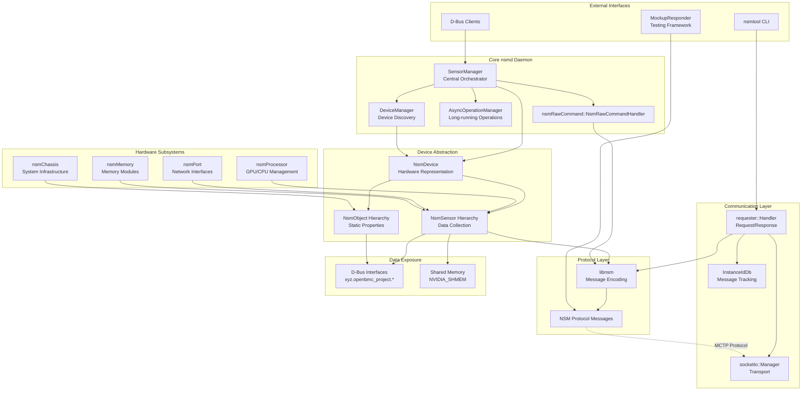
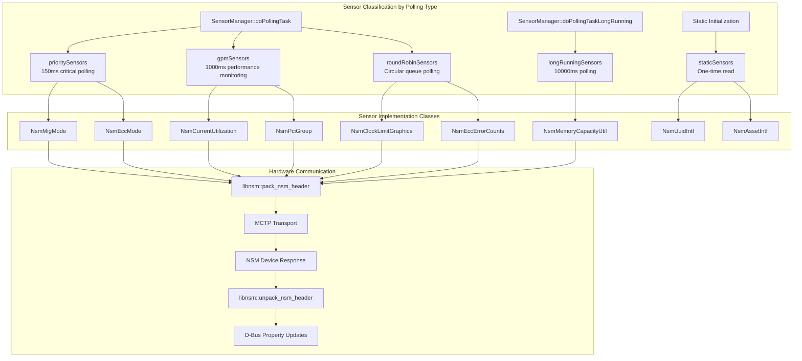
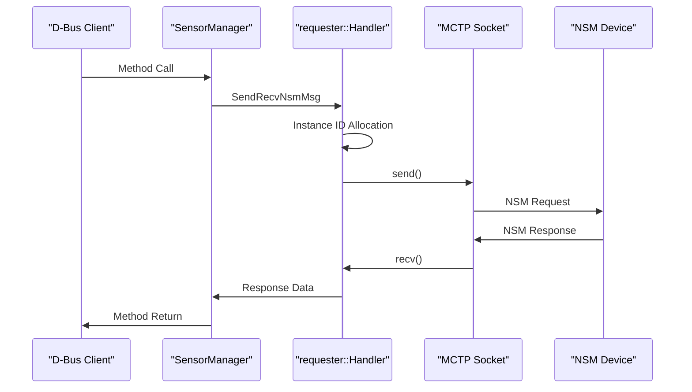

<!-- source: DeepWiki mcp.deepwiki.com · repo NVIDIA/nsmd · page 1 NVIDIA System Management (NSM) Overview · fetched 2026-10-26 -->

# NVIDIA System Management (NSM) Overview

Relevant source files

The following files were used as context for generating this wiki page:

- [.gitignore](.gitignore)
- [README.md](README.md)
- [libnsm/base.c](libnsm/base.c)
- [libnsm/base.h](libnsm/base.h)
- [libnsm/test/common-tests.cpp](libnsm/test/common-tests.cpp)
- [libnsm/test/common-tests.hpp](libnsm/test/common-tests.hpp)
- [libnsm/test/libnsm_base_test.cpp](libnsm/test/libnsm_base_test.cpp)
- [libnsm/test/meson.build](libnsm/test/meson.build)
- [meson.build](meson.build)
- [meson_options.txt](meson_options.txt)
- [nsmd/meson.build](nsmd/meson.build)
- [nsmtool/nsm_discovery_cmd.cpp](nsmtool/nsm_discovery_cmd.cpp)
- [subprojects/nvidia-shmem.wrap](subprojects/nvidia-shmem.wrap)
- [subprojects/nvidia-tal.wrap](subprojects/nvidia-tal.wrap)
- [subprojects/phosphor-dbus-interfaces.wrap](subprojects/phosphor-dbus-interfaces.wrap)
- [subprojects/phosphor-logging.wrap](subprojects/phosphor-logging.wrap)
- [subprojects/sdbusplus.wrap](subprojects/sdbusplus.wrap)
- [subprojects/sdeventplus.wrap](subprojects/sdeventplus.wrap)

## Purpose and Scope

The NVIDIA System Management (NSM) repository provides a comprehensive system management framework for NVIDIA hardware components including GPUs, network switches, memory modules, and chassis systems. This framework facilitates monitoring and control through standardized D-Bus interfaces, utilizing the NSM protocol over MCTP transport.

The repository includes:
- **`nsmd`**: The core management daemon responsible for device discovery and sensor orchestration.
- **`libnsm`**: A C library providing message encoding and decoding for the NSM protocol.
- **`nsmtool`**: A CLI utility for manual hardware interaction and diagnostics.
- **`MockupResponder`**: A testing framework for simulating hardware responses.

For information about specific hardware subsystem implementations, see [System Architecture](#1.1). For details about the NSM protocol message structures, see [NSM Protocol Layer](#4). For communication infrastructure and transport mechanisms, see [Communication Infrastructure](#5).

## System Architecture Overview

The NSM system follows a layered architecture with the core `nsmd` daemon serving as the central orchestrator for hardware management operations.

**NSM System Architecture**

Sources: [nsmd/nsmd.cpp:153-181](), [nsmd/sensorManager.cpp:1-100](), [nsmd/meson.build:1-21](), [libnsm/base.h:73-81]()

The architecture implements a hierarchical polling strategy where different sensor types operate on different schedules based on criticality and update frequency requirements. For a deep dive into the integration model and MCTP transport, see [System Architecture](#1.1).

**NSM Sensor Polling Architecture**

Sources: [nsmd/sensorManager.cpp:502-627](), [libnsm/base.c:25-63](), [meson_options.txt:45-51](), [meson_options.txt:133-139]()

## Core Components

### SensorManager - Central Orchestration

The `SensorManager` class serves as the central orchestrator for all NSM operations, implementing a sophisticated polling strategy with multiple sensor categories defined in `nsmDevice.hpp`.

| Component | Default Interval | Purpose |
|-----------|------------------|---------|
| `prioritySensors` | 150ms | Critical real-time monitoring [meson_options.txt:50]() |
| `gpmSensors` | 1000ms | GPU performance metrics [meson_options.txt:90]() |
| `roundRobinSensors` | 30000ms limit | Regular telemetry updates [meson_options.txt:162]() |
| `longRunningSensors` | 10000ms | Complex/Slow operations [meson_options.txt:138]() |
| `staticSensors` | One-time | Hardware identification and static data |

Sources: [nsmd/sensorManager.cpp:502-627](), [nsmd/nsmDevice.hpp:70-150]()

### DeviceManager - Hardware Discovery

The `DeviceManager` handles MCTP endpoint discovery and device enumeration. It utilizes the `MctpDiscovery` and `MctpEndpointProber` components to identify hardware and initialize the corresponding `NsmDevice` objects.

Sources: [requester/mctp_endpoint_discovery.cpp:1-50](), [requester/mctp_endpoint_prober.cpp:1-50]()

### NsmDevice - Hardware Abstraction

The `NsmDevice` class represents individual hardware components. It maintains collections of sensors and objects, tracking the device's operational state.

Sources: [nsmd/nsmDevice.cpp:1-100](), [nsmd/nsmDevice.hpp:70-150]()

## Communication Flow

The NSM system implements a request-response communication pattern over MCTP transport. It uses `libnsm` to pack and unpack headers following the NSM specification (OCP Type 8).

**NSM Communication Flow**

Sources: [libnsm/base.c:25-106](), [nsmd/socket_handler.cpp:1-50](), [nsmd/nsmMsghandler.cpp:1-50]()

## Build System and Configuration

The NSM system uses the Meson build system. It features a modular design where subdirectories for specific hardware (e.g., `nsmProcessor`, `nsmPort`) are conditionally included based on build options.

### Key Configuration Options

| Option | Default | Purpose |
|--------|---------|---------|
| `sensor-polling-time` | 150 | Priority sensor polling interval (ms) |
| `shmem` | enabled | Enable NVIDIA Shared-Memory IPC |
| `progressCounter` | enabled | Enable sensor progress counters |
| `mockup-responder` | enabled | Build the Mockup Responder tool |
| `response-time-out` | 2000 | Standard timeout (ms) |

For detailed instructions on building, configuring, and running tests, see [Build System and Configuration](#1.2).

Sources: [meson_options.txt:1-200](), [meson.build:1-150](), [README.md:37-49]()

---

