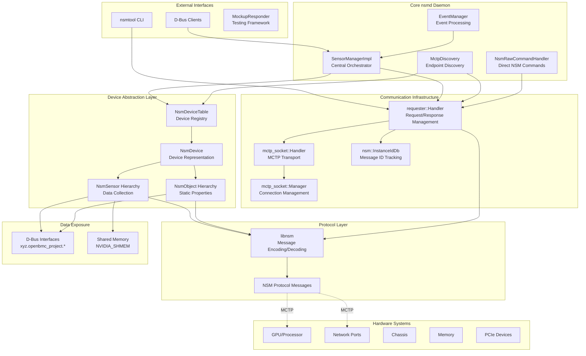
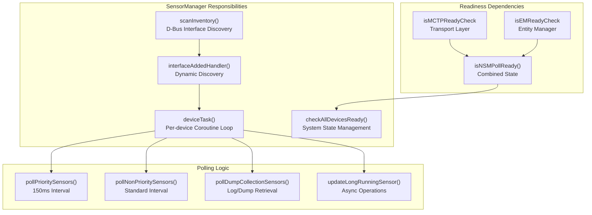
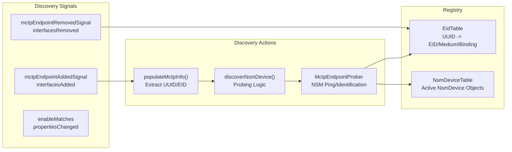
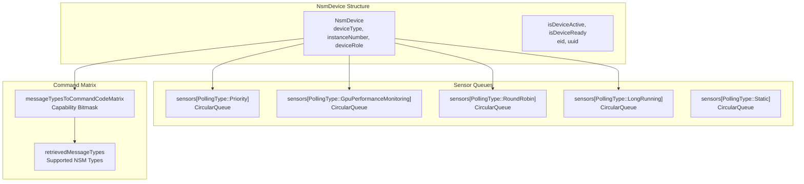
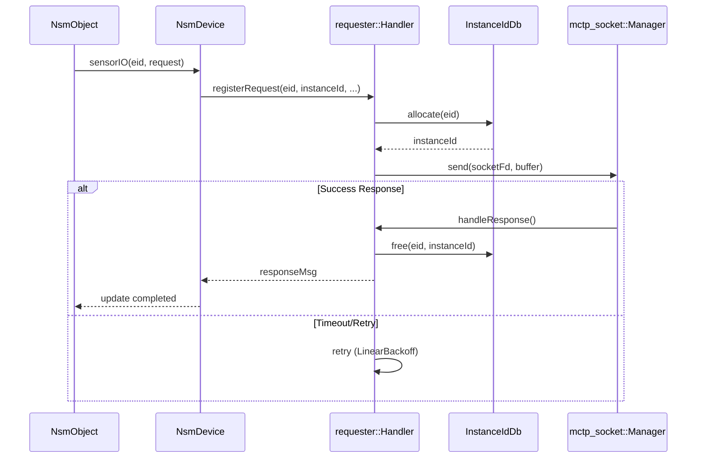

<!-- source: DeepWiki mcp.deepwiki.com · repo NVIDIA/nsmd · page 1.1 System Architecture · fetched 2026-10-26 -->

# System Architecture

Relevant source files

The following files were used as context for generating this wiki page:

- [common/dBusAsyncUtils.hpp](common/dBusAsyncUtils.hpp)
- [common/sleep.hpp](common/sleep.hpp)
- [common/test/common_utils_test.cpp](common/test/common_utils_test.cpp)
- [common/timer.hpp](common/timer.hpp)
- [common/types.hpp](common/types.hpp)
- [common/utils.cpp](common/utils.cpp)
- [common/utils.hpp](common/utils.hpp)
- [nsmd/nsmDevice.cpp](nsmd/nsmDevice.cpp)
- [nsmd/nsmDevice.hpp](nsmd/nsmDevice.hpp)
- [nsmd/nsmEvent/nsmRediscoveryEvent.cpp](nsmd/nsmEvent/nsmRediscoveryEvent.cpp)
- [nsmd/nsmEvent/nsmRediscoveryEvent.hpp](nsmd/nsmEvent/nsmRediscoveryEvent.hpp)
- [nsmd/nsmEventConfig/nsmEventSetting.cpp](nsmd/nsmEventConfig/nsmEventSetting.cpp)
- [nsmd/nsmEventConfig/test/nsmEventSetting_test.cpp](nsmd/nsmEventConfig/test/nsmEventSetting_test.cpp)
- [nsmd/nsmObject.hpp](nsmd/nsmObject.hpp)
- [nsmd/nsmd.cpp](nsmd/nsmd.cpp)
- [nsmd/sensorManager.cpp](nsmd/sensorManager.cpp)
- [nsmd/sensorManager.hpp](nsmd/sensorManager.hpp)
- [nsmd/test/mockSensorManager.hpp](nsmd/test/mockSensorManager.hpp)
- [nsmd/test/nsmDevice_test.cpp](nsmd/test/nsmDevice_test.cpp)
- [requester/mctp_endpoint_discovery.cpp](requester/mctp_endpoint_discovery.cpp)
- [requester/mctp_endpoint_discovery.hpp](requester/mctp_endpoint_discovery.hpp)

This document describes the high-level architecture of the NVIDIA System Management (NSM) daemon (`nsmd`), which provides system monitoring and management capabilities for NVIDIA hardware components through D-Bus interfaces and the NSM protocol over MCTP transport.

For information about specific hardware subsystems managed by NSM, see [Hardware Subsystems](#3). For details about the NSM protocol implementation, see [NSM Protocol Layer](#4). For communication infrastructure details, see [Communication Infrastructure](#5).

## Overview

The NSM daemon serves as a bridge between NVIDIA hardware components and system management interfaces, providing real-time telemetry, configuration capabilities, and health monitoring. The system architecture is built around several core components that work together to discover devices, poll sensors, manage communication, and expose data through standardized interfaces.

**NSM System Architecture Overview**

Sources: [nsmd/nsmd.cpp:92-156](), [nsmd/sensorManager.hpp:95-135](), [requester/mctp_endpoint_discovery.hpp:56-86]()

## Core Daemon Components

The `nsmd` daemon is structured around primary management components that coordinate device lifecycle, sensor monitoring, and communication.

### SensorManager - Central Orchestration

The `SensorManagerImpl` class serves as the primary orchestrator, managing the complete sensor lifecycle and device readiness state. It coordinates polling operations, handles D-Bus inventory discovery via Entity Manager configurations, and maintains system readiness status.

**SensorManager Architecture and Polling Flow**

Sources: [nsmd/sensorManager.cpp:133-184](), [nsmd/sensorManager.cpp:186-205](), [nsmd/sensorManager.hpp:143-159](), [nsmd/sensorManager.cpp:59-74]()

### MctpDiscovery - Endpoint Discovery

The `MctpDiscovery` class handles MCTP endpoint discovery by watching D-Bus signals from the MCTP daemon (e.g., `au.com.codeconstruct.mctp1`). It maintains the `EidTable` which maps UUIDs to EIDs and binding information.

**MctpDiscovery Flow**

Sources: [requester/mctp_endpoint_discovery.cpp:92-164](), [requester/mctp_endpoint_discovery.cpp:166-213](), [requester/mctp_endpoint_discovery.hpp:103-118]()

### Device Abstraction Model

The `NsmDevice` class represents individual hardware components and organizes sensors into different polling categories based on their update requirements and criticality.

**NsmDevice Structure and Sensor Organization**

Sources: [nsmd/nsmDevice.hpp:75-91](), [nsmd/nsmDevice.hpp:124-220](), [nsmd/nsmDevice.cpp:141-177](), [nsmd/nsmDevice.cpp:179-205]()

## Communication and Protocol Flow

The NSM system implements a layered communication architecture using the NSM protocol over MCTP transport, with comprehensive request/response handling and timeout management via the `requester::Handler`.

**NSM Communication Flow**

Sources: [requester/mctp_endpoint_discovery.cpp:81-90](), [nsmd/nsmd.cpp:113-124](), [nsmd/nsmEventConfig/nsmEventSetting.cpp:94-105]()

## Sensor Polling Architecture

The sensor polling system implements a priority-based scheduling mechanism. Each `NsmDevice` runs its own `deviceTask` coroutine that orchestrates different polling types.

| Polling Type | Frequency/Limit | Purpose |
| :--- | :--- | :--- |
| `Priority` | 150ms (`PRIORITY_REFRESH_LIMIT_IN_USEC`) | Critical real-time telemetry |
| `GpuPerformanceMonitoring` | 1000ms (`GPM_REFRESH_LIMIT_IN_USEC`) | GPM metrics for GPUs |
| `RoundRobin` | Default (`RR_REFRESH_LIMIT_IN_USEC`) | Standard telemetry sensors |
| `LongRunning` | 30s (`LONG_RUNNING_REFRESH_LIMIT_IN_USEC`) | Slow operations (e.g. firmware status) |
| `Static` | One-time | Constant inventory data |

Sources: [nsmd/nsmObject.hpp:24-38](), [nsmd/nsmDevice.hpp:75-84](), [nsmd/sensorManager.cpp:155-159]()

### Data Flow to D-Bus

1.  **Discovery**: `SensorManagerImpl::scanInventory` finds configuration interfaces on D-Bus [nsmd/sensorManager.cpp:133-170]().
2.  **Creation**: `NsmObjectFactory` creates `NsmObject` instances based on the discovered interfaces [nsmd/sensorManager.cpp:206-250]().
3.  **Polling**: The `deviceTask` loop triggers `NsmObject::update` [nsmd/nsmObject.hpp:76-81]().
4.  **Encoding**: `libnsm` functions encode the request [nsmd/nsmEventConfig/nsmEventSetting.cpp:77-89]().
5.  **Transport**: `NsmDevice::sensorIO` sends the message via MCTP [nsmd/nsmEventConfig/nsmEventSetting.cpp:94-105]().
6.  **Decoding**: The response is decoded, and D-Bus properties are updated [nsmd/nsmEventConfig/nsmEventSetting.cpp:107-133]().

Sources: [nsmd/sensorManager.cpp:133-250](), [nsmd/nsmObject.hpp:76-81](), [nsmd/nsmEventConfig/nsmEventSetting.cpp:77-133]()

---

