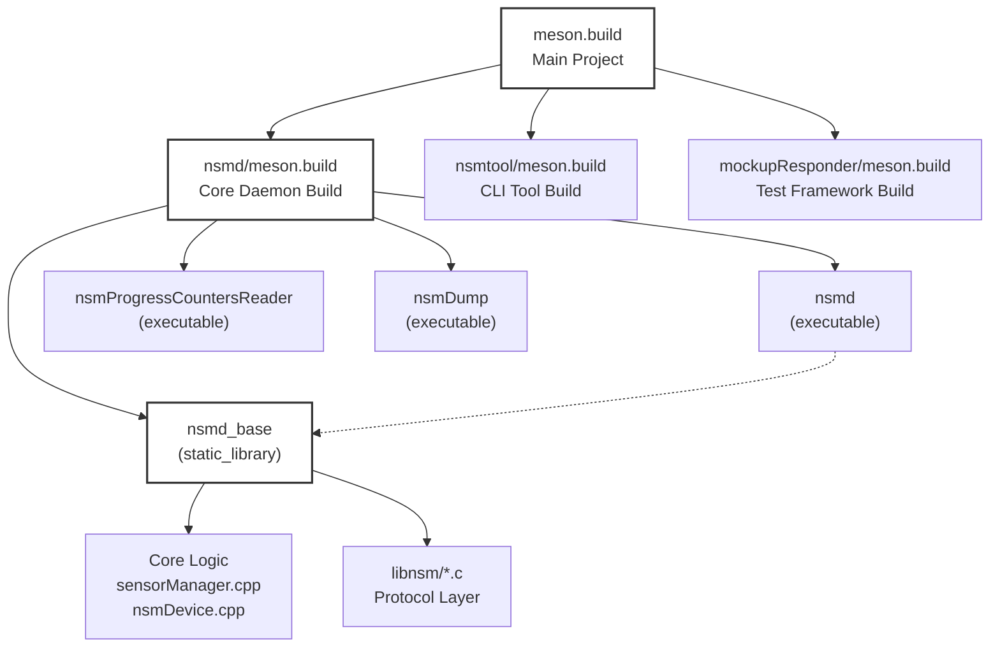
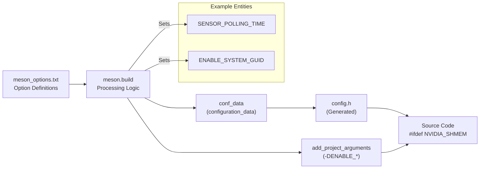

<!-- source: DeepWiki mcp.deepwiki.com · repo NVIDIA/nsmd · page 1.2 Build System and Configuration · fetched 2026-10-26 -->

# Build System and Configuration

Relevant source files

The following files were used as context for generating this wiki page:

- [.gitignore](.gitignore)
- [README.md](README.md)
- [meson.build](meson.build)
- [meson_options.txt](meson_options.txt)
- [nsmd/meson.build](nsmd/meson.build)
- [nsmd/nsmCommon/test/meson.build](nsmd/nsmCommon/test/meson.build)
- [nsmd/nsmEvent/test/meson.build](nsmd/nsmEvent/test/meson.build)
- [nsmd/nsmFwSwInventory/test/meson.build](nsmd/nsmFwSwInventory/test/meson.build)
- [nsmd/nsmGPM/test/meson.build](nsmd/nsmGPM/test/meson.build)
- [nsmd/nsmMemory/test/meson.build](nsmd/nsmMemory/test/meson.build)
- [nsmd/nsmNumericSensor/test/meson.build](nsmd/nsmNumericSensor/test/meson.build)
- [nsmd/nsmPort/test/meson.build](nsmd/nsmPort/test/meson.build)
- [nsmd/nsmRawCommand/test/meson.build](nsmd/nsmRawCommand/test/meson.build)
- [nsmd/nsmSetAsync/test/meson.build](nsmd/nsmSetAsync/test/meson.build)
- [nsmd/test/meson.build](nsmd/test/meson.build)
- [subprojects/nvidia-shmem.wrap](subprojects/nvidia-shmem.wrap)
- [subprojects/nvidia-tal.wrap](subprojects/nvidia-tal.wrap)
- [subprojects/phosphor-dbus-interfaces.wrap](subprojects/phosphor-dbus-interfaces.wrap)
- [subprojects/phosphor-logging.wrap](subprojects/phosphor-logging.wrap)
- [subprojects/sdbusplus.wrap](subprojects/sdbusplus.wrap)
- [subprojects/sdeventplus.wrap](subprojects/sdeventplus.wrap)

This page documents the build system and configuration options for the NSM daemon, covering the Meson build system, compile-time configuration options, and their impact on system behavior. The build system uses feature flags and configurable parameters to customize the daemon's functionality for different deployment scenarios.

For information about the overall system architecture, see [System Architecture](#1.1). For details about runtime device management, see [Core nsmd Daemon](#2).

## Build System Overview

The NSM repository uses the Meson build system to manage compilation and dependency resolution. The build system is designed to support flexible configuration through numerous compile-time options that control feature enablement, performance parameters, and hardware-specific settings.

### Project Structure

The build system follows a hierarchical structure with the main project definition and subdirectories for different components. The core daemon logic is partitioned into a static library `nsmd_base` to facilitate both the production binary and unit testing.

Sources: [meson.build:1-7]() [nsmd/meson.build:1-21]() [nsmd/meson.build:153-160]() [nsmd/meson.build:174-181]()

### Core Dependencies

The build system manages several key dependencies that are essential for NSM operation:

| Dependency | Purpose | Required |
|------------|---------|----------|
| `sdbusplus` | D-Bus C++ bindings | Yes |
| `sdeventplus` | Event loop integration | Yes |
| `phosphor-dbus-interfaces` | OpenBMC D-Bus interfaces | Yes |
| `phosphor-logging` | Structured logging | Yes |
| `nlohmann_json` | JSON parsing and serialization | Yes |
| `CLI11` | Command-line argument parsing | Yes |
| `nvidia-shmem` | NVIDIA shared memory IPC | Conditional |

Sources: [meson.build:12-16]() [meson.build:69-74]() [nsmd/meson.build:196-204]()

## Configuration System

The NSM daemon uses extensive compile-time configuration through `meson_options.txt` to customize behavior. These options are processed in the main `meson.build` and passed to the code via `configuration_data` (generating `config.h`) or project-wide compiler arguments.

### Configuration Flow

Sources: [meson_options.txt:1-250]() [meson.build:51-67]() [meson.build:76-140]()

### Feature Configuration Categories

#### Core Feature Flags
- `shmem`: Enables `NVIDIA_SHMEM` for shared-memory IPC [meson_options.txt:8-13]().
- `progressCounter`: Enables `NVIDIA_PROGRESS_COUNTER` functionality using `memfd` [meson_options.txt:14-19]().
- `stanbyToDC`: Enables `NVIDIA_STANDBYTODC` for Manager ready features [meson_options.txt:2-7]().
- `system-guid`: Enables the `ENABLE_SYSTEM_GUID` project argument [meson_options.txt:26-31]().

#### Hardware and SPI Configuration
- `grace-spi-operations`: Enables `ENABLE_GRACE_SPI_OPERATIONS` [meson_options.txt:32-37]().
- `grace-spi-operations-raw-debug-dump`: Enables raw SPI message logging for debugging [meson_options.txt:38-43]().
- `num-gpu-per-module`: Configures `NUM_GPU_PER_MODULE` (default 2) [meson_options.txt:121-125]().

## Polling and Timeout Parameters

The daemon's performance and responsiveness are controlled by several integer options defined in milliseconds or microseconds.

### Polling Intervals
| Option | Default | Purpose |
|--------|---------|---------|
| `sensor-polling-time` | 150ms | Standard sensor polling interval [meson_options.txt:45-51](). |
| `sensor-polling-time-gpm` | 1000ms | Polling interval for GPM sensors [meson_options.txt:85-91](). |
| `sensor-polling-time-long-running` | 10000ms | Polling for NSM Long-running requests [meson_options.txt:133-139](). |
| `rr-refresh-limit` | 30000ms | Refresh limit for round-robin sensors [meson_options.txt:157-163](). |

### Communication Timing
- `response-time-out`: Standard NSM response timeout (2000ms) [meson_options.txt:187-193]().
- `response-time-out-long-running`: Timeout for long-running event responses (3000ms) [meson_options.txt:195-201]().
- `number-of-request-retries`: Number of retries before failure (default 2) [meson_options.txt:179-185]().
- `retry-backoff`: Constant-delay backoff array `[maxRetries, delayMs]` [meson_options.txt:245-249]().

Sources: [meson_options.txt:45-201]() [meson.build:76-130]()

## Modular Plugin Architecture

The NSM daemon uses a modular directory structure. While core components are always included, many hardware-specific subsystems are conditionally compiled based on `nsmd-subdirs-include` or the `cx8-features` meta-option.

### Conditional Subdirectory Processing
The `nsmd/meson.build` file iterates through a list of `valid_nsmd_subdirs`. A subdirectory is included if `nsmd-subdirs-all` is true or if it is explicitly named in `nsmd-subdirs-include`.

| Subdirectory | Dependency/Feature Requirement |
|--------------|-------------------------------|
| `nsmDebugToken` | `enable-debug-token` must be enabled [nsmd/meson.build:127](). |
| `nsmDot` | `enable-dot` must be enabled [nsmd/meson.build:128](). |
| `nsmDumpCollection`| `enable-debug-info` must be enabled [nsmd/meson.build:129](). |

Sources: [nsmd/meson.build:75-145]()

## Testing Infrastructure

The build system integrates GTest and GMock for unit testing. Tests are enabled via the `tests` feature flag.

### Test Targets and Execution
When `tests` is enabled, the build system:
1. Declares `tests_deps` including `gtest`, `gmock`, and the `nsmd_base` static library [nsmd/meson.build:221-226]().
2. Recursively enters `test/` subdirectories for both core logic and modular plugins [nsmd/meson.build:228-244]().

### Running Tests
Tests can be executed via standard Meson/Ninja commands:
- **Run all tests**: `meson test -C builddir` [README.md:55]().
- **Run specific test**: `meson test -C builddir nsmChassis_test` [README.md:57]().
- **Valgrind integration**: `meson test -C builddir --wrapper "valgrind --leak-check=full"` [README.md:59]().
- **Coverage Reports**: Build with `-Db_coverage=true` and run `ninja -C builddir coverage` [README.md:66-69]().

Sources: [meson.build:19-49]() [nsmd/meson.build:207-245]() [README.md:51-70]()

---

