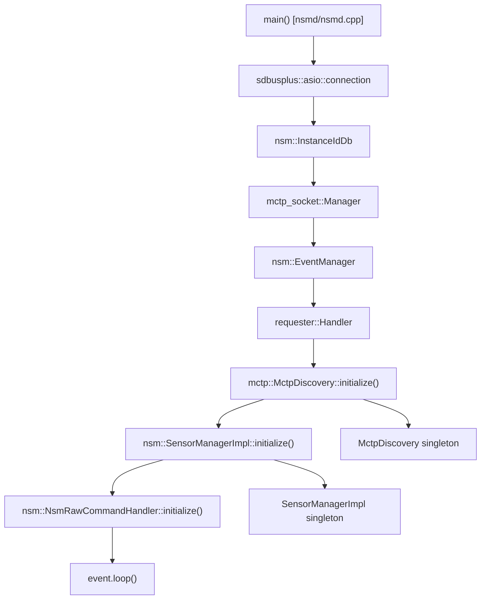
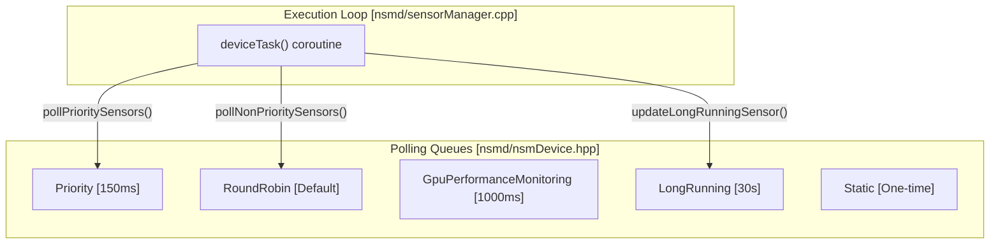

<!-- source: DeepWiki mcp.deepwiki.com · repo NVIDIA/nsmd · page 2 Core nsmd Daemon · fetched 2026-10-26 -->

# Core nsmd Daemon

Relevant source files

The following files were used as context for generating this wiki page:

- [common/types.hpp](common/types.hpp)
- [nsmd/eventManager.hpp](nsmd/eventManager.hpp)
- [nsmd/nsmDevice.cpp](nsmd/nsmDevice.cpp)
- [nsmd/nsmDevice.hpp](nsmd/nsmDevice.hpp)
- [nsmd/nsmEventConfig/nsmEventSetting.cpp](nsmd/nsmEventConfig/nsmEventSetting.cpp)
- [nsmd/nsmEventConfig/test/nsmEventSetting_test.cpp](nsmd/nsmEventConfig/test/nsmEventSetting_test.cpp)
- [nsmd/nsmObject.hpp](nsmd/nsmObject.hpp)
- [nsmd/nsmObjectFactory.cpp](nsmd/nsmObjectFactory.cpp)
- [nsmd/nsmObjectFactory.hpp](nsmd/nsmObjectFactory.hpp)
- [nsmd/nsmd.cpp](nsmd/nsmd.cpp)
- [nsmd/sensorManager.cpp](nsmd/sensorManager.cpp)
- [nsmd/sensorManager.hpp](nsmd/sensorManager.hpp)
- [nsmd/test/mockSensorManager.hpp](nsmd/test/mockSensorManager.hpp)
- [nsmd/test/nsmDevice_test.cpp](nsmd/test/nsmDevice_test.cpp)
- [requester/mctp_endpoint_discovery.cpp](requester/mctp_endpoint_discovery.cpp)
- [requester/mctp_endpoint_discovery.hpp](requester/mctp_endpoint_discovery.hpp)

The Core nsmd Daemon is the central component of the NVIDIA System Management (NSM) framework, responsible for orchestrating device discovery, sensor management, and hardware monitoring across NVIDIA components. This document covers the primary daemon components including the `SensorManager`, `DeviceManager`, and `NsmDevice` abstractions, as well as their initialization and coordination mechanisms.

For detailed technical explanations, see the child pages:
- [SensorManager and Device Lifecycle](#2.1)
- [DeviceManager and Discovery](#2.2)
- [Asynchronous Operation Management](#2.3)

## Architecture Overview

The `nsmd` daemon follows a layered architecture with singleton managers coordinating device discovery, sensor polling, and data exposure through D-Bus interfaces.

### Core Components Initialization Flow

The `main` function initializes the core communication stack before setting up the management singletons.

**Sources:** [nsmd/nsmd.cpp:91-175]()

### Component Relationships

The daemon architecture bridges the Natural Language Space (Device Management) to the Code Entity Space through specialized managers.

| Component | Code Entity | Role |
| :--- | :--- | :--- |
| **Discovery Manager** | `mctp::MctpDiscovery` | Handles MCTP endpoint enumeration and UUID-to-EID mapping. [requester/mctp_endpoint_discovery.hpp:56-66]() |
| **Sensor Orchestrator** | `nsm::SensorManagerImpl` | Manages polling loops, inventory scanning, and system readiness. [nsmd/sensorManager.hpp:95-135]() |
| **Device Model** | `nsm::NsmDevice` | Represents a physical hardware entity (GPU, Switch) and its capabilities. [nsmd/nsmDevice.hpp:124-132]() |
| **Message Handler** | `nsm::NsmMessageHandler` | Encapsulates the NSM requester/responder logic. [nsmd/nsmd.cpp:138-139]() |

**Sources:** [nsmd/nsmd.cpp:138-147](), [nsmd/sensorManager.hpp:51-84](), [nsmd/nsmDevice.hpp:124-156]()

## SensorManager - Central Orchestration

The `SensorManagerImpl` serves as the central coordinator for device lifecycle management, sensor polling, and system readiness determination. For details, see [SensorManager and Device Lifecycle](#2.1).

### Polling Architecture

The `SensorManager` implements a sophisticated polling system with multiple priority levels defined in the `PollingType` enum.

**Sources:** [nsmd/nsmDevice.hpp:75-84](), [nsmd/sensorManager.cpp:143-159](), [nsmd/nsmObject.hpp:27-37]()

## DeviceManager and Discovery

The `MctpDiscovery` (often referred to as the DeviceManager) handles NSM device discovery, capability queries, and maintains device command matrices. For details, see [DeviceManager and Discovery](#2.2).

### Command Matrix Management

Each `NsmDevice` maintains a `messageTypesToCommandCodeMatrix` to track which NSM commands the physical hardware supports. This matrix is populated during the discovery phase using `updateMessageTypesToCommandCodeMatrix`.

**Sources:** [nsmd/nsmDevice.hpp:151-152](), [nsmd/nsmDevice.cpp:150-177]()

## NsmDevice Abstraction

The `NsmDevice` class represents individual NSM devices and manages their sensor collections, polling state, and lifecycle events.

### Device Identification and Remapping

Devices are identified by `deviceType`, `instanceNumber`, and `deviceRole`. They support remapping via `DeviceRemapProperty` to associate D-Bus inventory objects with specific hardware based on `MCTP_UUID`, `MCTP_EID`, or `NSM_DEVICE_INSTANCE_NUMBER`.

**Sources:** [nsmd/nsmDevice.hpp:116-122](), [nsmd/nsmDevice.hpp:145-156]()

## Asynchronous Operation Management

The daemon utilizes a coroutine-based framework to handle non-blocking NSM operations, particularly for long-running commands that generate events rather than immediate responses. For details, see [Asynchronous Operation Management](#2.3).

### Long-Running Events

The `NsmDevice` class includes a `registerLongRunningEventHandler` to process asynchronous completion events for commands like firmware updates or complex diagnostics.

**Sources:** [nsmd/nsmDevice.cpp:158-158](), [nsmd/nsmDevice.hpp:68-73]()

---

### Child Pages
- **[SensorManager and Device Lifecycle](#2.1)**: Detailed explanation of the `SensorManager`'s role in device discovery, sensor polling, readiness management, and the `NsmDevice` abstraction.
- **[DeviceManager and Discovery](#2.2)**: How the `DeviceManager` handles MCTP endpoint discovery, device enumeration, capability queries, and FRU data exposure.
- **[Asynchronous Operation Management](#2.3)**: `AsyncOperationManager` system for handling non-blocking D-Bus operations and long-running commands.

---

