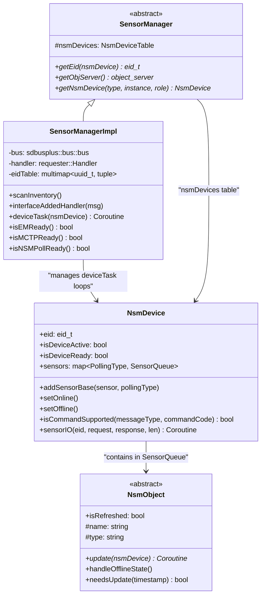
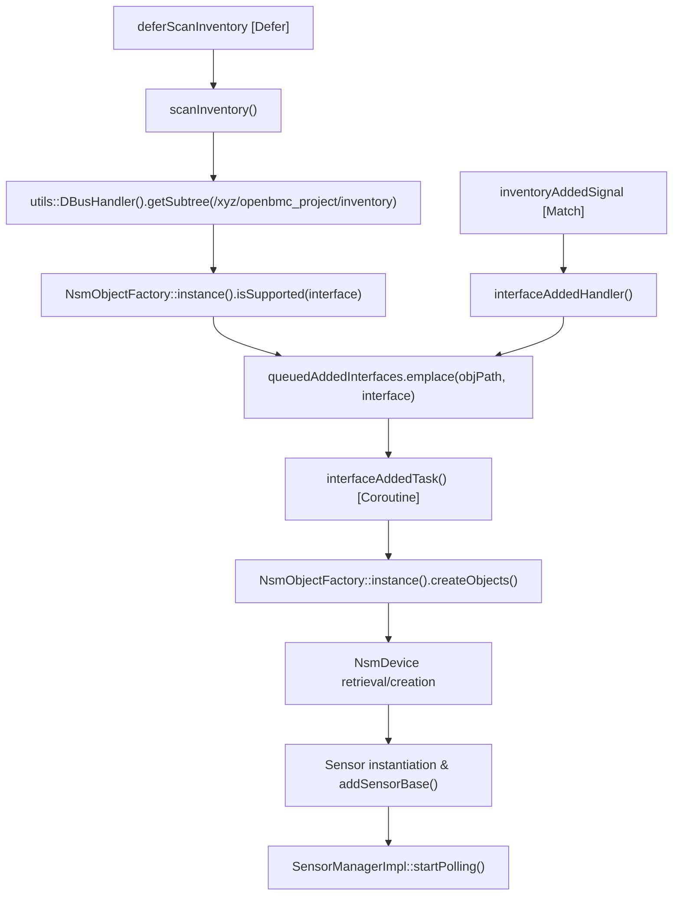
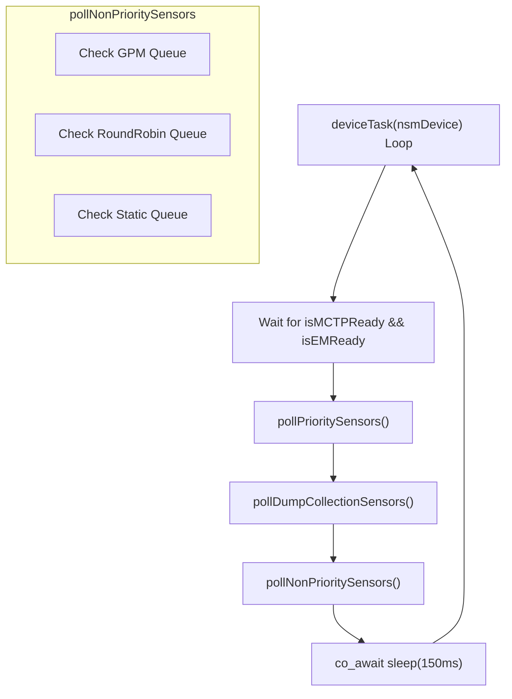

<!-- source: DeepWiki mcp.deepwiki.com · repo NVIDIA/nsmd · page 2.1 SensorManager and Device Lifecycle · fetched 2026-10-26 -->

# SensorManager and Device Lifecycle

Relevant source files

The following files were used as context for generating this wiki page:

- [common/coroutineSemaphore.hpp](common/coroutineSemaphore.hpp)
- [nsmd/nsmCommon/nsmCommon.cpp](nsmd/nsmCommon/nsmCommon.cpp)
- [nsmd/nsmCommon/nsmCommon.hpp](nsmd/nsmCommon/nsmCommon.hpp)
- [nsmd/nsmCommon/test/nsmCommon_test.cpp](nsmd/nsmCommon/test/nsmCommon_test.cpp)
- [nsmd/nsmDevice.cpp](nsmd/nsmDevice.cpp)
- [nsmd/nsmDevice.hpp](nsmd/nsmDevice.hpp)
- [nsmd/nsmLongRunning/nsmAsyncLongRunningSensor.hpp](nsmd/nsmLongRunning/nsmAsyncLongRunningSensor.hpp)
- [nsmd/nsmLongRunning/nsmLongRunningSensor.hpp](nsmd/nsmLongRunning/nsmLongRunningSensor.hpp)
- [nsmd/nsmNumericSensor/nsmNumericAggregator.cpp](nsmd/nsmNumericSensor/nsmNumericAggregator.cpp)
- [nsmd/nsmNumericSensor/nsmNumericAggregator.hpp](nsmd/nsmNumericSensor/nsmNumericAggregator.hpp)
- [nsmd/nsmObject.hpp](nsmd/nsmObject.hpp)
- [nsmd/nsmProgressCounters/progressCounterType.hpp](nsmd/nsmProgressCounters/progressCounterType.hpp)
- [nsmd/nsmProgressCounters/progressCounters.cpp](nsmd/nsmProgressCounters/progressCounters.cpp)
- [nsmd/nsmProgressCounters/test/progressCounters_test.cpp](nsmd/nsmProgressCounters/test/progressCounters_test.cpp)
- [nsmd/nsmSensor.cpp](nsmd/nsmSensor.cpp)
- [nsmd/nsmSensor.hpp](nsmd/nsmSensor.hpp)
- [nsmd/sensorManager.cpp](nsmd/sensorManager.cpp)
- [nsmd/sensorManager.hpp](nsmd/sensorManager.hpp)
- [nsmd/test/mockSensorManager.hpp](nsmd/test/mockSensorManager.hpp)
- [requester/mctp_endpoint_discovery.cpp](requester/mctp_endpoint_discovery.cpp)
- [requester/mctp_endpoint_discovery.hpp](requester/mctp_endpoint_discovery.hpp)

## Purpose and Scope

This document covers the `SensorManager` and `NsmDevice` systems responsible for device discovery, sensor orchestration, and lifecycle management within the `nsmd` daemon. The `SensorManager` serves as the central coordinator for NSM hardware device monitoring, while `NsmDevice` abstracts individual hardware components and their associated sensors.

For NSM protocol communication details, see [NSM Message Protocol](#4.1). For device-specific management of processors, network ports, and chassis, see [Hardware Subsystems](#3).

## Core Architecture

The sensor management system consists of three primary abstractions working together to manage NSM device monitoring:

### Sensor Management Class Relationships

**Sources:** [nsmd/sensorManager.hpp:51-84](), [nsmd/sensorManager.hpp:95-185](), [nsmd/nsmDevice.hpp:124-377](), [nsmd/nsmObject.hpp:43-103]()

## Device Discovery and Creation

The `SensorManager` discovers NSM devices through D-Bus inventory scanning and creates `NsmDevice` instances based on Entity Manager configuration.

### Discovery Data Flow

**Sources:** [nsmd/sensorManager.cpp:93-126](), [nsmd/sensorManager.cpp:133-170](), [nsmd/sensorManager.cpp:186-205](), [nsmd/sensorManager.cpp:207-261]()

### Device Identification and UUID Handling

`NsmDevice` instances are identified through two mechanisms:

| Identification Method | Format / Type | Usage |
|----------------------|---------------|-------|
| **UUID-based** | `uuid_t` | Runtime discovered devices mapped via `eidTable` [nsmd/sensorManager.hpp:184-185]() |
| **Static UUID** | `"STATIC:deviceType:instanceNumber"` | Static inventory configuration parsed via `utils::parseStaticUuid` [nsmd/test/mockSensorManager.hpp:110-116]() |
| **Identification Tuple** | `(deviceType, instanceNumber, deviceRole)` | Unique key for device lookup in `nsmDevices` table [nsmd/nsmDevice.hpp:145-150]() |

**Sources:** [nsmd/sensorManager.cpp:984-1019](), [nsmd/nsmDevice.cpp:40-54](), [nsmd/test/mockSensorManager.hpp:103-120]()

## Device Lifecycle Management

`NsmDevice` manages device availability and operational readiness through state flags and coroutine orchestration.

### Lifecycle Transitions
- **Activation (`setOnline`)**: Sets `isDeviceActive = true`. Marks all sensors for refresh. Triggers `onDeviceOnline()` hooks for all registered `NsmObject` instances. [nsmd/nsmDevice.cpp:164-186]()
- **Deactivation (`setOffline`)**: Sets `isDeviceActive = false`. Calls `handleOfflineState()` on all sensors (e.g., setting D-Bus properties to NaN). [nsmd/nsmDevice.cpp:188-220]()
- **Readiness**: A device is "Ready" when all its non-static sensors have been refreshed at least once. This is tracked via `ProgressCounters`. [nsmd/nsmDevice.cpp:468-493]()

**Sources:** [nsmd/nsmDevice.cpp:164-220](), [nsmd/nsmDevice.cpp:468-493](), [nsmd/nsmObject.hpp:91-93]()

## Sensor Polling Architecture

The polling system categorizes sensors into distinct types with different update frequencies and priorities.

### Polling Categories (`PollingType`)
| Type | Interval (Refresh Limit) | Description |
|------|-------------------------|-------------|
| **Priority** | 150ms (`PRIORITY_REFRESH_LIMIT_IN_USEC`) | High-frequency telemetry (e.g., critical power/temp). [nsmd/nsmObject.hpp:27-28]() |
| **DumpCollection** | 150ms | Collection of CPER/Dump records using leftover budget. [nsmd/nsmDevice.hpp:78-79]() |
| **GpuPerformanceMonitoring** | 1000ms (`GPM_REFRESH_LIMIT_IN_USEC`) | Specialized GPU metrics (GPM). [nsmd/nsmObject.hpp:33-34]() |
| **RoundRobin** | 1000ms-30s (`RR_REFRESH_LIMIT_IN_USEC`) | Standard telemetry cycled through a circular queue. [nsmd/nsmObject.hpp:30-31]() |
| **LongRunning** | 30s (`LONG_RUNNING_REFRESH_LIMIT_IN_USEC`) | Commands that take significant time or use events. [nsmd/nsmObject.hpp:36-37]() |
| **Static** | N/A | Polled once at discovery. [nsmd/nsmDevice.hpp:82]() |

**Sources:** [nsmd/nsmDevice.hpp:75-84](), [nsmd/nsmObject.hpp:24-38](), [nsmd/nsmDevice.cpp:185-203]()

### Polling Implementation (`deviceTask`)

Each device runs its own `deviceTask` coroutine loop. It prioritizes high-frequency sensors before processing lower-priority queues.

**Sources:** [nsmd/sensorManager.cpp:666-915](), [nsmd/sensorManager.cpp:550-627](), [nsmd/sensorManager.hpp:143-155]()

## System Readiness Management

The `SensorManager` ensures all dependencies (MCTP, Entity Manager) are satisfied before starting telemetry.

### Readiness Dependencies

| Component | Check Function | Source / Interface |
|-----------|---------------|--------------------|
| **MCTP** | `isMCTPReady()` | `xyz.openbmc_project.State.FeatureReady` on `/xyz/openbmc_project/state/configurableStateManager/MCTP` [nsmd/sensorManager.cpp:116-124]() |
| **Entity Manager** | `isEMReady()` | `xyz.openbmc_project.Inventory.Item.Chassis` readiness configuration. [nsmd/sensorManager.cpp:305-362]() |
| **Device Readiness** | `checkAllDevicesReady()` | Aggregated status of all `NsmDevice` readiness flags. [nsmd/sensorManager.cpp:468-493]() |

**Sources:** [nsmd/sensorManager.cpp:116-124](), [nsmd/sensorManager.cpp:305-362](), [nsmd/sensorManager.cpp:468-493](), [nsmd/sensorManager.hpp:131-135]()

### Readiness Logic
The daemon waits for `isNSMPollReady()` to return true before invoking `startPolling()`. This check combines MCTP availability and the presence of valid configuration from Entity Manager. If a power transition (Standby to DC) is detected via GPIO, the `SensorManager` may re-trigger readiness checks and sensor refreshes to ensure data consistency. [nsmd/sensorManager.cpp:263-303](), [nsmd/sensorManager.cpp:450-463]()

**Sources:** [nsmd/sensorManager.cpp:263-303](), [nsmd/sensorManager.cpp:450-463](), [nsmd/sensorManager.cpp:75-78]()

---

