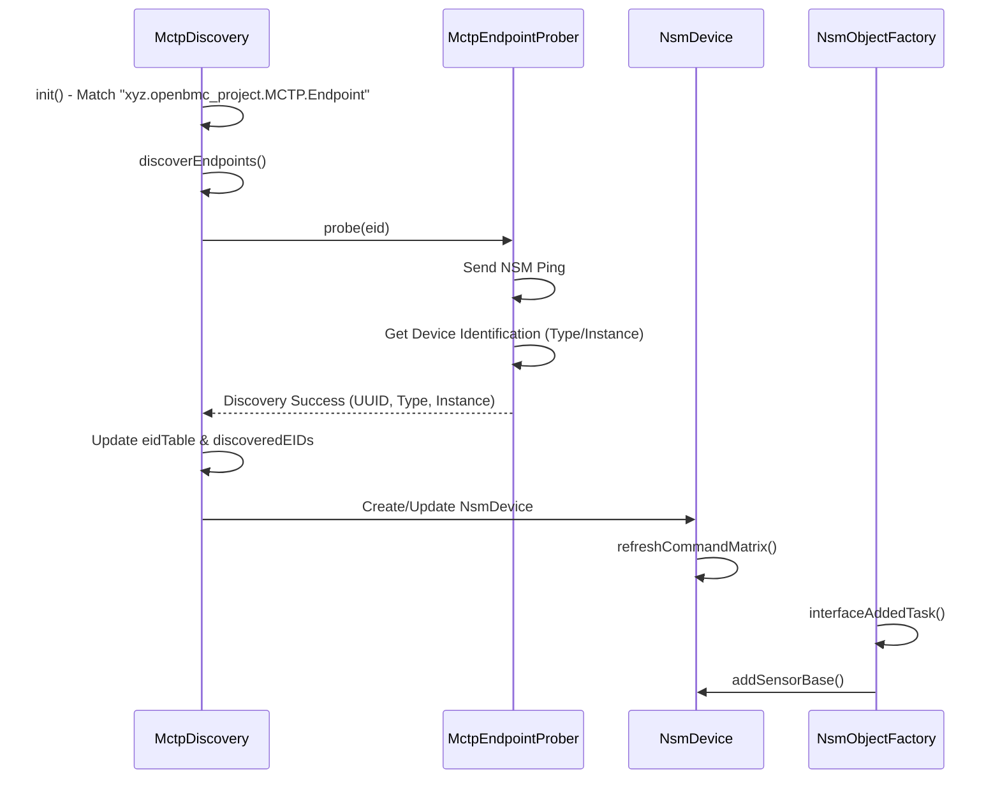
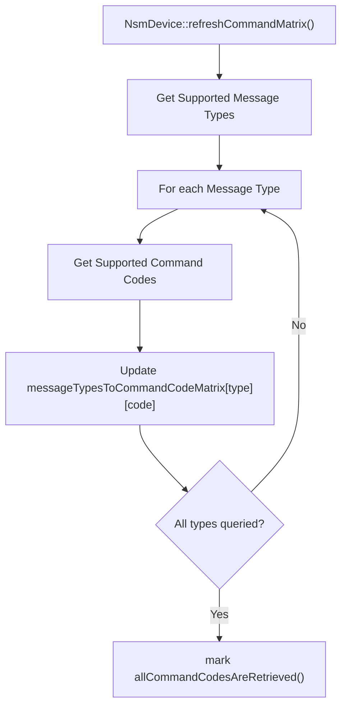

<!-- source: DeepWiki mcp.deepwiki.com · repo NVIDIA/nsmd · page 2.2 DeviceManager and Discovery · fetched 2026-10-26 -->

# DeviceManager and Discovery

Relevant source files

The following files were used as context for generating this wiki page:

- [libnsm/device-capability-discovery.c](libnsm/device-capability-discovery.c)
- [libnsm/device-capability-discovery.h](libnsm/device-capability-discovery.h)
- [libnsm/test/libnsm_device_capability_discovery_test.cpp](libnsm/test/libnsm_device_capability_discovery_test.cpp)
- [nsmd/eventManager.hpp](nsmd/eventManager.hpp)
- [nsmd/nsmDevice.cpp](nsmd/nsmDevice.cpp)
- [nsmd/nsmDevice.hpp](nsmd/nsmDevice.hpp)
- [nsmd/nsmEvent/nsmGPIOStateChangeEvent.cpp](nsmd/nsmEvent/nsmGPIOStateChangeEvent.cpp)
- [nsmd/nsmEventConfig/nsmEventSetting.hpp](nsmd/nsmEventConfig/nsmEventSetting.hpp)
- [nsmd/nsmObject.hpp](nsmd/nsmObject.hpp)
- [nsmd/nsmObjectFactory.cpp](nsmd/nsmObjectFactory.cpp)
- [nsmd/nsmObjectFactory.hpp](nsmd/nsmObjectFactory.hpp)
- [nsmd/nsmReady/nsmRemapInstanceNumber.cpp](nsmd/nsmReady/nsmRemapInstanceNumber.cpp)
- [nsmd/sensorManager.cpp](nsmd/sensorManager.cpp)
- [nsmd/sensorManager.hpp](nsmd/sensorManager.hpp)
- [nsmd/test/mockSensorManager.hpp](nsmd/test/mockSensorManager.hpp)
- [requester/mctp_endpoint_discovery.cpp](requester/mctp_endpoint_discovery.cpp)
- [requester/mctp_endpoint_discovery.hpp](requester/mctp_endpoint_discovery.hpp)
- [requester/mctp_endpoint_prober.cpp](requester/mctp_endpoint_prober.cpp)
- [requester/mctp_endpoint_prober.hpp](requester/mctp_endpoint_prober.hpp)
- [requester/retry_backoff_utils.hpp](requester/retry_backoff_utils.hpp)

This document covers how `nsmd` handles MCTP endpoint discovery, device enumeration, capability queries, and FRU data exposure. These processes are primarily managed by `MctpDiscovery` and the `NsmDevice` class, which coordinate to transform raw MCTP endpoints into managed NSM devices.

For information about sensor management and device lifecycle coordination, see [SensorManager and Device Lifecycle (2.1)](). For MCTP transport layer details, see [MCTP Transport and Discovery (5.2)]().

## System Architecture and Role

The discovery infrastructure serves as the bridge between the MCTP transport layer and the creation of fully-configured `NsmDevice` objects. It implements D-Bus watchers for MCTP endpoints and transforms them into managed NSM entities with known capabilities.

### Natural Language to Code Entity Mapping: Discovery Core

| System Concept | Code Entity | Role |
| :--- | :--- | :--- |
| **Endpoint Discovery** | `mctp::MctpDiscovery` | Monitors D-Bus for MCTP endpoints and manages the EID-to-UUID mapping. |
| **Device Probing** | `requester::MctpEndpointProber` | Handles the "ping" and capability query sequence with retry logic. |
| **Device Abstraction** | `nsm::NsmDevice` | Represents a physical device, holding its capability matrix and sensor list. |
| **Object Creation** | `nsm::NsmObjectFactory` | Uses a registration pattern to create D-Bus objects based on EM configurations. |
| **Inventory Mapping** | `nsm::SensorManager` | Tracks mappings between hardware modules and discovered devices. |

**Sources:** [requester/mctp_endpoint_discovery.hpp:56-112](), [nsmd/nsmDevice.hpp:124-156](), [nsmd/nsmObjectFactory.hpp:48-76]()

## Discovery Workflow

The discovery process is triggered when MCTP endpoints come online or when Entity Manager (EM) provides new configurations.

### Discovery Process Flow

**Sources:** [requester/mctp_endpoint_discovery.cpp:92-164](), [requester/mctp_endpoint_discovery.cpp:166-213](), [nsmd/sensorManager.cpp:133-184]()

### Endpoint Probing and EID Mapping
The `MctpDiscovery` class maintains the `eidTable`, a multimap linking UUIDs to their current EID, Medium, and Binding [requester/mctp_endpoint_discovery.hpp:51-52](). When a new endpoint is detected via `discoverEndpoints` [requester/mctp_endpoint_discovery.cpp:130](), the `MctpEndpointProber` executes a sequence of NSM commands to verify the device is responsive and to retrieve its identity.

## Device Capability Discovery

Once a device is identified, `nsmd` queries its protocol capabilities to build a `messageTypesToCommandCodeMatrix`. This matrix determines which sensors and controls can be instantiated for that specific device.

### Capability Matrix Construction

**Sources:** [nsmd/nsmDevice.cpp:127-139](), [nsmd/nsmDevice.cpp:150-177](), [nsmd/sensorManager.hpp:143-144]()

Key data structures in `NsmDevice`:
- `messageTypesToCommandCodeMatrix`: A 2D vector of booleans `[NUM_NSM_TYPES][NUM_COMMAND_CODES]` [nsmd/nsmDevice.hpp:151-152]().
- `isCommandSupported(type, code)`: A helper to check the matrix before sending requests [nsmd/nsmDevice.cpp:141-148]().

## Device Remapping and Instance Numbers

NSM supports remapping device instance numbers based on physical topology (EID, UUID, or Association). This is critical for Grace-Hopper systems where multiple GPUs or Switches must have stable, predictable instance numbers on D-Bus.

### Remapping Logic

The `saveNsmMapInstanceTable` function handles EM configurations that define how instance IDs should be assigned [nsmd/nsmReady/nsmRemapInstanceNumber.cpp:29-33]().

| Mapping Type | Code Entity | Source of Truth |
| :--- | :--- | :--- |
| **UUID Mapping** | `mapUuidToInstanceNumber` | `xyz.openbmc_project.Configuration.NSM_GetInstanceIDByMctpUUID` |
| **EID Mapping** | `mapEidToInstanceNumber` | `xyz.openbmc_project.Configuration.NSM_GetInstanceIDByDeviceEID` |
| **Direct Mapping** | `mapInstanceNumberToInstanceNumber` | `xyz.openbmc_project.Configuration.NSM_GetInstanceIDByDeviceInstanceID` |

**Sources:** [nsmd/nsmReady/nsmRemapInstanceNumber.cpp:113-157](), [requester/mctp_endpoint_discovery.hpp:47-50]()

## NsmObjectFactory Registration Pattern

The `NsmObjectFactory` uses a factory pattern to create NSM objects (sensors, inventory items, controls) based on D-Bus interfaces added by Entity Manager.

### Registration Macro
Classes register their creation logic using the `REGISTER_NSM_CREATION_FUNCTION` macro [nsmd/nsmObjectFactory.hpp:40-46](). This adds the interface name and a corresponding `CreationFunction` to the factory's internal map [nsmd/nsmObjectFactory.hpp:66]().

### Object Creation Flow
1. `SensorManagerImpl::scanInventory()` finds all objects under `/xyz/openbmc_project/inventory` [nsmd/sensorManager.cpp:133-150]().
2. For each interface, it checks `NsmObjectFactory::isSupported()` [nsmd/sensorManager.cpp:163]().
3. `interfaceAddedTask()` invokes the registered `CreationFunction` [nsmd/sensorManager.cpp:207]().
4. The creation function typically finds the relevant `NsmDevice` and calls `addSensorBase()` [nsmd/nsmDevice.cpp:179-205]().

## FRU Data Exposure

`NsmDevice` manages FRU (Field Replaceable Unit) data through the `FruInterfaceManager` struct [nsmd/nsmDevice.hpp:93-114]().

### FRU Implementation Details
- **Interface Creation**: `createAndRegisterInterface` creates a D-Bus interface (e.g., `xyz.openbmc_project.Inventory.Decorator.Asset`) for the device [nsmd/nsmDevice.hpp:104-107]().
- **Property Management**: Properties like `SerialNumber`, `PartNumber`, and `Manufacturer` are registered and updated dynamically based on NSM inventory commands [nsmd/nsmDevice.hpp:108-113]().
- **Persistence**: The `FruInterfaceManager` tracks if an interface has been initialized to avoid redundant D-Bus traffic [nsmd/nsmDevice.hpp:97]().

**Sources:** [nsmd/nsmDevice.hpp:93-114](), [nsmd/nsmDevice.cpp:709-720]()

---

