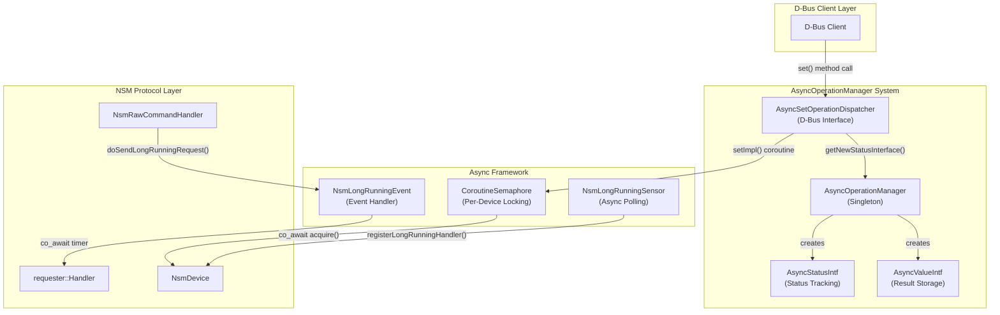
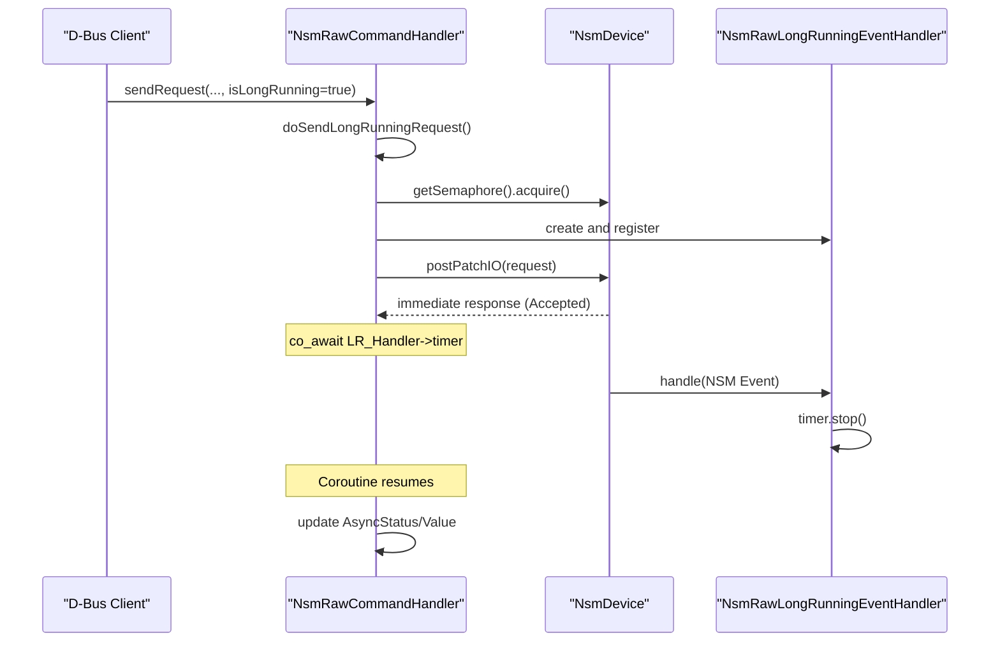

<!-- source: DeepWiki mcp.deepwiki.com · repo NVIDIA/nsmd · page 2.3 Asynchronous Operation Management · fetched 2026-10-26 -->

# Asynchronous Operation Management

Relevant source files

The following files were used as context for generating this wiki page:

- [common/coroutine.hpp](common/coroutine.hpp)
- [common/coroutineSemaphore.hpp](common/coroutineSemaphore.hpp)
- [common/test/mockSocketIo.hpp](common/test/mockSocketIo.hpp)
- [nsmd/nsmChassis/nsmGpuClockControl.cpp](nsmd/nsmChassis/nsmGpuClockControl.cpp)
- [nsmd/nsmChassis/nsmGpuClockControl.hpp](nsmd/nsmChassis/nsmGpuClockControl.hpp)
- [nsmd/nsmCommon/nsmCommon.cpp](nsmd/nsmCommon/nsmCommon.cpp)
- [nsmd/nsmCommon/nsmCommon.hpp](nsmd/nsmCommon/nsmCommon.hpp)
- [nsmd/nsmCommon/test/nsmCommon_test.cpp](nsmd/nsmCommon/test/nsmCommon_test.cpp)
- [nsmd/nsmEvent/nsmLongRunningEvent.cpp](nsmd/nsmEvent/nsmLongRunningEvent.cpp)
- [nsmd/nsmEvent/nsmLongRunningEvent.hpp](nsmd/nsmEvent/nsmLongRunningEvent.hpp)
- [nsmd/nsmEvent/nsmLongRunningEventHandler.cpp](nsmd/nsmEvent/nsmLongRunningEventHandler.cpp)
- [nsmd/nsmLongRunning/nsmAsyncLongRunningSensor.cpp](nsmd/nsmLongRunning/nsmAsyncLongRunningSensor.cpp)
- [nsmd/nsmLongRunning/nsmAsyncLongRunningSensor.hpp](nsmd/nsmLongRunning/nsmAsyncLongRunningSensor.hpp)
- [nsmd/nsmLongRunning/nsmLongRunningSensor.cpp](nsmd/nsmLongRunning/nsmLongRunningSensor.cpp)
- [nsmd/nsmLongRunning/nsmLongRunningSensor.hpp](nsmd/nsmLongRunning/nsmLongRunningSensor.hpp)
- [nsmd/nsmRawCommand/meson.build](nsmd/nsmRawCommand/meson.build)
- [nsmd/nsmRawCommand/nsmRawCommandHandler.cpp](nsmd/nsmRawCommand/nsmRawCommandHandler.cpp)
- [nsmd/nsmRawCommand/nsmRawCommandHandler.hpp](nsmd/nsmRawCommand/nsmRawCommandHandler.hpp)
- [nsmd/nsmRawCommand/test/nsmRawCommandHandler_test.cpp](nsmd/nsmRawCommand/test/nsmRawCommandHandler_test.cpp)
- [nsmd/nsmSetAsync/asyncOperationManager.cpp](nsmd/nsmSetAsync/asyncOperationManager.cpp)
- [nsmd/nsmSetAsync/asyncOperationManager.hpp](nsmd/nsmSetAsync/asyncOperationManager.hpp)
- [nsmd/nsmSetAsync/nsmSetCpuOperatingConfig.cpp](nsmd/nsmSetAsync/nsmSetCpuOperatingConfig.cpp)
- [nsmd/nsmSetAsync/test/asyncOperationManager_test.cpp](nsmd/nsmSetAsync/test/asyncOperationManager_test.cpp)
- [nsmd/socketIo.cpp](nsmd/socketIo.cpp)
- [nsmd/socketIo.hpp](nsmd/socketIo.hpp)
- [nsmd/socket_handler.cpp](nsmd/socket_handler.cpp)
- [nsmd/socket_handler.hpp](nsmd/socket_handler.hpp)
- [nsmd/test/requesterDeepBranch_test.cpp](nsmd/test/requesterDeepBranch_test.cpp)
- [nsmd/test/requesterHandlerBranch_test.cpp](nsmd/test/requesterHandlerBranch_test.cpp)
- [nsmd/test/socket_handler_test.cpp](nsmd/test/socket_handler_test.cpp)
- [requester/handler.hpp](requester/handler.hpp)
- [requester/request.hpp](requester/request.hpp)

The Asynchronous Operation Management system provides infrastructure for handling long-running, non-blocking D-Bus operations and complex NSM protocol interactions within the `nsmd` daemon. This system manages operation status tracking, result delivery, resource cleanup, and specialized handling for "Long Running" NSM commands that utilize asynchronous events for completion.

For information about the core nsmd daemon structure, see [Core nsmd Daemon](). For details about the NSM protocol layer, see [NSM Protocol Layer]().

## System Purpose and Architecture

The `AsyncOperationManager` enables `nsmd` to handle time-intensive operations like hardware configuration changes, debug token operations, and diagnostic commands without blocking D-Bus clients. It utilizes C++20 coroutines to maintain a responsive event loop while waiting for hardware responses or MCTP timeouts.

### Core Component Architecture

Sources: [nsmd/nsmSetAsync/asyncOperationManager.hpp:24-131](), [nsmd/nsmSetAsync/asyncOperationManager.cpp:25-227](), [nsmd/nsmLongRunning/nsmLongRunningSensor.cpp:38-69](), [nsmd/nsmRawCommand/nsmRawCommandHandler.cpp:74-103]()

## Core Components

### AsyncOperationManager

The `AsyncOperationManager` is a singleton class that orchestrates the creation and lifecycle management of asynchronous D-Bus operations [nsmd/nsmSetAsync/asyncOperationManager.cpp:25-30]().

| Component | Purpose | Key Methods |
|-----------|---------|-------------|
| `getInstance()` | Singleton access | Returns global instance [nsmd/nsmSetAsync/asyncOperationManager.cpp:25-30]() |
| `getNewStatusInterface()` | Status-only operations | Creates `AsyncStatusIntf` [nsmd/nsmSetAsync/asyncOperationManager.cpp:82-101]() |
| `getNewStatusValueInterface()` | Operations with results | Creates status and value interfaces [nsmd/nsmSetAsync/asyncOperationManager.cpp:113-136]() |
| `getDispatcher()` | D-Bus method handling | Returns dispatcher for object path [nsmd/nsmSetAsync/asyncOperationManager.cpp:37-44]() |

The manager maintains internal maps for `statusInterfaces`, `valueInterfaces`, and `objectPathTimers` to manage the 2-minute cleanup lifecycle of operation result objects [nsmd/nsmSetAsync/asyncOperationManager.cpp:62-73]().

### AsyncSetOperationDispatcher

The dispatcher implements the D-Bus `com.nvidia.Async.Set` interface [nsmd/nsmSetAsync/asyncOperationManager.hpp:115-116](). It maps D-Bus property changes to registered coroutine handlers [nsmd/nsmSetAsync/asyncOperationManager.cpp:161-168]().

When a `set` call is received, it invokes `setImpl`, which manages the execution flow:
1. Updates status to `InProgress` [nsmd/nsmSetAsync/asyncOperationManager.cpp:200]().
2. Executes the registered `operation.handler` [nsmd/nsmSetAsync/asyncOperationManager.cpp:204]().
3. Optionally triggers a sensor update if a sensor is associated with the operation [nsmd/nsmSetAsync/asyncOperationManager.cpp:210]().
4. Updates final status to `Success` or error types like `InvalidArgument` [nsmd/nsmSetAsync/asyncOperationManager.cpp:217-224]().

Sources: [nsmd/nsmSetAsync/asyncOperationManager.cpp:138-227]()

## Long-Running Operations (NSM Type 1/2)

Certain NSM commands return an immediate response indicating the command was accepted, followed by an asynchronous NSM Event containing the actual result. The system handles this via `NsmLongRunningEvent` and derived classes.

### NsmLongRunningEvent and Sensor Abstractions

- **NsmLongRunningEvent**: A base class for handling NSM events associated with long-running commands. It contains a `timer` that is used to `co_await` the completion event [nsmd/nsmEvent/nsmLongRunningEvent.hpp:26-34]().
- **NsmLongRunningSensor**: Extends `NsmSensor` to support polling that involves long-running NSM commands [nsmd/nsmLongRunning/nsmLongRunningSensor.hpp:25-30]().
- **NsmAsyncLongRunningSensor**: A version of the long-running sensor that specifically works with `NsmAsyncSensor` and the `AsyncOperationManager` [nsmd/nsmLongRunning/nsmAsyncLongRunningSensor.hpp:26-31]().

### Execution Flow for Long-Running Commands

The `update` method in `NsmLongRunningSensor` demonstrates the coordination between hardware locking and event waiting:

1. **Locking**: Acquires the device semaphore to ensure exclusive access during the request/event cycle [nsmd/nsmLongRunning/nsmLongRunningSensor.cpp:44]().
2. **Registration**: Registers itself as the active long-running handler in the `NsmDevice` for the specific `messageType` and `commandCode` [nsmd/nsmLongRunning/nsmLongRunningSensor.cpp:49-50]().
3. **Request**: Sends the initial NSM request. If the response indicates success, it transitions to waiting for the event [nsmd/nsmLongRunning/nsmLongRunningSensor.cpp:51-52]().
4. **Waiting**: Uses `co_await timer` to suspend the coroutine until the event is received or a timeout occurs [nsmd/nsmLongRunning/nsmLongRunningSensor.cpp:55]().
5. **Cleanup**: Unregisters the handler and releases the semaphore [nsmd/nsmLongRunning/nsmLongRunningSensor.cpp:61-63]().

Sources: [nsmd/nsmLongRunning/nsmLongRunningSensor.cpp:38-69](), [nsmd/nsmLongRunning/nsmAsyncLongRunningSensor.cpp:27-67]()

## Raw Command Interface

The `NsmRawCommandHandler` provides a direct D-Bus interface for sending arbitrary NSM commands, supporting both immediate and long-running modes.

Sources: [nsmd/nsmRawCommand/nsmRawCommandHandler.cpp:74-182](), [nsmd/nsmRawCommand/nsmRawCommandHandler.hpp:31-43]()

## Resource Management and Safety

### CoroutineSemaphore
To prevent command interleaving on a single MCTP endpoint, `NsmDevice` uses a `CoroutineSemaphore`. This ensures that only one high-priority or long-running operation (like a firmware update or raw command) is active at a time [nsmd/nsmLongRunning/nsmLongRunningSensor.cpp:44]().

### Timeout and Cleanup
- **D-Bus Result Cleanup**: `AsyncOperationManager` uses a 2-minute timer to delete result objects from the D-Bus tree [nsmd/nsmSetAsync/asyncOperationManager.cpp:73]().
- **NSM Request Retries**: The `requester::Handler` manages the lifecycle of individual NSM requests, including retries and instance ID expiration [requester/handler.hpp:51-61]().
- **Socket Buffers**: The system dynamically adjusts socket send buffers if a large NSM request (like a raw command) exceeds the default size [requester/handler.hpp:173-178]().

Sources: [nsmd/nsmSetAsync/asyncOperationManager.cpp:61-75](), [requester/handler.hpp:108-163](), [requester/request.hpp:57-78]()

---

