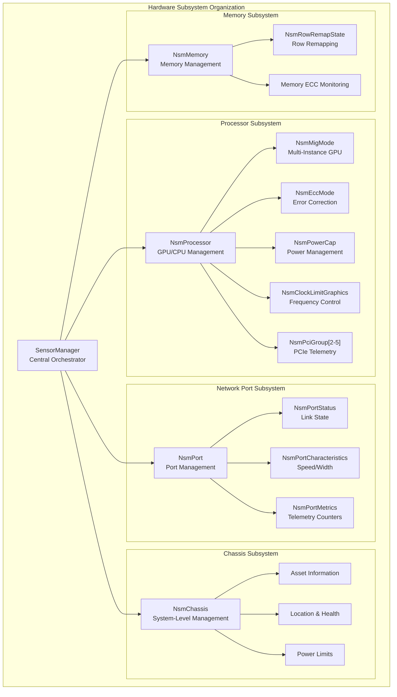
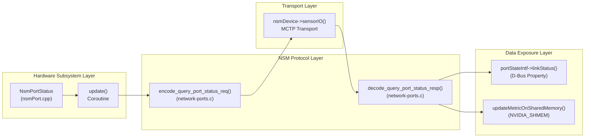

<!-- source: DeepWiki mcp.deepwiki.com · repo NVIDIA/nsmd · page 3 Hardware Subsystems · fetched 2026-10-26 -->

# Hardware Subsystems

Relevant source files

The following files were used as context for generating this wiki page:

- [libnsm/network-ports.c](libnsm/network-ports.c)
- [libnsm/network-ports.h](libnsm/network-ports.h)
- [libnsm/test/libnsm_network_ports_test.cpp](libnsm/test/libnsm_network_ports_test.cpp)
- [nsmd/nsmChassis/nsmChassis.cpp](nsmd/nsmChassis/nsmChassis.cpp)
- [nsmd/nsmChassis/nsmChassis.hpp](nsmd/nsmChassis/nsmChassis.hpp)
- [nsmd/nsmChassis/test/meson.build](nsmd/nsmChassis/test/meson.build)
- [nsmd/nsmChassis/test/nsmChassis_test.cpp](nsmd/nsmChassis/test/nsmChassis_test.cpp)
- [nsmd/nsmDeviceInventory/nsmPCIeRetimerSwitchDI.cpp](nsmd/nsmDeviceInventory/nsmPCIeRetimerSwitchDI.cpp)
- [nsmd/nsmDeviceInventory/nsmPCIeRetimerSwitchDI.hpp](nsmd/nsmDeviceInventory/nsmPCIeRetimerSwitchDI.hpp)
- [nsmd/nsmFwSwInventory/GPUSWInventory.cpp](nsmd/nsmFwSwInventory/GPUSWInventory.cpp)
- [nsmd/nsmFwSwInventory/GPUSWInventory.hpp](nsmd/nsmFwSwInventory/GPUSWInventory.hpp)
- [nsmd/nsmFwSwInventory/NVLinkManagementNICSWInventory.cpp](nsmd/nsmFwSwInventory/NVLinkManagementNICSWInventory.cpp)
- [nsmd/nsmFwSwInventory/NVLinkManagementNICSWInventory.hpp](nsmd/nsmFwSwInventory/NVLinkManagementNICSWInventory.hpp)
- [nsmd/nsmFwSwInventory/meson.build](nsmd/nsmFwSwInventory/meson.build)
- [nsmd/nsmFwSwInventory/test/NVLinkManagementNICSWInventory_test.cpp](nsmd/nsmFwSwInventory/test/NVLinkManagementNICSWInventory_test.cpp)
- [nsmd/nsmMemory/nsmMemory.cpp](nsmd/nsmMemory/nsmMemory.cpp)
- [nsmd/nsmMemory/nsmMemory.hpp](nsmd/nsmMemory/nsmMemory.hpp)
- [nsmd/nsmMemory/test/nsmMemory_test.cpp](nsmd/nsmMemory/test/nsmMemory_test.cpp)
- [nsmd/nsmPort/nsmPort.cpp](nsmd/nsmPort/nsmPort.cpp)
- [nsmd/nsmPort/nsmPort.hpp](nsmd/nsmPort/nsmPort.hpp)
- [nsmd/nsmPort/test/nsmPort_test.cpp](nsmd/nsmPort/test/nsmPort_test.cpp)
- [nsmd/nsmProcessor/meson.build](nsmd/nsmProcessor/meson.build)
- [nsmd/nsmProcessor/nsmProcessor.cpp](nsmd/nsmProcessor/nsmProcessor.cpp)
- [nsmd/nsmProcessor/nsmProcessor.hpp](nsmd/nsmProcessor/nsmProcessor.hpp)
- [nsmd/nsmProcessor/test/meson.build](nsmd/nsmProcessor/test/meson.build)
- [nsmd/nsmProcessor/test/nsmProcessor_test.cpp](nsmd/nsmProcessor/test/nsmProcessor_test.cpp)

This document covers the hardware-specific management subsystems within the NSM (NVIDIA System Management) daemon. These subsystems provide monitoring, control, and telemetry capabilities for various hardware components including processors/GPUs, network ports, chassis components, and memory subsystems.

For information about the core nsmd daemon architecture and sensor management, see [Core nsmd Daemon](#2). For details about the NSM protocol layer that these subsystems use to communicate with hardware, see [NSM Protocol Layer](#4).

## Hardware Subsystem Architecture

The NSM daemon organizes hardware management into specialized subsystems, each responsible for a specific category of hardware components. These subsystems inherit from common base classes and integrate with the central `SensorManager` for coordinated polling and data collection.

Sources: [nsmd/nsmProcessor/nsmProcessor.hpp:1-250](), [nsmd/nsmPort/nsmPort.hpp:1-150](), [nsmd/nsmChassis/nsmChassis.hpp:1-100](), [nsmd/nsmMemory/nsmMemory.hpp:1-100]()

## Sensor Classification and Polling

Hardware subsystems organize their sensors into different priority classes based on criticality and update frequency requirements. These are managed by the `NsmDevice` class which maintains separate queues for different polling requirements.

| Priority Class | Polling Interval | Purpose | Example Components |
|---|---|---|---|
| `prioritySensors` | 150ms | Critical real-time monitoring | GPU power states, thermal limits |
| `gpmSensors` | 1000ms | Graphics performance monitoring | Clock frequencies, utilization |
| `roundRobinSensors` | Circular queue | Regular telemetry updates | Port counters, ECC statistics |
| `longRunningSensors` | 30s | Operations requiring extended time | `NsmMigMode`, `NsmSetEccMode` |
| `staticSensors` | One-time read | Immutable properties | `NsmInventoryProperty`, `NsmAssetIntf` |

Sources: [nsmd/nsmProcessor/nsmProcessor.cpp:78-165](), [nsmd/nsmChassis/nsmChassis.cpp:84-104]()

## Hardware Communication Flow

This diagram illustrates how a hardware subsystem component (e.g., `NsmPortStatus`) interacts with the protocol and transport layers to retrieve data.

Sources: [nsmd/nsmPort/nsmPort.cpp:142-224](), [libnsm/network-ports.c:134-160](), [nsmd/nsmProcessor/nsmProcessor.cpp:78-99]()

## Hardware Subsystem Categories

### [Processor and GPU Management](#3.1)

The processor subsystem handles GPU and CPU device management, including power control, performance monitoring, and hardware configuration. It uses the `NsmProcessor` abstraction to represent high-level device groups.

- **`NsmMigMode`**: Multi-Instance GPU mode configuration and monitoring [nsmd/nsmProcessor/nsmProcessor.cpp:78-99]().
- **`NsmEccMode`**: Memory Error Correction Code mode management [nsmd/nsmProcessor/nsmProcessor.cpp:137-165]().
- **`NsmPowerCap`**: Dynamic power capping and thermal management [nsmd/nsmProcessor/nsmProcessor.hpp:39-40]().
- **`NsmClockLimitGraphics`**: Graphics clock frequency control and monitoring.
- **`NsmOemResetStatistics`**: Tracking of hardware reset events [nsmd/nsmProcessor/nsmOemResetStatistics.hpp:1-50]().

For details, see [Processor and GPU Management](#3.1).

### [Network Port Management](#3.2)

The port subsystem manages high-speed network interfaces, primarily NVLink ports for GPU-to-GPU communication and Ethernet/Infiniband ports.

- **`NsmPortStatus`**: Link state monitoring (Up/Down/Sleep) and training error detection [nsmd/nsmPort/nsmPort.cpp:120-140]().
- **`NsmPortCharacteristics`**: Port capabilities, speed (MBps), and width configuration [nsmd/nsmPort/nsmPort.cpp:241-260]().
- **`NsmPortMetrics`**: Telemetry counter collection (TX/RX packets, data, errors) [nsmd/nsmPort/nsmPort.cpp:388-410]().
- **`EthPortTelemetryAggregator`**: Aggregated metrics for Ethernet interfaces [nsmd/nsmPort/nsmPort.hpp:159-170]().

For details, see [Network Port Management](#3.2).

### [Chassis and System Management](#3.3)

The chassis subsystem provides system-level management and asset tracking via the `NsmChassis` template class.

- **Asset Information**: Hardware identification including `FRU_PART_NUMBER`, `SERIAL_NUMBER`, and `MARKETING_NAME` [nsmd/nsmChassis/nsmChassis.cpp:43-65]().
- **Location and Health**: Physical location tracking (`LocationIntf`) and health status monitoring (`HealthIntf`) [nsmd/nsmChassis/nsmChassis.cpp:158-182]().
- **Power Limits**: System-level power budget management.
- **Specialized Assemblies**: Support for NVSwitch and management NIC chassis [nsmd/nsmChassis/nsmChassis.cpp:202-220]().

For details, see [Chassis and System Management](#3.3).

### [Memory Management](#3.4)

The memory subsystem monitors and manages system memory components, including capacity and error rates.

- **`NsmRowRemapState`**: Memory row remapping status for hardware fault tolerance [nsmd/nsmMemory/nsmMemory.hpp:1-50]().
- **Memory ECC**: Detailed error correction monitoring and reporting for DRAM and SRAM.
- **Firmware Inventory**: Tracking software versions for GPU and NVLink management NICs [nsmd/nsmFwSwInventory/GPUSWInventory.hpp:1-30]().

For details, see [Memory Management](#3.4).

### [Device Inventory and Control](#3.5)

Additional device-specific management capabilities for complex interconnect components.

- **`NsmPCIeRetimerSwitchDI`**: Device inventory for PCIe retimer switches [nsmd/nsmDeviceInventory/nsmPCIeRetimerSwitchDI.hpp:1-40]().
- **`NsmSwitch`**: Management logic specifically for NVSwitch devices.
- **Isolation Controls**: Logic for managing device isolation and power modes [libnsm/network-ports.h:52-55]().

For details, see [Device Inventory and Control](#3.5).

Sources: [nsmd/nsmProcessor/nsmProcessor.cpp:1-200](), [nsmd/nsmPort/nsmPort.cpp:1-500](), [nsmd/nsmChassis/nsmChassis.cpp:1-300](), [nsmd/nsmMemory/nsmMemory.hpp:1-100](), [nsmd/nsmDeviceInventory/nsmPCIeRetimerSwitchDI.hpp:1-50]()

---

