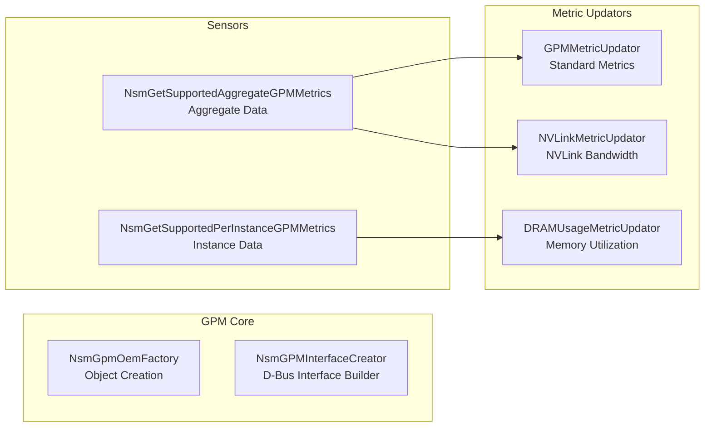

<!-- source: DeepWiki mcp.deepwiki.com · repo NVIDIA/nsmd · page 3.1 Processor and GPU Management · fetched 2026-10-26 -->

# Processor and GPU Management

Relevant source files

The following files were used as context for generating this wiki page:

- [mockupResponder/gpmMetricsList.hpp](mockupResponder/gpmMetricsList.hpp)
- [nsmd/nsmChassis/nsmProcessorModulePowerControl.cpp](nsmd/nsmChassis/nsmProcessorModulePowerControl.cpp)
- [nsmd/nsmChassis/nsmProcessorModulePowerControl.hpp](nsmd/nsmChassis/nsmProcessorModulePowerControl.hpp)
- [nsmd/nsmDbusIfaceOverride/nsmPowerSmoothingAdminProfileIntf-v2.hpp](nsmd/nsmDbusIfaceOverride/nsmPowerSmoothingAdminProfileIntf-v2.hpp)
- [nsmd/nsmDbusIfaceOverride/nsmPowerSmoothingAdminProfileIntf.hpp](nsmd/nsmDbusIfaceOverride/nsmPowerSmoothingAdminProfileIntf.hpp)
- [nsmd/nsmDbusIfaceOverride/nsmPowerSmoothingCurrentProfileIface.hpp](nsmd/nsmDbusIfaceOverride/nsmPowerSmoothingCurrentProfileIface.hpp)
- [nsmd/nsmDbusIfaceOverride/nsmPowerSmoothingFeatureIntf-v2.hpp](nsmd/nsmDbusIfaceOverride/nsmPowerSmoothingFeatureIntf-v2.hpp)
- [nsmd/nsmDbusIfaceOverride/nsmPowerSmoothingFeatureIntf.hpp](nsmd/nsmDbusIfaceOverride/nsmPowerSmoothingFeatureIntf.hpp)
- [nsmd/nsmDbusIfaceOverride/nsmPowerSmoothingPowerProfileIntf-v2.hpp](nsmd/nsmDbusIfaceOverride/nsmPowerSmoothingPowerProfileIntf-v2.hpp)
- [nsmd/nsmDbusIfaceOverride/nsmPowerSmoothingPowerProfileIntf.hpp](nsmd/nsmDbusIfaceOverride/nsmPowerSmoothingPowerProfileIntf.hpp)
- [nsmd/nsmDbusIfaceOverride/nsmWorkloadPowerProfileInfoIface.hpp](nsmd/nsmDbusIfaceOverride/nsmWorkloadPowerProfileInfoIface.hpp)
- [nsmd/nsmGPM/nsmGpmOem.cpp](nsmd/nsmGPM/nsmGpmOem.cpp)
- [nsmd/nsmGPM/nsmGpmOem.hpp](nsmd/nsmGPM/nsmGpmOem.hpp)
- [nsmd/nsmGPM/nsmGpmOemFactory.cpp](nsmd/nsmGPM/nsmGpmOemFactory.cpp)
- [nsmd/nsmGPM/test/nsmGpmOem_test.cpp](nsmd/nsmGPM/test/nsmGpmOem_test.cpp)
- [nsmd/nsmProcessor/meson.build](nsmd/nsmProcessor/meson.build)
- [nsmd/nsmProcessor/nsmPowerLimit.cpp](nsmd/nsmProcessor/nsmPowerLimit.cpp)
- [nsmd/nsmProcessor/nsmPowerLimit.hpp](nsmd/nsmProcessor/nsmPowerLimit.hpp)
- [nsmd/nsmProcessor/nsmPowerSmoothing-v2.hpp](nsmd/nsmProcessor/nsmPowerSmoothing-v2.hpp)
- [nsmd/nsmProcessor/nsmPowerSmoothing.cpp](nsmd/nsmProcessor/nsmPowerSmoothing.cpp)
- [nsmd/nsmProcessor/nsmPowerSmoothing.hpp](nsmd/nsmProcessor/nsmPowerSmoothing.hpp)
- [nsmd/nsmProcessor/nsmProcessor.cpp](nsmd/nsmProcessor/nsmProcessor.cpp)
- [nsmd/nsmProcessor/nsmProcessor.hpp](nsmd/nsmProcessor/nsmProcessor.hpp)
- [nsmd/nsmProcessor/nsmSoCPowerSmoothing.cpp](nsmd/nsmProcessor/nsmSoCPowerSmoothing.cpp)
- [nsmd/nsmProcessor/nsmSoCPowerSmoothing.hpp](nsmd/nsmProcessor/nsmSoCPowerSmoothing.hpp)
- [nsmd/nsmProcessor/nsmWorkloadPowerProfile.cpp](nsmd/nsmProcessor/nsmWorkloadPowerProfile.cpp)
- [nsmd/nsmProcessor/nsmWorkloadPowerProfile.hpp](nsmd/nsmProcessor/nsmWorkloadPowerProfile.hpp)
- [nsmd/nsmProcessor/test/meson.build](nsmd/nsmProcessor/test/meson.build)
- [nsmd/nsmProcessor/test/nsmProcessor_test.cpp](nsmd/nsmProcessor/test/nsmProcessor_test.cpp)
- [nsmd/nsmSetAsync/nsmSetECCMode.cpp](nsmd/nsmSetAsync/nsmSetECCMode.cpp)
- [nsmd/nsmSetAsync/nsmSetECCMode.hpp](nsmd/nsmSetAsync/nsmSetECCMode.hpp)
- [nsmd/nsmSetAsync/nsmSetMigMode.cpp](nsmd/nsmSetAsync/nsmSetMigMode.cpp)
- [nsmd/nsmSetAsync/nsmSetMigMode.hpp](nsmd/nsmSetAsync/nsmSetMigMode.hpp)
- [nsmtool/gpm_metrics_list.hpp](nsmtool/gpm_metrics_list.hpp)

## Purpose and Scope

This document covers the comprehensive processor and GPU management subsystem within the NSM daemon, focusing on the `NsmProcessor` component hierarchy. This system handles GPU/processor device monitoring, configuration, and control operations including MIG mode management, ECC control, power management, clock frequency control, PCIe telemetry, and performance monitoring. It also includes advanced features like GPU Performance Monitoring (GPM), power smoothing (v1 and v2), and workload power profiles.

For network port management, see [Network Port Management](3.2). For chassis-level management, see [Chassis and System Management](3.3). For memory subsystem details, see [Memory Management](3.4).

## Architecture Overview

The processor management system is built around specialized sensor classes that extend the base `NsmSensor` and `NsmLongRunningSensor` frameworks. Each component handles specific aspects of GPU/processor functionality through NSM protocol communications and exposes data via D-Bus interfaces and shared memory.

```mermaid
graph TB
    subgraph "D-Bus Interfaces"
        MigIntf["com.nvidia.MigMode"]
        EccIntf["xyz.openbmc_project.Memory.MemoryECC"]
        PerfIntf["xyz.openbmc_project.State.ProcessorPerformance"]
        AccelIntf["xyz.openbmc_project.Inventory.Item.Accelerator"]
        PowerIntf["xyz.openbmc_project.Inventory.Decorator.PowerLimit"]
        CCIntf["com.nvidia.CCMode"]
        GpmIntf["com.nvidia.GPMMetrics"]
    end

    subgraph "Core Sensor Classes"
        NsmMigMode["NsmMigMode<br/>MIG Mode Management"]
        NsmEccMode["NsmEccMode<br/>ECC Control"]
        NsmEccErrorCounts["NsmEccErrorCounts<br/>ECC Error Tracking"]
        NsmPowerCap["NsmPowerCap<br/>Power Management"]
        NsmEDPpScalingFactor["NsmEDPpScalingFactor<br/>EDPp Scaling"]
        NsmClockLimitGraphics["NsmClockLimitGraphics<br/>Clock Limits"]
        NsmCurrentUtilization["NsmCurrentUtilization<br/>Utilization Tracking"]
        NsmConfidentialCompute["NsmConfidentialCompute<br/>CC Mode"]
        NsmGpm["NsmGetSupportedAggregateGPMMetrics<br/>GPM Support"]
    end

    subgraph "Advanced Power Management"
        NsmPwrSmooth["NsmPowerSmoothing<br/>Power Smoothing v1/v2"]
        NsmWorkload["NsmWorkloadProfileStatus<br/>Power Profiles"]
    end

    subgraph "NSM Protocol Commands"
        GetMigMode["NSM_GET_MIG_MODE"]
        GetEccMode["NSM_GET_ECC_MODE"]
        GetEccErrors["NSM_GET_ECC_ERROR_COUNTS"]
        GetClockLimit["NSM_GET_CLOCK_LIMIT"]
        QueryTelemetry["NSM_QUERY_SCALAR_GROUP_TELEMETRY_V1"]
        GetGpm["NSM_GET_AGGREGATE_GPM_METRIC_SAMPLES"]
    end

    NsmMigMode --> MigIntf
    NsmEccMode --> EccIntf
    NsmEccErrorCounts --> EccIntf
    NsmCurrentUtilization --> PerfIntf
    NsmPowerCap --> PowerIntf
    NsmConfidentialCompute --> CCIntf
    NsmGpm --> GpmIntf

    NsmMigMode --> GetMigMode
    NsmEccMode --> GetEccMode
    NsmEccErrorCounts --> GetEccErrors
    NsmClockLimitGraphics --> GetClockLimit
    NsmGpm --> GetGpm
```

Sources: [nsmd/nsmProcessor/nsmProcessor.hpp:98-837](), [nsmd/nsmProcessor/nsmProcessor.cpp:78-1002](), [nsmd/nsmGPM/nsmGpmOem.cpp:164-210]()

## GPU Mode Management

### MIG Mode Control

The `NsmMigMode` class manages Multi-Instance GPU functionality. It uses `NSM_GET_MIG_MODE` to retrieve state and supports long-running event-based updates [nsmd/nsmProcessor/nsmProcessor.cpp:345-421]().

- **D-Bus Interface**: `com.nvidia.MigMode` [nsmd/nsmProcessor/nsmProcessor.cpp:96-99]()
- **Command**: `NSM_GET_MIG_MODE` [nsmd/nsmProcessor/test/nsmProcessor_test.cpp:57-57]()
- **Async Operation**: `NsmSetMigMode` handles D-Bus set requests using the `AsyncOperationManager` [nsmd/nsmProcessor/nsmProcessor.cpp:93-99]().

### ECC Mode Management

ECC management is handled by `NsmEccMode` and `NsmSetEccMode` [nsmd/nsmProcessor/nsmProcessor.cpp:146-165]().
- **Properties**: `ECCModeEnabled` (Current) and `PendingECCModeEnabled` (Next reboot) [nsmd/nsmProcessor/nsmProcessor.cpp:484-503]().
- **Error Counting**: `NsmEccErrorCounts` monitors SRAM and DRAM corrected/uncorrected errors [nsmd/nsmProcessor/nsmProcessor.cpp:506-582]().

Sources: [nsmd/nsmProcessor/nsmProcessor.cpp:78-165](), [nsmd/nsmProcessor/nsmProcessor.hpp:217-278](), [nsmd/nsmSetAsync/nsmSetMigMode.cpp:1-20](), [nsmd/nsmSetAsync/nsmSetECCMode.cpp:1-20]()

## Advanced Power and Performance

### Power Smoothing (v1 and v2)

Power smoothing manages GPU power ramps to prevent sudden electrical loads.
- **v1 Implementation**: `NsmPowerSmoothing` handles basic feature enablement and temperature floor settings [nsmd/nsmProcessor/nsmPowerSmoothing.cpp:27-151]().
- **v2 Implementation**: `NsmPowerSmoothingV2` introduces more granular control with support for admin overrides and profile metadata [nsmd/nsmProcessor/nsmProcessor.hpp:41-43]().
- **Interfaces**:
    - `OemPowerSmoothingFeatIntf`: General feature status [nsmd/nsmProcessor/nsmPowerSmoothing.hpp:42-42]().
    - `OemAdminProfileIntf`: Allows administrators to override ramp rates and hysteresis [nsmd/nsmDbusIfaceOverride/nsmPowerSmoothingAdminProfileIntf.hpp:34-38]().
    - `OemPowerProfileIntf`: Manages preset hardware profiles [nsmd/nsmDbusIfaceOverride/nsmPowerSmoothingPowerProfileIntf.hpp:33-37]().

### Workload Power Profiles

`NsmWorkloadProfileStatus` and `NsmWorkloadProfileInfoAsyncIntf` allow selecting optimized power profiles for specific workloads (e.g., AI training vs. inference).
- **Masking**: Uses a 256-bit bitmask to enable/disable specific profiles [nsmd/nsmProcessor/nsmWorkloadPowerProfile.cpp:46-49]().
- **Async Control**: D-Bus methods `enablePresetProfile` and `disablePresetProfile` trigger async NSM requests [nsmd/nsmProcessor/nsmWorkloadPowerProfile.cpp:126-151]().

Sources: [nsmd/nsmProcessor/nsmPowerSmoothing.cpp:1-151](), [nsmd/nsmProcessor/nsmWorkloadPowerProfile.cpp:30-151](), [nsmd/nsmDbusIfaceOverride/nsmPowerSmoothingAdminProfileIntf.hpp:67-152]()

## GPU Performance Monitoring (GPM)

The GPM subsystem provides high-frequency telemetry for compute and memory engines.

- **Metrics Supported**: Graphics Engine Activity, SM Activity, Tensor Core Activity, PCIe/NVLink Bandwidth [nsmd/nsmGPM/nsmGpmOem.cpp:164-210]().
- **Per-Instance Metrics**: Support for individual NVDEC, NVJPG, and NVENC instance monitoring [nsmd/nsmGPM/nsmGpmOemFactory.cpp:125-151]().
- **Data Flow**: Data is retrieved via `NSM_GET_AGGREGATE_GPM_METRIC_SAMPLES`, decoded based on metric type (Percentage or Bandwidth), and pushed to D-Bus and Shared Memory [nsmd/nsmGPM/nsmGpmOem.cpp:141-162]().

Sources: [nsmd/nsmGPM/nsmGpmOem.cpp:40-210](), [nsmd/nsmGPM/nsmGpmOemFactory.cpp:75-172]()

## FPGA Processor Support

The system includes specialized support for FPGA-based processors through `NsmFpgaProcessor`.
- **Diagnostics**: Supports FPGA diagnostic data retrieval using `data_index` multiplexing [nsmd/nsmProcessor/meson.build:3-3]().
- **Inventory**: Exposes FPGA-specific asset information and versioning via NSM Type 5 commands.

Sources: [nsmd/nsmProcessor/meson.build:1-12](), [nsmd/nsmProcessor/test/meson.build:9-9]()

## PCIe Telemetry and Error Injection

The `NsmPciGroup` classes (Group 2-5) manage PCIe-specific telemetry:
- **Group 2**: PCIe ECC metrics (Fatal/Non-fatal errors) [nsmd/nsmProcessor/nsmProcessor.cpp:595-645]().
- **Group 4**: Protocol metrics (Replays, NAKs) [nsmd/nsmProcessor/nsmProcessor.cpp:802-860]().
- **Group 5**: Throughput (TX/RX Bytes) [nsmd/nsmProcessor/nsmProcessor.cpp:928-1002]().

The system also supports **Error Injection** via `NsmErrorInjectionCommon` for testing PCIe and Memory reliability paths [nsmd/nsmProcessor/nsmProcessor.cpp:41-41]().

Sources: [nsmd/nsmProcessor/nsmProcessor.cpp:595-1002](), [nsmd/nsmProcessor/nsmProcessor.hpp:293-613]()

## Shared Memory Integration

Most processor metrics are mirrored to Shared Memory for low-latency access by external telemetry producers (e.g., `telemetry_mrd_producer`).
- **Function**: `updateMetricOnSharedMemory()` is called after every successful sensor update [nsmd/nsmProcessor/nsmPowerSmoothing.cpp:37-70]().
- **Implementation**: Uses `nsm_shmem_utils::SharedMemoryManager::cacheTALData` to store the latest D-Bus variant values [nsmd/nsmProcessor/nsmPowerSmoothing.cpp:66-68]().

Sources: [nsmd/nsmProcessor/nsmPowerSmoothing.cpp:37-70](), [nsmd/nsmProcessor/nsmProcessor.cpp:116-126]()

---

