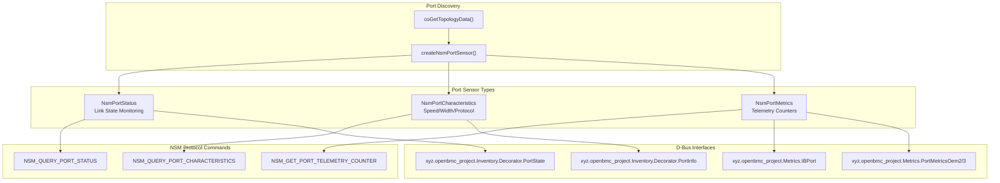
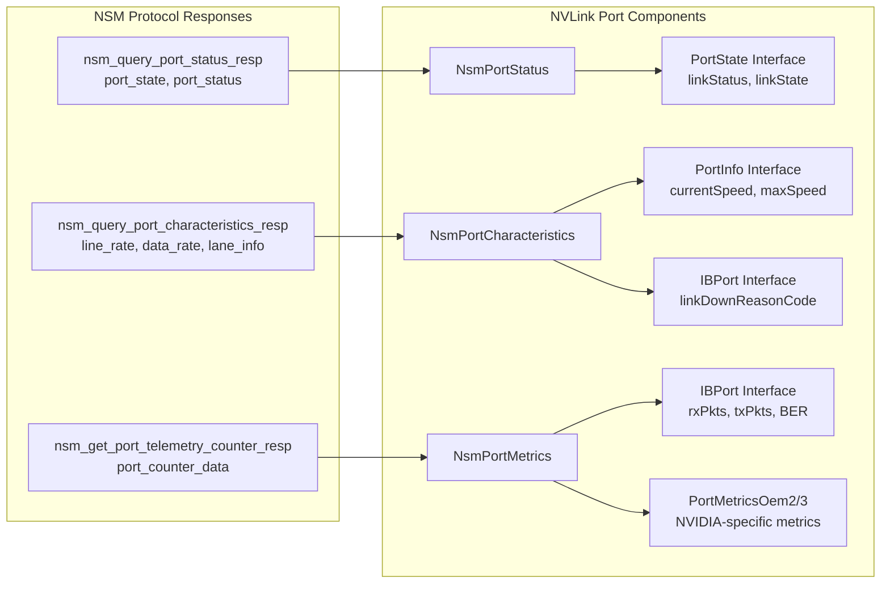
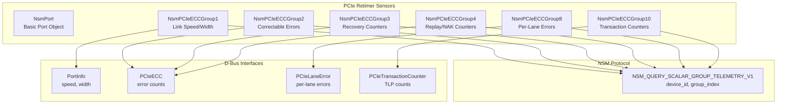
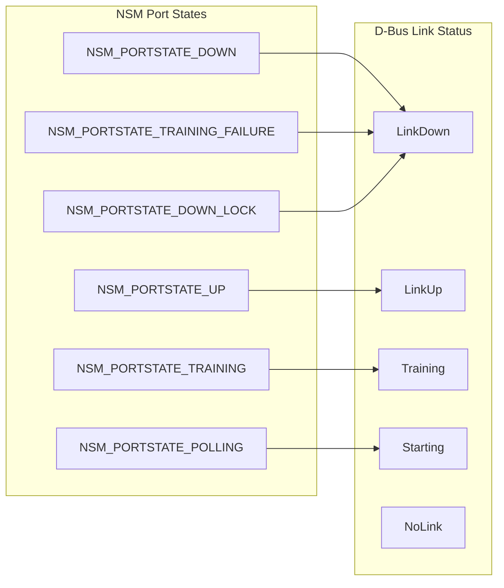
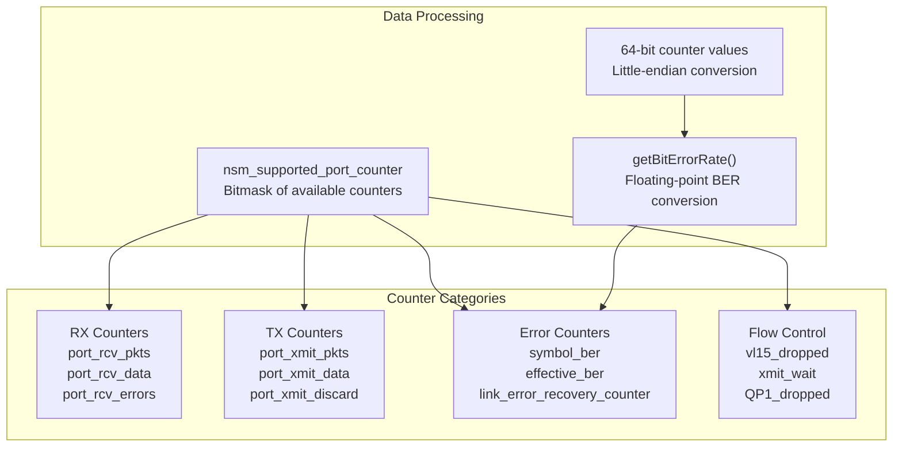
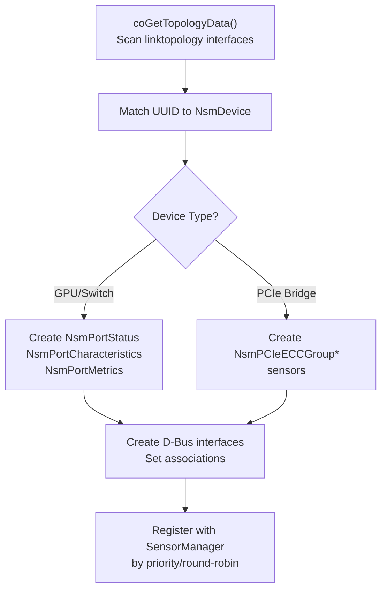
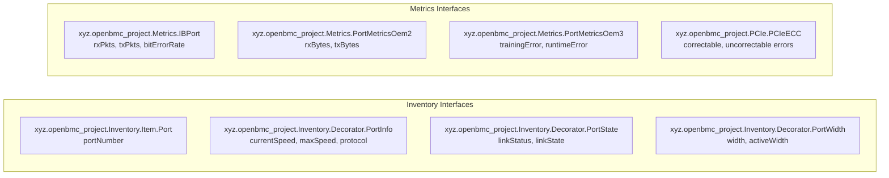

<!-- source: DeepWiki mcp.deepwiki.com · repo NVIDIA/nsmd · page 3.2 Network Port Management · fetched 2026-10-26 -->

# Network Port Management

Relevant source files

The following files were used as context for generating this wiki page:

- [common/globals.hpp](common/globals.hpp)
- [libnsm/network-ports.c](libnsm/network-ports.c)
- [libnsm/network-ports.h](libnsm/network-ports.h)
- [libnsm/pci-links.c](libnsm/pci-links.c)
- [libnsm/pci-links.h](libnsm/pci-links.h)
- [libnsm/test/libnsm_network_ports_test.cpp](libnsm/test/libnsm_network_ports_test.cpp)
- [libnsm/test/libnsm_pci_links_test.cpp](libnsm/test/libnsm_pci_links_test.cpp)
- [nsmd/nsmChassis/nsmChassisPCIeDevice.cpp](nsmd/nsmChassis/nsmChassisPCIeDevice.cpp)
- [nsmd/nsmChassis/nsmChassisPCIeDevice.hpp](nsmd/nsmChassis/nsmChassisPCIeDevice.hpp)
- [nsmd/nsmChassis/test/nsmChassisPCIeDevice_test.cpp](nsmd/nsmChassis/test/nsmChassisPCIeDevice_test.cpp)
- [nsmd/nsmChassis/test/nsmChassisPCIeSlot_test.cpp](nsmd/nsmChassis/test/nsmChassisPCIeSlot_test.cpp)
- [nsmd/nsmCommon/nsmPcieGroup.hpp](nsmd/nsmCommon/nsmPcieGroup.hpp)
- [nsmd/nsmNumericSensor/nsmThresholdFactory.cpp](nsmd/nsmNumericSensor/nsmThresholdFactory.cpp)
- [nsmd/nsmPCIeDevice/nsmPCIeRetimerPD.cpp](nsmd/nsmPCIeDevice/nsmPCIeRetimerPD.cpp)
- [nsmd/nsmPCIeDevice/nsmPCIeRetimerPD.hpp](nsmd/nsmPCIeDevice/nsmPCIeRetimerPD.hpp)
- [nsmd/nsmPort/meson.build](nsmd/nsmPort/meson.build)
- [nsmd/nsmPort/nsmFpgaPort.cpp](nsmd/nsmPort/nsmFpgaPort.cpp)
- [nsmd/nsmPort/nsmGpuPciePort.cpp](nsmd/nsmPort/nsmGpuPciePort.cpp)
- [nsmd/nsmPort/nsmGpuPciePort.hpp](nsmd/nsmPort/nsmGpuPciePort.hpp)
- [nsmd/nsmPort/nsmPCIeErrors.cpp](nsmd/nsmPort/nsmPCIeErrors.cpp)
- [nsmd/nsmPort/nsmPort.cpp](nsmd/nsmPort/nsmPort.cpp)
- [nsmd/nsmPort/nsmPort.hpp](nsmd/nsmPort/nsmPort.hpp)
- [nsmd/nsmPort/nsmRetimerPort.cpp](nsmd/nsmPort/nsmRetimerPort.cpp)
- [nsmd/nsmPort/nsmRetimerPort.hpp](nsmd/nsmPort/nsmRetimerPort.hpp)
- [nsmd/nsmPort/test/nsmPort_test.cpp](nsmd/nsmPort/test/nsmPort_test.cpp)
- [nsmd/nsmProcessor/nsmFpgaProcessor.cpp](nsmd/nsmProcessor/nsmFpgaProcessor.cpp)
- [nsmd/nsmSensors/nsmPCIeLinkSpeed.cpp](nsmd/nsmSensors/nsmPCIeLinkSpeed.cpp)
- [nsmd/nsmSensors/nsmPCIeLinkSpeed.hpp](nsmd/nsmSensors/nsmPCIeLinkSpeed.hpp)

This document covers the network port management subsystem within the NSM daemon, focusing on NVLink ports, PCIe retimer ports, and their telemetry collection. The system handles port status monitoring, characteristics reporting, and metrics collection through the NSM protocol.

For processor and GPU-specific port management, see [Processor and GPU Management](#3.1). For chassis-level network components, see [Chassis and System Management](#3.3).

## System Overview

The network port management system consists of three main sensor types that work together to provide comprehensive port monitoring:

**Port Management Architecture**

Sources: [nsmd/nsmPort/nsmPort.cpp:14-44](), [nsmd/nsmPort/nsmPort.hpp:76-157](), [nsmd/nsmPort/test/nsmPort_test.cpp:42-53]()

## Port Types and Sensor Classes

The system manages different port types through specialized sensor classes:

| Sensor Class | Purpose | NSM Command | Polling Type |
|--------------|---------|-------------|--------------|
| `NsmPortStatus` | Link state and connectivity | `NSM_QUERY_PORT_STATUS` | Object (immediate) |
| `NsmPortCharacteristics` | Speed, width, protocol info | `NSM_QUERY_PORT_CHARACTERISTICS` | Round-robin |
| `NsmPortMetrics` | Telemetry counters and BER | `NSM_GET_PORT_TELEMETRY_COUNTER` | Round-robin |
| `EthPortTelemetryAggregator` | Ethernet-specific metrics | `NSM_GET_ETH_PORT_TELEMETRY_COUNTER` | Aggregator |

### NVLink Port Management

NVLink ports are the primary focus, supporting full status, characteristics, and metrics collection:

**NVLink Port Data Flow**

Sources: [nsmd/nsmPort/nsmPort.cpp:120-299](), [libnsm/network-ports.h:42-68]()

### PCIe Retimer Port Management

PCIe retimer ports use a grouped architecture to collect telemetry across different functional domains:

**PCIe Retimer Port Architecture**

Sources: [nsmd/nsmPort/nsmRetimerPort.cpp:47-230](), [nsmd/nsmPort/nsmRetimerPort.hpp:95-175](), [libnsm/pci-links.h:87-110]()

## NSM Protocol Integration

### Port Status Protocol

The port status system maps NSM port states to D-Bus link status values:

**Port State Mapping**

The implementation handles runtime error detection for locked-down ports through the `checkPortCharactersticRCAndPopulateRuntimeErr` coroutine.

Sources: [nsmd/nsmPort/nsmPort.cpp:185-219](), [libnsm/network-ports.h:83-94]()

### Port Characteristics Protocol

Port characteristics provide speed and width information with protocol-specific encoding:

| Field | Description | Encoding |
|-------|-------------|----------|
| `nv_port_line_rate_mbps` | Maximum line rate | Mbps |
| `nv_port_data_rate_kbps` | Current data rate | Kbps |
| `status_lane_info` | Active lane count | Lower 4 bits |
| `port_down_reason_code` | Link failure reason | See link down codes |

The system provides comprehensive link down reason code mapping from NSM protocol values to D-Bus enums in `updateLinkDownCode`.

Sources: [nsmd/nsmPort/nsmPort.cpp:333-374](), [libnsm/network-ports.h:130-169](), [libnsm/network-ports.c:135-155]()

### Port Metrics Protocol

Port metrics collection uses a bitmask-controlled data structure `nsm_port_counter_data` to handle variable counter support across different hardware generations.

**Port Metrics Data Processing**

Sources: [nsmd/nsmPort/nsmPort.cpp:737-832](), [libnsm/network-ports.h:194-236](), [libnsm/network-ports.c:79-132]()

## Specialized Port Management

### GPU PCIe Port Management
The `NsmGpuPciePort` class manages PCIe ports specifically on GPU devices, including power state tracking through `ChasisStateIntf` and health monitoring. It also supports clearing PCIe counters via the `NsmClearPCIeCounters` class which interacts with NSM Type 11 commands.

Sources: [nsmd/nsmPort/nsmGpuPciePort.cpp:39-66](), [nsmd/nsmPort/nsmGpuPciePort.cpp:80-142]()

### FPGA Port Management
FPGA ports are managed through `NsmFpgaPortStatus`, `NsmFpgaPortCharacteristics`, and `NsmFpgaPortMetrics`. These classes extend the base port management to support FPGA-specific diagnostic indexes and data offsets.

Sources: [nsmd/nsmPort/nsmFpgaPort.cpp:21-125]()

## Data Collection and Polling

### Port Discovery Process

Port discovery uses topology data from D-Bus to create appropriate sensor instances:

**Port Discovery and Registration Flow**

Sources: [nsmd/nsmPort/nsmPort.cpp:51-118](), [nsmd/nsmChassis/nsmChassisPCIeDevice.cpp:103-149]()

### Polling Strategy

The system uses different polling strategies based on data criticality:

| Sensor Type | Polling Type | Frequency | Purpose |
|-------------|--------------|-----------|---------|
| `NsmPortStatus` | Object | Immediate | Critical link state changes |
| `NsmPortCharacteristics` | Round-robin | Periodic | Configuration verification |
| `NsmPortMetrics` | Round-robin | Periodic | Performance monitoring |
| `EthPortTelemetryAggregator` | Round-robin | Periodic | Aggregated Ethernet stats |

Sources: [nsmd/nsmPort/nsmPort.cpp:142-164](), [nsmd/nsmPort/nsmPort.hpp:124-157]()

## D-Bus Interface Exposure

### Standard OpenBMC Interfaces

The system implements standard OpenBMC inventory and metrics interfaces:

**D-Bus Interface Hierarchy**

### Shared Memory Integration

All port metrics are exposed through shared memory (NVIDIA_SHMEM) for high-performance telemetry producers. The `updateMetricOnSharedMemory()` method is implemented in all port sensor classes to synchronize D-Bus properties with the shared memory buffer.

Sources: [nsmd/nsmPort/nsmPort.cpp:273-299](), [nsmd/nsmPort/nsmPort.cpp:528-579](), [nsmd/nsmPort/nsmRetimerPort.cpp:192-230]()

## Error Handling and Link Down Detection

### Link Down Reason Codes

The system provides detailed link failure analysis through mapping `port_down_reason_code` from `nsm_port_characteristics_data`.

| NSM Code | D-Bus Enum | Description |
|----------|------------|-------------|
| `0x02` | `HighBitErrorRate` | Excessive bit errors |
| `0x03` | `BlockLockLost` | Clock recovery failure |
| `0x17` | `CableDisconnected` | Physical disconnection |
| `0x19` | `ThermalShutdown` | Temperature protection |

Sources: [libnsm/network-ports.h:130-169](), [nsmd/nsmPort/nsmPort.cpp:333-374]()

### Bit Error Rate (BER) Calculation
For NVLink ports, the system calculates BER using the `getBitErrorRate` function. It converts the raw 64-bit counter values into a floating-point representation where the exponent and mantissa are derived from the NSM telemetry response.

Sources: [nsmd/nsmPort/nsmPort.cpp:721-735]()

---

