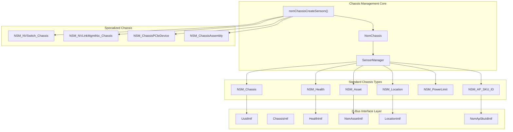
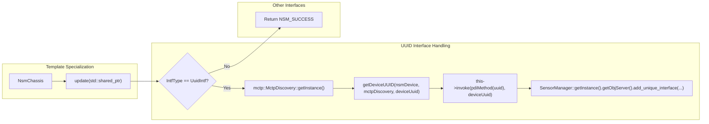
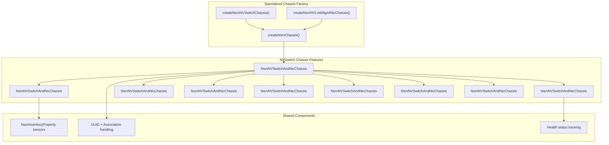
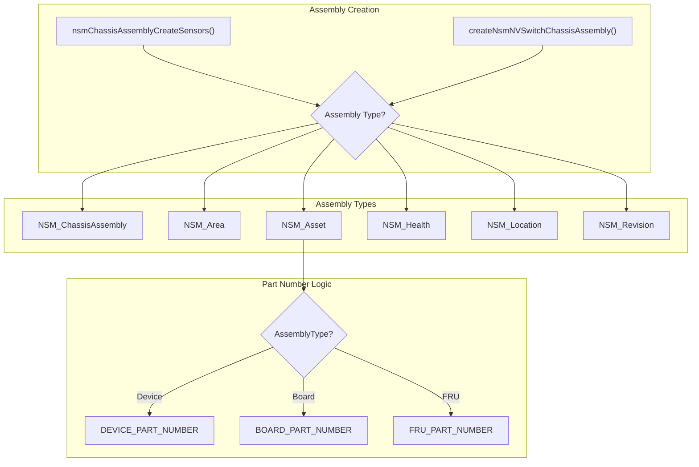
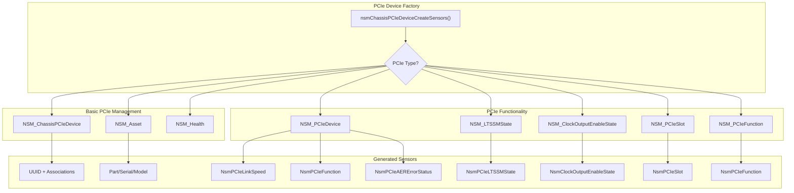
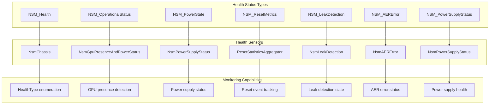
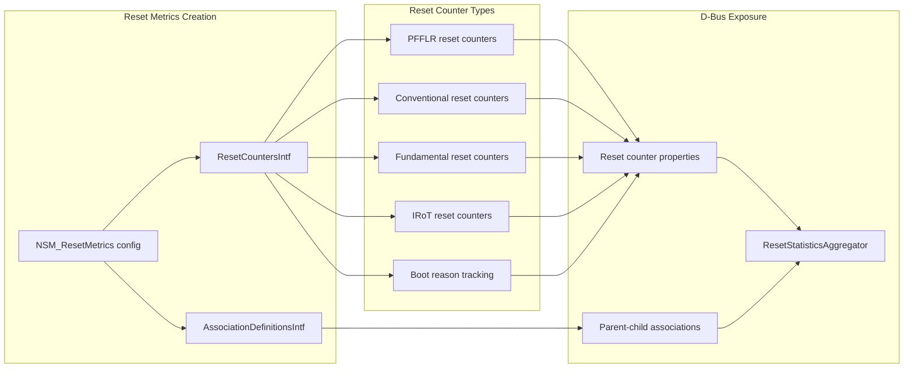

<!-- source: DeepWiki mcp.deepwiki.com · repo NVIDIA/nsmd · page 3.3 Chassis and System Management · fetched 2026-10-26 -->

# Chassis and System Management

Relevant source files

The following files were used as context for generating this wiki page:

- [nsmd/nsmChassis/nsmAERError.cpp](nsmd/nsmChassis/nsmAERError.cpp)
- [nsmd/nsmChassis/nsmAERError.hpp](nsmd/nsmChassis/nsmAERError.hpp)
- [nsmd/nsmChassis/nsmApSkuId.cpp](nsmd/nsmChassis/nsmApSkuId.cpp)
- [nsmd/nsmChassis/nsmApSkuId.hpp](nsmd/nsmChassis/nsmApSkuId.hpp)
- [nsmd/nsmChassis/nsmChassis.cpp](nsmd/nsmChassis/nsmChassis.cpp)
- [nsmd/nsmChassis/nsmChassis.hpp](nsmd/nsmChassis/nsmChassis.hpp)
- [nsmd/nsmChassis/nsmChassisAssembly.cpp](nsmd/nsmChassis/nsmChassisAssembly.cpp)
- [nsmd/nsmChassis/nsmGpuPresenceAndPowerStatus.cpp](nsmd/nsmChassis/nsmGpuPresenceAndPowerStatus.cpp)
- [nsmd/nsmChassis/nsmGpuPresenceAndPowerStatus.hpp](nsmd/nsmChassis/nsmGpuPresenceAndPowerStatus.hpp)
- [nsmd/nsmChassis/nsmLeakDetection.cpp](nsmd/nsmChassis/nsmLeakDetection.cpp)
- [nsmd/nsmChassis/nsmLeakDetection.hpp](nsmd/nsmChassis/nsmLeakDetection.hpp)
- [nsmd/nsmChassis/nsmNVSwitchAndNVMgmtNICChassis.cpp](nsmd/nsmChassis/nsmNVSwitchAndNVMgmtNICChassis.cpp)
- [nsmd/nsmChassis/nsmNVSwitchAndNVMgmtNICChassis.hpp](nsmd/nsmChassis/nsmNVSwitchAndNVMgmtNICChassis.hpp)
- [nsmd/nsmChassis/nsmNVSwitchAndNVMgmtNICChassisAssembly.cpp](nsmd/nsmChassis/nsmNVSwitchAndNVMgmtNICChassisAssembly.cpp)
- [nsmd/nsmChassis/nsmNVSwitchAndNVMgmtNICChassisAssembly.hpp](nsmd/nsmChassis/nsmNVSwitchAndNVMgmtNICChassisAssembly.hpp)
- [nsmd/nsmChassis/nsmPCIeFunction.cpp](nsmd/nsmChassis/nsmPCIeFunction.cpp)
- [nsmd/nsmChassis/nsmPCIeFunction.hpp](nsmd/nsmChassis/nsmPCIeFunction.hpp)
- [nsmd/nsmChassis/nsmPCIeLTSSMState.cpp](nsmd/nsmChassis/nsmPCIeLTSSMState.cpp)
- [nsmd/nsmChassis/nsmPCIeLTSSMState.hpp](nsmd/nsmChassis/nsmPCIeLTSSMState.hpp)
- [nsmd/nsmChassis/nsmPCIeRetimer.cpp](nsmd/nsmChassis/nsmPCIeRetimer.cpp)
- [nsmd/nsmChassis/nsmPCIeRetimer.hpp](nsmd/nsmChassis/nsmPCIeRetimer.hpp)
- [nsmd/nsmChassis/nsmPCIeSlot.cpp](nsmd/nsmChassis/nsmPCIeSlot.cpp)
- [nsmd/nsmChassis/nsmPowerSubSystem.cpp](nsmd/nsmChassis/nsmPowerSubSystem.cpp)
- [nsmd/nsmChassis/nsmPowerSubSystem.hpp](nsmd/nsmChassis/nsmPowerSubSystem.hpp)
- [nsmd/nsmChassis/nsmPowerSupplyStatus.cpp](nsmd/nsmChassis/nsmPowerSupplyStatus.cpp)
- [nsmd/nsmChassis/nsmUpdateApSkuId.cpp](nsmd/nsmChassis/nsmUpdateApSkuId.cpp)
- [nsmd/nsmChassis/nsmUpdateApSkuId.hpp](nsmd/nsmChassis/nsmUpdateApSkuId.hpp)
- [nsmd/nsmChassis/test/meson.build](nsmd/nsmChassis/test/meson.build)
- [nsmd/nsmChassis/test/nsmChassisAssembly_test.cpp](nsmd/nsmChassis/test/nsmChassisAssembly_test.cpp)
- [nsmd/nsmChassis/test/nsmChassis_test.cpp](nsmd/nsmChassis/test/nsmChassis_test.cpp)
- [nsmd/nsmDbusIfaceOverride/nsmActivateErrorInjectAsyncIntf.hpp](nsmd/nsmDbusIfaceOverride/nsmActivateErrorInjectAsyncIntf.hpp)
- [nsmd/nsmDbusIfaceOverride/nsmApSkuIdIntf.cpp](nsmd/nsmDbusIfaceOverride/nsmApSkuIdIntf.cpp)
- [nsmd/nsmDbusIfaceOverride/nsmAssetIntf.cpp](nsmd/nsmDbusIfaceOverride/nsmAssetIntf.cpp)
- [nsmd/nsmFirmwareUtils/nsmKeyMgmt.cpp](nsmd/nsmFirmwareUtils/nsmKeyMgmt.cpp)
- [nsmd/nsmFirmwareUtils/nsmKeyMgmt.hpp](nsmd/nsmFirmwareUtils/nsmKeyMgmt.hpp)
- [nsmd/nsmInterface.hpp](nsmd/nsmInterface.hpp)
- [nsmd/nsmSensors/nsmInventoryProperty.cpp](nsmd/nsmSensors/nsmInventoryProperty.cpp)
- [nsmd/nsmSensors/nsmInventoryProperty.hpp](nsmd/nsmSensors/nsmInventoryProperty.hpp)
- [nsmd/nsmSetAsync/nsmSetErrorInjection.cpp](nsmd/nsmSetAsync/nsmSetErrorInjection.cpp)
- [nsmd/nsmSetAsync/nsmSetErrorInjection.hpp](nsmd/nsmSetAsync/nsmSetErrorInjection.hpp)

This document covers the chassis-level management subsystem within the NSM daemon, responsible for managing hardware chassis components including asset information, health monitoring, location tracking, power management, and specialized chassis assemblies. The system provides D-Bus interfaces for chassis inventory, status monitoring, and control operations.

For processor-specific management features, see [Processor and GPU Management](#3.1). For network port management, see [Network Port Management](#3.2). For memory subsystem details, see [Memory Management](#3.4).

## Core Chassis Management Architecture

The chassis management system is built around the `NsmChassis` template class and the `nsmChassisCreateSensors` function, which dynamically creates sensors based on D-Bus configuration data. The system supports multiple chassis types with different capabilities and interface sets.

### Chassis Component Hierarchy

Sources: [nsmd/nsmChassis/nsmChassis.cpp:58-348](), [nsmd/nsmChassis/nsmChassis.hpp:61-76]()

### Chassis Sensor Creation Flow

The chassis management system uses a factory pattern to create appropriate sensors based on D-Bus configuration. The main entry point processes different chassis types and creates corresponding sensor objects.

```mermaid
graph TD
    DBusConfig["D-Bus Configuration"] --> ChassisFactory["nsmChassisCreateSensors()"]
    ChassisFactory --> TypeCheck{"Chassis Type?"}
    
    TypeCheck -->|"NSM_Chassis"| BasicFlow["Create UUID + MCTP sensors"]
    TypeCheck -->|"NSM_Asset"| AssetFlow["Create inventory sensors"]
    TypeCheck -->|"NSM_ChassisType"| ChassisTypeFlow["Create chassis type sensor"]
    TypeCheck -->|"NSM_Health"| HealthFlow["Create health sensor"]
    TypeCheck -->|"NSM_Location"| LocationFlow["Create location sensor"]
    TypeCheck -->|"NSM_LocationCode"| LocationCodeFlow["Create location code sensor"]
    TypeCheck -->|"NSM_PowerLimit"| PowerFlow["Create power limit sensors"]
    TypeCheck -->|"NSM_OperationalStatus"| OpStatusFlow["Create GPU presence sensor"]
    TypeCheck -->|"NSM_WriteProtect"| WriteProtectFlow["Create write protect jumper sensor"]
    TypeCheck -->|"NSM_ResetMetrics"| ResetMetricsFlow["Create reset statistics sensor"]
    TypeCheck -->|"NSM_LeakDetection"| LeakDetectionFlow["Create leak detection sensor"]
    TypeCheck -->|"NSM_AERError"| AERErrorFlow["Create AER error sensor"]
    TypeCheck -->|"NSM_PowerSupplyStatus"| PowerSupplyStatusFlow["Create power supply status sensor"]
    TypeCheck -->|"NSM_AP_SKU_ID"| ApSkuIdFlow["Create AP SKU ID sensor"]
    TypeCheck -->|"NSM_DebugInfo"| DebugInfoFlow["Create debug info sensor"]
    TypeCheck -->|"NSM_ErrorInjection"| ErrorInjectionFlow["Create error injection sensor"]
    TypeCheck -->|"NSM_GPIOState"| GPIOStateFlow["Create GPIO state sensor"]
    TypeCheck -->|"NSM_SoCPowerSmoothing"| SoCPowerSmoothingFlow["Create SoC power smoothing sensor"]

    BasicFlow --> UUIDSensor["NsmChassis<UuidIntf>"]
    BasicFlow --> MCTPSensor["NsmChassis<MctpUuidIntf>"]
    BasicFlow --> AssocSensor["NsmChassis<AssociationDefinitionsInft>"]
    
    AssetFlow --> PartNumSensor["NsmInventoryProperty<NsmAssetIntf>"]
    AssetFlow --> SerialSensor["NsmInventoryProperty<NsmAssetIntf>"]
    AssetFlow --> ModelSensor["NsmInventoryProperty<NsmAssetIntf>"]
    
    ChassisTypeFlow --> ChassisTypeSensor["NsmChassis<ChassisIntf>"]
    HealthFlow --> HealthSensor["NsmChassis<HealthIntf>"]
    LocationFlow --> LocationSensor["NsmChassis<LocationIntf>"]
    LocationCodeFlow --> LocationCodeSensor["NsmChassis<LocationCodeIntf>"]
    PowerFlow --> MinPowerSensor["NsmInventoryProperty<PowerLimitIntf>"]
    PowerFlow --> MaxPowerSensor["NsmInventoryProperty<PowerLimitIntf>"]
    
    OpStatusFlow --> PresenceSensor["NsmGpuPresenceAndPowerStatus"]
    WriteProtectFlow --> WriteProtectJumperSensor["NsmWriteProtectedJumper"]
    ResetMetricsFlow --> ResetStatisticsSensor["NsmOemResetStatistics"]
    LeakDetectionFlow --> LeakDetectionSensor["NsmLeakDetection"]
    AERErrorFlow --> AERErrorSensor["NsmAERError"]
    PowerSupplyStatusFlow --> PowerSupplyStatusSensor["NsmPowerSupplyStatus"]
    ApSkuIdFlow --> ApSkuIdSensor["NsmChassis<NsmApSkuIdIntf>"]
    DebugInfoFlow --> DebugInfoSensor["NsmDebugInfo"]
    ErrorInjectionFlow --> ErrorInjectionSensor["NsmSetErrorInjection"]
    GPIOStateFlow --> GPIOStateSensor["NsmGPIOState"]
    SoCPowerSmoothingFlow --> SoCPowerSmoothingSensor["NsmSoCPowerSmoothing"]
    
    UUIDSensor --> DeviceRegistry["device->addStaticSensor()"]
    MCTPSensor --> DeviceRegistry
    AssocSensor --> DeviceRegistry
    PartNumSensor --> DeviceRegistry
    SerialSensor --> DeviceRegistry
    ModelSensor --> DeviceRegistry
    ChassisTypeSensor --> DeviceRegistry
    HealthSensor --> DeviceRegistry
    LocationSensor --> DeviceRegistry
    LocationCodeSensor --> DeviceRegistry
    MinPowerSensor --> DeviceRegistry
    MaxPowerSensor --> DeviceRegistry
    PresenceSensor --> DeviceRegistry
    WriteProtectJumperSensor --> DeviceRegistry
    ResetStatisticsSensor --> DeviceRegistry
    LeakDetectionSensor --> DeviceRegistry
    AERErrorSensor --> DeviceRegistry
    PowerSupplyStatusSensor --> DeviceRegistry
    ApSkuIdSensor --> DeviceRegistry
    DebugInfoSensor --> DeviceRegistry
    ErrorInjectionSensor --> DeviceRegistry
    GPIOStateSensor --> DeviceRegistry
    SoCPowerSmoothingSensor --> DeviceRegistry
```

Sources: [nsmd/nsmChassis/nsmChassis.cpp:73-348](), [nsmd/nsmChassis/nsmChassis.cpp:350-367]()

## Chassis Types and Configuration

The system supports multiple chassis configuration types, each providing different sets of management capabilities through specific D-Bus interfaces.

### Supported Chassis Types

| Chassis Type | Purpose | Key Interfaces | Sensor Priority |
|--------------|---------|---------------|----------------|
| `NSM_Chassis` | Basic chassis identity | `UuidIntf`, `MctpUuidIntf`, `AssociationDefinitionsInft` | Static |
| `NSM_Asset` | Asset/inventory information | `NsmAssetIntf` | Static |
| `NSM_ChassisType` | Physical chassis classification | `ChassisIntf` | Static |
| `NSM_Health` | Health status monitoring | `HealthIntf` | Static |
| `NSM_Location` | Physical location tracking | `LocationIntf` | Static |
| `NSM_LocationCode` | Location code tracking | `LocationCodeIntf` | Static |
| `NSM_PowerLimit` | Power management limits | `PowerLimitIntf` | Dynamic |
| `NSM_OperationalStatus` | GPU presence/power status | `OperationalStatusIntf` | Priority |
| `NSM_WriteProtect` | Write protection controls | `SettingsIntf` | Dynamic |
| `NSM_ResetMetrics` | Reset statistics tracking | `ResetCountersIntf` | Dynamic |
| `NSM_LeakDetection` | Leak detection monitoring | `LeakDetectorIntf`, `StateLeakDetectorIntf`, `SensorValueIntf` | RoundRobin |
| `NSM_AERError` | Advanced Error Reporting (AER) errors | `AERErrorIntf` | RoundRobin |
| `NSM_PowerSupplyStatus` | Power supply status | `PowerSupplyIntf` | RoundRobin |
| `NSM_AP_SKU_ID` | AP SKU ID management | `NsmApSkuIdIntf` | Static |
| `NSM_DebugInfo` | Debug information | `DebugInfoIntf` | RoundRobin |
| `NSM_ErrorInjection` | Error injection capabilities | `ErrorInjectionIntf`, `ErrorInjectionCapabilityIntf` | Async |
| `NSM_GPIOState` | GPIO state monitoring | `GPIOStateIntf` | RoundRobin |
| `NSM_SoCPowerSmoothing` | SoC power smoothing | `SoCPowerSmoothingIntf` | RoundRobin |

Sources: [nsmd/nsmChassis/nsmChassis.cpp:73-348](), [nsmd/nsmChassis/nsmChassis.cpp:350-364](), [nsmd/nsmChassis/nsmLeakDetection.cpp:43-121](), [nsmd/nsmChassis/nsmAERError.cpp:40-100](), [nsmd/nsmChassis/nsmPowerSupplyStatus.cpp:40-100](), [nsmd/nsmChassis/nsmApSkuId.cpp:38-50](), [nsmd/nsmChassis/nsmDebugInfo.cpp:38-50](), [nsmd/nsmSetAsync/nsmSetErrorInjection.cpp:33-36](), [nsmd/nsmChassis/nsmGPIO/nsmGPIOState.cpp:38-50](), [nsmd/nsmProcessor/nsmSoCPowerSmoothing.cpp:38-50]()

### Chassis Interface Management

The `NsmChassis` template class provides a unified interface for different D-Bus interface types, with specialized update behavior for UUID interfaces.

Sources: [nsmd/nsmChassis/nsmNVSwitchAndNVMgmtNICChassis.cpp:34-61]()

## Specialized Chassis Implementations

The system includes specialized chassis implementations for specific hardware types, particularly NVSwitch devices and management NICs.

### NVSwitch and Management NIC Chassis

The specialized chassis types (`NSM_NVSwitch_Chassis` and `NSM_NVLinkMgmtNic_Chassis`) provide tailored management for network infrastructure components. These are handled by `NsmNVSwitchAndNicChassis` template class.

Sources: [nsmd/nsmChassis/nsmNVSwitchAndNVMgmtNICChassis.cpp:61-241](), [nsmd/nsmChassis/nsmNVSwitchAndNVMgmtNICChassis.hpp:48-63]()

### Chassis Assembly Management

Chassis assemblies represent sub-components within a chassis, providing detailed asset tracking and health monitoring for individual assemblies. The `NsmChassisAssembly` template class and `NsmNVSwitchAndNicChassisAssembly` template class are used for this purpose.

Sources: [nsmd/nsmChassis/nsmChassisAssembly.cpp:33-151](), [nsmd/nsmChassis/nsmNVSwitchAndNVMgmtNICChassisAssembly.cpp:30-186]()

## PCIe Device Management

The chassis system includes comprehensive PCIe device management, handling device identification, health monitoring, and link state tracking.

### PCIe Device Sensor Types

Sources: [nsmd/nsmChassis/nsmChassisPCIeDevice.cpp:62-220](), [nsmd/nsmChassis/nsmPCIeSlot.cpp](), [nsmd/nsmChassis/nsmPCIeFunction.cpp]()

## Inventory and Asset Management

The chassis system provides comprehensive inventory tracking through the `NsmInventoryProperty` template class, which handles different types of asset information retrieval and D-Bus interface updates.

### Inventory Property System

The inventory system supports multiple property types with specialized handling for different data formats and D-Bus interfaces.

| Property Type | NSM Command | Data Processing | Interface |
|---------------|-------------|-----------------|-----------|
| Part Numbers | `GET_INVENTORY_INFORMATION` | String conversion | `NsmAssetIntf` |
| Serial Numbers | `GET_INVENTORY_INFORMATION` | String conversion | `NsmAssetIntf` |
| Model Names | `GET_INVENTORY_INFORMATION` | String conversion | `NsmAssetIntf` |
| Dimensions | `GET_INVENTORY_INFORMATION` | uint32 conversion | `DimensionIntf` |
| Power Limits | `GET_INVENTORY_INFORMATION` | uint32 + scaling | `PowerLimitIntf` |
| Versions | `GET_INVENTORY_INFORMATION` | Custom formatting | `VersionIntf` |
| Asset Tag | `GET_INVENTORY_INFORMATION` | String conversion | `AssetTagIntf` |

Sources: [nsmd/nsmSensors/nsmInventoryProperty.hpp:85-311]()

### Asset Data Flow

```mermaid
graph LR
    subgraph "Request Generation"
        PropertyRequest["NsmInventoryProperty::genRequestMsg()"]
        NSMCommand["nsm_get_inventory_information_req"]
        PropertyID["property identifier"]
    end
    
    subgraph "Hardware Communication"
        MCTPTransport["MCTP Transport"]
        DeviceResponse["Hardware Response"]
        ResponseData["Raw inventory data"]
    end
    
    subgraph "Response Processing"
        HandleResponse["handleResponseMsg()"]
        DataConversion["Type-specific conversion"]
        DBusUpdate["D-Bus interface update"]
    end
    
    PropertyRequest --> NSMCommand
    NSMCommand --> PropertyID
    PropertyID --> MCTPTransport
    MCTPTransport --> DeviceResponse
    DeviceResponse --> ResponseData
    ResponseData --> HandleResponse
    HandleResponse --> DataConversion
    DataConversion --> DBusUpdate
```

Sources: [nsmd/nsmSensors/nsmInventoryProperty.hpp:46-61]()

## Health and Status Monitoring

The chassis system provides multiple levels of health and status monitoring, from basic health status to detailed operational monitoring and reset statistics.

### Health Monitoring Components

Sources: [nsmd/nsmChassis/nsmChassis.cpp:184-337](), [nsmd/nsmChassis/nsmPowerSupplyStatus.cpp](), [nsmd/nsmChassis/nsmGpuPresenceAndPowerStatus.cpp](), [nsmd/nsmChassis/nsmLeakDetection.cpp:43-121](), [nsmd/nsmChassis/nsmAERError.cpp:40-100]()

### Reset Statistics Tracking

The reset metrics system provides detailed tracking of different reset types and boot reasons, essential for system reliability analysis.

Sources: [nsmd/nsmChassis/nsmChassis.cpp:295-337]()

---

