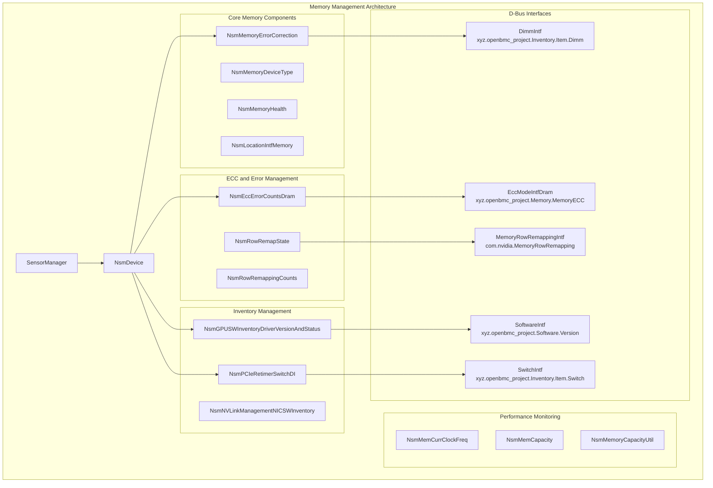

<!-- source: DeepWiki mcp.deepwiki.com · repo NVIDIA/nsmd · page 3.4 Memory Management · fetched 2026-10-26 -->

# Memory Management

Relevant source files

The following files were used as context for generating this wiki page:

- [nsmd/nsmDeviceInventory/nsmPCIeRetimerSwitchDI.cpp](nsmd/nsmDeviceInventory/nsmPCIeRetimerSwitchDI.cpp)
- [nsmd/nsmDeviceInventory/nsmPCIeRetimerSwitchDI.hpp](nsmd/nsmDeviceInventory/nsmPCIeRetimerSwitchDI.hpp)
- [nsmd/nsmFwSwInventory/GPUSWInventory.cpp](nsmd/nsmFwSwInventory/GPUSWInventory.cpp)
- [nsmd/nsmFwSwInventory/GPUSWInventory.hpp](nsmd/nsmFwSwInventory/GPUSWInventory.hpp)
- [nsmd/nsmFwSwInventory/NVLinkManagementNICSWInventory.cpp](nsmd/nsmFwSwInventory/NVLinkManagementNICSWInventory.cpp)
- [nsmd/nsmFwSwInventory/NVLinkManagementNICSWInventory.hpp](nsmd/nsmFwSwInventory/NVLinkManagementNICSWInventory.hpp)
- [nsmd/nsmFwSwInventory/meson.build](nsmd/nsmFwSwInventory/meson.build)
- [nsmd/nsmFwSwInventory/test/NVLinkManagementNICSWInventory_test.cpp](nsmd/nsmFwSwInventory/test/NVLinkManagementNICSWInventory_test.cpp)
- [nsmd/nsmMemory/nsmMemory.cpp](nsmd/nsmMemory/nsmMemory.cpp)
- [nsmd/nsmMemory/nsmMemory.hpp](nsmd/nsmMemory/nsmMemory.hpp)
- [nsmd/nsmMemory/test/nsmMemory_test.cpp](nsmd/nsmMemory/test/nsmMemory_test.cpp)
- [nsmd/nsmNumericSensor/nsmAltitudePressure.cpp](nsmd/nsmNumericSensor/nsmAltitudePressure.cpp)
- [nsmd/nsmNumericSensor/nsmAltitudePressure.hpp](nsmd/nsmNumericSensor/nsmAltitudePressure.hpp)
- [nsmd/nsmNumericSensor/nsmEnergy.cpp](nsmd/nsmNumericSensor/nsmEnergy.cpp)
- [nsmd/nsmNumericSensor/nsmEnergyAggregator.cpp](nsmd/nsmNumericSensor/nsmEnergyAggregator.cpp)
- [nsmd/nsmNumericSensor/nsmNumericSensor.cpp](nsmd/nsmNumericSensor/nsmNumericSensor.cpp)
- [nsmd/nsmNumericSensor/nsmNumericSensor.hpp](nsmd/nsmNumericSensor/nsmNumericSensor.hpp)
- [nsmd/nsmNumericSensor/nsmNumericSensorFactory.cpp](nsmd/nsmNumericSensor/nsmNumericSensorFactory.cpp)
- [nsmd/nsmNumericSensor/nsmPower.cpp](nsmd/nsmNumericSensor/nsmPower.cpp)
- [nsmd/nsmNumericSensor/nsmPowerAggregator.cpp](nsmd/nsmNumericSensor/nsmPowerAggregator.cpp)
- [nsmd/nsmNumericSensor/nsmTemp.cpp](nsmd/nsmNumericSensor/nsmTemp.cpp)
- [nsmd/nsmNumericSensor/nsmTempAggregator.cpp](nsmd/nsmNumericSensor/nsmTempAggregator.cpp)
- [nsmd/nsmNumericSensor/nsmThresholdAggregator.cpp](nsmd/nsmNumericSensor/nsmThresholdAggregator.cpp)
- [nsmd/nsmNumericSensor/nsmVoltage.cpp](nsmd/nsmNumericSensor/nsmVoltage.cpp)
- [nsmd/nsmNumericSensor/nsmVoltageAggregator.cpp](nsmd/nsmNumericSensor/nsmVoltageAggregator.cpp)
- [nsmd/nsmNumericSensor/test/nsmNumericAggregatorSensors_test.cpp](nsmd/nsmNumericSensor/test/nsmNumericAggregatorSensors_test.cpp)
- [nsmd/nsmNumericSensor/test/nsmNumericAggregator_test.cpp](nsmd/nsmNumericSensor/test/nsmNumericAggregator_test.cpp)
- [nsmd/nsmNumericSensor/test/nsmNumericSensors_test.cpp](nsmd/nsmNumericSensor/test/nsmNumericSensors_test.cpp)
- [nsmd/nsmNumericSensor/test/nsmNumeric_test.cpp](nsmd/nsmNumericSensor/test/nsmNumeric_test.cpp)
- [nsmd/nsmSensorAggregator.hpp](nsmd/nsmSensorAggregator.hpp)

## Purpose and Scope

The Memory Management subsystem provides comprehensive monitoring and control of memory components in NVIDIA hardware systems. This system tracks ECC error correction, row remapping capabilities, memory capacity utilization, clock frequencies, and general health status of DRAM modules. It also covers firmware/software inventory for GPUs and NVLink management NICs, as well as inventory for PCIe retimer switch devices.

The subsystem integrates with the NSM protocol to retrieve hardware telemetry and exposes data through D-Bus interfaces and shared memory for system-wide consumption.

## Architecture Overview

The memory management system is organized around several specialized sensor classes and inventory objects that handle different aspects of memory and device monitoring:

Sources: [nsmd/nsmMemory/nsmMemory.hpp:1-249](), [nsmd/nsmMemory/nsmMemory.cpp:17-848](), [nsmd/nsmFwSwInventory/GPUSWInventory.cpp:17-48](), [nsmd/nsmDeviceInventory/nsmPCIeRetimerSwitchDI.cpp:13-43]()

## Core Memory Components

The memory management system provides fundamental device identification and health monitoring through several core components.

### Memory Device Properties

The `NsmMemoryErrorCorrection` class manages ECC capabilities and the `NsmMemoryDeviceType` class handles device type identification. Both integrate with the `DimmIntf` D-Bus interface to expose standard memory properties [nsmd/nsmMemory/nsmMemory.cpp:25-33](), [nsmd/nsmMemory/nsmMemory.cpp:49-58]().

Memory health is tracked via `NsmMemoryHealth`, which initializes the health status to `OK` by default [nsmd/nsmMemory/nsmMemory.cpp:86-94](). Physical location is managed by `NsmLocationIntfMemory`, typically set to `Embedded` [nsmd/nsmMemory/nsmMemory.cpp:74-84]().

### Shared Memory Integration

All memory sensors implement shared memory updates when the `NVIDIA_SHMEM` compilation flag is enabled. The `updateMetricOnSharedMemory` method synchronizes D-Bus property values with shared memory regions for efficient access by other system components [nsmd/nsmMemory/nsmMemory.cpp:35-47](), [nsmd/nsmMemory/nsmMemory.cpp:60-72]().

## ECC and Error Management

The system provides comprehensive monitoring for memory reliability through ECC error tracking and row remapping status.

### ECC Error Counting

The `NsmEccErrorCountsDram` class monitors correctable and uncorrectable ECC errors. It uses the `NSM_GET_ECC_ERROR_COUNTS` command [nsmd/nsmMemory/nsmMemory.cpp:418-424]().

### Row Remapping System

The row remapping system manages DRAM row replacement when errors are detected:
- **`NsmRowRemapState`**: Monitors remapping status flags (Failure and Pending) using `NSM_GET_ROW_REMAP_STATE_FLAGS` [nsmd/nsmMemory/nsmMemory.cpp:114-124](), [nsmd/nsmMemory/nsmMemory.cpp:155-170]().
- **`NsmRowRemappingCounts`**: Tracks the number of remapped rows for both correctable and uncorrectable errors using `NSM_GET_ROW_REMAPPING_COUNTS` [nsmd/nsmMemory/nsmMemory.cpp:193-203]().
- **`NsmRemappingAvailabilityBankCount`**: Provides bank-level remapping capacity information using `NSM_GET_ROW_REMAP_AVAILABILITY` [nsmd/nsmMemory/nsmMemory.cpp:286-333]().

## Firmware and Software Inventory

The subsystem includes monitoring for GPU driver versions and management NIC software.

### GPU Software Inventory

The `NsmGPUSWInventoryDriverVersionAndStatus` class manages GPU driver information [nsmd/nsmFwSwInventory/GPUSWInventory.cpp:17-22](). It queries the device using `encode_get_driver_info_req` and updates the `xyz.openbmc_project.Software.Version` and `xyz.openbmc_project.State.Decorator.OperationalStatus` interfaces [nsmd/nsmFwSwInventory/GPUSWInventory.cpp:84-116]().

### NVLink Management NIC Inventory

The `NsmNVLinkManagementNICSWInventory` class provides similar inventory tracking for NVLink management NICs, exposing firmware and software versions via D-Bus [nsmd/nsmFwSwInventory/NVLinkManagementNICSWInventory.cpp:17-45]().

Sources: [nsmd/nsmFwSwInventory/GPUSWInventory.cpp:17-141](), [nsmd/nsmFwSwInventory/NVLinkManagementNICSWInventory.cpp:17-105]()

## Device Inventory: PCIe Retimers

The subsystem handles the inventory of PCIe retimer switch devices.

### PCIe Retimer Switch Inventory

The `NsmPCIeRetimerSwitchDI` class manages the inventory information for PCIe retimer switches [nsmd/nsmDeviceInventory/nsmPCIeRetimerSwitchDI.cpp:13-17](). It uses NSM telemetry commands to retrieve hardware details:
- **Commands**: It uses `NSM_QUERY_SCALAR_GROUP_TELEMETRY_V1` (Group 0) or the multiport V2 variant to fetch device IDs and vendor IDs [nsmd/nsmDeviceInventory/nsmPCIeRetimerSwitchDI.cpp:85-122]().
- **D-Bus Interface**: Data is exposed via the `xyz.openbmc_project.Inventory.Item.Switch` interface [nsmd/nsmDeviceInventory/nsmPCIeRetimerSwitchDI.cpp:25-43]().

Sources: [nsmd/nsmDeviceInventory/nsmPCIeRetimerSwitchDI.cpp:13-155]()

## NSM Protocol Integration

Memory and inventory objects implement the standard NSM lifecycle via `genRequestMsg` and `handleResponseMsg`.

| Component | NSM Command | Data Handled |
|-----------|-------------|--------------|
| `NsmRowRemapState` | `NSM_GET_ROW_REMAP_STATE_FLAGS` | Remap failure/pending bits [nsmd/nsmMemory/nsmMemory.cpp:148-153]() |
| `NsmGPUSWInventory` | `NSM_GET_DRIVER_INFO` | Driver state and version string [nsmd/nsmFwSwInventory/GPUSWInventory.cpp:111-116]() |
| `NsmPCIeRetimerSwitchDI` | `NSM_QUERY_SCALAR_GROUP_TELEMETRY_V1` | PCI Device ID and Vendor ID [nsmd/nsmDeviceInventory/nsmPCIeRetimerSwitchDI.cpp:145-152]() |
| `NsmEnergy` | `NSM_GET_CURRENT_ENERGY_COUNT` | Energy in Millijoules (converted to Joules) [nsmd/nsmNumericSensor/nsmEnergy.cpp:81-93]() |

Sources: [nsmd/nsmMemory/nsmMemory.cpp:155-191](), [nsmd/nsmFwSwInventory/GPUSWInventory.cpp:84-141](), [nsmd/nsmDeviceInventory/nsmPCIeRetimerSwitchDI.cpp:80-155](), [nsmd/nsmNumericSensor/nsmEnergy.cpp:57-98]()

## Sensor Registration and Factory Pattern

Components are instantiated using the `REGISTER_NSM_CREATION_FUNCTION` pattern, allowing the `SensorManager` to create objects based on Entity Manager configurations.

- **Memory Sensors**: Registered under `xyz.openbmc_project.Configuration.NSM_Memory` [nsmd/nsmMemory/nsmMemory.cpp:844-846]().
- **GPU Driver**: Registered under `xyz.openbmc_project.Configuration.NSM_GPU_SWInventory` [nsmd/nsmFwSwInventory/GPUSWInventory.cpp:194-196]().
- **Energy Sensors**: Registered under `xyz.openbmc_project.Configuration.NSM_Energy` [nsmd/nsmNumericSensor/nsmEnergy.cpp:127-128]().

Sources: [nsmd/nsmMemory/nsmMemory.cpp:836-847](), [nsmd/nsmFwSwInventory/GPUSWInventory.cpp:194-196](), [nsmd/nsmNumericSensor/nsmEnergy.cpp:127-128]()

---

