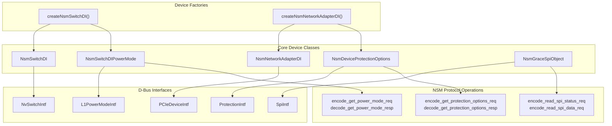
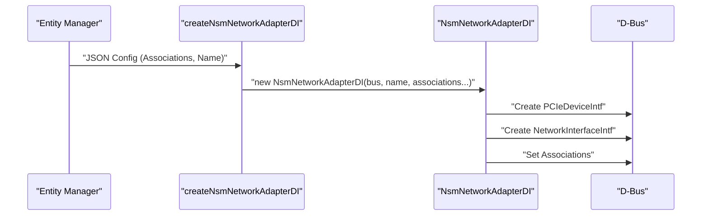
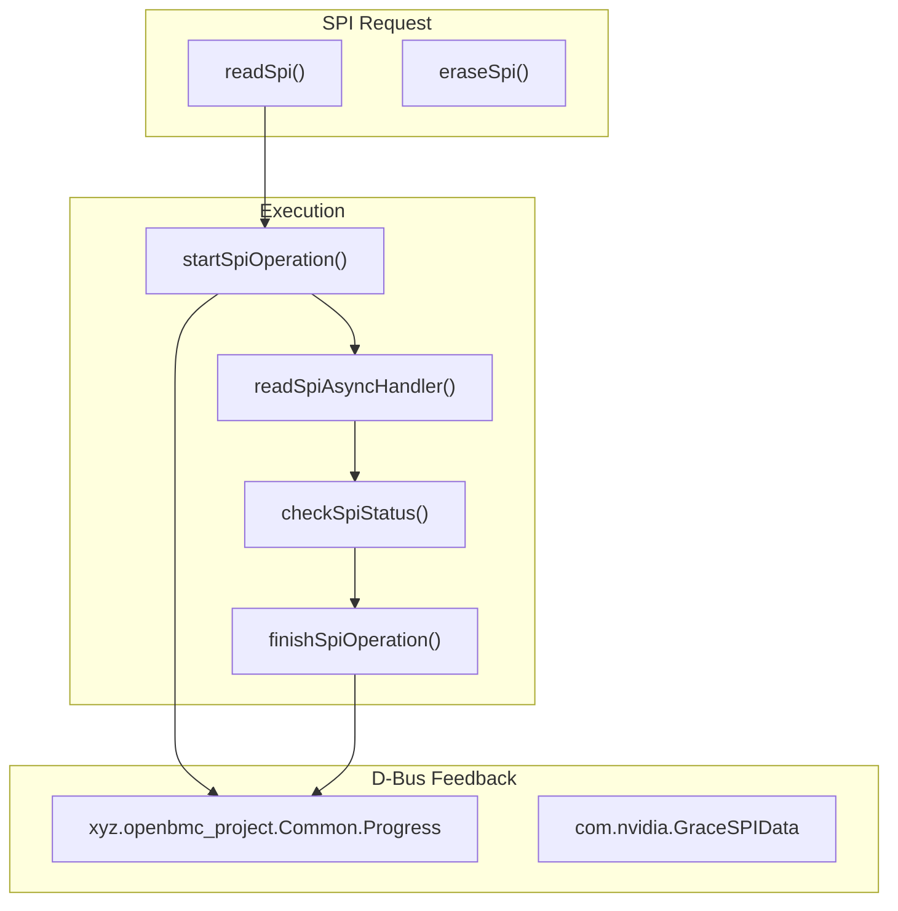

<!-- source: DeepWiki mcp.deepwiki.com · repo NVIDIA/nsmd · page 3.5 Device Inventory and Control · fetched 2026-10-26 -->

# Device Inventory and Control

Relevant source files

The following files were used as context for generating this wiki page:

- [nsmd/eventTypeHandlers.cpp](nsmd/eventTypeHandlers.cpp)
- [nsmd/eventTypeHandlers.hpp](nsmd/eventTypeHandlers.hpp)
- [nsmd/nsmDeviceInventory/meson.build](nsmd/nsmDeviceInventory/meson.build)
- [nsmd/nsmDeviceInventory/nsmNetworkAdapter.cpp](nsmd/nsmDeviceInventory/nsmNetworkAdapter.cpp)
- [nsmd/nsmDeviceInventory/nsmNetworkAdapter.hpp](nsmd/nsmDeviceInventory/nsmNetworkAdapter.hpp)
- [nsmd/nsmDeviceInventory/nsmNvSwitchDeviceConfiguration.cpp](nsmd/nsmDeviceInventory/nsmNvSwitchDeviceConfiguration.cpp)
- [nsmd/nsmDeviceInventory/nsmNvSwitchDeviceConfiguration.hpp](nsmd/nsmDeviceInventory/nsmNvSwitchDeviceConfiguration.hpp)
- [nsmd/nsmDeviceInventory/nsmSwitch.cpp](nsmd/nsmDeviceInventory/nsmSwitch.cpp)
- [nsmd/nsmDeviceInventory/nsmSwitch.hpp](nsmd/nsmDeviceInventory/nsmSwitch.hpp)
- [nsmd/nsmDeviceInventory/test/meson.build](nsmd/nsmDeviceInventory/test/meson.build)
- [nsmd/nsmDeviceInventory/test/nsmNvSwitchDeviceConfiguration_test.cpp](nsmd/nsmDeviceInventory/test/nsmNvSwitchDeviceConfiguration_test.cpp)
- [nsmd/nsmEvent/meson.build](nsmd/nsmEvent/meson.build)
- [nsmd/nsmEvent/nsmFabricManagerStateEvent.cpp](nsmd/nsmEvent/nsmFabricManagerStateEvent.cpp)
- [nsmd/nsmEvent/nsmFabricManagerStateEvent.hpp](nsmd/nsmEvent/nsmFabricManagerStateEvent.hpp)
- [nsmd/nsmFirmwareUtils/test/nsmSecurityRBP_test.cpp](nsmd/nsmFirmwareUtils/test/nsmSecurityRBP_test.cpp)
- [nsmd/nsmHistograms/nsmHistogramInfo.cpp](nsmd/nsmHistograms/nsmHistogramInfo.cpp)
- [nsmd/nsmHistograms/nsmHistogramInfo.hpp](nsmd/nsmHistograms/nsmHistogramInfo.hpp)
- [nsmd/nsmManagers/nsmFabricManager.cpp](nsmd/nsmManagers/nsmFabricManager.cpp)
- [nsmd/nsmManagers/nsmFabricManager.hpp](nsmd/nsmManagers/nsmFabricManager.hpp)
- [nsmd/nsmManagers/test/nsmFabricManagerBranch_test.cpp](nsmd/nsmManagers/test/nsmFabricManagerBranch_test.cpp)
- [nsmd/nsmManagers/test/nsmFabricManager_test.cpp](nsmd/nsmManagers/test/nsmFabricManager_test.cpp)
- [nsmd/nsmSPI/meson.build](nsmd/nsmSPI/meson.build)
- [nsmd/nsmSPI/nsmGraceSpi.cpp](nsmd/nsmSPI/nsmGraceSpi.cpp)
- [nsmd/nsmSPI/nsmGraceSpi.hpp](nsmd/nsmSPI/nsmGraceSpi.hpp)

This document covers the device-specific inventory management and control mechanisms for NVSwitch and Network Adapter devices within the NSM system. This includes power mode management, isolation controls, device reset functionality, protection options, and SPI interface operations for Grace-based platforms.

For general hardware subsystem architecture, see [Hardware Subsystems](#3). For network port management on NVSwitch devices, see [Network Port Management](#3.2). For NSM protocol implementation details, see [NSM Protocol Layer](#4).

## Core Architecture

The device inventory and control system is built around several key classes that manage different aspects of hardware functionality:

**Sources:** [nsmd/nsmDeviceInventory/nsmSwitch.hpp:42-129](), [nsmd/nsmDeviceInventory/nsmNetworkAdapter.hpp:61-98](), [nsmd/nsmSPI/nsmGraceSpi.hpp:47-111]()

## Device Inventory Management

### NVSwitch Inventory
The `createNsmSwitchDI` function serves as the primary factory for creating NVSwitch device inventory objects. It processes configuration from Entity Manager and creates appropriate sensor and interface instances:

| Device Type | Purpose | Key Interfaces |
|-------------|---------|----------------|
| `NSM_NVSwitch` | Core NVSwitch device | `NvSwitchIntf`, `UuidIntf`, `AssociationDefinitionsInft` |
| `NSM_PowerMode` | L1 power management | `L1PowerModeIntf` |
| `NSM_Switch` | Generic switch properties | `SwitchIntf` |
| `NSM_Asset` | Asset information | `NsmAssetIntf` |

**Sources:** [nsmd/nsmDeviceInventory/nsmSwitch.cpp:516-808](), [nsmd/nsmDeviceInventory/nsmSwitch.hpp:32-42]()

### Network Adapter Inventory
The `NsmNetworkAdapterDI` class manages the inventory for network interfaces, including PCIe device characteristics and associations with other system components.

**Sources:** [nsmd/nsmDeviceInventory/nsmNetworkAdapter.cpp:42-66](), [nsmd/nsmDeviceInventory/nsmNetworkAdapter.hpp:86-98]()

## Power Mode Control

The `NsmSwitchDIPowerMode` class manages L1 power state configurations for NVSwitch devices. It implements `update` to fetch current status and provides `setL1PowerModePatch` for updates.

### Power Mode Parameters
The system controls the following parameters through the `nsm_power_mode_data` structure:
- `l1_hw_mode_control`: Hardware-controlled L1 power mode.
- `l1_hw_mode_threshold`: Threshold for hardware mode activation.
- `l1_fw_throttling_mode`: Firmware throttling enable.
- `l1_prediction_mode`: Predictive power management.

**Sources:** [nsmd/nsmDeviceInventory/nsmSwitch.cpp:133-228](), [nsmd/nsmDeviceInventory/nsmSwitch.hpp:73-105]()

## Device Protection and Isolation

### Device Protection Options
The `NsmDeviceProtectionOptions` class provides control over hardware protection levels, such as preventing firmware updates or configuration changes.

| Protection Level | NSM Constant | Description |
|------------------|--------------|-------------|
| `NoProtection` | `PROTECTION_NONE` | No restrictions. |
| `PreventAll` | `PROTECTION_PREVENT_FW_UPDATE_AND_CONFIG` | Blocks FW updates and config. |
| `PreventHostFirmwareUpdates` | `PROTECTION_PREVENT_FW_UPDATE` | Blocks host-initiated FW updates. |

**Sources:** [nsmd/nsmDeviceInventory/nsmNetworkAdapter.cpp:98-116](), [nsmd/nsmDeviceInventory/nsmNetworkAdapter.hpp:61-84]()

### Switch Isolation
The `NsmSwitchIsolationMode` class manages communication isolation settings for NVSwitch devices, controlling whether the switch can communicate with other fabric components via `SWITCH_COMMUNICATION_MODE_ENABLED` or `DISABLED`.

**Sources:** [nsmd/nsmDeviceInventory/nsmSwitch.cpp:374-514](), [nsmd/nsmDeviceInventory/nsmSwitch.hpp:109-129]()

## SPI Interface Management (Grace Platforms)

For Grace-based platforms, the `NsmGraceSpiObject` provides an interface to perform SPI operations like reading and erasing SPI flash memory.

### SPI Operation Flow
Operations are performed asynchronously. A `SpiProgress` object is created to track the status of the long-running operation.

**Sources:** [nsmd/nsmSPI/nsmGraceSpi.cpp:41-106](), [nsmd/nsmSPI/nsmGraceSpi.hpp:47-111]()

## Reset Functionality

The system provides reset capabilities for both NVSwitch and Network Adapter devices.

- **NVSwitch Reset**: Uses `NsmSwitchDIReset` to provide a `ForceRestart` reset type via D-Bus. [nsmd/nsmDeviceInventory/nsmSwitch.cpp:94-109]()
- **Network Adapter Reset**: Uses `NsmNetworkAdapterDIReset` (when `ENABLE_NETWORK_ADAPTER_RESET` is defined). [nsmd/nsmDeviceInventory/nsmNetworkAdapter.hpp:101-114]()

## Histogram Information

The `NsmHistogramFormat` and `NsmHistogramData` classes handle the retrieval and formatting of device-specific histogram telemetry. It supports various data types including `NvU8`, `NvS16`, `NvU32`, and `NvS24_8` (float).

**Sources:** [nsmd/nsmHistograms/nsmHistogramInfo.cpp:209-230](), [nsmd/nsmHistograms/nsmHistogramInfo.hpp:59-100]()

## Event Handlers

Device-specific events are delegated to specialized handlers in `eventTypeHandlers.cpp`:
- `EventType1Handler`: Handles `NSM_FABRIC_MANAGER_STATE_EVENT`.
- `EventType5Handler`: Handles `NSM_DEVICE_CONFIGURATION_REQUEST_EVENT_V1`.

**Sources:** [nsmd/eventTypeHandlers.cpp:37-63]()

---

