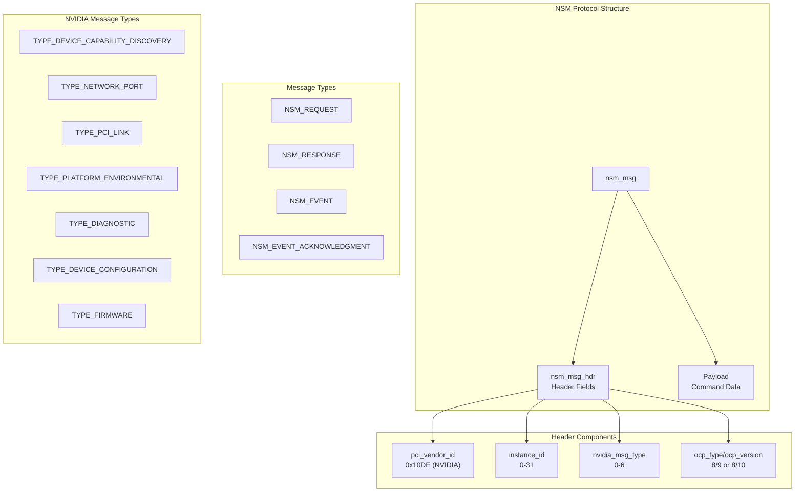
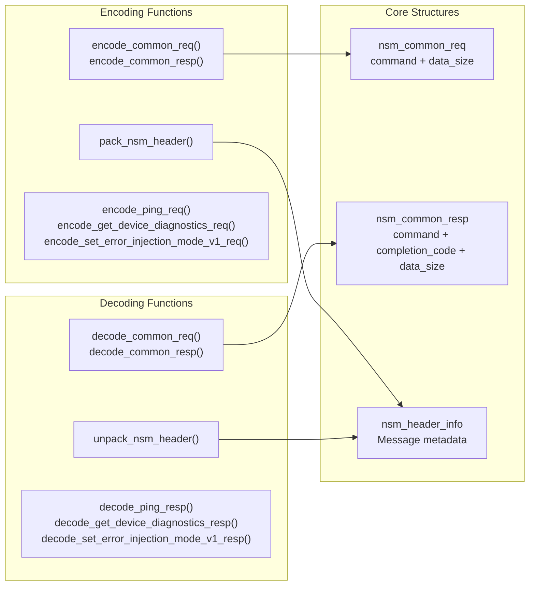
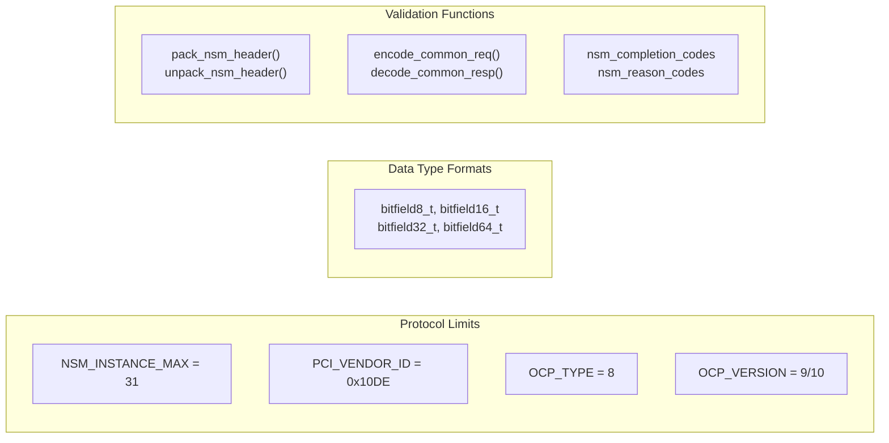

<!-- source: DeepWiki mcp.deepwiki.com · repo NVIDIA/nsmd · page 4 NSM Protocol Layer · fetched 2026-10-26 -->

# NSM Protocol Layer

Relevant source files

The following files were used as context for generating this wiki page:

- [libnsm/base.c](libnsm/base.c)
- [libnsm/base.h](libnsm/base.h)
- [libnsm/device-configuration.c](libnsm/device-configuration.c)
- [libnsm/device-configuration.h](libnsm/device-configuration.h)
- [libnsm/diagnostics.c](libnsm/diagnostics.c)
- [libnsm/diagnostics.h](libnsm/diagnostics.h)
- [libnsm/firmware-utils.c](libnsm/firmware-utils.c)
- [libnsm/firmware-utils.h](libnsm/firmware-utils.h)
- [libnsm/test/common-tests.cpp](libnsm/test/common-tests.cpp)
- [libnsm/test/common-tests.hpp](libnsm/test/common-tests.hpp)
- [libnsm/test/libnsm_base_test.cpp](libnsm/test/libnsm_base_test.cpp)
- [libnsm/test/libnsm_device_configuration_test.cpp](libnsm/test/libnsm_device_configuration_test.cpp)
- [libnsm/test/libnsm_diagnostics_test.cpp](libnsm/test/libnsm_diagnostics_test.cpp)
- [libnsm/test/libnsm_firmware_utils_test.cpp](libnsm/test/libnsm_firmware_utils_test.cpp)
- [libnsm/test/meson.build](libnsm/test/meson.build)
- [mockupResponder/firmwareUtils.cpp](mockupResponder/firmwareUtils.cpp)
- [mockupResponder/test/mockupResponder_test.cpp](mockupResponder/test/mockupResponder_test.cpp)
- [nsmd/nsmChassis/test/nsmRoTProperty_test.cpp](nsmd/nsmChassis/test/nsmRoTProperty_test.cpp)
- [nsmd/nsmProcessor/nsmOemResetStatistics.cpp](nsmd/nsmProcessor/nsmOemResetStatistics.cpp)
- [nsmd/nsmProcessor/nsmOemResetStatistics.hpp](nsmd/nsmProcessor/nsmOemResetStatistics.hpp)
- [nsmd/nsmProcessor/nsmReconfigPermissions.cpp](nsmd/nsmProcessor/nsmReconfigPermissions.cpp)
- [nsmd/nsmProcessor/nsmReconfigPermissions.hpp](nsmd/nsmProcessor/nsmReconfigPermissions.hpp)
- [nsmd/nsmSetAsync/meson.build](nsmd/nsmSetAsync/meson.build)
- [nsmtool/nsm_config_cmd.cpp](nsmtool/nsm_config_cmd.cpp)
- [nsmtool/nsm_diag_cmd.cpp](nsmtool/nsm_diag_cmd.cpp)
- [nsmtool/nsm_discovery_cmd.cpp](nsmtool/nsm_discovery_cmd.cpp)
- [nsmtool/nsm_firmware_cmd.cpp](nsmtool/nsm_firmware_cmd.cpp)

The NSM (NVIDIA System Management) Protocol Layer provides the foundational message format, encoding/decoding functions, and command definitions for communicating with NVIDIA hardware devices. This layer defines the wire protocol, message structures, and command categories that enable higher-level sensor management and hardware control operations.

For information about the higher-level sensor management that uses this protocol, see [Hardware Subsystems](#3). For details about the underlying transport mechanisms, see [Communication Infrastructure](#5).

## Protocol Overview

The NSM protocol is built on top of MCTP (Management Component Transport Protocol) and follows the OCP (Open Compute Project) specification. It defines a structured message format with headers, payloads, and specific encoding rules for different data types and operations.

Sources: [libnsm/base.h:31-35](), [libnsm/base.h:73-81](), [libnsm/base.h:430-467](), [libnsm/base.h:351-356]()

## Message Structure and Encoding

The NSM protocol uses structured message formats with consistent encoding/decoding patterns. All multi-byte fields use little-endian byte ordering for the payload data, while the MCTP header uses big-endian for the PCI vendor ID. Core message manipulation is handled in `libnsm/base.c`.

Sources: [libnsm/base.h:469-501](), [libnsm/base.c:25-106](), [libnsm/base.c:348-376]()

## Protocol Categories and Commands

The NSM protocol organizes commands into seven main categories, each identified by a specific `nsm_type` value:

| Message Type | Value | Purpose | Key Commands |
|--------------|-------|---------|--------------|
| Device Capability Discovery | 0 | Device identification and capability queries | `NSM_PING`, `NSM_QUERY_DEVICE_IDENTIFICATION`, `NSM_SUPPORTED_COMMAND_CODES` |
| Network Port | 1 | Network link management and telemetry | Port status, link metrics, NVLink operations |
| PCI Link | 2 | PCIe link monitoring and control | Link health, error reporting, retimer management |
| Platform Environmental | 3 | Environmental monitoring and control | Temperature, power, thermal management |
| Diagnostic | 4 | Debug and diagnostic operations | Reset statistics, device diagnostics, debug tokens |
| Device Configuration | 5 | Device configuration and error injection | Error injection, reconfiguration permissions, IST mode |
| Firmware | 6 | Firmware management and updates | eRoT state, DOT, security versioning |

For details on core structures, see [NSM Message Protocol](#4.1).

Sources: [libnsm/base.h:73-81](), [libnsm/base.h:85-105](), [libnsm/firmware-utils.h:29-49](), [libnsm/device-configuration.h:28-54]()

## Command Implementation Subsystems

### Device Configuration (Type 5)
Handles runtime modification of device behavior, reconfiguration permissions, and error injection for testing. This includes the `nsm_reconfiguration_permissions_v1_index` which controls sensitive operations like `RP_CONFIDENTIAL_COMPUTE` or `RP_CLOCK_LIMIT`.

For details, see [Device Configuration Commands](#4.2).

Sources: [libnsm/device-configuration.h:43-44](), [libnsm/device-configuration.h:103-129](), [libnsm/device-configuration.c:26-39]()

### Diagnostics and Debug (Type 4)
Provides essential debugging and monitoring capabilities, including reset statistics and segmented data retrieval. It also manages debug tokens for secure access to privileged hardware functions via the `nsm_debug_token_commands`.

For details, see [Diagnostics and Debug Operations](#4.3).

Sources: [libnsm/base.h:109-118](), [nsmtool/nsm_diag_cmd.cpp:54-115](), [nsmd/nsmProcessor/nsmOemResetStatistics.cpp:30-40]()

### Firmware and Security (Type 6)
Covers firmware management, RoT (Root of Trust) properties, and Device Ownership Transfer (DOT). It tracks firmware slots via `nsm_firmware_slot_info` and manages security versions.

For details, see [Firmware and Security Management](#4.4).

Sources: [libnsm/firmware-utils.h:29-49](), [libnsm/firmware-utils.h:199-215](), [nsmtool/nsm_firmware_cmd.cpp:121-210]()

## Protocol Constants and Validation

The NSM protocol defines numerous constants and validation rules to ensure message integrity. Multi-byte fields are handled using `endian.h` functions (e.g., `htole16`, `le32toh`) to ensure portability across architectures.

Sources: [libnsm/base.h:29-39](), [libnsm/base.h:122-160](), [libnsm/base.h:183-255](), [libnsm/base.c:25-106]()

---

