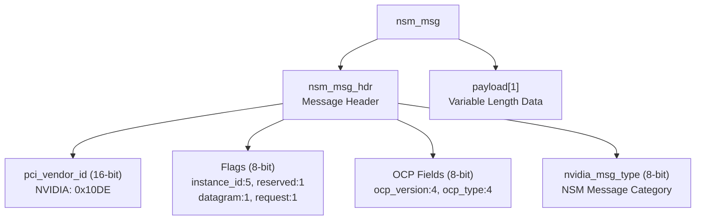
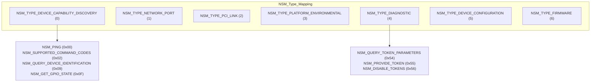
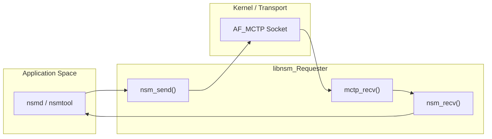

<!-- source: DeepWiki mcp.deepwiki.com · repo NVIDIA/nsmd · page 4.1 NSM Message Protocol · fetched 2026-10-26 -->

# NSM Message Protocol

Relevant source files

The following files were used as context for generating this wiki page:

- [libnsm/base.c](libnsm/base.c)
- [libnsm/base.h](libnsm/base.h)
- [libnsm/device-capability-discovery.c](libnsm/device-capability-discovery.c)
- [libnsm/device-capability-discovery.h](libnsm/device-capability-discovery.h)
- [libnsm/requester/mctp.c](libnsm/requester/mctp.c)
- [libnsm/requester/mctp.h](libnsm/requester/mctp.h)
- [libnsm/test/common-tests.cpp](libnsm/test/common-tests.cpp)
- [libnsm/test/common-tests.hpp](libnsm/test/common-tests.hpp)
- [libnsm/test/libnsm_base_test.cpp](libnsm/test/libnsm_base_test.cpp)
- [libnsm/test/libnsm_device_capability_discovery_test.cpp](libnsm/test/libnsm_device_capability_discovery_test.cpp)
- [libnsm/test/meson.build](libnsm/test/meson.build)
- [nsmd/nsmEvent/nsmGPIOStateChangeEvent.cpp](nsmd/nsmEvent/nsmGPIOStateChangeEvent.cpp)
- [nsmd/nsmEventConfig/nsmEventSetting.hpp](nsmd/nsmEventConfig/nsmEventSetting.hpp)
- [nsmtool/nsm_discovery_cmd.cpp](nsmtool/nsm_discovery_cmd.cpp)
- [tracepoints/nsmd-tp.c](tracepoints/nsmd-tp.c)
- [tracepoints/nsmd-tp.h](tracepoints/nsmd-tp.h)

## Purpose and Scope

This document covers the core NSM (NVIDIA System Management) message protocol implementation, including message structures, encoding/decoding functions, and foundational communication patterns. The NSM protocol provides standardized communication between system management components and NVIDIA hardware devices over MCTP transport.

The foundational protocol logic is implemented in `libnsm`, a C-based library providing the structures and pack/unpack routines used by both the `nsmd` daemon and the `nsmtool` CLI.

## NSM Message Structure

The NSM protocol uses a structured message format with a standardized header followed by a variable-length payload. All messages conform to the OCP (Open Compute Project) specification with NVIDIA-specific extensions.

### Message Header Format

The `nsm_msg_hdr` structure contains essential routing and protocol information:

| Field | Size | Purpose |
|-------|------|---------|
| `pci_vendor_id` | 16-bit | NVIDIA identifier (0x10DE) [libnsm/base.h:31]() |
| `instance_id` | 5-bit | Message instance for correlation (Max 31) [libnsm/base.h:29]() |
| `datagram` | 1-bit | Set for events and acknowledgments [libnsm/base.c:46]() |
| `request` | 1-bit | Set for requests and events [libnsm/base.c:52]() |
| `ocp_type` | 4-bit | OCP message type (Value: 8) [libnsm/base.h:33]() |
| `ocp_version` | 4-bit | Protocol version (9 or 10) [libnsm/base.h:34-35]() |
| `nvidia_msg_type` | 8-bit | NSM message category (e.g., Diagnostic, Firmware) |

Sources: [libnsm/base.h:403-415](), [libnsm/base.h:431-435](), [libnsm/base.c:43-61]()

### Message Types

The protocol supports four fundamental message types derived from the header flags:

| Type | request | datagram | Purpose |
|------|---------|----------|---------|
| `NSM_REQUEST` | 1 | 0 | Standard command request |
| `NSM_RESPONSE` | 0 | 0 | Standard command response |
| `NSM_EVENT` | 1 | 1 | Asynchronous notification |
| `NSM_EVENT_ACKNOWLEDGMENT` | 0 | 1 | Confirmation of event receipt |

Sources: [libnsm/base.h:325-330](), [libnsm/base.c:32-53](), [libnsm/base.c:95-100]()

## NSM Message Categories

NSM messages are organized into distinct categories (`nsm_type`), each targeting specific hardware management domains:

Sources: [libnsm/base.h:73-81](), [libnsm/base.h:85-105](), [libnsm/base.h:109-118]()

### Completion and Reason Codes

Standardized completion codes (`nsm_completion_codes`) indicate the status of an operation, while reason codes (`nsm_reason_codes`) provide granular error details.

| Completion Code | Value | Meaning |
|----------------|-------|---------|
| `NSM_SUCCESS` | 0x00 | Operation completed successfully |
| `NSM_ERROR` | 0x01 | General error condition |
| `NSM_ERR_INVALID_DATA` | 0x02 | Invalid data in request |
| `NSM_ERR_NOT_READY` | 0x04 | Device not ready |
| `NSM_ACCEPTED` | 0x7D | Long-running operation accepted |
| `NSM_BUSY` | 0x7E | Device busy, retry later |

Sources: [libnsm/base.h:122-135](), [libnsm/base.h:139-160]()

## Core Encoding and Decoding Functions

The foundational logic for the protocol resides in `libnsm/base.c`.

### Header Operations

- **`pack_nsm_header`**: Converts a `nsm_header_info` struct into the wire-format `nsm_msg_hdr`. It handles the setting of `datagram` and `request` bits based on message type and sets the `PCI_VENDOR_ID` to 0x10DE [libnsm/base.c:25-63]().
- **`pack_nsm_header_v2`**: Similar to above but sets `ocp_version` to `OCP_VERSION_V2` (10) [libnsm/base.c:65-73]().
- **`unpack_nsm_header`**: Validates the vendor ID and OCP fields before extracting the message type, instance ID, and NVIDIA message category [libnsm/base.c:75-106]().

### Endianness and Data Conversion

NSM uses Little-Endian for payload data. `libnsm` provides type-safe array conversion utilities:
- **`htoleArrayData`**: Converts host-endian arrays to little-endian based on `NvU8`, `NvU16`, `NvU32`, `NvU64`, etc. [libnsm/base.c:108-192]().
- **`letohArrayData`**: Converts little-endian arrays to host-endian [libnsm/base.c:194-280]().

## Device Capability Discovery (Type 0)

This subsystem handles the initial identification and capability negotiation between the requester and the device.

### Key Discovery Commands
- **NSM_PING**: Simple connectivity check. Encoded via `encode_ping_req` [libnsm/device-capability-discovery.c:252-261]() and decoded via `decode_ping_resp` [libnsm/device-capability-discovery.c:292-302]().
- **NSM_SUPPORTED_NVIDIA_MESSAGE_TYPES**: Retrieves a bitfield of supported `nsm_type` values [libnsm/device-capability-discovery.c:304-323]().
- **NSM_QUERY_DEVICE_IDENTIFICATION**: Returns device-specific info like Serial Number, Board Part Number, and UUID [libnsm/device-capability-discovery.h:268-283]().

### GPIO State Management
Commands `NSM_GET_GPIO_STATE` (0x0F) and `NSM_SET_GPIO_STATE` (0x10) allow management of hardware pins.
- **Request Structure**: `nsm_get_gpio_state_req` contains the `gpio_id` [libnsm/device-capability-discovery.h:393-396]().
- **Response Structure**: `nsm_get_gpio_state_resp` returns the `gpio_state` [libnsm/device-capability-discovery.h:398-402]().

Sources: [libnsm/device-capability-discovery.h:85-105](), [libnsm/device-capability-discovery.c:18-302]()

## Event Handling

### Event Structure and Classes
Events are asynchronous messages (`request=1, datagram=1`). The structure `nsm_event` includes a version, acknowledgment requirement, event ID, class, and state.

| Event Class | Value | Purpose |
|-------------|-------|---------|
| `NSM_GENERAL_EVENT_CLASS` | 0x00 | Standard events |
| `NSM_ASSERTION_DEASSERTION_EVENT_CLASS` | 0x01 | Boolean state changes |
| `NSM_POLLED_EVENT_CLASS` | 0x02 | Polling-based updates |
| `NSM_NVIDIA_GENERAL_EVENT_CLASS` | 0x80 | OEM/NVIDIA specific events |

Sources: [libnsm/base.h:176-181](), [libnsm/base.h:522-531]()

### Long-Running Events
When a command returns `NSM_ACCEPTED` (0x7D), the device later sends an `NSM_LONG_RUNNING_EVENT` (ID: 2) [libnsm/device-capability-discovery.h:44]().
- **Decoding**: `decode_long_running_event` extracts the original command, status, and completion data from the event payload [libnsm/base.c:961-1013]().

### GPIO State Change Event
The `NSM_GPIO_STATE_CHANGE_EVENT` (ID: 3) notifies the requester of physical pin changes [libnsm/device-capability-discovery.h:45](). It is handled in the daemon by `NsmGPIOStateChangeEvent` [nsmd/nsmEvent/nsmGPIOStateChangeEvent.cpp]().

## Histogram Sub-system

NSM provides a mechanism to retrieve telemetry histograms (e.g., power or temperature distributions).

- **Discovery**: `NSM_DISCOVER_HISTOGRAM` (0x0C) identifies available histograms.
- **Format**: `NSM_GET_HISTOGRAM_FORMAT` (0x0D) describes the buckets, units (`BucketUnit`), and data types (`BucketFormat`) [libnsm/base.h:358-397]().
- **Data**: `NSM_GET_HISTOGRAM_DATA` (0x0E) retrieves the actual bucket counts [libnsm/base.h:98]().

Sources: [libnsm/base.h:1065-1176]()

## Transport Integration (MCTP)

The protocol is typically carried over MCTP. The `libnsm/requester/mctp.c` file provides the low-level glue for socket communication.

- **`nsm_send`**: Prefixes the NSM message with a 3-byte MCTP header (Tag, EID, Message Type 0x7E) before sending via `sendmsg` [libnsm/requester/mctp.c:170-190]().
- **`mctp_recv`**: Uses `poll()` with `RESPONSE_TIME_OUT` and `MSG_PEEK` to safely ingest incoming packets from the MCTP socket [libnsm/requester/mctp.c:32-92]().

Sources: [libnsm/requester/mctp.c:32-190](), [libnsm/requester/mctp.h:30-46]()

## Testing Framework

The `libnsm` logic is verified using a comprehensive GTest suite located in `libnsm/test/`.

- **Base Tests**: `libnsm_base_test.cpp` verifies header packing/unpacking and ping encoding/decoding [libnsm/test/libnsm_base_test.cpp:26-140]().
- **Common Utilities**: `common-tests.hpp` provides templates like `testEncodeRequest` and `testDecodeResponse` to standardize testing across different NSM types [libnsm/test/common-tests.hpp:35-188]().
- **Coverage**: The build system defines dozens of test targets (e.g., `libnsm_network_ports_test`, `libnsm_firmware_utils_test`) to ensure protocol compliance for every command [libnsm/test/meson.build:6-55]().

Sources: [libnsm/test/libnsm_base_test.cpp:1-140](), [libnsm/test/common-tests.hpp:1-188](), [libnsm/test/meson.build:1-71]()

---

