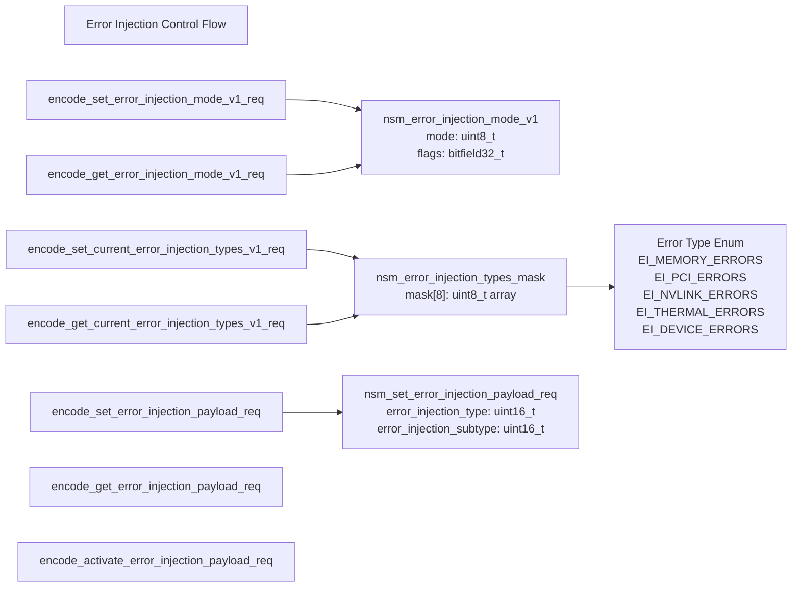
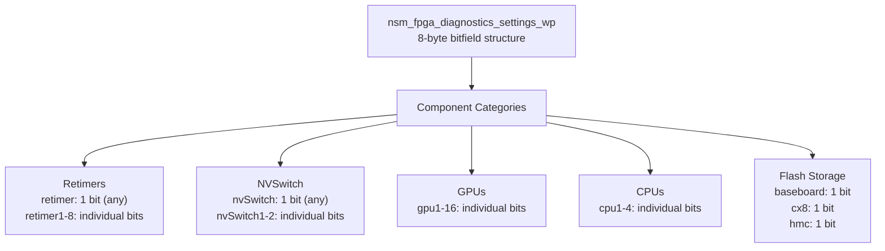
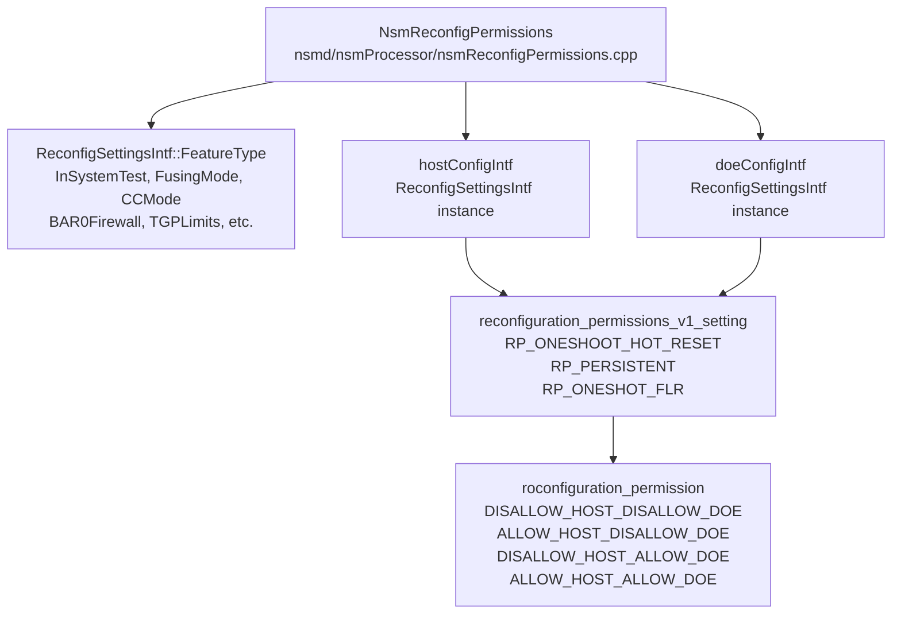
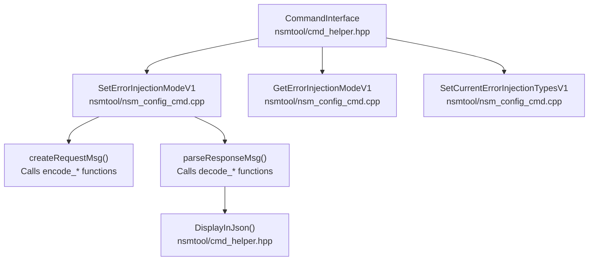

<!-- source: DeepWiki mcp.deepwiki.com · repo NVIDIA/nsmd · page 4.2 Device Configuration Commands · fetched 2026-10-26 -->

# Device Configuration Commands

Relevant source files

The following files were used as context for generating this wiki page:

- [libnsm/device-configuration.c](libnsm/device-configuration.c)
- [libnsm/device-configuration.h](libnsm/device-configuration.h)
- [libnsm/test/libnsm_device_configuration_test.cpp](libnsm/test/libnsm_device_configuration_test.cpp)
- [mockupResponder/test/mockupResponder_test.cpp](mockupResponder/test/mockupResponder_test.cpp)
- [nsmd/nsmChassis/nsmLeakDetection.cpp](nsmd/nsmChassis/nsmLeakDetection.cpp)
- [nsmd/nsmChassis/nsmLeakDetection.hpp](nsmd/nsmChassis/nsmLeakDetection.hpp)
- [nsmd/nsmDbusIfaceOverride/nsmActivateErrorInjectAsyncIntf.hpp](nsmd/nsmDbusIfaceOverride/nsmActivateErrorInjectAsyncIntf.hpp)
- [nsmd/nsmErrorInjection/meson.build](nsmd/nsmErrorInjection/meson.build)
- [nsmd/nsmErrorInjection/nsmErrorInjection.cpp](nsmd/nsmErrorInjection/nsmErrorInjection.cpp)
- [nsmd/nsmErrorInjection/nsmErrorInjection.hpp](nsmd/nsmErrorInjection/nsmErrorInjection.hpp)
- [nsmd/nsmErrorInjection/nsmErrorInjectionCommon.hpp](nsmd/nsmErrorInjection/nsmErrorInjectionCommon.hpp)
- [nsmd/nsmErrorInjection/test/meson.build](nsmd/nsmErrorInjection/test/meson.build)
- [nsmd/nsmErrorInjection/test/nsmErrorInjection_test.cpp](nsmd/nsmErrorInjection/test/nsmErrorInjection_test.cpp)
- [nsmd/nsmProcessor/nsmReconfigPermissions.cpp](nsmd/nsmProcessor/nsmReconfigPermissions.cpp)
- [nsmd/nsmProcessor/nsmReconfigPermissions.hpp](nsmd/nsmProcessor/nsmReconfigPermissions.hpp)
- [nsmd/nsmSetAsync/meson.build](nsmd/nsmSetAsync/meson.build)
- [nsmd/nsmSetAsync/nsmSetErrorInjection.cpp](nsmd/nsmSetAsync/nsmSetErrorInjection.cpp)
- [nsmd/nsmSetAsync/nsmSetErrorInjection.hpp](nsmd/nsmSetAsync/nsmSetErrorInjection.hpp)
- [nsmtool/nsm_config_cmd.cpp](nsmtool/nsm_config_cmd.cpp)

## Purpose and Scope

The Device Configuration Commands subsystem provides NSM protocol Type 5 commands for configuring and controlling various hardware features and operational modes of NVIDIA devices. This includes error injection capabilities, FPGA diagnostics, reconfiguration permissions, security modes, and device-specific settings.

For information about NSM message protocol basics and encoding/decoding, see [NSM Message Protocol](#4.1). For diagnostic and debug operations that don't involve configuration, see [Diagnostics and Debug Operations](#4.3).

## Command Categories Overview

The device configuration commands are organized into several functional categories, each addressing specific aspects of device configuration and control.

```mermaid
graph TB
    DeviceConfig["Device Configuration Commands<br/>NSM Type 5"]
    
    ErrorInj["Error Injection<br/>Commands 0x03-0x0C"]
    FPGADiag["FPGA Diagnostics<br/>Command 0x64"]
    ReconfigPerms["Reconfiguration Permissions<br/>Commands 0x40-0x41"]
    SecurityModes["Security & Compute Modes<br/>Commands 0x08-0x09, 0x42-0x43"]
    DeviceControl["Device Control<br/>Command 0x62"]
    
    DeviceConfig --> ErrorInj
    DeviceConfig --> FPGADiag
    DeviceConfig --> ReconfigPerms
    DeviceConfig --> SecurityModes
    DeviceConfig --> DeviceControl
    
    ErrorInj --> ErrorInjMode["NSM_SET/GET_ERROR_INJECTION_MODE_V1"]
    ErrorInj --> ErrorInjTypes["NSM_SET/GET_CURRENT_ERROR_INJECTION_TYPES_V1"]
    ErrorInj --> ErrorInjPayload["NSM_SET/GET_ERROR_INJECTION_PAYLOAD"]
    ErrorInj --> ErrorInjActivate["NSM_ACTIVATE_ERROR_INJECTION"]
    
    FPGADiag --> WPSettings["GET_WP_SETTINGS"]
    FPGADiag --> PowerStatus["GET_POWER_SUPPLY_STATUS"]
    FPGADiag --> GPUPresence["GET_GPU_PRESENCE"]
    FPGADiag --> ISTMode["GET_GPU_IST_MODE_SETTINGS"]
    
    ReconfigPerms --> GetPerms["NSM_GET_RECONFIGURATION_PERMISSIONS_V1"]
    ReconfigPerms --> SetPerms["NSM_SET_RECONFIGURATION_PERMISSIONS_V1"]
    
    SecurityModes --> CCMode["NSM_SET/GET_CONFIDENTIAL_COMPUTE_MODE_V1"]
    SecurityModes --> EGMMode["NSM_SET/GET_EGM_MODE"]
    
    DeviceControl --> GPUISTControl["NSM_ENABLE_DISABLE_GPU_IST_MODE"]
```

Sources: [libnsm/device-configuration.h:28-54](), [libnsm/device-configuration.h:85-101](), [libnsm/device-configuration.h:103-129]()

## Error Injection Subsystem

The error injection subsystem provides comprehensive capabilities for testing device resilience by introducing controlled hardware errors across multiple domains.

### Error Injection State Machine and Control

The error injection workflow follows a multi-phase process: enable global mode, configure specific error types, set payload parameters (such as memory fault bitmaps), and activate the injection.

The implementation in `nsmd` utilizes asynchronous operations to manage these transitions. Classes like `NsmSetErrorInjection` [nsmd/nsmSetAsync/nsmSetErrorInjection.cpp:31-36]() and `NsmSetErrorInjectionPayload` [nsmd/nsmSetAsync/nsmSetErrorInjection.hpp:79-82]() bridge D-Bus requests to the underlying NSM commands.

Sources: [libnsm/device-configuration.h:69-76](), [libnsm/device-configuration.h:168-175](), [libnsm/device-configuration.h:204-207](), [libnsm/device-configuration.h:232-237](), [nsmd/nsmSetAsync/nsmSetErrorInjection.cpp:51-105]()

### Async Error Injection Activation

For long-running or complex injection tasks, `NsmActivateErrorInjectionPayloadIntf` [nsmd/nsmDbusIfaceOverride/nsmActivateErrorInjectAsyncIntf.hpp:38-41]() provides a D-Bus `Activate()` method that returns an object path to an `AsyncStatus` interface. This allows clients to monitor the progress of the injection [nsmd/nsmDbusIfaceOverride/nsmActivateErrorInjectAsyncIntf.hpp:111-127]().

Sources: [nsmd/nsmDbusIfaceOverride/nsmActivateErrorInjectAsyncIntf.hpp:53-109](), [nsmd/nsmDbusIfaceOverride/nsmActivateErrorInjectAsyncIntf.hpp:111-127]()

## FPGA Diagnostics Settings

The FPGA diagnostics system provides access to comprehensive hardware status information across multiple subsystems using a `data_index` multiplexing scheme.

### Diagnostics Data Index Categories

| Data Index | Enum Value | Description | Response Type |
|------------|------------|-------------|---------------|
| 0x00 | `GET_WP_SETTINGS` | Write protection settings for various components | `nsm_fpga_diagnostics_settings_wp` |
| 0x02 | `GET_WP_JUMPER_PRESENCE` | Write protection jumper detection | `nsm_fpga_diagnostics_settings_wp_jumper` |
| 0x04 | `GET_GPU_IST_MODE_SETTINGS` | GPU IST mode per-device settings | `nsm_get_gpu_ist_mode_resp` |
| 0x05 | `GET_POWER_SUPPLY_STATUS` | Power supply status information | `nsm_get_power_supply_status_resp` |
| 0x0C | `GET_GPU_PRESENCE` | GPU presence detection bitmap | `nsm_get_gpu_presence_resp` |
| 0x0D | `GET_GPU_POWER_STATUS` | GPU power status per device | `nsm_get_gpu_power_status_resp` |
| 0xFF | `GET_AGGREGATE_TELEMETRY` | Combined telemetry data | Generic response |

Sources: [libnsm/device-configuration.h:85-101](), [libnsm/device-configuration.h:345-361]()

### Write Protection Settings Structure

The WP (Write Protection) settings provide detailed component-level protection status via a bitfield structure:

Sources: [libnsm/device-configuration.h:248-304](), [nsmtool/nsm_config_cmd.cpp:683-746]()

## Reconfiguration Permissions System

The reconfiguration permissions system controls access to device configuration features through both host software and Data Object Exchange (DOE) interfaces.

### Permission Architecture

The `NsmReconfigPermissions` class [nsmd/nsmProcessor/nsmReconfigPermissions.hpp:36-37]() manages permissions for features such as `InSystemTest`, `CCMode`, and `TGPLimits` [nsmd/nsmProcessor/nsmReconfigPermissions.cpp:91-147](). It tracks permissions for both `hostConfigIntf` and `doeConfigIntf` [nsmd/nsmProcessor/nsmReconfigPermissions.hpp:41-42]().

Sources: [nsmd/nsmProcessor/nsmReconfigPermissions.hpp:31-44](), [libnsm/device-configuration.h:131-135](), [libnsm/device-configuration.h:137-142]()

### Shared Memory Integration

`NsmReconfigPermissions` updates metrics in shared memory for fast access by other system components using `updateMetricOnSharedMemory()` [nsmd/nsmProcessor/nsmReconfigPermissions.cpp:44-86](). It caches properties like `AllowFLRPersistentConfig` and `AllowOneShotConfig` for both Host and DOE paths [nsmd/nsmProcessor/nsmReconfigPermissions.cpp:50-53]().

Sources: [nsmd/nsmProcessor/nsmReconfigPermissions.cpp:44-86]()

## Security and Compute Modes

### Confidential Compute Mode

The confidential compute mode provides hardware-enforced security boundaries with current and pending state tracking. It uses the `compute_mode` enum [libnsm/device-configuration.h:435-439]() and the `nsm_get_confidential_compute_mode_v1_resp` structure [libnsm/device-configuration.h:467-471]().

### EGM Mode

Extended Graphics Mode (EGM) configuration is handled via `NSM_SET_EGM_MODE` [libnsm/device-configuration.h:47]() and `NSM_GET_EGM_MODE` [libnsm/device-configuration.h:48](). The `nsm_get_egm_mode_resp` structure provides the current mode and flags [libnsm/device-configuration.h:558-562]().

Sources: [libnsm/device-configuration.h:435-439](), [libnsm/device-configuration.h:467-471](), [libnsm/device-configuration.h:558-562]()

## CLI Implementation Pattern

The `nsmtool` implements device configuration commands as dedicated classes inheriting from `CommandInterface` [nsmtool/nsm_config_cmd.cpp:84-94]().

Sources: [nsmtool/nsm_config_cmd.cpp:84-143](), [nsmtool/nsm_config_cmd.cpp:145-197](), [nsmtool/nsm_config_cmd.cpp:412-479]()

### Processing Pattern

All device configuration commands follow a consistent pattern:

1.  **Request Generation**: `createRequestMsg()` uses `libnsm` `encode_*_req` functions [nsmtool/nsm_config_cmd.cpp:108-116]().
2.  **Transport**: Messages are dispatched through the MCTP requester framework.
3.  **Response Handling**: `parseResponseMsg()` uses `libnsm` `decode_*_resp` functions to extract data and completion codes [nsmtool/nsm_config_cmd.cpp:118-139]().
4.  **Output**: Results are displayed in JSON format using `DisplayInJson()` [nsmtool/nsm_config_cmd.cpp:138]().

Sources: [nsmtool/nsm_config_cmd.cpp:108-143](), [libnsm/device-configuration.c:26-39](), [libnsm/device-configuration.c:114-138]()

---

