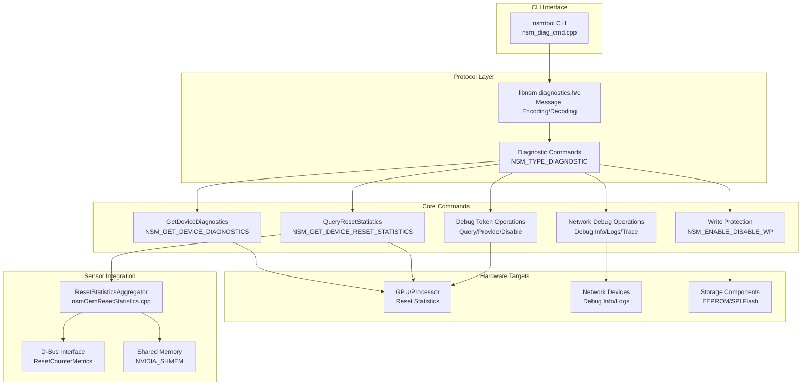
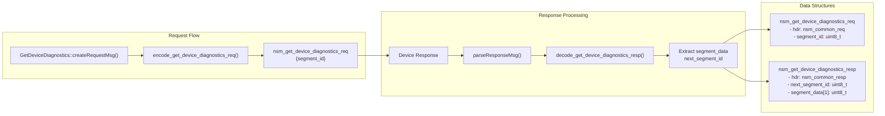
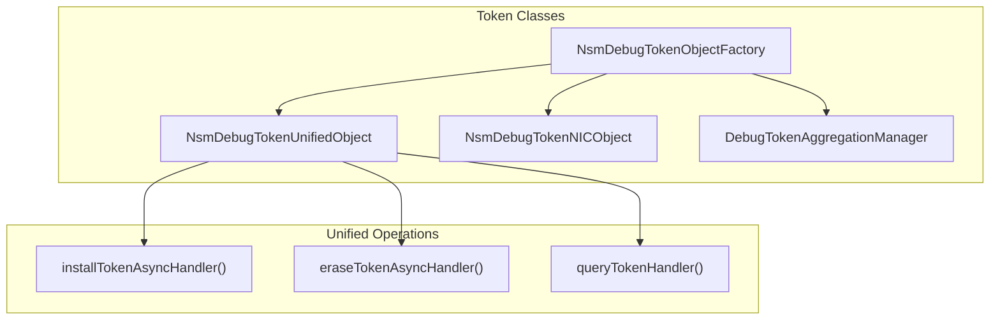
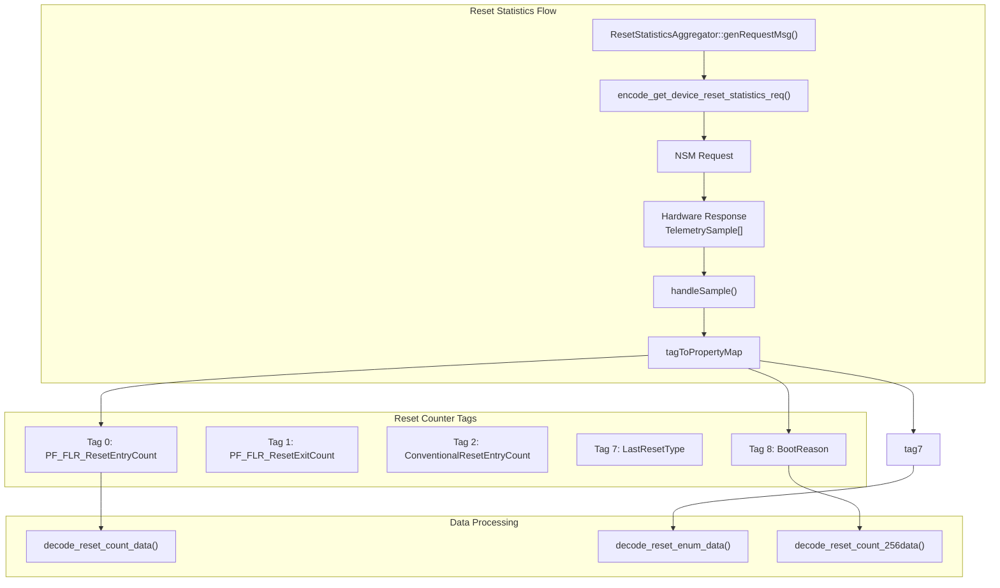

<!-- source: DeepWiki mcp.deepwiki.com · repo NVIDIA/nsmd · page 4.3 Diagnostics and Debug Operations · fetched 2026-10-26 -->

# Diagnostics and Debug Operations

Relevant source files

The following files were used as context for generating this wiki page:

- [debug-token/error.h](debug-token/error.h)
- [debug-token/test/debugTokenTLV_test.cpp](debug-token/test/debugTokenTLV_test.cpp)
- [debug-token/test/meson.build](debug-token/test/meson.build)
- [debug-token/tlv.h](debug-token/tlv.h)
- [debug-token/tlv_decoder.cpp](debug-token/tlv_decoder.cpp)
- [debug-token/tlv_encoder.cpp](debug-token/tlv_encoder.cpp)
- [debug-token/types.h](debug-token/types.h)
- [libnsm/debug-token.c](libnsm/debug-token.c)
- [libnsm/debug-token.h](libnsm/debug-token.h)
- [libnsm/diagnostics.c](libnsm/diagnostics.c)
- [libnsm/diagnostics.h](libnsm/diagnostics.h)
- [libnsm/test/libnsm_debug_token_test.cpp](libnsm/test/libnsm_debug_token_test.cpp)
- [libnsm/test/libnsm_diagnostics_test.cpp](libnsm/test/libnsm_diagnostics_test.cpp)
- [mockupResponder/debugToken.cpp](mockupResponder/debugToken.cpp)
- [nsmd/nsmDebugToken/debugTokenUtils.cpp](nsmd/nsmDebugToken/debugTokenUtils.cpp)
- [nsmd/nsmDebugToken/debugTokenUtils.hpp](nsmd/nsmDebugToken/debugTokenUtils.hpp)
- [nsmd/nsmDebugToken/meson.build](nsmd/nsmDebugToken/meson.build)
- [nsmd/nsmDebugToken/nsmDebugTokenAggregation.cpp](nsmd/nsmDebugToken/nsmDebugTokenAggregation.cpp)
- [nsmd/nsmDebugToken/nsmDebugTokenAggregation.hpp](nsmd/nsmDebugToken/nsmDebugTokenAggregation.hpp)
- [nsmd/nsmDebugToken/nsmDebugTokenNIC.cpp](nsmd/nsmDebugToken/nsmDebugTokenNIC.cpp)
- [nsmd/nsmDebugToken/nsmDebugTokenObjectFactory.cpp](nsmd/nsmDebugToken/nsmDebugTokenObjectFactory.cpp)
- [nsmd/nsmDebugToken/nsmDebugTokenUnified.cpp](nsmd/nsmDebugToken/nsmDebugTokenUnified.cpp)
- [nsmd/nsmDebugToken/nsmDebugTokenUnified.hpp](nsmd/nsmDebugToken/nsmDebugTokenUnified.hpp)
- [nsmd/nsmDebugToken/test/debugTokenUtils_test.cpp](nsmd/nsmDebugToken/test/debugTokenUtils_test.cpp)
- [nsmd/nsmDebugToken/test/nsmDebugTokenAggregationBranch2_test.cpp](nsmd/nsmDebugToken/test/nsmDebugTokenAggregationBranch2_test.cpp)
- [nsmd/nsmDebugToken/test/nsmDebugTokenAggregationBranch_test.cpp](nsmd/nsmDebugToken/test/nsmDebugTokenAggregationBranch_test.cpp)
- [nsmd/nsmDebugToken/test/nsmDebugTokenAggregation_test.cpp](nsmd/nsmDebugToken/test/nsmDebugTokenAggregation_test.cpp)
- [nsmd/nsmDebugToken/test/nsmDebugToken_test.cpp](nsmd/nsmDebugToken/test/nsmDebugToken_test.cpp)
- [nsmd/nsmDumpCollection/meson.build](nsmd/nsmDumpCollection/meson.build)
- [nsmd/nsmDumpCollection/nsmDebugInfo.cpp](nsmd/nsmDumpCollection/nsmDebugInfo.cpp)
- [nsmd/nsmDumpCollection/nsmDebugInfo.hpp](nsmd/nsmDumpCollection/nsmDebugInfo.hpp)
- [nsmd/nsmDumpCollection/nsmLogInfo.cpp](nsmd/nsmDumpCollection/nsmLogInfo.cpp)
- [nsmd/nsmDumpCollection/nsmLogInfo.hpp](nsmd/nsmDumpCollection/nsmLogInfo.hpp)
- [nsmd/nsmProcessor/nsmOemResetStatistics.cpp](nsmd/nsmProcessor/nsmOemResetStatistics.cpp)
- [nsmd/nsmProcessor/nsmOemResetStatistics.hpp](nsmd/nsmProcessor/nsmOemResetStatistics.hpp)
- [nsmtool/nsm_diag_cmd.cpp](nsmtool/nsm_diag_cmd.cpp)

This document covers the NSM diagnostics and debug operations subsystem, which provides comprehensive device debugging capabilities, reset statistics tracking, debug token management, and diagnostic data retrieval. The diagnostics system enables hardware troubleshooting, performance analysis, and secure debug access for NVIDIA hardware components.

For information about NSM message protocol structures, see [NSM Message Protocol](#4.1). For device configuration operations, see [Device Configuration Commands](#4.2).

## Overview

The diagnostics subsystem implements NSM Type 4 messages and provides tools for hardware debugging, reset tracking, and diagnostic data collection. It consists of command-line utilities, protocol encoding/decoding functions, and sensor aggregators for telemetry collection.

**Sources:** [nsmtool/nsm_diag_cmd.cpp:40-50](), [libnsm/diagnostics.h:29-40](), [nsmd/nsmProcessor/nsmOemResetStatistics.hpp:47-54]()

## Core Diagnostic Commands

The diagnostics subsystem implements several fundamental command categories defined in the `diagnostics_command` enum:

| Command | Value | Purpose |
|---------|-------|---------|
| `NSM_GET_DEVICE_RESET_STATISTICS` | 0x00 | Retrieve device reset counters and statistics |
| `NSM_GET_DEVICE_DIAGNOSTICS` | 0x40 | Get general device diagnostic information |
| `NSM_GET_NETWORK_DEVICE_DEBUG_INFO` | 0x50 | Fetch network device debug data |
| `NSM_ERASE_TRACE` | 0x51 | Clear trace data from device |
| `NSM_GET_NETWORK_DEVICE_LOG_INFO` | 0x52 | Retrieve network device logs |
| `NSM_RESET_NETWORK_DEVICE` | 0x53 | Reset network device with specified mode |
| `NSM_ERASE_DEBUG_INFO` | 0x59 | Erase debug information |
| `NSM_ENABLE_DISABLE_WP` | 0x65 | Control write protection on storage components |

**Sources:** [libnsm/diagnostics.h:29-40]()

## Device Diagnostics Retrieval

The `GetDeviceDiagnostics` command retrieves segmented diagnostic data from devices using a segment-based approach for large data transfers.

The implementation supports segmented data transfer where each request specifies a `segment_id` and responses include a `next_segment_id` for multi-part data retrieval. [libnsm/diagnostics.c:102-111]()

**Sources:** [nsmtool/nsm_diag_cmd.cpp:54-115](), [libnsm/diagnostics.h:100-117](), [libnsm/diagnostics.c:23-148]()

## Debug Token Management

Debug token operations provide secure access control for debugging capabilities through cryptographic tokens. The system supports multiple token types and operations.

### Debug Token Architecture
The `NsmDebugTokenObjectFactory` manages the creation of different debug token objects based on Entity Manager configuration. [nsmd/nsmDebugToken/nsmDebugTokenObjectFactory.cpp:39-98]() It supports:
- **NIC Tokens**: Handled by `NsmDebugTokenNICObject`. [nsmd/nsmDebugToken/nsmDebugTokenNIC.cpp:1-50]()
- **Unified Tokens**: Handled by `NsmDebugTokenUnifiedObject`, supporting asynchronous installation and erasure. [nsmd/nsmDebugToken/nsmDebugTokenUnified.cpp:49-135]()
- **Aggregated Tokens**: Managed by `DebugTokenAggregationManager`.

### TLV Encoding and Device Mappings
The `debug-token/` library provides TLV (Tag-Length-Value) encoding and decoding for token payloads. [debug-token/tlv.h:1-50]() Device-specific mappings for token types and subtypes are defined in `debugTokenUtils.cpp` for ERoT, CPU, and GPU devices. [nsmd/nsmDebugToken/debugTokenUtils.cpp:33-132]()

**Sources:** [nsmd/nsmDebugToken/nsmDebugTokenUnified.cpp:49-135](), [nsmd/nsmDebugToken/nsmDebugTokenObjectFactory.cpp:39-101](), [nsmd/nsmDebugToken/debugTokenUtils.cpp:33-132](), [libnsm/debug-token.h:62-125]()

## Reset Statistics Tracking

The `ResetStatisticsAggregator` implements comprehensive reset counter tracking using the NSM aggregate response format. It maps telemetry tags to D-Bus properties defined in `ResetCounterMetrics`. [nsmd/nsmProcessor/nsmOemResetStatistics.hpp:47-82]()

**Sources:** [nsmd/nsmProcessor/nsmOemResetStatistics.cpp:30-40](), [nsmd/nsmProcessor/nsmOemResetStatistics.cpp:77-150](), [libnsm/diagnostics.c:150-244]()

## Dump and Debug Information Collection

The `NsmDebugInfoObject` manages the retrieval of large debug data and device dumps. It utilizes asynchronous handlers to fetch data in chunks using `recordHandle` pointers. [nsmd/nsmDumpCollection/nsmDebugInfo.cpp:49-62]()

### Debug Information Types
| Type | Value | Description |
|------|-------|-------------|
| `INFO_TYPE_DEVICE_INFO` | 0 | Basic device information |
| `INFO_TYPE_FW_RUNTIME_INFO` | 1 | Firmware runtime data |
| `INFO_TYPE_FW_SAVED_INFO` | 2 | Firmware saved dump information |
| `INFO_TYPE_DEVICE_DUMP` | 3 | Complete device dump |

### Implementation Detail
- **`getDebugInfo`**: Initiates an asynchronous operation to retrieve logs or dumps. [nsmd/nsmDumpCollection/nsmDebugInfo.cpp:147-200]()
- **`getDebugInfoAsyncHandler`**: A coroutine that uses `postPatchIO` to send requests and `decode_get_network_device_debug_info_resp` to process chunks. [nsmd/nsmDumpCollection/nsmDebugInfo.cpp:82-144]()
- **`appendBufferToFd`**: Writes retrieved data chunks to a provided file descriptor. [nsmd/nsmDumpCollection/nsmDebugInfo.cpp:124-132]()

**Sources:** [nsmd/nsmDumpCollection/nsmDebugInfo.cpp:49-200](), [nsmd/nsmDumpCollection/nsmDebugInfo.hpp:40-69](), [libnsm/diagnostics.h:91-96]()

## Write Protection Control

The `NSM_ENABLE_DISABLE_WP` command controls write protection on various storage components via the `nsm_enable_disable_wp_req` structure. [libnsm/diagnostics.h:226-234]()

### Protected Storage Components
The `diagnostics_enable_disable_wp_data_index` enum defines controllable storage components:
- **EEPROM**: Retimer (128, 192-199), Baseboard FRU (129), PEX SW (130), NVSW (131-134), CX7 FRU (232).
- **SPI Flash**: GPU (160-170), HMC (176), CX8 (183), CPU (224-231).

**Sources:** [libnsm/diagnostics.h:42-80](), [libnsm/test/libnsm_diagnostics_test.cpp:215-239]()

## Implementation Architecture

### Message Encoding/Decoding
All diagnostic operations use consistent encoding patterns in `libnsm/diagnostics.c`:
- **Requests**: `encode_get_device_diagnostics_req`, `encode_get_device_reset_statistics_req`.
- **Responses**: `decode_get_device_diagnostics_resp`, `decode_get_network_device_debug_info_resp`.

### Testing Infrastructure
The subsystem is validated through extensive unit tests in `libnsm/test/libnsm_diagnostics_test.cpp` and `nsmd/nsmDebugToken/test/`, ensuring correct byte-level manipulation and state transitions. [libnsm/test/libnsm_diagnostics_test.cpp:23-150]()

**Sources:** [libnsm/diagnostics.c:1-244](), [libnsm/test/libnsm_diagnostics_test.cpp:23-150]()

---

