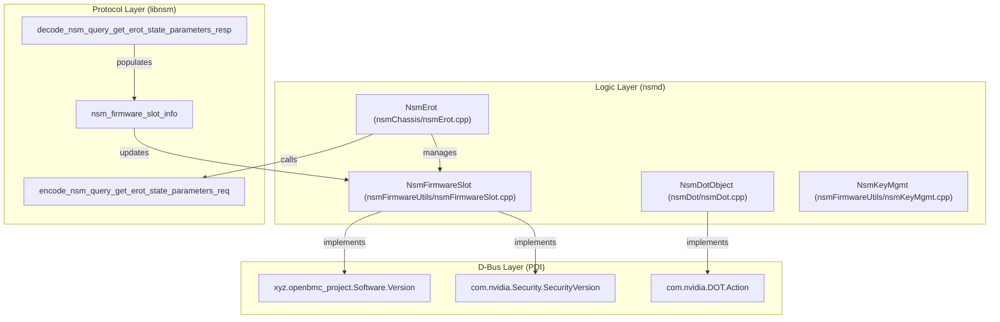
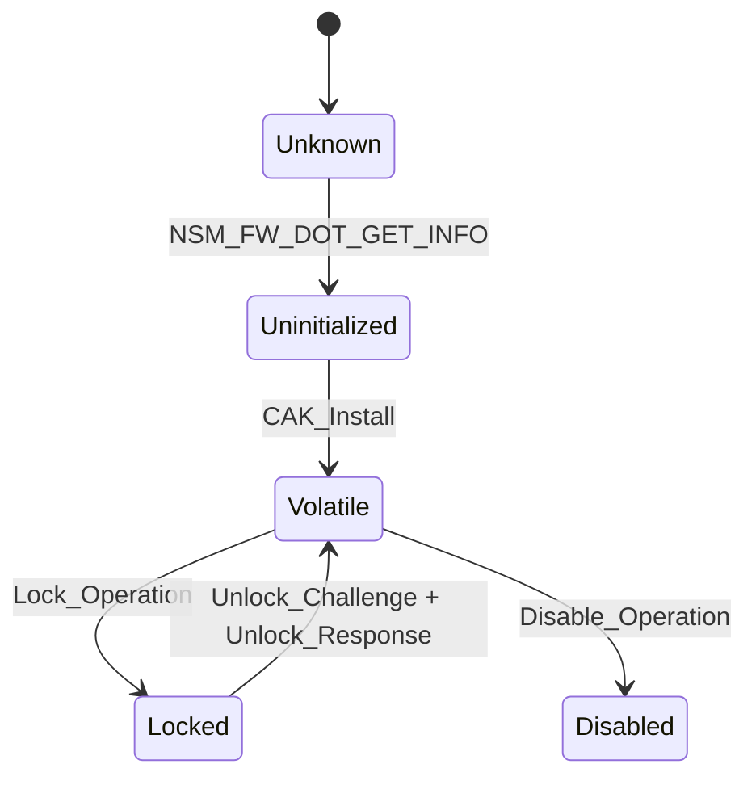

<!-- source: DeepWiki mcp.deepwiki.com · repo NVIDIA/nsmd · page 4.4 Firmware and Security Management · fetched 2026-10-26 -->

# Firmware and Security Management

Relevant source files

The following files were used as context for generating this wiki page:

- [dot/nsmDotUtils.cpp](dot/nsmDotUtils.cpp)
- [dot/nsmDotUtils.hpp](dot/nsmDotUtils.hpp)
- [dot/test/meson.build](dot/test/meson.build)
- [dot/test/nsmDotUtils_test.cpp](dot/test/nsmDotUtils_test.cpp)
- [libnsm/firmware-utils.c](libnsm/firmware-utils.c)
- [libnsm/firmware-utils.h](libnsm/firmware-utils.h)
- [libnsm/test/dot_test_fixtures.hpp](libnsm/test/dot_test_fixtures.hpp)
- [libnsm/test/libnsm_firmware_utils_test.cpp](libnsm/test/libnsm_firmware_utils_test.cpp)
- [mockupResponder/firmwareUtils.cpp](mockupResponder/firmwareUtils.cpp)
- [nsmd/nsmChassis/meson.build](nsmd/nsmChassis/meson.build)
- [nsmd/nsmChassis/nsmAERError.cpp](nsmd/nsmChassis/nsmAERError.cpp)
- [nsmd/nsmChassis/nsmAERError.hpp](nsmd/nsmChassis/nsmAERError.hpp)
- [nsmd/nsmChassis/nsmErot.cpp](nsmd/nsmChassis/nsmErot.cpp)
- [nsmd/nsmChassis/nsmErot.hpp](nsmd/nsmChassis/nsmErot.hpp)
- [nsmd/nsmChassis/nsmIRoTResponder.cpp](nsmd/nsmChassis/nsmIRoTResponder.cpp)
- [nsmd/nsmChassis/nsmIRoTResponder.hpp](nsmd/nsmChassis/nsmIRoTResponder.hpp)
- [nsmd/nsmChassis/nsmRoTProperty.cpp](nsmd/nsmChassis/nsmRoTProperty.cpp)
- [nsmd/nsmChassis/nsmRoTProperty.hpp](nsmd/nsmChassis/nsmRoTProperty.hpp)
- [nsmd/nsmChassis/nsmWriteProtectedJumper.cpp](nsmd/nsmChassis/nsmWriteProtectedJumper.cpp)
- [nsmd/nsmChassis/test/nsmRoTProperty_test.cpp](nsmd/nsmChassis/test/nsmRoTProperty_test.cpp)
- [nsmd/nsmDot/meson.build](nsmd/nsmDot/meson.build)
- [nsmd/nsmDot/nsmDot.cpp](nsmd/nsmDot/nsmDot.cpp)
- [nsmd/nsmDot/nsmDot.hpp](nsmd/nsmDot/nsmDot.hpp)
- [nsmd/nsmDot/test/meson.build](nsmd/nsmDot/test/meson.build)
- [nsmd/nsmDot/test/nsmDot_test.cpp](nsmd/nsmDot/test/nsmDot_test.cpp)
- [nsmd/nsmEvent/test/nsmEvent_test.cpp](nsmd/nsmEvent/test/nsmEvent_test.cpp)
- [nsmd/nsmFirmwareUtils/meson.build](nsmd/nsmFirmwareUtils/meson.build)
- [nsmd/nsmFirmwareUtils/nsmFirmwareSlot.cpp](nsmd/nsmFirmwareUtils/nsmFirmwareSlot.cpp)
- [nsmd/nsmFirmwareUtils/nsmFirmwareSlot.hpp](nsmd/nsmFirmwareUtils/nsmFirmwareSlot.hpp)
- [nsmd/nsmFirmwareUtils/nsmFirmwareUtilsCommon.hpp](nsmd/nsmFirmwareUtils/nsmFirmwareUtilsCommon.hpp)
- [nsmd/nsmFirmwareUtils/nsmKeyMgmt.cpp](nsmd/nsmFirmwareUtils/nsmKeyMgmt.cpp)
- [nsmd/nsmFirmwareUtils/nsmKeyMgmt.hpp](nsmd/nsmFirmwareUtils/nsmKeyMgmt.hpp)
- [nsmd/nsmFirmwareUtils/nsmSecurityRBP.cpp](nsmd/nsmFirmwareUtils/nsmSecurityRBP.cpp)
- [nsmd/nsmFirmwareUtils/nsmSecurityRBP.hpp](nsmd/nsmFirmwareUtils/nsmSecurityRBP.hpp)
- [nsmd/nsmFwSwInventory/nsmFirmwareInventory.cpp](nsmd/nsmFwSwInventory/nsmFirmwareInventory.cpp)
- [nsmd/nsmFwSwInventory/nsmWriteProtectedControl.cpp](nsmd/nsmFwSwInventory/nsmWriteProtectedControl.cpp)
- [nsmd/nsmFwSwInventory/nsmWriteProtectedControl.hpp](nsmd/nsmFwSwInventory/nsmWriteProtectedControl.hpp)
- [nsmd/nsmFwSwInventory/test/nsmFirmwareInventory_test.cpp](nsmd/nsmFwSwInventory/test/nsmFirmwareInventory_test.cpp)
- [nsmd/nsmSetAsync/nsmSetWriteProtected.cpp](nsmd/nsmSetAsync/nsmSetWriteProtected.cpp)
- [nsmd/nsmSetAsync/nsmSetWriteProtected.hpp](nsmd/nsmSetAsync/nsmSetWriteProtected.hpp)
- [nsmd/nsmSetAsync/test/nsmSetWriteProtected_test.cpp](nsmd/nsmSetAsync/test/nsmSetWriteProtected_test.cpp)
- [nsmtool/nsm_firmware_cmd.cpp](nsmtool/nsm_firmware_cmd.cpp)

The Firmware and Security Management subsystem in NSM handles the lifecycle of device firmware, including state monitoring, slot management, security versioning, and Device Ownership Transfer (DOT). It leverages the NSM Type 6 (Firmware) command set to interact with hardware Root of Trust (RoT) components like eRoT.

## Architecture and Data Flow

The system is built on a hierarchy of classes that represent physical firmware entities and security states. The `NsmErot` class acts as a coordinator for firmware slots and security properties associated with an eRoT device.

### System Entity Mapping

The following diagram maps high-level firmware concepts to the specific C++ classes and NSM protocol structures used in the implementation.

**Firmware Management Entity Map**

Sources: [nsmd/nsmChassis/nsmErot.cpp:34-43](), [nsmd/nsmFirmwareUtils/nsmFirmwareSlot.cpp:23-41](), [nsmd/nsmDot/nsmDot.cpp:147-158]()

## Firmware Slot Management

NSM tracks multiple firmware slots (e.g., Active, Inactive/Pending) for each component. The `NsmFirmwareSlot` class represents a single firmware image and its metadata.

### Slot Information Fields
The `nsm_firmware_slot_info` structure contains detailed telemetry for each slot, which is retrieved via the `NSM_FW_GET_EROT_STATE_INFORMATION` (0x01) command:
*   **Version String**: The human-readable version (e.g., "01.03.0210.0003").
*   **Build Type**: Distinguishes between Development and Release builds.
*   **Signing Type**: Indicates the signature origin (Production, Debug, External, or DOT).
*   **Firmware State**: Tracks the image lifecycle (Activated, PendingActivation, Staged, etc.).
*   **Security Version Number (SVN)**: Used for anti-rollback protection.

Sources: [libnsm/firmware-utils.h:199-215](), [nsmd/nsmFirmwareUtils/nsmFirmwareSlot.cpp:98-154]()

### State Transitions and Updates
The `NsmErot::handleResponseMsg` function orchestrates the update of all slots when a response is received from the hardware:
1.  Decodes the header containing global eRoT state (active slot ID, active keyset).
2.  Iterates through the list of `nsm_firmware_slot_info` structures.
3.  Calls `NsmFirmwareSlot::update` for each slot to refresh D-Bus properties.

Sources: [nsmd/nsmChassis/nsmErot.cpp:63-99](), [nsmd/nsmFirmwareUtils/nsmFirmwareSlot.cpp:98-154]()

## Security and Key Management

The security subsystem manages cryptographic keys and security versioning policies.

### RoT Properties
The `NsmRoTProperty` classes handle configurable security policies:
*   **In-band Update Policy**: Controls whether firmware can be updated through the host interface.
*   **AP SKU ID**: Manages the Application Processor SKU identifier, which can be persistent or volatile.
*   **Background Copy Policy**: Controls automatic redundancy synchronization between slots.

Sources: [nsmd/nsmChassis/nsmRoTProperty.cpp:69-89](), [nsmd/nsmChassis/nsmRoTProperty.hpp:1-50](), [libnsm/firmware-utils.h:95-100]()

### Key Management Logic
The `NsmKeyMgmt` class (and associated `NsmIRoTResponder`) manages the lifecycle of Code Authentication Keys (CAK). It tracks:
*   Active and Pending Key Indices.
*   Trusted and Revoked Key bitmasks.
*   Permissions for updating minimum security versions.

Sources: [nsmd/nsmFirmwareUtils/nsmKeyMgmt.cpp:1-50](), [nsmd/nsmChassis/nsmIRoTResponder.cpp:1-40]()

## Device Ownership Transfer (DOT)

DOT allows for secure transfer of hardware ownership by managing specialized cryptographic keys and "locking" the device state.

### DOT Operations and State Machine
The `NsmDotObject` implements the `com.nvidia.DOT.Action` D-Bus interface, providing methods for:
*   **CAK Install/Rotate**: Installing or updating ownership keys.
*   **Lock/Unlock**: Moving the device between volatile and locked states.
*   **Unlock Challenge**: Requesting a cryptographic challenge for secure unlocking.
*   **Bypass/Disable**: Special recovery or permanent disablement of DOT features.

**DOT State Transition Flow**

Sources: [nsmd/nsmDot/nsmDot.cpp:54-67](), [nsmd/nsmDot/nsmDot.cpp:160-220](), [libnsm/firmware-utils.h:38-49]()

### DOT Blob Management
DOT operations often involve large cryptographic blobs (1024 bytes). The `dot/` utility library provides functions for:
*   **Atomic Writes**: Ensuring blob files are written safely to persistent storage.
*   **SHA256 Validation**: Verifying blob integrity before and after transmission.
*   **File I/O**: Managing the `/var/lib/nsm/dot/` directory for stored blobs.

Sources: [nsmd/nsmDot/nsmDot.cpp:68-145](), [dot/nsmDotUtils.cpp:1-100]()

## Command Line Interface (nsmtool)

The `nsmtool firmware` module provides direct access to these management functions for debugging and manufacturing.

| Command | Protocol Function | Description |
| :--- | :--- | :--- |
| `get-rot-info` | `NSM_FW_GET_EROT_STATE_INFORMATION` | Dumps all slot and eRoT state info. |
| `set-rot-property` | `NSM_FW_SET_ROT_PROPERTY` | Configures update or redundancy policies. |
| `dot-get-info` | `NSM_FW_DOT_GET_INFO` | Retrieves current DOT status and blob. |
| `dot-lock` | `NSM_FW_DOT_LOCK` | Locks the device ownership. |

Sources: [nsmtool/nsm_firmware_cmd.cpp:121-161](), [nsmtool/nsm_firmware_cmd.cpp:1280-1350]()

## Implementation Details

### libnsm firmware-utils
The `libnsm` library provides the low-level encoding and decoding logic. It uses an "aggregate tag" pattern for the eRoT state response, where various fields are packed as Tag-Length-Value (TLV) entries.

**Core Protocol Functions:**
*   `encode_nsm_query_get_erot_state_parameters_req`: [libnsm/firmware-utils.c:486-508]()
*   `decode_nsm_query_get_erot_state_parameters_resp`: [libnsm/firmware-utils.c:537-670]()
*   `encode_nsm_dot_lock_req`: [libnsm/firmware-utils.c:1186-1205]()

### Mockup Responder
For testing without physical hardware, the `MockupResponder` maintains a `FirmwareStateMachine` that simulates eRoT behavior, including slot versioning and policy changes.

Sources: [mockupResponder/firmwareUtils.cpp:30-67](), [mockupResponder/firmwareUtils.cpp:71-157]()

---

