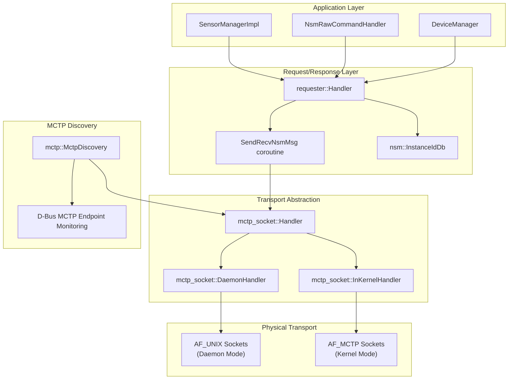
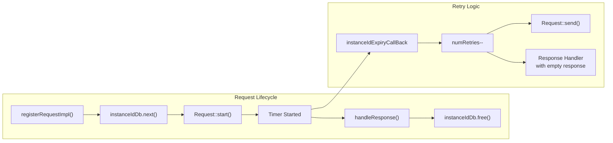
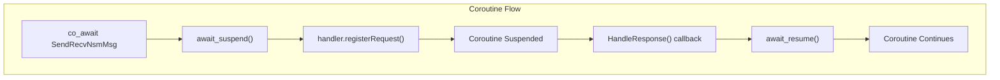
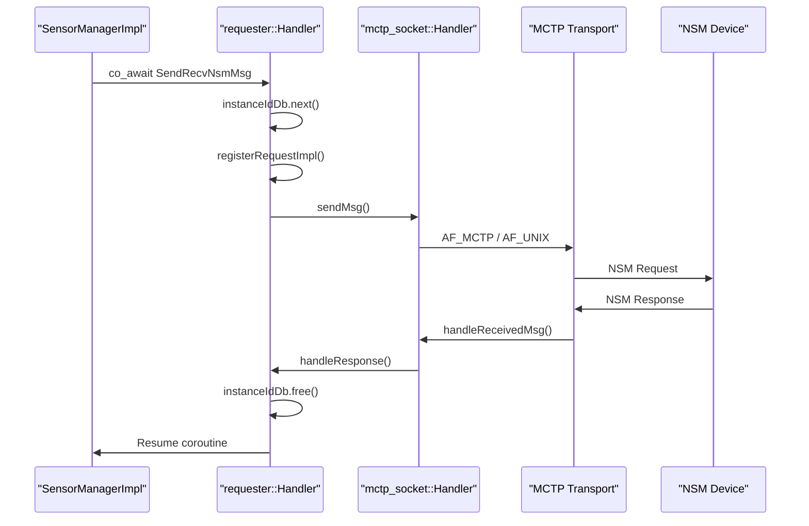

<!-- source: DeepWiki mcp.deepwiki.com · repo NVIDIA/nsmd · page 5 Communication Infrastructure · fetched 2026-10-26 -->

# Communication Infrastructure

Relevant source files

The following files were used as context for generating this wiki page:

- [common/test/mockSocketIo.hpp](common/test/mockSocketIo.hpp)
- [libnsm/requester/mctp.c](libnsm/requester/mctp.c)
- [libnsm/requester/mctp.h](libnsm/requester/mctp.h)
- [nsmd/nsmDevice.cpp](nsmd/nsmDevice.cpp)
- [nsmd/nsmDevice.hpp](nsmd/nsmDevice.hpp)
- [nsmd/nsmObject.hpp](nsmd/nsmObject.hpp)
- [nsmd/sensorManager.cpp](nsmd/sensorManager.cpp)
- [nsmd/sensorManager.hpp](nsmd/sensorManager.hpp)
- [nsmd/socketIo.cpp](nsmd/socketIo.cpp)
- [nsmd/socketIo.hpp](nsmd/socketIo.hpp)
- [nsmd/socket_handler.cpp](nsmd/socket_handler.cpp)
- [nsmd/socket_handler.hpp](nsmd/socket_handler.hpp)
- [nsmd/test/mockSensorManager.hpp](nsmd/test/mockSensorManager.hpp)
- [nsmd/test/requesterDeepBranch_test.cpp](nsmd/test/requesterDeepBranch_test.cpp)
- [nsmd/test/requesterHandlerBranch_test.cpp](nsmd/test/requesterHandlerBranch_test.cpp)
- [nsmd/test/socket_handler_test.cpp](nsmd/test/socket_handler_test.cpp)
- [requester/handler.hpp](requester/handler.hpp)
- [requester/mctp_endpoint_discovery.cpp](requester/mctp_endpoint_discovery.cpp)
- [requester/mctp_endpoint_discovery.hpp](requester/mctp_endpoint_discovery.hpp)
- [requester/request.hpp](requester/request.hpp)

## Purpose and Scope

This page covers the communication infrastructure that enables NSM (NVIDIA System Management) protocol message exchange between the `nsmd` daemon and NSM-capable hardware devices. The infrastructure encompasses three primary areas: MCTP (Management Component Transport Protocol) transport mechanisms, request/response lifecycle management, and direct raw command execution interfaces.

For information about the NSM protocol message formats and encoding, see [NSM Message Protocol](#4.1). For details about specific hardware sensor management, see [Hardware Subsystems](#3).

## Architecture Overview

The communication infrastructure consists of several interconnected layers that work together to provide reliable, asynchronous message delivery:

### System Communication Flow

Sources: [nsmd/sensorManager.hpp:95-126](), [nsmd/socket_handler.hpp:56-82](), [requester/mctp_endpoint_discovery.hpp:56-112]()

## Core Communication Components

### Request Handler Framework

The `requester::Handler` class serves as the central orchestrator for NSM message lifecycle management. It provides coroutine-based asynchronous operations with automatic retry logic, timeout handling, and instance ID management.

### Request Lifecycle State Machine

Key classes and their responsibilities:

- `requester::Handler<RequestInterface>`: Main request manager with retry and timeout logic [requester/handler.hpp:63-106]().
- `requester::RequestRetryTimer`: Base class for request retry mechanisms [requester/request.hpp:57-78]().
- `requester::Request`: Concrete implementation for MCTP socket communication [requester/request.hpp:172-199]().
- `nsm::InstanceIdDb`: Manages unique instance IDs for request/response correlation [nsmd/instance_id.hpp]().

Sources: [requester/handler.hpp:108-171](), [requester/request.hpp:84-107](), [requester/request.hpp:134-144]()

### Transport Layer Abstraction

The communication infrastructure supports two distinct MCTP transport modes through the `mctp_socket::Handler` interface:

**Daemon Mode (`DaemonHandler`)**: Communicates through Unix domain sockets with the MCTP demux daemon, providing compatibility with user-space MCTP implementations. It uses `AF_UNIX` and connects to a provided path [nsmd/socket_handler.cpp:126-189]().

**Kernel Mode (`InKernelHandler`)**: Uses native `AF_MCTP` sockets for direct communication with the in-kernel MCTP stack, offering improved performance. It supports `SIOCMCTPDROPTAG` for tag management [nsmd/socket_handler.hpp:120-156]().

Sources: [nsmd/socket_handler.hpp:56-118](), [nsmd/socket_handler.cpp:100-124]()

### MCTP Endpoint Discovery

The `mctp::MctpDiscovery` class monitors D-Bus for MCTP endpoint availability and automatically registers/unregisters endpoints with the socket handlers. It listens for `InterfacesAdded` on `/au/com/codeconstruct/mctp1` [requester/mctp_endpoint_discovery.cpp:100-104]().

The discovery process extracts MCTP endpoint information from D-Bus:
- `xyz.openbmc_project.MCTP.Endpoint`: EID and binding type.
- `xyz.openbmc_project.Common.UnixSocket`: Socket address for daemon mode [requester/mctp_endpoint_discovery.cpp:185-191]().
- `xyz.openbmc_project.Common.UUID`: Unique device identifier [requester/mctp_endpoint_discovery.cpp:180-183]().

For details, see [MCTP Transport and Discovery](#5.2).

Sources: [requester/mctp_endpoint_discovery.cpp:81-90](), [requester/mctp_endpoint_discovery.hpp:166-182]()

## Coroutine-Based Async Operations

The infrastructure leverages C++20 coroutines to provide clean asynchronous programming interfaces. `SensorManagerImpl` uses `requester::Coroutine` for various polling tasks like `pollPrioritySensors` and `deviceTask` [nsmd/sensorManager.hpp:143-155]().

### Coroutine Suspension Flow

For details, see [Request and Response Handling](#5.1).

Sources: [nsmd/sensorManager.cpp:179-184](), [requester/handler.hpp:48-49]()

## Raw Command Interface

The `NsmRawCommandHandler` provides direct access to NSM commands through D-Bus interfaces, supporting both immediate and long-running operations. It utilizes `AsyncOperationManager` to track status and results.

The raw command handler supports:
- **Immediate Commands**: Simple request/response operations.
- **Long-Running Commands**: Operations that return acceptance responses followed by completion events, managed via `NsmLongRunningEvent` [nsmd/nsmDevice.hpp:68-73]().
- **Device Semaphores**: Uses `CoroutineSemaphore` to ensure exclusive access to devices during command execution [nsmd/nsmDevice.hpp:25]().

For details, see [Raw Command Interface](#5.3).

Sources: [nsmd/nsmDevice.hpp:145-157](), [nsmd/nsmDevice.cpp:24-25]()

## Message Flow Architecture

The complete message flow from application layer to hardware demonstrates the integration of all communication components:

### End-to-End Sequence

Sources: [nsmd/socket_handler.cpp:51-98](), [requester/handler.hpp:108-171](), [nsmd/sensorManager.cpp:179-184]()

---

