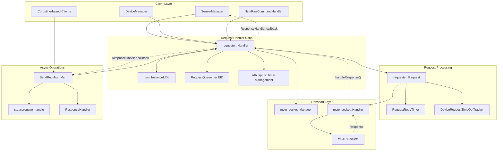
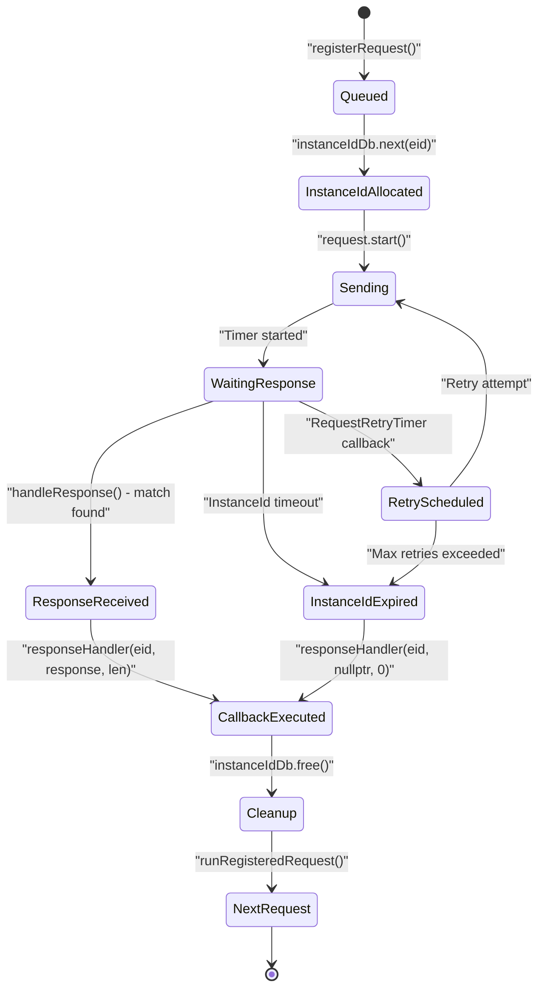
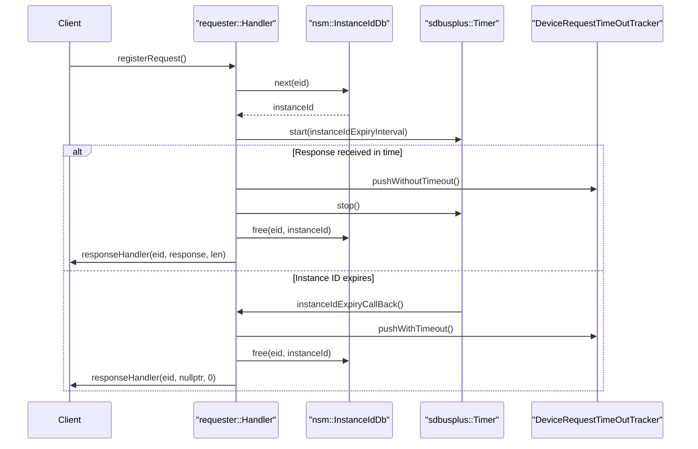
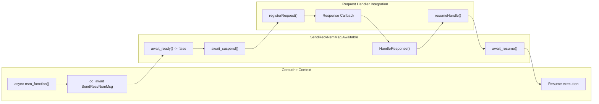
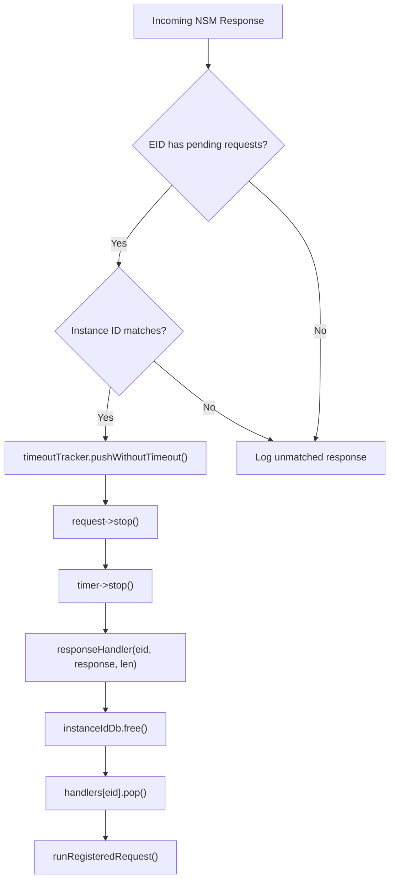

<!-- source: DeepWiki mcp.deepwiki.com · repo NVIDIA/nsmd · page 5.1 Request and Response Handling · fetched 2026-10-26 -->

# Request and Response Handling

<details>
<summary>Relevant source files</summary>

The following files were used as context for generating this wiki page:

- [common/coroutine.hpp](common/coroutine.hpp)
- [common/test/mockSocketIo.hpp](common/test/mockSocketIo.hpp)
- [nsmd/nsmAsioInterface/meson.build](nsmd/nsmAsioInterface/meson.build)
- [nsmd/nsmAsioInterface/nsmAsioInterfaceBase.cpp](nsmd/nsmAsioInterface/nsmAsioInterfaceBase.cpp)
- [nsmd/nsmAsioInterface/nsmAsioInterfaceBase.hpp](nsmd/nsmAsioInterface/nsmAsioInterfaceBase.hpp)
- [nsmd/nsmDbusIfaceOverride/nsmLogDumpOnDemand.hpp](nsmd/nsmDbusIfaceOverride/nsmLogDumpOnDemand.hpp)
- [nsmd/nsmMsghandler.hpp](nsmd/nsmMsghandler.hpp)
- [nsmd/nsmReady/nsmReady.cpp](nsmd/nsmReady/nsmReady.cpp)
- [nsmd/nsmReady/nsmReady.hpp](nsmd/nsmReady/nsmReady.hpp)
- [nsmd/socketIo.cpp](nsmd/socketIo.cpp)
- [nsmd/socketIo.hpp](nsmd/socketIo.hpp)
- [nsmd/socket_handler.cpp](nsmd/socket_handler.cpp)
- [nsmd/socket_handler.hpp](nsmd/socket_handler.hpp)
- [nsmd/test/requesterDeepBranch_test.cpp](nsmd/test/requesterDeepBranch_test.cpp)
- [nsmd/test/requesterHandlerBranch_test.cpp](nsmd/test/requesterHandlerBranch_test.cpp)
- [nsmd/test/socket_handler_test.cpp](nsmd/test/socket_handler_test.cpp)
- [requester/handler.hpp](requester/handler.hpp)
- [requester/request.hpp](requester/request.hpp)
- [requester/request_timeout_tracker.cpp](requester/request_timeout_tracker.cpp)
- [requester/request_timeout_tracker.hpp](requester/request_timeout_tracker.hpp)

</details>


## Purpose and Scope

This document covers the NSM request and response handling framework, which manages the complete lifecycle of NSM messages from creation to response processing. The system handles instance ID allocation, timeout management, retry logic, and asynchronous operations through coroutines. For information about the underlying MCTP transport mechanisms, see [MCTP Transport and Discovery](5.2). For direct command execution bypassing this framework, see [Raw Command Interface](5.3).

## Architecture Overview

The request and response handling system is built around the `requester::Handler` template class, which coordinates with multiple components to manage NSM message lifecycle:

### Request/Response System Architecture



Sources: [requester/handler.hpp:62-106](), [requester/request.hpp:156-199](), [nsmd/socket_handler.cpp:51-98]()

## Request Lifecycle Management

The `requester::Handler` class manages NSM request lifecycle through a queue-based system with per-EID request queues and comprehensive timeout handling:

### Request Lifecycle State Machine



Sources: [requester/handler.hpp:108-171](), [requester/handler.hpp:283-349]()

The handler maintains several key data structures to track requests and ensure proper cleanup:

| Component | Type | Purpose |
|-----------|------|---------|
| `handlers` | `std::unordered_map<eid_t, RequestQueue>` | Per-EID request queues storing `RequestValue` tuples. |
| `timerToFree` | `std::unordered_map<eid_t, std::unique_ptr<sdbusplus::Timer>>` | Stores timers that need to be freed outside of their own callback context. |
| `removeRequestContainer` | `std::unordered_map<eid_t, std::unique_ptr<sdeventplus::source::Defer>>` | Deferred event sources for cleaning up request entries. |

Sources: [requester/handler.hpp:70-73](), [requester/handler.hpp:369-377]()

## Instance ID and Timeout Management

### Instance ID Lifecycle

Instance IDs are managed through the `nsm::InstanceIdDb` to ensure proper request/response correlation and prevent collisions. The `requester::Handler` manages the allocation and release of these IDs in coordination with request timers.



Sources: [requester/handler.hpp:117-163](), [requester/handler.hpp:322-342](), [requester/request_timeout_tracker.cpp:62-85]()

### Timeout Configuration

The system uses configurable timeout intervals defined in the `Handler` constructor, which default to values provided in `config.h`:

- **Instance ID Expiry Interval**: Default `INSTANCE_ID_EXPIRATION_INTERVAL` seconds.
- **Response Timeout**: Default `RESPONSE_TIME_OUT` milliseconds (wait time between retries).
- **Number of Retries**: Default `NUMBER_OF_REQUEST_RETRIES`.

Sources: [requester/handler.hpp:94-106]()

### Timeout Tracker

The `DeviceRequestTimeOutTracker` is a singleton per EID that records successful requests and identifies which request timed out for diagnostic purposes. It maintains a circular buffer of the last `MAXSIZE` successful requests.

Sources: [requester/request_timeout_tracker.cpp:32-60](), [requester/request_timeout_tracker.hpp:46-52]()

## Retry Mechanisms

The retry logic is implemented in the `RequestRetryTimer` base class and its concrete implementation `Request`:

### Retry Timer Architecture

```mermaid
classDiagram
    class RequestRetryTimer {
        #sdeventplus::Event& event
        #uint8_t numRetries
        #chrono::milliseconds timeout
        #sdbusplus::Timer timer
        +start() int
        +stop() void
        #send()* int
        -callback() void
    }
    
    class Request {
        -int fd
        -eid_t eid
        -uint8_t tag
        -RequestMsg requestMsg
        -bool verbose
        -mctp_socket::Handler* socketHandler
        +getInstanceId() uint8_t
        +setInstanceId(uint8_t) void
        -send() int
    }
    
    RequestRetryTimer <|-- Request
    RequestRetryTimer --> sdbusplus::Timer
    Request --> mctp_socket::Handler
```

Sources: [requester/request.hpp:57-145](), [requester/request.hpp:172-212]()

The retry callback mechanism decrements the retry counter and re-sends the request using the virtual `send()` method until retries are exhausted.

Sources: [requester/request.hpp:134-144]()

## Coroutine-Based Async Operations

The system provides coroutine support through the `requester::Coroutine` return object and the `SendRecvNsmMsg` awaitable struct, enabling non-blocking async/await patterns for NSM operations.

### Coroutine Message Handling



Sources: [requester/handler.hpp:396-513](), [common/coroutine.hpp:29-137]()

### Awaitable Implementation

The `SendRecvNsmMsg` template provides the C++20 coroutine awaitable interface:

| Method | Purpose |
|--------|---------|
| `await_ready()` | Always returns `false` to ensure the coroutine suspends and yields back to the event loop. |
| `await_suspend()` | Registers the request with the `Handler` and stores the `std::coroutine_handle` for later resumption. |
| `await_resume()` | Called when the coroutine resumes; returns the completion code or result data. |
| `HandleResponse()` | Static callback that bridges the `ResponseHandler` callback to the coroutine resumption. |

Sources: [requester/handler.hpp:439-511]()

## Response Processing

Response processing involves matching incoming responses to pending requests based on EID and Instance ID.

### Response Matching Logic

Incoming messages are first intercepted by the `mctp_socket::Handler`, which differentiates between Events and Responses. Responses are forwarded to the `requester::Handler`.



Sources: [nsmd/socket_handler.cpp:51-98](), [requester/handler.hpp:283-349]()

## Socket I/O and Transport Integration

The request handler integrates with the transport layer via a `SocketIoInterface` which abstracts raw syscalls. This allows for `RealSocketIo` in production and `MockSocketIo` in tests.

### Transport Integration Points

| Component | Interface | Purpose |
|-----------|-----------|---------|
| `mctp_socket::Manager` | `getSocket(eid)`, `setSendBufferSize()` | Manages socket FDs and buffer sizes for specific endpoints. |
| `mctp_socket::Handler` | `sendMsg()` | Abstract interface for sending bytes over MCTP (In-Kernel or Daemon). |
| `SocketIoInterface` | `socket()`, `connect()`, `sendmsg()` | Redirects standard POSIX calls to an injectable interface. |

Sources: [nsmd/socketIo.hpp:32-63](), [nsmd/socket_handler.cpp:126-189](), [requester/handler.hpp:173-183]()

The system dynamically adjusts socket buffer sizes for large messages to prevent truncation:
```cpp
if (requestMsg.size() > static_cast<size_t>(sockManager.getSendBufferSize(eid)))
{
    sockManager.setSendBufferSize(sockManager.getSocket(eid), requestMsg.size());
}
```
Sources: [requester/handler.hpp:173-183]()

---

