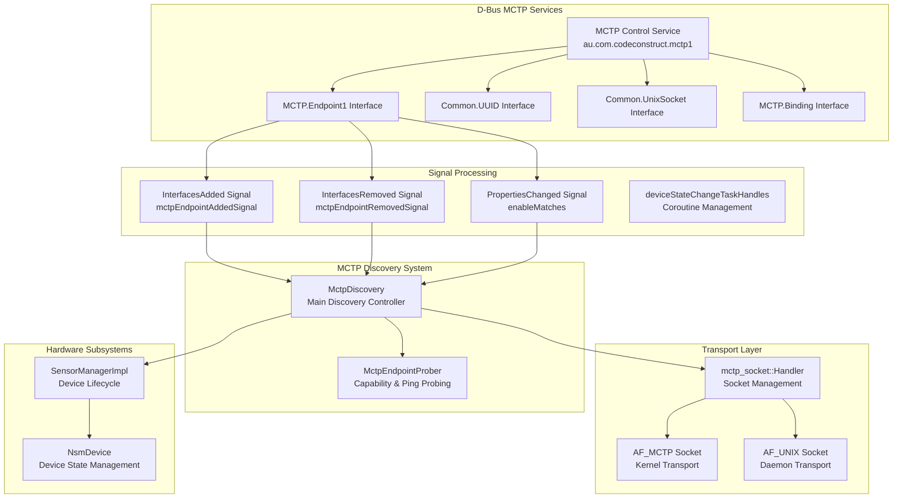
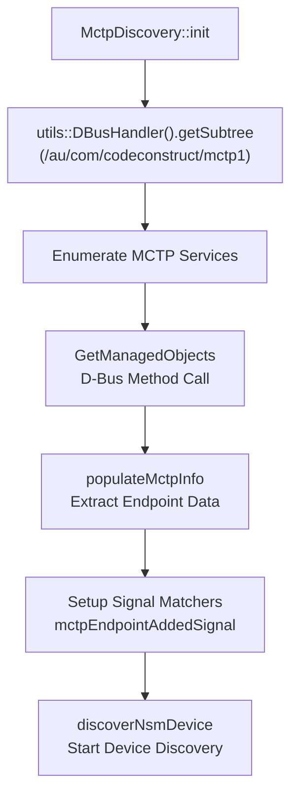
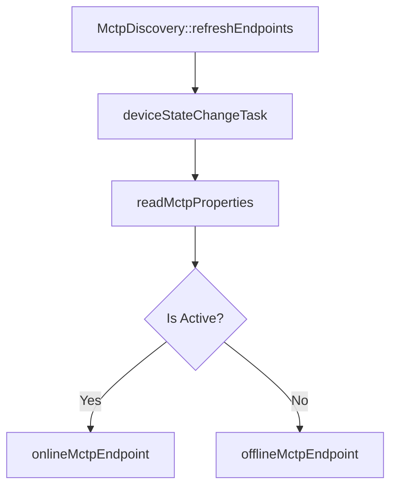

<!-- source: DeepWiki mcp.deepwiki.com · repo NVIDIA/nsmd · page 5.2 MCTP Transport and Discovery · fetched 2026-10-26 -->

# MCTP Transport and Discovery

<details>
<summary>Relevant source files</summary>

The following files were used as context for generating this wiki page:

- [common/test/common_utils_test.cpp](common/test/common_utils_test.cpp)
- [common/utils.cpp](common/utils.cpp)
- [common/utils.hpp](common/utils.hpp)
- [libnsm/requester/mctp.c](libnsm/requester/mctp.c)
- [libnsm/requester/mctp.h](libnsm/requester/mctp.h)
- [nsmd/nsmDevice.cpp](nsmd/nsmDevice.cpp)
- [nsmd/nsmDevice.hpp](nsmd/nsmDevice.hpp)
- [nsmd/nsmObject.hpp](nsmd/nsmObject.hpp)
- [nsmd/sensorManager.cpp](nsmd/sensorManager.cpp)
- [nsmd/sensorManager.hpp](nsmd/sensorManager.hpp)
- [nsmd/test/mockSensorManager.hpp](nsmd/test/mockSensorManager.hpp)
- [requester/mctp_endpoint_discovery.cpp](requester/mctp_endpoint_discovery.cpp)
- [requester/mctp_endpoint_discovery.hpp](requester/mctp_endpoint_discovery.hpp)
- [requester/mctp_endpoint_prober.cpp](requester/mctp_endpoint_prober.cpp)
- [requester/mctp_endpoint_prober.hpp](requester/mctp_endpoint_prober.hpp)
- [requester/retry_backoff_utils.hpp](requester/retry_backoff_utils.hpp)

</details>


## Purpose and Scope

The MCTP Transport and Discovery system provides the foundational communication layer for NSM (NVIDIA System Management) operations by implementing MCTP (Management Component Transport Protocol) endpoint discovery and transport management. This system discovers available MCTP endpoints through D-Bus interfaces, manages their lifecycle, and provides transport abstractions for NSM protocol communication.

This page covers the MCTP discovery mechanisms, endpoint probing with backoff, and transport layer abstractions. For NSM protocol message handling, see [Request and Response Handling](5.1). For higher-level device management built on top of MCTP transport, see [DeviceManager and Discovery](2.2).

## System Architecture

The MCTP Transport and Discovery system consists of several key components that work together to provide reliable endpoint discovery and communication transport:

### MCTP Discovery Architecture



Sources: [requester/mctp_endpoint_discovery.hpp:56-114](), [requester/mctp_endpoint_discovery.cpp:81-118]()

### Transport Abstraction Model

The system maps physical MCTP attributes to internal NSM device representations.

| Code Entity | Description | Source |
| :--- | :--- | :--- |
| `MctpInfo` | Tuple of (EID, UUID, Medium, Binding, NetworkId, etc.) | [common/types.hpp:55-65]() |
| `MctpDiscovery` | Singleton managing the EID-to-Device mapping and D-Bus signals. | [requester/mctp_endpoint_discovery.hpp:56-68]() |
| `MctpEndpointProber` | Logic for probing endpoints with `LinearBackoffConfig`. | [requester/mctp_endpoint_prober.hpp:25-45]() |
| `mediumPriority` | Static map defining preferred mediums (PCIe > USB > SPI > ...). | [common/utils.hpp:97-104]() |
| `bindingPriority` | Static map defining preferred bindings. | [common/utils.hpp:109-115]() |

Sources: [common/utils.hpp:97-115](), [requester/mctp_endpoint_discovery.hpp:32-54]()

## MCTP Endpoint Discovery Process

The discovery process involves initial enumeration via D-Bus `ObjectManager`, ongoing monitoring of `InterfacesAdded` signals, and capability probing.

### Discovery Initialization Flow

The `init()` function sets up matches for the `au.com.codeconstruct.mctp1` path and performs an initial scan.



Sources: [requester/mctp_endpoint_discovery.cpp:92-164]()

### Endpoint Information Processing

The `populateMctpInfo` function extracts critical endpoint data from D-Bus interfaces:

| D-Bus Interface | Properties Used | Purpose |
|-----------------|-----------------|---------|
| `xyz.openbmc_project.Common.UUID` | `UUID` | Unique endpoint identification [requester/mctp_endpoint_discovery.cpp:182]() |
| `xyz.openbmc_project.Common.UnixSocket` | `Type`, `Protocol`, `Address` | Communication parameters [requester/mctp_endpoint_discovery.cpp:187-190]() |
| `au.com.codeconstruct.MCTP.Endpoint1` | `Connectivity` | Determines if endpoint is "Available" [requester/mctp_endpoint_discovery.cpp:197]() |
| `xyz.openbmc_project.MCTP.Binding` | `BindingType` | Physical layer binding info [requester/mctp_endpoint_discovery.cpp:212]() |

Sources: [requester/mctp_endpoint_discovery.cpp:166-222]()

## Transport Layer Abstractions

### Requester Library (mctp.c)

The low-level transport is implemented in a C library that handles the MCTP framing (Tag, EID, Message Type).

- `nsm_send`: Encapsulates NSM request with MCTP header [libnsm/requester/mctp.c:170-190]()
- `nsm_recv`: Receives and validates MCTP response, checking EID and Instance ID [libnsm/requester/mctp.c:122-140]()
- `nsm_send_recv`: Blocking wrapper for a complete request-response cycle [libnsm/requester/mctp.c:142-168]()

Sources: [libnsm/requester/mctp.c:122-190]()

### Medium and Binding Priority

When multiple paths exist to the same UUID (e.g., PCIe and SMBus), `isPreferred` uses the priority tables to select the best transport.

```cpp
static std::unordered_map<MctpMedium, int> mediumPriority = {
    {"xyz.openbmc_project.MCTP.Endpoint.MediaTypes.PCIe", 0},
    {"xyz.openbmc_project.MCTP.Endpoint.MediaTypes.USB", 1},
    // ...
    {"xyz.openbmc_project.MCTP.Endpoint.MediaTypes.SMBus", 6}};
```

Sources: [common/utils.hpp:97-115](), [common/utils.cpp:49-82]()

## State Management and Lifecycle

### Device State Coroutines

The system uses coroutines to manage the transition of devices between online and offline states. `coSetdeviceStateOnlineTask` (invoked via `MctpDiscovery`) handles the sequence of making a device ready for polling.



Sources: [requester/mctp_endpoint_discovery.cpp:235-357](), [requester/mctp_endpoint_discovery.cpp:358-398]()

### MCTP Readiness

`SensorManagerImpl` monitors a global MCTP readiness state via the `configurableStateManager`. Polling only starts once `isMCTPReady` returns true, ensuring the transport stack is fully initialized.

Sources: [nsmd/sensorManager.cpp:116-126](), [nsmd/sensorManager.hpp:133]()

---

