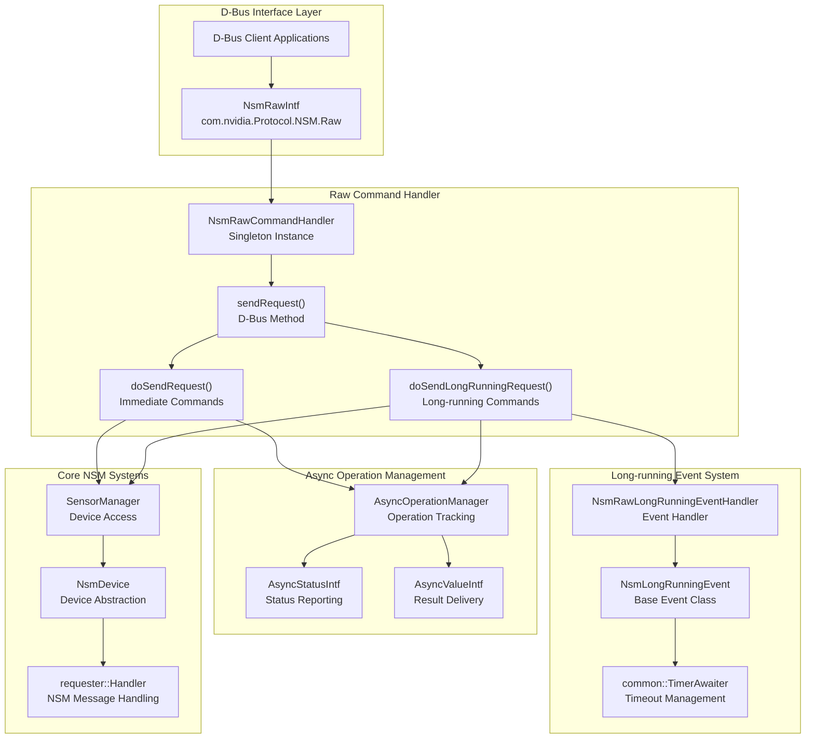
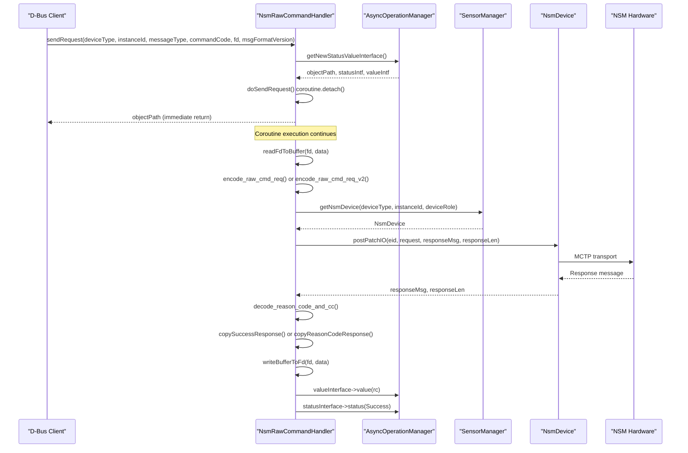
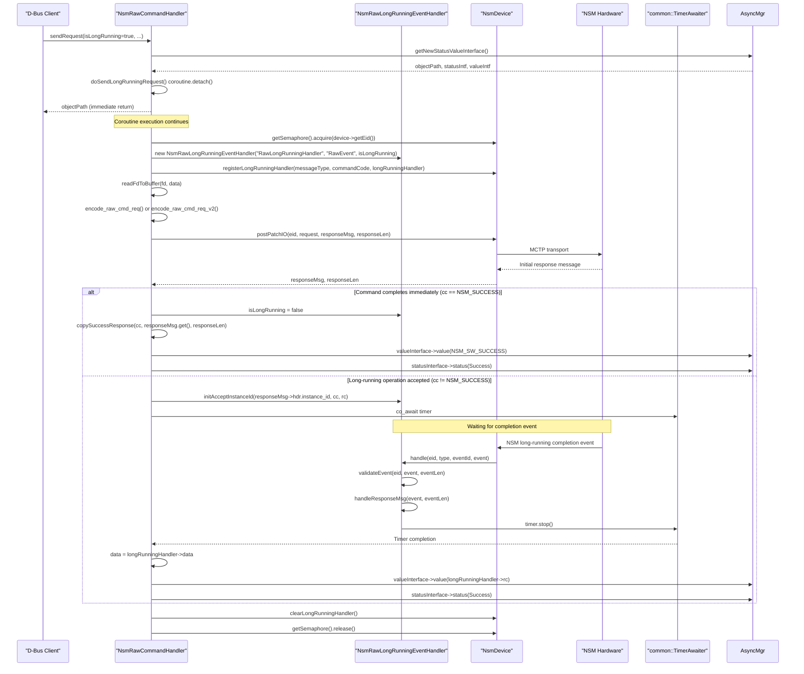
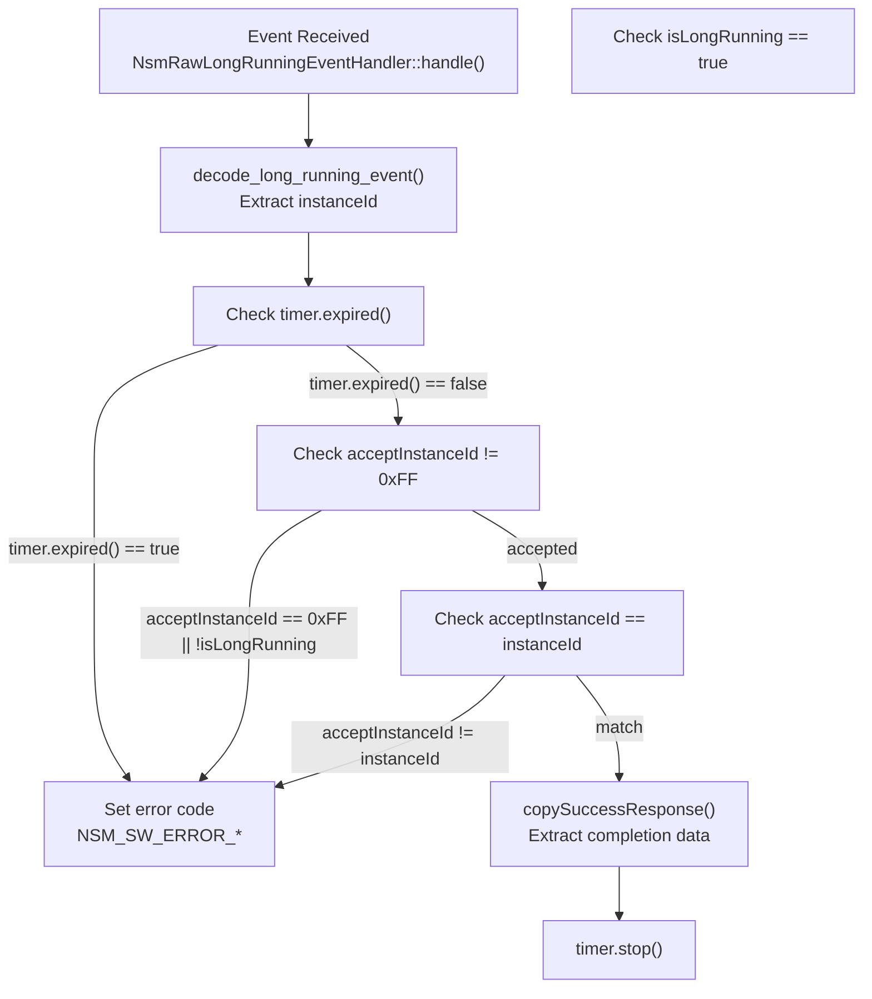
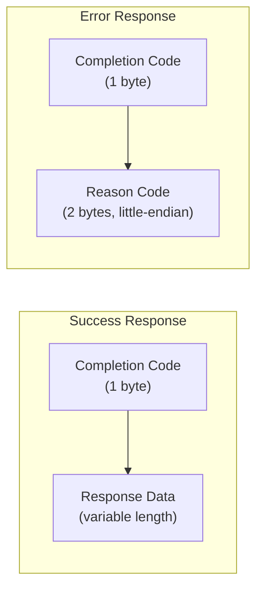
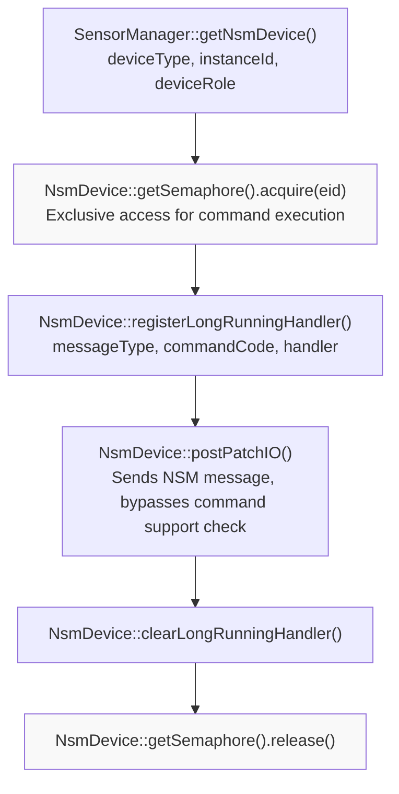

<!-- source: DeepWiki mcp.deepwiki.com · repo NVIDIA/nsmd · page 5.3 Raw Command Interface · fetched 2026-10-26 -->

# Raw Command Interface

Relevant source files

The following files were used as context for generating this wiki page:

- [nsmd/nsmEvent.cpp](nsmd/nsmEvent.cpp)
- [nsmd/nsmEvent.hpp](nsmd/nsmEvent.hpp)
- [nsmd/nsmEvent/nsmEventInfo.hpp](nsmd/nsmEvent/nsmEventInfo.hpp)
- [nsmd/nsmEvent/nsmLongRunningEvent.cpp](nsmd/nsmEvent/nsmLongRunningEvent.cpp)
- [nsmd/nsmEvent/nsmLongRunningEvent.hpp](nsmd/nsmEvent/nsmLongRunningEvent.hpp)
- [nsmd/nsmEvent/nsmLongRunningEventHandler.cpp](nsmd/nsmEvent/nsmLongRunningEventHandler.cpp)
- [nsmd/nsmEvent/nsmResetRequiredEvent.cpp](nsmd/nsmEvent/nsmResetRequiredEvent.cpp)
- [nsmd/nsmEvent/nsmXIDEvent.cpp](nsmd/nsmEvent/nsmXIDEvent.cpp)
- [nsmd/nsmLongRunning/nsmAsyncLongRunningSensor.cpp](nsmd/nsmLongRunning/nsmAsyncLongRunningSensor.cpp)
- [nsmd/nsmLongRunning/nsmLongRunningSensor.cpp](nsmd/nsmLongRunning/nsmLongRunningSensor.cpp)
- [nsmd/nsmProgressCounters/counterProducer.cpp](nsmd/nsmProgressCounters/counterProducer.cpp)
- [nsmd/nsmProgressCounters/counterProducer.hpp](nsmd/nsmProgressCounters/counterProducer.hpp)
- [nsmd/nsmProgressCounters/progressCounterReader.cpp](nsmd/nsmProgressCounters/progressCounterReader.cpp)
- [nsmd/nsmRawCommand/meson.build](nsmd/nsmRawCommand/meson.build)
- [nsmd/nsmRawCommand/nsmRawCommandHandler.cpp](nsmd/nsmRawCommand/nsmRawCommandHandler.cpp)
- [nsmd/nsmRawCommand/nsmRawCommandHandler.hpp](nsmd/nsmRawCommand/nsmRawCommandHandler.hpp)
- [nsmd/nsmRawCommand/test/nsmRawCommandHandler_test.cpp](nsmd/nsmRawCommand/test/nsmRawCommandHandler_test.cpp)
- [nsmtool/nsm_passthrough_cmd.cpp](nsmtool/nsm_passthrough_cmd.cpp)
- [nsmtool/nsm_passthrough_cmd.hpp](nsmtool/nsm_passthrough_cmd.hpp)

## Purpose and Scope

The Raw Command Interface provides direct access to NSM (NVIDIA System Management) protocol commands through D-Bus interfaces, enabling clients to send arbitrary NSM commands to hardware devices without going through specialized sensor abstractions. This system supports both immediate response commands and long-running operations that complete asynchronously through event notifications.

For information about the higher-level sensor management system, see [SensorManager and Device Lifecycle](#2.1). For details about the underlying NSM protocol message structures, see [NSM Message Protocol](#4.1).

## System Architecture

The Raw Command Interface is implemented through the `NsmRawCommandHandler` class, which exposes D-Bus methods for executing NSM commands and manages the lifecycle of both immediate and long-running operations.

**Sources:** [nsmd/nsmRawCommand/nsmRawCommandHandler.hpp:1-74](), [nsmd/nsmRawCommand/nsmRawCommandHandler.cpp:1-344]()

## Command Execution Flow

The raw command interface supports two distinct execution paths depending on whether the command is expected to complete immediately or requires long-running processing.

### Immediate Command Processing

Regular commands follow a synchronous request-response pattern with coroutine-based async handling:

**Sources:** [nsmd/nsmRawCommand/nsmRawCommandHandler.cpp:308-342](), [nsmd/nsmRawCommand/nsmRawCommandHandler.cpp:221-306]()

### Long-running Command Processing

Long-running commands require event-driven completion handling with timeout management. The `doSendLongRunningRequest` coroutine handles this flow [nsmd/nsmRawCommand/nsmRawCommandHandler.cpp:74-200]().

**Sources:** [nsmd/nsmRawCommand/nsmRawCommandHandler.cpp:74-200](), [nsmd/nsmRawCommand/nsmRawCommandHandler.cpp:202-219]()

## Event Handler Implementation

The `NsmRawLongRunningEventHandler` extends `NsmLongRunningEvent` to handle completion events for raw commands:

| Component | Purpose | Key Methods |
|-----------|---------|-------------|
| `NsmRawLongRunningEventHandler` | Handles events for raw commands, stores response data. | `handle()` [nsmd/nsmRawCommand/nsmRawCommandHandler.cpp:202-219]() |
| `NsmLongRunningEvent` | Base class for long-running events, provides common validation and timer management. | `validateEvent()` [nsmd/nsmEvent/nsmLongRunningEvent.cpp:41-80](), `initAcceptInstanceId()` [nsmd/nsmEvent/nsmLongRunningEvent.cpp:34-39]() |
| `common::TimerAwaiter` | Manages the timeout for long-running operations. | `co_await timer` [nsmd/nsmRawCommand/nsmRawCommandHandler.cpp:182](), `timer.stop()` [nsmd/nsmRawCommand/nsmRawCommandHandler.cpp:213]() |

### Event Validation Process

Long-running events undergo strict validation to ensure proper completion, implemented in `NsmLongRunningEvent::validateEvent` [nsmd/nsmEvent/nsmLongRunningEvent.cpp:41-80]():

**Sources:** [nsmd/nsmEvent/nsmLongRunningEvent.cpp:41-80](), [nsmd/nsmRawCommand/nsmRawCommandHandler.cpp:202-219]()

## Data Transfer Mechanism

The raw command interface uses file descriptors for data transfer to support arbitrary command payloads.

### File Descriptor Operations

| Operation | Function | Purpose |
|-----------|----------|---------|
| Input | `utils::readFdToBuffer(fd, data)` | Reads the command payload from the client-provided file descriptor into a buffer. [nsmd/nsmRawCommand/nsmRawCommandHandler.cpp:106]() |
| Encoding | `encode_raw_cmd_req()` / `encode_raw_cmd_req_v2()` | Creates the NSM request message from the buffer data, message type, and command code. [nsmd/nsmRawCommand/nsmRawCommandHandler.cpp:128-135]() |
| Output | `utils::writeBufferToFd(fd, data)` | Writes the response data back to the client's file descriptor. [nsmd/nsmRawCommand/nsmRawCommandHandler.cpp:329]() |

### Response Format

Response data follows a standardized format depending on the completion status, handled by `copySuccessResponse` [nsmd/nsmRawCommand/nsmRawCommandHandler.cpp:53-61]() and `copyReasonCodeResponse` [nsmd/nsmRawCommand/nsmRawCommandHandler.cpp:63-72]().

**Sources:** [nsmd/nsmRawCommand/nsmRawCommandHandler.cpp:53-72](), [nsmd/nsmRawCommand/nsmRawCommandHandler.cpp:105-111]()

## Integration with Device Management

The raw command handler integrates closely with the device management system for proper resource coordination.

### Device Access Control

The `postPatchIO` method [nsmd/nsmRawCommand/nsmRawCommandHandler.cpp:140]() is used to send the NSM message, which implicitly bypasses the command support check, allowing raw commands to be sent even if they're not explicitly registered in the device's supported command list. This enables access to diagnostic and debug functionality.

**Sources:** [nsmd/nsmRawCommand/nsmRawCommandHandler.cpp:85-94](), [nsmd/nsmRawCommand/nsmRawCommandHandler.cpp:116-118]()

## Error Handling and Status Reporting

The system provides comprehensive error reporting through the async operation interface. The `AsyncOperationStatusType` enum defines various states for an asynchronous operation.

| Status Type | Condition | Example |
|-------------|-----------|---------|
| `InvalidArgument` | Device not found, invalid parameters (e.g., `deviceType > NSM_DEV_ID_MCTP_BRIDGE` or invalid `msgFormatVersion`). | [nsmd/nsmRawCommand/nsmRawCommandHandler.cpp:90](), [nsmd/nsmRawCommand/nsmRawCommandHandler.cpp:120-123]() |
| `WriteFailure` | NSM communication failure (e.g., `postPatchIO` returns an error). | [nsmd/nsmRawCommand/nsmRawCommandHandler.cpp:152-155]() |
| `InternalFailure` | Unexpected exceptions (e.g., `std::runtime_error` during decoding). | [nsmd/nsmRawCommand/nsmRawCommandHandler.cpp:161-165]() |
| `Success` | Operation completed successfully. | [nsmd/nsmRawCommand/nsmRawCommandHandler.cpp:168]() |

Error responses include appropriate completion codes and reason codes that match the NSM protocol specification.

**Sources:** [nsmd/nsmRawCommand/nsmRawCommandHandler.cpp:314-317](), [nsmd/nsmRawCommand/nsmRawCommandHandler.cpp:185-194]()

---

