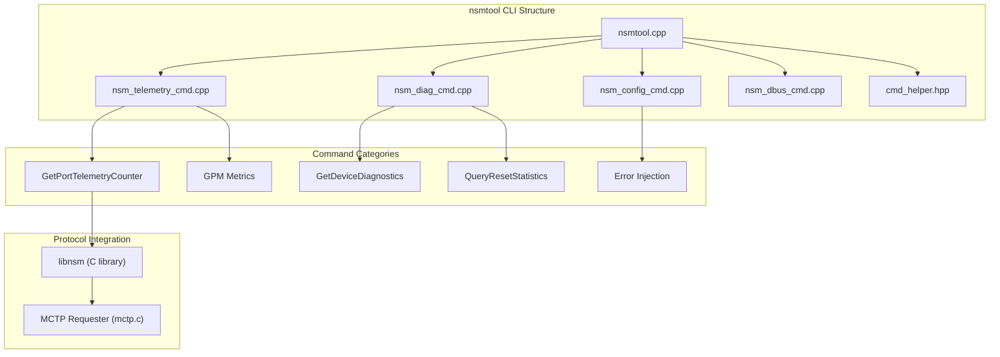
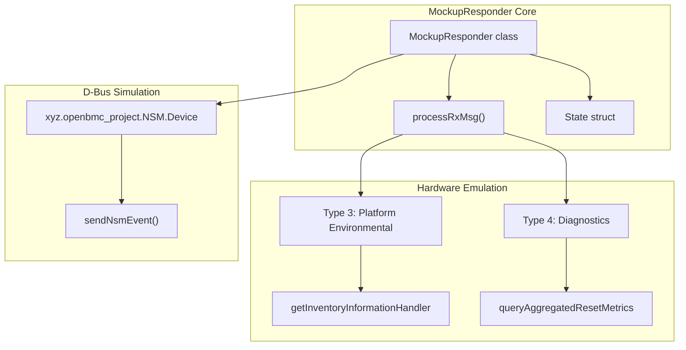

<!-- source: DeepWiki mcp.deepwiki.com · repo NVIDIA/nsmd · page 6 Tools and Testing Infrastructure · fetched 2026-10-26 -->

# Tools and Testing Infrastructure

Relevant source files

The following files were used as context for generating this wiki page:

- [example/umbriel_fpga_chassis.json](example/umbriel_fpga_chassis.json)
- [example/umbriel_gpu_chassis.json](example/umbriel_gpu_chassis.json)
- [example/umbriel_pcieretimer_chassis.json](example/umbriel_pcieretimer_chassis.json)
- [libnsm/platform-environmental.c](libnsm/platform-environmental.c)
- [libnsm/platform-environmental.h](libnsm/platform-environmental.h)
- [libnsm/test/libnsm_platform_environmental_test.cpp](libnsm/test/libnsm_platform_environmental_test.cpp)
- [mockupResponder/meson.build](mockupResponder/meson.build)
- [mockupResponder/mockupResponder.cpp](mockupResponder/mockupResponder.cpp)
- [mockupResponder/mockupResponder.hpp](mockupResponder/mockupResponder.hpp)
- [mockupResponder/nsmMockupResponder.cpp](mockupResponder/nsmMockupResponder.cpp)
- [mockupResponder/test/meson.build](mockupResponder/test/meson.build)
- [nsmd/nsmChassis/nsmChassisPCIeSlot.cpp](nsmd/nsmChassis/nsmChassisPCIeSlot.cpp)
- [nsmd/nsmChassis/nsmChassisPCIeSlot.hpp](nsmd/nsmChassis/nsmChassisPCIeSlot.hpp)
- [nsmd/nsmPort/nsmPCIePort.cpp](nsmd/nsmPort/nsmPCIePort.cpp)
- [nsmd/nsmPort/nsmPortInfo.hpp](nsmd/nsmPort/nsmPortInfo.hpp)
- [nsmtool/meson.build](nsmtool/meson.build)
- [nsmtool/nsm_dbus_client.cpp](nsmtool/nsm_dbus_client.cpp)
- [nsmtool/nsm_dbus_client.hpp](nsmtool/nsm_dbus_client.hpp)
- [nsmtool/nsm_dbus_cmd.cpp](nsmtool/nsm_dbus_cmd.cpp)
- [nsmtool/nsm_dbus_cmd.hpp](nsmtool/nsm_dbus_cmd.hpp)
- [nsmtool/nsm_telemetry_cmd.cpp](nsmtool/nsm_telemetry_cmd.cpp)
- [nsmtool/nsmtool.cpp](nsmtool/nsmtool.cpp)
- [nsmtool/test/meson.build](nsmtool/test/meson.build)
- [tools/correlation/HGXB_PLDM_sensorID_mapping.xlsx](tools/correlation/HGXB_PLDM_sensorID_mapping.xlsx)
- [tools/correlation/README.md](tools/correlation/README.md)
- [tools/correlation/hgxb_pldmd_sensorID_association.json](tools/correlation/hgxb_pldmd_sensorID_association.json)
- [tools/correlation/sensorId_association_generator.py](tools/correlation/sensorId_association_generator.py)
- [tools/topology/HGXB_NVLink_Mapping.xlsx](tools/topology/HGXB_NVLink_Mapping.xlsx)
- [tools/topology/README.md](tools/topology/README.md)

## Purpose and Scope

This section covers the command-line tools and testing infrastructure provided by the NSM (NVIDIA System Management) system. The tools enable direct interaction with NSM devices for debugging, configuration, and testing purposes, while the testing framework allows development and validation without physical hardware. This infrastructure includes `nsmtool` for CLI-based management, `MockupResponder` for hardware emulation, and various configuration utilities for platform integration.

For details on specific components, see:
- [nsmtool Command Line Interface](#6.1)
- [MockupResponder Testing Framework](#6.2)
- [Entity Manager Configuration and Platform Examples](#6.3)

## nsmtool Command Line Interface

The `nsmtool` utility is a CLI-based requester tool built using the `CLI11` library. It allows developers to send NSM commands directly to endpoints via MCTP sockets or interact with the running `nsmd` daemon via D-Bus.

### Command Architecture

### Execution Modes
`nsmtool` operates in two primary modes:
1.  **Direct Mode**: Communicates directly over MCTP sockets. This mode requires the `nsmd` service to be stopped to avoid resource contention [nsmtool/nsmtool.cpp:132-143]().
2.  **D-Bus Mode**: Uses the `dbus` subcommand to interact with the active `nsmd` daemon properties and methods [nsmtool/nsmtool.cpp:146-153]().

**Sources:** [nsmtool/nsmtool.cpp:120-177](), [nsmtool/nsm_telemetry_cmd.cpp:56-117](), [nsmtool/meson.build:3-20]()

## MockupResponder Testing Framework

The `MockupResponder` is an emulation daemon that simulates NSM-capable hardware. it allows for testing the management stack without requiring physical GPUs or switches.

### Emulation Architecture

### Key Features
- **State Persistence**: Maintains a `State` structure containing mock data for `prcKnobs`, `errorInjection`, and device modes [mockupResponder/mockupResponder.hpp:489-501]().
- **Event Injection**: Provides D-Bus methods like `genXIDEvent` and `genRediscoveryEvent` to trigger asynchronous NSM events for the daemon to process [mockupResponder/mockupResponder.cpp:154-183]().
- **Metric Simulation**: Includes mock tables for GPM metrics and reset statistics [mockupResponder/mockupResponder.hpp:41-76]().

**Sources:** [mockupResponder/mockupResponder.cpp:83-149](), [mockupResponder/mockupResponder.hpp:147-175](), [mockupResponder/meson.build:1-9]()

## Entity Manager Configuration and Platform Examples

NSM uses Entity Manager JSON files to define the system topology and device parameters. This allows the same `nsmd` binary to support various platforms like Umbriel or GB200NVL.

### Configuration Examples
The repository provides JSON templates for different device types:
- **GPUs**: Configures SXM modules with UUIDs and chassis associations [example/umbriel_gpu_chassis.json:8-12]().
- **FPGAs**: Defines inventory properties and firmware versioning specific to FPGA controllers.
- **PCIe Retimers**: Maps retimer ports to the system topology.

### Topology and Correlation Tools
The `tools/` directory contains utilities to bridge hardware documentation and code:
- **Topology Generation**: Scripts to generate NVLink mappings from Excel specifications.
- **Sensor Correlation**: Tools like `sensorId_association_generator.py` map PLDM sensor IDs to NSM entities [tools/correlation/sensorId_association_generator.py:1-20]().

**Sources:** [example/umbriel_gpu_chassis.json:1-118](), [tools/correlation/README.md](), [tools/topology/README.md]()

## Unit Testing Framework

The `libnsm` protocol library is validated using a comprehensive suite of unit tests located in `libnsm/test/`. These tests ensure that every request and response is correctly encoded and decoded according to the NSM specification.

### Test Coverage
- **Platform Environmental**: Validates temperature, power, and SPI operations [libnsm/test/libnsm_platform_environmental_test.cpp:26-54]().
- **Diagnostics**: Validates reset statistics and diagnostic data retrieval.
- **Error Handling**: Tests boundary conditions, null pointers, and invalid message lengths [libnsm/test/libnsm_platform_environmental_test.cpp:56-61]().

**Sources:** [libnsm/test/libnsm_platform_environmental_test.cpp:18-93](), [mockupResponder/test/meson.build:1-34]()

For details, see [nsmtool Command Line Interface](#6.1), [MockupResponder Testing Framework](#6.2), and [Entity Manager Configuration and Platform Examples](#6.3).

---

