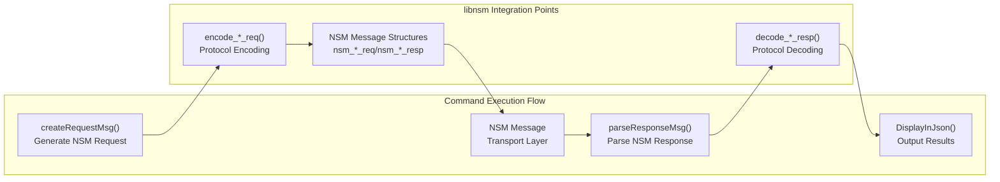
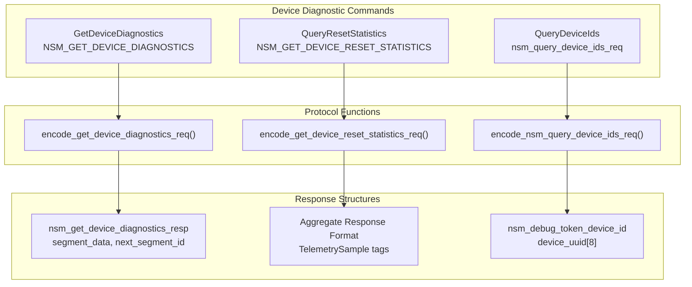
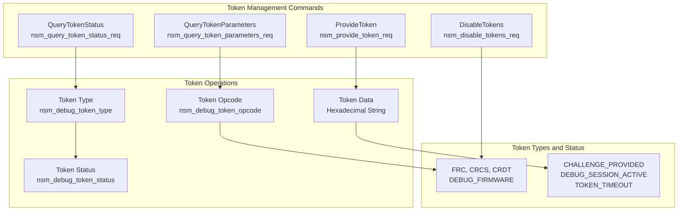
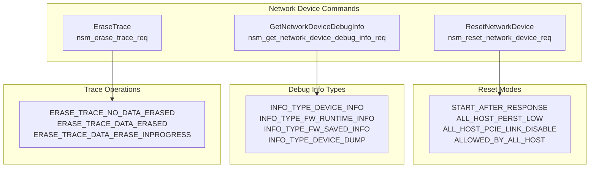
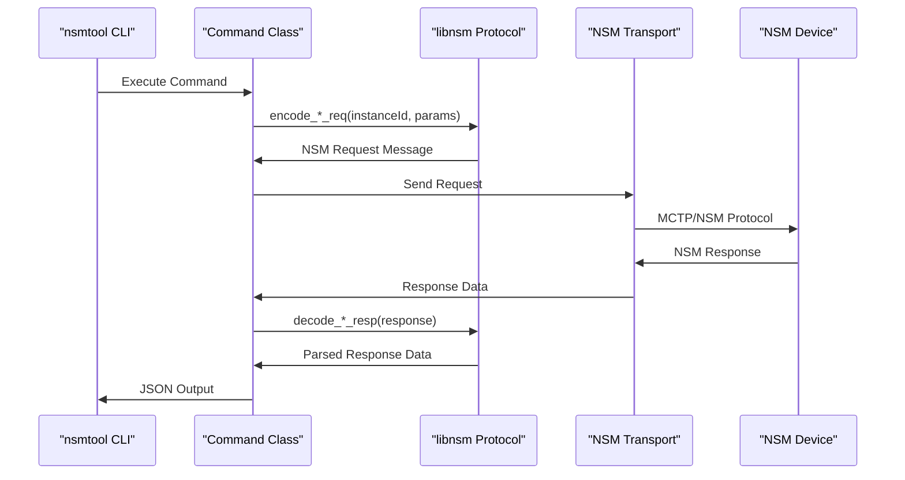
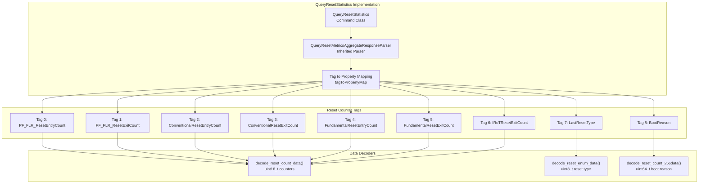
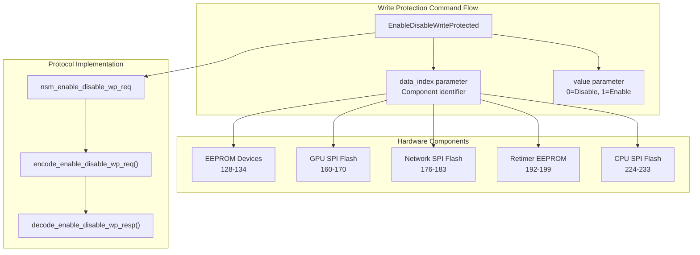
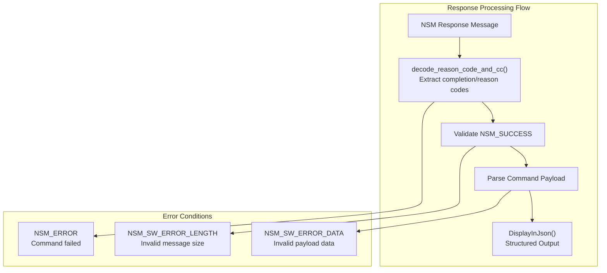

<!-- source: DeepWiki mcp.deepwiki.com · repo NVIDIA/nsmd · page 6.1 nsmtool Command Line Interface · fetched 2026-10-26 -->

# nsmtool Command Line Interface

Relevant source files

The following files were used as context for generating this wiki page:

- [libnsm/.clang-format](libnsm/.clang-format)
- [libnsm/diagnostics.c](libnsm/diagnostics.c)
- [libnsm/diagnostics.h](libnsm/diagnostics.h)
- [libnsm/firmware-utils.c](libnsm/firmware-utils.c)
- [libnsm/firmware-utils.h](libnsm/firmware-utils.h)
- [libnsm/test/libnsm_diagnostics_test.cpp](libnsm/test/libnsm_diagnostics_test.cpp)
- [libnsm/test/libnsm_firmware_utils_test.cpp](libnsm/test/libnsm_firmware_utils_test.cpp)
- [mockupResponder/firmwareUtils.cpp](mockupResponder/firmwareUtils.cpp)
- [mockupResponder/meson.build](mockupResponder/meson.build)
- [mockupResponder/nsmMockupResponder.cpp](mockupResponder/nsmMockupResponder.cpp)
- [mockupResponder/test/BLOCKED_TESTS.md](mockupResponder/test/BLOCKED_TESTS.md)
- [mockupResponder/test/meson.build](mockupResponder/test/meson.build)
- [nsmd/nsmChassis/test/nsmRoTProperty_test.cpp](nsmd/nsmChassis/test/nsmRoTProperty_test.cpp)
- [nsmd/nsmProcessor/nsmOemResetStatistics.cpp](nsmd/nsmProcessor/nsmOemResetStatistics.cpp)
- [nsmd/nsmProcessor/nsmOemResetStatistics.hpp](nsmd/nsmProcessor/nsmOemResetStatistics.hpp)
- [nsmd/test/commonMock.hpp](nsmd/test/commonMock.hpp)
- [nsmtool/README.md](nsmtool/README.md)
- [nsmtool/cmd_helper.cpp](nsmtool/cmd_helper.cpp)
- [nsmtool/cmd_helper.hpp](nsmtool/cmd_helper.hpp)
- [nsmtool/meson.build](nsmtool/meson.build)
- [nsmtool/nsm_dbus_client.cpp](nsmtool/nsm_dbus_client.cpp)
- [nsmtool/nsm_dbus_client.hpp](nsmtool/nsm_dbus_client.hpp)
- [nsmtool/nsm_dbus_cmd.cpp](nsmtool/nsm_dbus_cmd.cpp)
- [nsmtool/nsm_dbus_cmd.hpp](nsmtool/nsm_dbus_cmd.hpp)
- [nsmtool/nsm_diag_cmd.cpp](nsmtool/nsm_diag_cmd.cpp)
- [nsmtool/nsm_firmware_cmd.cpp](nsmtool/nsm_firmware_cmd.cpp)
- [nsmtool/nsm_passthrough_cmd.cpp](nsmtool/nsm_passthrough_cmd.cpp)
- [nsmtool/nsm_passthrough_cmd.hpp](nsmtool/nsm_passthrough_cmd.hpp)
- [nsmtool/nsmtool.cpp](nsmtool/nsmtool.cpp)
- [nsmtool/test/BLOCKED_TESTS.md](nsmtool/test/BLOCKED_TESTS.md)
- [nsmtool/test/cmd_helper_test.cpp](nsmtool/test/cmd_helper_test.cpp)
- [nsmtool/test/meson.build](nsmtool/test/meson.build)
- [nsmtool/test/nsm_config_cmd_parse_test.cpp](nsmtool/test/nsm_config_cmd_parse_test.cpp)
- [nsmtool/test/nsm_firmware_cmd_parse_test.cpp](nsmtool/test/nsm_firmware_cmd_parse_test.cpp)
- [nsmtool/test/nsm_telemetry_cmd_parse_test.cpp](nsmtool/test/nsm_telemetry_cmd_parse_test.cpp)

## Purpose and Scope

The nsmtool Command Line Interface is a diagnostic and management tool for NVIDIA System Management (NSM) devices. It provides direct command-line access to NSM protocol operations including device diagnostics, debug token management, reset statistics, network device operations, and hardware configuration control.

This document covers the nsmtool CLI architecture, command implementation patterns, and integration with the NSM protocol layer. For information about the core NSM protocol message structures, see [NSM Message Protocol](). For details about the underlying communication transport, see [Request and Response Handling]().

## Command Architecture Overview

The nsmtool CLI implements a modular command architecture where each diagnostic operation is encapsulated in a dedicated command class. All commands inherit from a common `CommandInterface` base and integrate with the libnsm protocol encoding/decoding functions.

```mermaid
graph TB
    subgraph "nsmtool CLI Layer"
        CLI["CLI Application<br/>nsmtool/nsmtool.cpp"]
        CmdFactory["Command Factory<br/>commands vector"]
    end
    
    subgraph "Command Implementation Classes"
        CmdIntf["CommandInterface<br/>Base Class"]
        GetDiag["GetDeviceDiagnostics<br/>nsmtool/nsm_diag_cmd.cpp"]
        QueryToken["QueryTokenParameters<br/>nsmtool/nsm_diag_cmd.cpp"]
        ResetStats["QueryResetStatistics<br/>nsmtool/nsm_diag_cmd.cpp"]
        ProvideToken["ProvideToken<br/>nsmtool/nsm_diag_cmd.cpp"]
        DisableTokens["DisableTokens<br/>nsmtool/nsm_diag_cmd.cpp"]
        QueryStatus["QueryTokenStatus<br/>nsmtool/nsm_diag_cmd.cpp"]
        QueryIds["QueryDeviceIds<br/>nsmtool/nsm_diag_cmd.cpp"]
        WriteProtect["EnableDisableWriteProtected<br/>nsmtool/nsm_diag_cmd.cpp"]
        ResetNet["ResetNetworkDevice<br/>nsmtool/nsm_diag_cmd.cpp"]
        NetDebug["GetNetworkDeviceDebugInfo<br/>nsmtool/nsm_diag_cmd.cpp"]
        EraseTrace["EraseTrace<br/>nsmtool/nsm_diag_cmd.cpp"]
        GetRotInfo["GetRotInformation<br/>nsmtool/nsm_firmware_cmd.cpp"]
    end
    
    subgraph "Protocol Integration"
        LibNSM["libnsm Protocol Layer<br/>diagnostics.h/diagnostics.c<br/>firmware-utils.h/firmware-utils.c"]
        EncodeReq["encode_*_req functions"]
        DecodeResp["decode_*_resp functions"]
    end
    
    subgraph "Output Processing"
        JsonOut["JSON Output<br/>DisplayInJson()"]
        ResponseParser["Response Parsers<br/>parseResponseMsg()"]
    end
    
    CLI --> CmdFactory
    CmdFactory --> CmdIntf
    CmdIntf --> GetDiag
    CmdIntf --> QueryToken
    CmdIntf --> ResetStats
    CmdIntf --> ProvideToken
    CmdIntf --> DisableTokens
    CmdIntf --> QueryStatus
    CmdIntf --> QueryIds
    CmdIntf --> WriteProtect
    CmdIntf --> ResetNet
    CmdIntf --> NetDebug
    CmdIntf --> EraseTrace
    CmdIntf --> GetRotInfo
    
    GetDiag --> EncodeReq
    QueryToken --> EncodeReq
    ResetStats --> EncodeReq
    ProvideToken --> EncodeReq
    DisableTokens --> EncodeReq
    QueryStatus --> EncodeReq
    QueryIds --> EncodeReq
    WriteProtect --> EncodeReq
    ResetNet --> EncodeReq
    NetDebug --> EncodeReq
    EraseTrace --> EncodeReq
    GetRotInfo --> EncodeReq
    
    EncodeReq --> LibNSM
    DecodeResp --> LibNSM
    
    ResponseParser --> DecodeResp
    ResponseParser --> JsonOut
```

Sources: [nsmtool/nsm_diag_cmd.cpp:36-48](), [nsmtool/nsm_diag_cmd.cpp:50-111](), [libnsm/diagnostics.h:29-38](), [nsmtool/nsm_firmware_cmd.cpp:34-38](), [nsmtool/nsm_firmware_cmd.cpp:121-129]()

## Command Interface Pattern

All nsmtool diagnostic commands follow a consistent two-phase pattern implemented through the `CommandInterface` base class. Each command must implement request message generation and response message parsing.

The command interface requires two key methods:

| Method | Purpose | Return Type |
|--------|---------|-------------|
| `createRequestMsg()` | Generate NSM protocol request message | `std::pair<int, std::vector<uint8_t>>` |
| `parseResponseMsg()` | Parse NSM protocol response and output results | `void` |

Sources: [nsmtool/nsm_diag_cmd.cpp:69-77](), [nsmtool/nsm_diag_cmd.cpp:79-107]()

## Diagnostic Command Categories

### Device Information and Statistics

Commands for retrieving device state, diagnostic data, and operational statistics.

Sources: [nsmtool/nsm_diag_cmd.cpp:50-111](), [nsmtool/nsm_diag_cmd.cpp:270-381](), [nsmtool/nsm_diag_cmd.cpp:639-689]()

### Debug Token Management

Commands for managing debug tokens used for secure device access and debugging operations.

Sources: [nsmtool/nsm_diag_cmd.cpp:113-268](), [nsmtool/nsm_diag_cmd.cpp:383-450](), [nsmtool/nsm_diag_cmd.cpp:452-499](), [nsmtool/nsm_diag_cmd.cpp:501-637]()

### Network Device Operations

Commands for network device diagnostics, debugging, and control operations.

Sources: [nsmtool/nsm_diag_cmd.cpp:827-883](), [nsmtool/nsm_diag_cmd.cpp:885-961](), [nsmtool/nsm_diag_cmd.cpp:963-1007](), [libnsm/diagnostics.h:82-87](), [libnsm/diagnostics.h:89-96]()

### Firmware Management

Commands for querying and managing firmware-related information and properties.

```mermaid
graph TB
    subgraph "Firmware Management Commands"
        GetRotInfo["GetRotInformation<br/>NSM_FW_GET_EROT_STATE_INFORMATION"]
    end

    subgraph "Request Parameters"
        Classification["classification<br/>Component classification"]
        Identifier["identifier<br/>Component identifier"]
        Index["index<br/>Component index"]
    end

    subgraph "Response Fields"
        BgCopyPolicy["Background copy policy persistent"]
        ActiveSlot["Active Slot"]
        ActiveKeyset["Active Keyset"]
        MinSecVersion["Minimum security version"]
        InbandUpdatePolicy["Inband update policy persistent"]
        BootStatusCode["Boot status code"]
        FwSlotCount["Firmware slot count"]
        InbandUpdatePolicyCurrent["Inband update policy current"]
        BgCopyPolicyCurrent["Background copy policy current"]
        ApSkuId["AP SKU ID"]
        GlobalFailoverPolicy["Global failover policy"]
        SlotInfo["Firmware Slot Information<br/>(slot_id, firmware_version_string, etc.)"]
    end

    GetRotInfo --> Classification
    GetRotInfo --> Identifier
    GetRotInfo --> Index

    GetRotInfo --> BgCopyPolicy
    GetRotInfo --> ActiveSlot
    GetRotInfo --> ActiveKeyset
    GetRotInfo --> MinSecVersion
    GetRotInfo --> InbandUpdatePolicy
    GetRotInfo --> BootStatusCode
    GetRotInfo --> FwSlotCount
    GetRotInfo --> InbandUpdatePolicyCurrent
    GetRotInfo --> BgCopyPolicyCurrent
    GetRotInfo --> ApSkuId
    GetRotInfo --> GlobalFailoverPolicy
    GetRotInfo --> SlotInfo
```

The `GetRotInformation` command retrieves detailed information about the Root of Trust (RoT) state and firmware slots on a specified endpoint. It requires `classification`, `identifier`, and `index` parameters to target the component. The response includes various policy settings, active firmware details, security versions, and information for each firmware slot. [nsmtool/nsm_firmware_cmd.cpp:121-260]()

Sources: [nsmtool/nsm_firmware_cmd.cpp:121-260](), [libnsm/firmware-utils.h:30-49](), [libnsm/firmware-utils.h:176-193](), [libnsm/firmware-utils.h:200-215]()

## Protocol Integration and Message Flow

The nsmtool commands integrate directly with libnsm protocol functions for message encoding and decoding. Each command maps to specific NSM protocol message types and uses standardized completion codes and reason codes.

### Message Structure Integration

| Component | NSM Structure | Purpose |
|-----------|---------------|---------|
| Request Header | `nsm_msg_hdr` | NSM message envelope |
| Command Header | `nsm_common_req` | Command identification and data size |
| Response Header | `nsm_common_resp` | Completion code and response data size |
| Payload Data | Command-specific structs | Request parameters and response data |

Sources: [nsmtool/nsm_diag_cmd.cpp:69-77](), [libnsm/diagnostics.h:102-115](), [libnsm/diagnostics.c:23-48]()

## Reset Statistics Command Implementation

The `QueryResetStatistics` command demonstrates the aggregate response parsing pattern used for telemetry data collection.

The `ResetStatisticsAggregator::tagToPropertyMap` defines the mapping from NSM aggregate tags to human-readable property names. [nsmd/nsmProcessor/nsmOemResetStatistics.cpp:30-40]() The `handleSample` method in `ResetStatisticsAggregator` processes individual telemetry samples based on their tag. For `LastResetType`, it uses `decode_reset_enum_data` [nsmd/nsmProcessor/nsmOemResetStatistics.cpp:101-112](). For `BootReason`, it uses `decode_reset_count_256data` [nsmd/nsmProcessor/nsmOemResetStatistics.cpp:117-128](). Other counters use `decode_reset_count_data` [nsmd/nsmProcessor/nsmOemResetStatistics.cpp:135-146]().

Sources: [nsmtool/nsm_diag_cmd.cpp:286-361](), [nsmtool/nsm_diag_cmd.cpp:294-303](), [libnsm/diagnostics.c:150-237](), [nsmd/nsmProcessor/nsmOemResetStatistics.cpp:30-40](), [nsmd/nsmProcessor/nsmOemResetStatistics.cpp:101-112](), [nsmd/nsmProcessor/nsmOemResetStatistics.cpp:117-128](), [nsmd/nsmProcessor/nsmOemResetStatistics.cpp:135-146]()

## Write Protection Control

The `EnableDisableWriteProtected` command provides control over hardware write protection for various storage devices and interfaces.

### Supported Data Indices

| Data Index Range | Component Type | Examples |
|------------------|----------------|----------|
| 128-134 | EEPROM Devices | Retimer, Baseboard FRU, PEX SW, NVSwitch |
| 160-170 | GPU SPI Flash | Individual GPUs 1-8, GPU groups |
| 176-183 | Network SPI Flash | HMC, CX8 devices |
| 192-199 | Retimer EEPROM | Individual retimers 1-8 |
| 224-233 | CPU and FRU | CPU SPI Flash 1-8, CX7/HMC FRU |

The `diagnostics_enable_disable_wp_data_index` enum defines the various data indices for write protection. [libnsm/diagnostics.h:40-80]() The `EnableDisableWriteProtected` command in `nsmtool` uses these indices to construct the `nsm_enable_disable_wp_req` message. [nsmtool/nsm_diag_cmd.cpp:714-732]()

Sources: [nsmtool/nsm_diag_cmd.cpp:691-825](), [nsmtool/nsm_diag_cmd.cpp:714-732](), [libnsm/diagnostics.h:40-80]()

## Error Handling and Response Processing

All nsmtool commands implement consistent error handling through NSM completion codes and reason codes. Response processing includes validation and JSON formatting for user output.

### Standard Response Processing Pattern

1. **Decode Response**: Extract completion code and reason code using `decode_reason_code_and_cc()`
2. **Validate Success**: Check for `NSM_SUCCESS` completion code
3. **Parse Payload**: Extract command-specific response data
4. **Format Output**: Convert response data to structured JSON using `DisplayInJson()`

The `parseResponseMsg` methods in command classes, such as `GetDeviceDiagnostics::parseResponseMsg` [nsmtool/nsm_diag_cmd.cpp:87-98]() and `GetRotInformation::parseResponseMsg` [nsmtool/nsm_firmware_cmd.cpp:163-177](), demonstrate this pattern. They check the return code (`rc`) and completion code (`cc`) from the `decode_*_resp` functions and print an error message if the command was not successful. Successful responses are then formatted into JSON using `nsmtool::helper::DisplayInJson`. [nsmtool/nsm_diag_cmd.cpp:100-107]()

Sources: [nsmtool/nsm_diag_cmd.cpp:87-98](), [nsmtool/nsm_diag_cmd.cpp:156-163](), [nsmtool/nsm_diag_cmd.cpp:100-107](), [nsmtool/nsm_firmware_cmd.cpp:163-177]()

---

