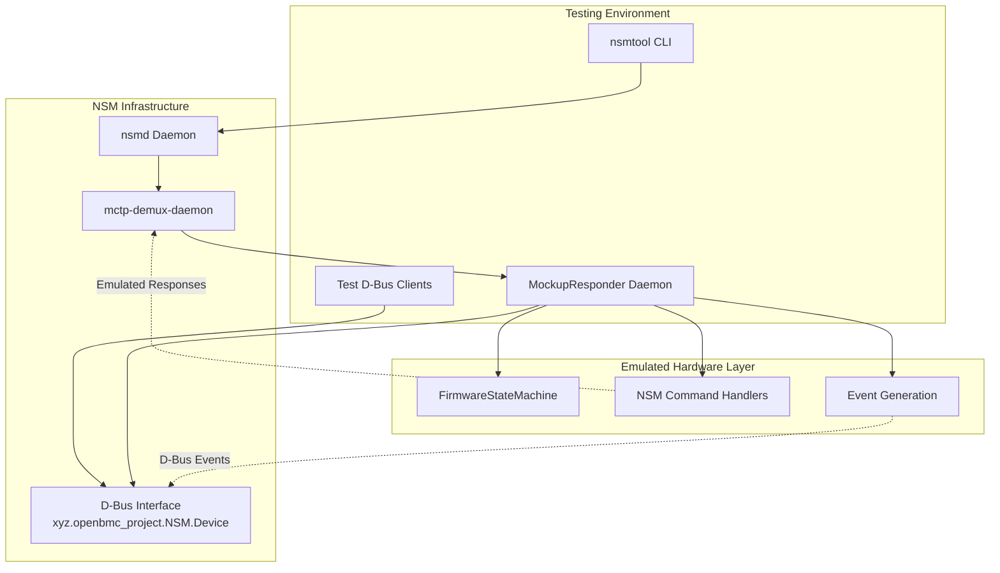
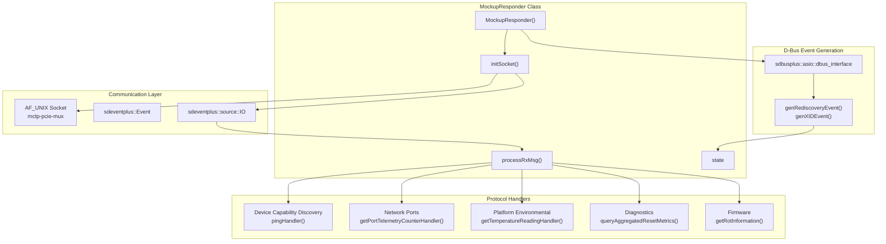
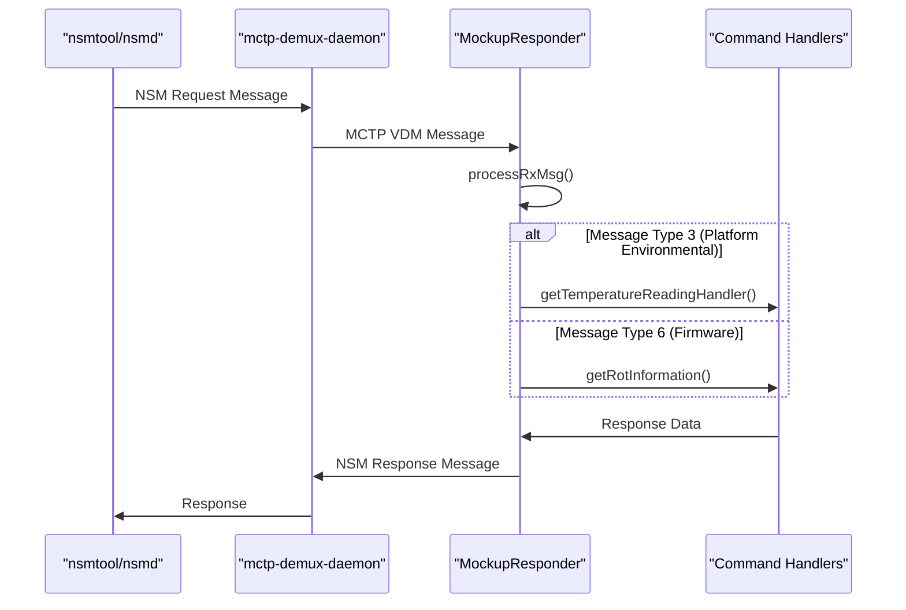

<!-- source: DeepWiki mcp.deepwiki.com · repo NVIDIA/nsmd · page 6.2 MockupResponder Testing Framework · fetched 2026-10-26 -->

# MockupResponder Testing Framework

Relevant source files

The following files were used as context for generating this wiki page:

- [libnsm/firmware-utils.c](libnsm/firmware-utils.c)
- [libnsm/firmware-utils.h](libnsm/firmware-utils.h)
- [libnsm/platform-environmental.c](libnsm/platform-environmental.c)
- [libnsm/platform-environmental.h](libnsm/platform-environmental.h)
- [libnsm/test/libnsm_firmware_utils_test.cpp](libnsm/test/libnsm_firmware_utils_test.cpp)
- [libnsm/test/libnsm_platform_environmental_test.cpp](libnsm/test/libnsm_platform_environmental_test.cpp)
- [mockupResponder/firmwareUtils.cpp](mockupResponder/firmwareUtils.cpp)
- [mockupResponder/gpmMetricsList.hpp](mockupResponder/gpmMetricsList.hpp)
- [mockupResponder/mockupResponder.cpp](mockupResponder/mockupResponder.cpp)
- [mockupResponder/mockupResponder.hpp](mockupResponder/mockupResponder.hpp)
- [nsmd/nsmChassis/test/nsmRoTProperty_test.cpp](nsmd/nsmChassis/test/nsmRoTProperty_test.cpp)
- [nsmd/nsmGPM/nsmGpmOem.cpp](nsmd/nsmGPM/nsmGpmOem.cpp)
- [nsmd/nsmGPM/nsmGpmOem.hpp](nsmd/nsmGPM/nsmGpmOem.hpp)
- [nsmd/nsmGPM/nsmGpmOemFactory.cpp](nsmd/nsmGPM/nsmGpmOemFactory.cpp)
- [nsmd/nsmGPM/test/nsmGpmOem_test.cpp](nsmd/nsmGPM/test/nsmGpmOem_test.cpp)
- [nsmtool/gpm_metrics_list.hpp](nsmtool/gpm_metrics_list.hpp)
- [nsmtool/nsm_firmware_cmd.cpp](nsmtool/nsm_firmware_cmd.cpp)
- [nsmtool/nsm_telemetry_cmd.cpp](nsmtool/nsm_telemetry_cmd.cpp)

The MockupResponder Testing Framework provides hardware emulation capabilities for the NSM (NVIDIA System Management) protocol, enabling development and testing without requiring physical NVIDIA hardware. This framework simulates NSM device responses across all supported message types and command codes, allowing comprehensive testing of the `nsmd` daemon, `nsmtool` CLI, and other NSM client applications.

## Architecture Overview

The MockupResponder framework operates as a standalone daemon that intercepts NSM protocol messages and generates realistic hardware responses. It integrates with the existing NSM communication infrastructure while providing controllable, deterministic behavior for testing scenarios.

### System Integration

Sources: [mockupResponder/mockupResponder.cpp:151-173](), [mockupResponder/mockupResponder.hpp:147-152](), [mockupResponder/firmwareUtils.cpp:30-67]()

### Core Components

The MockupResponder system consists of several key components that work together to provide comprehensive NSM protocol emulation:

Sources: [mockupResponder/mockupResponder.cpp:83-150](), [mockupResponder/mockupResponder.hpp:147-185](), [mockupResponder/mockupResponder.hpp:133-133]()

## Protocol Message Processing

The MockupResponder processes incoming NSM messages through a structured dispatch system. Incoming MCTP VDM messages are received via a socket and dispatched based on the NSM message type and command code.

### Message Flow Architecture

Sources: [mockupResponder/mockupResponder.cpp:332-710](), [mockupResponder/mockupResponder.hpp:157-160]()

## State Management and Mock Data

The MockupResponder maintains internal state to simulate realistic device behavior. This includes a dedicated `FirmwareStateMachine` for tracking RoT policies and security versions.

### State Structure and Mock Tables

The system uses several static tables to provide consistent telemetry data:
*   **Reset Metrics**: `resetMetricsMockTable` provides counts for FLR, Conventional, and Fundamental resets [mockupResponder/mockupResponder.hpp:41-51]().
*   **Power Smoothing**: `powerSmoothingFeatureInfoMockTable` and `presetProfileInfoMockTable` simulate power profile parameters [mockupResponder/mockupResponder.hpp:53-115]().
*   **Firmware State**: The `FirmwareStateMachine` class tracks `backgroundCopyPolicy`, `inbandUpdatePolicy`, and `apSkuId` [mockupResponder/firmwareUtils.cpp:30-67]().

Sources: [mockupResponder/mockupResponder.hpp:39-126](), [mockupResponder/firmwareUtils.cpp:30-67]()

## GPM Metrics Simulation

The MockupResponder framework supports the simulation of GPU Performance Monitoring (GPM) metrics. This is integrated with the `nsmd` GPM logic which uses `NsmGetSupportedPerInstanceGPMMetrics` to retrieve metrics like DRAM usage or NVLink bandwidth.

| Metric ID | Metric Name | Source |
|-----------|-------------|--------|
| 4 | DRAM Usage | [nsmd/nsmGPM/nsmGpmOemFactory.cpp:30-30]() |
| 10 | NVLink Raw Tx Bandwidth | [nsmd/nsmGPM/nsmGpmOemFactory.cpp:31-31]() |
| 11 | NVLink Data Tx Bandwidth | [nsmd/nsmGPM/nsmGpmOemFactory.cpp:32-32]() |

Sources: [nsmd/nsmGPM/nsmGpmOemFactory.cpp:28-35](), [mockupResponder/gpmMetricsList.hpp:1-20]()

## Event Generation and D-Bus Integration

The MockupResponder provides D-Bus methods for generating NSM events, enabling comprehensive testing of event handling in NSM client applications.

### D-Bus Event Interface

The framework registers methods on the `xyz.openbmc_project.NSM.Device` interface to trigger hardware-like events:
*   `genRediscoveryEvent`: Triggers a rediscovery flow [mockupResponder/mockupResponder.cpp:154-156]().
*   `genXIDEvent`: Simulates a GPU XID error event [mockupResponder/mockupResponder.cpp:166-172]().
*   `genResetRequiredEvent`: Signals that a device reset is needed [mockupResponder/mockupResponder.cpp:174-176]().

Sources: [mockupResponder/mockupResponder.cpp:152-210](), [mockupResponder/mockupResponder.hpp:217-263]()

## Integration with libnsm Protocol Layer

The MockupResponder leverages the `libnsm` library for protocol message encoding and decoding. It uses standard headers like `platform-environmental.h` and `firmware-utils.h` to ensure the mock responses are byte-compatible with real hardware.

### Key Integration Points

*   **Firmware**: Uses `decode_nsm_query_get_erot_state_parameters_req` to parse incoming RoT info requests [mockupResponder/firmwareUtils.cpp:81-83]().
*   **Telemetry**: Uses `encode_get_port_telemetry_counter_resp` for network port simulation [nsmtool/nsm_telemetry_cmd.cpp:100-103]().
*   **SPI Operations**: Implements SPI transaction simulation for Grace platforms using `encode_send_spi_command_req` [libnsm/test/libnsm_platform_environmental_test.cpp:26-54]().

Sources: [mockupResponder/mockupResponder.cpp:20-31](), [libnsm/platform-environmental.h:39-101](), [libnsm/firmware-utils.h:28-49]()

---

