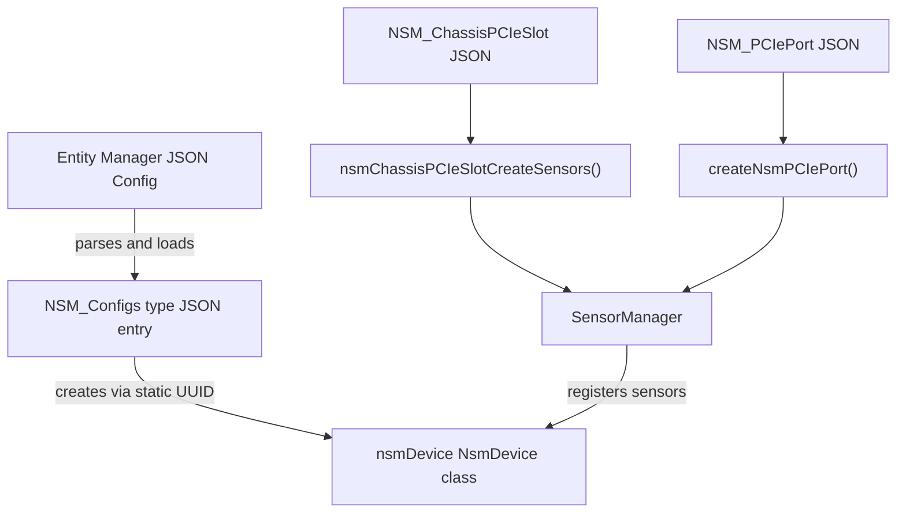
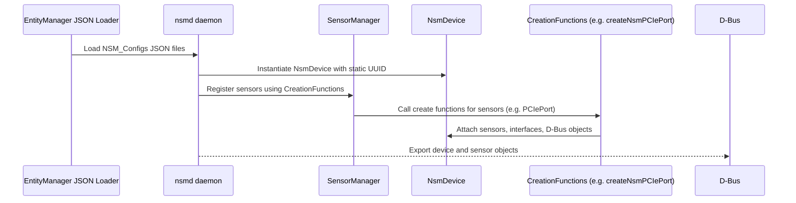

<!-- source: DeepWiki mcp.deepwiki.com · repo NVIDIA/nsmd · page 6.3 Entity Manager Configuration and Platform Examples · fetched 2026-10-26 -->

# Entity Manager Configuration and Platform Examples

<details>
<summary>Relevant source files</summary>

The following files were used as context for generating this wiki page:

- [example/gb200nvl_gpu_chassis.json](example/gb200nvl_gpu_chassis.json)
- [example/umbriel_cx7_chassis.json](example/umbriel_cx7_chassis.json)
- [example/umbriel_fpga_chassis.json](example/umbriel_fpga_chassis.json)
- [example/umbriel_gpu_chassis.json](example/umbriel_gpu_chassis.json)
- [example/umbriel_nvlink_chassis.json](example/umbriel_nvlink_chassis.json)
- [example/umbriel_pcieretimer_chassis.json](example/umbriel_pcieretimer_chassis.json)
- [nsmd/nsmChassis/nsmChassisPCIeSlot.cpp](nsmd/nsmChassis/nsmChassisPCIeSlot.cpp)
- [nsmd/nsmChassis/nsmChassisPCIeSlot.hpp](nsmd/nsmChassis/nsmChassisPCIeSlot.hpp)
- [nsmd/nsmDbusIfaceOverride/nsmMNNVLinkTopologyIntf.cpp](nsmd/nsmDbusIfaceOverride/nsmMNNVLinkTopologyIntf.cpp)
- [nsmd/nsmDbusIfaceOverride/nsmMNNVLinkTopologyIntf.hpp](nsmd/nsmDbusIfaceOverride/nsmMNNVLinkTopologyIntf.hpp)
- [nsmd/nsmPort/nsmEndpoint.cpp](nsmd/nsmPort/nsmEndpoint.cpp)
- [nsmd/nsmPort/nsmEndpoint.hpp](nsmd/nsmPort/nsmEndpoint.hpp)
- [nsmd/nsmPort/nsmPCIePort.cpp](nsmd/nsmPort/nsmPCIePort.cpp)
- [nsmd/nsmPort/nsmPortInfo.hpp](nsmd/nsmPort/nsmPortInfo.hpp)
- [nsmd/nsmPort/nsmZone.cpp](nsmd/nsmPort/nsmZone.cpp)
- [nsmd/nsmPort/nsmZone.hpp](nsmd/nsmPort/nsmZone.hpp)
- [tools/correlation/HGXB_PLDM_sensorID_mapping.xlsx](tools/correlation/HGXB_PLDM_sensorID_mapping.xlsx)
- [tools/correlation/README.md](tools/correlation/README.md)
- [tools/correlation/hgxb_pldmd_sensorID_association.json](tools/correlation/hgxb_pldmd_sensorID_association.json)
- [tools/correlation/sensorId_association_generator.py](tools/correlation/sensorId_association_generator.py)
- [tools/topology/HGXB_NVLink_Mapping.xlsx](tools/topology/HGXB_NVLink_Mapping.xlsx)
- [tools/topology/README.md](tools/topology/README.md)
- [tools/topology/hgxb_nvlink_topology.json](tools/topology/hgxb_nvlink_topology.json)
- [tools/topology/nvLink_topology_processor.py](tools/topology/nvLink_topology_processor.py)

</details>


This section provides detailed guidance on configuring the NSM daemon (`nsmd`) using Entity Manager (EM) JSON configuration files to support different NVIDIA hardware platforms. It covers the `example/` directory's JSON configuration files for Umbriel GPUs, FPGAs, PCIe retimers, CX7 devices, NVLink fabrics, and GB200NVL platforms. The page also explains the internal `NSM_Configs` structure, the static UUID format convention used for device identification, and describes tools in the `tools/` directory that assist with topology generation and PLDM sensor correlation.

## Overview

The Entity Manager is a crucial subsystem within NSM responsible for defining the hardware topology and exposing devices and sensors via D-Bus interfaces. Its configuration is done primarily by JSON files that declaratively specify devices, chassis, components, and sensors, and their relationships.

The JSON files under the `example/` directory illustrate how such configurations can be structured for different hardware platforms running NSM, employing the `NSM_Configs` type for device definitions and exposing additional D-Bus objects representing chassis and sensors. These examples provide a blueprint for integrating NSM with complex NVIDIA hardware topologies.

---

## 1. NSM_Configs Structure

Each JSON entry representing a device or chassis typically has a `"Type"` field set to `"NSM_Configs"`. This signals to NSM that the item is part of the Entity Manager configuration. Key fields in such entries include:

- `"Name"`: The inventory or device name in the D-Bus namespace.
- `"Probe"`: A boolean or a D-Bus probe string specifying how the device should be discovered or activated.
- `"Parent_Chassis"`: D-Bus path string that denotes the chassis or parent object in the inventory tree.
- `"Exposes"`: An optional array specifying child or related objects this object exposes on the D-Bus.
- Vendor-specific interfaces such as `"xyz.openbmc_project.NsmDevice"` which include:
  - `"DEVICE_TYPE"`: An integer device type enumeration.
  - `"INSTANCE_NUMBER"`: The device index or ordinal.
  - `"UUID"`: A unique identifier, which often uses the `STATIC` scheme explained below.

This structure is parsed by NSM during startup or reload to instantiate device abstractions, attach sensors, and dynamically create objects on the D-Bus.

---

## 2. Static UUID Format

Nodes in the EM configuration declare UUIDs using a `"STATIC:x:y"` string format, where:

- `x` corresponds to the device type integer (e.g., 0 for GPU, 1 for NVSwitch).
- `y` corresponds to the instance number, distinguishing multiple devices of the same type.

This deterministic static UUID scheme is essential for NSM to resolve devices during runtime without relying on dynamic hardware discovery. For example, a GPU device with `DEVICE_TYPE=0` and `INSTANCE_NUMBER=3` will have a UUID `STATIC:0:3`.

The static UUIDs serve as keys to locate the device instances within NSM’s internal registries, and they link configuration entries to the runtime device objects.

---

## 3. Platform Examples in `example/` Directory

The `example/` directory contains curated JSON files for various hardware platforms. These files show concrete configurations of devices, chassis, sensor exposures, and complex associations. The major platform examples include:

### 3.1 Umbriel GPU Platform (`umbriel_gpu_chassis.json`)

- Declares multiple GPU devices (`NSM_DEV_GPU_0`) with `DEVICE_TYPE=0` and instances 0 through 7.
- Each device references the HGX chassis as its parent chassis.
- Lists child objects under `"Exposes"` with detailed properties such as chassis assemblies, PCIe devices, assets, location codes, health states, power limits, and PCIe link configurations.
- Utilizes `UUID` with the `STATIC` format for device identification.
- Associations define forward/backward links between components such as PCIe devices and chassis.
- Power limit and health objects are configured per GPU.

_Example snippet from `umbriel_gpu_chassis.json`:_  
```json
{
  "Name": "NSM_DEV_GPU_0",
  "Probe": "TRUE",
  "Type": "NSM_Configs",
  "Parent_Chassis": "/xyz/openbmc_project/inventory/system/chassis/HGX_Chassis_0",
  "xyz.openbmc_project.NsmDevice": {
    "DEVICE_TYPE": 0,
    "INSTANCE_NUMBER": 0,
    "UUID": "STATIC:0:0"
  }
}
```

### 3.2 Umbriel FPGA Platform (`umbriel_fpga_chassis.json`)

- Defines FPGA devices with `DEVICE_TYPE=3`.
- Associates each FPGA device with the HGX chassis.
- Configures chassis assemblies, PCIe slots for reference, and multiple temperature sensors aggregated to the chassis.
- Includes write protection and firmware version objects for FPGA firmware management, mapping firmware indices offset by instance number.
- Includes detailed thermal sensors associated to the FPGA chassis.

### 3.3 PCIe Retimer Platform (`umbriel_pcieretimer_chassis.json`)

- Defines PCIe retimers as chassis objects with `"Type": "chassis"`.
- Entries include temperature sensors and write protect configurations.
- Firmware version objects that use instance-based `DataIndex` for firmware slots.
- Probe strings provided as `"xyz.openbmc_project.Configuration.NSM_PCIeRetimer({})"` to link these components to NSM PCIe retimer handlers.

### 3.4 CX7 Platform (`umbriel_cx7_chassis.json`)

- Defines CX7 devices (`DEVICE_TYPE=2`), FPGAs, NVLink Management NICs, and NVLink fabrics.
- Exposes network adapters, chassis assemblies, software inventories, NVLink fabric switches, and detailed associations among them.
- Includes sensor auxiliary names (`SensorAuxName`) and port info mappings for NVLink NICs using sensor IDs.
- Demonstrates hierarchical structuring through `"Exposes"` and `"Associations"` for complex device interrelations.
- Uses `$INSTANCE_NUMBER`, `$UUID`, and other variables for generating multiple device entries.

### 3.5 NVLink Platform (`umbriel_nvlink_chassis.json`)

- Defines NVSwitch devices (`DEVICE_TYPE=1`), NVLink fabrics, and associated chassis.
- Associates NVSwitches with their assemblies, assets, locations, and health monitoring.
- Specifies NVLink ports, sensors, and network adapter associations.
- Demonstrates complex association maps that integrate NVLink fabrics, switches, and management NICs.

### 3.6 GB200NVL Platform (`gb200nvl_gpu_chassis.json`)

- Alternative GPU platform configuration for GB200NVL hardware.
- Includes details for GPU assembly, PCIe devices, power limits, thermal sensors with detailed thermal parameters (e.g., UpperFatal, UpperCritical).
- PCIe devices with device functions and LTSSM states.
- Aggregated temperature sensors mapped to chassis and processor locations with priorities assigned.
- Uses the static UUID model and hierarchical device relationships.

---

## 4. How NSM Uses Entity Manager JSON Configurations

The JSON configurations produce a hierarchical representation reflecting the physical topology of the system. 

At daemon start or reload:

1. NSM loads each JSON file and processes `NSM_Configs` entries to construct device objects (`NsmDevice`) using the static UUIDs.
2. Devices are registered with their `DEVICE_TYPE` and `INSTANCE_NUMBER`.
3. `Exposes` arrays define sub-objects such as chassis assemblies, PCIe slots, power limit controllers, and sensors.
4. Associations between devices, chassis, sensors, and ports are established based on `"Associations"` fields, forwarding and backward links with absolute inventory object paths.
5. SensorManager calls registered creation functions keyed on JSON `"Type"` entries and interface types to instantiate sensor or device interfaces. This is seen, for example, in how PCIe slots and ports are created:
   - `nsmChassisPCIeSlotCreateSensors()` handles `"NSM_ChassisPCIeSlot"` objects, adding PCIe slot sensors to devices.
   - `createNsmPCIePort()` creates PCIe port sensors and error monitoring linked to devices by static UUID.  
   
   These creation functions use D-Bus properties to dynamically retrieve and set up sensor interfaces on NSM devices [nsmd/nsmChassis/nsmChassisPCIeSlot.cpp:31-93](), [nsmd/nsmPort/nsmPCIePort.cpp:43-142]().

6. Devices are connected through D-Bus associations which define how ports link to chassis, how devices are grouped under higher-level assemblies, and where each sensor belongs in the hierarchy.

---

## 5. Key Code Entities Bridging JSON to Runtime Objects

The following mermaid diagram illustrates key JSON types and their corresponding code handlers:



This shows how each JSON configuration triggers corresponding code functions which create device or sensor objects and register them with the SensorManager during runtime.

---

## 6. Tools for Topology Generation and Sensor Correlation

Two important Python scripts under the `tools/` directory assist with converting raw inventory and topology data to Entity Manager JSON configurations or sensor mapping files:

### 6.1 NVLink Topology Processor (`tools/topology/nvLink_topology_processor.py`)

- Parses Excel spreadsheets describing NVLink device topology, connections, device IDs, port mappings, and prefix naming.
- Generates sorted topology mappings combining device types and logical/physical port IDs.
- The processed output helps construct the EM JSON for complex NVLink fabric topologies, supporting the `umbriel_nvlink_chassis.json` platform example.
- Supports generating prefix mappings for device interconnections.

### 6.2 Sensor ID Association Generator (`tools/correlation/sensorId_association_generator.py`)

- Converts Excel sensor mappings to JSON lists of sensor auxiliary names (`SensorAuxName`) and port info (`SensorPortInfo`) entries.
- These JSON outputs are copied manually into the NVSwitch and NIC EM JSON files to maintain sensor-to-port ID correlations.
- Automates creating sensor exposure entries with correct sensor IDs and port protocols for NVLink NICs or switches.
- Enhances maintenance and scalability of sensor configurations within large device fleets.

An example generator invocation is:

```bash
python sensorId_association_generator.py input_mapping.xlsx output.json
```

---

## Summary Table: Supported Device Types by Example Files

| JSON Example File               | Device Types Included                              | Key Features                            |
|--------------------------------|---------------------------------------------------|---------------------------------------|
| `umbriel_gpu_chassis.json`     | GPU (`DEVICE_TYPE=0`)                              | Multiple GPU instances, PCIe links    |
| `umbriel_fpga_chassis.json`    | FPGA (`DEVICE_TYPE=3`)                             | Temperature sensors, firmware state   |
| `umbriel_pcieretimer_chassis.json` | PCIe Retimer (chassis type)                  | Firmware version, temp sensors        |
| `umbriel_cx7_chassis.json`     | CX7 (`DEVICE_TYPE=2`), NVLink NIC, Fabrics        | Network adapters, complex associations|
| `umbriel_nvlink_chassis.json`  | NVSwitch (`DEVICE_TYPE=1`), NVLink fabrics         | Switches, ports, fabric manager       |
| `gb200nvl_gpu_chassis.json`    | GPU (custom GB200NVL platform)                     | Thermal limits, PCIe LTSSM states     |

---

## Integration Workflow

Typical integration using these JSON files involves:

1. Copying or adapting the example JSON files under `example/` to the target platform directory.
2. Adjusting instance numbers, UUIDs, chassis paths, and asset information.
3. Using static UUID formats for consistent device identification.
4. Running Python tools to generate sensor ID mappings or topology snippets.
5. Loading the JSON configurations at NSM daemon startup to instantiate device and sensor objects.
6. Verifying the D-Bus object hierarchy and sensor readings for correctness.

---

## Detailed Diagram: EM JSON to Device Creation Flow



This illustrates the flow from configuration to runtime objects visible on D-Bus.

---

## Conclusion

Entity Manager JSON configurations provide a powerful, declarative method to describe NVIDIA hardware topologies within NSM. The example files in the `example/` directory serve as comprehensive templates for GPU, FPGA, PCIe retimer, CX7, NVLink, and GB200NVL platforms. Using the static UUID scheme and adhering to the `NSM_Configs` format enables consistent device management. The codebase includes handler functions that parse these configurations and instantiate the necessary D-Bus objects and sensor interfaces dynamically.

Scripts in the `tools/` directory augment this work by automating the generation of sensor-port mappings and fabric topologies, reinforcing the full device lifecycle from hardware description to live sensor monitoring.

---

### Sources

- `example/umbriel_gpu_chassis.json` [example/umbriel_gpu_chassis.json:1-15196]()
- `example/umbriel_fpga_chassis.json` [example/umbriel_fpga_chassis.json:1-28387]()
- `example/umbriel_pcieretimer_chassis.json` [example/umbriel_pcieretimer_chassis.json:1-51]()
- `example/umbriel_cx7_chassis.json` [example/umbriel_cx7_chassis.json:1-3914]()
- `example/umbriel_nvlink_chassis.json` [example/umbriel_nvlink_chassis.json:1-1924]()
- `example/gb200nvl_gpu_chassis.json` [example/gb200nvl_gpu_chassis.json:1-20949]()
- `nsmd/nsmChassis/nsmChassisPCIeSlot.cpp` [nsmd/nsmChassis/nsmChassisPCIeSlot.cpp:31-93]()
- `nsmd/nsmPort/nsmPCIePort.cpp` [nsmd/nsmPort/nsmPCIePort.cpp:43-142]()
- `tools/topology/nvLink_topology_processor.py` [tools/topology/nvLink_topology_processor.py:1-8544]()
- `tools/correlation/sensorId_association_generator.py` [tools/correlation/sensorId_association_generator.py:1-92]()

---

