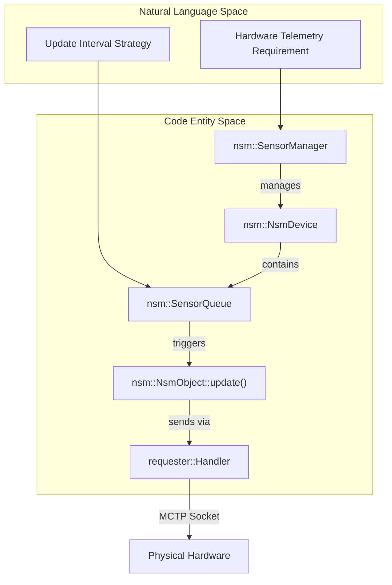
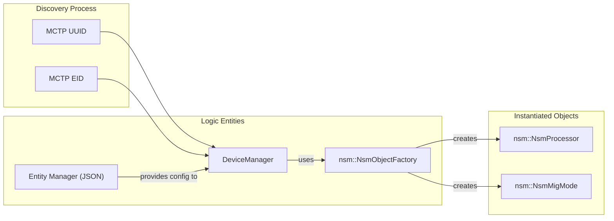

<!-- source: DeepWiki mcp.deepwiki.com · repo NVIDIA/nsmd · page 7 Glossary · fetched 2026-10-26 -->

# Glossary

Relevant source files

The following files were used as context for generating this wiki page:

- [common/test/common_utils_test.cpp](common/test/common_utils_test.cpp)
- [common/utils.cpp](common/utils.cpp)
- [common/utils.hpp](common/utils.hpp)
- [libnsm/base.c](libnsm/base.c)
- [libnsm/base.h](libnsm/base.h)
- [libnsm/firmware-utils.c](libnsm/firmware-utils.c)
- [libnsm/firmware-utils.h](libnsm/firmware-utils.h)
- [libnsm/platform-environmental.c](libnsm/platform-environmental.c)
- [libnsm/platform-environmental.h](libnsm/platform-environmental.h)
- [libnsm/test/common-tests.cpp](libnsm/test/common-tests.cpp)
- [libnsm/test/common-tests.hpp](libnsm/test/common-tests.hpp)
- [libnsm/test/libnsm_base_test.cpp](libnsm/test/libnsm_base_test.cpp)
- [libnsm/test/libnsm_firmware_utils_test.cpp](libnsm/test/libnsm_firmware_utils_test.cpp)
- [libnsm/test/libnsm_platform_environmental_test.cpp](libnsm/test/libnsm_platform_environmental_test.cpp)
- [libnsm/test/meson.build](libnsm/test/meson.build)
- [meson.build](meson.build)
- [meson_options.txt](meson_options.txt)
- [mockupResponder/firmwareUtils.cpp](mockupResponder/firmwareUtils.cpp)
- [mockupResponder/mockupResponder.cpp](mockupResponder/mockupResponder.cpp)
- [mockupResponder/mockupResponder.hpp](mockupResponder/mockupResponder.hpp)
- [nsmd/meson.build](nsmd/meson.build)
- [nsmd/nsmChassis/test/nsmRoTProperty_test.cpp](nsmd/nsmChassis/test/nsmRoTProperty_test.cpp)
- [nsmd/nsmDevice.cpp](nsmd/nsmDevice.cpp)
- [nsmd/nsmDevice.hpp](nsmd/nsmDevice.hpp)
- [nsmd/nsmObject.hpp](nsmd/nsmObject.hpp)
- [nsmd/nsmProcessor/meson.build](nsmd/nsmProcessor/meson.build)
- [nsmd/nsmProcessor/nsmProcessor.cpp](nsmd/nsmProcessor/nsmProcessor.cpp)
- [nsmd/nsmProcessor/nsmProcessor.hpp](nsmd/nsmProcessor/nsmProcessor.hpp)
- [nsmd/nsmProcessor/test/meson.build](nsmd/nsmProcessor/test/meson.build)
- [nsmd/nsmProcessor/test/nsmProcessor_test.cpp](nsmd/nsmProcessor/test/nsmProcessor_test.cpp)
- [nsmd/sensorManager.cpp](nsmd/sensorManager.cpp)
- [nsmd/sensorManager.hpp](nsmd/sensorManager.hpp)
- [nsmd/test/mockSensorManager.hpp](nsmd/test/mockSensorManager.hpp)
- [nsmtool/nsm_discovery_cmd.cpp](nsmtool/nsm_discovery_cmd.cpp)
- [nsmtool/nsm_firmware_cmd.cpp](nsmtool/nsm_firmware_cmd.cpp)
- [nsmtool/nsm_telemetry_cmd.cpp](nsmtool/nsm_telemetry_cmd.cpp)
- [requester/mctp_endpoint_discovery.cpp](requester/mctp_endpoint_discovery.cpp)
- [requester/mctp_endpoint_discovery.hpp](requester/mctp_endpoint_discovery.hpp)

This glossary defines technical terms, domain concepts, and abbreviations specific to the `nsmd` codebase. It serves as a reference for onboarding engineers to understand the mapping between the NSM protocol and its implementation in C++.

## Core Concepts & Terms

### NSM (NVIDIA System Management)
The primary protocol used for managing NVIDIA hardware components. It defines message types, command codes, and event structures for telemetry, configuration, diagnostics, and firmware management.
*   **NSM Types**: Categories of commands (e.g., Type 1: Network Ports, Type 3: Platform Environmental). [nsmtool/nsm_telemetry_cmd.cpp:18-23]()
*   **NSM Message Structure**: Consists of a header (`nsm_msg_hdr`) followed by a payload. [libnsm/base.h:54-58]()

### NsmDevice
A C++ abstraction representing a physical hardware entity (e.g., a GPU, NVSwitch, or PCIe Retimer) identified by an MCTP Endpoint ID (EID). It manages a collection of `NsmObject` instances and coordinates their polling logic.
*   **Class Definition**: `nsm::NsmDevice` [nsmd/nsmDevice.hpp:124-126]()
*   **Device Discovery**: Handled by the `DeviceManager` and `MctpDiscovery` which map EIDs to device instances. [nsmd/nsmDevice.cpp:28-30]()

### NsmObject
The base class for all entities that interact with the NSM protocol. This includes sensors (read-only), control objects (read-write), and inventory properties.
*   **Class Definition**: `nsm::NsmObject` [nsmd/nsmObject.hpp:26-28]()
*   **Update Loop**: Each object implements an `update` coroutine to fetch data from hardware. [nsmd/nsmDevice.hpp:144-144]()

### Polling Types
The `nsmd` daemon categorizes sensors into different queues to optimize bus utilization and meet latency requirements.
*   **Priority**: High-frequency polling (default 150ms). [nsmd/nsmDevice.hpp:77-77]()
*   **RoundRobin (RR)**: Standard polling for non-critical telemetry. [nsmd/nsmDevice.hpp:83-83]()
*   **GPM (GPU Performance Monitoring)**: Specific to high-speed performance metrics (default 1000ms). [nsmd/nsmDevice.hpp:80-80]()
*   **LongRunning**: For commands that take significant time to complete on the device side. [nsmd/nsmDevice.hpp:81-81]()

## System Mappings

### Natural Language to Code Entity Space: Polling & Execution
The following diagram bridges the conceptual requirement of "polling hardware" to the specific code entities responsible for the data flow.

**Diagram: Polling Data Flow Architecture**

*   **Sources**: [nsmd/sensorManager.cpp:50-57](), [nsmd/nsmDevice.hpp:66-73](), [nsmd/nsmDevice.cpp:179-205]()

### Natural Language to Code Entity Space: Device Discovery
This diagram maps the conceptual process of "finding a GPU" to the internal discovery logic.

**Diagram: Device Discovery and Factory Pattern**

*   **Sources**: [nsmd/sensorManager.cpp:138-142](), [nsmd/nsmProcessor/nsmProcessor.cpp:78-99](), [nsmd/nsmDevice.hpp:159-200]()

## Technical Abbreviations

| Abbreviation | Full Term | Description | Code Pointer |
| :--- | :--- | :--- | :--- |
| **MIG** | Multi-Instance GPU | Technology to partition a GPU into multiple instances. | [nsmd/nsmProcessor/nsmProcessor.cpp:78-99]() |
| **GPM** | GPU Performance Monitoring | A subsystem for high-fidelity telemetry like SM utilization. | [libnsm/platform-environmental.h:72-75]() |
| **ECC** | Error Correction Code | Monitoring for memory errors (SRAM/DRAM). | [nsmd/nsmProcessor/nsmProcessor.cpp:137-165]() |
| **EDPp** | Electrical Design Point (peak) | Power scaling factor management. | [nsmd/nsmProcessor/nsmProcessor.cpp:167-190]() |
| **EID** | Endpoint ID | The MCTP address of a managed device. | [nsmd/nsmDevice.hpp:179-182]() |
| **CPER** | Common Platform Error Record | Format for reporting hardware errors. | [nsmd/nsmDevice.hpp:78-79]() |
| **XID** | Xid Error | NVIDIA-specific GPU error codes. | [libnsm/platform-environmental.h:150-150]() |

## Domain Concepts

### Long Running Operations
Some NSM commands do not return immediate data. Instead, they return a "Long Running Token," and the device sends an asynchronous event once the operation is finished.
*   **Implementation**: Managed by `NsmLongRunningSensor` and `NsmLongRunningEventHandler`. [nsmd/nsmDevice.cpp:22-24]()
*   **Timeout Handling**: Uses `RESPONSE_TIME_OUT_LONG_RUNNING` (default 3000ms). [meson_options.txt:195-201]()

### Mockup Responder
A testing utility that emulates a physical NSM device. It listens on a socket and responds to NSM requests, allowing for daemon testing without hardware.
*   **Class**: `MockupResponder::MockupResponder` [mockupResponder/mockupResponder.cpp:83-150]()
*   **Functionality**: Simulates events like `genXIDEvent` or `genRediscoveryEvent`. [mockupResponder/mockupResponder.cpp:154-171]()

### Shared Memory (SHMEM)
An IPC mechanism used to export high-frequency telemetry data to other system components without the overhead of D-Bus.
*   **Build Option**: `shmem` [meson_options.txt:9-13]()
*   **Usage**: Triggered via `updateMetricOnSharedMemory()`. [nsmd/nsmProcessor/nsmProcessor.hpp:145-145]()

### Progress Counters
A mechanism to track the progress of long-running discovery or sensor polling tasks, often exposed via `memfd`.
*   **Build Option**: `progressCounter` [meson_options.txt:15-19]()
*   **Classes**: `ProgressCounters`, `DiscoveryEvents`. [nsmd/nsmDevice.hpp:62-63]()

**Sources**:
*   [nsmd/nsmDevice.hpp:1-200]()
*   [nsmd/nsmDevice.cpp:1-200]()
*   [nsmd/sensorManager.cpp:1-200]()
*   [libnsm/platform-environmental.h:1-200]()
*   [mockupResponder/mockupResponder.cpp:1-200]()
*   [meson_options.txt:1-250]()