# Page: NVIDIA System Management (NSM) Overview

# NVIDIA System Management (NSM) Overview

<details>
<summary>Relevant source files</summary>

The following files were used as context for generating this wiki page:

- [.gitignore](.gitignore)
- [README.md](README.md)
- [libnsm/base.c](libnsm/base.c)
- [libnsm/base.h](libnsm/base.h)
- [libnsm/test/common-tests.cpp](libnsm/test/common-tests.cpp)
- [libnsm/test/common-tests.hpp](libnsm/test/common-tests.hpp)
- [libnsm/test/libnsm_base_test.cpp](libnsm/test/libnsm_base_test.cpp)
- [libnsm/test/meson.build](libnsm/test/meson.build)
- [meson.build](meson.build)
- [meson_options.txt](meson_options.txt)
- [nsmd/meson.build](nsmd/meson.build)
- [nsmtool/nsm_discovery_cmd.cpp](nsmtool/nsm_discovery_cmd.cpp)
- [subprojects/nvidia-shmem.wrap](subprojects/nvidia-shmem.wrap)
- [subprojects/nvidia-tal.wrap](subprojects/nvidia-tal.wrap)
- [subprojects/phosphor-dbus-interfaces.wrap](subprojects/phosphor-dbus-interfaces.wrap)
- [subprojects/phosphor-logging.wrap](subprojects/phosphor-logging.wrap)
- [subprojects/sdbusplus.wrap](subprojects/sdbusplus.wrap)
- [subprojects/sdeventplus.wrap](subprojects/sdeventplus.wrap)

</details>


## Purpose and Scope

The NVIDIA System Management (NSM) repository provides a comprehensive system management framework for NVIDIA hardware components including GPUs, network switches, memory modules, and chassis systems. This framework facilitates monitoring and control through standardized D-Bus interfaces, utilizing the NSM protocol over MCTP transport.

The repository includes:
- **`nsmd`**: The core management daemon responsible for device discovery and sensor orchestration.
- **`libnsm`**: A C library providing message encoding and decoding for the NSM protocol.
- **`nsmtool`**: A CLI utility for manual hardware interaction and diagnostics.
- **`MockupResponder`**: A testing framework for simulating hardware responses.

For information about specific hardware subsystem implementations, see [System Architecture](#1.1). For details about the NSM protocol message structures, see [NSM Protocol Layer](#4). For communication infrastructure and transport mechanisms, see [Communication Infrastructure](#5).

## System Architecture Overview

The NSM system follows a layered architecture with the core `nsmd` daemon serving as the central orchestrator for hardware management operations.

**NSM System Architecture**

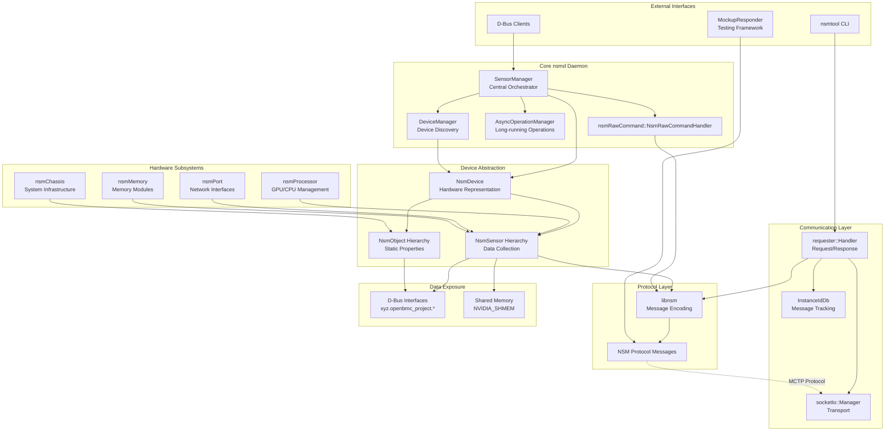

Sources: [nsmd/nsmd.cpp:153-181](), [nsmd/sensorManager.cpp:1-100](), [nsmd/meson.build:1-21](), [libnsm/base.h:73-81]()

The architecture implements a hierarchical polling strategy where different sensor types operate on different schedules based on criticality and update frequency requirements. For a deep dive into the integration model and MCTP transport, see [System Architecture](#1.1).

**NSM Sensor Polling Architecture**

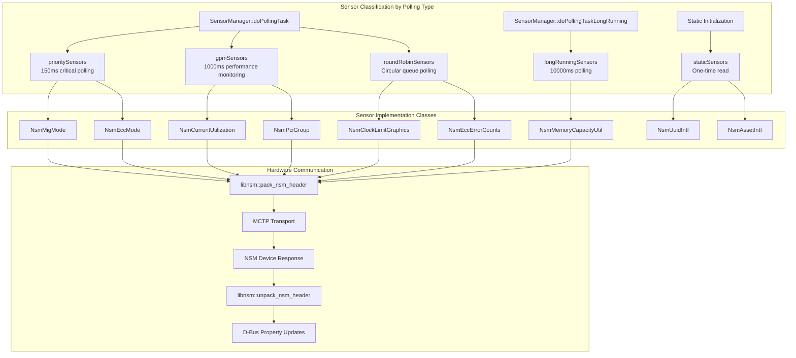

Sources: [nsmd/sensorManager.cpp:502-627](), [libnsm/base.c:25-63](), [meson_options.txt:45-51](), [meson_options.txt:133-139]()

## Core Components

### SensorManager - Central Orchestration

The `SensorManager` class serves as the central orchestrator for all NSM operations, implementing a sophisticated polling strategy with multiple sensor categories defined in `nsmDevice.hpp`.

| Component | Default Interval | Purpose |
|-----------|------------------|---------|
| `prioritySensors` | 150ms | Critical real-time monitoring [meson_options.txt:50]() |
| `gpmSensors` | 1000ms | GPU performance metrics [meson_options.txt:90]() |
| `roundRobinSensors` | 30000ms limit | Regular telemetry updates [meson_options.txt:162]() |
| `longRunningSensors` | 10000ms | Complex/Slow operations [meson_options.txt:138]() |
| `staticSensors` | One-time | Hardware identification and static data |

Sources: [nsmd/sensorManager.cpp:502-627](), [nsmd/nsmDevice.hpp:70-150]()

### DeviceManager - Hardware Discovery

The `DeviceManager` handles MCTP endpoint discovery and device enumeration. It utilizes the `MctpDiscovery` and `MctpEndpointProber` components to identify hardware and initialize the corresponding `NsmDevice` objects.

Sources: [requester/mctp_endpoint_discovery.cpp:1-50](), [requester/mctp_endpoint_prober.cpp:1-50]()

### NsmDevice - Hardware Abstraction

The `NsmDevice` class represents individual hardware components. It maintains collections of sensors and objects, tracking the device's operational state.

Sources: [nsmd/nsmDevice.cpp:1-100](), [nsmd/nsmDevice.hpp:70-150]()

## Communication Flow

The NSM system implements a request-response communication pattern over MCTP transport. It uses `libnsm` to pack and unpack headers following the NSM specification (OCP Type 8).

**NSM Communication Flow**

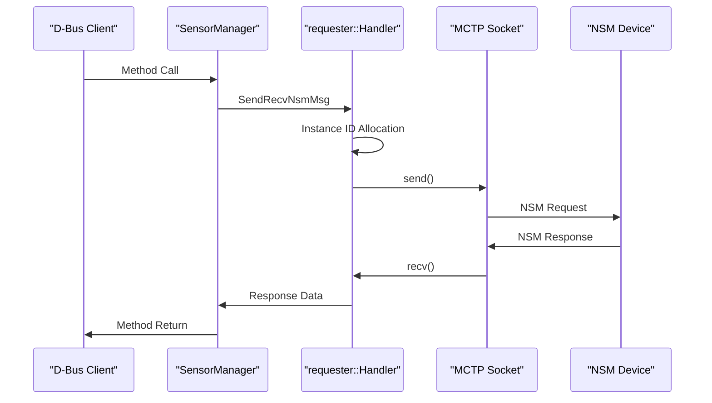

Sources: [libnsm/base.c:25-106](), [nsmd/socket_handler.cpp:1-50](), [nsmd/nsmMsghandler.cpp:1-50]()

## Build System and Configuration

The NSM system uses the Meson build system. It features a modular design where subdirectories for specific hardware (e.g., `nsmProcessor`, `nsmPort`) are conditionally included based on build options.

### Key Configuration Options

| Option | Default | Purpose |
|--------|---------|---------|
| `sensor-polling-time` | 150 | Priority sensor polling interval (ms) |
| `shmem` | enabled | Enable NVIDIA Shared-Memory IPC |
| `progressCounter` | enabled | Enable sensor progress counters |
| `mockup-responder` | enabled | Build the Mockup Responder tool |
| `response-time-out` | 2000 | Standard timeout (ms) |

For detailed instructions on building, configuring, and running tests, see [Build System and Configuration](#1.2).

Sources: [meson_options.txt:1-200](), [meson.build:1-150](), [README.md:37-49]()

---

# Page: System Architecture

# System Architecture

<details>
<summary>Relevant source files</summary>

The following files were used as context for generating this wiki page:

- [common/dBusAsyncUtils.hpp](common/dBusAsyncUtils.hpp)
- [common/sleep.hpp](common/sleep.hpp)
- [common/test/common_utils_test.cpp](common/test/common_utils_test.cpp)
- [common/timer.hpp](common/timer.hpp)
- [common/types.hpp](common/types.hpp)
- [common/utils.cpp](common/utils.cpp)
- [common/utils.hpp](common/utils.hpp)
- [nsmd/nsmDevice.cpp](nsmd/nsmDevice.cpp)
- [nsmd/nsmDevice.hpp](nsmd/nsmDevice.hpp)
- [nsmd/nsmEvent/nsmRediscoveryEvent.cpp](nsmd/nsmEvent/nsmRediscoveryEvent.cpp)
- [nsmd/nsmEvent/nsmRediscoveryEvent.hpp](nsmd/nsmEvent/nsmRediscoveryEvent.hpp)
- [nsmd/nsmEventConfig/nsmEventSetting.cpp](nsmd/nsmEventConfig/nsmEventSetting.cpp)
- [nsmd/nsmEventConfig/test/nsmEventSetting_test.cpp](nsmd/nsmEventConfig/test/nsmEventSetting_test.cpp)
- [nsmd/nsmObject.hpp](nsmd/nsmObject.hpp)
- [nsmd/nsmd.cpp](nsmd/nsmd.cpp)
- [nsmd/sensorManager.cpp](nsmd/sensorManager.cpp)
- [nsmd/sensorManager.hpp](nsmd/sensorManager.hpp)
- [nsmd/test/mockSensorManager.hpp](nsmd/test/mockSensorManager.hpp)
- [nsmd/test/nsmDevice_test.cpp](nsmd/test/nsmDevice_test.cpp)
- [requester/mctp_endpoint_discovery.cpp](requester/mctp_endpoint_discovery.cpp)
- [requester/mctp_endpoint_discovery.hpp](requester/mctp_endpoint_discovery.hpp)

</details>


This document describes the high-level architecture of the NVIDIA System Management (NSM) daemon (`nsmd`), which provides system monitoring and management capabilities for NVIDIA hardware components through D-Bus interfaces and the NSM protocol over MCTP transport.

For information about specific hardware subsystems managed by NSM, see [Hardware Subsystems](#3). For details about the NSM protocol implementation, see [NSM Protocol Layer](#4). For communication infrastructure details, see [Communication Infrastructure](#5).

## Overview

The NSM daemon serves as a bridge between NVIDIA hardware components and system management interfaces, providing real-time telemetry, configuration capabilities, and health monitoring. The system architecture is built around several core components that work together to discover devices, poll sensors, manage communication, and expose data through standardized interfaces.

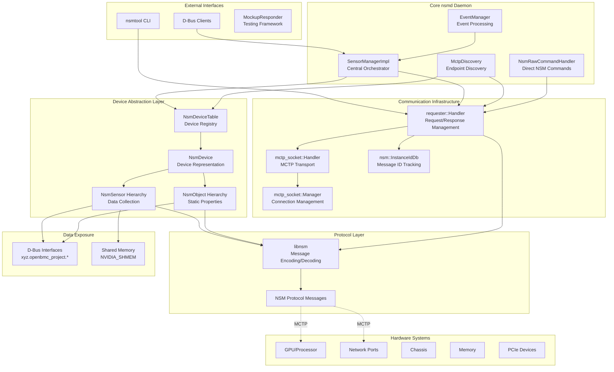

**NSM System Architecture Overview**

Sources: [nsmd/nsmd.cpp:92-156](), [nsmd/sensorManager.hpp:95-135](), [requester/mctp_endpoint_discovery.hpp:56-86]()

## Core Daemon Components

The `nsmd` daemon is structured around primary management components that coordinate device lifecycle, sensor monitoring, and communication.

### SensorManager - Central Orchestration

The `SensorManagerImpl` class serves as the primary orchestrator, managing the complete sensor lifecycle and device readiness state. It coordinates polling operations, handles D-Bus inventory discovery via Entity Manager configurations, and maintains system readiness status.

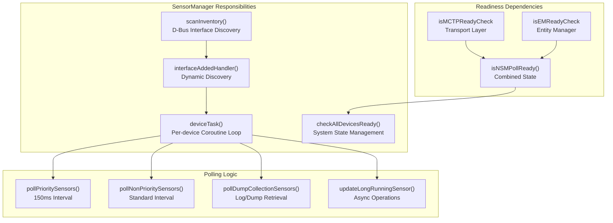

**SensorManager Architecture and Polling Flow**

Sources: [nsmd/sensorManager.cpp:133-184](), [nsmd/sensorManager.cpp:186-205](), [nsmd/sensorManager.hpp:143-159](), [nsmd/sensorManager.cpp:59-74]()

### MctpDiscovery - Endpoint Discovery

The `MctpDiscovery` class handles MCTP endpoint discovery by watching D-Bus signals from the MCTP daemon (e.g., `au.com.codeconstruct.mctp1`). It maintains the `EidTable` which maps UUIDs to EIDs and binding information.

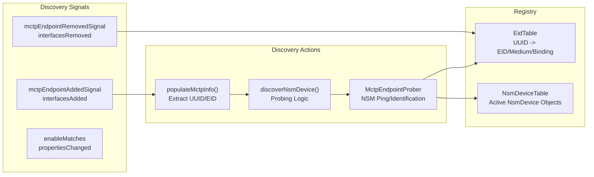

**MctpDiscovery Flow**

Sources: [requester/mctp_endpoint_discovery.cpp:92-164](), [requester/mctp_endpoint_discovery.cpp:166-213](), [requester/mctp_endpoint_discovery.hpp:103-118]()

### Device Abstraction Model

The `NsmDevice` class represents individual hardware components and organizes sensors into different polling categories based on their update requirements and criticality.

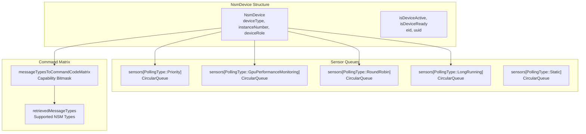

**NsmDevice Structure and Sensor Organization**

Sources: [nsmd/nsmDevice.hpp:75-91](), [nsmd/nsmDevice.hpp:124-220](), [nsmd/nsmDevice.cpp:141-177](), [nsmd/nsmDevice.cpp:179-205]()

## Communication and Protocol Flow

The NSM system implements a layered communication architecture using the NSM protocol over MCTP transport, with comprehensive request/response handling and timeout management via the `requester::Handler`.

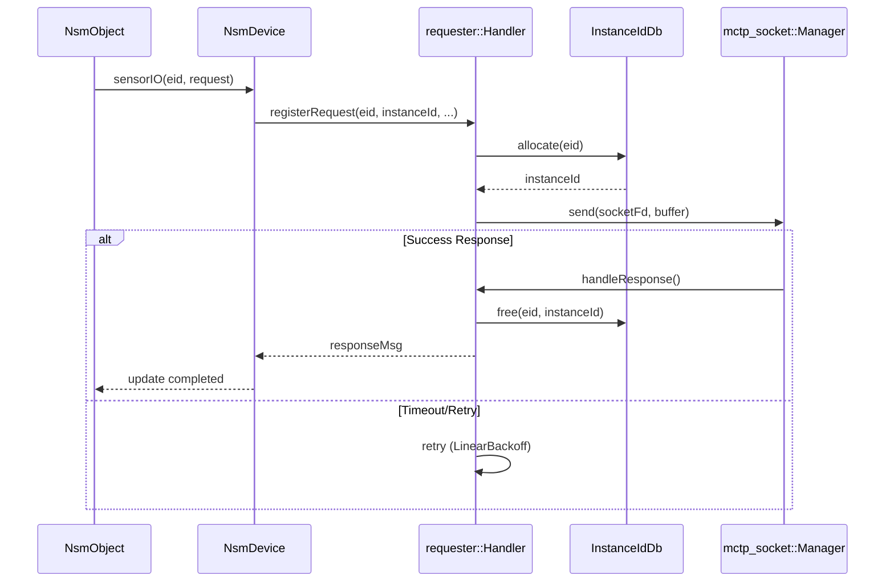

**NSM Communication Flow**

Sources: [requester/mctp_endpoint_discovery.cpp:81-90](), [nsmd/nsmd.cpp:113-124](), [nsmd/nsmEventConfig/nsmEventSetting.cpp:94-105]()

## Sensor Polling Architecture

The sensor polling system implements a priority-based scheduling mechanism. Each `NsmDevice` runs its own `deviceTask` coroutine that orchestrates different polling types.

| Polling Type | Frequency/Limit | Purpose |
| :--- | :--- | :--- |
| `Priority` | 150ms (`PRIORITY_REFRESH_LIMIT_IN_USEC`) | Critical real-time telemetry |
| `GpuPerformanceMonitoring` | 1000ms (`GPM_REFRESH_LIMIT_IN_USEC`) | GPM metrics for GPUs |
| `RoundRobin` | Default (`RR_REFRESH_LIMIT_IN_USEC`) | Standard telemetry sensors |
| `LongRunning` | 30s (`LONG_RUNNING_REFRESH_LIMIT_IN_USEC`) | Slow operations (e.g. firmware status) |
| `Static` | One-time | Constant inventory data |

Sources: [nsmd/nsmObject.hpp:24-38](), [nsmd/nsmDevice.hpp:75-84](), [nsmd/sensorManager.cpp:155-159]()

### Data Flow to D-Bus

1.  **Discovery**: `SensorManagerImpl::scanInventory` finds configuration interfaces on D-Bus [nsmd/sensorManager.cpp:133-170]().
2.  **Creation**: `NsmObjectFactory` creates `NsmObject` instances based on the discovered interfaces [nsmd/sensorManager.cpp:206-250]().
3.  **Polling**: The `deviceTask` loop triggers `NsmObject::update` [nsmd/nsmObject.hpp:76-81]().
4.  **Encoding**: `libnsm` functions encode the request [nsmd/nsmEventConfig/nsmEventSetting.cpp:77-89]().
5.  **Transport**: `NsmDevice::sensorIO` sends the message via MCTP [nsmd/nsmEventConfig/nsmEventSetting.cpp:94-105]().
6.  **Decoding**: The response is decoded, and D-Bus properties are updated [nsmd/nsmEventConfig/nsmEventSetting.cpp:107-133]().

Sources: [nsmd/sensorManager.cpp:133-250](), [nsmd/nsmObject.hpp:76-81](), [nsmd/nsmEventConfig/nsmEventSetting.cpp:77-133]()

---

# Page: Build System and Configuration

# Build System and Configuration

<details>
<summary>Relevant source files</summary>

The following files were used as context for generating this wiki page:

- [.gitignore](.gitignore)
- [README.md](README.md)
- [meson.build](meson.build)
- [meson_options.txt](meson_options.txt)
- [nsmd/meson.build](nsmd/meson.build)
- [nsmd/nsmCommon/test/meson.build](nsmd/nsmCommon/test/meson.build)
- [nsmd/nsmEvent/test/meson.build](nsmd/nsmEvent/test/meson.build)
- [nsmd/nsmFwSwInventory/test/meson.build](nsmd/nsmFwSwInventory/test/meson.build)
- [nsmd/nsmGPM/test/meson.build](nsmd/nsmGPM/test/meson.build)
- [nsmd/nsmMemory/test/meson.build](nsmd/nsmMemory/test/meson.build)
- [nsmd/nsmNumericSensor/test/meson.build](nsmd/nsmNumericSensor/test/meson.build)
- [nsmd/nsmPort/test/meson.build](nsmd/nsmPort/test/meson.build)
- [nsmd/nsmRawCommand/test/meson.build](nsmd/nsmRawCommand/test/meson.build)
- [nsmd/nsmSetAsync/test/meson.build](nsmd/nsmSetAsync/test/meson.build)
- [nsmd/test/meson.build](nsmd/test/meson.build)
- [subprojects/nvidia-shmem.wrap](subprojects/nvidia-shmem.wrap)
- [subprojects/nvidia-tal.wrap](subprojects/nvidia-tal.wrap)
- [subprojects/phosphor-dbus-interfaces.wrap](subprojects/phosphor-dbus-interfaces.wrap)
- [subprojects/phosphor-logging.wrap](subprojects/phosphor-logging.wrap)
- [subprojects/sdbusplus.wrap](subprojects/sdbusplus.wrap)
- [subprojects/sdeventplus.wrap](subprojects/sdeventplus.wrap)

</details>


This page documents the build system and configuration options for the NSM daemon, covering the Meson build system, compile-time configuration options, and their impact on system behavior. The build system uses feature flags and configurable parameters to customize the daemon's functionality for different deployment scenarios.

For information about the overall system architecture, see [System Architecture](#1.1). For details about runtime device management, see [Core nsmd Daemon](#2).

## Build System Overview

The NSM repository uses the Meson build system to manage compilation and dependency resolution. The build system is designed to support flexible configuration through numerous compile-time options that control feature enablement, performance parameters, and hardware-specific settings.

### Project Structure

The build system follows a hierarchical structure with the main project definition and subdirectories for different components. The core daemon logic is partitioned into a static library `nsmd_base` to facilitate both the production binary and unit testing.

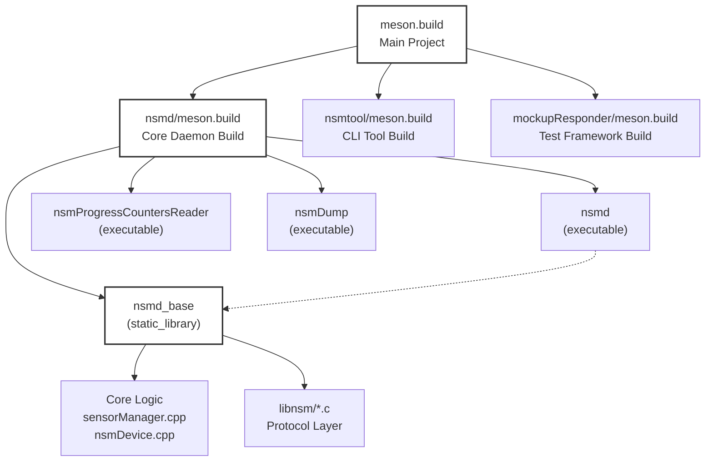

Sources: [meson.build:1-7]() [nsmd/meson.build:1-21]() [nsmd/meson.build:153-160]() [nsmd/meson.build:174-181]()

### Core Dependencies

The build system manages several key dependencies that are essential for NSM operation:

| Dependency | Purpose | Required |
|------------|---------|----------|
| `sdbusplus` | D-Bus C++ bindings | Yes |
| `sdeventplus` | Event loop integration | Yes |
| `phosphor-dbus-interfaces` | OpenBMC D-Bus interfaces | Yes |
| `phosphor-logging` | Structured logging | Yes |
| `nlohmann_json` | JSON parsing and serialization | Yes |
| `CLI11` | Command-line argument parsing | Yes |
| `nvidia-shmem` | NVIDIA shared memory IPC | Conditional |

Sources: [meson.build:12-16]() [meson.build:69-74]() [nsmd/meson.build:196-204]()

## Configuration System

The NSM daemon uses extensive compile-time configuration through `meson_options.txt` to customize behavior. These options are processed in the main `meson.build` and passed to the code via `configuration_data` (generating `config.h`) or project-wide compiler arguments.

### Configuration Flow

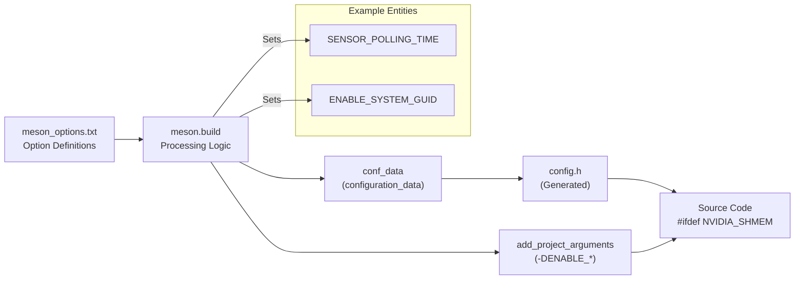

Sources: [meson_options.txt:1-250]() [meson.build:51-67]() [meson.build:76-140]()

### Feature Configuration Categories

#### Core Feature Flags
- `shmem`: Enables `NVIDIA_SHMEM` for shared-memory IPC [meson_options.txt:8-13]().
- `progressCounter`: Enables `NVIDIA_PROGRESS_COUNTER` functionality using `memfd` [meson_options.txt:14-19]().
- `stanbyToDC`: Enables `NVIDIA_STANDBYTODC` for Manager ready features [meson_options.txt:2-7]().
- `system-guid`: Enables the `ENABLE_SYSTEM_GUID` project argument [meson_options.txt:26-31]().

#### Hardware and SPI Configuration
- `grace-spi-operations`: Enables `ENABLE_GRACE_SPI_OPERATIONS` [meson_options.txt:32-37]().
- `grace-spi-operations-raw-debug-dump`: Enables raw SPI message logging for debugging [meson_options.txt:38-43]().
- `num-gpu-per-module`: Configures `NUM_GPU_PER_MODULE` (default 2) [meson_options.txt:121-125]().

## Polling and Timeout Parameters

The daemon's performance and responsiveness are controlled by several integer options defined in milliseconds or microseconds.

### Polling Intervals
| Option | Default | Purpose |
|--------|---------|---------|
| `sensor-polling-time` | 150ms | Standard sensor polling interval [meson_options.txt:45-51](). |
| `sensor-polling-time-gpm` | 1000ms | Polling interval for GPM sensors [meson_options.txt:85-91](). |
| `sensor-polling-time-long-running` | 10000ms | Polling for NSM Long-running requests [meson_options.txt:133-139](). |
| `rr-refresh-limit` | 30000ms | Refresh limit for round-robin sensors [meson_options.txt:157-163](). |

### Communication Timing
- `response-time-out`: Standard NSM response timeout (2000ms) [meson_options.txt:187-193]().
- `response-time-out-long-running`: Timeout for long-running event responses (3000ms) [meson_options.txt:195-201]().
- `number-of-request-retries`: Number of retries before failure (default 2) [meson_options.txt:179-185]().
- `retry-backoff`: Constant-delay backoff array `[maxRetries, delayMs]` [meson_options.txt:245-249]().

Sources: [meson_options.txt:45-201]() [meson.build:76-130]()

## Modular Plugin Architecture

The NSM daemon uses a modular directory structure. While core components are always included, many hardware-specific subsystems are conditionally compiled based on `nsmd-subdirs-include` or the `cx8-features` meta-option.

### Conditional Subdirectory Processing
The `nsmd/meson.build` file iterates through a list of `valid_nsmd_subdirs`. A subdirectory is included if `nsmd-subdirs-all` is true or if it is explicitly named in `nsmd-subdirs-include`.

| Subdirectory | Dependency/Feature Requirement |
|--------------|-------------------------------|
| `nsmDebugToken` | `enable-debug-token` must be enabled [nsmd/meson.build:127](). |
| `nsmDot` | `enable-dot` must be enabled [nsmd/meson.build:128](). |
| `nsmDumpCollection`| `enable-debug-info` must be enabled [nsmd/meson.build:129](). |

Sources: [nsmd/meson.build:75-145]()

## Testing Infrastructure

The build system integrates GTest and GMock for unit testing. Tests are enabled via the `tests` feature flag.

### Test Targets and Execution
When `tests` is enabled, the build system:
1. Declares `tests_deps` including `gtest`, `gmock`, and the `nsmd_base` static library [nsmd/meson.build:221-226]().
2. Recursively enters `test/` subdirectories for both core logic and modular plugins [nsmd/meson.build:228-244]().

### Running Tests
Tests can be executed via standard Meson/Ninja commands:
- **Run all tests**: `meson test -C builddir` [README.md:55]().
- **Run specific test**: `meson test -C builddir nsmChassis_test` [README.md:57]().
- **Valgrind integration**: `meson test -C builddir --wrapper "valgrind --leak-check=full"` [README.md:59]().
- **Coverage Reports**: Build with `-Db_coverage=true` and run `ninja -C builddir coverage` [README.md:66-69]().

Sources: [meson.build:19-49]() [nsmd/meson.build:207-245]() [README.md:51-70]()

---

# Page: Core nsmd Daemon

# Core nsmd Daemon

<details>
<summary>Relevant source files</summary>

The following files were used as context for generating this wiki page:

- [common/types.hpp](common/types.hpp)
- [nsmd/eventManager.hpp](nsmd/eventManager.hpp)
- [nsmd/nsmDevice.cpp](nsmd/nsmDevice.cpp)
- [nsmd/nsmDevice.hpp](nsmd/nsmDevice.hpp)
- [nsmd/nsmEventConfig/nsmEventSetting.cpp](nsmd/nsmEventConfig/nsmEventSetting.cpp)
- [nsmd/nsmEventConfig/test/nsmEventSetting_test.cpp](nsmd/nsmEventConfig/test/nsmEventSetting_test.cpp)
- [nsmd/nsmObject.hpp](nsmd/nsmObject.hpp)
- [nsmd/nsmObjectFactory.cpp](nsmd/nsmObjectFactory.cpp)
- [nsmd/nsmObjectFactory.hpp](nsmd/nsmObjectFactory.hpp)
- [nsmd/nsmd.cpp](nsmd/nsmd.cpp)
- [nsmd/sensorManager.cpp](nsmd/sensorManager.cpp)
- [nsmd/sensorManager.hpp](nsmd/sensorManager.hpp)
- [nsmd/test/mockSensorManager.hpp](nsmd/test/mockSensorManager.hpp)
- [nsmd/test/nsmDevice_test.cpp](nsmd/test/nsmDevice_test.cpp)
- [requester/mctp_endpoint_discovery.cpp](requester/mctp_endpoint_discovery.cpp)
- [requester/mctp_endpoint_discovery.hpp](requester/mctp_endpoint_discovery.hpp)

</details>


The Core nsmd Daemon is the central component of the NVIDIA System Management (NSM) framework, responsible for orchestrating device discovery, sensor management, and hardware monitoring across NVIDIA components. This document covers the primary daemon components including the `SensorManager`, `DeviceManager`, and `NsmDevice` abstractions, as well as their initialization and coordination mechanisms.

For detailed technical explanations, see the child pages:
- [SensorManager and Device Lifecycle](#2.1)
- [DeviceManager and Discovery](#2.2)
- [Asynchronous Operation Management](#2.3)

## Architecture Overview

The `nsmd` daemon follows a layered architecture with singleton managers coordinating device discovery, sensor polling, and data exposure through D-Bus interfaces.

### Core Components Initialization Flow

The `main` function initializes the core communication stack before setting up the management singletons.

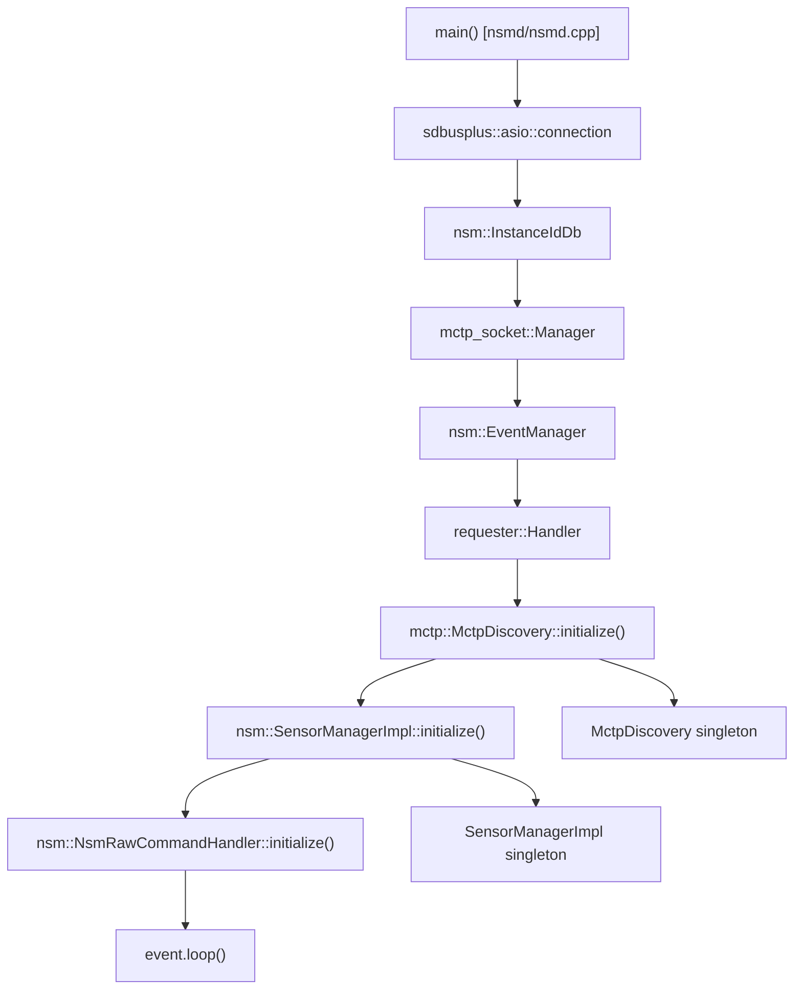
**Sources:** [nsmd/nsmd.cpp:91-175]()

### Component Relationships

The daemon architecture bridges the Natural Language Space (Device Management) to the Code Entity Space through specialized managers.

| Component | Code Entity | Role |
| :--- | :--- | :--- |
| **Discovery Manager** | `mctp::MctpDiscovery` | Handles MCTP endpoint enumeration and UUID-to-EID mapping. [requester/mctp_endpoint_discovery.hpp:56-66]() |
| **Sensor Orchestrator** | `nsm::SensorManagerImpl` | Manages polling loops, inventory scanning, and system readiness. [nsmd/sensorManager.hpp:95-135]() |
| **Device Model** | `nsm::NsmDevice` | Represents a physical hardware entity (GPU, Switch) and its capabilities. [nsmd/nsmDevice.hpp:124-132]() |
| **Message Handler** | `nsm::NsmMessageHandler` | Encapsulates the NSM requester/responder logic. [nsmd/nsmd.cpp:138-139]() |

**Sources:** [nsmd/nsmd.cpp:138-147](), [nsmd/sensorManager.hpp:51-84](), [nsmd/nsmDevice.hpp:124-156]()

## SensorManager - Central Orchestration

The `SensorManagerImpl` serves as the central coordinator for device lifecycle management, sensor polling, and system readiness determination. For details, see [SensorManager and Device Lifecycle](#2.1).

### Polling Architecture

The `SensorManager` implements a sophisticated polling system with multiple priority levels defined in the `PollingType` enum.

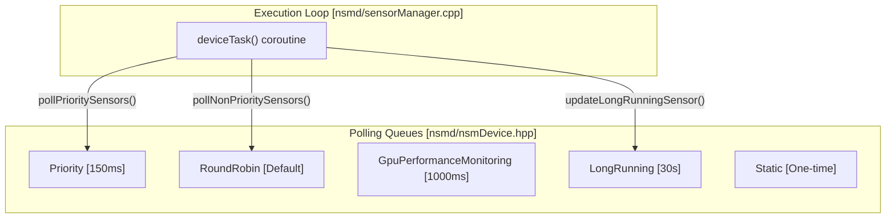
**Sources:** [nsmd/nsmDevice.hpp:75-84](), [nsmd/sensorManager.cpp:143-159](), [nsmd/nsmObject.hpp:27-37]()

## DeviceManager and Discovery

The `MctpDiscovery` (often referred to as the DeviceManager) handles NSM device discovery, capability queries, and maintains device command matrices. For details, see [DeviceManager and Discovery](#2.2).

### Command Matrix Management

Each `NsmDevice` maintains a `messageTypesToCommandCodeMatrix` to track which NSM commands the physical hardware supports. This matrix is populated during the discovery phase using `updateMessageTypesToCommandCodeMatrix`.

**Sources:** [nsmd/nsmDevice.hpp:151-152](), [nsmd/nsmDevice.cpp:150-177]()

## NsmDevice Abstraction

The `NsmDevice` class represents individual NSM devices and manages their sensor collections, polling state, and lifecycle events.

### Device Identification and Remapping

Devices are identified by `deviceType`, `instanceNumber`, and `deviceRole`. They support remapping via `DeviceRemapProperty` to associate D-Bus inventory objects with specific hardware based on `MCTP_UUID`, `MCTP_EID`, or `NSM_DEVICE_INSTANCE_NUMBER`.

**Sources:** [nsmd/nsmDevice.hpp:116-122](), [nsmd/nsmDevice.hpp:145-156]()

## Asynchronous Operation Management

The daemon utilizes a coroutine-based framework to handle non-blocking NSM operations, particularly for long-running commands that generate events rather than immediate responses. For details, see [Asynchronous Operation Management](#2.3).

### Long-Running Events

The `NsmDevice` class includes a `registerLongRunningEventHandler` to process asynchronous completion events for commands like firmware updates or complex diagnostics.

**Sources:** [nsmd/nsmDevice.cpp:158-158](), [nsmd/nsmDevice.hpp:68-73]()

---

### Child Pages
- **[SensorManager and Device Lifecycle](#2.1)**: Detailed explanation of the `SensorManager`'s role in device discovery, sensor polling, readiness management, and the `NsmDevice` abstraction.
- **[DeviceManager and Discovery](#2.2)**: How the `DeviceManager` handles MCTP endpoint discovery, device enumeration, capability queries, and FRU data exposure.
- **[Asynchronous Operation Management](#2.3)**: `AsyncOperationManager` system for handling non-blocking D-Bus operations and long-running commands.

---

# Page: SensorManager and Device Lifecycle

# SensorManager and Device Lifecycle

<details>
<summary>Relevant source files</summary>

The following files were used as context for generating this wiki page:

- [common/coroutineSemaphore.hpp](common/coroutineSemaphore.hpp)
- [nsmd/nsmCommon/nsmCommon.cpp](nsmd/nsmCommon/nsmCommon.cpp)
- [nsmd/nsmCommon/nsmCommon.hpp](nsmd/nsmCommon/nsmCommon.hpp)
- [nsmd/nsmCommon/test/nsmCommon_test.cpp](nsmd/nsmCommon/test/nsmCommon_test.cpp)
- [nsmd/nsmDevice.cpp](nsmd/nsmDevice.cpp)
- [nsmd/nsmDevice.hpp](nsmd/nsmDevice.hpp)
- [nsmd/nsmLongRunning/nsmAsyncLongRunningSensor.hpp](nsmd/nsmLongRunning/nsmAsyncLongRunningSensor.hpp)
- [nsmd/nsmLongRunning/nsmLongRunningSensor.hpp](nsmd/nsmLongRunning/nsmLongRunningSensor.hpp)
- [nsmd/nsmNumericSensor/nsmNumericAggregator.cpp](nsmd/nsmNumericSensor/nsmNumericAggregator.cpp)
- [nsmd/nsmNumericSensor/nsmNumericAggregator.hpp](nsmd/nsmNumericSensor/nsmNumericAggregator.hpp)
- [nsmd/nsmObject.hpp](nsmd/nsmObject.hpp)
- [nsmd/nsmProgressCounters/progressCounterType.hpp](nsmd/nsmProgressCounters/progressCounterType.hpp)
- [nsmd/nsmProgressCounters/progressCounters.cpp](nsmd/nsmProgressCounters/progressCounters.cpp)
- [nsmd/nsmProgressCounters/test/progressCounters_test.cpp](nsmd/nsmProgressCounters/test/progressCounters_test.cpp)
- [nsmd/nsmSensor.cpp](nsmd/nsmSensor.cpp)
- [nsmd/nsmSensor.hpp](nsmd/nsmSensor.hpp)
- [nsmd/sensorManager.cpp](nsmd/sensorManager.cpp)
- [nsmd/sensorManager.hpp](nsmd/sensorManager.hpp)
- [nsmd/test/mockSensorManager.hpp](nsmd/test/mockSensorManager.hpp)
- [requester/mctp_endpoint_discovery.cpp](requester/mctp_endpoint_discovery.cpp)
- [requester/mctp_endpoint_discovery.hpp](requester/mctp_endpoint_discovery.hpp)

</details>


## Purpose and Scope

This document covers the `SensorManager` and `NsmDevice` systems responsible for device discovery, sensor orchestration, and lifecycle management within the `nsmd` daemon. The `SensorManager` serves as the central coordinator for NSM hardware device monitoring, while `NsmDevice` abstracts individual hardware components and their associated sensors.

For NSM protocol communication details, see [NSM Message Protocol](#4.1). For device-specific management of processors, network ports, and chassis, see [Hardware Subsystems](#3).

## Core Architecture

The sensor management system consists of three primary abstractions working together to manage NSM device monitoring:

### Sensor Management Class Relationships
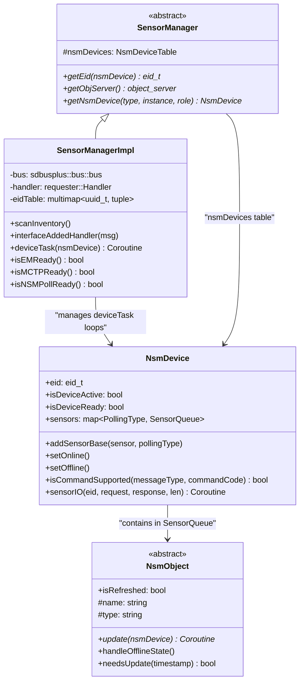

**Sources:** [nsmd/sensorManager.hpp:51-84](), [nsmd/sensorManager.hpp:95-185](), [nsmd/nsmDevice.hpp:124-377](), [nsmd/nsmObject.hpp:43-103]()

## Device Discovery and Creation

The `SensorManager` discovers NSM devices through D-Bus inventory scanning and creates `NsmDevice` instances based on Entity Manager configuration.

### Discovery Data Flow
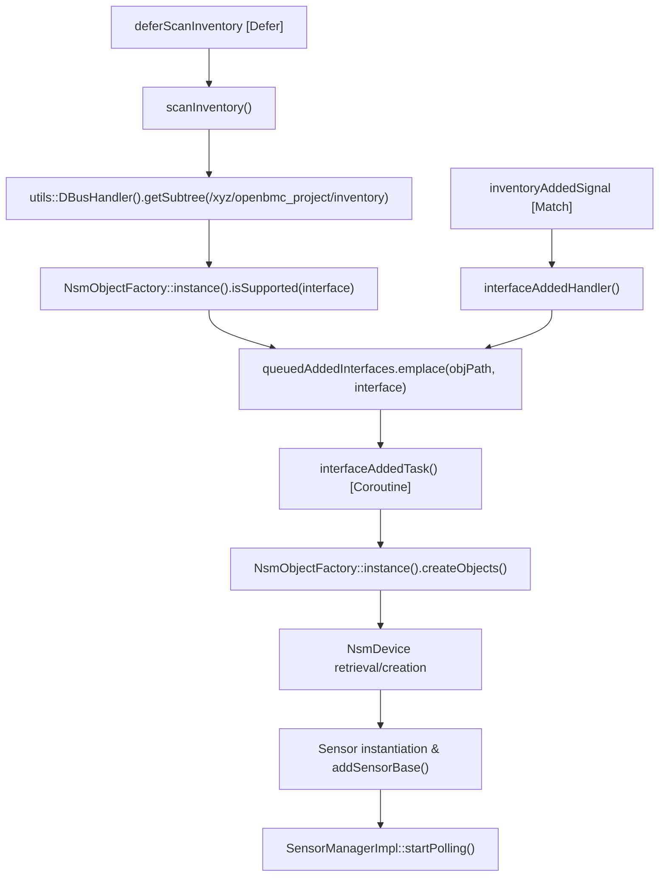

**Sources:** [nsmd/sensorManager.cpp:93-126](), [nsmd/sensorManager.cpp:133-170](), [nsmd/sensorManager.cpp:186-205](), [nsmd/sensorManager.cpp:207-261]()

### Device Identification and UUID Handling

`NsmDevice` instances are identified through two mechanisms:

| Identification Method | Format / Type | Usage |
|----------------------|---------------|-------|
| **UUID-based** | `uuid_t` | Runtime discovered devices mapped via `eidTable` [nsmd/sensorManager.hpp:184-185]() |
| **Static UUID** | `"STATIC:deviceType:instanceNumber"` | Static inventory configuration parsed via `utils::parseStaticUuid` [nsmd/test/mockSensorManager.hpp:110-116]() |
| **Identification Tuple** | `(deviceType, instanceNumber, deviceRole)` | Unique key for device lookup in `nsmDevices` table [nsmd/nsmDevice.hpp:145-150]() |

**Sources:** [nsmd/sensorManager.cpp:984-1019](), [nsmd/nsmDevice.cpp:40-54](), [nsmd/test/mockSensorManager.hpp:103-120]()

## Device Lifecycle Management

`NsmDevice` manages device availability and operational readiness through state flags and coroutine orchestration.

### Lifecycle Transitions
- **Activation (`setOnline`)**: Sets `isDeviceActive = true`. Marks all sensors for refresh. Triggers `onDeviceOnline()` hooks for all registered `NsmObject` instances. [nsmd/nsmDevice.cpp:164-186]()
- **Deactivation (`setOffline`)**: Sets `isDeviceActive = false`. Calls `handleOfflineState()` on all sensors (e.g., setting D-Bus properties to NaN). [nsmd/nsmDevice.cpp:188-220]()
- **Readiness**: A device is "Ready" when all its non-static sensors have been refreshed at least once. This is tracked via `ProgressCounters`. [nsmd/nsmDevice.cpp:468-493]()

**Sources:** [nsmd/nsmDevice.cpp:164-220](), [nsmd/nsmDevice.cpp:468-493](), [nsmd/nsmObject.hpp:91-93]()

## Sensor Polling Architecture

The polling system categorizes sensors into distinct types with different update frequencies and priorities.

### Polling Categories (`PollingType`)
| Type | Interval (Refresh Limit) | Description |
|------|-------------------------|-------------|
| **Priority** | 150ms (`PRIORITY_REFRESH_LIMIT_IN_USEC`) | High-frequency telemetry (e.g., critical power/temp). [nsmd/nsmObject.hpp:27-28]() |
| **DumpCollection** | 150ms | Collection of CPER/Dump records using leftover budget. [nsmd/nsmDevice.hpp:78-79]() |
| **GpuPerformanceMonitoring** | 1000ms (`GPM_REFRESH_LIMIT_IN_USEC`) | Specialized GPU metrics (GPM). [nsmd/nsmObject.hpp:33-34]() |
| **RoundRobin** | 1000ms-30s (`RR_REFRESH_LIMIT_IN_USEC`) | Standard telemetry cycled through a circular queue. [nsmd/nsmObject.hpp:30-31]() |
| **LongRunning** | 30s (`LONG_RUNNING_REFRESH_LIMIT_IN_USEC`) | Commands that take significant time or use events. [nsmd/nsmObject.hpp:36-37]() |
| **Static** | N/A | Polled once at discovery. [nsmd/nsmDevice.hpp:82]() |

**Sources:** [nsmd/nsmDevice.hpp:75-84](), [nsmd/nsmObject.hpp:24-38](), [nsmd/nsmDevice.cpp:185-203]()

### Polling Implementation (`deviceTask`)

Each device runs its own `deviceTask` coroutine loop. It prioritizes high-frequency sensors before processing lower-priority queues.

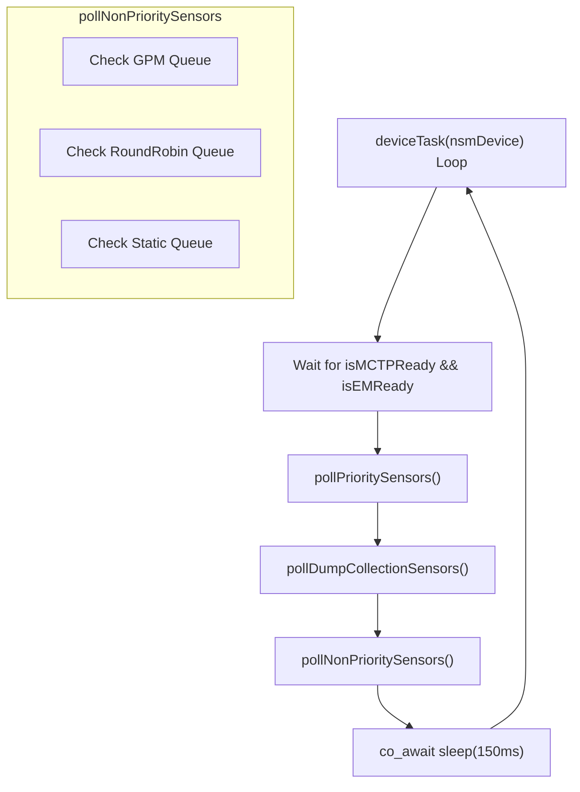

**Sources:** [nsmd/sensorManager.cpp:666-915](), [nsmd/sensorManager.cpp:550-627](), [nsmd/sensorManager.hpp:143-155]()

## System Readiness Management

The `SensorManager` ensures all dependencies (MCTP, Entity Manager) are satisfied before starting telemetry.

### Readiness Dependencies

| Component | Check Function | Source / Interface |
|-----------|---------------|--------------------|
| **MCTP** | `isMCTPReady()` | `xyz.openbmc_project.State.FeatureReady` on `/xyz/openbmc_project/state/configurableStateManager/MCTP` [nsmd/sensorManager.cpp:116-124]() |
| **Entity Manager** | `isEMReady()` | `xyz.openbmc_project.Inventory.Item.Chassis` readiness configuration. [nsmd/sensorManager.cpp:305-362]() |
| **Device Readiness** | `checkAllDevicesReady()` | Aggregated status of all `NsmDevice` readiness flags. [nsmd/sensorManager.cpp:468-493]() |

**Sources:** [nsmd/sensorManager.cpp:116-124](), [nsmd/sensorManager.cpp:305-362](), [nsmd/sensorManager.cpp:468-493](), [nsmd/sensorManager.hpp:131-135]()

### Readiness Logic
The daemon waits for `isNSMPollReady()` to return true before invoking `startPolling()`. This check combines MCTP availability and the presence of valid configuration from Entity Manager. If a power transition (Standby to DC) is detected via GPIO, the `SensorManager` may re-trigger readiness checks and sensor refreshes to ensure data consistency. [nsmd/sensorManager.cpp:263-303](), [nsmd/sensorManager.cpp:450-463]()

**Sources:** [nsmd/sensorManager.cpp:263-303](), [nsmd/sensorManager.cpp:450-463](), [nsmd/sensorManager.cpp:75-78]()

---

# Page: DeviceManager and Discovery

# DeviceManager and Discovery

<details>
<summary>Relevant source files</summary>

The following files were used as context for generating this wiki page:

- [libnsm/device-capability-discovery.c](libnsm/device-capability-discovery.c)
- [libnsm/device-capability-discovery.h](libnsm/device-capability-discovery.h)
- [libnsm/test/libnsm_device_capability_discovery_test.cpp](libnsm/test/libnsm_device_capability_discovery_test.cpp)
- [nsmd/eventManager.hpp](nsmd/eventManager.hpp)
- [nsmd/nsmDevice.cpp](nsmd/nsmDevice.cpp)
- [nsmd/nsmDevice.hpp](nsmd/nsmDevice.hpp)
- [nsmd/nsmEvent/nsmGPIOStateChangeEvent.cpp](nsmd/nsmEvent/nsmGPIOStateChangeEvent.cpp)
- [nsmd/nsmEventConfig/nsmEventSetting.hpp](nsmd/nsmEventConfig/nsmEventSetting.hpp)
- [nsmd/nsmObject.hpp](nsmd/nsmObject.hpp)
- [nsmd/nsmObjectFactory.cpp](nsmd/nsmObjectFactory.cpp)
- [nsmd/nsmObjectFactory.hpp](nsmd/nsmObjectFactory.hpp)
- [nsmd/nsmReady/nsmRemapInstanceNumber.cpp](nsmd/nsmReady/nsmRemapInstanceNumber.cpp)
- [nsmd/sensorManager.cpp](nsmd/sensorManager.cpp)
- [nsmd/sensorManager.hpp](nsmd/sensorManager.hpp)
- [nsmd/test/mockSensorManager.hpp](nsmd/test/mockSensorManager.hpp)
- [requester/mctp_endpoint_discovery.cpp](requester/mctp_endpoint_discovery.cpp)
- [requester/mctp_endpoint_discovery.hpp](requester/mctp_endpoint_discovery.hpp)
- [requester/mctp_endpoint_prober.cpp](requester/mctp_endpoint_prober.cpp)
- [requester/mctp_endpoint_prober.hpp](requester/mctp_endpoint_prober.hpp)
- [requester/retry_backoff_utils.hpp](requester/retry_backoff_utils.hpp)

</details>


This document covers how `nsmd` handles MCTP endpoint discovery, device enumeration, capability queries, and FRU data exposure. These processes are primarily managed by `MctpDiscovery` and the `NsmDevice` class, which coordinate to transform raw MCTP endpoints into managed NSM devices.

For information about sensor management and device lifecycle coordination, see [SensorManager and Device Lifecycle (2.1)](). For MCTP transport layer details, see [MCTP Transport and Discovery (5.2)]().

## System Architecture and Role

The discovery infrastructure serves as the bridge between the MCTP transport layer and the creation of fully-configured `NsmDevice` objects. It implements D-Bus watchers for MCTP endpoints and transforms them into managed NSM entities with known capabilities.

### Natural Language to Code Entity Mapping: Discovery Core

| System Concept | Code Entity | Role |
| :--- | :--- | :--- |
| **Endpoint Discovery** | `mctp::MctpDiscovery` | Monitors D-Bus for MCTP endpoints and manages the EID-to-UUID mapping. |
| **Device Probing** | `requester::MctpEndpointProber` | Handles the "ping" and capability query sequence with retry logic. |
| **Device Abstraction** | `nsm::NsmDevice` | Represents a physical device, holding its capability matrix and sensor list. |
| **Object Creation** | `nsm::NsmObjectFactory` | Uses a registration pattern to create D-Bus objects based on EM configurations. |
| **Inventory Mapping** | `nsm::SensorManager` | Tracks mappings between hardware modules and discovered devices. |

**Sources:** [requester/mctp_endpoint_discovery.hpp:56-112](), [nsmd/nsmDevice.hpp:124-156](), [nsmd/nsmObjectFactory.hpp:48-76]()

## Discovery Workflow

The discovery process is triggered when MCTP endpoints come online or when Entity Manager (EM) provides new configurations.

### Discovery Process Flow

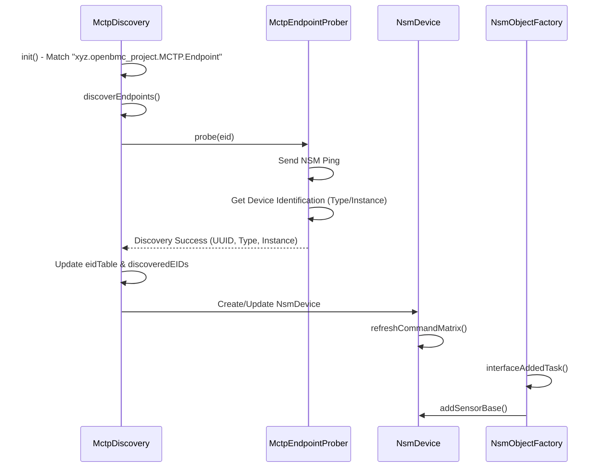

**Sources:** [requester/mctp_endpoint_discovery.cpp:92-164](), [requester/mctp_endpoint_discovery.cpp:166-213](), [nsmd/sensorManager.cpp:133-184]()

### Endpoint Probing and EID Mapping
The `MctpDiscovery` class maintains the `eidTable`, a multimap linking UUIDs to their current EID, Medium, and Binding [requester/mctp_endpoint_discovery.hpp:51-52](). When a new endpoint is detected via `discoverEndpoints` [requester/mctp_endpoint_discovery.cpp:130](), the `MctpEndpointProber` executes a sequence of NSM commands to verify the device is responsive and to retrieve its identity.

## Device Capability Discovery

Once a device is identified, `nsmd` queries its protocol capabilities to build a `messageTypesToCommandCodeMatrix`. This matrix determines which sensors and controls can be instantiated for that specific device.

### Capability Matrix Construction

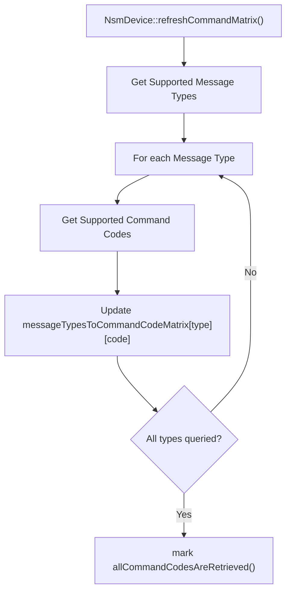

**Sources:** [nsmd/nsmDevice.cpp:127-139](), [nsmd/nsmDevice.cpp:150-177](), [nsmd/sensorManager.hpp:143-144]()

Key data structures in `NsmDevice`:
- `messageTypesToCommandCodeMatrix`: A 2D vector of booleans `[NUM_NSM_TYPES][NUM_COMMAND_CODES]` [nsmd/nsmDevice.hpp:151-152]().
- `isCommandSupported(type, code)`: A helper to check the matrix before sending requests [nsmd/nsmDevice.cpp:141-148]().

## Device Remapping and Instance Numbers

NSM supports remapping device instance numbers based on physical topology (EID, UUID, or Association). This is critical for Grace-Hopper systems where multiple GPUs or Switches must have stable, predictable instance numbers on D-Bus.

### Remapping Logic

The `saveNsmMapInstanceTable` function handles EM configurations that define how instance IDs should be assigned [nsmd/nsmReady/nsmRemapInstanceNumber.cpp:29-33]().

| Mapping Type | Code Entity | Source of Truth |
| :--- | :--- | :--- |
| **UUID Mapping** | `mapUuidToInstanceNumber` | `xyz.openbmc_project.Configuration.NSM_GetInstanceIDByMctpUUID` |
| **EID Mapping** | `mapEidToInstanceNumber` | `xyz.openbmc_project.Configuration.NSM_GetInstanceIDByDeviceEID` |
| **Direct Mapping** | `mapInstanceNumberToInstanceNumber` | `xyz.openbmc_project.Configuration.NSM_GetInstanceIDByDeviceInstanceID` |

**Sources:** [nsmd/nsmReady/nsmRemapInstanceNumber.cpp:113-157](), [requester/mctp_endpoint_discovery.hpp:47-50]()

## NsmObjectFactory Registration Pattern

The `NsmObjectFactory` uses a factory pattern to create NSM objects (sensors, inventory items, controls) based on D-Bus interfaces added by Entity Manager.

### Registration Macro
Classes register their creation logic using the `REGISTER_NSM_CREATION_FUNCTION` macro [nsmd/nsmObjectFactory.hpp:40-46](). This adds the interface name and a corresponding `CreationFunction` to the factory's internal map [nsmd/nsmObjectFactory.hpp:66]().

### Object Creation Flow
1. `SensorManagerImpl::scanInventory()` finds all objects under `/xyz/openbmc_project/inventory` [nsmd/sensorManager.cpp:133-150]().
2. For each interface, it checks `NsmObjectFactory::isSupported()` [nsmd/sensorManager.cpp:163]().
3. `interfaceAddedTask()` invokes the registered `CreationFunction` [nsmd/sensorManager.cpp:207]().
4. The creation function typically finds the relevant `NsmDevice` and calls `addSensorBase()` [nsmd/nsmDevice.cpp:179-205]().

## FRU Data Exposure

`NsmDevice` manages FRU (Field Replaceable Unit) data through the `FruInterfaceManager` struct [nsmd/nsmDevice.hpp:93-114]().

### FRU Implementation Details
- **Interface Creation**: `createAndRegisterInterface` creates a D-Bus interface (e.g., `xyz.openbmc_project.Inventory.Decorator.Asset`) for the device [nsmd/nsmDevice.hpp:104-107]().
- **Property Management**: Properties like `SerialNumber`, `PartNumber`, and `Manufacturer` are registered and updated dynamically based on NSM inventory commands [nsmd/nsmDevice.hpp:108-113]().
- **Persistence**: The `FruInterfaceManager` tracks if an interface has been initialized to avoid redundant D-Bus traffic [nsmd/nsmDevice.hpp:97]().

**Sources:** [nsmd/nsmDevice.hpp:93-114](), [nsmd/nsmDevice.cpp:709-720]()

---

# Page: Asynchronous Operation Management

# Asynchronous Operation Management

<details>
<summary>Relevant source files</summary>

The following files were used as context for generating this wiki page:

- [common/coroutine.hpp](common/coroutine.hpp)
- [common/coroutineSemaphore.hpp](common/coroutineSemaphore.hpp)
- [common/test/mockSocketIo.hpp](common/test/mockSocketIo.hpp)
- [nsmd/nsmChassis/nsmGpuClockControl.cpp](nsmd/nsmChassis/nsmGpuClockControl.cpp)
- [nsmd/nsmChassis/nsmGpuClockControl.hpp](nsmd/nsmChassis/nsmGpuClockControl.hpp)
- [nsmd/nsmCommon/nsmCommon.cpp](nsmd/nsmCommon/nsmCommon.cpp)
- [nsmd/nsmCommon/nsmCommon.hpp](nsmd/nsmCommon/nsmCommon.hpp)
- [nsmd/nsmCommon/test/nsmCommon_test.cpp](nsmd/nsmCommon/test/nsmCommon_test.cpp)
- [nsmd/nsmEvent/nsmLongRunningEvent.cpp](nsmd/nsmEvent/nsmLongRunningEvent.cpp)
- [nsmd/nsmEvent/nsmLongRunningEvent.hpp](nsmd/nsmEvent/nsmLongRunningEvent.hpp)
- [nsmd/nsmEvent/nsmLongRunningEventHandler.cpp](nsmd/nsmEvent/nsmLongRunningEventHandler.cpp)
- [nsmd/nsmLongRunning/nsmAsyncLongRunningSensor.cpp](nsmd/nsmLongRunning/nsmAsyncLongRunningSensor.cpp)
- [nsmd/nsmLongRunning/nsmAsyncLongRunningSensor.hpp](nsmd/nsmLongRunning/nsmAsyncLongRunningSensor.hpp)
- [nsmd/nsmLongRunning/nsmLongRunningSensor.cpp](nsmd/nsmLongRunning/nsmLongRunningSensor.cpp)
- [nsmd/nsmLongRunning/nsmLongRunningSensor.hpp](nsmd/nsmLongRunning/nsmLongRunningSensor.hpp)
- [nsmd/nsmRawCommand/meson.build](nsmd/nsmRawCommand/meson.build)
- [nsmd/nsmRawCommand/nsmRawCommandHandler.cpp](nsmd/nsmRawCommand/nsmRawCommandHandler.cpp)
- [nsmd/nsmRawCommand/nsmRawCommandHandler.hpp](nsmd/nsmRawCommand/nsmRawCommandHandler.hpp)
- [nsmd/nsmRawCommand/test/nsmRawCommandHandler_test.cpp](nsmd/nsmRawCommand/test/nsmRawCommandHandler_test.cpp)
- [nsmd/nsmSetAsync/asyncOperationManager.cpp](nsmd/nsmSetAsync/asyncOperationManager.cpp)
- [nsmd/nsmSetAsync/asyncOperationManager.hpp](nsmd/nsmSetAsync/asyncOperationManager.hpp)
- [nsmd/nsmSetAsync/nsmSetCpuOperatingConfig.cpp](nsmd/nsmSetAsync/nsmSetCpuOperatingConfig.cpp)
- [nsmd/nsmSetAsync/test/asyncOperationManager_test.cpp](nsmd/nsmSetAsync/test/asyncOperationManager_test.cpp)
- [nsmd/socketIo.cpp](nsmd/socketIo.cpp)
- [nsmd/socketIo.hpp](nsmd/socketIo.hpp)
- [nsmd/socket_handler.cpp](nsmd/socket_handler.cpp)
- [nsmd/socket_handler.hpp](nsmd/socket_handler.hpp)
- [nsmd/test/requesterDeepBranch_test.cpp](nsmd/test/requesterDeepBranch_test.cpp)
- [nsmd/test/requesterHandlerBranch_test.cpp](nsmd/test/requesterHandlerBranch_test.cpp)
- [nsmd/test/socket_handler_test.cpp](nsmd/test/socket_handler_test.cpp)
- [requester/handler.hpp](requester/handler.hpp)
- [requester/request.hpp](requester/request.hpp)

</details>


The Asynchronous Operation Management system provides infrastructure for handling long-running, non-blocking D-Bus operations and complex NSM protocol interactions within the `nsmd` daemon. This system manages operation status tracking, result delivery, resource cleanup, and specialized handling for "Long Running" NSM commands that utilize asynchronous events for completion.

For information about the core nsmd daemon structure, see [Core nsmd Daemon](). For details about the NSM protocol layer, see [NSM Protocol Layer]().

## System Purpose and Architecture

The `AsyncOperationManager` enables `nsmd` to handle time-intensive operations like hardware configuration changes, debug token operations, and diagnostic commands without blocking D-Bus clients. It utilizes C++20 coroutines to maintain a responsive event loop while waiting for hardware responses or MCTP timeouts.

### Core Component Architecture

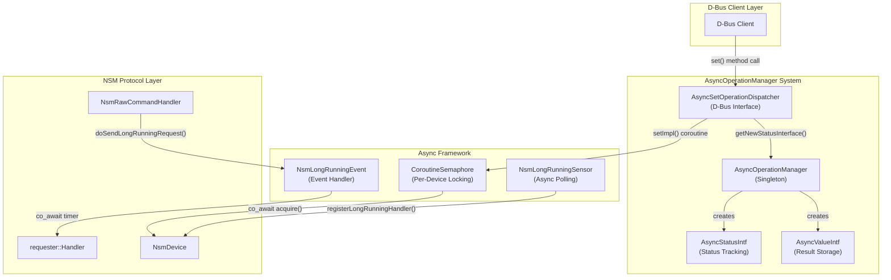

Sources: [nsmd/nsmSetAsync/asyncOperationManager.hpp:24-131](), [nsmd/nsmSetAsync/asyncOperationManager.cpp:25-227](), [nsmd/nsmLongRunning/nsmLongRunningSensor.cpp:38-69](), [nsmd/nsmRawCommand/nsmRawCommandHandler.cpp:74-103]()

## Core Components

### AsyncOperationManager

The `AsyncOperationManager` is a singleton class that orchestrates the creation and lifecycle management of asynchronous D-Bus operations [nsmd/nsmSetAsync/asyncOperationManager.cpp:25-30]().

| Component | Purpose | Key Methods |
|-----------|---------|-------------|
| `getInstance()` | Singleton access | Returns global instance [nsmd/nsmSetAsync/asyncOperationManager.cpp:25-30]() |
| `getNewStatusInterface()` | Status-only operations | Creates `AsyncStatusIntf` [nsmd/nsmSetAsync/asyncOperationManager.cpp:82-101]() |
| `getNewStatusValueInterface()` | Operations with results | Creates status and value interfaces [nsmd/nsmSetAsync/asyncOperationManager.cpp:113-136]() |
| `getDispatcher()` | D-Bus method handling | Returns dispatcher for object path [nsmd/nsmSetAsync/asyncOperationManager.cpp:37-44]() |

The manager maintains internal maps for `statusInterfaces`, `valueInterfaces`, and `objectPathTimers` to manage the 2-minute cleanup lifecycle of operation result objects [nsmd/nsmSetAsync/asyncOperationManager.cpp:62-73]().

### AsyncSetOperationDispatcher

The dispatcher implements the D-Bus `com.nvidia.Async.Set` interface [nsmd/nsmSetAsync/asyncOperationManager.hpp:115-116](). It maps D-Bus property changes to registered coroutine handlers [nsmd/nsmSetAsync/asyncOperationManager.cpp:161-168]().

When a `set` call is received, it invokes `setImpl`, which manages the execution flow:
1. Updates status to `InProgress` [nsmd/nsmSetAsync/asyncOperationManager.cpp:200]().
2. Executes the registered `operation.handler` [nsmd/nsmSetAsync/asyncOperationManager.cpp:204]().
3. Optionally triggers a sensor update if a sensor is associated with the operation [nsmd/nsmSetAsync/asyncOperationManager.cpp:210]().
4. Updates final status to `Success` or error types like `InvalidArgument` [nsmd/nsmSetAsync/asyncOperationManager.cpp:217-224]().

Sources: [nsmd/nsmSetAsync/asyncOperationManager.cpp:138-227]()

## Long-Running Operations (NSM Type 1/2)

Certain NSM commands return an immediate response indicating the command was accepted, followed by an asynchronous NSM Event containing the actual result. The system handles this via `NsmLongRunningEvent` and derived classes.

### NsmLongRunningEvent and Sensor Abstractions

- **NsmLongRunningEvent**: A base class for handling NSM events associated with long-running commands. It contains a `timer` that is used to `co_await` the completion event [nsmd/nsmEvent/nsmLongRunningEvent.hpp:26-34]().
- **NsmLongRunningSensor**: Extends `NsmSensor` to support polling that involves long-running NSM commands [nsmd/nsmLongRunning/nsmLongRunningSensor.hpp:25-30]().
- **NsmAsyncLongRunningSensor**: A version of the long-running sensor that specifically works with `NsmAsyncSensor` and the `AsyncOperationManager` [nsmd/nsmLongRunning/nsmAsyncLongRunningSensor.hpp:26-31]().

### Execution Flow for Long-Running Commands

The `update` method in `NsmLongRunningSensor` demonstrates the coordination between hardware locking and event waiting:

1. **Locking**: Acquires the device semaphore to ensure exclusive access during the request/event cycle [nsmd/nsmLongRunning/nsmLongRunningSensor.cpp:44]().
2. **Registration**: Registers itself as the active long-running handler in the `NsmDevice` for the specific `messageType` and `commandCode` [nsmd/nsmLongRunning/nsmLongRunningSensor.cpp:49-50]().
3. **Request**: Sends the initial NSM request. If the response indicates success, it transitions to waiting for the event [nsmd/nsmLongRunning/nsmLongRunningSensor.cpp:51-52]().
4. **Waiting**: Uses `co_await timer` to suspend the coroutine until the event is received or a timeout occurs [nsmd/nsmLongRunning/nsmLongRunningSensor.cpp:55]().
5. **Cleanup**: Unregisters the handler and releases the semaphore [nsmd/nsmLongRunning/nsmLongRunningSensor.cpp:61-63]().

Sources: [nsmd/nsmLongRunning/nsmLongRunningSensor.cpp:38-69](), [nsmd/nsmLongRunning/nsmAsyncLongRunningSensor.cpp:27-67]()

## Raw Command Interface

The `NsmRawCommandHandler` provides a direct D-Bus interface for sending arbitrary NSM commands, supporting both immediate and long-running modes.

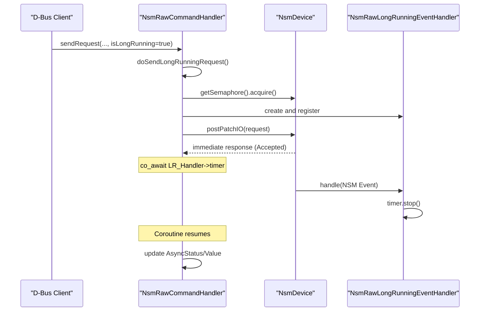

Sources: [nsmd/nsmRawCommand/nsmRawCommandHandler.cpp:74-182](), [nsmd/nsmRawCommand/nsmRawCommandHandler.hpp:31-43]()

## Resource Management and Safety

### CoroutineSemaphore
To prevent command interleaving on a single MCTP endpoint, `NsmDevice` uses a `CoroutineSemaphore`. This ensures that only one high-priority or long-running operation (like a firmware update or raw command) is active at a time [nsmd/nsmLongRunning/nsmLongRunningSensor.cpp:44]().

### Timeout and Cleanup
- **D-Bus Result Cleanup**: `AsyncOperationManager` uses a 2-minute timer to delete result objects from the D-Bus tree [nsmd/nsmSetAsync/asyncOperationManager.cpp:73]().
- **NSM Request Retries**: The `requester::Handler` manages the lifecycle of individual NSM requests, including retries and instance ID expiration [requester/handler.hpp:51-61]().
- **Socket Buffers**: The system dynamically adjusts socket send buffers if a large NSM request (like a raw command) exceeds the default size [requester/handler.hpp:173-178]().

Sources: [nsmd/nsmSetAsync/asyncOperationManager.cpp:61-75](), [requester/handler.hpp:108-163](), [requester/request.hpp:57-78]()

---

# Page: Hardware Subsystems

# Hardware Subsystems

<details>
<summary>Relevant source files</summary>

The following files were used as context for generating this wiki page:

- [libnsm/network-ports.c](libnsm/network-ports.c)
- [libnsm/network-ports.h](libnsm/network-ports.h)
- [libnsm/test/libnsm_network_ports_test.cpp](libnsm/test/libnsm_network_ports_test.cpp)
- [nsmd/nsmChassis/nsmChassis.cpp](nsmd/nsmChassis/nsmChassis.cpp)
- [nsmd/nsmChassis/nsmChassis.hpp](nsmd/nsmChassis/nsmChassis.hpp)
- [nsmd/nsmChassis/test/meson.build](nsmd/nsmChassis/test/meson.build)
- [nsmd/nsmChassis/test/nsmChassis_test.cpp](nsmd/nsmChassis/test/nsmChassis_test.cpp)
- [nsmd/nsmDeviceInventory/nsmPCIeRetimerSwitchDI.cpp](nsmd/nsmDeviceInventory/nsmPCIeRetimerSwitchDI.cpp)
- [nsmd/nsmDeviceInventory/nsmPCIeRetimerSwitchDI.hpp](nsmd/nsmDeviceInventory/nsmPCIeRetimerSwitchDI.hpp)
- [nsmd/nsmFwSwInventory/GPUSWInventory.cpp](nsmd/nsmFwSwInventory/GPUSWInventory.cpp)
- [nsmd/nsmFwSwInventory/GPUSWInventory.hpp](nsmd/nsmFwSwInventory/GPUSWInventory.hpp)
- [nsmd/nsmFwSwInventory/NVLinkManagementNICSWInventory.cpp](nsmd/nsmFwSwInventory/NVLinkManagementNICSWInventory.cpp)
- [nsmd/nsmFwSwInventory/NVLinkManagementNICSWInventory.hpp](nsmd/nsmFwSwInventory/NVLinkManagementNICSWInventory.hpp)
- [nsmd/nsmFwSwInventory/meson.build](nsmd/nsmFwSwInventory/meson.build)
- [nsmd/nsmFwSwInventory/test/NVLinkManagementNICSWInventory_test.cpp](nsmd/nsmFwSwInventory/test/NVLinkManagementNICSWInventory_test.cpp)
- [nsmd/nsmMemory/nsmMemory.cpp](nsmd/nsmMemory/nsmMemory.cpp)
- [nsmd/nsmMemory/nsmMemory.hpp](nsmd/nsmMemory/nsmMemory.hpp)
- [nsmd/nsmMemory/test/nsmMemory_test.cpp](nsmd/nsmMemory/test/nsmMemory_test.cpp)
- [nsmd/nsmPort/nsmPort.cpp](nsmd/nsmPort/nsmPort.cpp)
- [nsmd/nsmPort/nsmPort.hpp](nsmd/nsmPort/nsmPort.hpp)
- [nsmd/nsmPort/test/nsmPort_test.cpp](nsmd/nsmPort/test/nsmPort_test.cpp)
- [nsmd/nsmProcessor/meson.build](nsmd/nsmProcessor/meson.build)
- [nsmd/nsmProcessor/nsmProcessor.cpp](nsmd/nsmProcessor/nsmProcessor.cpp)
- [nsmd/nsmProcessor/nsmProcessor.hpp](nsmd/nsmProcessor/nsmProcessor.hpp)
- [nsmd/nsmProcessor/test/meson.build](nsmd/nsmProcessor/test/meson.build)
- [nsmd/nsmProcessor/test/nsmProcessor_test.cpp](nsmd/nsmProcessor/test/nsmProcessor_test.cpp)

</details>


This document covers the hardware-specific management subsystems within the NSM (NVIDIA System Management) daemon. These subsystems provide monitoring, control, and telemetry capabilities for various hardware components including processors/GPUs, network ports, chassis components, and memory subsystems.

For information about the core nsmd daemon architecture and sensor management, see [Core nsmd Daemon](#2). For details about the NSM protocol layer that these subsystems use to communicate with hardware, see [NSM Protocol Layer](#4).

## Hardware Subsystem Architecture

The NSM daemon organizes hardware management into specialized subsystems, each responsible for a specific category of hardware components. These subsystems inherit from common base classes and integrate with the central `SensorManager` for coordinated polling and data collection.

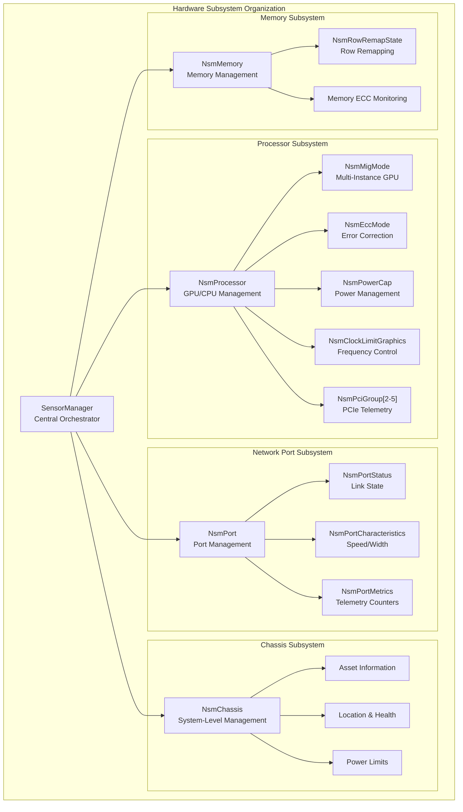

Sources: [nsmd/nsmProcessor/nsmProcessor.hpp:1-250](), [nsmd/nsmPort/nsmPort.hpp:1-150](), [nsmd/nsmChassis/nsmChassis.hpp:1-100](), [nsmd/nsmMemory/nsmMemory.hpp:1-100]()

## Sensor Classification and Polling

Hardware subsystems organize their sensors into different priority classes based on criticality and update frequency requirements. These are managed by the `NsmDevice` class which maintains separate queues for different polling requirements.

| Priority Class | Polling Interval | Purpose | Example Components |
|---|---|---|---|
| `prioritySensors` | 150ms | Critical real-time monitoring | GPU power states, thermal limits |
| `gpmSensors` | 1000ms | Graphics performance monitoring | Clock frequencies, utilization |
| `roundRobinSensors` | Circular queue | Regular telemetry updates | Port counters, ECC statistics |
| `longRunningSensors` | 30s | Operations requiring extended time | `NsmMigMode`, `NsmSetEccMode` |
| `staticSensors` | One-time read | Immutable properties | `NsmInventoryProperty`, `NsmAssetIntf` |

Sources: [nsmd/nsmProcessor/nsmProcessor.cpp:78-165](), [nsmd/nsmChassis/nsmChassis.cpp:84-104]()

## Hardware Communication Flow

This diagram illustrates how a hardware subsystem component (e.g., `NsmPortStatus`) interacts with the protocol and transport layers to retrieve data.

```mermaid
graph LR
    subgraph "Hardware Subsystem Layer"
        HWSubsystem["NsmPortStatus<br/>(nsmPort.cpp)"]
        SensorImpl["update()<br/>Coroutine"]
    end
    
    subgraph "NSM Protocol Layer"
        RequestGen["encode_query_port_status_req()<br/>(network-ports.c)"]
        ResponseHandler["decode_query_port_status_resp()<br/>(network-ports.c)"]
    end
    
    subgraph "Transport Layer"
        MCTPHandler["nsmDevice->sensorIO()<br/>MCTP Transport"]
    end
    
    subgraph "Data Exposure Layer"
        DBusUpdate["portStateIntf->linkStatus()<br/>(D-Bus Property)"]
        SharedMem["updateMetricOnSharedMemory()<br/>(NVIDIA_SHMEM)"]
    end
    
    HWSubsystem --> SensorImpl
    SensorImpl --> RequestGen
    RequestGen --> MCTPHandler
    MCTPHandler --> ResponseHandler
    ResponseHandler --> DBusUpdate
    ResponseHandler --> SharedMem
```

Sources: [nsmd/nsmPort/nsmPort.cpp:142-224](), [libnsm/network-ports.c:134-160](), [nsmd/nsmProcessor/nsmProcessor.cpp:78-99]()

## Hardware Subsystem Categories

### [Processor and GPU Management](#3.1)

The processor subsystem handles GPU and CPU device management, including power control, performance monitoring, and hardware configuration. It uses the `NsmProcessor` abstraction to represent high-level device groups.

- **`NsmMigMode`**: Multi-Instance GPU mode configuration and monitoring [nsmd/nsmProcessor/nsmProcessor.cpp:78-99]().
- **`NsmEccMode`**: Memory Error Correction Code mode management [nsmd/nsmProcessor/nsmProcessor.cpp:137-165]().
- **`NsmPowerCap`**: Dynamic power capping and thermal management [nsmd/nsmProcessor/nsmProcessor.hpp:39-40]().
- **`NsmClockLimitGraphics`**: Graphics clock frequency control and monitoring.
- **`NsmOemResetStatistics`**: Tracking of hardware reset events [nsmd/nsmProcessor/nsmOemResetStatistics.hpp:1-50]().

For details, see [Processor and GPU Management](#3.1).

### [Network Port Management](#3.2)

The port subsystem manages high-speed network interfaces, primarily NVLink ports for GPU-to-GPU communication and Ethernet/Infiniband ports.

- **`NsmPortStatus`**: Link state monitoring (Up/Down/Sleep) and training error detection [nsmd/nsmPort/nsmPort.cpp:120-140]().
- **`NsmPortCharacteristics`**: Port capabilities, speed (MBps), and width configuration [nsmd/nsmPort/nsmPort.cpp:241-260]().
- **`NsmPortMetrics`**: Telemetry counter collection (TX/RX packets, data, errors) [nsmd/nsmPort/nsmPort.cpp:388-410]().
- **`EthPortTelemetryAggregator`**: Aggregated metrics for Ethernet interfaces [nsmd/nsmPort/nsmPort.hpp:159-170]().

For details, see [Network Port Management](#3.2).

### [Chassis and System Management](#3.3)

The chassis subsystem provides system-level management and asset tracking via the `NsmChassis` template class.

- **Asset Information**: Hardware identification including `FRU_PART_NUMBER`, `SERIAL_NUMBER`, and `MARKETING_NAME` [nsmd/nsmChassis/nsmChassis.cpp:43-65]().
- **Location and Health**: Physical location tracking (`LocationIntf`) and health status monitoring (`HealthIntf`) [nsmd/nsmChassis/nsmChassis.cpp:158-182]().
- **Power Limits**: System-level power budget management.
- **Specialized Assemblies**: Support for NVSwitch and management NIC chassis [nsmd/nsmChassis/nsmChassis.cpp:202-220]().

For details, see [Chassis and System Management](#3.3).

### [Memory Management](#3.4)

The memory subsystem monitors and manages system memory components, including capacity and error rates.

- **`NsmRowRemapState`**: Memory row remapping status for hardware fault tolerance [nsmd/nsmMemory/nsmMemory.hpp:1-50]().
- **Memory ECC**: Detailed error correction monitoring and reporting for DRAM and SRAM.
- **Firmware Inventory**: Tracking software versions for GPU and NVLink management NICs [nsmd/nsmFwSwInventory/GPUSWInventory.hpp:1-30]().

For details, see [Memory Management](#3.4).

### [Device Inventory and Control](#3.5)

Additional device-specific management capabilities for complex interconnect components.

- **`NsmPCIeRetimerSwitchDI`**: Device inventory for PCIe retimer switches [nsmd/nsmDeviceInventory/nsmPCIeRetimerSwitchDI.hpp:1-40]().
- **`NsmSwitch`**: Management logic specifically for NVSwitch devices.
- **Isolation Controls**: Logic for managing device isolation and power modes [libnsm/network-ports.h:52-55]().

For details, see [Device Inventory and Control](#3.5).

Sources: [nsmd/nsmProcessor/nsmProcessor.cpp:1-200](), [nsmd/nsmPort/nsmPort.cpp:1-500](), [nsmd/nsmChassis/nsmChassis.cpp:1-300](), [nsmd/nsmMemory/nsmMemory.hpp:1-100](), [nsmd/nsmDeviceInventory/nsmPCIeRetimerSwitchDI.hpp:1-50]()

---

# Page: Processor and GPU Management

# Processor and GPU Management

<details>
<summary>Relevant source files</summary>

The following files were used as context for generating this wiki page:

- [mockupResponder/gpmMetricsList.hpp](mockupResponder/gpmMetricsList.hpp)
- [nsmd/nsmChassis/nsmProcessorModulePowerControl.cpp](nsmd/nsmChassis/nsmProcessorModulePowerControl.cpp)
- [nsmd/nsmChassis/nsmProcessorModulePowerControl.hpp](nsmd/nsmChassis/nsmProcessorModulePowerControl.hpp)
- [nsmd/nsmDbusIfaceOverride/nsmPowerSmoothingAdminProfileIntf-v2.hpp](nsmd/nsmDbusIfaceOverride/nsmPowerSmoothingAdminProfileIntf-v2.hpp)
- [nsmd/nsmDbusIfaceOverride/nsmPowerSmoothingAdminProfileIntf.hpp](nsmd/nsmDbusIfaceOverride/nsmPowerSmoothingAdminProfileIntf.hpp)
- [nsmd/nsmDbusIfaceOverride/nsmPowerSmoothingCurrentProfileIface.hpp](nsmd/nsmDbusIfaceOverride/nsmPowerSmoothingCurrentProfileIface.hpp)
- [nsmd/nsmDbusIfaceOverride/nsmPowerSmoothingFeatureIntf-v2.hpp](nsmd/nsmDbusIfaceOverride/nsmPowerSmoothingFeatureIntf-v2.hpp)
- [nsmd/nsmDbusIfaceOverride/nsmPowerSmoothingFeatureIntf.hpp](nsmd/nsmDbusIfaceOverride/nsmPowerSmoothingFeatureIntf.hpp)
- [nsmd/nsmDbusIfaceOverride/nsmPowerSmoothingPowerProfileIntf-v2.hpp](nsmd/nsmDbusIfaceOverride/nsmPowerSmoothingPowerProfileIntf-v2.hpp)
- [nsmd/nsmDbusIfaceOverride/nsmPowerSmoothingPowerProfileIntf.hpp](nsmd/nsmDbusIfaceOverride/nsmPowerSmoothingPowerProfileIntf.hpp)
- [nsmd/nsmDbusIfaceOverride/nsmWorkloadPowerProfileInfoIface.hpp](nsmd/nsmDbusIfaceOverride/nsmWorkloadPowerProfileInfoIface.hpp)
- [nsmd/nsmGPM/nsmGpmOem.cpp](nsmd/nsmGPM/nsmGpmOem.cpp)
- [nsmd/nsmGPM/nsmGpmOem.hpp](nsmd/nsmGPM/nsmGpmOem.hpp)
- [nsmd/nsmGPM/nsmGpmOemFactory.cpp](nsmd/nsmGPM/nsmGpmOemFactory.cpp)
- [nsmd/nsmGPM/test/nsmGpmOem_test.cpp](nsmd/nsmGPM/test/nsmGpmOem_test.cpp)
- [nsmd/nsmProcessor/meson.build](nsmd/nsmProcessor/meson.build)
- [nsmd/nsmProcessor/nsmPowerLimit.cpp](nsmd/nsmProcessor/nsmPowerLimit.cpp)
- [nsmd/nsmProcessor/nsmPowerLimit.hpp](nsmd/nsmProcessor/nsmPowerLimit.hpp)
- [nsmd/nsmProcessor/nsmPowerSmoothing-v2.hpp](nsmd/nsmProcessor/nsmPowerSmoothing-v2.hpp)
- [nsmd/nsmProcessor/nsmPowerSmoothing.cpp](nsmd/nsmProcessor/nsmPowerSmoothing.cpp)
- [nsmd/nsmProcessor/nsmPowerSmoothing.hpp](nsmd/nsmProcessor/nsmPowerSmoothing.hpp)
- [nsmd/nsmProcessor/nsmProcessor.cpp](nsmd/nsmProcessor/nsmProcessor.cpp)
- [nsmd/nsmProcessor/nsmProcessor.hpp](nsmd/nsmProcessor/nsmProcessor.hpp)
- [nsmd/nsmProcessor/nsmSoCPowerSmoothing.cpp](nsmd/nsmProcessor/nsmSoCPowerSmoothing.cpp)
- [nsmd/nsmProcessor/nsmSoCPowerSmoothing.hpp](nsmd/nsmProcessor/nsmSoCPowerSmoothing.hpp)
- [nsmd/nsmProcessor/nsmWorkloadPowerProfile.cpp](nsmd/nsmProcessor/nsmWorkloadPowerProfile.cpp)
- [nsmd/nsmProcessor/nsmWorkloadPowerProfile.hpp](nsmd/nsmProcessor/nsmWorkloadPowerProfile.hpp)
- [nsmd/nsmProcessor/test/meson.build](nsmd/nsmProcessor/test/meson.build)
- [nsmd/nsmProcessor/test/nsmProcessor_test.cpp](nsmd/nsmProcessor/test/nsmProcessor_test.cpp)
- [nsmd/nsmSetAsync/nsmSetECCMode.cpp](nsmd/nsmSetAsync/nsmSetECCMode.cpp)
- [nsmd/nsmSetAsync/nsmSetECCMode.hpp](nsmd/nsmSetAsync/nsmSetECCMode.hpp)
- [nsmd/nsmSetAsync/nsmSetMigMode.cpp](nsmd/nsmSetAsync/nsmSetMigMode.cpp)
- [nsmd/nsmSetAsync/nsmSetMigMode.hpp](nsmd/nsmSetAsync/nsmSetMigMode.hpp)
- [nsmtool/gpm_metrics_list.hpp](nsmtool/gpm_metrics_list.hpp)

</details>


## Purpose and Scope

This document covers the comprehensive processor and GPU management subsystem within the NSM daemon, focusing on the `NsmProcessor` component hierarchy. This system handles GPU/processor device monitoring, configuration, and control operations including MIG mode management, ECC control, power management, clock frequency control, PCIe telemetry, and performance monitoring. It also includes advanced features like GPU Performance Monitoring (GPM), power smoothing (v1 and v2), and workload power profiles.

For network port management, see [Network Port Management](3.2). For chassis-level management, see [Chassis and System Management](3.3). For memory subsystem details, see [Memory Management](3.4).

## Architecture Overview

The processor management system is built around specialized sensor classes that extend the base `NsmSensor` and `NsmLongRunningSensor` frameworks. Each component handles specific aspects of GPU/processor functionality through NSM protocol communications and exposes data via D-Bus interfaces and shared memory.

```mermaid
graph TB
    subgraph "D-Bus Interfaces"
        MigIntf["com.nvidia.MigMode"]
        EccIntf["xyz.openbmc_project.Memory.MemoryECC"]
        PerfIntf["xyz.openbmc_project.State.ProcessorPerformance"]
        AccelIntf["xyz.openbmc_project.Inventory.Item.Accelerator"]
        PowerIntf["xyz.openbmc_project.Inventory.Decorator.PowerLimit"]
        CCIntf["com.nvidia.CCMode"]
        GpmIntf["com.nvidia.GPMMetrics"]
    end

    subgraph "Core Sensor Classes"
        NsmMigMode["NsmMigMode<br/>MIG Mode Management"]
        NsmEccMode["NsmEccMode<br/>ECC Control"]
        NsmEccErrorCounts["NsmEccErrorCounts<br/>ECC Error Tracking"]
        NsmPowerCap["NsmPowerCap<br/>Power Management"]
        NsmEDPpScalingFactor["NsmEDPpScalingFactor<br/>EDPp Scaling"]
        NsmClockLimitGraphics["NsmClockLimitGraphics<br/>Clock Limits"]
        NsmCurrentUtilization["NsmCurrentUtilization<br/>Utilization Tracking"]
        NsmConfidentialCompute["NsmConfidentialCompute<br/>CC Mode"]
        NsmGpm["NsmGetSupportedAggregateGPMMetrics<br/>GPM Support"]
    end

    subgraph "Advanced Power Management"
        NsmPwrSmooth["NsmPowerSmoothing<br/>Power Smoothing v1/v2"]
        NsmWorkload["NsmWorkloadProfileStatus<br/>Power Profiles"]
    end

    subgraph "NSM Protocol Commands"
        GetMigMode["NSM_GET_MIG_MODE"]
        GetEccMode["NSM_GET_ECC_MODE"]
        GetEccErrors["NSM_GET_ECC_ERROR_COUNTS"]
        GetClockLimit["NSM_GET_CLOCK_LIMIT"]
        QueryTelemetry["NSM_QUERY_SCALAR_GROUP_TELEMETRY_V1"]
        GetGpm["NSM_GET_AGGREGATE_GPM_METRIC_SAMPLES"]
    end

    NsmMigMode --> MigIntf
    NsmEccMode --> EccIntf
    NsmEccErrorCounts --> EccIntf
    NsmCurrentUtilization --> PerfIntf
    NsmPowerCap --> PowerIntf
    NsmConfidentialCompute --> CCIntf
    NsmGpm --> GpmIntf

    NsmMigMode --> GetMigMode
    NsmEccMode --> GetEccMode
    NsmEccErrorCounts --> GetEccErrors
    NsmClockLimitGraphics --> GetClockLimit
    NsmGpm --> GetGpm
```

Sources: [nsmd/nsmProcessor/nsmProcessor.hpp:98-837](), [nsmd/nsmProcessor/nsmProcessor.cpp:78-1002](), [nsmd/nsmGPM/nsmGpmOem.cpp:164-210]()

## GPU Mode Management

### MIG Mode Control

The `NsmMigMode` class manages Multi-Instance GPU functionality. It uses `NSM_GET_MIG_MODE` to retrieve state and supports long-running event-based updates [nsmd/nsmProcessor/nsmProcessor.cpp:345-421]().

- **D-Bus Interface**: `com.nvidia.MigMode` [nsmd/nsmProcessor/nsmProcessor.cpp:96-99]()
- **Command**: `NSM_GET_MIG_MODE` [nsmd/nsmProcessor/test/nsmProcessor_test.cpp:57-57]()
- **Async Operation**: `NsmSetMigMode` handles D-Bus set requests using the `AsyncOperationManager` [nsmd/nsmProcessor/nsmProcessor.cpp:93-99]().

### ECC Mode Management

ECC management is handled by `NsmEccMode` and `NsmSetEccMode` [nsmd/nsmProcessor/nsmProcessor.cpp:146-165]().
- **Properties**: `ECCModeEnabled` (Current) and `PendingECCModeEnabled` (Next reboot) [nsmd/nsmProcessor/nsmProcessor.cpp:484-503]().
- **Error Counting**: `NsmEccErrorCounts` monitors SRAM and DRAM corrected/uncorrected errors [nsmd/nsmProcessor/nsmProcessor.cpp:506-582]().

Sources: [nsmd/nsmProcessor/nsmProcessor.cpp:78-165](), [nsmd/nsmProcessor/nsmProcessor.hpp:217-278](), [nsmd/nsmSetAsync/nsmSetMigMode.cpp:1-20](), [nsmd/nsmSetAsync/nsmSetECCMode.cpp:1-20]()

## Advanced Power and Performance

### Power Smoothing (v1 and v2)

Power smoothing manages GPU power ramps to prevent sudden electrical loads.
- **v1 Implementation**: `NsmPowerSmoothing` handles basic feature enablement and temperature floor settings [nsmd/nsmProcessor/nsmPowerSmoothing.cpp:27-151]().
- **v2 Implementation**: `NsmPowerSmoothingV2` introduces more granular control with support for admin overrides and profile metadata [nsmd/nsmProcessor/nsmProcessor.hpp:41-43]().
- **Interfaces**:
    - `OemPowerSmoothingFeatIntf`: General feature status [nsmd/nsmProcessor/nsmPowerSmoothing.hpp:42-42]().
    - `OemAdminProfileIntf`: Allows administrators to override ramp rates and hysteresis [nsmd/nsmDbusIfaceOverride/nsmPowerSmoothingAdminProfileIntf.hpp:34-38]().
    - `OemPowerProfileIntf`: Manages preset hardware profiles [nsmd/nsmDbusIfaceOverride/nsmPowerSmoothingPowerProfileIntf.hpp:33-37]().

### Workload Power Profiles

`NsmWorkloadProfileStatus` and `NsmWorkloadProfileInfoAsyncIntf` allow selecting optimized power profiles for specific workloads (e.g., AI training vs. inference).
- **Masking**: Uses a 256-bit bitmask to enable/disable specific profiles [nsmd/nsmProcessor/nsmWorkloadPowerProfile.cpp:46-49]().
- **Async Control**: D-Bus methods `enablePresetProfile` and `disablePresetProfile` trigger async NSM requests [nsmd/nsmProcessor/nsmWorkloadPowerProfile.cpp:126-151]().

Sources: [nsmd/nsmProcessor/nsmPowerSmoothing.cpp:1-151](), [nsmd/nsmProcessor/nsmWorkloadPowerProfile.cpp:30-151](), [nsmd/nsmDbusIfaceOverride/nsmPowerSmoothingAdminProfileIntf.hpp:67-152]()

## GPU Performance Monitoring (GPM)

The GPM subsystem provides high-frequency telemetry for compute and memory engines.

```mermaid
graph LR
    subgraph "GPM Core"
        Factory["NsmGpmOemFactory<br/>Object Creation"]
        Creator["NsmGPMInterfaceCreator<br/>D-Bus Interface Builder"]
    end

    subgraph "Metric Updators"
        GPMMetricUpdator["GPMMetricUpdator<br/>Standard Metrics"]
        NVLinkMetricUpdator["NVLinkMetricUpdator<br/>NVLink Bandwidth"]
        DRAMUsageUpdator["DRAMUsageMetricUpdator<br/>Memory Utilization"]
    end

    subgraph "Sensors"
        AggSensor["NsmGetSupportedAggregateGPMMetrics<br/>Aggregate Data"]
        InstSensor["NsmGetSupportedPerInstanceGPMMetrics<br/>Instance Data"]
    end

    AggSensor --> GPMMetricUpdator
    AggSensor --> NVLinkMetricUpdator
    InstSensor --> DRAMUsageUpdator
```

- **Metrics Supported**: Graphics Engine Activity, SM Activity, Tensor Core Activity, PCIe/NVLink Bandwidth [nsmd/nsmGPM/nsmGpmOem.cpp:164-210]().
- **Per-Instance Metrics**: Support for individual NVDEC, NVJPG, and NVENC instance monitoring [nsmd/nsmGPM/nsmGpmOemFactory.cpp:125-151]().
- **Data Flow**: Data is retrieved via `NSM_GET_AGGREGATE_GPM_METRIC_SAMPLES`, decoded based on metric type (Percentage or Bandwidth), and pushed to D-Bus and Shared Memory [nsmd/nsmGPM/nsmGpmOem.cpp:141-162]().

Sources: [nsmd/nsmGPM/nsmGpmOem.cpp:40-210](), [nsmd/nsmGPM/nsmGpmOemFactory.cpp:75-172]()

## FPGA Processor Support

The system includes specialized support for FPGA-based processors through `NsmFpgaProcessor`.
- **Diagnostics**: Supports FPGA diagnostic data retrieval using `data_index` multiplexing [nsmd/nsmProcessor/meson.build:3-3]().
- **Inventory**: Exposes FPGA-specific asset information and versioning via NSM Type 5 commands.

Sources: [nsmd/nsmProcessor/meson.build:1-12](), [nsmd/nsmProcessor/test/meson.build:9-9]()

## PCIe Telemetry and Error Injection

The `NsmPciGroup` classes (Group 2-5) manage PCIe-specific telemetry:
- **Group 2**: PCIe ECC metrics (Fatal/Non-fatal errors) [nsmd/nsmProcessor/nsmProcessor.cpp:595-645]().
- **Group 4**: Protocol metrics (Replays, NAKs) [nsmd/nsmProcessor/nsmProcessor.cpp:802-860]().
- **Group 5**: Throughput (TX/RX Bytes) [nsmd/nsmProcessor/nsmProcessor.cpp:928-1002]().

The system also supports **Error Injection** via `NsmErrorInjectionCommon` for testing PCIe and Memory reliability paths [nsmd/nsmProcessor/nsmProcessor.cpp:41-41]().

Sources: [nsmd/nsmProcessor/nsmProcessor.cpp:595-1002](), [nsmd/nsmProcessor/nsmProcessor.hpp:293-613]()

## Shared Memory Integration

Most processor metrics are mirrored to Shared Memory for low-latency access by external telemetry producers (e.g., `telemetry_mrd_producer`).
- **Function**: `updateMetricOnSharedMemory()` is called after every successful sensor update [nsmd/nsmProcessor/nsmPowerSmoothing.cpp:37-70]().
- **Implementation**: Uses `nsm_shmem_utils::SharedMemoryManager::cacheTALData` to store the latest D-Bus variant values [nsmd/nsmProcessor/nsmPowerSmoothing.cpp:66-68]().

Sources: [nsmd/nsmProcessor/nsmPowerSmoothing.cpp:37-70](), [nsmd/nsmProcessor/nsmProcessor.cpp:116-126]()

---

# Page: Network Port Management

# Network Port Management

<details>
<summary>Relevant source files</summary>

The following files were used as context for generating this wiki page:

- [common/globals.hpp](common/globals.hpp)
- [libnsm/network-ports.c](libnsm/network-ports.c)
- [libnsm/network-ports.h](libnsm/network-ports.h)
- [libnsm/pci-links.c](libnsm/pci-links.c)
- [libnsm/pci-links.h](libnsm/pci-links.h)
- [libnsm/test/libnsm_network_ports_test.cpp](libnsm/test/libnsm_network_ports_test.cpp)
- [libnsm/test/libnsm_pci_links_test.cpp](libnsm/test/libnsm_pci_links_test.cpp)
- [nsmd/nsmChassis/nsmChassisPCIeDevice.cpp](nsmd/nsmChassis/nsmChassisPCIeDevice.cpp)
- [nsmd/nsmChassis/nsmChassisPCIeDevice.hpp](nsmd/nsmChassis/nsmChassisPCIeDevice.hpp)
- [nsmd/nsmChassis/test/nsmChassisPCIeDevice_test.cpp](nsmd/nsmChassis/test/nsmChassisPCIeDevice_test.cpp)
- [nsmd/nsmChassis/test/nsmChassisPCIeSlot_test.cpp](nsmd/nsmChassis/test/nsmChassisPCIeSlot_test.cpp)
- [nsmd/nsmCommon/nsmPcieGroup.hpp](nsmd/nsmCommon/nsmPcieGroup.hpp)
- [nsmd/nsmNumericSensor/nsmThresholdFactory.cpp](nsmd/nsmNumericSensor/nsmThresholdFactory.cpp)
- [nsmd/nsmPCIeDevice/nsmPCIeRetimerPD.cpp](nsmd/nsmPCIeDevice/nsmPCIeRetimerPD.cpp)
- [nsmd/nsmPCIeDevice/nsmPCIeRetimerPD.hpp](nsmd/nsmPCIeDevice/nsmPCIeRetimerPD.hpp)
- [nsmd/nsmPort/meson.build](nsmd/nsmPort/meson.build)
- [nsmd/nsmPort/nsmFpgaPort.cpp](nsmd/nsmPort/nsmFpgaPort.cpp)
- [nsmd/nsmPort/nsmGpuPciePort.cpp](nsmd/nsmPort/nsmGpuPciePort.cpp)
- [nsmd/nsmPort/nsmGpuPciePort.hpp](nsmd/nsmPort/nsmGpuPciePort.hpp)
- [nsmd/nsmPort/nsmPCIeErrors.cpp](nsmd/nsmPort/nsmPCIeErrors.cpp)
- [nsmd/nsmPort/nsmPort.cpp](nsmd/nsmPort/nsmPort.cpp)
- [nsmd/nsmPort/nsmPort.hpp](nsmd/nsmPort/nsmPort.hpp)
- [nsmd/nsmPort/nsmRetimerPort.cpp](nsmd/nsmPort/nsmRetimerPort.cpp)
- [nsmd/nsmPort/nsmRetimerPort.hpp](nsmd/nsmPort/nsmRetimerPort.hpp)
- [nsmd/nsmPort/test/nsmPort_test.cpp](nsmd/nsmPort/test/nsmPort_test.cpp)
- [nsmd/nsmProcessor/nsmFpgaProcessor.cpp](nsmd/nsmProcessor/nsmFpgaProcessor.cpp)
- [nsmd/nsmSensors/nsmPCIeLinkSpeed.cpp](nsmd/nsmSensors/nsmPCIeLinkSpeed.cpp)
- [nsmd/nsmSensors/nsmPCIeLinkSpeed.hpp](nsmd/nsmSensors/nsmPCIeLinkSpeed.hpp)

</details>


This document covers the network port management subsystem within the NSM daemon, focusing on NVLink ports, PCIe retimer ports, and their telemetry collection. The system handles port status monitoring, characteristics reporting, and metrics collection through the NSM protocol.

For processor and GPU-specific port management, see [Processor and GPU Management](#3.1). For chassis-level network components, see [Chassis and System Management](#3.3).

## System Overview

The network port management system consists of three main sensor types that work together to provide comprehensive port monitoring:

```mermaid
graph TB
    subgraph "Port Discovery"
        TopoData["coGetTopologyData()"]
        TopoData --> PortCreation["createNsmPortSensor()"]
    end
    
    subgraph "Port Sensor Types"
        PortStatus["NsmPortStatus<br/>Link State Monitoring"]
        PortChar["NsmPortCharacteristics<br/>Speed/Width/Protocol"]
        PortMetrics["NsmPortMetrics<br/>Telemetry Counters"]
    end
    
    subgraph "NSM Protocol Commands"
        StatusCmd["NSM_QUERY_PORT_STATUS"]
        CharCmd["NSM_QUERY_PORT_CHARACTERISTICS"] 
        MetricsCmd["NSM_GET_PORT_TELEMETRY_COUNTER"]
    end
    
    subgraph "D-Bus Interfaces"
        PortStateIntf["xyz.openbmc_project.Inventory.Decorator.PortState"]
        PortInfoIntf["xyz.openbmc_project.Inventory.Decorator.PortInfo"]
        IBPortIntf["xyz.openbmc_project.Metrics.IBPort"]
        PortMetricsOem["xyz.openbmc_project.Metrics.PortMetricsOem2/3"]
    end
    
    PortCreation --> PortStatus
    PortCreation --> PortChar
    PortCreation --> PortMetrics
    
    PortStatus --> StatusCmd
    PortChar --> CharCmd
    PortMetrics --> MetricsCmd
    
    PortStatus --> PortStateIntf
    PortChar --> PortInfoIntf
    PortMetrics --> IBPortIntf
    PortMetrics --> PortMetricsOem
```

**Port Management Architecture**

Sources: [nsmd/nsmPort/nsmPort.cpp:14-44](), [nsmd/nsmPort/nsmPort.hpp:76-157](), [nsmd/nsmPort/test/nsmPort_test.cpp:42-53]()

## Port Types and Sensor Classes

The system manages different port types through specialized sensor classes:

| Sensor Class | Purpose | NSM Command | Polling Type |
|--------------|---------|-------------|--------------|
| `NsmPortStatus` | Link state and connectivity | `NSM_QUERY_PORT_STATUS` | Object (immediate) |
| `NsmPortCharacteristics` | Speed, width, protocol info | `NSM_QUERY_PORT_CHARACTERISTICS` | Round-robin |
| `NsmPortMetrics` | Telemetry counters and BER | `NSM_GET_PORT_TELEMETRY_COUNTER` | Round-robin |
| `EthPortTelemetryAggregator` | Ethernet-specific metrics | `NSM_GET_ETH_PORT_TELEMETRY_COUNTER` | Aggregator |

### NVLink Port Management

NVLink ports are the primary focus, supporting full status, characteristics, and metrics collection:

```mermaid
graph LR
    subgraph "NVLink Port Components"
        NsmPortStatus --> PortStateIntf["PortState Interface<br/>linkStatus, linkState"]
        NsmPortCharacteristics --> PortInfoIntf["PortInfo Interface<br/>currentSpeed, maxSpeed"]
        NsmPortCharacteristics --> IBPortLinkDown["IBPort Interface<br/>linkDownReasonCode"]
        NsmPortMetrics --> IBPortCounters["IBPort Interface<br/>rxPkts, txPkts, BER"]
        NsmPortMetrics --> PortMetricsOem["PortMetricsOem2/3<br/>NVIDIA-specific metrics"]
    end
    
    subgraph "NSM Protocol Responses"
        StatusResp["nsm_query_port_status_resp<br/>port_state, port_status"]
        CharResp["nsm_query_port_characteristics_resp<br/>line_rate, data_rate, lane_info"]
        MetricsResp["nsm_get_port_telemetry_counter_resp<br/>port_counter_data"]
    end
    
    StatusResp --> NsmPortStatus
    CharResp --> NsmPortCharacteristics  
    MetricsResp --> NsmPortMetrics
```

**NVLink Port Data Flow**

Sources: [nsmd/nsmPort/nsmPort.cpp:120-299](), [libnsm/network-ports.h:42-68]()

### PCIe Retimer Port Management

PCIe retimer ports use a grouped architecture to collect telemetry across different functional domains:

```mermaid
graph TB
    subgraph "PCIe Retimer Sensors"
        NsmPort["NsmPort<br/>Basic Port Object"]
        PCIeGroup1["NsmPCIeECCGroup1<br/>Link Speed/Width"]
        PCIeGroup2["NsmPCIeECCGroup2<br/>Correctable Errors"]
        PCIeGroup3["NsmPCIeECCGroup3<br/>Recovery Counters"]
        PCIeGroup4["NsmPCIeECCGroup4<br/>Replay/NAK Counters"]
        PCIeGroup8["NsmPCIeECCGroup8<br/>Per-Lane Errors"]
        PCIeGroup10["NsmPCIeECCGroup10<br/>Transaction Counters"]
    end
    
    subgraph "NSM Protocol"
        ScalarCmd["NSM_QUERY_SCALAR_GROUP_TELEMETRY_V1<br/>device_id, group_index"]
    end
    
    subgraph "D-Bus Interfaces"
        PortInfoIntf["PortInfo<br/>speed, width"]
        PCIeEccIntf["PCIeECC<br/>error counts"]
        LaneErrorIntf["PCIeLaneError<br/>per-lane errors"]
        TransactionIntf["PCIeTransactionCounter<br/>TLP counts"]
    end
    
    PCIeGroup1 --> ScalarCmd
    PCIeGroup2 --> ScalarCmd
    PCIeGroup3 --> ScalarCmd
    PCIeGroup4 --> ScalarCmd
    PCIeGroup8 --> ScalarCmd
    PCIeGroup10 --> ScalarCmd
    
    PCIeGroup1 --> PortInfoIntf
    PCIeGroup2 --> PCIeEccIntf
    PCIeGroup3 --> PCIeEccIntf
    PCIeGroup4 --> PCIeEccIntf
    PCIeGroup8 --> LaneErrorIntf
    PCIeGroup10 --> TransactionIntf
```

**PCIe Retimer Port Architecture**

Sources: [nsmd/nsmPort/nsmRetimerPort.cpp:47-230](), [nsmd/nsmPort/nsmRetimerPort.hpp:95-175](), [libnsm/pci-links.h:87-110]()

## NSM Protocol Integration

### Port Status Protocol

The port status system maps NSM port states to D-Bus link status values:

```mermaid
graph LR
    subgraph "NSM Port States"
        DOWN["NSM_PORTSTATE_DOWN"]
        UP["NSM_PORTSTATE_UP"] 
        TRAINING["NSM_PORTSTATE_TRAINING"]
        TRAINING_FAIL["NSM_PORTSTATE_TRAINING_FAILURE"]
        POLLING["NSM_PORTSTATE_POLLING"]
        DOWN_LOCK["NSM_PORTSTATE_DOWN_LOCK"]
    end
    
    subgraph "D-Bus Link Status"
        LinkDown["LinkDown"]
        LinkUp["LinkUp"]
        Training["Training"]
        Starting["Starting"]
        NoLink["NoLink"]
    end
    
    DOWN --> LinkDown
    UP --> LinkUp
    TRAINING --> Training
    TRAINING_FAIL --> LinkDown
    POLLING --> Starting
    DOWN_LOCK --> LinkDown
```

**Port State Mapping**

The implementation handles runtime error detection for locked-down ports through the `checkPortCharactersticRCAndPopulateRuntimeErr` coroutine.

Sources: [nsmd/nsmPort/nsmPort.cpp:185-219](), [libnsm/network-ports.h:83-94]()

### Port Characteristics Protocol

Port characteristics provide speed and width information with protocol-specific encoding:

| Field | Description | Encoding |
|-------|-------------|----------|
| `nv_port_line_rate_mbps` | Maximum line rate | Mbps |
| `nv_port_data_rate_kbps` | Current data rate | Kbps |
| `status_lane_info` | Active lane count | Lower 4 bits |
| `port_down_reason_code` | Link failure reason | See link down codes |

The system provides comprehensive link down reason code mapping from NSM protocol values to D-Bus enums in `updateLinkDownCode`.

Sources: [nsmd/nsmPort/nsmPort.cpp:333-374](), [libnsm/network-ports.h:130-169](), [libnsm/network-ports.c:135-155]()

### Port Metrics Protocol

Port metrics collection uses a bitmask-controlled data structure `nsm_port_counter_data` to handle variable counter support across different hardware generations.

```mermaid
graph TB
    subgraph "Counter Categories"
        RxCounters["RX Counters<br/>port_rcv_pkts<br/>port_rcv_data<br/>port_rcv_errors"]
        TxCounters["TX Counters<br/>port_xmit_pkts<br/>port_xmit_data<br/>port_xmit_discard"]
        ErrorCounters["Error Counters<br/>symbol_ber<br/>effective_ber<br/>link_error_recovery_counter"]
        FlowControl["Flow Control<br/>vl15_dropped<br/>xmit_wait<br/>QP1_dropped"]
    end
    
    subgraph "Data Processing"
        SupportedMask["nsm_supported_port_counter<br/>Bitmask of available counters"]
        RawData["64-bit counter values<br/>Little-endian conversion"]
        BERCalculation["getBitErrorRate()<br/>Floating-point BER conversion"]
    end
    
    SupportedMask --> RxCounters
    SupportedMask --> TxCounters  
    SupportedMask --> ErrorCounters
    SupportedMask --> FlowControl
    
    RawData --> BERCalculation
    BERCalculation --> ErrorCounters
```

**Port Metrics Data Processing**

Sources: [nsmd/nsmPort/nsmPort.cpp:737-832](), [libnsm/network-ports.h:194-236](), [libnsm/network-ports.c:79-132]()

## Specialized Port Management

### GPU PCIe Port Management
The `NsmGpuPciePort` class manages PCIe ports specifically on GPU devices, including power state tracking through `ChasisStateIntf` and health monitoring. It also supports clearing PCIe counters via the `NsmClearPCIeCounters` class which interacts with NSM Type 11 commands.

Sources: [nsmd/nsmPort/nsmGpuPciePort.cpp:39-66](), [nsmd/nsmPort/nsmGpuPciePort.cpp:80-142]()

### FPGA Port Management
FPGA ports are managed through `NsmFpgaPortStatus`, `NsmFpgaPortCharacteristics`, and `NsmFpgaPortMetrics`. These classes extend the base port management to support FPGA-specific diagnostic indexes and data offsets.

Sources: [nsmd/nsmPort/nsmFpgaPort.cpp:21-125]()

## Data Collection and Polling

### Port Discovery Process

Port discovery uses topology data from D-Bus to create appropriate sensor instances:

```mermaid
graph TD
    TopoScan["coGetTopologyData()<br/>Scan linktopology interfaces"]
    TopoScan --> DeviceMatch["Match UUID to NsmDevice"]
    DeviceMatch --> PortType{"Device Type?"}
    
    PortType -->|GPU/Switch| NVLinkSensors["Create NsmPortStatus<br/>NsmPortCharacteristics<br/>NsmPortMetrics"]
    PortType -->|PCIe Bridge| PCIeSensors["Create NsmPCIeECCGroup*<br/>sensors"]
    
    NVLinkSensors --> DBusCreation["Create D-Bus interfaces<br/>Set associations"]
    PCIeSensors --> DBusCreation
    
    DBusCreation --> SensorReg["Register with SensorManager<br/>by priority/round-robin"]
```

**Port Discovery and Registration Flow**

Sources: [nsmd/nsmPort/nsmPort.cpp:51-118](), [nsmd/nsmChassis/nsmChassisPCIeDevice.cpp:103-149]()

### Polling Strategy

The system uses different polling strategies based on data criticality:

| Sensor Type | Polling Type | Frequency | Purpose |
|-------------|--------------|-----------|---------|
| `NsmPortStatus` | Object | Immediate | Critical link state changes |
| `NsmPortCharacteristics` | Round-robin | Periodic | Configuration verification |
| `NsmPortMetrics` | Round-robin | Periodic | Performance monitoring |
| `EthPortTelemetryAggregator` | Round-robin | Periodic | Aggregated Ethernet stats |

Sources: [nsmd/nsmPort/nsmPort.cpp:142-164](), [nsmd/nsmPort/nsmPort.hpp:124-157]()

## D-Bus Interface Exposure

### Standard OpenBMC Interfaces

The system implements standard OpenBMC inventory and metrics interfaces:

```mermaid
graph LR
    subgraph "Inventory Interfaces"
        PortItem["xyz.openbmc_project.Inventory.Item.Port<br/>portNumber"]
        PortInfo["xyz.openbmc_project.Inventory.Decorator.PortInfo<br/>currentSpeed, maxSpeed, protocol"]
        PortState["xyz.openbmc_project.Inventory.Decorator.PortState<br/>linkStatus, linkState"]
        PortWidth["xyz.openbmc_project.Inventory.Decorator.PortWidth<br/>width, activeWidth"]
    end
    
    subgraph "Metrics Interfaces"
        IBPort["xyz.openbmc_project.Metrics.IBPort<br/>rxPkts, txPkts, bitErrorRate"]
        PortMetricsOem2["xyz.openbmc_project.Metrics.PortMetricsOem2<br/>rxBytes, txBytes"]
        PortMetricsOem3["xyz.openbmc_project.Metrics.PortMetricsOem3<br/>trainingError, runtimeError"]
        PCIeECC["xyz.openbmc_project.PCIe.PCIeECC<br/>correctable, uncorrectable errors"]
    end
```

**D-Bus Interface Hierarchy**

### Shared Memory Integration

All port metrics are exposed through shared memory (NVIDIA_SHMEM) for high-performance telemetry producers. The `updateMetricOnSharedMemory()` method is implemented in all port sensor classes to synchronize D-Bus properties with the shared memory buffer.

Sources: [nsmd/nsmPort/nsmPort.cpp:273-299](), [nsmd/nsmPort/nsmPort.cpp:528-579](), [nsmd/nsmPort/nsmRetimerPort.cpp:192-230]()

## Error Handling and Link Down Detection

### Link Down Reason Codes

The system provides detailed link failure analysis through mapping `port_down_reason_code` from `nsm_port_characteristics_data`.

| NSM Code | D-Bus Enum | Description |
|----------|------------|-------------|
| `0x02` | `HighBitErrorRate` | Excessive bit errors |
| `0x03` | `BlockLockLost` | Clock recovery failure |
| `0x17` | `CableDisconnected` | Physical disconnection |
| `0x19` | `ThermalShutdown` | Temperature protection |

Sources: [libnsm/network-ports.h:130-169](), [nsmd/nsmPort/nsmPort.cpp:333-374]()

### Bit Error Rate (BER) Calculation
For NVLink ports, the system calculates BER using the `getBitErrorRate` function. It converts the raw 64-bit counter values into a floating-point representation where the exponent and mantissa are derived from the NSM telemetry response.

Sources: [nsmd/nsmPort/nsmPort.cpp:721-735]()

---

# Page: Chassis and System Management

# Chassis and System Management

<details>
<summary>Relevant source files</summary>

The following files were used as context for generating this wiki page:

- [nsmd/nsmChassis/nsmAERError.cpp](nsmd/nsmChassis/nsmAERError.cpp)
- [nsmd/nsmChassis/nsmAERError.hpp](nsmd/nsmChassis/nsmAERError.hpp)
- [nsmd/nsmChassis/nsmApSkuId.cpp](nsmd/nsmChassis/nsmApSkuId.cpp)
- [nsmd/nsmChassis/nsmApSkuId.hpp](nsmd/nsmChassis/nsmApSkuId.hpp)
- [nsmd/nsmChassis/nsmChassis.cpp](nsmd/nsmChassis/nsmChassis.cpp)
- [nsmd/nsmChassis/nsmChassis.hpp](nsmd/nsmChassis/nsmChassis.hpp)
- [nsmd/nsmChassis/nsmChassisAssembly.cpp](nsmd/nsmChassis/nsmChassisAssembly.cpp)
- [nsmd/nsmChassis/nsmGpuPresenceAndPowerStatus.cpp](nsmd/nsmChassis/nsmGpuPresenceAndPowerStatus.cpp)
- [nsmd/nsmChassis/nsmGpuPresenceAndPowerStatus.hpp](nsmd/nsmChassis/nsmGpuPresenceAndPowerStatus.hpp)
- [nsmd/nsmChassis/nsmLeakDetection.cpp](nsmd/nsmChassis/nsmLeakDetection.cpp)
- [nsmd/nsmChassis/nsmLeakDetection.hpp](nsmd/nsmChassis/nsmLeakDetection.hpp)
- [nsmd/nsmChassis/nsmNVSwitchAndNVMgmtNICChassis.cpp](nsmd/nsmChassis/nsmNVSwitchAndNVMgmtNICChassis.cpp)
- [nsmd/nsmChassis/nsmNVSwitchAndNVMgmtNICChassis.hpp](nsmd/nsmChassis/nsmNVSwitchAndNVMgmtNICChassis.hpp)
- [nsmd/nsmChassis/nsmNVSwitchAndNVMgmtNICChassisAssembly.cpp](nsmd/nsmChassis/nsmNVSwitchAndNVMgmtNICChassisAssembly.cpp)
- [nsmd/nsmChassis/nsmNVSwitchAndNVMgmtNICChassisAssembly.hpp](nsmd/nsmChassis/nsmNVSwitchAndNVMgmtNICChassisAssembly.hpp)
- [nsmd/nsmChassis/nsmPCIeFunction.cpp](nsmd/nsmChassis/nsmPCIeFunction.cpp)
- [nsmd/nsmChassis/nsmPCIeFunction.hpp](nsmd/nsmChassis/nsmPCIeFunction.hpp)
- [nsmd/nsmChassis/nsmPCIeLTSSMState.cpp](nsmd/nsmChassis/nsmPCIeLTSSMState.cpp)
- [nsmd/nsmChassis/nsmPCIeLTSSMState.hpp](nsmd/nsmChassis/nsmPCIeLTSSMState.hpp)
- [nsmd/nsmChassis/nsmPCIeRetimer.cpp](nsmd/nsmChassis/nsmPCIeRetimer.cpp)
- [nsmd/nsmChassis/nsmPCIeRetimer.hpp](nsmd/nsmChassis/nsmPCIeRetimer.hpp)
- [nsmd/nsmChassis/nsmPCIeSlot.cpp](nsmd/nsmChassis/nsmPCIeSlot.cpp)
- [nsmd/nsmChassis/nsmPowerSubSystem.cpp](nsmd/nsmChassis/nsmPowerSubSystem.cpp)
- [nsmd/nsmChassis/nsmPowerSubSystem.hpp](nsmd/nsmChassis/nsmPowerSubSystem.hpp)
- [nsmd/nsmChassis/nsmPowerSupplyStatus.cpp](nsmd/nsmChassis/nsmPowerSupplyStatus.cpp)
- [nsmd/nsmChassis/nsmUpdateApSkuId.cpp](nsmd/nsmChassis/nsmUpdateApSkuId.cpp)
- [nsmd/nsmChassis/nsmUpdateApSkuId.hpp](nsmd/nsmChassis/nsmUpdateApSkuId.hpp)
- [nsmd/nsmChassis/test/meson.build](nsmd/nsmChassis/test/meson.build)
- [nsmd/nsmChassis/test/nsmChassisAssembly_test.cpp](nsmd/nsmChassis/test/nsmChassisAssembly_test.cpp)
- [nsmd/nsmChassis/test/nsmChassis_test.cpp](nsmd/nsmChassis/test/nsmChassis_test.cpp)
- [nsmd/nsmDbusIfaceOverride/nsmActivateErrorInjectAsyncIntf.hpp](nsmd/nsmDbusIfaceOverride/nsmActivateErrorInjectAsyncIntf.hpp)
- [nsmd/nsmDbusIfaceOverride/nsmApSkuIdIntf.cpp](nsmd/nsmDbusIfaceOverride/nsmApSkuIdIntf.cpp)
- [nsmd/nsmDbusIfaceOverride/nsmAssetIntf.cpp](nsmd/nsmDbusIfaceOverride/nsmAssetIntf.cpp)
- [nsmd/nsmFirmwareUtils/nsmKeyMgmt.cpp](nsmd/nsmFirmwareUtils/nsmKeyMgmt.cpp)
- [nsmd/nsmFirmwareUtils/nsmKeyMgmt.hpp](nsmd/nsmFirmwareUtils/nsmKeyMgmt.hpp)
- [nsmd/nsmInterface.hpp](nsmd/nsmInterface.hpp)
- [nsmd/nsmSensors/nsmInventoryProperty.cpp](nsmd/nsmSensors/nsmInventoryProperty.cpp)
- [nsmd/nsmSensors/nsmInventoryProperty.hpp](nsmd/nsmSensors/nsmInventoryProperty.hpp)
- [nsmd/nsmSetAsync/nsmSetErrorInjection.cpp](nsmd/nsmSetAsync/nsmSetErrorInjection.cpp)
- [nsmd/nsmSetAsync/nsmSetErrorInjection.hpp](nsmd/nsmSetAsync/nsmSetErrorInjection.hpp)

</details>


This document covers the chassis-level management subsystem within the NSM daemon, responsible for managing hardware chassis components including asset information, health monitoring, location tracking, power management, and specialized chassis assemblies. The system provides D-Bus interfaces for chassis inventory, status monitoring, and control operations.

For processor-specific management features, see [Processor and GPU Management](#3.1). For network port management, see [Network Port Management](#3.2). For memory subsystem details, see [Memory Management](#3.4).

## Core Chassis Management Architecture

The chassis management system is built around the `NsmChassis` template class and the `nsmChassisCreateSensors` function, which dynamically creates sensors based on D-Bus configuration data. The system supports multiple chassis types with different capabilities and interface sets.

### Chassis Component Hierarchy

```mermaid
graph TB
    subgraph "Chassis Management Core"
        ChassisFactory["nsmChassisCreateSensors()"]
        ChassisTemplate["NsmChassis<IntfType>"]
        DeviceManager["SensorManager"]
    end
    
    subgraph "Standard Chassis Types"
        BasicChassis["NSM_Chassis"]
        AssetChassis["NSM_Asset"]
        HealthChassis["NSM_Health"]
        LocationChassis["NSM_Location"]
        PowerChassis["NSM_PowerLimit"]
        ApSkuIdChassis["NSM_AP_SKU_ID"]
    end
    
    subgraph "Specialized Chassis"
        NVSwitchChassis["NSM_NVSwitch_Chassis"]
        NICChassis["NSM_NVLinkMgmtNic_Chassis"]
        PCIeChassis["NSM_ChassisPCIeDevice"]
        AssemblyChassis["NSM_ChassisAssembly"]
    end
    
    subgraph "D-Bus Interface Layer"
        UuidIntf["UuidIntf"]
        ChassisIntf["ChassisIntf"]
        HealthIntf["HealthIntf"]
        AssetIntf["NsmAssetIntf"]
        LocationIntf["LocationIntf"]
        ApSkuIdIntf["NsmApSkuIdIntf"]
    end
    
    ChassisFactory --> ChassisTemplate
    ChassisTemplate --> DeviceManager
    DeviceManager --> BasicChassis
    DeviceManager --> AssetChassis
    DeviceManager --> HealthChassis
    DeviceManager --> LocationChassis
    DeviceManager --> PowerChassis
    DeviceManager --> ApSkuIdChassis
    
    BasicChassis --> UuidIntf
    AssetChassis --> AssetIntf
    HealthChassis --> HealthIntf
    LocationChassis --> LocationIntf
    ApSkuIdChassis --> ApSkuIdIntf
    
    ChassisFactory --> NVSwitchChassis
    ChassisFactory --> NICChassis
    ChassisFactory --> PCIeChassis
    ChassisFactory --> AssemblyChassis
```

Sources: [nsmd/nsmChassis/nsmChassis.cpp:58-348](), [nsmd/nsmChassis/nsmChassis.hpp:61-76]()

### Chassis Sensor Creation Flow

The chassis management system uses a factory pattern to create appropriate sensors based on D-Bus configuration. The main entry point processes different chassis types and creates corresponding sensor objects.

```mermaid
graph TD
    DBusConfig["D-Bus Configuration"] --> ChassisFactory["nsmChassisCreateSensors()"]
    ChassisFactory --> TypeCheck{"Chassis Type?"}
    
    TypeCheck -->|"NSM_Chassis"| BasicFlow["Create UUID + MCTP sensors"]
    TypeCheck -->|"NSM_Asset"| AssetFlow["Create inventory sensors"]
    TypeCheck -->|"NSM_ChassisType"| ChassisTypeFlow["Create chassis type sensor"]
    TypeCheck -->|"NSM_Health"| HealthFlow["Create health sensor"]
    TypeCheck -->|"NSM_Location"| LocationFlow["Create location sensor"]
    TypeCheck -->|"NSM_LocationCode"| LocationCodeFlow["Create location code sensor"]
    TypeCheck -->|"NSM_PowerLimit"| PowerFlow["Create power limit sensors"]
    TypeCheck -->|"NSM_OperationalStatus"| OpStatusFlow["Create GPU presence sensor"]
    TypeCheck -->|"NSM_WriteProtect"| WriteProtectFlow["Create write protect jumper sensor"]
    TypeCheck -->|"NSM_ResetMetrics"| ResetMetricsFlow["Create reset statistics sensor"]
    TypeCheck -->|"NSM_LeakDetection"| LeakDetectionFlow["Create leak detection sensor"]
    TypeCheck -->|"NSM_AERError"| AERErrorFlow["Create AER error sensor"]
    TypeCheck -->|"NSM_PowerSupplyStatus"| PowerSupplyStatusFlow["Create power supply status sensor"]
    TypeCheck -->|"NSM_AP_SKU_ID"| ApSkuIdFlow["Create AP SKU ID sensor"]
    TypeCheck -->|"NSM_DebugInfo"| DebugInfoFlow["Create debug info sensor"]
    TypeCheck -->|"NSM_ErrorInjection"| ErrorInjectionFlow["Create error injection sensor"]
    TypeCheck -->|"NSM_GPIOState"| GPIOStateFlow["Create GPIO state sensor"]
    TypeCheck -->|"NSM_SoCPowerSmoothing"| SoCPowerSmoothingFlow["Create SoC power smoothing sensor"]

    BasicFlow --> UUIDSensor["NsmChassis<UuidIntf>"]
    BasicFlow --> MCTPSensor["NsmChassis<MctpUuidIntf>"]
    BasicFlow --> AssocSensor["NsmChassis<AssociationDefinitionsInft>"]
    
    AssetFlow --> PartNumSensor["NsmInventoryProperty<NsmAssetIntf>"]
    AssetFlow --> SerialSensor["NsmInventoryProperty<NsmAssetIntf>"]
    AssetFlow --> ModelSensor["NsmInventoryProperty<NsmAssetIntf>"]
    
    ChassisTypeFlow --> ChassisTypeSensor["NsmChassis<ChassisIntf>"]
    HealthFlow --> HealthSensor["NsmChassis<HealthIntf>"]
    LocationFlow --> LocationSensor["NsmChassis<LocationIntf>"]
    LocationCodeFlow --> LocationCodeSensor["NsmChassis<LocationCodeIntf>"]
    PowerFlow --> MinPowerSensor["NsmInventoryProperty<PowerLimitIntf>"]
    PowerFlow --> MaxPowerSensor["NsmInventoryProperty<PowerLimitIntf>"]
    
    OpStatusFlow --> PresenceSensor["NsmGpuPresenceAndPowerStatus"]
    WriteProtectFlow --> WriteProtectJumperSensor["NsmWriteProtectedJumper"]
    ResetMetricsFlow --> ResetStatisticsSensor["NsmOemResetStatistics"]
    LeakDetectionFlow --> LeakDetectionSensor["NsmLeakDetection"]
    AERErrorFlow --> AERErrorSensor["NsmAERError"]
    PowerSupplyStatusFlow --> PowerSupplyStatusSensor["NsmPowerSupplyStatus"]
    ApSkuIdFlow --> ApSkuIdSensor["NsmChassis<NsmApSkuIdIntf>"]
    DebugInfoFlow --> DebugInfoSensor["NsmDebugInfo"]
    ErrorInjectionFlow --> ErrorInjectionSensor["NsmSetErrorInjection"]
    GPIOStateFlow --> GPIOStateSensor["NsmGPIOState"]
    SoCPowerSmoothingFlow --> SoCPowerSmoothingSensor["NsmSoCPowerSmoothing"]
    
    UUIDSensor --> DeviceRegistry["device->addStaticSensor()"]
    MCTPSensor --> DeviceRegistry
    AssocSensor --> DeviceRegistry
    PartNumSensor --> DeviceRegistry
    SerialSensor --> DeviceRegistry
    ModelSensor --> DeviceRegistry
    ChassisTypeSensor --> DeviceRegistry
    HealthSensor --> DeviceRegistry
    LocationSensor --> DeviceRegistry
    LocationCodeSensor --> DeviceRegistry
    MinPowerSensor --> DeviceRegistry
    MaxPowerSensor --> DeviceRegistry
    PresenceSensor --> DeviceRegistry
    WriteProtectJumperSensor --> DeviceRegistry
    ResetStatisticsSensor --> DeviceRegistry
    LeakDetectionSensor --> DeviceRegistry
    AERErrorSensor --> DeviceRegistry
    PowerSupplyStatusSensor --> DeviceRegistry
    ApSkuIdSensor --> DeviceRegistry
    DebugInfoSensor --> DeviceRegistry
    ErrorInjectionSensor --> DeviceRegistry
    GPIOStateSensor --> DeviceRegistry
    SoCPowerSmoothingSensor --> DeviceRegistry
```

Sources: [nsmd/nsmChassis/nsmChassis.cpp:73-348](), [nsmd/nsmChassis/nsmChassis.cpp:350-367]()

## Chassis Types and Configuration

The system supports multiple chassis configuration types, each providing different sets of management capabilities through specific D-Bus interfaces.

### Supported Chassis Types

| Chassis Type | Purpose | Key Interfaces | Sensor Priority |
|--------------|---------|---------------|----------------|
| `NSM_Chassis` | Basic chassis identity | `UuidIntf`, `MctpUuidIntf`, `AssociationDefinitionsInft` | Static |
| `NSM_Asset` | Asset/inventory information | `NsmAssetIntf` | Static |
| `NSM_ChassisType` | Physical chassis classification | `ChassisIntf` | Static |
| `NSM_Health` | Health status monitoring | `HealthIntf` | Static |
| `NSM_Location` | Physical location tracking | `LocationIntf` | Static |
| `NSM_LocationCode` | Location code tracking | `LocationCodeIntf` | Static |
| `NSM_PowerLimit` | Power management limits | `PowerLimitIntf` | Dynamic |
| `NSM_OperationalStatus` | GPU presence/power status | `OperationalStatusIntf` | Priority |
| `NSM_WriteProtect` | Write protection controls | `SettingsIntf` | Dynamic |
| `NSM_ResetMetrics` | Reset statistics tracking | `ResetCountersIntf` | Dynamic |
| `NSM_LeakDetection` | Leak detection monitoring | `LeakDetectorIntf`, `StateLeakDetectorIntf`, `SensorValueIntf` | RoundRobin |
| `NSM_AERError` | Advanced Error Reporting (AER) errors | `AERErrorIntf` | RoundRobin |
| `NSM_PowerSupplyStatus` | Power supply status | `PowerSupplyIntf` | RoundRobin |
| `NSM_AP_SKU_ID` | AP SKU ID management | `NsmApSkuIdIntf` | Static |
| `NSM_DebugInfo` | Debug information | `DebugInfoIntf` | RoundRobin |
| `NSM_ErrorInjection` | Error injection capabilities | `ErrorInjectionIntf`, `ErrorInjectionCapabilityIntf` | Async |
| `NSM_GPIOState` | GPIO state monitoring | `GPIOStateIntf` | RoundRobin |
| `NSM_SoCPowerSmoothing` | SoC power smoothing | `SoCPowerSmoothingIntf` | RoundRobin |

Sources: [nsmd/nsmChassis/nsmChassis.cpp:73-348](), [nsmd/nsmChassis/nsmChassis.cpp:350-364](), [nsmd/nsmChassis/nsmLeakDetection.cpp:43-121](), [nsmd/nsmChassis/nsmAERError.cpp:40-100](), [nsmd/nsmChassis/nsmPowerSupplyStatus.cpp:40-100](), [nsmd/nsmChassis/nsmApSkuId.cpp:38-50](), [nsmd/nsmChassis/nsmDebugInfo.cpp:38-50](), [nsmd/nsmSetAsync/nsmSetErrorInjection.cpp:33-36](), [nsmd/nsmChassis/nsmGPIO/nsmGPIOState.cpp:38-50](), [nsmd/nsmProcessor/nsmSoCPowerSmoothing.cpp:38-50]()

### Chassis Interface Management

The `NsmChassis` template class provides a unified interface for different D-Bus interface types, with specialized update behavior for UUID interfaces.

```mermaid
graph LR
    subgraph "Template Specialization"
        ChassisTemplate["NsmChassis<IntfType>"]
        UpdateMethod["update(std::shared_ptr<NsmDevice>)"]
    end
    
    subgraph "UUID Interface Handling"
        UUIDCheck{"IntfType == UuidIntf?"}
        MctpDiscovery["mctp::MctpDiscovery::getInstance()"]
        GetUUID["getDeviceUUID(nsmDevice, mctpDiscovery, deviceUuid)"]
        SetUUID["this->invoke(pdiMethod(uuid), deviceUuid)"]
        AddAssociation["SensorManager::getInstance().getObjServer().add_unique_interface(...)"]
    end
    
    subgraph "Other Interfaces"
        NoUpdate["Return NSM_SUCCESS"]
    end
    
    ChassisTemplate --> UpdateMethod
    UpdateMethod --> UUIDCheck
    UUIDCheck -->|Yes| MctpDiscovery
    MctpDiscovery --> GetUUID
    GetUUID --> SetUUID
    SetUUID --> AddAssociation
    UUIDCheck -->|No| NoUpdate
```

Sources: [nsmd/nsmChassis/nsmNVSwitchAndNVMgmtNICChassis.cpp:34-61]()

## Specialized Chassis Implementations

The system includes specialized chassis implementations for specific hardware types, particularly NVSwitch devices and management NICs.

### NVSwitch and Management NIC Chassis

The specialized chassis types (`NSM_NVSwitch_Chassis` and `NSM_NVLinkMgmtNic_Chassis`) provide tailored management for network infrastructure components. These are handled by `NsmNVSwitchAndNicChassis` template class.

```mermaid
graph TB
    subgraph "Specialized Chassis Factory"
        BaseFactory["createNsmChassis()"]
        NVSwitchFactory["createNsmNVSwitchChassis()"]
        NICFactory["createNsmNVLinkMgmtNicChassis()"]
    end
    
    subgraph "NVSwitch Chassis Features"
        NVSwitchChassis["NsmNVSwitchAndNicChassis<ChassisIntf>"]
        NVSwitchAsset["NsmNVSwitchAndNicChassis<NsmAssetIntf>"]
        NVSwitchHealth["NsmNVSwitchAndNicChassis<HealthIntf>"]
        NVSwitchLocation["NsmNVSwitchAndNicChassis<LocationIntf>"]
        NVSwitchLocationCode["NsmNVSwitchAndNicChassis<LocationCodeIntf>"]
        NVSwitchPrettyName["NsmNVSwitchAndNicChassis<ItemIntf>"]
        NVSwitchAssetTag["NsmNVSwitchAndNicChassis<AssetTagIntf>"]
        NVSwitchRevision["NsmNVSwitchAndNicChassis<RevisionIntf>"]
        NVSwitchSKU["NsmNVSwitchAndNicChassis<NsmApSkuIdIntf>"]
    end
    
    subgraph "Shared Components"
        AssetSensors["NsmInventoryProperty sensors"]
        UUIDManagement["UUID + Association handling"]
        HealthMonitoring["Health status tracking"]
    end
    
    NVSwitchFactory --> BaseFactory
    NICFactory --> BaseFactory
    BaseFactory --> NVSwitchChassis
    
    NVSwitchChassis --> NVSwitchAsset
    NVSwitchChassis --> NVSwitchHealth
    NVSwitchChassis --> NVSwitchLocation
    NVSwitchChassis --> NVSwitchLocationCode
    NVSwitchChassis --> NVSwitchPrettyName
    NVSwitchChassis --> NVSwitchAssetTag
    NVSwitchChassis --> NVSwitchRevision
    NVSwitchChassis --> NVSwitchSKU
    
    NVSwitchAsset --> AssetSensors
    NVSwitchChassis --> UUIDManagement
    NVSwitchHealth --> HealthMonitoring
```

Sources: [nsmd/nsmChassis/nsmNVSwitchAndNVMgmtNICChassis.cpp:61-241](), [nsmd/nsmChassis/nsmNVSwitchAndNVMgmtNICChassis.hpp:48-63]()

### Chassis Assembly Management

Chassis assemblies represent sub-components within a chassis, providing detailed asset tracking and health monitoring for individual assemblies. The `NsmChassisAssembly` template class and `NsmNVSwitchAndNicChassisAssembly` template class are used for this purpose.

```mermaid
graph TD
    subgraph "Assembly Creation"
        AssemblyFactory["nsmChassisAssemblyCreateSensors()"]
        NVSwitchAssemblyFactory["createNsmNVSwitchChassisAssembly()"]
        AssemblyCheck{"Assembly Type?"}
    end
    
    subgraph "Assembly Types"
        BasicAssembly["NSM_ChassisAssembly"]
        AreaAssembly["NSM_Area"]
        AssetAssembly["NSM_Asset"]
        HealthAssembly["NSM_Health"]
        LocationAssembly["NSM_Location"]
        RevisionAssembly["NSM_Revision"]
    end
    
    subgraph "Part Number Logic"
        AssemblyTypeCheck{"AssemblyType?"}
        DevicePartNum["DEVICE_PART_NUMBER"]
        BoardPartNum["BOARD_PART_NUMBER"]
        FRUPartNum["FRU_PART_NUMBER"]
    end
    
    AssemblyFactory --> AssemblyCheck
    NVSwitchAssemblyFactory --> AssemblyCheck
    AssemblyCheck --> BasicAssembly
    AssemblyCheck --> AreaAssembly
    AssemblyCheck --> AssetAssembly
    AssemblyCheck --> HealthAssembly
    AssemblyCheck --> LocationAssembly
    AssemblyCheck --> RevisionAssembly
    
    AssetAssembly --> AssemblyTypeCheck
    AssemblyTypeCheck -->|"Device"| DevicePartNum
    AssemblyTypeCheck -->|"Board"| BoardPartNum
    AssemblyTypeCheck -->|"FRU"| FRUPartNum
```

Sources: [nsmd/nsmChassis/nsmChassisAssembly.cpp:33-151](), [nsmd/nsmChassis/nsmNVSwitchAndNVMgmtNICChassisAssembly.cpp:30-186]()

## PCIe Device Management

The chassis system includes comprehensive PCIe device management, handling device identification, health monitoring, and link state tracking.

### PCIe Device Sensor Types

```mermaid
graph TB
    subgraph "PCIe Device Factory"
        PCIeFactory["nsmChassisPCIeDeviceCreateSensors()"]
        PCIeTypeCheck{"PCIe Type?"}
    end
    
    subgraph "Basic PCIe Management"
        PCIeDevice["NSM_ChassisPCIeDevice"]
        PCIeAsset["NSM_Asset"]
        PCIeHealth["NSM_Health"]
    end
    
    subgraph "PCIe Functionality"
        PCIeDeviceType["NSM_PCIeDevice"]
        LTSSMState["NSM_LTSSMState"]
        ClockEnable["NSM_ClockOutputEnableState"]
        PCIeSlot["NSM_PCIeSlot"]
        PCIeFunction["NSM_PCIeFunction"]
    end
    
    subgraph "Generated Sensors"
        UUIDSensor["UUID + Associations"]
        AssetSensors["Part/Serial/Model"]
        LinkSpeed["NsmPCIeLinkSpeed"]
        Functions["NsmPCIeFunction"]
        StateMonitor["NsmPCIeLTSSMState"]
        ClockControl["NsmClockOutputEnableState"]
        AERError["NsmPCIeAERErrorStatus"]
        Slot["NsmPCIeSlot"]
        Function["NsmPCIeFunction"]
    end
    
    PCIeFactory --> PCIeTypeCheck
    PCIeTypeCheck --> PCIeDevice
    PCIeTypeCheck --> PCIeAsset
    PCIeTypeCheck --> PCIeHealth
    PCIeTypeCheck --> PCIeDeviceType
    PCIeTypeCheck --> LTSSMState
    PCIeTypeCheck --> ClockEnable
    PCIeTypeCheck --> PCIeSlot
    PCIeTypeCheck --> PCIeFunction
    
    PCIeDevice --> UUIDSensor
    PCIeAsset --> AssetSensors
    PCIeDeviceType --> LinkSpeed
    PCIeDeviceType --> Functions
    PCIeDeviceType --> AERError
    LTSSMState --> StateMonitor
    ClockEnable --> ClockControl
    PCIeSlot --> Slot
    PCIeFunction --> Function
```

Sources: [nsmd/nsmChassis/nsmChassisPCIeDevice.cpp:62-220](), [nsmd/nsmChassis/nsmPCIeSlot.cpp](), [nsmd/nsmChassis/nsmPCIeFunction.cpp]()

## Inventory and Asset Management

The chassis system provides comprehensive inventory tracking through the `NsmInventoryProperty` template class, which handles different types of asset information retrieval and D-Bus interface updates.

### Inventory Property System

The inventory system supports multiple property types with specialized handling for different data formats and D-Bus interfaces.

| Property Type | NSM Command | Data Processing | Interface |
|---------------|-------------|-----------------|-----------|
| Part Numbers | `GET_INVENTORY_INFORMATION` | String conversion | `NsmAssetIntf` |
| Serial Numbers | `GET_INVENTORY_INFORMATION` | String conversion | `NsmAssetIntf` |
| Model Names | `GET_INVENTORY_INFORMATION` | String conversion | `NsmAssetIntf` |
| Dimensions | `GET_INVENTORY_INFORMATION` | uint32 conversion | `DimensionIntf` |
| Power Limits | `GET_INVENTORY_INFORMATION` | uint32 + scaling | `PowerLimitIntf` |
| Versions | `GET_INVENTORY_INFORMATION` | Custom formatting | `VersionIntf` |
| Asset Tag | `GET_INVENTORY_INFORMATION` | String conversion | `AssetTagIntf` |

Sources: [nsmd/nsmSensors/nsmInventoryProperty.hpp:85-311]()

### Asset Data Flow

```mermaid
graph LR
    subgraph "Request Generation"
        PropertyRequest["NsmInventoryProperty::genRequestMsg()"]
        NSMCommand["nsm_get_inventory_information_req"]
        PropertyID["property identifier"]
    end
    
    subgraph "Hardware Communication"
        MCTPTransport["MCTP Transport"]
        DeviceResponse["Hardware Response"]
        ResponseData["Raw inventory data"]
    end
    
    subgraph "Response Processing"
        HandleResponse["handleResponseMsg()"]
        DataConversion["Type-specific conversion"]
        DBusUpdate["D-Bus interface update"]
    end
    
    PropertyRequest --> NSMCommand
    NSMCommand --> PropertyID
    PropertyID --> MCTPTransport
    MCTPTransport --> DeviceResponse
    DeviceResponse --> ResponseData
    ResponseData --> HandleResponse
    HandleResponse --> DataConversion
    DataConversion --> DBusUpdate
```

Sources: [nsmd/nsmSensors/nsmInventoryProperty.hpp:46-61]()

## Health and Status Monitoring

The chassis system provides multiple levels of health and status monitoring, from basic health status to detailed operational monitoring and reset statistics.

### Health Monitoring Components

```mermaid
graph TB
    subgraph "Health Status Types"
        BasicHealth["NSM_Health"]
        OpStatus["NSM_OperationalStatus"]
        PowerState["NSM_PowerState"]
        ResetMetrics["NSM_ResetMetrics"]
        LeakDetection["NSM_LeakDetection"]
        AERError["NSM_AERError"]
        PowerSupplyStatus["NSM_PowerSupplyStatus"]
    end
    
    subgraph "Health Sensors"
        HealthSensor["NsmChassis<HealthIntf>"]
        PresenceSensor["NsmGpuPresenceAndPowerStatus"]
        PowerSensor["NsmPowerSupplyStatus"]
        ResetSensor["ResetStatisticsAggregator"]
        LeakDetectionSensor["NsmLeakDetection"]
        AERErrorSensor["NsmAERError"]
        PowerSupplyStatusSensor["NsmPowerSupplyStatus"]
    end
    
    subgraph "Monitoring Capabilities"
        HealthEnum["HealthType enumeration"]
        GPUPresence["GPU presence detection"]
        PowerStatus["Power supply status"]
        ResetCounters["Reset event tracking"]
        LeakState["Leak detection state"]
        AERErrorStatus["AER error status"]
        PowerSupplyHealth["Power supply health"]
    end
    
    BasicHealth --> HealthSensor
    OpStatus --> PresenceSensor
    PowerState --> PowerSensor
    ResetMetrics --> ResetSensor
    LeakDetection --> LeakDetectionSensor
    AERError --> AERErrorSensor
    PowerSupplyStatus --> PowerSupplyStatusSensor
    
    HealthSensor --> HealthEnum
    PresenceSensor --> GPUPresence
    PowerSensor --> PowerStatus
    ResetSensor --> ResetCounters
    LeakDetectionSensor --> LeakState
    AERErrorSensor --> AERErrorStatus
    PowerSupplyStatusSensor --> PowerSupplyHealth
```

Sources: [nsmd/nsmChassis/nsmChassis.cpp:184-337](), [nsmd/nsmChassis/nsmPowerSupplyStatus.cpp](), [nsmd/nsmChassis/nsmGpuPresenceAndPowerStatus.cpp](), [nsmd/nsmChassis/nsmLeakDetection.cpp:43-121](), [nsmd/nsmChassis/nsmAERError.cpp:40-100]()

### Reset Statistics Tracking

The reset metrics system provides detailed tracking of different reset types and boot reasons, essential for system reliability analysis.

```mermaid
graph LR
    subgraph "Reset Metrics Creation"
        ResetConfig["NSM_ResetMetrics config"]
        ResetInterface["ResetCountersIntf"]
        AssociationIntf["AssociationDefinitionsIntf"]
    end
    
    subgraph "Reset Counter Types"
        PFFLR["PFFLR reset counters"]
        Conventional["Conventional reset counters"]
        Fundamental["Fundamental reset counters"]
        IRoT["IRoT reset counters"]
        BootReason["Boot reason tracking"]
    end
    
    subgraph "D-Bus Exposure"
        CounterProperties["Reset counter properties"]
        ParentAssoc["Parent-child associations"]
        ResetAggregator["ResetStatisticsAggregator"]
    end
    
    ResetConfig --> ResetInterface
    ResetConfig --> AssociationIntf
    ResetInterface --> PFFLR
    ResetInterface --> Conventional
    ResetInterface --> Fundamental
    ResetInterface --> IRoT
    ResetInterface --> BootReason
    
    PFFLR --> CounterProperties
    Conventional --> CounterProperties
    Fundamental --> CounterProperties
    IRoT --> CounterProperties
    BootReason --> CounterProperties
    
    AssociationIntf --> ParentAssoc
    CounterProperties --> ResetAggregator
    ParentAssoc --> ResetAggregator
```

Sources: [nsmd/nsmChassis/nsmChassis.cpp:295-337]()

---

# Page: Memory Management

# Memory Management

<details>
<summary>Relevant source files</summary>

The following files were used as context for generating this wiki page:

- [nsmd/nsmDeviceInventory/nsmPCIeRetimerSwitchDI.cpp](nsmd/nsmDeviceInventory/nsmPCIeRetimerSwitchDI.cpp)
- [nsmd/nsmDeviceInventory/nsmPCIeRetimerSwitchDI.hpp](nsmd/nsmDeviceInventory/nsmPCIeRetimerSwitchDI.hpp)
- [nsmd/nsmFwSwInventory/GPUSWInventory.cpp](nsmd/nsmFwSwInventory/GPUSWInventory.cpp)
- [nsmd/nsmFwSwInventory/GPUSWInventory.hpp](nsmd/nsmFwSwInventory/GPUSWInventory.hpp)
- [nsmd/nsmFwSwInventory/NVLinkManagementNICSWInventory.cpp](nsmd/nsmFwSwInventory/NVLinkManagementNICSWInventory.cpp)
- [nsmd/nsmFwSwInventory/NVLinkManagementNICSWInventory.hpp](nsmd/nsmFwSwInventory/NVLinkManagementNICSWInventory.hpp)
- [nsmd/nsmFwSwInventory/meson.build](nsmd/nsmFwSwInventory/meson.build)
- [nsmd/nsmFwSwInventory/test/NVLinkManagementNICSWInventory_test.cpp](nsmd/nsmFwSwInventory/test/NVLinkManagementNICSWInventory_test.cpp)
- [nsmd/nsmMemory/nsmMemory.cpp](nsmd/nsmMemory/nsmMemory.cpp)
- [nsmd/nsmMemory/nsmMemory.hpp](nsmd/nsmMemory/nsmMemory.hpp)
- [nsmd/nsmMemory/test/nsmMemory_test.cpp](nsmd/nsmMemory/test/nsmMemory_test.cpp)
- [nsmd/nsmNumericSensor/nsmAltitudePressure.cpp](nsmd/nsmNumericSensor/nsmAltitudePressure.cpp)
- [nsmd/nsmNumericSensor/nsmAltitudePressure.hpp](nsmd/nsmNumericSensor/nsmAltitudePressure.hpp)
- [nsmd/nsmNumericSensor/nsmEnergy.cpp](nsmd/nsmNumericSensor/nsmEnergy.cpp)
- [nsmd/nsmNumericSensor/nsmEnergyAggregator.cpp](nsmd/nsmNumericSensor/nsmEnergyAggregator.cpp)
- [nsmd/nsmNumericSensor/nsmNumericSensor.cpp](nsmd/nsmNumericSensor/nsmNumericSensor.cpp)
- [nsmd/nsmNumericSensor/nsmNumericSensor.hpp](nsmd/nsmNumericSensor/nsmNumericSensor.hpp)
- [nsmd/nsmNumericSensor/nsmNumericSensorFactory.cpp](nsmd/nsmNumericSensor/nsmNumericSensorFactory.cpp)
- [nsmd/nsmNumericSensor/nsmPower.cpp](nsmd/nsmNumericSensor/nsmPower.cpp)
- [nsmd/nsmNumericSensor/nsmPowerAggregator.cpp](nsmd/nsmNumericSensor/nsmPowerAggregator.cpp)
- [nsmd/nsmNumericSensor/nsmTemp.cpp](nsmd/nsmNumericSensor/nsmTemp.cpp)
- [nsmd/nsmNumericSensor/nsmTempAggregator.cpp](nsmd/nsmNumericSensor/nsmTempAggregator.cpp)
- [nsmd/nsmNumericSensor/nsmThresholdAggregator.cpp](nsmd/nsmNumericSensor/nsmThresholdAggregator.cpp)
- [nsmd/nsmNumericSensor/nsmVoltage.cpp](nsmd/nsmNumericSensor/nsmVoltage.cpp)
- [nsmd/nsmNumericSensor/nsmVoltageAggregator.cpp](nsmd/nsmNumericSensor/nsmVoltageAggregator.cpp)
- [nsmd/nsmNumericSensor/test/nsmNumericAggregatorSensors_test.cpp](nsmd/nsmNumericSensor/test/nsmNumericAggregatorSensors_test.cpp)
- [nsmd/nsmNumericSensor/test/nsmNumericAggregator_test.cpp](nsmd/nsmNumericSensor/test/nsmNumericAggregator_test.cpp)
- [nsmd/nsmNumericSensor/test/nsmNumericSensors_test.cpp](nsmd/nsmNumericSensor/test/nsmNumericSensors_test.cpp)
- [nsmd/nsmNumericSensor/test/nsmNumeric_test.cpp](nsmd/nsmNumericSensor/test/nsmNumeric_test.cpp)
- [nsmd/nsmSensorAggregator.hpp](nsmd/nsmSensorAggregator.hpp)

</details>


## Purpose and Scope

The Memory Management subsystem provides comprehensive monitoring and control of memory components in NVIDIA hardware systems. This system tracks ECC error correction, row remapping capabilities, memory capacity utilization, clock frequencies, and general health status of DRAM modules. It also covers firmware/software inventory for GPUs and NVLink management NICs, as well as inventory for PCIe retimer switch devices.

The subsystem integrates with the NSM protocol to retrieve hardware telemetry and exposes data through D-Bus interfaces and shared memory for system-wide consumption.

## Architecture Overview

The memory management system is organized around several specialized sensor classes and inventory objects that handle different aspects of memory and device monitoring:

```mermaid
graph TB
    subgraph "Memory Management Architecture"
        SensorMgr["SensorManager"]
        NsmDevice["NsmDevice"]
        
        subgraph "Core Memory Components"
            MemErrorCorr["NsmMemoryErrorCorrection"]
            MemDeviceType["NsmMemoryDeviceType"]
            MemHealth["NsmMemoryHealth"]
            MemLocation["NsmLocationIntfMemory"]
        end
        
        subgraph "ECC and Error Management"
            EccErrorCounts["NsmEccErrorCountsDram"]
            RowRemapState["NsmRowRemapState"]
            RowRemapCounts["NsmRowRemappingCounts"]
        end
        
        subgraph "Performance Monitoring"
            CurrClockFreq["NsmMemCurrClockFreq"]
            MemCapacity["NsmMemCapacity"]
            CapacityUtil["NsmMemoryCapacityUtil"]
        end

        subgraph "Inventory Management"
            GPUSWInv["NsmGPUSWInventoryDriverVersionAndStatus"]
            NICInv["NsmNVLinkManagementNICSWInventory"]
            RetimerDI["NsmPCIeRetimerSwitchDI"]
        end
        
        subgraph "D-Bus Interfaces"
            DimmIntf["DimmIntf<br/>xyz.openbmc_project.Inventory.Item.Dimm"]
            EccIntf["EccModeIntfDram<br/>xyz.openbmc_project.Memory.MemoryECC"]
            RowRemapIntf["MemoryRowRemappingIntf<br/>com.nvidia.MemoryRowRemapping"]
            SoftwareIntf["SoftwareIntf<br/>xyz.openbmc_project.Software.Version"]
            SwitchIntf["SwitchIntf<br/>xyz.openbmc_project.Inventory.Item.Switch"]
        end
    end
    
    SensorMgr --> NsmDevice
    NsmDevice --> MemErrorCorr
    NsmDevice --> EccErrorCounts
    NsmDevice --> GPUSWInv
    NsmDevice --> RetimerDI
    
    MemErrorCorr --> DimmIntf
    EccErrorCounts --> EccIntf
    RowRemapState --> RowRemapIntf
    GPUSWInv --> SoftwareIntf
    RetimerDI --> SwitchIntf
```

Sources: [nsmd/nsmMemory/nsmMemory.hpp:1-249](), [nsmd/nsmMemory/nsmMemory.cpp:17-848](), [nsmd/nsmFwSwInventory/GPUSWInventory.cpp:17-48](), [nsmd/nsmDeviceInventory/nsmPCIeRetimerSwitchDI.cpp:13-43]()

## Core Memory Components

The memory management system provides fundamental device identification and health monitoring through several core components.

### Memory Device Properties

The `NsmMemoryErrorCorrection` class manages ECC capabilities and the `NsmMemoryDeviceType` class handles device type identification. Both integrate with the `DimmIntf` D-Bus interface to expose standard memory properties [nsmd/nsmMemory/nsmMemory.cpp:25-33](), [nsmd/nsmMemory/nsmMemory.cpp:49-58]().

Memory health is tracked via `NsmMemoryHealth`, which initializes the health status to `OK` by default [nsmd/nsmMemory/nsmMemory.cpp:86-94](). Physical location is managed by `NsmLocationIntfMemory`, typically set to `Embedded` [nsmd/nsmMemory/nsmMemory.cpp:74-84]().

### Shared Memory Integration

All memory sensors implement shared memory updates when the `NVIDIA_SHMEM` compilation flag is enabled. The `updateMetricOnSharedMemory` method synchronizes D-Bus property values with shared memory regions for efficient access by other system components [nsmd/nsmMemory/nsmMemory.cpp:35-47](), [nsmd/nsmMemory/nsmMemory.cpp:60-72]().

## ECC and Error Management

The system provides comprehensive monitoring for memory reliability through ECC error tracking and row remapping status.

### ECC Error Counting

The `NsmEccErrorCountsDram` class monitors correctable and uncorrectable ECC errors. It uses the `NSM_GET_ECC_ERROR_COUNTS` command [nsmd/nsmMemory/nsmMemory.cpp:418-424]().

### Row Remapping System

The row remapping system manages DRAM row replacement when errors are detected:
- **`NsmRowRemapState`**: Monitors remapping status flags (Failure and Pending) using `NSM_GET_ROW_REMAP_STATE_FLAGS` [nsmd/nsmMemory/nsmMemory.cpp:114-124](), [nsmd/nsmMemory/nsmMemory.cpp:155-170]().
- **`NsmRowRemappingCounts`**: Tracks the number of remapped rows for both correctable and uncorrectable errors using `NSM_GET_ROW_REMAPPING_COUNTS` [nsmd/nsmMemory/nsmMemory.cpp:193-203]().
- **`NsmRemappingAvailabilityBankCount`**: Provides bank-level remapping capacity information using `NSM_GET_ROW_REMAP_AVAILABILITY` [nsmd/nsmMemory/nsmMemory.cpp:286-333]().

## Firmware and Software Inventory

The subsystem includes monitoring for GPU driver versions and management NIC software.

### GPU Software Inventory

The `NsmGPUSWInventoryDriverVersionAndStatus` class manages GPU driver information [nsmd/nsmFwSwInventory/GPUSWInventory.cpp:17-22](). It queries the device using `encode_get_driver_info_req` and updates the `xyz.openbmc_project.Software.Version` and `xyz.openbmc_project.State.Decorator.OperationalStatus` interfaces [nsmd/nsmFwSwInventory/GPUSWInventory.cpp:84-116]().

### NVLink Management NIC Inventory

The `NsmNVLinkManagementNICSWInventory` class provides similar inventory tracking for NVLink management NICs, exposing firmware and software versions via D-Bus [nsmd/nsmFwSwInventory/NVLinkManagementNICSWInventory.cpp:17-45]().

Sources: [nsmd/nsmFwSwInventory/GPUSWInventory.cpp:17-141](), [nsmd/nsmFwSwInventory/NVLinkManagementNICSWInventory.cpp:17-105]()

## Device Inventory: PCIe Retimers

The subsystem handles the inventory of PCIe retimer switch devices.

### PCIe Retimer Switch Inventory

The `NsmPCIeRetimerSwitchDI` class manages the inventory information for PCIe retimer switches [nsmd/nsmDeviceInventory/nsmPCIeRetimerSwitchDI.cpp:13-17](). It uses NSM telemetry commands to retrieve hardware details:
- **Commands**: It uses `NSM_QUERY_SCALAR_GROUP_TELEMETRY_V1` (Group 0) or the multiport V2 variant to fetch device IDs and vendor IDs [nsmd/nsmDeviceInventory/nsmPCIeRetimerSwitchDI.cpp:85-122]().
- **D-Bus Interface**: Data is exposed via the `xyz.openbmc_project.Inventory.Item.Switch` interface [nsmd/nsmDeviceInventory/nsmPCIeRetimerSwitchDI.cpp:25-43]().

Sources: [nsmd/nsmDeviceInventory/nsmPCIeRetimerSwitchDI.cpp:13-155]()

## NSM Protocol Integration

Memory and inventory objects implement the standard NSM lifecycle via `genRequestMsg` and `handleResponseMsg`.

| Component | NSM Command | Data Handled |
|-----------|-------------|--------------|
| `NsmRowRemapState` | `NSM_GET_ROW_REMAP_STATE_FLAGS` | Remap failure/pending bits [nsmd/nsmMemory/nsmMemory.cpp:148-153]() |
| `NsmGPUSWInventory` | `NSM_GET_DRIVER_INFO` | Driver state and version string [nsmd/nsmFwSwInventory/GPUSWInventory.cpp:111-116]() |
| `NsmPCIeRetimerSwitchDI` | `NSM_QUERY_SCALAR_GROUP_TELEMETRY_V1` | PCI Device ID and Vendor ID [nsmd/nsmDeviceInventory/nsmPCIeRetimerSwitchDI.cpp:145-152]() |
| `NsmEnergy` | `NSM_GET_CURRENT_ENERGY_COUNT` | Energy in Millijoules (converted to Joules) [nsmd/nsmNumericSensor/nsmEnergy.cpp:81-93]() |

Sources: [nsmd/nsmMemory/nsmMemory.cpp:155-191](), [nsmd/nsmFwSwInventory/GPUSWInventory.cpp:84-141](), [nsmd/nsmDeviceInventory/nsmPCIeRetimerSwitchDI.cpp:80-155](), [nsmd/nsmNumericSensor/nsmEnergy.cpp:57-98]()

## Sensor Registration and Factory Pattern

Components are instantiated using the `REGISTER_NSM_CREATION_FUNCTION` pattern, allowing the `SensorManager` to create objects based on Entity Manager configurations.

- **Memory Sensors**: Registered under `xyz.openbmc_project.Configuration.NSM_Memory` [nsmd/nsmMemory/nsmMemory.cpp:844-846]().
- **GPU Driver**: Registered under `xyz.openbmc_project.Configuration.NSM_GPU_SWInventory` [nsmd/nsmFwSwInventory/GPUSWInventory.cpp:194-196]().
- **Energy Sensors**: Registered under `xyz.openbmc_project.Configuration.NSM_Energy` [nsmd/nsmNumericSensor/nsmEnergy.cpp:127-128]().

Sources: [nsmd/nsmMemory/nsmMemory.cpp:836-847](), [nsmd/nsmFwSwInventory/GPUSWInventory.cpp:194-196](), [nsmd/nsmNumericSensor/nsmEnergy.cpp:127-128]()

---

# Page: Device Inventory and Control

# Device Inventory and Control

<details>
<summary>Relevant source files</summary>

The following files were used as context for generating this wiki page:

- [nsmd/eventTypeHandlers.cpp](nsmd/eventTypeHandlers.cpp)
- [nsmd/eventTypeHandlers.hpp](nsmd/eventTypeHandlers.hpp)
- [nsmd/nsmDeviceInventory/meson.build](nsmd/nsmDeviceInventory/meson.build)
- [nsmd/nsmDeviceInventory/nsmNetworkAdapter.cpp](nsmd/nsmDeviceInventory/nsmNetworkAdapter.cpp)
- [nsmd/nsmDeviceInventory/nsmNetworkAdapter.hpp](nsmd/nsmDeviceInventory/nsmNetworkAdapter.hpp)
- [nsmd/nsmDeviceInventory/nsmNvSwitchDeviceConfiguration.cpp](nsmd/nsmDeviceInventory/nsmNvSwitchDeviceConfiguration.cpp)
- [nsmd/nsmDeviceInventory/nsmNvSwitchDeviceConfiguration.hpp](nsmd/nsmDeviceInventory/nsmNvSwitchDeviceConfiguration.hpp)
- [nsmd/nsmDeviceInventory/nsmSwitch.cpp](nsmd/nsmDeviceInventory/nsmSwitch.cpp)
- [nsmd/nsmDeviceInventory/nsmSwitch.hpp](nsmd/nsmDeviceInventory/nsmSwitch.hpp)
- [nsmd/nsmDeviceInventory/test/meson.build](nsmd/nsmDeviceInventory/test/meson.build)
- [nsmd/nsmDeviceInventory/test/nsmNvSwitchDeviceConfiguration_test.cpp](nsmd/nsmDeviceInventory/test/nsmNvSwitchDeviceConfiguration_test.cpp)
- [nsmd/nsmEvent/meson.build](nsmd/nsmEvent/meson.build)
- [nsmd/nsmEvent/nsmFabricManagerStateEvent.cpp](nsmd/nsmEvent/nsmFabricManagerStateEvent.cpp)
- [nsmd/nsmEvent/nsmFabricManagerStateEvent.hpp](nsmd/nsmEvent/nsmFabricManagerStateEvent.hpp)
- [nsmd/nsmFirmwareUtils/test/nsmSecurityRBP_test.cpp](nsmd/nsmFirmwareUtils/test/nsmSecurityRBP_test.cpp)
- [nsmd/nsmHistograms/nsmHistogramInfo.cpp](nsmd/nsmHistograms/nsmHistogramInfo.cpp)
- [nsmd/nsmHistograms/nsmHistogramInfo.hpp](nsmd/nsmHistograms/nsmHistogramInfo.hpp)
- [nsmd/nsmManagers/nsmFabricManager.cpp](nsmd/nsmManagers/nsmFabricManager.cpp)
- [nsmd/nsmManagers/nsmFabricManager.hpp](nsmd/nsmManagers/nsmFabricManager.hpp)
- [nsmd/nsmManagers/test/nsmFabricManagerBranch_test.cpp](nsmd/nsmManagers/test/nsmFabricManagerBranch_test.cpp)
- [nsmd/nsmManagers/test/nsmFabricManager_test.cpp](nsmd/nsmManagers/test/nsmFabricManager_test.cpp)
- [nsmd/nsmSPI/meson.build](nsmd/nsmSPI/meson.build)
- [nsmd/nsmSPI/nsmGraceSpi.cpp](nsmd/nsmSPI/nsmGraceSpi.cpp)
- [nsmd/nsmSPI/nsmGraceSpi.hpp](nsmd/nsmSPI/nsmGraceSpi.hpp)

</details>


This document covers the device-specific inventory management and control mechanisms for NVSwitch and Network Adapter devices within the NSM system. This includes power mode management, isolation controls, device reset functionality, protection options, and SPI interface operations for Grace-based platforms.

For general hardware subsystem architecture, see [Hardware Subsystems](#3). For network port management on NVSwitch devices, see [Network Port Management](#3.2). For NSM protocol implementation details, see [NSM Protocol Layer](#4).

## Core Architecture

The device inventory and control system is built around several key classes that manage different aspects of hardware functionality:

```mermaid
graph TB
    subgraph "Device Factories"
        SwitchFactory["createNsmSwitchDI()"]
        NetFactory["createNsmNetworkAdapterDI()"]
    end
    
    subgraph "Core Device Classes"
        SwitchDI["NsmSwitchDI<IntfType>"]
        NetAdapterDI["NsmNetworkAdapterDI"]
        PowerMode["NsmSwitchDIPowerMode"]
        Protection["NsmDeviceProtectionOptions"]
        GraceSpi["NsmGraceSpiObject"]
    end
    
    subgraph "D-Bus Interfaces"
        NvSwitchIntf["NvSwitchIntf"]
        PCIeDeviceIntf["PCIeDeviceIntf"]
        L1PowerModeIntf["L1PowerModeIntf"]
        ProtectionIntf["ProtectionIntf"]
        SpiIntf["SpiIntf"]
    end
    
    subgraph "NSM Protocol Operations"
        PowerModeOps["encode_get_power_mode_req<br/>decode_get_power_mode_resp"]
        ProtectOps["encode_get_protection_options_req<br/>decode_get_protection_options_resp"]
        SpiOps["encode_read_spi_status_req<br/>encode_read_spi_data_req"]
    end
    
    SwitchFactory --> SwitchDI
    SwitchFactory --> PowerMode
    NetFactory --> NetAdapterDI
    NetFactory --> Protection
    
    SwitchDI --> NvSwitchIntf
    NetAdapterDI --> PCIeDeviceIntf
    PowerMode --> L1PowerModeIntf
    Protection --> ProtectionIntf
    GraceSpi --> SpiIntf
    
    PowerMode --> PowerModeOps
    Protection --> ProtectOps
    GraceSpi --> SpiOps
```

**Sources:** [nsmd/nsmDeviceInventory/nsmSwitch.hpp:42-129](), [nsmd/nsmDeviceInventory/nsmNetworkAdapter.hpp:61-98](), [nsmd/nsmSPI/nsmGraceSpi.hpp:47-111]()

## Device Inventory Management

### NVSwitch Inventory
The `createNsmSwitchDI` function serves as the primary factory for creating NVSwitch device inventory objects. It processes configuration from Entity Manager and creates appropriate sensor and interface instances:

| Device Type | Purpose | Key Interfaces |
|-------------|---------|----------------|
| `NSM_NVSwitch` | Core NVSwitch device | `NvSwitchIntf`, `UuidIntf`, `AssociationDefinitionsInft` |
| `NSM_PowerMode` | L1 power management | `L1PowerModeIntf` |
| `NSM_Switch` | Generic switch properties | `SwitchIntf` |
| `NSM_Asset` | Asset information | `NsmAssetIntf` |

**Sources:** [nsmd/nsmDeviceInventory/nsmSwitch.cpp:516-808](), [nsmd/nsmDeviceInventory/nsmSwitch.hpp:32-42]()

### Network Adapter Inventory
The `NsmNetworkAdapterDI` class manages the inventory for network interfaces, including PCIe device characteristics and associations with other system components.

```mermaid
sequenceDiagram
    participant EM as "Entity Manager"
    participant Factory as "createNsmNetworkAdapterDI"
    participant DI as "NsmNetworkAdapterDI"
    participant DBus as "D-Bus"

    EM->>Factory: "JSON Config (Associations, Name)"
    Factory->>DI: "new NsmNetworkAdapterDI(bus, name, associations...)"
    DI->>DBus: "Create PCIeDeviceIntf"
    DI->>DBus: "Create NetworkInterfaceIntf"
    DI->>DBus: "Set Associations"
```

**Sources:** [nsmd/nsmDeviceInventory/nsmNetworkAdapter.cpp:42-66](), [nsmd/nsmDeviceInventory/nsmNetworkAdapter.hpp:86-98]()

## Power Mode Control

The `NsmSwitchDIPowerMode` class manages L1 power state configurations for NVSwitch devices. It implements `update` to fetch current status and provides `setL1PowerModePatch` for updates.

### Power Mode Parameters
The system controls the following parameters through the `nsm_power_mode_data` structure:
- `l1_hw_mode_control`: Hardware-controlled L1 power mode.
- `l1_hw_mode_threshold`: Threshold for hardware mode activation.
- `l1_fw_throttling_mode`: Firmware throttling enable.
- `l1_prediction_mode`: Predictive power management.

**Sources:** [nsmd/nsmDeviceInventory/nsmSwitch.cpp:133-228](), [nsmd/nsmDeviceInventory/nsmSwitch.hpp:73-105]()

## Device Protection and Isolation

### Device Protection Options
The `NsmDeviceProtectionOptions` class provides control over hardware protection levels, such as preventing firmware updates or configuration changes.

| Protection Level | NSM Constant | Description |
|------------------|--------------|-------------|
| `NoProtection` | `PROTECTION_NONE` | No restrictions. |
| `PreventAll` | `PROTECTION_PREVENT_FW_UPDATE_AND_CONFIG` | Blocks FW updates and config. |
| `PreventHostFirmwareUpdates` | `PROTECTION_PREVENT_FW_UPDATE` | Blocks host-initiated FW updates. |

**Sources:** [nsmd/nsmDeviceInventory/nsmNetworkAdapter.cpp:98-116](), [nsmd/nsmDeviceInventory/nsmNetworkAdapter.hpp:61-84]()

### Switch Isolation
The `NsmSwitchIsolationMode` class manages communication isolation settings for NVSwitch devices, controlling whether the switch can communicate with other fabric components via `SWITCH_COMMUNICATION_MODE_ENABLED` or `DISABLED`.

**Sources:** [nsmd/nsmDeviceInventory/nsmSwitch.cpp:374-514](), [nsmd/nsmDeviceInventory/nsmSwitch.hpp:109-129]()

## SPI Interface Management (Grace Platforms)

For Grace-based platforms, the `NsmGraceSpiObject` provides an interface to perform SPI operations like reading and erasing SPI flash memory.

### SPI Operation Flow
Operations are performed asynchronously. A `SpiProgress` object is created to track the status of the long-running operation.

```mermaid
graph TB
    subgraph "SPI Request"
        ReadSpi["readSpi()"]
        EraseSpi["eraseSpi()"]
    end
    
    subgraph "Execution"
        StartOp["startSpiOperation()"]
        AsyncHandler["readSpiAsyncHandler()"]
        CheckStatus["checkSpiStatus()"]
        FinishOp["finishSpiOperation()"]
    end
    
    subgraph "D-Bus Feedback"
        ProgressIntf["xyz.openbmc_project.Common.Progress"]
        SpiDataIntf["com.nvidia.GraceSPIData"]
    end
    
    ReadSpi --> StartOp
    StartOp --> ProgressIntf
    StartOp --> AsyncHandler
    AsyncHandler --> CheckStatus
    CheckStatus --> FinishOp
    FinishOp --> ProgressIntf
```

**Sources:** [nsmd/nsmSPI/nsmGraceSpi.cpp:41-106](), [nsmd/nsmSPI/nsmGraceSpi.hpp:47-111]()

## Reset Functionality

The system provides reset capabilities for both NVSwitch and Network Adapter devices.

- **NVSwitch Reset**: Uses `NsmSwitchDIReset` to provide a `ForceRestart` reset type via D-Bus. [nsmd/nsmDeviceInventory/nsmSwitch.cpp:94-109]()
- **Network Adapter Reset**: Uses `NsmNetworkAdapterDIReset` (when `ENABLE_NETWORK_ADAPTER_RESET` is defined). [nsmd/nsmDeviceInventory/nsmNetworkAdapter.hpp:101-114]()

## Histogram Information

The `NsmHistogramFormat` and `NsmHistogramData` classes handle the retrieval and formatting of device-specific histogram telemetry. It supports various data types including `NvU8`, `NvS16`, `NvU32`, and `NvS24_8` (float).

**Sources:** [nsmd/nsmHistograms/nsmHistogramInfo.cpp:209-230](), [nsmd/nsmHistograms/nsmHistogramInfo.hpp:59-100]()

## Event Handlers

Device-specific events are delegated to specialized handlers in `eventTypeHandlers.cpp`:
- `EventType1Handler`: Handles `NSM_FABRIC_MANAGER_STATE_EVENT`.
- `EventType5Handler`: Handles `NSM_DEVICE_CONFIGURATION_REQUEST_EVENT_V1`.

**Sources:** [nsmd/eventTypeHandlers.cpp:37-63]()

---

# Page: NSM Protocol Layer

# NSM Protocol Layer

<details>
<summary>Relevant source files</summary>

The following files were used as context for generating this wiki page:

- [libnsm/base.c](libnsm/base.c)
- [libnsm/base.h](libnsm/base.h)
- [libnsm/device-configuration.c](libnsm/device-configuration.c)
- [libnsm/device-configuration.h](libnsm/device-configuration.h)
- [libnsm/diagnostics.c](libnsm/diagnostics.c)
- [libnsm/diagnostics.h](libnsm/diagnostics.h)
- [libnsm/firmware-utils.c](libnsm/firmware-utils.c)
- [libnsm/firmware-utils.h](libnsm/firmware-utils.h)
- [libnsm/test/common-tests.cpp](libnsm/test/common-tests.cpp)
- [libnsm/test/common-tests.hpp](libnsm/test/common-tests.hpp)
- [libnsm/test/libnsm_base_test.cpp](libnsm/test/libnsm_base_test.cpp)
- [libnsm/test/libnsm_device_configuration_test.cpp](libnsm/test/libnsm_device_configuration_test.cpp)
- [libnsm/test/libnsm_diagnostics_test.cpp](libnsm/test/libnsm_diagnostics_test.cpp)
- [libnsm/test/libnsm_firmware_utils_test.cpp](libnsm/test/libnsm_firmware_utils_test.cpp)
- [libnsm/test/meson.build](libnsm/test/meson.build)
- [mockupResponder/firmwareUtils.cpp](mockupResponder/firmwareUtils.cpp)
- [mockupResponder/test/mockupResponder_test.cpp](mockupResponder/test/mockupResponder_test.cpp)
- [nsmd/nsmChassis/test/nsmRoTProperty_test.cpp](nsmd/nsmChassis/test/nsmRoTProperty_test.cpp)
- [nsmd/nsmProcessor/nsmOemResetStatistics.cpp](nsmd/nsmProcessor/nsmOemResetStatistics.cpp)
- [nsmd/nsmProcessor/nsmOemResetStatistics.hpp](nsmd/nsmProcessor/nsmOemResetStatistics.hpp)
- [nsmd/nsmProcessor/nsmReconfigPermissions.cpp](nsmd/nsmProcessor/nsmReconfigPermissions.cpp)
- [nsmd/nsmProcessor/nsmReconfigPermissions.hpp](nsmd/nsmProcessor/nsmReconfigPermissions.hpp)
- [nsmd/nsmSetAsync/meson.build](nsmd/nsmSetAsync/meson.build)
- [nsmtool/nsm_config_cmd.cpp](nsmtool/nsm_config_cmd.cpp)
- [nsmtool/nsm_diag_cmd.cpp](nsmtool/nsm_diag_cmd.cpp)
- [nsmtool/nsm_discovery_cmd.cpp](nsmtool/nsm_discovery_cmd.cpp)
- [nsmtool/nsm_firmware_cmd.cpp](nsmtool/nsm_firmware_cmd.cpp)

</details>


The NSM (NVIDIA System Management) Protocol Layer provides the foundational message format, encoding/decoding functions, and command definitions for communicating with NVIDIA hardware devices. This layer defines the wire protocol, message structures, and command categories that enable higher-level sensor management and hardware control operations.

For information about the higher-level sensor management that uses this protocol, see [Hardware Subsystems](#3). For details about the underlying transport mechanisms, see [Communication Infrastructure](#5).

## Protocol Overview

The NSM protocol is built on top of MCTP (Management Component Transport Protocol) and follows the OCP (Open Compute Project) specification. It defines a structured message format with headers, payloads, and specific encoding rules for different data types and operations.

```mermaid
graph TB
    subgraph "NSM Protocol Structure"
        NsmMsg["nsm_msg"]
        NsmHdr["nsm_msg_hdr<br/>Header Fields"]
        Payload["Payload<br/>Command Data"]
        
        NsmMsg --> NsmHdr
        NsmMsg --> Payload
    end
    
    subgraph "Header Components"
        VendorID["pci_vendor_id<br/>0x10DE (NVIDIA)"]
        InstanceID["instance_id<br/>0-31"]
        MsgType["nvidia_msg_type<br/>0-6"]
        OcpInfo["ocp_type/ocp_version<br/>8/9 or 8/10"]
        
        NsmHdr --> VendorID
        NsmHdr --> InstanceID  
        NsmHdr --> MsgType
        NsmHdr --> OcpInfo
    end
    
    subgraph "Message Types"
        Request["NSM_REQUEST"]
        Response["NSM_RESPONSE"] 
        Event["NSM_EVENT"]
        EventAck["NSM_EVENT_ACKNOWLEDGMENT"]
    end
    
    subgraph "NVIDIA Message Types"
        Type0["TYPE_DEVICE_CAPABILITY_DISCOVERY"]
        Type1["TYPE_NETWORK_PORT"]
        Type2["TYPE_PCI_LINK"]
        Type3["TYPE_PLATFORM_ENVIRONMENTAL"]
        Type4["TYPE_DIAGNOSTIC"]
        Type5["TYPE_DEVICE_CONFIGURATION"]
        Type6["TYPE_FIRMWARE"]
    end
```

Sources: [libnsm/base.h:31-35](), [libnsm/base.h:73-81](), [libnsm/base.h:430-467](), [libnsm/base.h:351-356]()

## Message Structure and Encoding

The NSM protocol uses structured message formats with consistent encoding/decoding patterns. All multi-byte fields use little-endian byte ordering for the payload data, while the MCTP header uses big-endian for the PCI vendor ID. Core message manipulation is handled in `libnsm/base.c`.

```mermaid
graph LR
    subgraph "Encoding Functions"
        EncHeader["pack_nsm_header()"]
        EncCommon["encode_common_req()<br/>encode_common_resp()"]
        EncSpecific["encode_ping_req()<br/>encode_get_device_diagnostics_req()<br/>encode_set_error_injection_mode_v1_req()"]
    end
    
    subgraph "Decoding Functions"
        DecHeader["unpack_nsm_header()"]
        DecCommon["decode_common_req()<br/>decode_common_resp()"]
        DecSpecific["decode_ping_resp()<br/>decode_get_device_diagnostics_resp()<br/>decode_set_error_injection_mode_v1_resp()"]
    end
    
    subgraph "Core Structures"
        CommonReq["nsm_common_req<br/>command + data_size"]
        CommonResp["nsm_common_resp<br/>command + completion_code + data_size"]
        HeaderInfo["nsm_header_info<br/>Message metadata"]
    end
    
    EncHeader --> HeaderInfo
    EncCommon --> CommonReq
    DecHeader --> HeaderInfo
    DecCommon --> CommonResp
```

Sources: [libnsm/base.h:469-501](), [libnsm/base.c:25-106](), [libnsm/base.c:348-376]()

## Protocol Categories and Commands

The NSM protocol organizes commands into seven main categories, each identified by a specific `nsm_type` value:

| Message Type | Value | Purpose | Key Commands |
|--------------|-------|---------|--------------|
| Device Capability Discovery | 0 | Device identification and capability queries | `NSM_PING`, `NSM_QUERY_DEVICE_IDENTIFICATION`, `NSM_SUPPORTED_COMMAND_CODES` |
| Network Port | 1 | Network link management and telemetry | Port status, link metrics, NVLink operations |
| PCI Link | 2 | PCIe link monitoring and control | Link health, error reporting, retimer management |
| Platform Environmental | 3 | Environmental monitoring and control | Temperature, power, thermal management |
| Diagnostic | 4 | Debug and diagnostic operations | Reset statistics, device diagnostics, debug tokens |
| Device Configuration | 5 | Device configuration and error injection | Error injection, reconfiguration permissions, IST mode |
| Firmware | 6 | Firmware management and updates | eRoT state, DOT, security versioning |

For details on core structures, see [NSM Message Protocol](#4.1).

Sources: [libnsm/base.h:73-81](), [libnsm/base.h:85-105](), [libnsm/firmware-utils.h:29-49](), [libnsm/device-configuration.h:28-54]()

## Command Implementation Subsystems

### Device Configuration (Type 5)
Handles runtime modification of device behavior, reconfiguration permissions, and error injection for testing. This includes the `nsm_reconfiguration_permissions_v1_index` which controls sensitive operations like `RP_CONFIDENTIAL_COMPUTE` or `RP_CLOCK_LIMIT`.

For details, see [Device Configuration Commands](#4.2).

Sources: [libnsm/device-configuration.h:43-44](), [libnsm/device-configuration.h:103-129](), [libnsm/device-configuration.c:26-39]()

### Diagnostics and Debug (Type 4)
Provides essential debugging and monitoring capabilities, including reset statistics and segmented data retrieval. It also manages debug tokens for secure access to privileged hardware functions via the `nsm_debug_token_commands`.

For details, see [Diagnostics and Debug Operations](#4.3).

Sources: [libnsm/base.h:109-118](), [nsmtool/nsm_diag_cmd.cpp:54-115](), [nsmd/nsmProcessor/nsmOemResetStatistics.cpp:30-40]()

### Firmware and Security (Type 6)
Covers firmware management, RoT (Root of Trust) properties, and Device Ownership Transfer (DOT). It tracks firmware slots via `nsm_firmware_slot_info` and manages security versions.

For details, see [Firmware and Security Management](#4.4).

Sources: [libnsm/firmware-utils.h:29-49](), [libnsm/firmware-utils.h:199-215](), [nsmtool/nsm_firmware_cmd.cpp:121-210]()

## Protocol Constants and Validation

The NSM protocol defines numerous constants and validation rules to ensure message integrity. Multi-byte fields are handled using `endian.h` functions (e.g., `htole16`, `le32toh`) to ensure portability across architectures.

```mermaid
graph LR
    subgraph "Protocol Limits"
        MaxInstance["NSM_INSTANCE_MAX = 31"]
        VendorID["PCI_VENDOR_ID = 0x10DE"]
        OcpType["OCP_TYPE = 8"]
        OcpVer["OCP_VERSION = 9/10"]
    end
    
    subgraph "Data Type Formats"
        Bitfields["bitfield8_t, bitfield16_t<br/>bitfield32_t, bitfield64_t"]
    end
    
    subgraph "Validation Functions"
        HeaderValidation["pack_nsm_header()<br/>unpack_nsm_header()"]
        DataValidation["encode_common_req()<br/>decode_common_resp()"]
        ErrorHandling["nsm_completion_codes<br/>nsm_reason_codes"]
    end
```

Sources: [libnsm/base.h:29-39](), [libnsm/base.h:122-160](), [libnsm/base.h:183-255](), [libnsm/base.c:25-106]()

---

# Page: NSM Message Protocol

# NSM Message Protocol

<details>
<summary>Relevant source files</summary>

The following files were used as context for generating this wiki page:

- [libnsm/base.c](libnsm/base.c)
- [libnsm/base.h](libnsm/base.h)
- [libnsm/device-capability-discovery.c](libnsm/device-capability-discovery.c)
- [libnsm/device-capability-discovery.h](libnsm/device-capability-discovery.h)
- [libnsm/requester/mctp.c](libnsm/requester/mctp.c)
- [libnsm/requester/mctp.h](libnsm/requester/mctp.h)
- [libnsm/test/common-tests.cpp](libnsm/test/common-tests.cpp)
- [libnsm/test/common-tests.hpp](libnsm/test/common-tests.hpp)
- [libnsm/test/libnsm_base_test.cpp](libnsm/test/libnsm_base_test.cpp)
- [libnsm/test/libnsm_device_capability_discovery_test.cpp](libnsm/test/libnsm_device_capability_discovery_test.cpp)
- [libnsm/test/meson.build](libnsm/test/meson.build)
- [nsmd/nsmEvent/nsmGPIOStateChangeEvent.cpp](nsmd/nsmEvent/nsmGPIOStateChangeEvent.cpp)
- [nsmd/nsmEventConfig/nsmEventSetting.hpp](nsmd/nsmEventConfig/nsmEventSetting.hpp)
- [nsmtool/nsm_discovery_cmd.cpp](nsmtool/nsm_discovery_cmd.cpp)
- [tracepoints/nsmd-tp.c](tracepoints/nsmd-tp.c)
- [tracepoints/nsmd-tp.h](tracepoints/nsmd-tp.h)

</details>


## Purpose and Scope

This document covers the core NSM (NVIDIA System Management) message protocol implementation, including message structures, encoding/decoding functions, and foundational communication patterns. The NSM protocol provides standardized communication between system management components and NVIDIA hardware devices over MCTP transport.

The foundational protocol logic is implemented in `libnsm`, a C-based library providing the structures and pack/unpack routines used by both the `nsmd` daemon and the `nsmtool` CLI.

## NSM Message Structure

The NSM protocol uses a structured message format with a standardized header followed by a variable-length payload. All messages conform to the OCP (Open Compute Project) specification with NVIDIA-specific extensions.

### Message Header Format

```mermaid
graph TD
    msg["nsm_msg"] --> hdr["nsm_msg_hdr<br/>Message Header"]
    msg --> payload["payload[1]<br/>Variable Length Data"]
    
    hdr --> pci_vendor_id["pci_vendor_id (16-bit)<br/>NVIDIA: 0x10DE"]
    hdr --> flags["Flags (8-bit)<br/>instance_id:5, reserved:1<br/>datagram:1, request:1"]
    hdr --> ocp_fields["OCP Fields (8-bit)<br/>ocp_version:4, ocp_type:4"]
    hdr --> nvidia_msg_type["nvidia_msg_type (8-bit)<br/>NSM Message Category"]
```

The `nsm_msg_hdr` structure contains essential routing and protocol information:

| Field | Size | Purpose |
|-------|------|---------|
| `pci_vendor_id` | 16-bit | NVIDIA identifier (0x10DE) [libnsm/base.h:31]() |
| `instance_id` | 5-bit | Message instance for correlation (Max 31) [libnsm/base.h:29]() |
| `datagram` | 1-bit | Set for events and acknowledgments [libnsm/base.c:46]() |
| `request` | 1-bit | Set for requests and events [libnsm/base.c:52]() |
| `ocp_type` | 4-bit | OCP message type (Value: 8) [libnsm/base.h:33]() |
| `ocp_version` | 4-bit | Protocol version (9 or 10) [libnsm/base.h:34-35]() |
| `nvidia_msg_type` | 8-bit | NSM message category (e.g., Diagnostic, Firmware) |

Sources: [libnsm/base.h:403-415](), [libnsm/base.h:431-435](), [libnsm/base.c:43-61]()

### Message Types

The protocol supports four fundamental message types derived from the header flags:

| Type | request | datagram | Purpose |
|------|---------|----------|---------|
| `NSM_REQUEST` | 1 | 0 | Standard command request |
| `NSM_RESPONSE` | 0 | 0 | Standard command response |
| `NSM_EVENT` | 1 | 1 | Asynchronous notification |
| `NSM_EVENT_ACKNOWLEDGMENT` | 0 | 1 | Confirmation of event receipt |

Sources: [libnsm/base.h:325-330](), [libnsm/base.c:32-53](), [libnsm/base.c:95-100]()

## NSM Message Categories

NSM messages are organized into distinct categories (`nsm_type`), each targeting specific hardware management domains:

```mermaid
graph TB
    subgraph "NSM_Type_Mapping"
        type0["NSM_TYPE_DEVICE_CAPABILITY_DISCOVERY (0)"]
        type1["NSM_TYPE_NETWORK_PORT (1)"]
        type2["NSM_TYPE_PCI_LINK (2)"]
        type3["NSM_TYPE_PLATFORM_ENVIRONMENTAL (3)"]
        type4["NSM_TYPE_DIAGNOSTIC (4)"]
        type5["NSM_TYPE_DEVICE_CONFIGURATION (5)"]
        type6["NSM_TYPE_FIRMWARE (6)"]
    end
    
    type0 --> discovery_cmds["NSM_PING (0x00)<br/>NSM_SUPPORTED_COMMAND_CODES (0x02)<br/>NSM_QUERY_DEVICE_IDENTIFICATION (0x09)<br/>NSM_GET_GPIO_STATE (0x0F)"]
    type4 --> debug_cmds["NSM_QUERY_TOKEN_PARAMETERS (0x54)<br/>NSM_PROVIDE_TOKEN (0x55)<br/>NSM_DISABLE_TOKENS (0x56)"]
```

Sources: [libnsm/base.h:73-81](), [libnsm/base.h:85-105](), [libnsm/base.h:109-118]()

### Completion and Reason Codes

Standardized completion codes (`nsm_completion_codes`) indicate the status of an operation, while reason codes (`nsm_reason_codes`) provide granular error details.

| Completion Code | Value | Meaning |
|----------------|-------|---------|
| `NSM_SUCCESS` | 0x00 | Operation completed successfully |
| `NSM_ERROR` | 0x01 | General error condition |
| `NSM_ERR_INVALID_DATA` | 0x02 | Invalid data in request |
| `NSM_ERR_NOT_READY` | 0x04 | Device not ready |
| `NSM_ACCEPTED` | 0x7D | Long-running operation accepted |
| `NSM_BUSY` | 0x7E | Device busy, retry later |

Sources: [libnsm/base.h:122-135](), [libnsm/base.h:139-160]()

## Core Encoding and Decoding Functions

The foundational logic for the protocol resides in `libnsm/base.c`.

### Header Operations

- **`pack_nsm_header`**: Converts a `nsm_header_info` struct into the wire-format `nsm_msg_hdr`. It handles the setting of `datagram` and `request` bits based on message type and sets the `PCI_VENDOR_ID` to 0x10DE [libnsm/base.c:25-63]().
- **`pack_nsm_header_v2`**: Similar to above but sets `ocp_version` to `OCP_VERSION_V2` (10) [libnsm/base.c:65-73]().
- **`unpack_nsm_header`**: Validates the vendor ID and OCP fields before extracting the message type, instance ID, and NVIDIA message category [libnsm/base.c:75-106]().

### Endianness and Data Conversion

NSM uses Little-Endian for payload data. `libnsm` provides type-safe array conversion utilities:
- **`htoleArrayData`**: Converts host-endian arrays to little-endian based on `NvU8`, `NvU16`, `NvU32`, `NvU64`, etc. [libnsm/base.c:108-192]().
- **`letohArrayData`**: Converts little-endian arrays to host-endian [libnsm/base.c:194-280]().

## Device Capability Discovery (Type 0)

This subsystem handles the initial identification and capability negotiation between the requester and the device.

### Key Discovery Commands
- **NSM_PING**: Simple connectivity check. Encoded via `encode_ping_req` [libnsm/device-capability-discovery.c:252-261]() and decoded via `decode_ping_resp` [libnsm/device-capability-discovery.c:292-302]().
- **NSM_SUPPORTED_NVIDIA_MESSAGE_TYPES**: Retrieves a bitfield of supported `nsm_type` values [libnsm/device-capability-discovery.c:304-323]().
- **NSM_QUERY_DEVICE_IDENTIFICATION**: Returns device-specific info like Serial Number, Board Part Number, and UUID [libnsm/device-capability-discovery.h:268-283]().

### GPIO State Management
Commands `NSM_GET_GPIO_STATE` (0x0F) and `NSM_SET_GPIO_STATE` (0x10) allow management of hardware pins.
- **Request Structure**: `nsm_get_gpio_state_req` contains the `gpio_id` [libnsm/device-capability-discovery.h:393-396]().
- **Response Structure**: `nsm_get_gpio_state_resp` returns the `gpio_state` [libnsm/device-capability-discovery.h:398-402]().

Sources: [libnsm/device-capability-discovery.h:85-105](), [libnsm/device-capability-discovery.c:18-302]()

## Event Handling

### Event Structure and Classes
Events are asynchronous messages (`request=1, datagram=1`). The structure `nsm_event` includes a version, acknowledgment requirement, event ID, class, and state.

| Event Class | Value | Purpose |
|-------------|-------|---------|
| `NSM_GENERAL_EVENT_CLASS` | 0x00 | Standard events |
| `NSM_ASSERTION_DEASSERTION_EVENT_CLASS` | 0x01 | Boolean state changes |
| `NSM_POLLED_EVENT_CLASS` | 0x02 | Polling-based updates |
| `NSM_NVIDIA_GENERAL_EVENT_CLASS` | 0x80 | OEM/NVIDIA specific events |

Sources: [libnsm/base.h:176-181](), [libnsm/base.h:522-531]()

### Long-Running Events
When a command returns `NSM_ACCEPTED` (0x7D), the device later sends an `NSM_LONG_RUNNING_EVENT` (ID: 2) [libnsm/device-capability-discovery.h:44]().
- **Decoding**: `decode_long_running_event` extracts the original command, status, and completion data from the event payload [libnsm/base.c:961-1013]().

### GPIO State Change Event
The `NSM_GPIO_STATE_CHANGE_EVENT` (ID: 3) notifies the requester of physical pin changes [libnsm/device-capability-discovery.h:45](). It is handled in the daemon by `NsmGPIOStateChangeEvent` [nsmd/nsmEvent/nsmGPIOStateChangeEvent.cpp]().

## Histogram Sub-system

NSM provides a mechanism to retrieve telemetry histograms (e.g., power or temperature distributions).

- **Discovery**: `NSM_DISCOVER_HISTOGRAM` (0x0C) identifies available histograms.
- **Format**: `NSM_GET_HISTOGRAM_FORMAT` (0x0D) describes the buckets, units (`BucketUnit`), and data types (`BucketFormat`) [libnsm/base.h:358-397]().
- **Data**: `NSM_GET_HISTOGRAM_DATA` (0x0E) retrieves the actual bucket counts [libnsm/base.h:98]().

Sources: [libnsm/base.h:1065-1176]()

## Transport Integration (MCTP)

The protocol is typically carried over MCTP. The `libnsm/requester/mctp.c` file provides the low-level glue for socket communication.

```mermaid
graph LR
    subgraph "Application Space"
        nsmd["nsmd / nsmtool"]
    end
    
    subgraph "libnsm_Requester"
        nsm_send["nsm_send()"]
        nsm_recv["nsm_recv()"]
        mctp_recv["mctp_recv()"]
    end
    
    subgraph "Kernel / Transport"
        socket["AF_MCTP Socket"]
    end
    
    nsmd --> nsm_send
    nsm_send --> socket
    socket --> mctp_recv
    mctp_recv --> nsm_recv
    nsm_recv --> nsmd
```

- **`nsm_send`**: Prefixes the NSM message with a 3-byte MCTP header (Tag, EID, Message Type 0x7E) before sending via `sendmsg` [libnsm/requester/mctp.c:170-190]().
- **`mctp_recv`**: Uses `poll()` with `RESPONSE_TIME_OUT` and `MSG_PEEK` to safely ingest incoming packets from the MCTP socket [libnsm/requester/mctp.c:32-92]().

Sources: [libnsm/requester/mctp.c:32-190](), [libnsm/requester/mctp.h:30-46]()

## Testing Framework

The `libnsm` logic is verified using a comprehensive GTest suite located in `libnsm/test/`.

- **Base Tests**: `libnsm_base_test.cpp` verifies header packing/unpacking and ping encoding/decoding [libnsm/test/libnsm_base_test.cpp:26-140]().
- **Common Utilities**: `common-tests.hpp` provides templates like `testEncodeRequest` and `testDecodeResponse` to standardize testing across different NSM types [libnsm/test/common-tests.hpp:35-188]().
- **Coverage**: The build system defines dozens of test targets (e.g., `libnsm_network_ports_test`, `libnsm_firmware_utils_test`) to ensure protocol compliance for every command [libnsm/test/meson.build:6-55]().

Sources: [libnsm/test/libnsm_base_test.cpp:1-140](), [libnsm/test/common-tests.hpp:1-188](), [libnsm/test/meson.build:1-71]()

---

# Page: Device Configuration Commands

# Device Configuration Commands

<details>
<summary>Relevant source files</summary>

The following files were used as context for generating this wiki page:

- [libnsm/device-configuration.c](libnsm/device-configuration.c)
- [libnsm/device-configuration.h](libnsm/device-configuration.h)
- [libnsm/test/libnsm_device_configuration_test.cpp](libnsm/test/libnsm_device_configuration_test.cpp)
- [mockupResponder/test/mockupResponder_test.cpp](mockupResponder/test/mockupResponder_test.cpp)
- [nsmd/nsmChassis/nsmLeakDetection.cpp](nsmd/nsmChassis/nsmLeakDetection.cpp)
- [nsmd/nsmChassis/nsmLeakDetection.hpp](nsmd/nsmChassis/nsmLeakDetection.hpp)
- [nsmd/nsmDbusIfaceOverride/nsmActivateErrorInjectAsyncIntf.hpp](nsmd/nsmDbusIfaceOverride/nsmActivateErrorInjectAsyncIntf.hpp)
- [nsmd/nsmErrorInjection/meson.build](nsmd/nsmErrorInjection/meson.build)
- [nsmd/nsmErrorInjection/nsmErrorInjection.cpp](nsmd/nsmErrorInjection/nsmErrorInjection.cpp)
- [nsmd/nsmErrorInjection/nsmErrorInjection.hpp](nsmd/nsmErrorInjection/nsmErrorInjection.hpp)
- [nsmd/nsmErrorInjection/nsmErrorInjectionCommon.hpp](nsmd/nsmErrorInjection/nsmErrorInjectionCommon.hpp)
- [nsmd/nsmErrorInjection/test/meson.build](nsmd/nsmErrorInjection/test/meson.build)
- [nsmd/nsmErrorInjection/test/nsmErrorInjection_test.cpp](nsmd/nsmErrorInjection/test/nsmErrorInjection_test.cpp)
- [nsmd/nsmProcessor/nsmReconfigPermissions.cpp](nsmd/nsmProcessor/nsmReconfigPermissions.cpp)
- [nsmd/nsmProcessor/nsmReconfigPermissions.hpp](nsmd/nsmProcessor/nsmReconfigPermissions.hpp)
- [nsmd/nsmSetAsync/meson.build](nsmd/nsmSetAsync/meson.build)
- [nsmd/nsmSetAsync/nsmSetErrorInjection.cpp](nsmd/nsmSetAsync/nsmSetErrorInjection.cpp)
- [nsmd/nsmSetAsync/nsmSetErrorInjection.hpp](nsmd/nsmSetAsync/nsmSetErrorInjection.hpp)
- [nsmtool/nsm_config_cmd.cpp](nsmtool/nsm_config_cmd.cpp)

</details>


## Purpose and Scope

The Device Configuration Commands subsystem provides NSM protocol Type 5 commands for configuring and controlling various hardware features and operational modes of NVIDIA devices. This includes error injection capabilities, FPGA diagnostics, reconfiguration permissions, security modes, and device-specific settings.

For information about NSM message protocol basics and encoding/decoding, see [NSM Message Protocol](#4.1). For diagnostic and debug operations that don't involve configuration, see [Diagnostics and Debug Operations](#4.3).

## Command Categories Overview

The device configuration commands are organized into several functional categories, each addressing specific aspects of device configuration and control.

```mermaid
graph TB
    DeviceConfig["Device Configuration Commands<br/>NSM Type 5"]
    
    ErrorInj["Error Injection<br/>Commands 0x03-0x0C"]
    FPGADiag["FPGA Diagnostics<br/>Command 0x64"]
    ReconfigPerms["Reconfiguration Permissions<br/>Commands 0x40-0x41"]
    SecurityModes["Security & Compute Modes<br/>Commands 0x08-0x09, 0x42-0x43"]
    DeviceControl["Device Control<br/>Command 0x62"]
    
    DeviceConfig --> ErrorInj
    DeviceConfig --> FPGADiag
    DeviceConfig --> ReconfigPerms
    DeviceConfig --> SecurityModes
    DeviceConfig --> DeviceControl
    
    ErrorInj --> ErrorInjMode["NSM_SET/GET_ERROR_INJECTION_MODE_V1"]
    ErrorInj --> ErrorInjTypes["NSM_SET/GET_CURRENT_ERROR_INJECTION_TYPES_V1"]
    ErrorInj --> ErrorInjPayload["NSM_SET/GET_ERROR_INJECTION_PAYLOAD"]
    ErrorInj --> ErrorInjActivate["NSM_ACTIVATE_ERROR_INJECTION"]
    
    FPGADiag --> WPSettings["GET_WP_SETTINGS"]
    FPGADiag --> PowerStatus["GET_POWER_SUPPLY_STATUS"]
    FPGADiag --> GPUPresence["GET_GPU_PRESENCE"]
    FPGADiag --> ISTMode["GET_GPU_IST_MODE_SETTINGS"]
    
    ReconfigPerms --> GetPerms["NSM_GET_RECONFIGURATION_PERMISSIONS_V1"]
    ReconfigPerms --> SetPerms["NSM_SET_RECONFIGURATION_PERMISSIONS_V1"]
    
    SecurityModes --> CCMode["NSM_SET/GET_CONFIDENTIAL_COMPUTE_MODE_V1"]
    SecurityModes --> EGMMode["NSM_SET/GET_EGM_MODE"]
    
    DeviceControl --> GPUISTControl["NSM_ENABLE_DISABLE_GPU_IST_MODE"]
```

Sources: [libnsm/device-configuration.h:28-54](), [libnsm/device-configuration.h:85-101](), [libnsm/device-configuration.h:103-129]()

## Error Injection Subsystem

The error injection subsystem provides comprehensive capabilities for testing device resilience by introducing controlled hardware errors across multiple domains.

### Error Injection State Machine and Control

The error injection workflow follows a multi-phase process: enable global mode, configure specific error types, set payload parameters (such as memory fault bitmaps), and activate the injection.

```mermaid
graph LR
    ErrorInjControl["Error Injection Control Flow"]
    
    SetMode["encode_set_error_injection_mode_v1_req"]
    GetMode["encode_get_error_injection_mode_v1_req"]
    SetTypes["encode_set_current_error_injection_types_v1_req"]
    GetTypes["encode_get_current_error_injection_types_v1_req"]
    SetPayload["encode_set_error_injection_payload_req"]
    GetPayload["encode_get_error_injection_payload_req"]
    Activate["encode_activate_error_injection_payload_req"]
    
    ModeStruct["nsm_error_injection_mode_v1<br/>mode: uint8_t<br/>flags: bitfield32_t"]
    TypesMask["nsm_error_injection_types_mask<br/>mask[8]: uint8_t array"]
    PayloadStruct["nsm_set_error_injection_payload_req<br/>error_injection_type: uint16_t<br/>error_injection_subtype: uint16_t"]
    
    ErrorTypes["Error Type Enum<br/>EI_MEMORY_ERRORS<br/>EI_PCI_ERRORS<br/>EI_NVLINK_ERRORS<br/>EI_THERMAL_ERRORS<br/>EI_DEVICE_ERRORS"]
    
    SetMode --> ModeStruct
    GetMode --> ModeStruct
    SetTypes --> TypesMask
    GetTypes --> TypesMask
    SetPayload --> PayloadStruct
    
    TypesMask --> ErrorTypes
```

The implementation in `nsmd` utilizes asynchronous operations to manage these transitions. Classes like `NsmSetErrorInjection` [nsmd/nsmSetAsync/nsmSetErrorInjection.cpp:31-36]() and `NsmSetErrorInjectionPayload` [nsmd/nsmSetAsync/nsmSetErrorInjection.hpp:79-82]() bridge D-Bus requests to the underlying NSM commands.

Sources: [libnsm/device-configuration.h:69-76](), [libnsm/device-configuration.h:168-175](), [libnsm/device-configuration.h:204-207](), [libnsm/device-configuration.h:232-237](), [nsmd/nsmSetAsync/nsmSetErrorInjection.cpp:51-105]()

### Async Error Injection Activation

For long-running or complex injection tasks, `NsmActivateErrorInjectionPayloadIntf` [nsmd/nsmDbusIfaceOverride/nsmActivateErrorInjectAsyncIntf.hpp:38-41]() provides a D-Bus `Activate()` method that returns an object path to an `AsyncStatus` interface. This allows clients to monitor the progress of the injection [nsmd/nsmDbusIfaceOverride/nsmActivateErrorInjectAsyncIntf.hpp:111-127]().

Sources: [nsmd/nsmDbusIfaceOverride/nsmActivateErrorInjectAsyncIntf.hpp:53-109](), [nsmd/nsmDbusIfaceOverride/nsmActivateErrorInjectAsyncIntf.hpp:111-127]()

## FPGA Diagnostics Settings

The FPGA diagnostics system provides access to comprehensive hardware status information across multiple subsystems using a `data_index` multiplexing scheme.

### Diagnostics Data Index Categories

| Data Index | Enum Value | Description | Response Type |
|------------|------------|-------------|---------------|
| 0x00 | `GET_WP_SETTINGS` | Write protection settings for various components | `nsm_fpga_diagnostics_settings_wp` |
| 0x02 | `GET_WP_JUMPER_PRESENCE` | Write protection jumper detection | `nsm_fpga_diagnostics_settings_wp_jumper` |
| 0x04 | `GET_GPU_IST_MODE_SETTINGS` | GPU IST mode per-device settings | `nsm_get_gpu_ist_mode_resp` |
| 0x05 | `GET_POWER_SUPPLY_STATUS` | Power supply status information | `nsm_get_power_supply_status_resp` |
| 0x0C | `GET_GPU_PRESENCE` | GPU presence detection bitmap | `nsm_get_gpu_presence_resp` |
| 0x0D | `GET_GPU_POWER_STATUS` | GPU power status per device | `nsm_get_gpu_power_status_resp` |
| 0xFF | `GET_AGGREGATE_TELEMETRY` | Combined telemetry data | Generic response |

Sources: [libnsm/device-configuration.h:85-101](), [libnsm/device-configuration.h:345-361]()

### Write Protection Settings Structure

The WP (Write Protection) settings provide detailed component-level protection status via a bitfield structure:

```mermaid
graph TB
    WPSettings["nsm_fpga_diagnostics_settings_wp<br/>8-byte bitfield structure"]
    
    ComponentCategories["Component Categories"]
    RetimersGroup["Retimers<br/>retimer: 1 bit (any)<br/>retimer1-8: individual bits"]
    NVSwitchGroup["NVSwitch<br/>nvSwitch: 1 bit (any)<br/>nvSwitch1-2: individual bits"]
    GPUGroup["GPUs<br/>gpu1-16: individual bits"]
    CPUGroup["CPUs<br/>cpu1-4: individual bits"]
    FlashGroup["Flash Storage<br/>baseboard: 1 bit<br/>cx8: 1 bit<br/>hmc: 1 bit"]
    
    WPSettings --> ComponentCategories
    ComponentCategories --> RetimersGroup
    ComponentCategories --> NVSwitchGroup
    ComponentCategories --> GPUGroup
    ComponentCategories --> CPUGroup
    ComponentCategories --> FlashGroup
```

Sources: [libnsm/device-configuration.h:248-304](), [nsmtool/nsm_config_cmd.cpp:683-746]()

## Reconfiguration Permissions System

The reconfiguration permissions system controls access to device configuration features through both host software and Data Object Exchange (DOE) interfaces.

### Permission Architecture

The `NsmReconfigPermissions` class [nsmd/nsmProcessor/nsmReconfigPermissions.hpp:36-37]() manages permissions for features such as `InSystemTest`, `CCMode`, and `TGPLimits` [nsmd/nsmProcessor/nsmReconfigPermissions.cpp:91-147](). It tracks permissions for both `hostConfigIntf` and `doeConfigIntf` [nsmd/nsmProcessor/nsmReconfigPermissions.hpp:41-42]().

```mermaid
graph TB
    ReconfigPermissions["NsmReconfigPermissions<br/>nsmd/nsmProcessor/nsmReconfigPermissions.cpp"]
    
    FeatureTypes["ReconfigSettingsIntf::FeatureType<br/>InSystemTest, FusingMode, CCMode<br/>BAR0Firewall, TGPLimits, etc."]
    
    HostInterface["hostConfigIntf<br/>ReconfigSettingsIntf instance"]
    DOEInterface["doeConfigIntf<br/>ReconfigSettingsIntf instance"]
    
    PermissionSettings["reconfiguration_permissions_v1_setting<br/>RP_ONESHOOT_HOT_RESET<br/>RP_PERSISTENT<br/>RP_ONESHOT_FLR"]
    
    PermissionValues["roconfiguration_permission<br/>DISALLOW_HOST_DISALLOW_DOE<br/>ALLOW_HOST_DISALLOW_DOE<br/>DISALLOW_HOST_ALLOW_DOE<br/>ALLOW_HOST_ALLOW_DOE"]
    
    ReconfigPermissions --> FeatureTypes
    ReconfigPermissions --> HostInterface
    ReconfigPermissions --> DOEInterface
    
    HostInterface --> PermissionSettings
    DOEInterface --> PermissionSettings
    
    PermissionSettings --> PermissionValues
```

Sources: [nsmd/nsmProcessor/nsmReconfigPermissions.hpp:31-44](), [libnsm/device-configuration.h:131-135](), [libnsm/device-configuration.h:137-142]()

### Shared Memory Integration

`NsmReconfigPermissions` updates metrics in shared memory for fast access by other system components using `updateMetricOnSharedMemory()` [nsmd/nsmProcessor/nsmReconfigPermissions.cpp:44-86](). It caches properties like `AllowFLRPersistentConfig` and `AllowOneShotConfig` for both Host and DOE paths [nsmd/nsmProcessor/nsmReconfigPermissions.cpp:50-53]().

Sources: [nsmd/nsmProcessor/nsmReconfigPermissions.cpp:44-86]()

## Security and Compute Modes

### Confidential Compute Mode

The confidential compute mode provides hardware-enforced security boundaries with current and pending state tracking. It uses the `compute_mode` enum [libnsm/device-configuration.h:435-439]() and the `nsm_get_confidential_compute_mode_v1_resp` structure [libnsm/device-configuration.h:467-471]().

### EGM Mode

Extended Graphics Mode (EGM) configuration is handled via `NSM_SET_EGM_MODE` [libnsm/device-configuration.h:47]() and `NSM_GET_EGM_MODE` [libnsm/device-configuration.h:48](). The `nsm_get_egm_mode_resp` structure provides the current mode and flags [libnsm/device-configuration.h:558-562]().

Sources: [libnsm/device-configuration.h:435-439](), [libnsm/device-configuration.h:467-471](), [libnsm/device-configuration.h:558-562]()

## CLI Implementation Pattern

The `nsmtool` implements device configuration commands as dedicated classes inheriting from `CommandInterface` [nsmtool/nsm_config_cmd.cpp:84-94]().

```mermaid
graph TB
    CommandInterface["CommandInterface<br/>nsmtool/cmd_helper.hpp"]
    
    SetErrorInjMode["SetErrorInjectionModeV1<br/>nsmtool/nsm_config_cmd.cpp"]
    GetErrorInjMode["GetErrorInjectionModeV1<br/>nsmtool/nsm_config_cmd.cpp"]
    SetErrorInjTypes["SetCurrentErrorInjectionTypesV1<br/>nsmtool/nsm_config_cmd.cpp"]
    
    CreateRequest["createRequestMsg()<br/>Calls encode_* functions"]
    ParseResponse["parseResponseMsg()<br/>Calls decode_* functions"]
    JSONOutput["DisplayInJson()<br/>nsmtool/cmd_helper.hpp"]
    
    CommandInterface --> SetErrorInjMode
    CommandInterface --> GetErrorInjMode
    CommandInterface --> SetErrorInjTypes
    
    SetErrorInjMode --> CreateRequest
    SetErrorInjMode --> ParseResponse
    ParseResponse --> JSONOutput
```

Sources: [nsmtool/nsm_config_cmd.cpp:84-143](), [nsmtool/nsm_config_cmd.cpp:145-197](), [nsmtool/nsm_config_cmd.cpp:412-479]()

### Processing Pattern

All device configuration commands follow a consistent pattern:

1.  **Request Generation**: `createRequestMsg()` uses `libnsm` `encode_*_req` functions [nsmtool/nsm_config_cmd.cpp:108-116]().
2.  **Transport**: Messages are dispatched through the MCTP requester framework.
3.  **Response Handling**: `parseResponseMsg()` uses `libnsm` `decode_*_resp` functions to extract data and completion codes [nsmtool/nsm_config_cmd.cpp:118-139]().
4.  **Output**: Results are displayed in JSON format using `DisplayInJson()` [nsmtool/nsm_config_cmd.cpp:138]().

Sources: [nsmtool/nsm_config_cmd.cpp:108-143](), [libnsm/device-configuration.c:26-39](), [libnsm/device-configuration.c:114-138]()

---

# Page: Diagnostics and Debug Operations

# Diagnostics and Debug Operations

<details>
<summary>Relevant source files</summary>

The following files were used as context for generating this wiki page:

- [debug-token/error.h](debug-token/error.h)
- [debug-token/test/debugTokenTLV_test.cpp](debug-token/test/debugTokenTLV_test.cpp)
- [debug-token/test/meson.build](debug-token/test/meson.build)
- [debug-token/tlv.h](debug-token/tlv.h)
- [debug-token/tlv_decoder.cpp](debug-token/tlv_decoder.cpp)
- [debug-token/tlv_encoder.cpp](debug-token/tlv_encoder.cpp)
- [debug-token/types.h](debug-token/types.h)
- [libnsm/debug-token.c](libnsm/debug-token.c)
- [libnsm/debug-token.h](libnsm/debug-token.h)
- [libnsm/diagnostics.c](libnsm/diagnostics.c)
- [libnsm/diagnostics.h](libnsm/diagnostics.h)
- [libnsm/test/libnsm_debug_token_test.cpp](libnsm/test/libnsm_debug_token_test.cpp)
- [libnsm/test/libnsm_diagnostics_test.cpp](libnsm/test/libnsm_diagnostics_test.cpp)
- [mockupResponder/debugToken.cpp](mockupResponder/debugToken.cpp)
- [nsmd/nsmDebugToken/debugTokenUtils.cpp](nsmd/nsmDebugToken/debugTokenUtils.cpp)
- [nsmd/nsmDebugToken/debugTokenUtils.hpp](nsmd/nsmDebugToken/debugTokenUtils.hpp)
- [nsmd/nsmDebugToken/meson.build](nsmd/nsmDebugToken/meson.build)
- [nsmd/nsmDebugToken/nsmDebugTokenAggregation.cpp](nsmd/nsmDebugToken/nsmDebugTokenAggregation.cpp)
- [nsmd/nsmDebugToken/nsmDebugTokenAggregation.hpp](nsmd/nsmDebugToken/nsmDebugTokenAggregation.hpp)
- [nsmd/nsmDebugToken/nsmDebugTokenNIC.cpp](nsmd/nsmDebugToken/nsmDebugTokenNIC.cpp)
- [nsmd/nsmDebugToken/nsmDebugTokenObjectFactory.cpp](nsmd/nsmDebugToken/nsmDebugTokenObjectFactory.cpp)
- [nsmd/nsmDebugToken/nsmDebugTokenUnified.cpp](nsmd/nsmDebugToken/nsmDebugTokenUnified.cpp)
- [nsmd/nsmDebugToken/nsmDebugTokenUnified.hpp](nsmd/nsmDebugToken/nsmDebugTokenUnified.hpp)
- [nsmd/nsmDebugToken/test/debugTokenUtils_test.cpp](nsmd/nsmDebugToken/test/debugTokenUtils_test.cpp)
- [nsmd/nsmDebugToken/test/nsmDebugTokenAggregationBranch2_test.cpp](nsmd/nsmDebugToken/test/nsmDebugTokenAggregationBranch2_test.cpp)
- [nsmd/nsmDebugToken/test/nsmDebugTokenAggregationBranch_test.cpp](nsmd/nsmDebugToken/test/nsmDebugTokenAggregationBranch_test.cpp)
- [nsmd/nsmDebugToken/test/nsmDebugTokenAggregation_test.cpp](nsmd/nsmDebugToken/test/nsmDebugTokenAggregation_test.cpp)
- [nsmd/nsmDebugToken/test/nsmDebugToken_test.cpp](nsmd/nsmDebugToken/test/nsmDebugToken_test.cpp)
- [nsmd/nsmDumpCollection/meson.build](nsmd/nsmDumpCollection/meson.build)
- [nsmd/nsmDumpCollection/nsmDebugInfo.cpp](nsmd/nsmDumpCollection/nsmDebugInfo.cpp)
- [nsmd/nsmDumpCollection/nsmDebugInfo.hpp](nsmd/nsmDumpCollection/nsmDebugInfo.hpp)
- [nsmd/nsmDumpCollection/nsmLogInfo.cpp](nsmd/nsmDumpCollection/nsmLogInfo.cpp)
- [nsmd/nsmDumpCollection/nsmLogInfo.hpp](nsmd/nsmDumpCollection/nsmLogInfo.hpp)
- [nsmd/nsmProcessor/nsmOemResetStatistics.cpp](nsmd/nsmProcessor/nsmOemResetStatistics.cpp)
- [nsmd/nsmProcessor/nsmOemResetStatistics.hpp](nsmd/nsmProcessor/nsmOemResetStatistics.hpp)
- [nsmtool/nsm_diag_cmd.cpp](nsmtool/nsm_diag_cmd.cpp)

</details>


This document covers the NSM diagnostics and debug operations subsystem, which provides comprehensive device debugging capabilities, reset statistics tracking, debug token management, and diagnostic data retrieval. The diagnostics system enables hardware troubleshooting, performance analysis, and secure debug access for NVIDIA hardware components.

For information about NSM message protocol structures, see [NSM Message Protocol](#4.1). For device configuration operations, see [Device Configuration Commands](#4.2).

## Overview

The diagnostics subsystem implements NSM Type 4 messages and provides tools for hardware debugging, reset tracking, and diagnostic data collection. It consists of command-line utilities, protocol encoding/decoding functions, and sensor aggregators for telemetry collection.

```mermaid
graph TB
    subgraph "CLI Interface"
        nsmtool["nsmtool CLI<br/>nsm_diag_cmd.cpp"]
    end
    
    subgraph "Protocol Layer"
        libnsm["libnsm diagnostics.h/c<br/>Message Encoding/Decoding"]
        commands["Diagnostic Commands<br/>NSM_TYPE_DIAGNOSTIC"]
    end
    
    subgraph "Core Commands"
        getdiag["GetDeviceDiagnostics<br/>NSM_GET_DEVICE_DIAGNOSTICS"]
        resetstats["QueryResetStatistics<br/>NSM_GET_DEVICE_RESET_STATISTICS"]
        tokenops["Debug Token Operations<br/>Query/Provide/Disable"]
        netdebug["Network Debug Operations<br/>Debug Info/Logs/Trace"]
        writeprotect["Write Protection<br/>NSM_ENABLE_DISABLE_WP"]
    end
    
    subgraph "Hardware Targets"
        gpu["GPU/Processor<br/>Reset Statistics"]
        network["Network Devices<br/>Debug Info/Logs"]
        storage["Storage Components<br/>EEPROM/SPI Flash"]
    end
    
    subgraph "Sensor Integration"
        aggregator["ResetStatisticsAggregator<br/>nsmOemResetStatistics.cpp"]
        dbus["D-Bus Interface<br/>ResetCounterMetrics"]
        shmem["Shared Memory<br/>NVIDIA_SHMEM"]
    end
    
    nsmtool --> libnsm
    libnsm --> commands
    commands --> getdiag
    commands --> resetstats
    commands --> tokenops
    commands --> netdebug
    commands --> writeprotect
    
    getdiag --> gpu
    resetstats --> gpu
    tokenops --> gpu
    netdebug --> network
    writeprotect --> storage
    
    resetstats --> aggregator
    aggregator --> dbus
    aggregator --> shmem
```

**Sources:** [nsmtool/nsm_diag_cmd.cpp:40-50](), [libnsm/diagnostics.h:29-40](), [nsmd/nsmProcessor/nsmOemResetStatistics.hpp:47-54]()

## Core Diagnostic Commands

The diagnostics subsystem implements several fundamental command categories defined in the `diagnostics_command` enum:

| Command | Value | Purpose |
|---------|-------|---------|
| `NSM_GET_DEVICE_RESET_STATISTICS` | 0x00 | Retrieve device reset counters and statistics |
| `NSM_GET_DEVICE_DIAGNOSTICS` | 0x40 | Get general device diagnostic information |
| `NSM_GET_NETWORK_DEVICE_DEBUG_INFO` | 0x50 | Fetch network device debug data |
| `NSM_ERASE_TRACE` | 0x51 | Clear trace data from device |
| `NSM_GET_NETWORK_DEVICE_LOG_INFO` | 0x52 | Retrieve network device logs |
| `NSM_RESET_NETWORK_DEVICE` | 0x53 | Reset network device with specified mode |
| `NSM_ERASE_DEBUG_INFO` | 0x59 | Erase debug information |
| `NSM_ENABLE_DISABLE_WP` | 0x65 | Control write protection on storage components |

**Sources:** [libnsm/diagnostics.h:29-40]()

## Device Diagnostics Retrieval

The `GetDeviceDiagnostics` command retrieves segmented diagnostic data from devices using a segment-based approach for large data transfers.

```mermaid
graph LR
    subgraph "Request Flow"
        A["GetDeviceDiagnostics::createRequestMsg()"] --> B["encode_get_device_diagnostics_req()"]
        B --> C["nsm_get_device_diagnostics_req<br/>{segment_id}"]
    end
    
    subgraph "Response Processing"
        D["Device Response"] --> E["parseResponseMsg()"]
        E --> F["decode_get_device_diagnostics_resp()"]
        F --> G["Extract segment_data<br/>next_segment_id"]
    end
    
    subgraph "Data Structures"
        H["nsm_get_device_diagnostics_req<br/>- hdr: nsm_common_req<br/>- segment_id: uint8_t"]
        I["nsm_get_device_diagnostics_resp<br/>- hdr: nsm_common_resp<br/>- next_segment_id: uint8_t<br/>- segment_data[1]: uint8_t"]
    end
    
    C --> D
    G --> H
    G --> I
```

The implementation supports segmented data transfer where each request specifies a `segment_id` and responses include a `next_segment_id` for multi-part data retrieval. [libnsm/diagnostics.c:102-111]()

**Sources:** [nsmtool/nsm_diag_cmd.cpp:54-115](), [libnsm/diagnostics.h:100-117](), [libnsm/diagnostics.c:23-148]()

## Debug Token Management

Debug token operations provide secure access control for debugging capabilities through cryptographic tokens. The system supports multiple token types and operations.

### Debug Token Architecture
The `NsmDebugTokenObjectFactory` manages the creation of different debug token objects based on Entity Manager configuration. [nsmd/nsmDebugToken/nsmDebugTokenObjectFactory.cpp:39-98]() It supports:
- **NIC Tokens**: Handled by `NsmDebugTokenNICObject`. [nsmd/nsmDebugToken/nsmDebugTokenNIC.cpp:1-50]()
- **Unified Tokens**: Handled by `NsmDebugTokenUnifiedObject`, supporting asynchronous installation and erasure. [nsmd/nsmDebugToken/nsmDebugTokenUnified.cpp:49-135]()
- **Aggregated Tokens**: Managed by `DebugTokenAggregationManager`.

```mermaid
graph TB
    subgraph "Token Classes"
        Factory["NsmDebugTokenObjectFactory"]
        Unified["NsmDebugTokenUnifiedObject"]
        NIC["NsmDebugTokenNICObject"]
        Agg["DebugTokenAggregationManager"]
    end

    subgraph "Unified Operations"
        Install["installTokenAsyncHandler()"]
        Erase["eraseTokenAsyncHandler()"]
        Query["queryTokenHandler()"]
    end

    Factory --> Unified
    Factory --> NIC
    Factory --> Agg
    Unified --> Install
    Unified --> Erase
    Unified --> Query
```

### TLV Encoding and Device Mappings
The `debug-token/` library provides TLV (Tag-Length-Value) encoding and decoding for token payloads. [debug-token/tlv.h:1-50]() Device-specific mappings for token types and subtypes are defined in `debugTokenUtils.cpp` for ERoT, CPU, and GPU devices. [nsmd/nsmDebugToken/debugTokenUtils.cpp:33-132]()

**Sources:** [nsmd/nsmDebugToken/nsmDebugTokenUnified.cpp:49-135](), [nsmd/nsmDebugToken/nsmDebugTokenObjectFactory.cpp:39-101](), [nsmd/nsmDebugToken/debugTokenUtils.cpp:33-132](), [libnsm/debug-token.h:62-125]()

## Reset Statistics Tracking

The `ResetStatisticsAggregator` implements comprehensive reset counter tracking using the NSM aggregate response format. It maps telemetry tags to D-Bus properties defined in `ResetCounterMetrics`. [nsmd/nsmProcessor/nsmOemResetStatistics.hpp:47-82]()

```mermaid
graph TB
    subgraph "Reset Statistics Flow"
        A["ResetStatisticsAggregator::genRequestMsg()"] --> B["encode_get_device_reset_statistics_req()"]
        B --> C["NSM Request"]
        C --> D["Hardware Response<br/>TelemetrySample[]"]
        D --> E["handleSample()"]
        E --> F["tagToPropertyMap"]
    end
    
    subgraph "Reset Counter Tags"
        tag0["Tag 0: PF_FLR_ResetEntryCount"]
        tag1["Tag 1: PF_FLR_ResetExitCount"]
        tag2["Tag 2: ConventionalResetEntryCount"]
        tag3["Tag 7: LastResetType"]
        tag8["Tag 8: BootReason"]
    end
    
    subgraph "Data Processing"
        G["decode_reset_count_data()"]
        H["decode_reset_enum_data()"]
        I["decode_reset_count_256data()"]
    end
    
    F --> tag0
    F --> tag7
    F --> tag8
    tag0 --> G
    tag7 --> H
    tag8 --> I
```

**Sources:** [nsmd/nsmProcessor/nsmOemResetStatistics.cpp:30-40](), [nsmd/nsmProcessor/nsmOemResetStatistics.cpp:77-150](), [libnsm/diagnostics.c:150-244]()

## Dump and Debug Information Collection

The `NsmDebugInfoObject` manages the retrieval of large debug data and device dumps. It utilizes asynchronous handlers to fetch data in chunks using `recordHandle` pointers. [nsmd/nsmDumpCollection/nsmDebugInfo.cpp:49-62]()

### Debug Information Types
| Type | Value | Description |
|------|-------|-------------|
| `INFO_TYPE_DEVICE_INFO` | 0 | Basic device information |
| `INFO_TYPE_FW_RUNTIME_INFO` | 1 | Firmware runtime data |
| `INFO_TYPE_FW_SAVED_INFO` | 2 | Firmware saved dump information |
| `INFO_TYPE_DEVICE_DUMP` | 3 | Complete device dump |

### Implementation Detail
- **`getDebugInfo`**: Initiates an asynchronous operation to retrieve logs or dumps. [nsmd/nsmDumpCollection/nsmDebugInfo.cpp:147-200]()
- **`getDebugInfoAsyncHandler`**: A coroutine that uses `postPatchIO` to send requests and `decode_get_network_device_debug_info_resp` to process chunks. [nsmd/nsmDumpCollection/nsmDebugInfo.cpp:82-144]()
- **`appendBufferToFd`**: Writes retrieved data chunks to a provided file descriptor. [nsmd/nsmDumpCollection/nsmDebugInfo.cpp:124-132]()

**Sources:** [nsmd/nsmDumpCollection/nsmDebugInfo.cpp:49-200](), [nsmd/nsmDumpCollection/nsmDebugInfo.hpp:40-69](), [libnsm/diagnostics.h:91-96]()

## Write Protection Control

The `NSM_ENABLE_DISABLE_WP` command controls write protection on various storage components via the `nsm_enable_disable_wp_req` structure. [libnsm/diagnostics.h:226-234]()

### Protected Storage Components
The `diagnostics_enable_disable_wp_data_index` enum defines controllable storage components:
- **EEPROM**: Retimer (128, 192-199), Baseboard FRU (129), PEX SW (130), NVSW (131-134), CX7 FRU (232).
- **SPI Flash**: GPU (160-170), HMC (176), CX8 (183), CPU (224-231).

**Sources:** [libnsm/diagnostics.h:42-80](), [libnsm/test/libnsm_diagnostics_test.cpp:215-239]()

## Implementation Architecture

### Message Encoding/Decoding
All diagnostic operations use consistent encoding patterns in `libnsm/diagnostics.c`:
- **Requests**: `encode_get_device_diagnostics_req`, `encode_get_device_reset_statistics_req`.
- **Responses**: `decode_get_device_diagnostics_resp`, `decode_get_network_device_debug_info_resp`.

### Testing Infrastructure
The subsystem is validated through extensive unit tests in `libnsm/test/libnsm_diagnostics_test.cpp` and `nsmd/nsmDebugToken/test/`, ensuring correct byte-level manipulation and state transitions. [libnsm/test/libnsm_diagnostics_test.cpp:23-150]()

**Sources:** [libnsm/diagnostics.c:1-244](), [libnsm/test/libnsm_diagnostics_test.cpp:23-150]()

---

# Page: Firmware and Security Management

# Firmware and Security Management

<details>
<summary>Relevant source files</summary>

The following files were used as context for generating this wiki page:

- [dot/nsmDotUtils.cpp](dot/nsmDotUtils.cpp)
- [dot/nsmDotUtils.hpp](dot/nsmDotUtils.hpp)
- [dot/test/meson.build](dot/test/meson.build)
- [dot/test/nsmDotUtils_test.cpp](dot/test/nsmDotUtils_test.cpp)
- [libnsm/firmware-utils.c](libnsm/firmware-utils.c)
- [libnsm/firmware-utils.h](libnsm/firmware-utils.h)
- [libnsm/test/dot_test_fixtures.hpp](libnsm/test/dot_test_fixtures.hpp)
- [libnsm/test/libnsm_firmware_utils_test.cpp](libnsm/test/libnsm_firmware_utils_test.cpp)
- [mockupResponder/firmwareUtils.cpp](mockupResponder/firmwareUtils.cpp)
- [nsmd/nsmChassis/meson.build](nsmd/nsmChassis/meson.build)
- [nsmd/nsmChassis/nsmAERError.cpp](nsmd/nsmChassis/nsmAERError.cpp)
- [nsmd/nsmChassis/nsmAERError.hpp](nsmd/nsmChassis/nsmAERError.hpp)
- [nsmd/nsmChassis/nsmErot.cpp](nsmd/nsmChassis/nsmErot.cpp)
- [nsmd/nsmChassis/nsmErot.hpp](nsmd/nsmChassis/nsmErot.hpp)
- [nsmd/nsmChassis/nsmIRoTResponder.cpp](nsmd/nsmChassis/nsmIRoTResponder.cpp)
- [nsmd/nsmChassis/nsmIRoTResponder.hpp](nsmd/nsmChassis/nsmIRoTResponder.hpp)
- [nsmd/nsmChassis/nsmRoTProperty.cpp](nsmd/nsmChassis/nsmRoTProperty.cpp)
- [nsmd/nsmChassis/nsmRoTProperty.hpp](nsmd/nsmChassis/nsmRoTProperty.hpp)
- [nsmd/nsmChassis/nsmWriteProtectedJumper.cpp](nsmd/nsmChassis/nsmWriteProtectedJumper.cpp)
- [nsmd/nsmChassis/test/nsmRoTProperty_test.cpp](nsmd/nsmChassis/test/nsmRoTProperty_test.cpp)
- [nsmd/nsmDot/meson.build](nsmd/nsmDot/meson.build)
- [nsmd/nsmDot/nsmDot.cpp](nsmd/nsmDot/nsmDot.cpp)
- [nsmd/nsmDot/nsmDot.hpp](nsmd/nsmDot/nsmDot.hpp)
- [nsmd/nsmDot/test/meson.build](nsmd/nsmDot/test/meson.build)
- [nsmd/nsmDot/test/nsmDot_test.cpp](nsmd/nsmDot/test/nsmDot_test.cpp)
- [nsmd/nsmEvent/test/nsmEvent_test.cpp](nsmd/nsmEvent/test/nsmEvent_test.cpp)
- [nsmd/nsmFirmwareUtils/meson.build](nsmd/nsmFirmwareUtils/meson.build)
- [nsmd/nsmFirmwareUtils/nsmFirmwareSlot.cpp](nsmd/nsmFirmwareUtils/nsmFirmwareSlot.cpp)
- [nsmd/nsmFirmwareUtils/nsmFirmwareSlot.hpp](nsmd/nsmFirmwareUtils/nsmFirmwareSlot.hpp)
- [nsmd/nsmFirmwareUtils/nsmFirmwareUtilsCommon.hpp](nsmd/nsmFirmwareUtils/nsmFirmwareUtilsCommon.hpp)
- [nsmd/nsmFirmwareUtils/nsmKeyMgmt.cpp](nsmd/nsmFirmwareUtils/nsmKeyMgmt.cpp)
- [nsmd/nsmFirmwareUtils/nsmKeyMgmt.hpp](nsmd/nsmFirmwareUtils/nsmKeyMgmt.hpp)
- [nsmd/nsmFirmwareUtils/nsmSecurityRBP.cpp](nsmd/nsmFirmwareUtils/nsmSecurityRBP.cpp)
- [nsmd/nsmFirmwareUtils/nsmSecurityRBP.hpp](nsmd/nsmFirmwareUtils/nsmSecurityRBP.hpp)
- [nsmd/nsmFwSwInventory/nsmFirmwareInventory.cpp](nsmd/nsmFwSwInventory/nsmFirmwareInventory.cpp)
- [nsmd/nsmFwSwInventory/nsmWriteProtectedControl.cpp](nsmd/nsmFwSwInventory/nsmWriteProtectedControl.cpp)
- [nsmd/nsmFwSwInventory/nsmWriteProtectedControl.hpp](nsmd/nsmFwSwInventory/nsmWriteProtectedControl.hpp)
- [nsmd/nsmFwSwInventory/test/nsmFirmwareInventory_test.cpp](nsmd/nsmFwSwInventory/test/nsmFirmwareInventory_test.cpp)
- [nsmd/nsmSetAsync/nsmSetWriteProtected.cpp](nsmd/nsmSetAsync/nsmSetWriteProtected.cpp)
- [nsmd/nsmSetAsync/nsmSetWriteProtected.hpp](nsmd/nsmSetAsync/nsmSetWriteProtected.hpp)
- [nsmd/nsmSetAsync/test/nsmSetWriteProtected_test.cpp](nsmd/nsmSetAsync/test/nsmSetWriteProtected_test.cpp)
- [nsmtool/nsm_firmware_cmd.cpp](nsmtool/nsm_firmware_cmd.cpp)

</details>


The Firmware and Security Management subsystem in NSM handles the lifecycle of device firmware, including state monitoring, slot management, security versioning, and Device Ownership Transfer (DOT). It leverages the NSM Type 6 (Firmware) command set to interact with hardware Root of Trust (RoT) components like eRoT.

## Architecture and Data Flow

The system is built on a hierarchy of classes that represent physical firmware entities and security states. The `NsmErot` class acts as a coordinator for firmware slots and security properties associated with an eRoT device.

### System Entity Mapping

The following diagram maps high-level firmware concepts to the specific C++ classes and NSM protocol structures used in the implementation.

**Firmware Management Entity Map**
```mermaid
graph TD
    subgraph "D-Bus Layer (PDI)"
        DB_Slot["xyz.openbmc_project.Software.Version"]
        DB_Sec["com.nvidia.Security.SecurityVersion"]
        DB_DOT["com.nvidia.DOT.Action"]
    end

    subgraph "Logic Layer (nsmd)"
        Erot["NsmErot (nsmChassis/nsmErot.cpp)"]
        Slot["NsmFirmwareSlot (nsmFirmwareUtils/nsmFirmwareSlot.cpp)"]
        DotObj["NsmDotObject (nsmDot/nsmDot.cpp)"]
        KeyMgmt["NsmKeyMgmt (nsmFirmwareUtils/nsmKeyMgmt.cpp)"]
    end

    subgraph "Protocol Layer (libnsm)"
        Enc_Erot["encode_nsm_query_get_erot_state_parameters_req"]
        Dec_Erot["decode_nsm_query_get_erot_state_parameters_resp"]
        Struct_Slot["nsm_firmware_slot_info"]
    end

    Erot -->|manages| Slot
    Slot -->|implements| DB_Slot
    Slot -->|implements| DB_Sec
    DotObj -->|implements| DB_DOT
    
    Erot -->|calls| Enc_Erot
    Dec_Erot -->|populates| Struct_Slot
    Struct_Slot -->|updates| Slot
```
Sources: [nsmd/nsmChassis/nsmErot.cpp:34-43](), [nsmd/nsmFirmwareUtils/nsmFirmwareSlot.cpp:23-41](), [nsmd/nsmDot/nsmDot.cpp:147-158]()

## Firmware Slot Management

NSM tracks multiple firmware slots (e.g., Active, Inactive/Pending) for each component. The `NsmFirmwareSlot` class represents a single firmware image and its metadata.

### Slot Information Fields
The `nsm_firmware_slot_info` structure contains detailed telemetry for each slot, which is retrieved via the `NSM_FW_GET_EROT_STATE_INFORMATION` (0x01) command:
*   **Version String**: The human-readable version (e.g., "01.03.0210.0003").
*   **Build Type**: Distinguishes between Development and Release builds.
*   **Signing Type**: Indicates the signature origin (Production, Debug, External, or DOT).
*   **Firmware State**: Tracks the image lifecycle (Activated, PendingActivation, Staged, etc.).
*   **Security Version Number (SVN)**: Used for anti-rollback protection.

Sources: [libnsm/firmware-utils.h:199-215](), [nsmd/nsmFirmwareUtils/nsmFirmwareSlot.cpp:98-154]()

### State Transitions and Updates
The `NsmErot::handleResponseMsg` function orchestrates the update of all slots when a response is received from the hardware:
1.  Decodes the header containing global eRoT state (active slot ID, active keyset).
2.  Iterates through the list of `nsm_firmware_slot_info` structures.
3.  Calls `NsmFirmwareSlot::update` for each slot to refresh D-Bus properties.

Sources: [nsmd/nsmChassis/nsmErot.cpp:63-99](), [nsmd/nsmFirmwareUtils/nsmFirmwareSlot.cpp:98-154]()

## Security and Key Management

The security subsystem manages cryptographic keys and security versioning policies.

### RoT Properties
The `NsmRoTProperty` classes handle configurable security policies:
*   **In-band Update Policy**: Controls whether firmware can be updated through the host interface.
*   **AP SKU ID**: Manages the Application Processor SKU identifier, which can be persistent or volatile.
*   **Background Copy Policy**: Controls automatic redundancy synchronization between slots.

Sources: [nsmd/nsmChassis/nsmRoTProperty.cpp:69-89](), [nsmd/nsmChassis/nsmRoTProperty.hpp:1-50](), [libnsm/firmware-utils.h:95-100]()

### Key Management Logic
The `NsmKeyMgmt` class (and associated `NsmIRoTResponder`) manages the lifecycle of Code Authentication Keys (CAK). It tracks:
*   Active and Pending Key Indices.
*   Trusted and Revoked Key bitmasks.
*   Permissions for updating minimum security versions.

Sources: [nsmd/nsmFirmwareUtils/nsmKeyMgmt.cpp:1-50](), [nsmd/nsmChassis/nsmIRoTResponder.cpp:1-40]()

## Device Ownership Transfer (DOT)

DOT allows for secure transfer of hardware ownership by managing specialized cryptographic keys and "locking" the device state.

### DOT Operations and State Machine
The `NsmDotObject` implements the `com.nvidia.DOT.Action` D-Bus interface, providing methods for:
*   **CAK Install/Rotate**: Installing or updating ownership keys.
*   **Lock/Unlock**: Moving the device between volatile and locked states.
*   **Unlock Challenge**: Requesting a cryptographic challenge for secure unlocking.
*   **Bypass/Disable**: Special recovery or permanent disablement of DOT features.

**DOT State Transition Flow**
```mermaid
stateDiagram-v2
    [*] --> Unknown
    Unknown --> Uninitialized: NSM_FW_DOT_GET_INFO
    Uninitialized --> Volatile: CAK_Install
    Volatile --> Locked: Lock_Operation
    Locked --> Volatile: Unlock_Challenge + Unlock_Response
    Volatile --> Disabled: Disable_Operation
```
Sources: [nsmd/nsmDot/nsmDot.cpp:54-67](), [nsmd/nsmDot/nsmDot.cpp:160-220](), [libnsm/firmware-utils.h:38-49]()

### DOT Blob Management
DOT operations often involve large cryptographic blobs (1024 bytes). The `dot/` utility library provides functions for:
*   **Atomic Writes**: Ensuring blob files are written safely to persistent storage.
*   **SHA256 Validation**: Verifying blob integrity before and after transmission.
*   **File I/O**: Managing the `/var/lib/nsm/dot/` directory for stored blobs.

Sources: [nsmd/nsmDot/nsmDot.cpp:68-145](), [dot/nsmDotUtils.cpp:1-100]()

## Command Line Interface (nsmtool)

The `nsmtool firmware` module provides direct access to these management functions for debugging and manufacturing.

| Command | Protocol Function | Description |
| :--- | :--- | :--- |
| `get-rot-info` | `NSM_FW_GET_EROT_STATE_INFORMATION` | Dumps all slot and eRoT state info. |
| `set-rot-property` | `NSM_FW_SET_ROT_PROPERTY` | Configures update or redundancy policies. |
| `dot-get-info` | `NSM_FW_DOT_GET_INFO` | Retrieves current DOT status and blob. |
| `dot-lock` | `NSM_FW_DOT_LOCK` | Locks the device ownership. |

Sources: [nsmtool/nsm_firmware_cmd.cpp:121-161](), [nsmtool/nsm_firmware_cmd.cpp:1280-1350]()

## Implementation Details

### libnsm firmware-utils
The `libnsm` library provides the low-level encoding and decoding logic. It uses an "aggregate tag" pattern for the eRoT state response, where various fields are packed as Tag-Length-Value (TLV) entries.

**Core Protocol Functions:**
*   `encode_nsm_query_get_erot_state_parameters_req`: [libnsm/firmware-utils.c:486-508]()
*   `decode_nsm_query_get_erot_state_parameters_resp`: [libnsm/firmware-utils.c:537-670]()
*   `encode_nsm_dot_lock_req`: [libnsm/firmware-utils.c:1186-1205]()

### Mockup Responder
For testing without physical hardware, the `MockupResponder` maintains a `FirmwareStateMachine` that simulates eRoT behavior, including slot versioning and policy changes.

Sources: [mockupResponder/firmwareUtils.cpp:30-67](), [mockupResponder/firmwareUtils.cpp:71-157]()

---

# Page: Communication Infrastructure

# Communication Infrastructure

<details>
<summary>Relevant source files</summary>

The following files were used as context for generating this wiki page:

- [common/test/mockSocketIo.hpp](common/test/mockSocketIo.hpp)
- [libnsm/requester/mctp.c](libnsm/requester/mctp.c)
- [libnsm/requester/mctp.h](libnsm/requester/mctp.h)
- [nsmd/nsmDevice.cpp](nsmd/nsmDevice.cpp)
- [nsmd/nsmDevice.hpp](nsmd/nsmDevice.hpp)
- [nsmd/nsmObject.hpp](nsmd/nsmObject.hpp)
- [nsmd/sensorManager.cpp](nsmd/sensorManager.cpp)
- [nsmd/sensorManager.hpp](nsmd/sensorManager.hpp)
- [nsmd/socketIo.cpp](nsmd/socketIo.cpp)
- [nsmd/socketIo.hpp](nsmd/socketIo.hpp)
- [nsmd/socket_handler.cpp](nsmd/socket_handler.cpp)
- [nsmd/socket_handler.hpp](nsmd/socket_handler.hpp)
- [nsmd/test/mockSensorManager.hpp](nsmd/test/mockSensorManager.hpp)
- [nsmd/test/requesterDeepBranch_test.cpp](nsmd/test/requesterDeepBranch_test.cpp)
- [nsmd/test/requesterHandlerBranch_test.cpp](nsmd/test/requesterHandlerBranch_test.cpp)
- [nsmd/test/socket_handler_test.cpp](nsmd/test/socket_handler_test.cpp)
- [requester/handler.hpp](requester/handler.hpp)
- [requester/mctp_endpoint_discovery.cpp](requester/mctp_endpoint_discovery.cpp)
- [requester/mctp_endpoint_discovery.hpp](requester/mctp_endpoint_discovery.hpp)
- [requester/request.hpp](requester/request.hpp)

</details>


## Purpose and Scope

This page covers the communication infrastructure that enables NSM (NVIDIA System Management) protocol message exchange between the `nsmd` daemon and NSM-capable hardware devices. The infrastructure encompasses three primary areas: MCTP (Management Component Transport Protocol) transport mechanisms, request/response lifecycle management, and direct raw command execution interfaces.

For information about the NSM protocol message formats and encoding, see [NSM Message Protocol](#4.1). For details about specific hardware sensor management, see [Hardware Subsystems](#3).

## Architecture Overview

The communication infrastructure consists of several interconnected layers that work together to provide reliable, asynchronous message delivery:

### System Communication Flow
```mermaid
graph TB
    subgraph "Application Layer"
        SensorMgr["SensorManagerImpl"]
        RawCmdHandler["NsmRawCommandHandler"]
        DeviceMgr["DeviceManager"]
    end
    
    subgraph "Request/Response Layer"
        ReqHandler["requester::Handler<requester::Request>"]
        SendRecvCoroutine["SendRecvNsmMsg coroutine"]
        InstanceIdDb["nsm::InstanceIdDb"]
    end
    
    subgraph "Transport Abstraction"
        SocketHandler["mctp_socket::Handler"]
        DaemonHandler["mctp_socket::DaemonHandler"]
        InKernelHandler["mctp_socket::InKernelHandler"]
    end
    
    subgraph "MCTP Discovery"
        MctpDiscovery["mctp::MctpDiscovery"]
        EndpointMonitor["D-Bus MCTP Endpoint Monitoring"]
    end
    
    subgraph "Physical Transport"
        UnixSockets["AF_UNIX Sockets<br/>(Daemon Mode)"]
        KernelSockets["AF_MCTP Sockets<br/>(Kernel Mode)"]
    end
    
    SensorMgr --> ReqHandler
    RawCmdHandler --> ReqHandler
    DeviceMgr --> ReqHandler
    
    ReqHandler --> SendRecvCoroutine
    ReqHandler --> InstanceIdDb
    SendRecvCoroutine --> SocketHandler
    
    SocketHandler --> DaemonHandler
    SocketHandler --> InKernelHandler
    
    MctpDiscovery --> EndpointMonitor
    MctpDiscovery --> SocketHandler
    
    DaemonHandler --> UnixSockets
    InKernelHandler --> KernelSockets
```
Sources: [nsmd/sensorManager.hpp:95-126](), [nsmd/socket_handler.hpp:56-82](), [requester/mctp_endpoint_discovery.hpp:56-112]()

## Core Communication Components

### Request Handler Framework

The `requester::Handler` class serves as the central orchestrator for NSM message lifecycle management. It provides coroutine-based asynchronous operations with automatic retry logic, timeout handling, and instance ID management.

### Request Lifecycle State Machine
```mermaid
graph LR
    subgraph "Request Lifecycle"
        Start["registerRequestImpl()"]
        InstanceId["instanceIdDb.next()"]
        Send["Request::start()"]
        Timer["Timer Started"]
        Response["handleResponse()"]
        Cleanup["instanceIdDb.free()"]
    end
    
    subgraph "Retry Logic"
        Timeout["instanceIdExpiryCallBack"]
        Retry["numRetries--"]
        Resend["Request::send()"]
        Failure["Response Handler<br/>with empty response"]
    end
    
    Start --> InstanceId
    InstanceId --> Send
    Send --> Timer
    Timer --> Response
    Timer --> Timeout
    Timeout --> Retry
    Retry --> Resend
    Retry --> Failure
    Response --> Cleanup
```
Key classes and their responsibilities:

- `requester::Handler<RequestInterface>`: Main request manager with retry and timeout logic [requester/handler.hpp:63-106]().
- `requester::RequestRetryTimer`: Base class for request retry mechanisms [requester/request.hpp:57-78]().
- `requester::Request`: Concrete implementation for MCTP socket communication [requester/request.hpp:172-199]().
- `nsm::InstanceIdDb`: Manages unique instance IDs for request/response correlation [nsmd/instance_id.hpp]().

Sources: [requester/handler.hpp:108-171](), [requester/request.hpp:84-107](), [requester/request.hpp:134-144]()

### Transport Layer Abstraction

The communication infrastructure supports two distinct MCTP transport modes through the `mctp_socket::Handler` interface:

**Daemon Mode (`DaemonHandler`)**: Communicates through Unix domain sockets with the MCTP demux daemon, providing compatibility with user-space MCTP implementations. It uses `AF_UNIX` and connects to a provided path [nsmd/socket_handler.cpp:126-189]().

**Kernel Mode (`InKernelHandler`)**: Uses native `AF_MCTP` sockets for direct communication with the in-kernel MCTP stack, offering improved performance. It supports `SIOCMCTPDROPTAG` for tag management [nsmd/socket_handler.hpp:120-156]().

Sources: [nsmd/socket_handler.hpp:56-118](), [nsmd/socket_handler.cpp:100-124]()

### MCTP Endpoint Discovery

The `mctp::MctpDiscovery` class monitors D-Bus for MCTP endpoint availability and automatically registers/unregisters endpoints with the socket handlers. It listens for `InterfacesAdded` on `/au/com/codeconstruct/mctp1` [requester/mctp_endpoint_discovery.cpp:100-104]().

The discovery process extracts MCTP endpoint information from D-Bus:
- `xyz.openbmc_project.MCTP.Endpoint`: EID and binding type.
- `xyz.openbmc_project.Common.UnixSocket`: Socket address for daemon mode [requester/mctp_endpoint_discovery.cpp:185-191]().
- `xyz.openbmc_project.Common.UUID`: Unique device identifier [requester/mctp_endpoint_discovery.cpp:180-183]().

For details, see [MCTP Transport and Discovery](#5.2).

Sources: [requester/mctp_endpoint_discovery.cpp:81-90](), [requester/mctp_endpoint_discovery.hpp:166-182]()

## Coroutine-Based Async Operations

The infrastructure leverages C++20 coroutines to provide clean asynchronous programming interfaces. `SensorManagerImpl` uses `requester::Coroutine` for various polling tasks like `pollPrioritySensors` and `deviceTask` [nsmd/sensorManager.hpp:143-155]().

### Coroutine Suspension Flow
```mermaid
graph TB
    subgraph "Coroutine Flow"
        CoAwait["co_await SendRecvNsmMsg"]
        AwaitSuspend["await_suspend()"]
        RegisterReq["handler.registerRequest()"]
        Suspended["Coroutine Suspended"]
        HandleResponse["HandleResponse() callback"]
        AwaitResume["await_resume()"]
        Continue["Coroutine Continues"]
    end
    
    CoAwait --> AwaitSuspend
    AwaitSuspend --> RegisterReq
    RegisterReq --> Suspended
    Suspended --> HandleResponse
    HandleResponse --> AwaitResume
    AwaitResume --> Continue
```

For details, see [Request and Response Handling](#5.1).

Sources: [nsmd/sensorManager.cpp:179-184](), [requester/handler.hpp:48-49]()

## Raw Command Interface

The `NsmRawCommandHandler` provides direct access to NSM commands through D-Bus interfaces, supporting both immediate and long-running operations. It utilizes `AsyncOperationManager` to track status and results.

The raw command handler supports:
- **Immediate Commands**: Simple request/response operations.
- **Long-Running Commands**: Operations that return acceptance responses followed by completion events, managed via `NsmLongRunningEvent` [nsmd/nsmDevice.hpp:68-73]().
- **Device Semaphores**: Uses `CoroutineSemaphore` to ensure exclusive access to devices during command execution [nsmd/nsmDevice.hpp:25]().

For details, see [Raw Command Interface](#5.3).

Sources: [nsmd/nsmDevice.hpp:145-157](), [nsmd/nsmDevice.cpp:24-25]()

## Message Flow Architecture

The complete message flow from application layer to hardware demonstrates the integration of all communication components:

### End-to-End Sequence
```mermaid
sequenceDiagram
    participant App as "SensorManagerImpl"
    participant Handler as "requester::Handler"
    participant Socket as "mctp_socket::Handler"
    participant Transport as "MCTP Transport"
    participant Device as "NSM Device"
    
    App->>Handler: co_await SendRecvNsmMsg
    Handler->>Handler: instanceIdDb.next()
    Handler->>Handler: registerRequestImpl()
    Handler->>Socket: sendMsg()
    Socket->>Transport: AF_MCTP / AF_UNIX
    Transport->>Device: NSM Request
    
    Device->>Transport: NSM Response
    Transport->>Socket: handleReceivedMsg()
    Socket->>Handler: handleResponse()
    Handler->>Handler: instanceIdDb.free()
    Handler->>App: Resume coroutine
```

Sources: [nsmd/socket_handler.cpp:51-98](), [requester/handler.hpp:108-171](), [nsmd/sensorManager.cpp:179-184]()

---

# Page: Request and Response Handling

# Request and Response Handling

<details>
<summary>Relevant source files</summary>

The following files were used as context for generating this wiki page:

- [common/coroutine.hpp](common/coroutine.hpp)
- [common/test/mockSocketIo.hpp](common/test/mockSocketIo.hpp)
- [nsmd/nsmAsioInterface/meson.build](nsmd/nsmAsioInterface/meson.build)
- [nsmd/nsmAsioInterface/nsmAsioInterfaceBase.cpp](nsmd/nsmAsioInterface/nsmAsioInterfaceBase.cpp)
- [nsmd/nsmAsioInterface/nsmAsioInterfaceBase.hpp](nsmd/nsmAsioInterface/nsmAsioInterfaceBase.hpp)
- [nsmd/nsmDbusIfaceOverride/nsmLogDumpOnDemand.hpp](nsmd/nsmDbusIfaceOverride/nsmLogDumpOnDemand.hpp)
- [nsmd/nsmMsghandler.hpp](nsmd/nsmMsghandler.hpp)
- [nsmd/nsmReady/nsmReady.cpp](nsmd/nsmReady/nsmReady.cpp)
- [nsmd/nsmReady/nsmReady.hpp](nsmd/nsmReady/nsmReady.hpp)
- [nsmd/socketIo.cpp](nsmd/socketIo.cpp)
- [nsmd/socketIo.hpp](nsmd/socketIo.hpp)
- [nsmd/socket_handler.cpp](nsmd/socket_handler.cpp)
- [nsmd/socket_handler.hpp](nsmd/socket_handler.hpp)
- [nsmd/test/requesterDeepBranch_test.cpp](nsmd/test/requesterDeepBranch_test.cpp)
- [nsmd/test/requesterHandlerBranch_test.cpp](nsmd/test/requesterHandlerBranch_test.cpp)
- [nsmd/test/socket_handler_test.cpp](nsmd/test/socket_handler_test.cpp)
- [requester/handler.hpp](requester/handler.hpp)
- [requester/request.hpp](requester/request.hpp)
- [requester/request_timeout_tracker.cpp](requester/request_timeout_tracker.cpp)
- [requester/request_timeout_tracker.hpp](requester/request_timeout_tracker.hpp)

</details>


## Purpose and Scope

This document covers the NSM request and response handling framework, which manages the complete lifecycle of NSM messages from creation to response processing. The system handles instance ID allocation, timeout management, retry logic, and asynchronous operations through coroutines. For information about the underlying MCTP transport mechanisms, see [MCTP Transport and Discovery](5.2). For direct command execution bypassing this framework, see [Raw Command Interface](5.3).

## Architecture Overview

The request and response handling system is built around the `requester::Handler` template class, which coordinates with multiple components to manage NSM message lifecycle:

### Request/Response System Architecture

```mermaid
graph TB
    subgraph "Client Layer"
        SensorMgr["SensorManager"]
        DeviceMgr["DeviceManager"] 
        RawCmdHandler["NsmRawCommandHandler"]
        CoroutineClient["Coroutine-based Clients"]
    end
    
    subgraph "Request Handler Core"
        ReqHandler["requester::Handler<RequestInterface>"]
        InstanceDb["nsm::InstanceIdDb"]
        ReqQueue["RequestQueue per EID"]
        TimerMgr["sdbusplus::Timer Management"]
    end
    
    subgraph "Request Processing"
        Request["requester::Request"]
        RetryTimer["RequestRetryTimer"]
        TimeoutTracker["DeviceRequestTimeOutTracker"]
    end
    
    subgraph "Transport Layer"
        SocketMgr["mctp_socket::Manager"]
        SocketHandler["mctp_socket::Handler"]
        MCTPSockets["MCTP Sockets"]
    end
    
    subgraph "Async Operations"
        SendRecvMsg["SendRecvNsmMsg<T>"]
        CoroHandle["std::coroutine_handle"]
        ResponseCallback["ResponseHandler"]
    end
    
    SensorMgr --> ReqHandler
    DeviceMgr --> ReqHandler
    RawCmdHandler --> ReqHandler
    CoroutineClient --> SendRecvMsg
    
    ReqHandler --> InstanceDb
    ReqHandler --> ReqQueue
    ReqHandler --> TimerMgr
    ReqHandler --> Request
    
    Request --> RetryTimer
    Request --> TimeoutTracker
    Request --> SocketHandler
    
    SendRecvMsg --> ReqHandler
    SendRecvMsg --> CoroHandle
    SendRecvMsg --> ResponseCallback
    
    ReqHandler --> SocketMgr
    SocketHandler --> MCTPSockets
    
    MCTPSockets -.->|"Response"| SocketHandler
    SocketHandler -.->|"handleResponse()"| ReqHandler
    ReqHandler -.->|"ResponseHandler callback"| SensorMgr
    ReqHandler -.->|"ResponseHandler callback"| SendRecvMsg
```

Sources: [requester/handler.hpp:62-106](), [requester/request.hpp:156-199](), [nsmd/socket_handler.cpp:51-98]()

## Request Lifecycle Management

The `requester::Handler` class manages NSM request lifecycle through a queue-based system with per-EID request queues and comprehensive timeout handling:

### Request Lifecycle State Machine

```mermaid
stateDiagram-v2
    [*] --> Queued: "registerRequest()"
    
    Queued --> InstanceIdAllocated: "instanceIdDb.next(eid)"
    InstanceIdAllocated --> Sending: "request.start()"
    Sending --> WaitingResponse: "Timer started"
    
    WaitingResponse --> ResponseReceived: "handleResponse() - match found"
    WaitingResponse --> RetryScheduled: "RequestRetryTimer callback"
    WaitingResponse --> InstanceIdExpired: "InstanceId timeout"
    
    RetryScheduled --> Sending: "Retry attempt"
    RetryScheduled --> InstanceIdExpired: "Max retries exceeded"
    
    ResponseReceived --> CallbackExecuted: "responseHandler(eid, response, len)"
    InstanceIdExpired --> CallbackExecuted: "responseHandler(eid, nullptr, 0)"
    
    CallbackExecuted --> Cleanup: "instanceIdDb.free()"
    Cleanup --> NextRequest: "runRegisteredRequest()"
    NextRequest --> [*]
```

Sources: [requester/handler.hpp:108-171](), [requester/handler.hpp:283-349]()

The handler maintains several key data structures to track requests and ensure proper cleanup:

| Component | Type | Purpose |
|-----------|------|---------|
| `handlers` | `std::unordered_map<eid_t, RequestQueue>` | Per-EID request queues storing `RequestValue` tuples. |
| `timerToFree` | `std::unordered_map<eid_t, std::unique_ptr<sdbusplus::Timer>>` | Stores timers that need to be freed outside of their own callback context. |
| `removeRequestContainer` | `std::unordered_map<eid_t, std::unique_ptr<sdeventplus::source::Defer>>` | Deferred event sources for cleaning up request entries. |

Sources: [requester/handler.hpp:70-73](), [requester/handler.hpp:369-377]()

## Instance ID and Timeout Management

### Instance ID Lifecycle

Instance IDs are managed through the `nsm::InstanceIdDb` to ensure proper request/response correlation and prevent collisions. The `requester::Handler` manages the allocation and release of these IDs in coordination with request timers.

```mermaid
sequenceDiagram
    participant Client
    participant Handler as "requester::Handler"
    participant InstanceDb as "nsm::InstanceIdDb"
    participant Timer as "sdbusplus::Timer"
    participant TimeoutTracker as "DeviceRequestTimeOutTracker"
    
    Client->>Handler: registerRequest()
    Handler->>InstanceDb: next(eid)
    InstanceDb-->>Handler: instanceId
    Handler->>Timer: start(instanceIdExpiryInterval)
    
    alt Response received in time
        Handler->>TimeoutTracker: pushWithoutTimeout()
        Handler->>Timer: stop()
        Handler->>InstanceDb: free(eid, instanceId)
        Handler->>Client: responseHandler(eid, response, len)
    else Instance ID expires
        Timer->>Handler: instanceIdExpiryCallBack()
        Handler->>TimeoutTracker: pushWithTimeout()
        Handler->>InstanceDb: free(eid, instanceId)
        Handler->>Client: responseHandler(eid, nullptr, 0)
    end
```

Sources: [requester/handler.hpp:117-163](), [requester/handler.hpp:322-342](), [requester/request_timeout_tracker.cpp:62-85]()

### Timeout Configuration

The system uses configurable timeout intervals defined in the `Handler` constructor, which default to values provided in `config.h`:

- **Instance ID Expiry Interval**: Default `INSTANCE_ID_EXPIRATION_INTERVAL` seconds.
- **Response Timeout**: Default `RESPONSE_TIME_OUT` milliseconds (wait time between retries).
- **Number of Retries**: Default `NUMBER_OF_REQUEST_RETRIES`.

Sources: [requester/handler.hpp:94-106]()

### Timeout Tracker

The `DeviceRequestTimeOutTracker` is a singleton per EID that records successful requests and identifies which request timed out for diagnostic purposes. It maintains a circular buffer of the last `MAXSIZE` successful requests.

Sources: [requester/request_timeout_tracker.cpp:32-60](), [requester/request_timeout_tracker.hpp:46-52]()

## Retry Mechanisms

The retry logic is implemented in the `RequestRetryTimer` base class and its concrete implementation `Request`:

### Retry Timer Architecture

```mermaid
classDiagram
    class RequestRetryTimer {
        #sdeventplus::Event& event
        #uint8_t numRetries
        #chrono::milliseconds timeout
        #sdbusplus::Timer timer
        +start() int
        +stop() void
        #send()* int
        -callback() void
    }
    
    class Request {
        -int fd
        -eid_t eid
        -uint8_t tag
        -RequestMsg requestMsg
        -bool verbose
        -mctp_socket::Handler* socketHandler
        +getInstanceId() uint8_t
        +setInstanceId(uint8_t) void
        -send() int
    }
    
    RequestRetryTimer <|-- Request
    RequestRetryTimer --> sdbusplus::Timer
    Request --> mctp_socket::Handler
```

Sources: [requester/request.hpp:57-145](), [requester/request.hpp:172-212]()

The retry callback mechanism decrements the retry counter and re-sends the request using the virtual `send()` method until retries are exhausted.

Sources: [requester/request.hpp:134-144]()

## Coroutine-Based Async Operations

The system provides coroutine support through the `requester::Coroutine` return object and the `SendRecvNsmMsg` awaitable struct, enabling non-blocking async/await patterns for NSM operations.

### Coroutine Message Handling

```mermaid
graph LR
    subgraph "Coroutine Context"
        CoroFunc["async nsm_function()"]
        CoAwait["co_await SendRecvNsmMsg"]
        CoResume["Resume execution"]
    end
    
    subgraph "SendRecvNsmMsg Awaitable"
        AwaitReady["await_ready() -> false"]
        AwaitSuspend["await_suspend()"]
        AwaitResume["await_resume()"]
        HandleResponse["HandleResponse()"]
    end
    
    subgraph "Request Handler Integration"
        RegisterReq["registerRequest()"]
        ResponseCB["Response Callback"]
        ResumeHandle["resumeHandle()"]
    end
    
    CoroFunc --> CoAwait
    CoAwait --> AwaitReady
    AwaitReady --> AwaitSuspend
    AwaitSuspend --> RegisterReq
    RegisterReq --> ResponseCB
    ResponseCB --> HandleResponse
    HandleResponse --> ResumeHandle
    ResumeHandle --> AwaitResume
    AwaitResume --> CoResume
```

Sources: [requester/handler.hpp:396-513](), [common/coroutine.hpp:29-137]()

### Awaitable Implementation

The `SendRecvNsmMsg` template provides the C++20 coroutine awaitable interface:

| Method | Purpose |
|--------|---------|
| `await_ready()` | Always returns `false` to ensure the coroutine suspends and yields back to the event loop. |
| `await_suspend()` | Registers the request with the `Handler` and stores the `std::coroutine_handle` for later resumption. |
| `await_resume()` | Called when the coroutine resumes; returns the completion code or result data. |
| `HandleResponse()` | Static callback that bridges the `ResponseHandler` callback to the coroutine resumption. |

Sources: [requester/handler.hpp:439-511]()

## Response Processing

Response processing involves matching incoming responses to pending requests based on EID and Instance ID.

### Response Matching Logic

Incoming messages are first intercepted by the `mctp_socket::Handler`, which differentiates between Events and Responses. Responses are forwarded to the `requester::Handler`.

```mermaid
graph TD
    IncomingResponse["Incoming NSM Response"]
    EidCheck{"EID has pending requests?"}
    InstanceCheck{"Instance ID matches?"}
    StopRequest["request->stop()"]
    StopTimer["timer->stop()"]
    UpdateTracker["timeoutTracker.pushWithoutTimeout()"]
    ExecuteCallback["responseHandler(eid, response, len)"]
    CleanupInstance["instanceIdDb.free()"]
    PopQueue["handlers[eid].pop()"]
    RunNext["runRegisteredRequest()"]
    LogError["Log unmatched response"]
    
    IncomingResponse --> EidCheck
    EidCheck -->|Yes| InstanceCheck
    EidCheck -->|No| LogError
    InstanceCheck -->|Yes| UpdateTracker
    InstanceCheck -->|No| LogError
    UpdateTracker --> StopRequest
    StopRequest --> StopTimer
    StopTimer --> ExecuteCallback
    ExecuteCallback --> CleanupInstance
    CleanupInstance --> PopQueue
    PopQueue --> RunNext
```

Sources: [nsmd/socket_handler.cpp:51-98](), [requester/handler.hpp:283-349]()

## Socket I/O and Transport Integration

The request handler integrates with the transport layer via a `SocketIoInterface` which abstracts raw syscalls. This allows for `RealSocketIo` in production and `MockSocketIo` in tests.

### Transport Integration Points

| Component | Interface | Purpose |
|-----------|-----------|---------|
| `mctp_socket::Manager` | `getSocket(eid)`, `setSendBufferSize()` | Manages socket FDs and buffer sizes for specific endpoints. |
| `mctp_socket::Handler` | `sendMsg()` | Abstract interface for sending bytes over MCTP (In-Kernel or Daemon). |
| `SocketIoInterface` | `socket()`, `connect()`, `sendmsg()` | Redirects standard POSIX calls to an injectable interface. |

Sources: [nsmd/socketIo.hpp:32-63](), [nsmd/socket_handler.cpp:126-189](), [requester/handler.hpp:173-183]()

The system dynamically adjusts socket buffer sizes for large messages to prevent truncation:
```cpp
if (requestMsg.size() > static_cast<size_t>(sockManager.getSendBufferSize(eid)))
{
    sockManager.setSendBufferSize(sockManager.getSocket(eid), requestMsg.size());
}
```
Sources: [requester/handler.hpp:173-183]()

---

# Page: MCTP Transport and Discovery

# MCTP Transport and Discovery

<details>
<summary>Relevant source files</summary>

The following files were used as context for generating this wiki page:

- [common/test/common_utils_test.cpp](common/test/common_utils_test.cpp)
- [common/utils.cpp](common/utils.cpp)
- [common/utils.hpp](common/utils.hpp)
- [libnsm/requester/mctp.c](libnsm/requester/mctp.c)
- [libnsm/requester/mctp.h](libnsm/requester/mctp.h)
- [nsmd/nsmDevice.cpp](nsmd/nsmDevice.cpp)
- [nsmd/nsmDevice.hpp](nsmd/nsmDevice.hpp)
- [nsmd/nsmObject.hpp](nsmd/nsmObject.hpp)
- [nsmd/sensorManager.cpp](nsmd/sensorManager.cpp)
- [nsmd/sensorManager.hpp](nsmd/sensorManager.hpp)
- [nsmd/test/mockSensorManager.hpp](nsmd/test/mockSensorManager.hpp)
- [requester/mctp_endpoint_discovery.cpp](requester/mctp_endpoint_discovery.cpp)
- [requester/mctp_endpoint_discovery.hpp](requester/mctp_endpoint_discovery.hpp)
- [requester/mctp_endpoint_prober.cpp](requester/mctp_endpoint_prober.cpp)
- [requester/mctp_endpoint_prober.hpp](requester/mctp_endpoint_prober.hpp)
- [requester/retry_backoff_utils.hpp](requester/retry_backoff_utils.hpp)

</details>


## Purpose and Scope

The MCTP Transport and Discovery system provides the foundational communication layer for NSM (NVIDIA System Management) operations by implementing MCTP (Management Component Transport Protocol) endpoint discovery and transport management. This system discovers available MCTP endpoints through D-Bus interfaces, manages their lifecycle, and provides transport abstractions for NSM protocol communication.

This page covers the MCTP discovery mechanisms, endpoint probing with backoff, and transport layer abstractions. For NSM protocol message handling, see [Request and Response Handling](5.1). For higher-level device management built on top of MCTP transport, see [DeviceManager and Discovery](2.2).

## System Architecture

The MCTP Transport and Discovery system consists of several key components that work together to provide reliable endpoint discovery and communication transport:

### MCTP Discovery Architecture

```mermaid
graph TB
    subgraph "D-Bus MCTP Services"
        MCTPCtrl["MCTP Control Service<br/>au.com.codeconstruct.mctp1"]
        EndpointIntf["MCTP.Endpoint1 Interface"]
        UUIDIntf["Common.UUID Interface"] 
        SocketIntf["Common.UnixSocket Interface"]
        BindingIntf["MCTP.Binding Interface"]
    end
    
    subgraph "MCTP Discovery System"
        MctpDiscovery["MctpDiscovery<br/>Main Discovery Controller"]
        Prober["MctpEndpointProber<br/>Capability & Ping Probing"]
        
        MctpDiscovery --> Prober
    end
    
    subgraph "Transport Layer"
        SocketHandler["mctp_socket::Handler<br/>Socket Management"]
        MCTPSocket["AF_MCTP Socket<br/>Kernel Transport"]
        UnixSocket["AF_UNIX Socket<br/>Daemon Transport"]
    end
    
    subgraph "Hardware Subsystems"
        SensorMgr["SensorManagerImpl<br/>Device Lifecycle"]
        NsmDevice["NsmDevice<br/>Device State Management"]
    end
    
    subgraph "Signal Processing"
        AddedSignal["InterfacesAdded Signal<br/>mctpEndpointAddedSignal"]
        RemovedSignal["InterfacesRemoved Signal<br/>mctpEndpointRemovedSignal"] 
        EnableSignal["PropertiesChanged Signal<br/>enableMatches"]
        StateChangeTasks["deviceStateChangeTaskHandles<br/>Coroutine Management"]
    end
    
    MCTPCtrl --> EndpointIntf
    MCTPCtrl --> UUIDIntf
    MCTPCtrl --> SocketIntf
    MCTPCtrl --> BindingIntf
    
    EndpointIntf --> AddedSignal
    EndpointIntf --> RemovedSignal
    EndpointIntf --> EnableSignal
    
    AddedSignal --> MctpDiscovery
    RemovedSignal --> MctpDiscovery
    EnableSignal --> MctpDiscovery
    
    MctpDiscovery --> SocketHandler
    SocketHandler --> MCTPSocket
    SocketHandler --> UnixSocket
    
    MctpDiscovery --> SensorMgr
    SensorMgr --> NsmDevice
```

Sources: [requester/mctp_endpoint_discovery.hpp:56-114](), [requester/mctp_endpoint_discovery.cpp:81-118]()

### Transport Abstraction Model

The system maps physical MCTP attributes to internal NSM device representations.

| Code Entity | Description | Source |
| :--- | :--- | :--- |
| `MctpInfo` | Tuple of (EID, UUID, Medium, Binding, NetworkId, etc.) | [common/types.hpp:55-65]() |
| `MctpDiscovery` | Singleton managing the EID-to-Device mapping and D-Bus signals. | [requester/mctp_endpoint_discovery.hpp:56-68]() |
| `MctpEndpointProber` | Logic for probing endpoints with `LinearBackoffConfig`. | [requester/mctp_endpoint_prober.hpp:25-45]() |
| `mediumPriority` | Static map defining preferred mediums (PCIe > USB > SPI > ...). | [common/utils.hpp:97-104]() |
| `bindingPriority` | Static map defining preferred bindings. | [common/utils.hpp:109-115]() |

Sources: [common/utils.hpp:97-115](), [requester/mctp_endpoint_discovery.hpp:32-54]()

## MCTP Endpoint Discovery Process

The discovery process involves initial enumeration via D-Bus `ObjectManager`, ongoing monitoring of `InterfacesAdded` signals, and capability probing.

### Discovery Initialization Flow

The `init()` function sets up matches for the `au.com.codeconstruct.mctp1` path and performs an initial scan.

```mermaid
graph TD
    Start["MctpDiscovery::init"]
    GetSubtree["utils::DBusHandler().getSubtree<br/>(/au/com/codeconstruct/mctp1)"]
    ServiceEnum["Enumerate MCTP Services"]
    
    GetManagedObjects["GetManagedObjects<br/>D-Bus Method Call"]
    PopulateMctpInfo["populateMctpInfo<br/>Extract Endpoint Data"]
    
    SetupMatchers["Setup Signal Matchers<br/>mctpEndpointAddedSignal"]
    DiscoverNsmDevice["discoverNsmDevice<br/>Start Device Discovery"]
    
    Start --> GetSubtree
    GetSubtree --> ServiceEnum
    ServiceEnum --> GetManagedObjects
    GetManagedObjects --> PopulateMctpInfo
    PopulateMctpInfo --> SetupMatchers
    SetupMatchers --> DiscoverNsmDevice
```

Sources: [requester/mctp_endpoint_discovery.cpp:92-164]()

### Endpoint Information Processing

The `populateMctpInfo` function extracts critical endpoint data from D-Bus interfaces:

| D-Bus Interface | Properties Used | Purpose |
|-----------------|-----------------|---------|
| `xyz.openbmc_project.Common.UUID` | `UUID` | Unique endpoint identification [requester/mctp_endpoint_discovery.cpp:182]() |
| `xyz.openbmc_project.Common.UnixSocket` | `Type`, `Protocol`, `Address` | Communication parameters [requester/mctp_endpoint_discovery.cpp:187-190]() |
| `au.com.codeconstruct.MCTP.Endpoint1` | `Connectivity` | Determines if endpoint is "Available" [requester/mctp_endpoint_discovery.cpp:197]() |
| `xyz.openbmc_project.MCTP.Binding` | `BindingType` | Physical layer binding info [requester/mctp_endpoint_discovery.cpp:212]() |

Sources: [requester/mctp_endpoint_discovery.cpp:166-222]()

## Transport Layer Abstractions

### Requester Library (mctp.c)

The low-level transport is implemented in a C library that handles the MCTP framing (Tag, EID, Message Type).

- `nsm_send`: Encapsulates NSM request with MCTP header [libnsm/requester/mctp.c:170-190]()
- `nsm_recv`: Receives and validates MCTP response, checking EID and Instance ID [libnsm/requester/mctp.c:122-140]()
- `nsm_send_recv`: Blocking wrapper for a complete request-response cycle [libnsm/requester/mctp.c:142-168]()

Sources: [libnsm/requester/mctp.c:122-190]()

### Medium and Binding Priority

When multiple paths exist to the same UUID (e.g., PCIe and SMBus), `isPreferred` uses the priority tables to select the best transport.

```cpp
static std::unordered_map<MctpMedium, int> mediumPriority = {
    {"xyz.openbmc_project.MCTP.Endpoint.MediaTypes.PCIe", 0},
    {"xyz.openbmc_project.MCTP.Endpoint.MediaTypes.USB", 1},
    // ...
    {"xyz.openbmc_project.MCTP.Endpoint.MediaTypes.SMBus", 6}};
```

Sources: [common/utils.hpp:97-115](), [common/utils.cpp:49-82]()

## State Management and Lifecycle

### Device State Coroutines

The system uses coroutines to manage the transition of devices between online and offline states. `coSetdeviceStateOnlineTask` (invoked via `MctpDiscovery`) handles the sequence of making a device ready for polling.

```mermaid
graph TD
    Trigger["MctpDiscovery::refreshEndpoints"]
    Task["deviceStateChangeTask"]
    ReadProps["readMctpProperties"]
    
    CheckActive{"Is Active?"}
    Online["onlineMctpEndpoint"]
    Offline["offlineMctpEndpoint"]
    
    Trigger --> Task
    Task --> ReadProps
    ReadProps --> CheckActive
    CheckActive -->|Yes| Online
    CheckActive -->|No| Offline
```

Sources: [requester/mctp_endpoint_discovery.cpp:235-357](), [requester/mctp_endpoint_discovery.cpp:358-398]()

### MCTP Readiness

`SensorManagerImpl` monitors a global MCTP readiness state via the `configurableStateManager`. Polling only starts once `isMCTPReady` returns true, ensuring the transport stack is fully initialized.

Sources: [nsmd/sensorManager.cpp:116-126](), [nsmd/sensorManager.hpp:133]()

---

# Page: Raw Command Interface

# Raw Command Interface

<details>
<summary>Relevant source files</summary>

The following files were used as context for generating this wiki page:

- [nsmd/nsmEvent.cpp](nsmd/nsmEvent.cpp)
- [nsmd/nsmEvent.hpp](nsmd/nsmEvent.hpp)
- [nsmd/nsmEvent/nsmEventInfo.hpp](nsmd/nsmEvent/nsmEventInfo.hpp)
- [nsmd/nsmEvent/nsmLongRunningEvent.cpp](nsmd/nsmEvent/nsmLongRunningEvent.cpp)
- [nsmd/nsmEvent/nsmLongRunningEvent.hpp](nsmd/nsmEvent/nsmLongRunningEvent.hpp)
- [nsmd/nsmEvent/nsmLongRunningEventHandler.cpp](nsmd/nsmEvent/nsmLongRunningEventHandler.cpp)
- [nsmd/nsmEvent/nsmResetRequiredEvent.cpp](nsmd/nsmEvent/nsmResetRequiredEvent.cpp)
- [nsmd/nsmEvent/nsmXIDEvent.cpp](nsmd/nsmEvent/nsmXIDEvent.cpp)
- [nsmd/nsmLongRunning/nsmAsyncLongRunningSensor.cpp](nsmd/nsmLongRunning/nsmAsyncLongRunningSensor.cpp)
- [nsmd/nsmLongRunning/nsmLongRunningSensor.cpp](nsmd/nsmLongRunning/nsmLongRunningSensor.cpp)
- [nsmd/nsmProgressCounters/counterProducer.cpp](nsmd/nsmProgressCounters/counterProducer.cpp)
- [nsmd/nsmProgressCounters/counterProducer.hpp](nsmd/nsmProgressCounters/counterProducer.hpp)
- [nsmd/nsmProgressCounters/progressCounterReader.cpp](nsmd/nsmProgressCounters/progressCounterReader.cpp)
- [nsmd/nsmRawCommand/meson.build](nsmd/nsmRawCommand/meson.build)
- [nsmd/nsmRawCommand/nsmRawCommandHandler.cpp](nsmd/nsmRawCommand/nsmRawCommandHandler.cpp)
- [nsmd/nsmRawCommand/nsmRawCommandHandler.hpp](nsmd/nsmRawCommand/nsmRawCommandHandler.hpp)
- [nsmd/nsmRawCommand/test/nsmRawCommandHandler_test.cpp](nsmd/nsmRawCommand/test/nsmRawCommandHandler_test.cpp)
- [nsmtool/nsm_passthrough_cmd.cpp](nsmtool/nsm_passthrough_cmd.cpp)
- [nsmtool/nsm_passthrough_cmd.hpp](nsmtool/nsm_passthrough_cmd.hpp)

</details>


## Purpose and Scope

The Raw Command Interface provides direct access to NSM (NVIDIA System Management) protocol commands through D-Bus interfaces, enabling clients to send arbitrary NSM commands to hardware devices without going through specialized sensor abstractions. This system supports both immediate response commands and long-running operations that complete asynchronously through event notifications.

For information about the higher-level sensor management system, see [SensorManager and Device Lifecycle](#2.1). For details about the underlying NSM protocol message structures, see [NSM Message Protocol](#4.1).

## System Architecture

The Raw Command Interface is implemented through the `NsmRawCommandHandler` class, which exposes D-Bus methods for executing NSM commands and manages the lifecycle of both immediate and long-running operations.

```mermaid
graph TB
    subgraph "D-Bus Interface Layer"
        DBusClient["D-Bus Client Applications"]
        NsmRawIntf["NsmRawIntf<br/>com.nvidia.Protocol.NSM.Raw"]
    end
    
    subgraph "Raw Command Handler"
        NsmRawCommandHandler["NsmRawCommandHandler<br/>Singleton Instance"]
        sendRequest_DBus["sendRequest()<br/>D-Bus Method"]
        doSendRequest_Internal["doSendRequest()<br/>Immediate Commands"]
        doSendLongRunningRequest_Internal["doSendLongRunningRequest()<br/>Long-running Commands"]
    end
    
    subgraph "Async Operation Management"
        AsyncOperationManager["AsyncOperationManager<br/>Operation Tracking"]
        AsyncStatusIntf["AsyncStatusIntf<br/>Status Reporting"]
        AsyncValueIntf["AsyncValueIntf<br/>Result Delivery"]
    end
    
    subgraph "Long-running Event System"
        NsmRawLongRunningEventHandler["NsmRawLongRunningEventHandler<br/>Event Handler"]
        NsmLongRunningEvent["NsmLongRunningEvent<br/>Base Event Class"]
        TimerAwaiter["common::TimerAwaiter<br/>Timeout Management"]
    end
    
    subgraph "Core NSM Systems"
        SensorManager["SensorManager<br/>Device Access"]
        NsmDevice["NsmDevice<br/>Device Abstraction"]
        RequesterHandler["requester::Handler<br/>NSM Message Handling"]
    end
    
    DBusClient --> NsmRawIntf
    NsmRawIntf --> NsmRawCommandHandler
    NsmRawCommandHandler --> sendRequest_DBus
    sendRequest_DBus --> doSendRequest_Internal
    sendRequest_DBus --> doSendLongRunningRequest_Internal
    
    doSendRequest_Internal --> AsyncOperationManager
    doSendLongRunningRequest_Internal --> AsyncOperationManager
    AsyncOperationManager --> AsyncStatusIntf
    AsyncOperationManager --> AsyncValueIntf
    
    doSendLongRunningRequest_Internal --> NsmRawLongRunningEventHandler
    NsmRawLongRunningEventHandler --> NsmLongRunningEvent
    NsmLongRunningEvent --> TimerAwaiter
    
    doSendRequest_Internal --> SensorManager
    doSendLongRunningRequest_Internal --> SensorManager
    SensorManager --> NsmDevice
    NsmDevice --> RequesterHandler
```

**Sources:** [nsmd/nsmRawCommand/nsmRawCommandHandler.hpp:1-74](), [nsmd/nsmRawCommand/nsmRawCommandHandler.cpp:1-344]()

## Command Execution Flow

The raw command interface supports two distinct execution paths depending on whether the command is expected to complete immediately or requires long-running processing.

### Immediate Command Processing

Regular commands follow a synchronous request-response pattern with coroutine-based async handling:

```mermaid
sequenceDiagram
    participant Client as "D-Bus Client"
    participant Handler as "NsmRawCommandHandler"
    participant AsyncMgr as "AsyncOperationManager"
    participant SensorMgr as "SensorManager"
    participant Device as "NsmDevice"
    participant Hardware as "NSM Hardware"
    
    Client->>Handler: sendRequest(deviceType, instanceId, messageType, commandCode, fd, msgFormatVersion)
    Handler->>AsyncMgr: getNewStatusValueInterface()
    AsyncMgr-->>Handler: objectPath, statusIntf, valueIntf
    Handler->>Handler: doSendRequest() coroutine.detach()
    Handler-->>Client: objectPath (immediate return)
    
    Note over Handler: Coroutine execution continues
    
    Handler->>Handler: readFdToBuffer(fd, data)
    Handler->>Handler: encode_raw_cmd_req() or encode_raw_cmd_req_v2()
    Handler->>SensorMgr: getNsmDevice(deviceType, instanceId, deviceRole)
    SensorMgr-->>Handler: NsmDevice
    Handler->>Device: postPatchIO(eid, request, responseMsg, responseLen)
    Device->>Hardware: MCTP transport
    Hardware-->>Device: Response message
    Device-->>Handler: responseMsg, responseLen
    Handler->>Handler: decode_reason_code_and_cc()
    Handler->>Handler: copySuccessResponse() or copyReasonCodeResponse()
    Handler->>Handler: writeBufferToFd(fd, data)
    Handler->>AsyncMgr: valueInterface->value(rc)
    Handler->>AsyncMgr: statusInterface->status(Success)
```

**Sources:** [nsmd/nsmRawCommand/nsmRawCommandHandler.cpp:308-342](), [nsmd/nsmRawCommand/nsmRawCommandHandler.cpp:221-306]()

### Long-running Command Processing

Long-running commands require event-driven completion handling with timeout management. The `doSendLongRunningRequest` coroutine handles this flow [nsmd/nsmRawCommand/nsmRawCommandHandler.cpp:74-200]().

```mermaid
sequenceDiagram
    participant Client as "D-Bus Client"
    participant Handler as "NsmRawCommandHandler"
    participant EventHandler as "NsmRawLongRunningEventHandler"
    participant Device as "NsmDevice"
    participant Hardware as "NSM Hardware"
    participant Timer as "common::TimerAwaiter"
    
    Client->>Handler: sendRequest(isLongRunning=true, ...)
    Handler->>AsyncMgr: getNewStatusValueInterface()
    AsyncMgr-->>Handler: objectPath, statusIntf, valueIntf
    Handler->>Handler: doSendLongRunningRequest() coroutine.detach()
    Handler-->>Client: objectPath (immediate return)

    Note over Handler: Coroutine execution continues
    
    Handler->>Device: getSemaphore().acquire(device->getEid())
    Handler->>EventHandler: new NsmRawLongRunningEventHandler("RawLongRunningHandler", "RawEvent", isLongRunning)
    Handler->>Device: registerLongRunningHandler(messageType, commandCode, longRunningHandler)
    Handler->>Handler: readFdToBuffer(fd, data)
    Handler->>Handler: encode_raw_cmd_req() or encode_raw_cmd_req_v2()
    Handler->>Device: postPatchIO(eid, request, responseMsg, responseLen)
    Device->>Hardware: MCTP transport
    Hardware-->>Device: Initial response message
    Device-->>Handler: responseMsg, responseLen
    
    alt Command completes immediately (cc == NSM_SUCCESS)
        Handler->>EventHandler: isLongRunning = false
        Handler->>Handler: copySuccessResponse(cc, responseMsg.get(), responseLen)
        Handler->>AsyncMgr: valueInterface->value(NSM_SW_SUCCESS)
        Handler->>AsyncMgr: statusInterface->status(Success)
    else Long-running operation accepted (cc != NSM_SUCCESS)
        Handler->>EventHandler: initAcceptInstanceId(responseMsg->hdr.instance_id, cc, rc)
        Handler->>Timer: co_await timer
        
        Note over EventHandler, Hardware: Waiting for completion event
        
        Hardware->>Device: NSM long-running completion event
        Device->>EventHandler: handle(eid, type, eventId, event)
        EventHandler->>EventHandler: validateEvent(eid, event, eventLen)
        EventHandler->>EventHandler: handleResponseMsg(event, eventLen)
        EventHandler->>Timer: timer.stop()
        Timer-->>Handler: Timer completion
        Handler->>Handler: data = longRunningHandler->data
        Handler->>AsyncMgr: valueInterface->value(longRunningHandler->rc)
        Handler->>AsyncMgr: statusInterface->status(Success)
    end
    
    Handler->>Device: clearLongRunningHandler()
    Handler->>Device: getSemaphore().release()
```

**Sources:** [nsmd/nsmRawCommand/nsmRawCommandHandler.cpp:74-200](), [nsmd/nsmRawCommand/nsmRawCommandHandler.cpp:202-219]()

## Event Handler Implementation

The `NsmRawLongRunningEventHandler` extends `NsmLongRunningEvent` to handle completion events for raw commands:

| Component | Purpose | Key Methods |
|-----------|---------|-------------|
| `NsmRawLongRunningEventHandler` | Handles events for raw commands, stores response data. | `handle()` [nsmd/nsmRawCommand/nsmRawCommandHandler.cpp:202-219]() |
| `NsmLongRunningEvent` | Base class for long-running events, provides common validation and timer management. | `validateEvent()` [nsmd/nsmEvent/nsmLongRunningEvent.cpp:41-80](), `initAcceptInstanceId()` [nsmd/nsmEvent/nsmLongRunningEvent.cpp:34-39]() |
| `common::TimerAwaiter` | Manages the timeout for long-running operations. | `co_await timer` [nsmd/nsmRawCommand/nsmRawCommandHandler.cpp:182](), `timer.stop()` [nsmd/nsmRawCommand/nsmRawCommandHandler.cpp:213]() |

### Event Validation Process

Long-running events undergo strict validation to ensure proper completion, implemented in `NsmLongRunningEvent::validateEvent` [nsmd/nsmEvent/nsmLongRunningEvent.cpp:41-80]():

```mermaid
graph TD
    EventReceived["Event Received<br/>NsmRawLongRunningEventHandler::handle()"]
    DecodeEvent["decode_long_running_event()<br/>Extract instanceId"]
    ValidateTimer["Check timer.expired()"]
    ValidateAccept["Check acceptInstanceId != 0xFF"]
    ValidateInstance["Check acceptInstanceId == instanceId"]
    ValidateRunning["Check isLongRunning == true"]
    
    ProcessEvent["copySuccessResponse()<br/>Extract completion data"]
    StopTimer["timer.stop()"]
    SetError["Set error code<br/>NSM_SW_ERROR_*"]
    
    EventReceived --> DecodeEvent
    DecodeEvent --> ValidateTimer
    ValidateTimer -- "timer.expired() == true" --> SetError
    ValidateTimer -- "timer.expired() == false" --> ValidateAccept
    ValidateAccept -- "acceptInstanceId == 0xFF || !isLongRunning" --> SetError
    ValidateAccept -- "accepted" --> ValidateInstance
    ValidateInstance -- "acceptInstanceId != instanceId" --> SetError
    ValidateInstance -- "match" --> ProcessEvent
    ProcessEvent --> StopTimer
```

**Sources:** [nsmd/nsmEvent/nsmLongRunningEvent.cpp:41-80](), [nsmd/nsmRawCommand/nsmRawCommandHandler.cpp:202-219]()

## Data Transfer Mechanism

The raw command interface uses file descriptors for data transfer to support arbitrary command payloads.

### File Descriptor Operations

| Operation | Function | Purpose |
|-----------|----------|---------|
| Input | `utils::readFdToBuffer(fd, data)` | Reads the command payload from the client-provided file descriptor into a buffer. [nsmd/nsmRawCommand/nsmRawCommandHandler.cpp:106]() |
| Encoding | `encode_raw_cmd_req()` / `encode_raw_cmd_req_v2()` | Creates the NSM request message from the buffer data, message type, and command code. [nsmd/nsmRawCommand/nsmRawCommandHandler.cpp:128-135]() |
| Output | `utils::writeBufferToFd(fd, data)` | Writes the response data back to the client's file descriptor. [nsmd/nsmRawCommand/nsmRawCommandHandler.cpp:329]() |

### Response Format

Response data follows a standardized format depending on the completion status, handled by `copySuccessResponse` [nsmd/nsmRawCommand/nsmRawCommandHandler.cpp:53-61]() and `copyReasonCodeResponse` [nsmd/nsmRawCommand/nsmRawCommandHandler.cpp:63-72]().

```mermaid
graph LR
    subgraph "Success Response"
        SuccessCC["Completion Code<br/>(1 byte)"]
        SuccessData["Response Data<br/>(variable length)"]
        SuccessCC --> SuccessData
    end
    
    subgraph "Error Response"
        ErrorCC["Completion Code<br/>(1 byte)"]
        ErrorReason["Reason Code<br/>(2 bytes, little-endian)"]
        ErrorCC --> ErrorReason
    end
```

**Sources:** [nsmd/nsmRawCommand/nsmRawCommandHandler.cpp:53-72](), [nsmd/nsmRawCommand/nsmRawCommandHandler.cpp:105-111]()

## Integration with Device Management

The raw command handler integrates closely with the device management system for proper resource coordination.

### Device Access Control

```mermaid
graph TB
    GetDevice["SensorManager::getNsmDevice()<br/>deviceType, instanceId, deviceRole"]
    AcquireSemaphore["NsmDevice::getSemaphore().acquire(eid)<br/>Exclusive access for command execution"]
    RegisterHandler["NsmDevice::registerLongRunningHandler()<br/>messageType, commandCode, handler"]
    SendCommand["NsmDevice::postPatchIO()<br/>Sends NSM message, bypasses command support check"]
    ClearHandler["NsmDevice::clearLongRunningHandler()"]
    ReleaseSemaphore["NsmDevice::getSemaphore().release()"]
    
    GetDevice --> AcquireSemaphore
    AcquireSemaphore --> RegisterHandler
    RegisterHandler --> SendCommand
    SendCommand --> ClearHandler
    ClearHandler --> ReleaseSemaphore
    
    style AcquireSemaphore fill:#f9f9f9
    style ReleaseSemaphore fill:#f9f9f9
```

The `postPatchIO` method [nsmd/nsmRawCommand/nsmRawCommandHandler.cpp:140]() is used to send the NSM message, which implicitly bypasses the command support check, allowing raw commands to be sent even if they're not explicitly registered in the device's supported command list. This enables access to diagnostic and debug functionality.

**Sources:** [nsmd/nsmRawCommand/nsmRawCommandHandler.cpp:85-94](), [nsmd/nsmRawCommand/nsmRawCommandHandler.cpp:116-118]()

## Error Handling and Status Reporting

The system provides comprehensive error reporting through the async operation interface. The `AsyncOperationStatusType` enum defines various states for an asynchronous operation.

| Status Type | Condition | Example |
|-------------|-----------|---------|
| `InvalidArgument` | Device not found, invalid parameters (e.g., `deviceType > NSM_DEV_ID_MCTP_BRIDGE` or invalid `msgFormatVersion`). | [nsmd/nsmRawCommand/nsmRawCommandHandler.cpp:90](), [nsmd/nsmRawCommand/nsmRawCommandHandler.cpp:120-123]() |
| `WriteFailure` | NSM communication failure (e.g., `postPatchIO` returns an error). | [nsmd/nsmRawCommand/nsmRawCommandHandler.cpp:152-155]() |
| `InternalFailure` | Unexpected exceptions (e.g., `std::runtime_error` during decoding). | [nsmd/nsmRawCommand/nsmRawCommandHandler.cpp:161-165]() |
| `Success` | Operation completed successfully. | [nsmd/nsmRawCommand/nsmRawCommandHandler.cpp:168]() |

Error responses include appropriate completion codes and reason codes that match the NSM protocol specification.

**Sources:** [nsmd/nsmRawCommand/nsmRawCommandHandler.cpp:314-317](), [nsmd/nsmRawCommand/nsmRawCommandHandler.cpp:185-194]()

---

# Page: Tools and Testing Infrastructure

# Tools and Testing Infrastructure

<details>
<summary>Relevant source files</summary>

The following files were used as context for generating this wiki page:

- [example/umbriel_fpga_chassis.json](example/umbriel_fpga_chassis.json)
- [example/umbriel_gpu_chassis.json](example/umbriel_gpu_chassis.json)
- [example/umbriel_pcieretimer_chassis.json](example/umbriel_pcieretimer_chassis.json)
- [libnsm/platform-environmental.c](libnsm/platform-environmental.c)
- [libnsm/platform-environmental.h](libnsm/platform-environmental.h)
- [libnsm/test/libnsm_platform_environmental_test.cpp](libnsm/test/libnsm_platform_environmental_test.cpp)
- [mockupResponder/meson.build](mockupResponder/meson.build)
- [mockupResponder/mockupResponder.cpp](mockupResponder/mockupResponder.cpp)
- [mockupResponder/mockupResponder.hpp](mockupResponder/mockupResponder.hpp)
- [mockupResponder/nsmMockupResponder.cpp](mockupResponder/nsmMockupResponder.cpp)
- [mockupResponder/test/meson.build](mockupResponder/test/meson.build)
- [nsmd/nsmChassis/nsmChassisPCIeSlot.cpp](nsmd/nsmChassis/nsmChassisPCIeSlot.cpp)
- [nsmd/nsmChassis/nsmChassisPCIeSlot.hpp](nsmd/nsmChassis/nsmChassisPCIeSlot.hpp)
- [nsmd/nsmPort/nsmPCIePort.cpp](nsmd/nsmPort/nsmPCIePort.cpp)
- [nsmd/nsmPort/nsmPortInfo.hpp](nsmd/nsmPort/nsmPortInfo.hpp)
- [nsmtool/meson.build](nsmtool/meson.build)
- [nsmtool/nsm_dbus_client.cpp](nsmtool/nsm_dbus_client.cpp)
- [nsmtool/nsm_dbus_client.hpp](nsmtool/nsm_dbus_client.hpp)
- [nsmtool/nsm_dbus_cmd.cpp](nsmtool/nsm_dbus_cmd.cpp)
- [nsmtool/nsm_dbus_cmd.hpp](nsmtool/nsm_dbus_cmd.hpp)
- [nsmtool/nsm_telemetry_cmd.cpp](nsmtool/nsm_telemetry_cmd.cpp)
- [nsmtool/nsmtool.cpp](nsmtool/nsmtool.cpp)
- [nsmtool/test/meson.build](nsmtool/test/meson.build)
- [tools/correlation/HGXB_PLDM_sensorID_mapping.xlsx](tools/correlation/HGXB_PLDM_sensorID_mapping.xlsx)
- [tools/correlation/README.md](tools/correlation/README.md)
- [tools/correlation/hgxb_pldmd_sensorID_association.json](tools/correlation/hgxb_pldmd_sensorID_association.json)
- [tools/correlation/sensorId_association_generator.py](tools/correlation/sensorId_association_generator.py)
- [tools/topology/HGXB_NVLink_Mapping.xlsx](tools/topology/HGXB_NVLink_Mapping.xlsx)
- [tools/topology/README.md](tools/topology/README.md)

</details>


## Purpose and Scope

This section covers the command-line tools and testing infrastructure provided by the NSM (NVIDIA System Management) system. The tools enable direct interaction with NSM devices for debugging, configuration, and testing purposes, while the testing framework allows development and validation without physical hardware. This infrastructure includes `nsmtool` for CLI-based management, `MockupResponder` for hardware emulation, and various configuration utilities for platform integration.

For details on specific components, see:
- [nsmtool Command Line Interface](#6.1)
- [MockupResponder Testing Framework](#6.2)
- [Entity Manager Configuration and Platform Examples](#6.3)

## nsmtool Command Line Interface

The `nsmtool` utility is a CLI-based requester tool built using the `CLI11` library. It allows developers to send NSM commands directly to endpoints via MCTP sockets or interact with the running `nsmd` daemon via D-Bus.

### Command Architecture

```mermaid
graph TB
    subgraph "nsmtool CLI Structure"
        CLI["nsmtool.cpp"] --> TelemetryCmd["nsm_telemetry_cmd.cpp"]
        CLI --> DiagCmd["nsm_diag_cmd.cpp"]
        CLI --> ConfigCmd["nsm_config_cmd.cpp"]
        CLI --> DbusCmd["nsm_dbus_cmd.cpp"]
        CLI --> BaseCmd["cmd_helper.hpp"]
    end
    
    subgraph "Command Categories"
        TelemetryCmd --> PortOps["GetPortTelemetryCounter"]
        TelemetryCmd --> GPMOps["GPM Metrics"]
        DiagCmd --> DeviceDiag["GetDeviceDiagnostics"]
        DiagCmd --> ResetStats["QueryResetStatistics"]
        ConfigCmd --> ErrorInj["Error Injection"]
    end
    
    subgraph "Protocol Integration"
        PortOps --> LibNSM["libnsm (C library)"]
        LibNSM --> MCTPSocket["MCTP Requester (mctp.c)"]
    end
```

### Execution Modes
`nsmtool` operates in two primary modes:
1.  **Direct Mode**: Communicates directly over MCTP sockets. This mode requires the `nsmd` service to be stopped to avoid resource contention [nsmtool/nsmtool.cpp:132-143]().
2.  **D-Bus Mode**: Uses the `dbus` subcommand to interact with the active `nsmd` daemon properties and methods [nsmtool/nsmtool.cpp:146-153]().

**Sources:** [nsmtool/nsmtool.cpp:120-177](), [nsmtool/nsm_telemetry_cmd.cpp:56-117](), [nsmtool/meson.build:3-20]()

## MockupResponder Testing Framework

The `MockupResponder` is an emulation daemon that simulates NSM-capable hardware. it allows for testing the management stack without requiring physical GPUs or switches.

### Emulation Architecture

```mermaid
graph TB
    subgraph "MockupResponder Core"
        MR["MockupResponder class"] --> MsgProc["processRxMsg()"]
        MR --> StateMan["State struct"]
    end
    
    subgraph "Hardware Emulation"
        MsgProc --> Type3["Type 3: Platform Environmental"]
        MsgProc --> Type4["Type 4: Diagnostics"]
        Type3 --> Inventory["getInventoryInformationHandler"]
        Type4 --> Reset["queryAggregatedResetMetrics"]
    end
    
    subgraph "D-Bus Simulation"
        MR --> DBusIface["xyz.openbmc_project.NSM.Device"]
        DBusIface --> EventGen["sendNsmEvent()"]
    end
```

### Key Features
- **State Persistence**: Maintains a `State` structure containing mock data for `prcKnobs`, `errorInjection`, and device modes [mockupResponder/mockupResponder.hpp:489-501]().
- **Event Injection**: Provides D-Bus methods like `genXIDEvent` and `genRediscoveryEvent` to trigger asynchronous NSM events for the daemon to process [mockupResponder/mockupResponder.cpp:154-183]().
- **Metric Simulation**: Includes mock tables for GPM metrics and reset statistics [mockupResponder/mockupResponder.hpp:41-76]().

**Sources:** [mockupResponder/mockupResponder.cpp:83-149](), [mockupResponder/mockupResponder.hpp:147-175](), [mockupResponder/meson.build:1-9]()

## Entity Manager Configuration and Platform Examples

NSM uses Entity Manager JSON files to define the system topology and device parameters. This allows the same `nsmd` binary to support various platforms like Umbriel or GB200NVL.

### Configuration Examples
The repository provides JSON templates for different device types:
- **GPUs**: Configures SXM modules with UUIDs and chassis associations [example/umbriel_gpu_chassis.json:8-12]().
- **FPGAs**: Defines inventory properties and firmware versioning specific to FPGA controllers.
- **PCIe Retimers**: Maps retimer ports to the system topology.

### Topology and Correlation Tools
The `tools/` directory contains utilities to bridge hardware documentation and code:
- **Topology Generation**: Scripts to generate NVLink mappings from Excel specifications.
- **Sensor Correlation**: Tools like `sensorId_association_generator.py` map PLDM sensor IDs to NSM entities [tools/correlation/sensorId_association_generator.py:1-20]().

**Sources:** [example/umbriel_gpu_chassis.json:1-118](), [tools/correlation/README.md](), [tools/topology/README.md]()

## Unit Testing Framework

The `libnsm` protocol library is validated using a comprehensive suite of unit tests located in `libnsm/test/`. These tests ensure that every request and response is correctly encoded and decoded according to the NSM specification.

### Test Coverage
- **Platform Environmental**: Validates temperature, power, and SPI operations [libnsm/test/libnsm_platform_environmental_test.cpp:26-54]().
- **Diagnostics**: Validates reset statistics and diagnostic data retrieval.
- **Error Handling**: Tests boundary conditions, null pointers, and invalid message lengths [libnsm/test/libnsm_platform_environmental_test.cpp:56-61]().

**Sources:** [libnsm/test/libnsm_platform_environmental_test.cpp:18-93](), [mockupResponder/test/meson.build:1-34]()

For details, see [nsmtool Command Line Interface](#6.1), [MockupResponder Testing Framework](#6.2), and [Entity Manager Configuration and Platform Examples](#6.3).

---

# Page: nsmtool Command Line Interface

# nsmtool Command Line Interface

<details>
<summary>Relevant source files</summary>

The following files were used as context for generating this wiki page:

- [libnsm/.clang-format](libnsm/.clang-format)
- [libnsm/diagnostics.c](libnsm/diagnostics.c)
- [libnsm/diagnostics.h](libnsm/diagnostics.h)
- [libnsm/firmware-utils.c](libnsm/firmware-utils.c)
- [libnsm/firmware-utils.h](libnsm/firmware-utils.h)
- [libnsm/test/libnsm_diagnostics_test.cpp](libnsm/test/libnsm_diagnostics_test.cpp)
- [libnsm/test/libnsm_firmware_utils_test.cpp](libnsm/test/libnsm_firmware_utils_test.cpp)
- [mockupResponder/firmwareUtils.cpp](mockupResponder/firmwareUtils.cpp)
- [mockupResponder/meson.build](mockupResponder/meson.build)
- [mockupResponder/nsmMockupResponder.cpp](mockupResponder/nsmMockupResponder.cpp)
- [mockupResponder/test/BLOCKED_TESTS.md](mockupResponder/test/BLOCKED_TESTS.md)
- [mockupResponder/test/meson.build](mockupResponder/test/meson.build)
- [nsmd/nsmChassis/test/nsmRoTProperty_test.cpp](nsmd/nsmChassis/test/nsmRoTProperty_test.cpp)
- [nsmd/nsmProcessor/nsmOemResetStatistics.cpp](nsmd/nsmProcessor/nsmOemResetStatistics.cpp)
- [nsmd/nsmProcessor/nsmOemResetStatistics.hpp](nsmd/nsmProcessor/nsmOemResetStatistics.hpp)
- [nsmd/test/commonMock.hpp](nsmd/test/commonMock.hpp)
- [nsmtool/README.md](nsmtool/README.md)
- [nsmtool/cmd_helper.cpp](nsmtool/cmd_helper.cpp)
- [nsmtool/cmd_helper.hpp](nsmtool/cmd_helper.hpp)
- [nsmtool/meson.build](nsmtool/meson.build)
- [nsmtool/nsm_dbus_client.cpp](nsmtool/nsm_dbus_client.cpp)
- [nsmtool/nsm_dbus_client.hpp](nsmtool/nsm_dbus_client.hpp)
- [nsmtool/nsm_dbus_cmd.cpp](nsmtool/nsm_dbus_cmd.cpp)
- [nsmtool/nsm_dbus_cmd.hpp](nsmtool/nsm_dbus_cmd.hpp)
- [nsmtool/nsm_diag_cmd.cpp](nsmtool/nsm_diag_cmd.cpp)
- [nsmtool/nsm_firmware_cmd.cpp](nsmtool/nsm_firmware_cmd.cpp)
- [nsmtool/nsm_passthrough_cmd.cpp](nsmtool/nsm_passthrough_cmd.cpp)
- [nsmtool/nsm_passthrough_cmd.hpp](nsmtool/nsm_passthrough_cmd.hpp)
- [nsmtool/nsmtool.cpp](nsmtool/nsmtool.cpp)
- [nsmtool/test/BLOCKED_TESTS.md](nsmtool/test/BLOCKED_TESTS.md)
- [nsmtool/test/cmd_helper_test.cpp](nsmtool/test/cmd_helper_test.cpp)
- [nsmtool/test/meson.build](nsmtool/test/meson.build)
- [nsmtool/test/nsm_config_cmd_parse_test.cpp](nsmtool/test/nsm_config_cmd_parse_test.cpp)
- [nsmtool/test/nsm_firmware_cmd_parse_test.cpp](nsmtool/test/nsm_firmware_cmd_parse_test.cpp)
- [nsmtool/test/nsm_telemetry_cmd_parse_test.cpp](nsmtool/test/nsm_telemetry_cmd_parse_test.cpp)

</details>


## Purpose and Scope

The nsmtool Command Line Interface is a diagnostic and management tool for NVIDIA System Management (NSM) devices. It provides direct command-line access to NSM protocol operations including device diagnostics, debug token management, reset statistics, network device operations, and hardware configuration control.

This document covers the nsmtool CLI architecture, command implementation patterns, and integration with the NSM protocol layer. For information about the core NSM protocol message structures, see [NSM Message Protocol](). For details about the underlying communication transport, see [Request and Response Handling]().

## Command Architecture Overview

The nsmtool CLI implements a modular command architecture where each diagnostic operation is encapsulated in a dedicated command class. All commands inherit from a common `CommandInterface` base and integrate with the libnsm protocol encoding/decoding functions.

```mermaid
graph TB
    subgraph "nsmtool CLI Layer"
        CLI["CLI Application<br/>nsmtool/nsmtool.cpp"]
        CmdFactory["Command Factory<br/>commands vector"]
    end
    
    subgraph "Command Implementation Classes"
        CmdIntf["CommandInterface<br/>Base Class"]
        GetDiag["GetDeviceDiagnostics<br/>nsmtool/nsm_diag_cmd.cpp"]
        QueryToken["QueryTokenParameters<br/>nsmtool/nsm_diag_cmd.cpp"]
        ResetStats["QueryResetStatistics<br/>nsmtool/nsm_diag_cmd.cpp"]
        ProvideToken["ProvideToken<br/>nsmtool/nsm_diag_cmd.cpp"]
        DisableTokens["DisableTokens<br/>nsmtool/nsm_diag_cmd.cpp"]
        QueryStatus["QueryTokenStatus<br/>nsmtool/nsm_diag_cmd.cpp"]
        QueryIds["QueryDeviceIds<br/>nsmtool/nsm_diag_cmd.cpp"]
        WriteProtect["EnableDisableWriteProtected<br/>nsmtool/nsm_diag_cmd.cpp"]
        ResetNet["ResetNetworkDevice<br/>nsmtool/nsm_diag_cmd.cpp"]
        NetDebug["GetNetworkDeviceDebugInfo<br/>nsmtool/nsm_diag_cmd.cpp"]
        EraseTrace["EraseTrace<br/>nsmtool/nsm_diag_cmd.cpp"]
        GetRotInfo["GetRotInformation<br/>nsmtool/nsm_firmware_cmd.cpp"]
    end
    
    subgraph "Protocol Integration"
        LibNSM["libnsm Protocol Layer<br/>diagnostics.h/diagnostics.c<br/>firmware-utils.h/firmware-utils.c"]
        EncodeReq["encode_*_req functions"]
        DecodeResp["decode_*_resp functions"]
    end
    
    subgraph "Output Processing"
        JsonOut["JSON Output<br/>DisplayInJson()"]
        ResponseParser["Response Parsers<br/>parseResponseMsg()"]
    end
    
    CLI --> CmdFactory
    CmdFactory --> CmdIntf
    CmdIntf --> GetDiag
    CmdIntf --> QueryToken
    CmdIntf --> ResetStats
    CmdIntf --> ProvideToken
    CmdIntf --> DisableTokens
    CmdIntf --> QueryStatus
    CmdIntf --> QueryIds
    CmdIntf --> WriteProtect
    CmdIntf --> ResetNet
    CmdIntf --> NetDebug
    CmdIntf --> EraseTrace
    CmdIntf --> GetRotInfo
    
    GetDiag --> EncodeReq
    QueryToken --> EncodeReq
    ResetStats --> EncodeReq
    ProvideToken --> EncodeReq
    DisableTokens --> EncodeReq
    QueryStatus --> EncodeReq
    QueryIds --> EncodeReq
    WriteProtect --> EncodeReq
    ResetNet --> EncodeReq
    NetDebug --> EncodeReq
    EraseTrace --> EncodeReq
    GetRotInfo --> EncodeReq
    
    EncodeReq --> LibNSM
    DecodeResp --> LibNSM
    
    ResponseParser --> DecodeResp
    ResponseParser --> JsonOut
```

Sources: [nsmtool/nsm_diag_cmd.cpp:36-48](), [nsmtool/nsm_diag_cmd.cpp:50-111](), [libnsm/diagnostics.h:29-38](), [nsmtool/nsm_firmware_cmd.cpp:34-38](), [nsmtool/nsm_firmware_cmd.cpp:121-129]()

## Command Interface Pattern

All nsmtool diagnostic commands follow a consistent two-phase pattern implemented through the `CommandInterface` base class. Each command must implement request message generation and response message parsing.

```mermaid
graph LR
    subgraph "Command Execution Flow"
        CmdCreate["createRequestMsg()<br/>Generate NSM Request"]
        NSMSend["NSM Message<br/>Transport Layer"]
        CmdParse["parseResponseMsg()<br/>Parse NSM Response"]
        JsonDisplay["DisplayInJson()<br/>Output Results"]
    end
    
    subgraph "libnsm Integration Points"
        EncodeFunc["encode_*_req()<br/>Protocol Encoding"]
        DecodeFunc["decode_*_resp()<br/>Protocol Decoding"]
        NSMStructs["NSM Message Structures<br/>nsm_*_req/nsm_*_resp"]
    end
    
    CmdCreate --> EncodeFunc
    EncodeFunc --> NSMStructs
    NSMStructs --> NSMSend
    NSMSend --> CmdParse
    CmdParse --> DecodeFunc
    DecodeFunc --> JsonDisplay
```

The command interface requires two key methods:

| Method | Purpose | Return Type |
|--------|---------|-------------|
| `createRequestMsg()` | Generate NSM protocol request message | `std::pair<int, std::vector<uint8_t>>` |
| `parseResponseMsg()` | Parse NSM protocol response and output results | `void` |

Sources: [nsmtool/nsm_diag_cmd.cpp:69-77](), [nsmtool/nsm_diag_cmd.cpp:79-107]()

## Diagnostic Command Categories

### Device Information and Statistics

Commands for retrieving device state, diagnostic data, and operational statistics.

```mermaid
graph TB
    subgraph "Device Diagnostic Commands"
        GetDiag["GetDeviceDiagnostics<br/>NSM_GET_DEVICE_DIAGNOSTICS"]
        ResetStats["QueryResetStatistics<br/>NSM_GET_DEVICE_RESET_STATISTICS"]
        QueryIds["QueryDeviceIds<br/>nsm_query_device_ids_req"]
    end
    
    subgraph "Protocol Functions"
        GetDiagEnc["encode_get_device_diagnostics_req()"]
        ResetStatsEnc["encode_get_device_reset_statistics_req()"]
        QueryIdsEnc["encode_nsm_query_device_ids_req()"]
    end
    
    subgraph "Response Structures"
        GetDiagResp["nsm_get_device_diagnostics_resp<br/>segment_data, next_segment_id"]
        ResetStatsResp["Aggregate Response Format<br/>TelemetrySample tags"]
        QueryIdsResp["nsm_debug_token_device_id<br/>device_uuid[8]"]
    end
    
    GetDiag --> GetDiagEnc
    ResetStats --> ResetStatsEnc
    QueryIds --> QueryIdsEnc
    
    GetDiagEnc --> GetDiagResp
    ResetStatsEnc --> ResetStatsResp
    QueryIdsEnc --> QueryIdsResp
```

Sources: [nsmtool/nsm_diag_cmd.cpp:50-111](), [nsmtool/nsm_diag_cmd.cpp:270-381](), [nsmtool/nsm_diag_cmd.cpp:639-689]()

### Debug Token Management

Commands for managing debug tokens used for secure device access and debugging operations.

```mermaid
graph TB
    subgraph "Token Management Commands"
        QueryParams["QueryTokenParameters<br/>nsm_query_token_parameters_req"]
        ProvideToken["ProvideToken<br/>nsm_provide_token_req"]
        DisableTokens["DisableTokens<br/>nsm_disable_tokens_req"]
        QueryStatus["QueryTokenStatus<br/>nsm_query_token_status_req"]
    end
    
    subgraph "Token Operations"
        TokenOpcode["Token Opcode<br/>nsm_debug_token_opcode"]
        TokenData["Token Data<br/>Hexadecimal String"]
        TokenType["Token Type<br/>nsm_debug_token_type"]
        TokenStatus["Token Status<br/>nsm_debug_token_status"]
    end
    
    subgraph "Token Types and Status"
        TokenTypes["FRC, CRCS, CRDT<br/>DEBUG_FIRMWARE"]
        TokenStates["CHALLENGE_PROVIDED<br/>DEBUG_SESSION_ACTIVE<br/>TOKEN_TIMEOUT"]
    end
    
    QueryParams --> TokenOpcode
    ProvideToken --> TokenData
    DisableTokens --> TokenTypes
    QueryStatus --> TokenType
    
    TokenOpcode --> TokenTypes
    TokenData --> TokenStates
    TokenType --> TokenStatus
```

Sources: [nsmtool/nsm_diag_cmd.cpp:113-268](), [nsmtool/nsm_diag_cmd.cpp:383-450](), [nsmtool/nsm_diag_cmd.cpp:452-499](), [nsmtool/nsm_diag_cmd.cpp:501-637]()

### Network Device Operations

Commands for network device diagnostics, debugging, and control operations.

```mermaid
graph TB
    subgraph "Network Device Commands"
        ResetNet["ResetNetworkDevice<br/>nsm_reset_network_device_req"]
        NetDebug["GetNetworkDeviceDebugInfo<br/>nsm_get_network_device_debug_info_req"]
        EraseTrace["EraseTrace<br/>nsm_erase_trace_req"]
    end
    
    subgraph "Reset Modes"
        ResetModes["START_AFTER_RESPONSE<br/>ALL_HOST_PERST_LOW<br/>ALL_HOST_PCIE_LINK_DISABLE<br/>ALLOWED_BY_ALL_HOST"]
    end
    
    subgraph "Debug Info Types"
        DebugTypes["INFO_TYPE_DEVICE_INFO<br/>INFO_TYPE_FW_RUNTIME_INFO<br/>INFO_TYPE_FW_SAVED_INFO<br/>INFO_TYPE_DEVICE_DUMP"]
    end
    
    subgraph "Trace Operations"
        TraceStatus["ERASE_TRACE_NO_DATA_ERASED<br/>ERASE_TRACE_DATA_ERASED<br/>ERASE_TRACE_DATA_ERASE_INPROGRESS"]
    end
    
    ResetNet --> ResetModes
    NetDebug --> DebugTypes
    EraseTrace --> TraceStatus
```

Sources: [nsmtool/nsm_diag_cmd.cpp:827-883](), [nsmtool/nsm_diag_cmd.cpp:885-961](), [nsmtool/nsm_diag_cmd.cpp:963-1007](), [libnsm/diagnostics.h:82-87](), [libnsm/diagnostics.h:89-96]()

### Firmware Management

Commands for querying and managing firmware-related information and properties.

```mermaid
graph TB
    subgraph "Firmware Management Commands"
        GetRotInfo["GetRotInformation<br/>NSM_FW_GET_EROT_STATE_INFORMATION"]
    end

    subgraph "Request Parameters"
        Classification["classification<br/>Component classification"]
        Identifier["identifier<br/>Component identifier"]
        Index["index<br/>Component index"]
    end

    subgraph "Response Fields"
        BgCopyPolicy["Background copy policy persistent"]
        ActiveSlot["Active Slot"]
        ActiveKeyset["Active Keyset"]
        MinSecVersion["Minimum security version"]
        InbandUpdatePolicy["Inband update policy persistent"]
        BootStatusCode["Boot status code"]
        FwSlotCount["Firmware slot count"]
        InbandUpdatePolicyCurrent["Inband update policy current"]
        BgCopyPolicyCurrent["Background copy policy current"]
        ApSkuId["AP SKU ID"]
        GlobalFailoverPolicy["Global failover policy"]
        SlotInfo["Firmware Slot Information<br/>(slot_id, firmware_version_string, etc.)"]
    end

    GetRotInfo --> Classification
    GetRotInfo --> Identifier
    GetRotInfo --> Index

    GetRotInfo --> BgCopyPolicy
    GetRotInfo --> ActiveSlot
    GetRotInfo --> ActiveKeyset
    GetRotInfo --> MinSecVersion
    GetRotInfo --> InbandUpdatePolicy
    GetRotInfo --> BootStatusCode
    GetRotInfo --> FwSlotCount
    GetRotInfo --> InbandUpdatePolicyCurrent
    GetRotInfo --> BgCopyPolicyCurrent
    GetRotInfo --> ApSkuId
    GetRotInfo --> GlobalFailoverPolicy
    GetRotInfo --> SlotInfo
```

The `GetRotInformation` command retrieves detailed information about the Root of Trust (RoT) state and firmware slots on a specified endpoint. It requires `classification`, `identifier`, and `index` parameters to target the component. The response includes various policy settings, active firmware details, security versions, and information for each firmware slot. [nsmtool/nsm_firmware_cmd.cpp:121-260]()

Sources: [nsmtool/nsm_firmware_cmd.cpp:121-260](), [libnsm/firmware-utils.h:30-49](), [libnsm/firmware-utils.h:176-193](), [libnsm/firmware-utils.h:200-215]()

## Protocol Integration and Message Flow

The nsmtool commands integrate directly with libnsm protocol functions for message encoding and decoding. Each command maps to specific NSM protocol message types and uses standardized completion codes and reason codes.

```mermaid
sequenceDiagram
    participant CLI as "nsmtool CLI"
    participant Cmd as "Command Class"
    participant LibNSM as "libnsm Protocol"
    participant Transport as "NSM Transport"
    participant Device as "NSM Device"
    
    CLI->>Cmd: Execute Command
    Cmd->>LibNSM: encode_*_req(instanceId, params)
    LibNSM->>Cmd: NSM Request Message
    Cmd->>Transport: Send Request
    Transport->>Device: MCTP/NSM Protocol
    Device->>Transport: NSM Response
    Transport->>Cmd: Response Data
    Cmd->>LibNSM: decode_*_resp(response)
    LibNSM->>Cmd: Parsed Response Data
    Cmd->>CLI: JSON Output
```

### Message Structure Integration

| Component | NSM Structure | Purpose |
|-----------|---------------|---------|
| Request Header | `nsm_msg_hdr` | NSM message envelope |
| Command Header | `nsm_common_req` | Command identification and data size |
| Response Header | `nsm_common_resp` | Completion code and response data size |
| Payload Data | Command-specific structs | Request parameters and response data |

Sources: [nsmtool/nsm_diag_cmd.cpp:69-77](), [libnsm/diagnostics.h:102-115](), [libnsm/diagnostics.c:23-48]()

## Reset Statistics Command Implementation

The `QueryResetStatistics` command demonstrates the aggregate response parsing pattern used for telemetry data collection.

```mermaid
graph TB
    subgraph "QueryResetStatistics Implementation"
        ResetStatsCmd["QueryResetStatistics<br/>Command Class"]
        AggregateParser["QueryResetMetricsAggregateResponseParser<br/>Inherited Parser"]
        TagMapping["Tag to Property Mapping<br/>tagToPropertyMap"]
    end
    
    subgraph "Reset Counter Tags"
        Tag0["Tag 0: PF_FLR_ResetEntryCount"]
        Tag1["Tag 1: PF_FLR_ResetExitCount"]
        Tag2["Tag 2: ConventionalResetEntryCount"]
        Tag3["Tag 3: ConventionalResetExitCount"]
        Tag4["Tag 4: FundamentalResetEntryCount"]
        Tag5["Tag 5: FundamentalResetExitCount"]
        Tag6["Tag 6: IRoTResetExitCount"]
        Tag7["Tag 7: LastResetType"]
        Tag8["Tag 8: BootReason"]
    end
    
    subgraph "Data Decoders"
        ResetCountDecoder["decode_reset_count_data()<br/>uint16_t counters"]
        ResetEnumDecoder["decode_reset_enum_data()<br/>uint8_t reset type"]
        Reset64Decoder["decode_reset_count_256data()<br/>uint64_t boot reason"]
    end
    
    ResetStatsCmd --> AggregateParser
    AggregateParser --> TagMapping
    TagMapping --> Tag0
    TagMapping --> Tag1
    TagMapping --> Tag2
    TagMapping --> Tag3
    TagMapping --> Tag4
    TagMapping --> Tag5
    TagMapping --> Tag6
    TagMapping --> Tag7
    TagMapping --> Tag8
    
    Tag0 --> ResetCountDecoder
    Tag1 --> ResetCountDecoder
    Tag2 --> ResetCountDecoder
    Tag3 --> ResetCountDecoder
    Tag4 --> ResetCountDecoder
    Tag5 --> ResetCountDecoder
    Tag6 --> ResetCountDecoder
    Tag7 --> ResetEnumDecoder
    Tag8 --> Reset64Decoder
```

The `ResetStatisticsAggregator::tagToPropertyMap` defines the mapping from NSM aggregate tags to human-readable property names. [nsmd/nsmProcessor/nsmOemResetStatistics.cpp:30-40]() The `handleSample` method in `ResetStatisticsAggregator` processes individual telemetry samples based on their tag. For `LastResetType`, it uses `decode_reset_enum_data` [nsmd/nsmProcessor/nsmOemResetStatistics.cpp:101-112](). For `BootReason`, it uses `decode_reset_count_256data` [nsmd/nsmProcessor/nsmOemResetStatistics.cpp:117-128](). Other counters use `decode_reset_count_data` [nsmd/nsmProcessor/nsmOemResetStatistics.cpp:135-146]().

Sources: [nsmtool/nsm_diag_cmd.cpp:286-361](), [nsmtool/nsm_diag_cmd.cpp:294-303](), [libnsm/diagnostics.c:150-237](), [nsmd/nsmProcessor/nsmOemResetStatistics.cpp:30-40](), [nsmd/nsmProcessor/nsmOemResetStatistics.cpp:101-112](), [nsmd/nsmProcessor/nsmOemResetStatistics.cpp:117-128](), [nsmd/nsmProcessor/nsmOemResetStatistics.cpp:135-146]()

## Write Protection Control

The `EnableDisableWriteProtected` command provides control over hardware write protection for various storage devices and interfaces.

### Supported Data Indices

| Data Index Range | Component Type | Examples |
|------------------|----------------|----------|
| 128-134 | EEPROM Devices | Retimer, Baseboard FRU, PEX SW, NVSwitch |
| 160-170 | GPU SPI Flash | Individual GPUs 1-8, GPU groups |
| 176-183 | Network SPI Flash | HMC, CX8 devices |
| 192-199 | Retimer EEPROM | Individual retimers 1-8 |
| 224-233 | CPU and FRU | CPU SPI Flash 1-8, CX7/HMC FRU |

```mermaid
graph TB
    subgraph "Write Protection Command Flow"
        WPCmd["EnableDisableWriteProtected"]
        DataIndex["data_index parameter<br/>Component identifier"]
        WPValue["value parameter<br/>0=Disable, 1=Enable"]
    end
    
    subgraph "Hardware Components"
        EEPROMs["EEPROM Devices<br/>128-134"]
        GPUFlash["GPU SPI Flash<br/>160-170"]
        NetFlash["Network SPI Flash<br/>176-183"]
        RetimerEEPROM["Retimer EEPROM<br/>192-199"]
        CPUFlash["CPU SPI Flash<br/>224-233"]
    end
    
    subgraph "Protocol Implementation"
        WPReq["nsm_enable_disable_wp_req"]
        WPEncode["encode_enable_disable_wp_req()"]
        WPDecode["decode_enable_disable_wp_resp()"]
    end
    
    WPCmd --> DataIndex
    WPCmd --> WPValue
    DataIndex --> EEPROMs
    DataIndex --> GPUFlash
    DataIndex --> NetFlash
    DataIndex --> RetimerEEPROM
    DataIndex --> CPUFlash
    
    WPCmd --> WPReq
    WPReq --> WPEncode
    WPEncode --> WPDecode
```

The `diagnostics_enable_disable_wp_data_index` enum defines the various data indices for write protection. [libnsm/diagnostics.h:40-80]() The `EnableDisableWriteProtected` command in `nsmtool` uses these indices to construct the `nsm_enable_disable_wp_req` message. [nsmtool/nsm_diag_cmd.cpp:714-732]()

Sources: [nsmtool/nsm_diag_cmd.cpp:691-825](), [nsmtool/nsm_diag_cmd.cpp:714-732](), [libnsm/diagnostics.h:40-80]()

## Error Handling and Response Processing

All nsmtool commands implement consistent error handling through NSM completion codes and reason codes. Response processing includes validation and JSON formatting for user output.

### Standard Response Processing Pattern

1. **Decode Response**: Extract completion code and reason code using `decode_reason_code_and_cc()`
2. **Validate Success**: Check for `NSM_SUCCESS` completion code
3. **Parse Payload**: Extract command-specific response data
4. **Format Output**: Convert response data to structured JSON using `DisplayInJson()`

```mermaid
graph TB
    subgraph "Response Processing Flow"
        RespMsg["NSM Response Message"]
        DecodeCC["decode_reason_code_and_cc()<br/>Extract completion/reason codes"]
        ValidateCC["Validate NSM_SUCCESS"]
        ParsePayload["Parse Command Payload"]
        FormatJSON["DisplayInJson()<br/>Structured Output"]
    end
    
    subgraph "Error Conditions"
        NSMError["NSM_ERROR<br/>Command failed"]
        LengthError["NSM_SW_ERROR_LENGTH<br/>Invalid message size"]
        DataError["NSM_SW_ERROR_DATA<br/>Invalid payload data"]
    end
    
    RespMsg --> DecodeCC
    DecodeCC --> ValidateCC
    ValidateCC --> ParsePayload
    ParsePayload --> FormatJSON
    
    DecodeCC --> NSMError
    ValidateCC --> LengthError
    ParsePayload --> DataError
```

The `parseResponseMsg` methods in command classes, such as `GetDeviceDiagnostics::parseResponseMsg` [nsmtool/nsm_diag_cmd.cpp:87-98]() and `GetRotInformation::parseResponseMsg` [nsmtool/nsm_firmware_cmd.cpp:163-177](), demonstrate this pattern. They check the return code (`rc`) and completion code (`cc`) from the `decode_*_resp` functions and print an error message if the command was not successful. Successful responses are then formatted into JSON using `nsmtool::helper::DisplayInJson`. [nsmtool/nsm_diag_cmd.cpp:100-107]()

Sources: [nsmtool/nsm_diag_cmd.cpp:87-98](), [nsmtool/nsm_diag_cmd.cpp:156-163](), [nsmtool/nsm_diag_cmd.cpp:100-107](), [nsmtool/nsm_firmware_cmd.cpp:163-177]()

---

# Page: MockupResponder Testing Framework

# MockupResponder Testing Framework

<details>
<summary>Relevant source files</summary>

The following files were used as context for generating this wiki page:

- [libnsm/firmware-utils.c](libnsm/firmware-utils.c)
- [libnsm/firmware-utils.h](libnsm/firmware-utils.h)
- [libnsm/platform-environmental.c](libnsm/platform-environmental.c)
- [libnsm/platform-environmental.h](libnsm/platform-environmental.h)
- [libnsm/test/libnsm_firmware_utils_test.cpp](libnsm/test/libnsm_firmware_utils_test.cpp)
- [libnsm/test/libnsm_platform_environmental_test.cpp](libnsm/test/libnsm_platform_environmental_test.cpp)
- [mockupResponder/firmwareUtils.cpp](mockupResponder/firmwareUtils.cpp)
- [mockupResponder/gpmMetricsList.hpp](mockupResponder/gpmMetricsList.hpp)
- [mockupResponder/mockupResponder.cpp](mockupResponder/mockupResponder.cpp)
- [mockupResponder/mockupResponder.hpp](mockupResponder/mockupResponder.hpp)
- [nsmd/nsmChassis/test/nsmRoTProperty_test.cpp](nsmd/nsmChassis/test/nsmRoTProperty_test.cpp)
- [nsmd/nsmGPM/nsmGpmOem.cpp](nsmd/nsmGPM/nsmGpmOem.cpp)
- [nsmd/nsmGPM/nsmGpmOem.hpp](nsmd/nsmGPM/nsmGpmOem.hpp)
- [nsmd/nsmGPM/nsmGpmOemFactory.cpp](nsmd/nsmGPM/nsmGpmOemFactory.cpp)
- [nsmd/nsmGPM/test/nsmGpmOem_test.cpp](nsmd/nsmGPM/test/nsmGpmOem_test.cpp)
- [nsmtool/gpm_metrics_list.hpp](nsmtool/gpm_metrics_list.hpp)
- [nsmtool/nsm_firmware_cmd.cpp](nsmtool/nsm_firmware_cmd.cpp)
- [nsmtool/nsm_telemetry_cmd.cpp](nsmtool/nsm_telemetry_cmd.cpp)

</details>


The MockupResponder Testing Framework provides hardware emulation capabilities for the NSM (NVIDIA System Management) protocol, enabling development and testing without requiring physical NVIDIA hardware. This framework simulates NSM device responses across all supported message types and command codes, allowing comprehensive testing of the `nsmd` daemon, `nsmtool` CLI, and other NSM client applications.

## Architecture Overview

The MockupResponder framework operates as a standalone daemon that intercepts NSM protocol messages and generates realistic hardware responses. It integrates with the existing NSM communication infrastructure while providing controllable, deterministic behavior for testing scenarios.

### System Integration

```mermaid
graph TB
    subgraph "Testing Environment"
        nsmtool["nsmtool CLI"]
        TestClients["Test D-Bus Clients"]
        MockupResp["MockupResponder Daemon"]
    end
    
    subgraph "NSM Infrastructure"
        nsmd["nsmd Daemon"]
        MCTPDemux["mctp-demux-daemon"]
        DBusIntf["D-Bus Interface<br/>xyz.openbmc_project.NSM.Device"]
    end
    
    subgraph "Emulated Hardware Layer"
        MockState["FirmwareStateMachine"]
        MockHandlers["NSM Command Handlers"]
        EventGen["Event Generation"]
    end
    
    nsmtool --> nsmd
    TestClients --> DBusIntf
    nsmd --> MCTPDemux
    MCTPDemux --> MockupResp
    
    MockupResp --> MockState
    MockupResp --> MockHandlers
    MockupResp --> EventGen
    
    MockupResp --> DBusIntf
    
    MockHandlers -.->|"Emulated Responses"| MCTPDemux
    EventGen -.->|"D-Bus Events"| DBusIntf
```

Sources: [mockupResponder/mockupResponder.cpp:151-173](), [mockupResponder/mockupResponder.hpp:147-152](), [mockupResponder/firmwareUtils.cpp:30-67]()

### Core Components

The MockupResponder system consists of several key components that work together to provide comprehensive NSM protocol emulation:

```mermaid
graph TB
    subgraph "MockupResponder Class"
        Constructor["MockupResponder()"]
        SocketInit["initSocket()"]
        MsgProcessor["processRxMsg()"]
        StateManager["state"]
    end
    
    subgraph "Communication Layer"
        MCTPSocket["AF_UNIX Socket<br/>mctp-pcie-mux"]
        EventLoop["sdeventplus::Event"]
        IOHandler["sdeventplus::source::IO"]
    end
    
    subgraph "Protocol Handlers"
        Type0Handler["Device Capability Discovery<br/>pingHandler()"]
        Type1Handler["Network Ports<br/>getPortTelemetryCounterHandler()"]
        Type3Handler["Platform Environmental<br/>getTemperatureReadingHandler()"]
        Type4Handler["Diagnostics<br/>queryAggregatedResetMetrics()"]
        Type6Handler["Firmware<br/>getRotInformation()"]
    end
    
    subgraph "D-Bus Event Generation"
        DBusInterface["sdbusplus::asio::dbus_interface"]
        EventMethods["genRediscoveryEvent()<br/>genXIDEvent()"]
    end
    
    Constructor --> SocketInit
    Constructor --> DBusInterface
    SocketInit --> MCTPSocket
    SocketInit --> IOHandler
    
    IOHandler --> MsgProcessor
    MsgProcessor --> Type0Handler
    MsgProcessor --> Type1Handler
    MsgProcessor --> Type3Handler
    MsgProcessor --> Type4Handler
    MsgProcessor --> Type6Handler
    
    DBusInterface --> EventMethods
    EventMethods --> StateManager
```

Sources: [mockupResponder/mockupResponder.cpp:83-150](), [mockupResponder/mockupResponder.hpp:147-185](), [mockupResponder/mockupResponder.hpp:133-133]()

## Protocol Message Processing

The MockupResponder processes incoming NSM messages through a structured dispatch system. Incoming MCTP VDM messages are received via a socket and dispatched based on the NSM message type and command code.

### Message Flow Architecture

```mermaid
sequenceDiagram
    participant Client as "nsmtool/nsmd"
    participant MCTPDemux as "mctp-demux-daemon"
    participant MockResp as "MockupResponder"
    participant Handlers as "Command Handlers"
    
    Client->>MCTPDemux: NSM Request Message
    MCTPDemux->>MockResp: MCTP VDM Message
    MockResp->>MockResp: processRxMsg()
    
    alt Message Type 3 (Platform Environmental)
        MockResp->>Handlers: getTemperatureReadingHandler()
    else Message Type 6 (Firmware)
        MockResp->>Handlers: getRotInformation()
    end
    
    Handlers->>MockResp: Response Data
    MockResp->>MCTPDemux: NSM Response Message
    MCTPDemux->>Client: Response
```

Sources: [mockupResponder/mockupResponder.cpp:332-710](), [mockupResponder/mockupResponder.hpp:157-160]()

## State Management and Mock Data

The MockupResponder maintains internal state to simulate realistic device behavior. This includes a dedicated `FirmwareStateMachine` for tracking RoT policies and security versions.

### State Structure and Mock Tables

The system uses several static tables to provide consistent telemetry data:
*   **Reset Metrics**: `resetMetricsMockTable` provides counts for FLR, Conventional, and Fundamental resets [mockupResponder/mockupResponder.hpp:41-51]().
*   **Power Smoothing**: `powerSmoothingFeatureInfoMockTable` and `presetProfileInfoMockTable` simulate power profile parameters [mockupResponder/mockupResponder.hpp:53-115]().
*   **Firmware State**: The `FirmwareStateMachine` class tracks `backgroundCopyPolicy`, `inbandUpdatePolicy`, and `apSkuId` [mockupResponder/firmwareUtils.cpp:30-67]().

Sources: [mockupResponder/mockupResponder.hpp:39-126](), [mockupResponder/firmwareUtils.cpp:30-67]()

## GPM Metrics Simulation

The MockupResponder framework supports the simulation of GPU Performance Monitoring (GPM) metrics. This is integrated with the `nsmd` GPM logic which uses `NsmGetSupportedPerInstanceGPMMetrics` to retrieve metrics like DRAM usage or NVLink bandwidth.

| Metric ID | Metric Name | Source |
|-----------|-------------|--------|
| 4 | DRAM Usage | [nsmd/nsmGPM/nsmGpmOemFactory.cpp:30-30]() |
| 10 | NVLink Raw Tx Bandwidth | [nsmd/nsmGPM/nsmGpmOemFactory.cpp:31-31]() |
| 11 | NVLink Data Tx Bandwidth | [nsmd/nsmGPM/nsmGpmOemFactory.cpp:32-32]() |

Sources: [nsmd/nsmGPM/nsmGpmOemFactory.cpp:28-35](), [mockupResponder/gpmMetricsList.hpp:1-20]()

## Event Generation and D-Bus Integration

The MockupResponder provides D-Bus methods for generating NSM events, enabling comprehensive testing of event handling in NSM client applications.

### D-Bus Event Interface

The framework registers methods on the `xyz.openbmc_project.NSM.Device` interface to trigger hardware-like events:
*   `genRediscoveryEvent`: Triggers a rediscovery flow [mockupResponder/mockupResponder.cpp:154-156]().
*   `genXIDEvent`: Simulates a GPU XID error event [mockupResponder/mockupResponder.cpp:166-172]().
*   `genResetRequiredEvent`: Signals that a device reset is needed [mockupResponder/mockupResponder.cpp:174-176]().

Sources: [mockupResponder/mockupResponder.cpp:152-210](), [mockupResponder/mockupResponder.hpp:217-263]()

## Integration with libnsm Protocol Layer

The MockupResponder leverages the `libnsm` library for protocol message encoding and decoding. It uses standard headers like `platform-environmental.h` and `firmware-utils.h` to ensure the mock responses are byte-compatible with real hardware.

### Key Integration Points

*   **Firmware**: Uses `decode_nsm_query_get_erot_state_parameters_req` to parse incoming RoT info requests [mockupResponder/firmwareUtils.cpp:81-83]().
*   **Telemetry**: Uses `encode_get_port_telemetry_counter_resp` for network port simulation [nsmtool/nsm_telemetry_cmd.cpp:100-103]().
*   **SPI Operations**: Implements SPI transaction simulation for Grace platforms using `encode_send_spi_command_req` [libnsm/test/libnsm_platform_environmental_test.cpp:26-54]().

Sources: [mockupResponder/mockupResponder.cpp:20-31](), [libnsm/platform-environmental.h:39-101](), [libnsm/firmware-utils.h:28-49]()

---

# Page: Entity Manager Configuration and Platform Examples

# Entity Manager Configuration and Platform Examples

<details>
<summary>Relevant source files</summary>

The following files were used as context for generating this wiki page:

- [example/gb200nvl_gpu_chassis.json](example/gb200nvl_gpu_chassis.json)
- [example/umbriel_cx7_chassis.json](example/umbriel_cx7_chassis.json)
- [example/umbriel_fpga_chassis.json](example/umbriel_fpga_chassis.json)
- [example/umbriel_gpu_chassis.json](example/umbriel_gpu_chassis.json)
- [example/umbriel_nvlink_chassis.json](example/umbriel_nvlink_chassis.json)
- [example/umbriel_pcieretimer_chassis.json](example/umbriel_pcieretimer_chassis.json)
- [nsmd/nsmChassis/nsmChassisPCIeSlot.cpp](nsmd/nsmChassis/nsmChassisPCIeSlot.cpp)
- [nsmd/nsmChassis/nsmChassisPCIeSlot.hpp](nsmd/nsmChassis/nsmChassisPCIeSlot.hpp)
- [nsmd/nsmDbusIfaceOverride/nsmMNNVLinkTopologyIntf.cpp](nsmd/nsmDbusIfaceOverride/nsmMNNVLinkTopologyIntf.cpp)
- [nsmd/nsmDbusIfaceOverride/nsmMNNVLinkTopologyIntf.hpp](nsmd/nsmDbusIfaceOverride/nsmMNNVLinkTopologyIntf.hpp)
- [nsmd/nsmPort/nsmEndpoint.cpp](nsmd/nsmPort/nsmEndpoint.cpp)
- [nsmd/nsmPort/nsmEndpoint.hpp](nsmd/nsmPort/nsmEndpoint.hpp)
- [nsmd/nsmPort/nsmPCIePort.cpp](nsmd/nsmPort/nsmPCIePort.cpp)
- [nsmd/nsmPort/nsmPortInfo.hpp](nsmd/nsmPort/nsmPortInfo.hpp)
- [nsmd/nsmPort/nsmZone.cpp](nsmd/nsmPort/nsmZone.cpp)
- [nsmd/nsmPort/nsmZone.hpp](nsmd/nsmPort/nsmZone.hpp)
- [tools/correlation/HGXB_PLDM_sensorID_mapping.xlsx](tools/correlation/HGXB_PLDM_sensorID_mapping.xlsx)
- [tools/correlation/README.md](tools/correlation/README.md)
- [tools/correlation/hgxb_pldmd_sensorID_association.json](tools/correlation/hgxb_pldmd_sensorID_association.json)
- [tools/correlation/sensorId_association_generator.py](tools/correlation/sensorId_association_generator.py)
- [tools/topology/HGXB_NVLink_Mapping.xlsx](tools/topology/HGXB_NVLink_Mapping.xlsx)
- [tools/topology/README.md](tools/topology/README.md)
- [tools/topology/hgxb_nvlink_topology.json](tools/topology/hgxb_nvlink_topology.json)
- [tools/topology/nvLink_topology_processor.py](tools/topology/nvLink_topology_processor.py)

</details>


This section provides detailed guidance on configuring the NSM daemon (`nsmd`) using Entity Manager (EM) JSON configuration files to support different NVIDIA hardware platforms. It covers the `example/` directory's JSON configuration files for Umbriel GPUs, FPGAs, PCIe retimers, CX7 devices, NVLink fabrics, and GB200NVL platforms. The page also explains the internal `NSM_Configs` structure, the static UUID format convention used for device identification, and describes tools in the `tools/` directory that assist with topology generation and PLDM sensor correlation.

## Overview

The Entity Manager is a crucial subsystem within NSM responsible for defining the hardware topology and exposing devices and sensors via D-Bus interfaces. Its configuration is done primarily by JSON files that declaratively specify devices, chassis, components, and sensors, and their relationships.

The JSON files under the `example/` directory illustrate how such configurations can be structured for different hardware platforms running NSM, employing the `NSM_Configs` type for device definitions and exposing additional D-Bus objects representing chassis and sensors. These examples provide a blueprint for integrating NSM with complex NVIDIA hardware topologies.

---

## 1. NSM_Configs Structure

Each JSON entry representing a device or chassis typically has a `"Type"` field set to `"NSM_Configs"`. This signals to NSM that the item is part of the Entity Manager configuration. Key fields in such entries include:

- `"Name"`: The inventory or device name in the D-Bus namespace.
- `"Probe"`: A boolean or a D-Bus probe string specifying how the device should be discovered or activated.
- `"Parent_Chassis"`: D-Bus path string that denotes the chassis or parent object in the inventory tree.
- `"Exposes"`: An optional array specifying child or related objects this object exposes on the D-Bus.
- Vendor-specific interfaces such as `"xyz.openbmc_project.NsmDevice"` which include:
  - `"DEVICE_TYPE"`: An integer device type enumeration.
  - `"INSTANCE_NUMBER"`: The device index or ordinal.
  - `"UUID"`: A unique identifier, which often uses the `STATIC` scheme explained below.

This structure is parsed by NSM during startup or reload to instantiate device abstractions, attach sensors, and dynamically create objects on the D-Bus.

---

## 2. Static UUID Format

Nodes in the EM configuration declare UUIDs using a `"STATIC:x:y"` string format, where:

- `x` corresponds to the device type integer (e.g., 0 for GPU, 1 for NVSwitch).
- `y` corresponds to the instance number, distinguishing multiple devices of the same type.

This deterministic static UUID scheme is essential for NSM to resolve devices during runtime without relying on dynamic hardware discovery. For example, a GPU device with `DEVICE_TYPE=0` and `INSTANCE_NUMBER=3` will have a UUID `STATIC:0:3`.

The static UUIDs serve as keys to locate the device instances within NSM’s internal registries, and they link configuration entries to the runtime device objects.

---

## 3. Platform Examples in `example/` Directory

The `example/` directory contains curated JSON files for various hardware platforms. These files show concrete configurations of devices, chassis, sensor exposures, and complex associations. The major platform examples include:

### 3.1 Umbriel GPU Platform (`umbriel_gpu_chassis.json`)

- Declares multiple GPU devices (`NSM_DEV_GPU_0`) with `DEVICE_TYPE=0` and instances 0 through 7.
- Each device references the HGX chassis as its parent chassis.
- Lists child objects under `"Exposes"` with detailed properties such as chassis assemblies, PCIe devices, assets, location codes, health states, power limits, and PCIe link configurations.
- Utilizes `UUID` with the `STATIC` format for device identification.
- Associations define forward/backward links between components such as PCIe devices and chassis.
- Power limit and health objects are configured per GPU.

_Example snippet from `umbriel_gpu_chassis.json`:_  
```json
{
  "Name": "NSM_DEV_GPU_0",
  "Probe": "TRUE",
  "Type": "NSM_Configs",
  "Parent_Chassis": "/xyz/openbmc_project/inventory/system/chassis/HGX_Chassis_0",
  "xyz.openbmc_project.NsmDevice": {
    "DEVICE_TYPE": 0,
    "INSTANCE_NUMBER": 0,
    "UUID": "STATIC:0:0"
  }
}
```

### 3.2 Umbriel FPGA Platform (`umbriel_fpga_chassis.json`)

- Defines FPGA devices with `DEVICE_TYPE=3`.
- Associates each FPGA device with the HGX chassis.
- Configures chassis assemblies, PCIe slots for reference, and multiple temperature sensors aggregated to the chassis.
- Includes write protection and firmware version objects for FPGA firmware management, mapping firmware indices offset by instance number.
- Includes detailed thermal sensors associated to the FPGA chassis.

### 3.3 PCIe Retimer Platform (`umbriel_pcieretimer_chassis.json`)

- Defines PCIe retimers as chassis objects with `"Type": "chassis"`.
- Entries include temperature sensors and write protect configurations.
- Firmware version objects that use instance-based `DataIndex` for firmware slots.
- Probe strings provided as `"xyz.openbmc_project.Configuration.NSM_PCIeRetimer({})"` to link these components to NSM PCIe retimer handlers.

### 3.4 CX7 Platform (`umbriel_cx7_chassis.json`)

- Defines CX7 devices (`DEVICE_TYPE=2`), FPGAs, NVLink Management NICs, and NVLink fabrics.
- Exposes network adapters, chassis assemblies, software inventories, NVLink fabric switches, and detailed associations among them.
- Includes sensor auxiliary names (`SensorAuxName`) and port info mappings for NVLink NICs using sensor IDs.
- Demonstrates hierarchical structuring through `"Exposes"` and `"Associations"` for complex device interrelations.
- Uses `$INSTANCE_NUMBER`, `$UUID`, and other variables for generating multiple device entries.

### 3.5 NVLink Platform (`umbriel_nvlink_chassis.json`)

- Defines NVSwitch devices (`DEVICE_TYPE=1`), NVLink fabrics, and associated chassis.
- Associates NVSwitches with their assemblies, assets, locations, and health monitoring.
- Specifies NVLink ports, sensors, and network adapter associations.
- Demonstrates complex association maps that integrate NVLink fabrics, switches, and management NICs.

### 3.6 GB200NVL Platform (`gb200nvl_gpu_chassis.json`)

- Alternative GPU platform configuration for GB200NVL hardware.
- Includes details for GPU assembly, PCIe devices, power limits, thermal sensors with detailed thermal parameters (e.g., UpperFatal, UpperCritical).
- PCIe devices with device functions and LTSSM states.
- Aggregated temperature sensors mapped to chassis and processor locations with priorities assigned.
- Uses the static UUID model and hierarchical device relationships.

---

## 4. How NSM Uses Entity Manager JSON Configurations

The JSON configurations produce a hierarchical representation reflecting the physical topology of the system. 

At daemon start or reload:

1. NSM loads each JSON file and processes `NSM_Configs` entries to construct device objects (`NsmDevice`) using the static UUIDs.
2. Devices are registered with their `DEVICE_TYPE` and `INSTANCE_NUMBER`.
3. `Exposes` arrays define sub-objects such as chassis assemblies, PCIe slots, power limit controllers, and sensors.
4. Associations between devices, chassis, sensors, and ports are established based on `"Associations"` fields, forwarding and backward links with absolute inventory object paths.
5. SensorManager calls registered creation functions keyed on JSON `"Type"` entries and interface types to instantiate sensor or device interfaces. This is seen, for example, in how PCIe slots and ports are created:
   - `nsmChassisPCIeSlotCreateSensors()` handles `"NSM_ChassisPCIeSlot"` objects, adding PCIe slot sensors to devices.
   - `createNsmPCIePort()` creates PCIe port sensors and error monitoring linked to devices by static UUID.  
   
   These creation functions use D-Bus properties to dynamically retrieve and set up sensor interfaces on NSM devices [nsmd/nsmChassis/nsmChassisPCIeSlot.cpp:31-93](), [nsmd/nsmPort/nsmPCIePort.cpp:43-142]().

6. Devices are connected through D-Bus associations which define how ports link to chassis, how devices are grouped under higher-level assemblies, and where each sensor belongs in the hierarchy.

---

## 5. Key Code Entities Bridging JSON to Runtime Objects

The following mermaid diagram illustrates key JSON types and their corresponding code handlers:

```mermaid
flowchart TB
    EM_JSON["Entity Manager JSON Config"]
    NSM_Configs["NSM_Configs type JSON entry"]
    DeviceObj["nsmDevice NsmDevice class"]
    SensorMgr["SensorManager"]
    PCIeSlotJSON["NSM_ChassisPCIeSlot JSON"]
    PCIeSlotFunc["nsmChassisPCIeSlotCreateSensors()"]
    PCIePortJSON["NSM_PCIePort JSON"]
    PCIePortFunc["createNsmPCIePort()"]

    EM_JSON -->|parses and loads| NSM_Configs
    NSM_Configs -->|creates via static UUID| DeviceObj
    SensorMgr -->|registers sensors| DeviceObj
    PCIeSlotJSON --> PCIeSlotFunc
    PCIeSlotFunc --> SensorMgr
    PCIePortJSON --> PCIePortFunc
    PCIePortFunc --> SensorMgr
```

This shows how each JSON configuration triggers corresponding code functions which create device or sensor objects and register them with the SensorManager during runtime.

---

## 6. Tools for Topology Generation and Sensor Correlation

Two important Python scripts under the `tools/` directory assist with converting raw inventory and topology data to Entity Manager JSON configurations or sensor mapping files:

### 6.1 NVLink Topology Processor (`tools/topology/nvLink_topology_processor.py`)

- Parses Excel spreadsheets describing NVLink device topology, connections, device IDs, port mappings, and prefix naming.
- Generates sorted topology mappings combining device types and logical/physical port IDs.
- The processed output helps construct the EM JSON for complex NVLink fabric topologies, supporting the `umbriel_nvlink_chassis.json` platform example.
- Supports generating prefix mappings for device interconnections.

### 6.2 Sensor ID Association Generator (`tools/correlation/sensorId_association_generator.py`)

- Converts Excel sensor mappings to JSON lists of sensor auxiliary names (`SensorAuxName`) and port info (`SensorPortInfo`) entries.
- These JSON outputs are copied manually into the NVSwitch and NIC EM JSON files to maintain sensor-to-port ID correlations.
- Automates creating sensor exposure entries with correct sensor IDs and port protocols for NVLink NICs or switches.
- Enhances maintenance and scalability of sensor configurations within large device fleets.

An example generator invocation is:

```bash
python sensorId_association_generator.py input_mapping.xlsx output.json
```

---

## Summary Table: Supported Device Types by Example Files

| JSON Example File               | Device Types Included                              | Key Features                            |
|--------------------------------|---------------------------------------------------|---------------------------------------|
| `umbriel_gpu_chassis.json`     | GPU (`DEVICE_TYPE=0`)                              | Multiple GPU instances, PCIe links    |
| `umbriel_fpga_chassis.json`    | FPGA (`DEVICE_TYPE=3`)                             | Temperature sensors, firmware state   |
| `umbriel_pcieretimer_chassis.json` | PCIe Retimer (chassis type)                  | Firmware version, temp sensors        |
| `umbriel_cx7_chassis.json`     | CX7 (`DEVICE_TYPE=2`), NVLink NIC, Fabrics        | Network adapters, complex associations|
| `umbriel_nvlink_chassis.json`  | NVSwitch (`DEVICE_TYPE=1`), NVLink fabrics         | Switches, ports, fabric manager       |
| `gb200nvl_gpu_chassis.json`    | GPU (custom GB200NVL platform)                     | Thermal limits, PCIe LTSSM states     |

---

## Integration Workflow

Typical integration using these JSON files involves:

1. Copying or adapting the example JSON files under `example/` to the target platform directory.
2. Adjusting instance numbers, UUIDs, chassis paths, and asset information.
3. Using static UUID formats for consistent device identification.
4. Running Python tools to generate sensor ID mappings or topology snippets.
5. Loading the JSON configurations at NSM daemon startup to instantiate device and sensor objects.
6. Verifying the D-Bus object hierarchy and sensor readings for correctness.

---

## Detailed Diagram: EM JSON to Device Creation Flow

```mermaid
sequenceDiagram
    participant EM as EntityManager JSON Loader
    participant NSM as nsmd daemon
    participant SM as SensorManager
    participant Dev as NsmDevice
    participant Func as CreationFunctions (e.g. createNsmPCIePort)

    EM->>NSM: Load NSM_Configs JSON files
    NSM->>Dev: Instantiate NsmDevice with static UUID
    NSM->>SM: Register sensors using CreationFunctions
    SM->>Func: Call create functions for sensors (e.g. PCIePort)
    Func->>Dev: Attach sensors, interfaces, D-Bus objects
    NSM-->>D-Bus: Export device and sensor objects
```

This illustrates the flow from configuration to runtime objects visible on D-Bus.

---

## Conclusion

Entity Manager JSON configurations provide a powerful, declarative method to describe NVIDIA hardware topologies within NSM. The example files in the `example/` directory serve as comprehensive templates for GPU, FPGA, PCIe retimer, CX7, NVLink, and GB200NVL platforms. Using the static UUID scheme and adhering to the `NSM_Configs` format enables consistent device management. The codebase includes handler functions that parse these configurations and instantiate the necessary D-Bus objects and sensor interfaces dynamically.

Scripts in the `tools/` directory augment this work by automating the generation of sensor-port mappings and fabric topologies, reinforcing the full device lifecycle from hardware description to live sensor monitoring.

---

### Sources

- `example/umbriel_gpu_chassis.json` [example/umbriel_gpu_chassis.json:1-15196]()
- `example/umbriel_fpga_chassis.json` [example/umbriel_fpga_chassis.json:1-28387]()
- `example/umbriel_pcieretimer_chassis.json` [example/umbriel_pcieretimer_chassis.json:1-51]()
- `example/umbriel_cx7_chassis.json` [example/umbriel_cx7_chassis.json:1-3914]()
- `example/umbriel_nvlink_chassis.json` [example/umbriel_nvlink_chassis.json:1-1924]()
- `example/gb200nvl_gpu_chassis.json` [example/gb200nvl_gpu_chassis.json:1-20949]()
- `nsmd/nsmChassis/nsmChassisPCIeSlot.cpp` [nsmd/nsmChassis/nsmChassisPCIeSlot.cpp:31-93]()
- `nsmd/nsmPort/nsmPCIePort.cpp` [nsmd/nsmPort/nsmPCIePort.cpp:43-142]()
- `tools/topology/nvLink_topology_processor.py` [tools/topology/nvLink_topology_processor.py:1-8544]()
- `tools/correlation/sensorId_association_generator.py` [tools/correlation/sensorId_association_generator.py:1-92]()

---

# Page: Glossary

# Glossary

<details>
<summary>Relevant source files</summary>

The following files were used as context for generating this wiki page:

- [common/test/common_utils_test.cpp](common/test/common_utils_test.cpp)
- [common/utils.cpp](common/utils.cpp)
- [common/utils.hpp](common/utils.hpp)
- [libnsm/base.c](libnsm/base.c)
- [libnsm/base.h](libnsm/base.h)
- [libnsm/firmware-utils.c](libnsm/firmware-utils.c)
- [libnsm/firmware-utils.h](libnsm/firmware-utils.h)
- [libnsm/platform-environmental.c](libnsm/platform-environmental.c)
- [libnsm/platform-environmental.h](libnsm/platform-environmental.h)
- [libnsm/test/common-tests.cpp](libnsm/test/common-tests.cpp)
- [libnsm/test/common-tests.hpp](libnsm/test/common-tests.hpp)
- [libnsm/test/libnsm_base_test.cpp](libnsm/test/libnsm_base_test.cpp)
- [libnsm/test/libnsm_firmware_utils_test.cpp](libnsm/test/libnsm_firmware_utils_test.cpp)
- [libnsm/test/libnsm_platform_environmental_test.cpp](libnsm/test/libnsm_platform_environmental_test.cpp)
- [libnsm/test/meson.build](libnsm/test/meson.build)
- [meson.build](meson.build)
- [meson_options.txt](meson_options.txt)
- [mockupResponder/firmwareUtils.cpp](mockupResponder/firmwareUtils.cpp)
- [mockupResponder/mockupResponder.cpp](mockupResponder/mockupResponder.cpp)
- [mockupResponder/mockupResponder.hpp](mockupResponder/mockupResponder.hpp)
- [nsmd/meson.build](nsmd/meson.build)
- [nsmd/nsmChassis/test/nsmRoTProperty_test.cpp](nsmd/nsmChassis/test/nsmRoTProperty_test.cpp)
- [nsmd/nsmDevice.cpp](nsmd/nsmDevice.cpp)
- [nsmd/nsmDevice.hpp](nsmd/nsmDevice.hpp)
- [nsmd/nsmObject.hpp](nsmd/nsmObject.hpp)
- [nsmd/nsmProcessor/meson.build](nsmd/nsmProcessor/meson.build)
- [nsmd/nsmProcessor/nsmProcessor.cpp](nsmd/nsmProcessor/nsmProcessor.cpp)
- [nsmd/nsmProcessor/nsmProcessor.hpp](nsmd/nsmProcessor/nsmProcessor.hpp)
- [nsmd/nsmProcessor/test/meson.build](nsmd/nsmProcessor/test/meson.build)
- [nsmd/nsmProcessor/test/nsmProcessor_test.cpp](nsmd/nsmProcessor/test/nsmProcessor_test.cpp)
- [nsmd/sensorManager.cpp](nsmd/sensorManager.cpp)
- [nsmd/sensorManager.hpp](nsmd/sensorManager.hpp)
- [nsmd/test/mockSensorManager.hpp](nsmd/test/mockSensorManager.hpp)
- [nsmtool/nsm_discovery_cmd.cpp](nsmtool/nsm_discovery_cmd.cpp)
- [nsmtool/nsm_firmware_cmd.cpp](nsmtool/nsm_firmware_cmd.cpp)
- [nsmtool/nsm_telemetry_cmd.cpp](nsmtool/nsm_telemetry_cmd.cpp)
- [requester/mctp_endpoint_discovery.cpp](requester/mctp_endpoint_discovery.cpp)
- [requester/mctp_endpoint_discovery.hpp](requester/mctp_endpoint_discovery.hpp)

</details>


This glossary defines technical terms, domain concepts, and abbreviations specific to the `nsmd` codebase. It serves as a reference for onboarding engineers to understand the mapping between the NSM protocol and its implementation in C++.

## Core Concepts & Terms

### NSM (NVIDIA System Management)
The primary protocol used for managing NVIDIA hardware components. It defines message types, command codes, and event structures for telemetry, configuration, diagnostics, and firmware management.
*   **NSM Types**: Categories of commands (e.g., Type 1: Network Ports, Type 3: Platform Environmental). [nsmtool/nsm_telemetry_cmd.cpp:18-23]()
*   **NSM Message Structure**: Consists of a header (`nsm_msg_hdr`) followed by a payload. [libnsm/base.h:54-58]()

### NsmDevice
A C++ abstraction representing a physical hardware entity (e.g., a GPU, NVSwitch, or PCIe Retimer) identified by an MCTP Endpoint ID (EID). It manages a collection of `NsmObject` instances and coordinates their polling logic.
*   **Class Definition**: `nsm::NsmDevice` [nsmd/nsmDevice.hpp:124-126]()
*   **Device Discovery**: Handled by the `DeviceManager` and `MctpDiscovery` which map EIDs to device instances. [nsmd/nsmDevice.cpp:28-30]()

### NsmObject
The base class for all entities that interact with the NSM protocol. This includes sensors (read-only), control objects (read-write), and inventory properties.
*   **Class Definition**: `nsm::NsmObject` [nsmd/nsmObject.hpp:26-28]()
*   **Update Loop**: Each object implements an `update` coroutine to fetch data from hardware. [nsmd/nsmDevice.hpp:144-144]()

### Polling Types
The `nsmd` daemon categorizes sensors into different queues to optimize bus utilization and meet latency requirements.
*   **Priority**: High-frequency polling (default 150ms). [nsmd/nsmDevice.hpp:77-77]()
*   **RoundRobin (RR)**: Standard polling for non-critical telemetry. [nsmd/nsmDevice.hpp:83-83]()
*   **GPM (GPU Performance Monitoring)**: Specific to high-speed performance metrics (default 1000ms). [nsmd/nsmDevice.hpp:80-80]()
*   **LongRunning**: For commands that take significant time to complete on the device side. [nsmd/nsmDevice.hpp:81-81]()

## System Mappings

### Natural Language to Code Entity Space: Polling & Execution
The following diagram bridges the conceptual requirement of "polling hardware" to the specific code entities responsible for the data flow.

**Diagram: Polling Data Flow Architecture**
```mermaid
graph TD
    subgraph "Natural Language Space"
        A["Hardware Telemetry Requirement"]
        B["Update Interval Strategy"]
    end

    subgraph "Code Entity Space"
        C["nsm::SensorManager"]
        D["nsm::NsmDevice"]
        E["nsm::SensorQueue"]
        F["nsm::NsmObject::update()"]
        G["requester::Handler"]
    end

    A --> C
    B --> E
    C -- "manages" --> D
    D -- "contains" --> E
    E -- "triggers" --> F
    F -- "sends via" --> G
    G -- "MCTP Socket" --> H["Physical Hardware"]
```
*   **Sources**: [nsmd/sensorManager.cpp:50-57](), [nsmd/nsmDevice.hpp:66-73](), [nsmd/nsmDevice.cpp:179-205]()

### Natural Language to Code Entity Space: Device Discovery
This diagram maps the conceptual process of "finding a GPU" to the internal discovery logic.

**Diagram: Device Discovery and Factory Pattern**
```mermaid
graph LR
    subgraph "Discovery Process"
        UUID["MCTP UUID"]
        EID["MCTP EID"]
    end

    subgraph "Logic Entities"
        DM["DeviceManager"]
        EM["Entity Manager (JSON)"]
        Fact["nsm::NsmObjectFactory"]
    end

    subgraph "Instantiated Objects"
        Proc["nsm::NsmProcessor"]
        Mig["nsm::NsmMigMode"]
    end

    UUID --> DM
    EID --> DM
    EM -- "provides config to" --> DM
    DM -- "uses" --> Fact
    Fact -- "creates" --> Proc
    Fact -- "creates" --> Mig
```
*   **Sources**: [nsmd/sensorManager.cpp:138-142](), [nsmd/nsmProcessor/nsmProcessor.cpp:78-99](), [nsmd/nsmDevice.hpp:159-200]()

## Technical Abbreviations

| Abbreviation | Full Term | Description | Code Pointer |
| :--- | :--- | :--- | :--- |
| **MIG** | Multi-Instance GPU | Technology to partition a GPU into multiple instances. | [nsmd/nsmProcessor/nsmProcessor.cpp:78-99]() |
| **GPM** | GPU Performance Monitoring | A subsystem for high-fidelity telemetry like SM utilization. | [libnsm/platform-environmental.h:72-75]() |
| **ECC** | Error Correction Code | Monitoring for memory errors (SRAM/DRAM). | [nsmd/nsmProcessor/nsmProcessor.cpp:137-165]() |
| **EDPp** | Electrical Design Point (peak) | Power scaling factor management. | [nsmd/nsmProcessor/nsmProcessor.cpp:167-190]() |
| **EID** | Endpoint ID | The MCTP address of a managed device. | [nsmd/nsmDevice.hpp:179-182]() |
| **CPER** | Common Platform Error Record | Format for reporting hardware errors. | [nsmd/nsmDevice.hpp:78-79]() |
| **XID** | Xid Error | NVIDIA-specific GPU error codes. | [libnsm/platform-environmental.h:150-150]() |

## Domain Concepts

### Long Running Operations
Some NSM commands do not return immediate data. Instead, they return a "Long Running Token," and the device sends an asynchronous event once the operation is finished.
*   **Implementation**: Managed by `NsmLongRunningSensor` and `NsmLongRunningEventHandler`. [nsmd/nsmDevice.cpp:22-24]()
*   **Timeout Handling**: Uses `RESPONSE_TIME_OUT_LONG_RUNNING` (default 3000ms). [meson_options.txt:195-201]()

### Mockup Responder
A testing utility that emulates a physical NSM device. It listens on a socket and responds to NSM requests, allowing for daemon testing without hardware.
*   **Class**: `MockupResponder::MockupResponder` [mockupResponder/mockupResponder.cpp:83-150]()
*   **Functionality**: Simulates events like `genXIDEvent` or `genRediscoveryEvent`. [mockupResponder/mockupResponder.cpp:154-171]()

### Shared Memory (SHMEM)
An IPC mechanism used to export high-frequency telemetry data to other system components without the overhead of D-Bus.
*   **Build Option**: `shmem` [meson_options.txt:9-13]()
*   **Usage**: Triggered via `updateMetricOnSharedMemory()`. [nsmd/nsmProcessor/nsmProcessor.hpp:145-145]()

### Progress Counters
A mechanism to track the progress of long-running discovery or sensor polling tasks, often exposed via `memfd`.
*   **Build Option**: `progressCounter` [meson_options.txt:15-19]()
*   **Classes**: `ProgressCounters`, `DiscoveryEvents`. [nsmd/nsmDevice.hpp:62-63]()

**Sources**:
*   [nsmd/nsmDevice.hpp:1-200]()
*   [nsmd/nsmDevice.cpp:1-200]()
*   [nsmd/sensorManager.cpp:1-200]()
*   [libnsm/platform-environmental.h:1-200]()
*   [mockupResponder/mockupResponder.cpp:1-200]()
*   [meson_options.txt:1-250]()