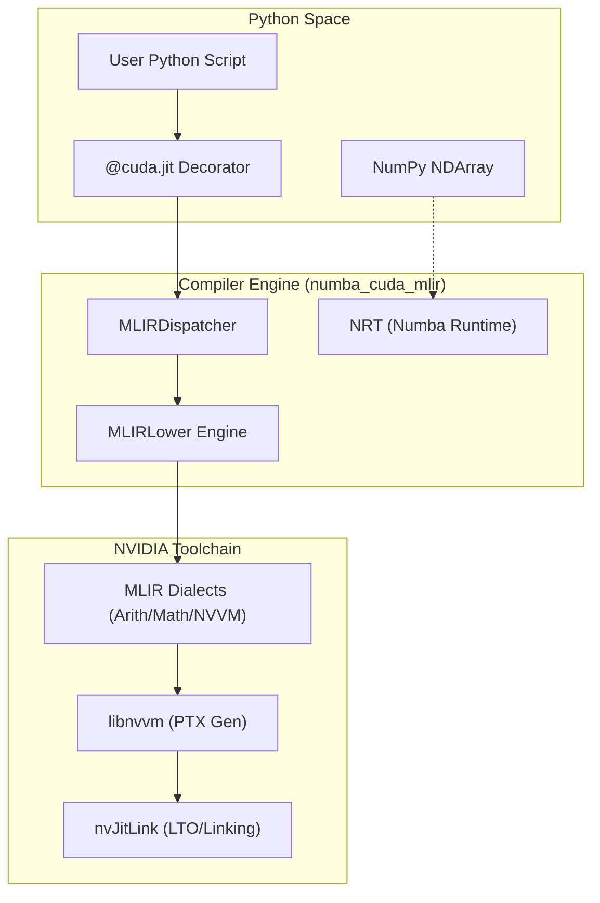
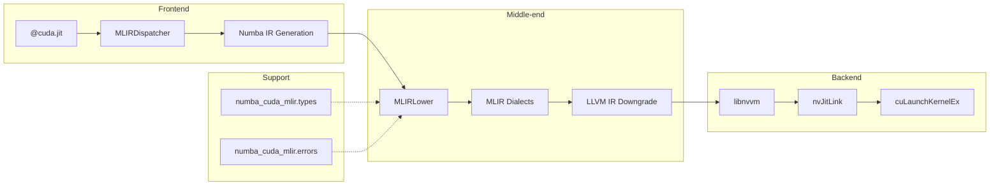

<!-- source: DeepWiki mcp.deepwiki.com · repo NVIDIA/numba-cuda-mlir · page 1 Overview · fetched 2026-10-26 -->

# Overview

<details>
<summary>Relevant source files</summary>

The following files were used as context for generating this wiki page:

- [CONTRIBUTING.md](CONTRIBUTING.md)
- [INSTALL.md](INSTALL.md)
- [README.md](README.md)
- [docs/source/user/installation.rst](docs/source/user/installation.rst)
- [docs/versions.json](docs/versions.json)
- [pyproject.toml](pyproject.toml)
- [src/numba_cuda_mlir/VERSION](src/numba_cuda_mlir/VERSION)
- [src/numba_cuda_mlir/cuda/libdevice.pyi](src/numba_cuda_mlir/cuda/libdevice.pyi)
- [src/numba_cuda_mlir/errors.py](src/numba_cuda_mlir/errors.py)
- [src/numba_cuda_mlir/py.typed](src/numba_cuda_mlir/py.typed)

</details>


`numba-cuda-mlir` is a high-performance Python compiler that provides a programming model similar to CUDA C++, evolved from the original [Numba-CUDA](https://github.com/NVIDIA/numba-cuda) project [README.md:3-5](). It is designed to be compatible with existing Numba-CUDA kernels while leveraging the **Multi-Level Intermediate Representation (MLIR)** framework for code generation instead of direct LLVM IR emission [README.md:58-61]().

The project aims to interoperate with existing Python data science stacks (like NumPy) while providing experts with granular control over GPU code generation [README.md:7-9]().

### System Context Diagram

The following diagram illustrates how the `numba-cuda-mlir` system bridges the gap between Python source code and the CUDA hardware execution environment.

**Natural Language to Code Entity Mapping**

Sources: [README.md:25-30](), [src/numba_cuda_mlir/errors.py:43-48](), [pyproject.toml:31-54]()

---

## Key Capabilities

*   **Numba-CUDA Compatibility**: Most existing Numba-CUDA kernels can be migrated by simply changing the import from `from numba import cuda` to `from numba_cuda_mlir import cuda` [README.md:42-55]().
*   **Modern MLIR Pipeline**: Replaces the legacy Numba LLVM lowering with a modern MLIR-based infrastructure, allowing for more sophisticated optimizations and better dialect-level abstractions [README.md:58-61]().
*   **Broad Type Support**: Includes support for standard NumPy dtypes, CUDA vector types (e.g., `float2`), and reduced-precision formats like `bf16`, `tf32`, and `fp8` [src/numba_cuda_mlir/cuda/libdevice.pyi:4-12]().
*   **Advanced Linking**: Utilizes `nvJitLink` for LTO-aware linking and support for modern CUDA features [pyproject.toml:35-41]().

---

## Major Subsystems

The codebase is organized into several functional areas that manage the lifecycle of a CUDA kernel:

### 1. Compilation and Dispatch
The entry point for users is the `@cuda.jit` decorator. This triggers a pipeline that transforms Python AST into Numba IR, which is then lowered to MLIR operations. The `MLIRDispatcher` manages the specialized versions of kernels for different input types.
*   For details, see [Architecture Overview](#1.2).

### 2. Lowering and Dialects
The core of the compiler is the `MLIRLower` engine. It translates Numba IR instructions into specific MLIR dialects such as `arith`, `math`, and eventually the `nvvm` dialect for NVIDIA-specific operations.
*   For details, see [Compilation Pipeline](#2).

### 3. Runtime and Driver
The project includes a Numba Runtime (NRT) implementation for device-side memory management (e.g., atomic reference counting) and a Python-level abstraction for the CUDA Driver (Contexts, Streams, and Memory).
*   For details, see [Memory Management and Runtime](#5).

### 4. Compatibility and Symbol Isolation
To handle the complexities of loading multiple versions of LLVM/MLIR within the same process, the project uses `RTLD_DEEPBIND` for symbol isolation and a specialized C++ extension to downgrade modern LLVM IR for compatibility with `libnvvm`.
*   For details, see [Symbol Isolation and LLVM Compatibility](#7).

---

## Component Relationship Diagram

This diagram maps specific code entities and files to the high-level compilation flow.

**Code Entity Interaction Map**

Sources: [src/numba_cuda_mlir/errors.py:43-80](), [README.md:25-39](), [pyproject.toml:47-53]()

---

## Getting Started
To begin using `numba-cuda-mlir`, ensure you have a compatible NVIDIA GPU (Compute Capability 7.0+) and the appropriate CUDA Toolkit (12.x or 13.x) [README.md:64-74]().

```bash
pip install numba-cuda-mlir[cu13]
```
For detailed installation instructions, environment setup, and a quick-start guide, see [Getting Started](#1.1).

---

## Architecture Deep Dive
The compilation pipeline is a multi-stage process involving Python AST transforms, type inference, MLIR lowering, and final translation to PTX/CUBIN via `libnvvm`.
*   For a bird's-eye view of the pipeline, see [Architecture Overview](#1.2).
*   For technical details on each stage, see [Compilation Pipeline](#2).

Sources:
- [README.md:1-125]()
- [INSTALL.md:1-154]()
- [pyproject.toml:1-207]()
- [src/numba_cuda_mlir/errors.py:1-130]()

---

