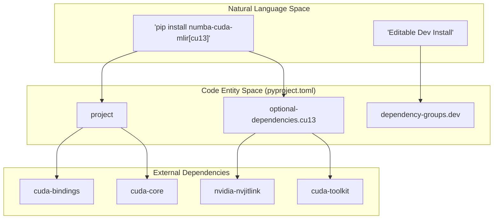
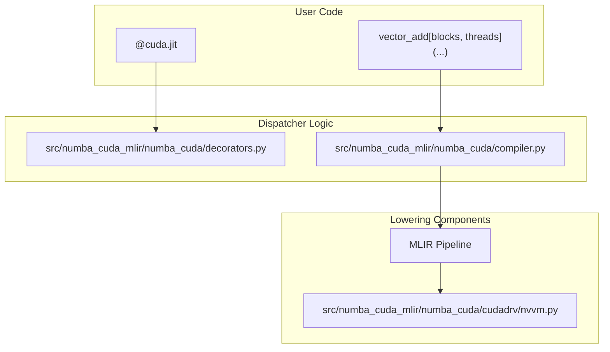

<!-- source: DeepWiki mcp.deepwiki.com · repo NVIDIA/numba-cuda-mlir · page 1.1 Getting Started · fetched 2026-10-26 -->

# Getting Started

<details>
<summary>Relevant source files</summary>

The following files were used as context for generating this wiki page:

- [CONTRIBUTING.md](CONTRIBUTING.md)
- [INSTALL.md](INSTALL.md)
- [README.md](README.md)
- [docs/source/user/installation.rst](docs/source/user/installation.rst)
- [pyproject.toml](pyproject.toml)
- [src/numba_cuda_mlir/cuda/libdevice.pyi](src/numba_cuda_mlir/cuda/libdevice.pyi)
- [src/numba_cuda_mlir/errors.py](src/numba_cuda_mlir/errors.py)
- [src/numba_cuda_mlir/numba_cuda/__init__.py](src/numba_cuda_mlir/numba_cuda/__init__.py)
- [src/numba_cuda_mlir/numba_cuda/core/config.py](src/numba_cuda_mlir/numba_cuda/core/config.py)
- [src/numba_cuda_mlir/numba_cuda/cudadrv/__init__.py](src/numba_cuda_mlir/numba_cuda/cudadrv/__init__.py)
- [src/numba_cuda_mlir/numba_cuda/decorators.py](src/numba_cuda_mlir/numba_cuda/decorators.py)
- [src/numba_cuda_mlir/numba_cuda/random.py](src/numba_cuda_mlir/numba_cuda/random.py)
- [src/numba_cuda_mlir/py.typed](src/numba_cuda_mlir/py.typed)
- [tests/numba_cuda_tests/cudadrv/test_nvvm_driver.py](tests/numba_cuda_tests/cudadrv/test_nvvm_driver.py)

</details>


Numba-CUDA-MLIR provides a high-performance Python programming model for NVIDIA GPUs, evolving from the original Numba-CUDA project by replacing the LLVM-IR generation path with an MLIR-based pipeline [README.md:1-9](). This page covers the requirements, installation procedures, and basic usage patterns for the compiler.

## Prerequisites

To use Numba-CUDA-MLIR, the following environment specifications must be met:

### Software Requirements
*   **Python**: Version 3.11 or greater [README.md:66]().
*   **NumPy**: Version 1.22 or greater [README.md:68]().
*   **CUDA Toolkit**: Components including CUDA Runtime, NVCC, NVRTC, nvJitLink, and CCCL must be present [README.md:69-70]().
*   **CUDA Python**: The `cuda.core` and `cuda-bindings` packages are required at import time [README.md:67](), [src/numba_cuda_mlir/numba_cuda/__init__.py:24-30]().

### Hardware Requirements
*   **NVIDIA GPU**: Compute Capability 7.0 (Volta) or greater [README.md:71]().
*   **Drivers**:
    *   For CUDA 12.x: Driver version >= r525 [README.md:72]().
    *   For CUDA 13.x: Driver version >= r580 [README.md:73]().

**Sources:** [README.md:64-75](), [INSTALL.md:15-25](), [src/numba_cuda_mlir/numba_cuda/__init__.py:24-30]()

---

## Installation Options

The project supports three primary installation methods depending on whether you are a user or a contributor.

### Option 1: Pip Installation (Recommended for Users)
The easiest way to install is via `pip` using optional extras to pull in the correct CUDA dependencies:

```bash
# For CUDA 12
pip install numba-cuda-mlir[cu12]

# For CUDA 13
pip install numba-cuda-mlir[cu13]
```
[README.md:16](), [INSTALL.md:37-41]()

### Option 2: Editable Install (Recommended for Contributors)
Contributors typically use pre-built LLVM artifacts provided by CI to avoid long compilation times.

1.  **Download Artifacts**: Obtain `llvm-modern-install` and `llvm7-install` from the latest successful GitHub Action run [INSTALL.md:83-97]().
2.  **Install**:
    ```shell
    MLIR_DIR=$PWD/llvm-modern-install/lib/cmake/mlir \
    LIBLLVM7=$PWD/llvm7-install/lib/libLLVM-7.so \
      pip install -e '.[cu13]' --group dev --config-settings editable_mode=compat
    ```
    [INSTALL.md:107-109]()

### Option 3: Build from Source
If modifying the compiler's underlying C++ layers or LLVM/MLIR itself, use the provided build scripts:
*   `ci/build-llvm-modern.sh`: Builds the modern LLVM/MLIR stack [INSTALL.md:121]().
*   `ci/build-llvm7.sh`: Builds the legacy LLVM 7 shared library required for `libnvvm` compatibility [INSTALL.md:124]().

**Sources:** [README.md:11-17](), [INSTALL.md:1-131](), [pyproject.toml:30-54]()

---

## Quick Start Workflow

Numba-CUDA-MLIR is designed to be a drop-in replacement for `numba.cuda`. To migrate existing code, update the import statement from `from numba import cuda` to `from numba_cuda_mlir import cuda` [README.md:42-56]().

### Basic Kernel Example
The following example demonstrates a vector addition kernel using the `@cuda.jit` decorator.

```python
import numpy as np
from numba_cuda_mlir import cuda

@cuda.jit
def vector_add(a, b, out):
    # Determine absolute thread position in the 1D grid
    i = cuda.grid(1)
    
    # Guard against out-of-bounds access
    if i < out.shape[0]:
        out[i] = a[i] + b[i]

n = 1_000_000
a = np.ones(n, dtype=np.float32)
b = np.ones(n, dtype=np.float32)
out = np.zeros(n, dtype=np.float32)

threads_per_block = 256
blocks = (n + threads_per_block - 1) // threads_per_block

# Launch kernel with [grid_size, block_size] configuration
vector_add[blocks, threads_per_block](a, b, out)
```
[README.md:21-39]()

### Environment Configuration
The compiler behavior can be adjusted using environment variables or a `.numba_config.yaml` file [src/numba_cuda_mlir/numba_cuda/core/config.py:28-30](). Key settings are processed by the `_EnvReloader` class [src/numba_cuda_mlir/numba_cuda/core/config.py:124-125]().

| Variable | Description |
| :--- | :--- |
| `NUMBA_OPT` | Set optimization level (0, 1, 2, 3, or 'max') [src/numba_cuda_mlir/numba_cuda/core/config.py:112-121](). |
| `NUMBA_CUDA_DEFAULT_PTX_CC` | Default compute capability (defaults to 7.5) [src/numba_cuda_mlir/numba_cuda/__init__.py:55-58](). |

**Sources:** [README.md:19-61](), [src/numba_cuda_mlir/numba_cuda/core/config.py:124-165](), [src/numba_cuda_mlir/numba_cuda/__init__.py:48-59]()

---

## Code Entity Mapping

The following diagrams illustrate how user-facing decorators and installation configurations map to internal code entities.

### Installation and Dependency Mapping
This diagram shows how the `pyproject.toml` configuration drives the installation of specific CUDA and LLVM components.


**Sources:** [pyproject.toml:12-73](), [INSTALL.md:31-54]()

### JIT Entry Point and Execution Flow
This diagram maps the high-level `@cuda.jit` usage to the primary dispatcher and compiler components.


**Sources:** [src/numba_cuda_mlir/numba_cuda/decorators.py](), [src/numba_cuda_mlir/numba_cuda/compiler.py:35-41](), [src/numba_cuda_mlir/numba_cuda/cudadrv/nvvm.py:7]()

---

## Debugging Your First Kernel

If a kernel fails to compile or execute as expected, use the following decorator options to inspect the intermediate representations:

*   **Dump IR**: Use `@cuda.jit(dump=True)` to print Numba IR and MLIR to stderr [CONTRIBUTING.md:60]().
*   **Help**: Use `@cuda.jit(help=True)` to see all available debug and configuration options [CONTRIBUTING.md:61]().
*   **Internal Errors**: If a compiler bug is triggered, the system raises a `UserFacingInternalCompilerError` and saves a full traceback to a temporary log file [src/numba_cuda_mlir/errors.py:34-79]().

**Sources:** [CONTRIBUTING.md:58-62](), [src/numba_cuda_mlir/errors.py:34-79]()

---

