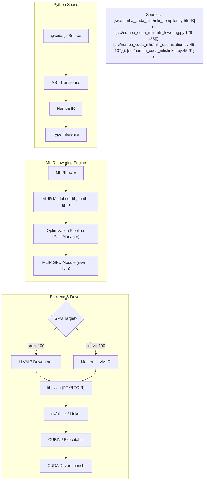
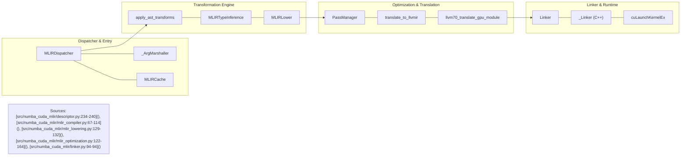

<!-- source: DeepWiki mcp.deepwiki.com · repo NVIDIA/numba-cuda-mlir · page 1.2 Architecture Overview · fetched 2026-10-26 -->

# Architecture Overview

Relevant source files

The following files were used as context for generating this wiki page:

- [src/numba_cuda_mlir/caching.py](src/numba_cuda_mlir/caching.py)
- [src/numba_cuda_mlir/decorators.py](src/numba_cuda_mlir/decorators.py)
- [src/numba_cuda_mlir/descriptor.py](src/numba_cuda_mlir/descriptor.py)
- [src/numba_cuda_mlir/linker.py](src/numba_cuda_mlir/linker.py)
- [src/numba_cuda_mlir/mlir_compiler.py](src/numba_cuda_mlir/mlir_compiler.py)
- [src/numba_cuda_mlir/mlir_lowering.py](src/numba_cuda_mlir/mlir_lowering.py)
- [src/numba_cuda_mlir/mlir_optimization.py](src/numba_cuda_mlir/mlir_optimization.py)
- [src/numba_cuda_mlir/numba_cuda/cudadrv/driver.py](src/numba_cuda_mlir/numba_cuda/cudadrv/driver.py)
- [tests/test_cuda_array_interface_launch_cache.py](tests/test_cuda_array_interface_launch_cache.py)
- [tests/test_descriptor_launch_config.py](tests/test_descriptor_launch_config.py)
- [tests/test_kernel_exceptions.py](tests/test_kernel_exceptions.py)
- [tests/test_tuple.py](tests/test_tuple.py)

The `numba-cuda-mlir` compiler pipeline transforms Python source code into high-performance CUDA kernels using MLIR as the primary intermediate representation. This architecture replaces the traditional Numba NVVM backend with a modern, multi-dialect MLIR lowering engine that supports advanced features like LTO (Link Time Optimization), structured data types, and unified memory management.

## Compilation Pipeline Overview

The compilation process is a multi-stage transformation that bridges the gap between Python's high-level AST and the low-level PTX/CUBIN executed on NVIDIA GPUs.

### 1. Frontend and IR Generation
The process begins when a function decorated with `@cuda.jit` or `@mlir_jit` is called.
*   **AST Transforms**: Before Numba IR generation, the Python AST is modified by `apply_ast_transforms` [src/numba_cuda_mlir/mlir_compiler.py:58-58](). This stage handles compile-time constant evaluation (`consteval`), constant-if pruning, and loop unrolling [src/numba_cuda_mlir/ast_transforms.py:1-10]().
*   **Numba IR**: The transformed AST is lowered to standard Numba IR.
*   **Type Inference**: The `MLIRTypeInference` pass [src/numba_cuda_mlir/mlir_compiler.py:67-114]() resolves types across the IR. It uses a specialized `MLIRTypingContext` to handle CUDA-specific types like vector types (e.g., `float4`) and reduced precision types (`bf16`, `fp8`).

### 2. MLIR Lowering
The core of the system is `MLIRLower` [src/numba_cuda_mlir/mlir_lowering.py:129-132](), which translates Numba IR into MLIR operations.
*   **Dialect Usage**: The engine emits a mix of dialects including `arith`, `math`, `memref`, `scf`, `gpu`, and `nvvm` [src/numba_cuda_mlir/mlir_lowering.py:59-72]().
*   **Data Layout**: Numba types are converted to MLIR types via `to_mlir_type` [src/numba_cuda_mlir/mlir_lowering.py:23-26](). Structured types (NumPy Records) are lowered to LLVM structs, while arrays become `memref` descriptors.
*   **SSA and Spilling**: The lowering engine manages SSA values and handles "spilling" for variables that cross block boundaries or require memory-backed storage [src/numba_cuda_mlir/mlir_lowering.py:129-200]().

### 3. Optimization and Target Translation
Once the MLIR module is constructed, it passes through the `PassManager` [src/numba_cuda_mlir/mlir_optimization.py:9-12]().
*   **Optimization Pipeline**: The `get_base_pipeline` [src/numba_cuda_mlir/mlir_optimization.py:45-96]() defines the transformation sequence:
    1.  `one-shot-bufferize`: Converts tensor-like operations to memrefs.
    2.  `convert-linalg-to-parallel-loops`: Lowers high-level NumPy-like operations.
    3.  `gpu-kernel-outlining`: Separates the device code into a `gpu.module`.
    4.  `convert-nvvm-to-llvm`: Prepares the IR for final translation.
*   **LLVM Downgrade**: For GPUs older than Blackwell (sm_100), the modern MLIR LLVM dialect is downgraded to an LLVM 7-compatible form via the `llvm_downgrade.cpp` C++ extension to support `libnvvm` [src/numba_cuda_mlir/mlir_optimization.py:99-107]().

### 4. Linking and Execution
The final binary is produced by the `Linker` [src/numba_cuda_mlir/linker.py:94-94]().
*   **JIT Linking**: The system uses `nvJitLink` to combine the generated PTX/LTOIR with external libraries or device functions [src/numba_cuda_mlir/linker.py:45-91]().
*   **Kernel Launch**: The `MLIRDispatcher` [src/numba_cuda_mlir/descriptor.py:234-240]() uses `_ArgMarshaller` [src/numba_cuda_mlir/descriptor.py:13-13]() to prepare Python/NumPy arguments for the CUDA driver. Launch is performed via `cuLaunchKernelEx` through the C++ `KernelDispatcher`.

## Data Flow Diagram

The following diagram illustrates the transformation of a kernel from Python source to executable machine code.

### High-Level Compilation Flow

## System Entity Map

This diagram maps conceptual stages to the specific classes and functions responsible for their implementation.

### Code Entity Association

## Key Architectural Components

| Component | Responsibility | Key File/Class |
| :--- | :--- | :--- |
| **Dispatcher** | Manages JIT compilation triggers, argument marshalling, and caching. | `MLIRDispatcher` [src/numba_cuda_mlir/descriptor.py:234]() |
| **Lowering Engine** | Translates typed Numba IR into MLIR operations across multiple dialects. | `MLIRLower` [src/numba_cuda_mlir/mlir_lowering.py:129]() |
| **Optimization** | Executes MLIR pass pipelines for bufferization and hardware-specific lowering. | `PassManager` [src/numba_cuda_mlir/mlir_optimization.py:9]() |
| **LLVM Bridge** | Handles compatibility between modern MLIR and legacy `libnvvm` (LLVM 7). | `_get_llvm70_capi` [src/numba_cuda_mlir/mlir_optimization.py:122]() |
| **Linker** | Orchestrates `nvJitLink` for LTO and external symbol resolution. | `Linker` [src/numba_cuda_mlir/linker.py:94]() |
| **Runtime (NRT)** | Implements device-side memory management and reference counting. | `emit_nrt_functions` [src/numba_cuda_mlir/mlir_lowering.py:82]() |

## Data Flow Details

1.  **Input**: The user provides a Python function and arguments.
2.  **Dispatch**: `MLIRDispatcher` checks the `MLIRCache` [src/numba_cuda_mlir/caching.py:109-111](). If a cache miss occurs, it triggers the compiler.
3.  **Frontend**: `apply_ast_transforms` [src/numba_cuda_mlir/ast_transforms.py:1-10]() cleans up the Python source. Numba's `type_inference_stage` [src/numba_cuda_mlir/mlir_compiler.py:82-90]() determines variable types.
4.  **Lowering**: `MLIRLower` iterates over Numba IR blocks [src/numba_cuda_mlir/mlir_lowering.py:137-138](), emitting MLIR ops for every instruction.
5.  **Optimization**: The `PassManager` applies the `get_base_pipeline` [src/numba_cuda_mlir/mlir_optimization.py:45-96](), resulting in an optimized `gpu.module`.
6.  **Translation**: The module is translated to LLVM IR. If `sm < 100`, it uses the `llvm70_translate` path [src/numba_cuda_mlir/mlir_optimization.py:183-203]().
7.  **Binary Generation**: `libnvvm` compiles LLVM IR to PTX or LTOIR. The `Linker` invokes `nvJitLink` to produce the final CUBIN.
8.  **Execution**: The CUDA driver loads the CUBIN and launches the kernel using the grid/block dimensions provided by the `LaunchConfiguration` [src/numba_cuda_mlir/descriptor.py:54-54]().

Sources: `src/numba_cuda_mlir/mlir_compiler.py`, `src/numba_cuda_mlir/mlir_lowering.py`, `src/numba_cuda_mlir/mlir_optimization.py`, `src/numba_cuda_mlir/linker.py`, `src/numba_cuda_mlir/descriptor.py`.

---

