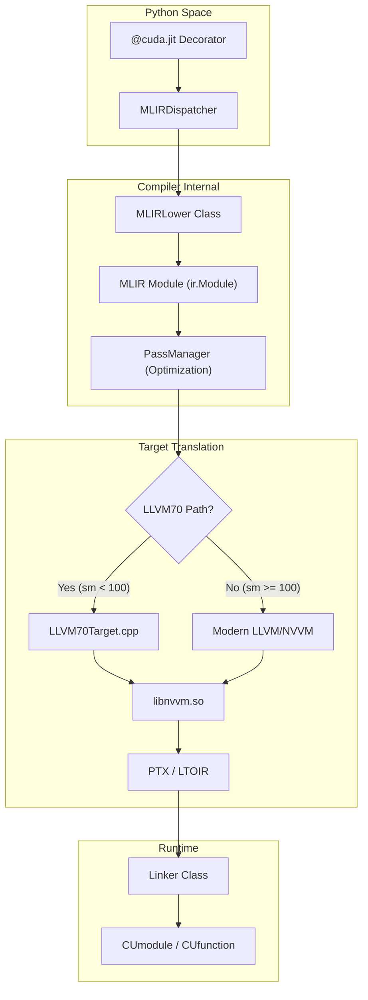
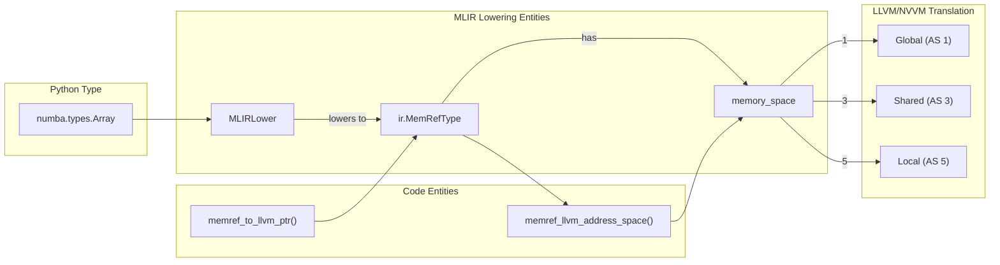

<!-- source: DeepWiki mcp.deepwiki.com · repo NVIDIA/numba-cuda-mlir · page 10 Glossary · fetched 2026-10-26 -->

# Glossary

Relevant source files

The following files were used as context for generating this wiki page:

- [CONTRIBUTING.md](CONTRIBUTING.md)
- [INSTALL.md](INSTALL.md)
- [README.md](README.md)
- [cext/launcher/cuda_shim.h](cext/launcher/cuda_shim.h)
- [cext/launcher/kernel.cpp](cext/launcher/kernel.cpp)
- [cext/launcher/llvm_downgrade.cpp](cext/launcher/llvm_downgrade.cpp)
- [cext/mlir-llvm70/include/llvm70/LLVM70Target.h](cext/mlir-llvm70/include/llvm70/LLVM70Target.h)
- [cext/mlir-llvm70/lib/LLVM70Target.cpp](cext/mlir-llvm70/lib/LLVM70Target.cpp)
- [ci/tools/run-expensive-tests](ci/tools/run-expensive-tests)
- [ci/tools/run-tests](ci/tools/run-tests)
- [docs/source/user/installation.rst](docs/source/user/installation.rst)
- [pyproject.toml](pyproject.toml)
- [src/numba_cuda_mlir/__init__.py](src/numba_cuda_mlir/__init__.py)
- [src/numba_cuda_mlir/caching.py](src/numba_cuda_mlir/caching.py)
- [src/numba_cuda_mlir/cuda/libdevice.pyi](src/numba_cuda_mlir/cuda/libdevice.pyi)
- [src/numba_cuda_mlir/decorators.py](src/numba_cuda_mlir/decorators.py)
- [src/numba_cuda_mlir/errors.py](src/numba_cuda_mlir/errors.py)
- [src/numba_cuda_mlir/linker.py](src/numba_cuda_mlir/linker.py)
- [src/numba_cuda_mlir/lowering/ctypes.py](src/numba_cuda_mlir/lowering/ctypes.py)
- [src/numba_cuda_mlir/lowering/record.py](src/numba_cuda_mlir/lowering/record.py)
- [src/numba_cuda_mlir/lowering/vector.py](src/numba_cuda_mlir/lowering/vector.py)
- [src/numba_cuda_mlir/lowering_utilities/__init__.py](src/numba_cuda_mlir/lowering_utilities/__init__.py)
- [src/numba_cuda_mlir/mlir_compiler.py](src/numba_cuda_mlir/mlir_compiler.py)
- [src/numba_cuda_mlir/mlir_lowering.py](src/numba_cuda_mlir/mlir_lowering.py)
- [src/numba_cuda_mlir/mlir_optimization.py](src/numba_cuda_mlir/mlir_optimization.py)
- [src/numba_cuda_mlir/numba_cuda/cudadrv/driver.py](src/numba_cuda_mlir/numba_cuda/cudadrv/driver.py)
- [src/numba_cuda_mlir/numba_cuda/np/numpy_support.py](src/numba_cuda_mlir/numba_cuda/np/numpy_support.py)
- [src/numba_cuda_mlir/numba_cuda/typeconv/rules.py](src/numba_cuda_mlir/numba_cuda/typeconv/rules.py)
- [src/numba_cuda_mlir/numba_cuda/types/__init__.py](src/numba_cuda_mlir/numba_cuda/types/__init__.py)
- [src/numba_cuda_mlir/numba_cuda/types/abstract.py](src/numba_cuda_mlir/numba_cuda/types/abstract.py)
- [src/numba_cuda_mlir/numba_cuda/typing/npydecl.py](src/numba_cuda_mlir/numba_cuda/typing/npydecl.py)
- [src/numba_cuda_mlir/py.typed](src/numba_cuda_mlir/py.typed)
- [src/numba_cuda_mlir/tools.py](src/numba_cuda_mlir/tools.py)
- [src/numba_cuda_mlir/types.py](src/numba_cuda_mlir/types.py)
- [tests/data/Makefile](tests/data/Makefile)
- [tests/data/fake_mlir_shim.c](tests/data/fake_mlir_shim.c)
- [tests/numba_cuda_tests/cudadrv/test_linker.py](tests/numba_cuda_tests/cudadrv/test_linker.py)
- [tests/numba_cuda_tests/cudadrv/test_module_callbacks.py](tests/numba_cuda_tests/cudadrv/test_module_callbacks.py)
- [tests/test_builtin_broadcasted_binops.py](tests/test_builtin_broadcasted_binops.py)
- [tests/test_dynamic_shared_memory.py](tests/test_dynamic_shared_memory.py)
- [tests/test_jit_compat.py](tests/test_jit_compat.py)
- [tests/test_kernel_exceptions.py](tests/test_kernel_exceptions.py)
- [tests/test_large_smem.py](tests/test_large_smem.py)
- [tests/test_ptr_ops.py](tests/test_ptr_ops.py)
- [tests/test_record_dtype.py](tests/test_record_dtype.py)
- [tests/test_symbol_isolation.py](tests/test_symbol_isolation.py)
- [tests/test_tuple.py](tests/test_tuple.py)

This page provides definitions and technical context for terms, abbreviations, and internal jargon used throughout the `numba-cuda-mlir` codebase. It serves as a reference for onboarding engineers to understand the mapping between CUDA concepts, MLIR dialects, and Python-level abstractions.

## Core Compilation Terms

| Term | Definition |
| :--- | :--- |
| **Numba IR** | The intermediate representation used by Numba after Python bytecode analysis. It consists of basic blocks containing linear sequences of instructions in SSA-like form [src/numba_cuda_mlir/mlir_lowering.py:137-138](). |
| **MLIRLower** | The primary engine responsible for translating Numba IR instructions into MLIR operations across various dialects [src/numba_cuda_mlir/mlir_lowering.py:129-132](). |
| **Dispatcher** | A Python object (e.g., `MLIRDispatcher`) that manages the compilation, caching, and launching of CUDA kernels [src/numba_cuda_mlir/lowering_utilities/__init__.py:4-5](). |
| **PTX** | Parallel Thread Execution; a low-level virtual machine and instruction set architecture (ISA) used by NVIDIA GPUs. |
| **CUBIN** | CUDA Binary; the hardware-specific executable image for a specific GPU architecture. |
| **LTO / LTOIR** | Link Time Optimization. `LTOIR` refers to the bitcode format used for device-side linking via `nvJitLink` [src/numba_cuda_mlir/linker.py:15-18](). |

### Data Flow: Python to PTX
The following diagram shows how high-level Python code is transformed into machine-executable PTX via the internal compiler entities.

**Compiler Entity Pipeline**

Sources: [src/numba_cuda_mlir/mlir_lowering.py:129-145](), [src/numba_cuda_mlir/mlir_optimization.py:9-25](), [src/numba_cuda_mlir/mlir_optimization.py:99-107](), [src/numba_cuda_mlir/linker.py:94-113]().

---

## MLIR Dialects and Usage

The codebase utilizes several MLIR dialects to represent different levels of abstraction during the lowering process.

*   **`arith`**: Used for standard integer and floating-point arithmetic [src/numba_cuda_mlir/mlir_lowering.py:61]().
*   **`gpu`**: Represents GPU-specific constructs like `gpu.module`, `gpu.func`, and kernel launches [src/numba_cuda_mlir/mlir_lowering.py:69]().
*   **`nvvm`**: The NVIDIA Virtual Machine dialect, providing a near-1:1 mapping to LLVM NVPTX intrinsics [src/numba_cuda_mlir/mlir_lowering.py:68]().
*   **`memref`**: Used to represent buffers and pointers with layout information (strides/offsets) [src/numba_cuda_mlir/mlir_lowering.py:66]().
*   **`scf`**: Structured Control Flow (loops, if-statements) [src/numba_cuda_mlir/mlir_lowering.py:67]().
*   **`llvm`**: The final dialect before translation to LLVM IR [src/numba_cuda_mlir/mlir_lowering.py:60]().

---

## Internal Jargon and Sentinels

### GEP_DYNAMIC_INDEX
A sentinel value (`-2147483648`, representing `INT32_MIN`) used in the `llvm.getelementptr` (GEP) operation to indicate that an index is dynamic (resolved at runtime) rather than a compile-time constant [src/numba_cuda_mlir/lowering_utilities/__init__.py:40](), [src/numba_cuda_mlir/mlir_lowering.py:96]().

### LLVM70 Path
A specialized translation path for GPUs with Compute Capability < 10.0 (pre-Blackwell). Because modern MLIR produces LLVM IR dialects that `libnvvm` (older versions) cannot consume, the `MLIRToLLVM70` translator downgrades the IR to a version compatible with LLVM 7.0 [src/numba_cuda_mlir/mlir_optimization.py:99-107](), [cext/mlir-llvm70/lib/LLVM70Target.cpp:30-46]().

### TheMSys
A device-side global variable used by the Numba Runtime (NRT) to track memory allocations and statistics across the GPU [src/numba_cuda_mlir/mlir_optimization.py:29-38]().

---

## Memory and Linking Concepts

### ResolvedLinkPlan
A dataclass that determines how the JIT linker should handle inputs. It decides whether to compile new inputs (like MLIR modules or `.cu` files) as PTX or LTOIR based on the GPU target and user options [src/numba_cuda_mlir/linker.py:28-43]().

### Address Space Mapping
The compiler maps MLIR memory spaces to NVVM/PTX address spaces:
*   **Space 0**: Generic memory.
*   **Space 1**: Global memory [src/numba_cuda_mlir/lowering_utilities/__init__.py:50-51]().
*   **Space 3**: Shared / Workgroup memory [src/numba_cuda_mlir/lowering_utilities/__init__.py:55-56]().
*   **Space 5**: Local / Private memory [src/numba_cuda_mlir/lowering_utilities/__init__.py:57-58]().

**Memory Lowering Entity Mapping**

Sources: [src/numba_cuda_mlir/lowering_utilities/__init__.py:43-60](), [src/numba_cuda_mlir/lowering_utilities/__init__.py:96-124](), [src/numba_cuda_mlir/mlir_lowering.py:129-132]().

---

## Driver and Runtime Symbols

*   **`CUresult`**: The error code returned by CUDA Driver API calls. The `Driver` class maps these to human-readable strings via `ERROR_MAP` [src/numba_cuda_mlir/numba_cuda/cudadrv/driver.py:221-233]().
*   **`PendingDeallocs`**: A mechanism to prevent crashes during resource cleanup by deferring deallocations if the CUDA context is in an unstable state [src/numba_cuda_mlir/numba_cuda/cudadrv/driver.py:8-15]().
*   **`nvjitlink`**: The NVIDIA library used for high-performance, LTO-aware linking of PTX and LTOIR at runtime [src/numba_cuda_mlir/numba_cuda/cudadrv/driver.py:110-129]().
*   **`ERROR_CODE_GLOBAL_NAME`**: The internal name (`__numba_cuda_mlir_error_code`) of the global variable used to propagate kernel-side exceptions (like `IndexError`) back to the host [src/numba_cuda_mlir/mlir_lowering.py:87-94]().

Sources:
- [src/numba_cuda_mlir/mlir_lowering.py:1-129]()
- [src/numba_cuda_mlir/lowering_utilities/__init__.py:1-130]()
- [src/numba_cuda_mlir/numba_cuda/cudadrv/driver.py:1-247]()
- [src/numba_cuda_mlir/linker.py:1-136]()
- [src/numba_cuda_mlir/mlir_optimization.py:1-110]()
- [cext/mlir-llvm70/lib/LLVM70Target.cpp:1-108]()