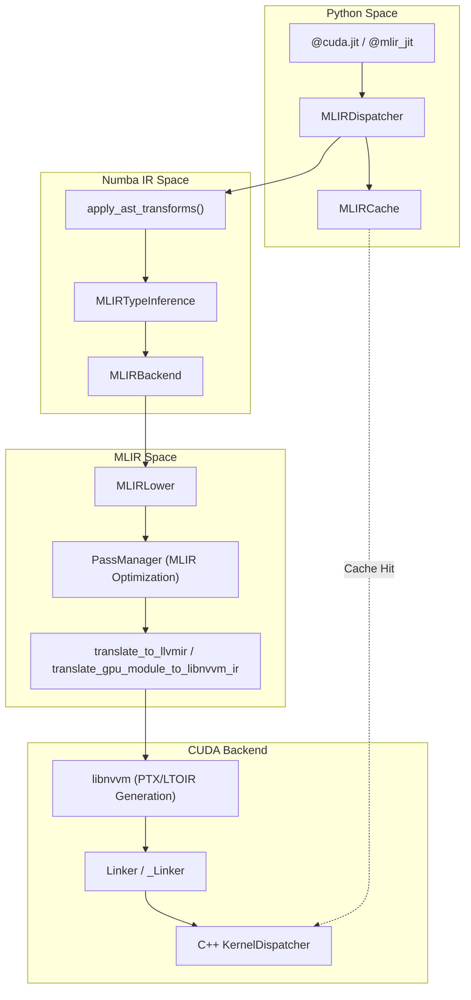

<!-- source: DeepWiki mcp.deepwiki.com · repo NVIDIA/numba-cuda-mlir · page 2 Compilation Pipeline · fetched 2026-10-26 -->

# Compilation Pipeline

Relevant source files

The following files were used as context for generating this wiki page:

- [src/numba_cuda_mlir/caching.py](src/numba_cuda_mlir/caching.py)
- [src/numba_cuda_mlir/decorators.py](src/numba_cuda_mlir/decorators.py)
- [src/numba_cuda_mlir/linker.py](src/numba_cuda_mlir/linker.py)
- [src/numba_cuda_mlir/mlir_compiler.py](src/numba_cuda_mlir/mlir_compiler.py)
- [src/numba_cuda_mlir/mlir_lowering.py](src/numba_cuda_mlir/mlir_lowering.py)
- [src/numba_cuda_mlir/mlir_optimization.py](src/numba_cuda_mlir/mlir_optimization.py)
- [src/numba_cuda_mlir/numba_cuda/cudadrv/driver.py](src/numba_cuda_mlir/numba_cuda/cudadrv/driver.py)
- [tests/test_kernel_exceptions.py](tests/test_kernel_exceptions.py)
- [tests/test_tuple.py](tests/test_tuple.py)

The `numba-cuda-mlir` compilation pipeline is an end-to-end JIT process that transforms Python source code into high-performance CUDA kernels using MLIR (Multi-Level Intermediate Representation) as the primary optimization and lowering framework. Unlike the standard Numba CUDA target which lowers Numba IR directly to LLVM IR, this pipeline introduces MLIR dialects to perform high-level optimizations like bufferization, loop transformations, and structured memory management before reaching the LLVM layer.

### Pipeline Stages Overview

The compilation process is orchestrated through several distinct stages, moving from high-level Python semantics to low-level machine code:

1.  **Frontend & Dispatch**: Entry through `@cuda.jit` or `@mlir_jit`, where the `MLIRDispatcher` manages specialization based on argument types and handles the transition from Python to the compiler [src/numba_cuda_mlir/mlir_compiler.py:57-57]().
2.  **AST & Numba IR**: Python source is parsed into an AST, transformed (e.g., constant evaluation), and lowered to Numba IR [src/numba_cuda_mlir/mlir_compiler.py:58-58]().
3.  **MLIR Lowering**: The `MLIRLower` engine translates Numba IR into a mix of MLIR dialects (Arith, Math, MemRef, SCF, GPU, and NVVM) [src/numba_cuda_mlir/mlir_lowering.py:129-132]().
4.  **MLIR Optimization**: A specialized `PassManager` executes a pipeline of transformations, including bufferization and lowering structured loops to the NVVM dialect [src/numba_cuda_mlir/mlir_optimization.py:45-96]().
5.  **Target Translation**: The optimized MLIR is translated to LLVM IR. For older GPUs (pre-Blackwell), a compatibility path downgrades the IR to LLVM 7.0 for `libnvvm` consumption [src/numba_cuda_mlir/mlir_optimization.py:99-107]().
6.  **Assembly & Linking**: `libnvvm` generates PTX or LTO-IR, which is then linked with external libraries using `nvJitLink` or the CUDA Driver API [src/numba_cuda_mlir/linker.py:94-113]().

### High-Level Flow Diagram

The following diagram illustrates the flow of data and control through the major code entities of the pipeline.

**System Data Flow: Python to Kernel**

Sources: [src/numba_cuda_mlir/mlir_compiler.py:50-145](), [src/numba_cuda_mlir/mlir_optimization.py:45-96](), [src/numba_cuda_mlir/linker.py:94-135]()

---

### 2.1 Decorators and Dispatchers
The entry point to the pipeline is the `MLIRDispatcher`, which is registered as the handler for `@cuda.jit` when the MLIR backend is enabled. It handles lazy compilation, argument type inference, and result caching. The `MLIRDispatcher` uses an `_ArgMarshaller` to prepare Python/NumPy objects for the device.

For details, see [Decorators and Dispatchers](#2.1).
Sources: [src/numba_cuda_mlir/mlir_compiler.py:57-57](), [src/numba_cuda_mlir/caching.py:109-118]()

### 2.2 AST Transforms and Numba IR
Before Numba IR is generated, the pipeline applies custom AST transformations. These include `consteval` for compile-time loop unrolling and constant-if pruning. Once Numba IR is produced, `MLIRTypeInference` resolves types using a context tailored for MLIR-compatible types.

For details, see [AST Transforms and Numba IR](#2.2).
Sources: [src/numba_cuda_mlir/mlir_compiler.py:58-96](), [src/numba_cuda_mlir/numbair_transforms.py:50-53]()

### 2.3 MLIR Lowering Engine
The `MLIRLower` class is the heart of the frontend-to-MLIR transition. It iterates through Numba IR blocks and emits MLIR operations. Key responsibilities include managing the `mlir_loc` for debug info, handling SSA value mapping, and lowering complex structures like NumPy arrays into MLIR `MemRef` types.

For details, see [MLIR Lowering Engine](#2.3).
Sources: [src/numba_cuda_mlir/mlir_lowering.py:129-203](), [src/numba_cuda_mlir/mlir_lowering.py:116-122]()

### 2.4 MLIR Optimization and Target Translation
The MLIR `PassManager` runs a sequence of passes such as `one-shot-bufferize`, `convert-linalg-to-parallel-loops`, and `gpu-kernel-outlining`. For compatibility with `libnvvm`, the pipeline can branch into an `LLVM70` path, which uses a C++ bridge to downgrade modern MLIR/LLVM constructs to a format compatible with older CUDA toolkits.

For details, see [MLIR Optimization and Target Translation](#2.4).
Sources: [src/numba_cuda_mlir/mlir_optimization.py:45-96](), [src/numba_cuda_mlir/mlir_optimization.py:99-107](), [src/numba_cuda_mlir/mlir_optimization.py:183-205]()

### 2.5 Linking and Kernel Launch
The final stage involves the `Linker` class, which aggregates PTX, LTO-IR, and object files. It supports LTO-aware linking via `nvJitLink`. Once linked, the binary is passed to a C++ `KernelDispatcher` which uses the CUDA Driver API (e.g., `cuLaunchKernelEx`) to execute the code on the GPU.

For details, see [Linking and Kernel Launch](#2.5).
Sources: [src/numba_cuda_mlir/linker.py:94-135](), [src/numba_cuda_mlir/linker.py:45-91]()

### Pipeline Summary Table

| Stage | Input | Output | Key Entity |
| :--- | :--- | :--- | :--- |
| **Frontend** | Python Function | Specialized Signature | `MLIRDispatcher` |
| **Analysis** | Python AST | Numba IR | `apply_ast_transforms` |
| **Lowering** | Numba IR | MLIR (GPU/SCF/Arith) | `MLIRLower` |
| **Optimization**| MLIR Dialects | MLIR (NVVM/LLVM) | `PassManager` |
| **Translation** | MLIR | LLVM IR / PTX | `translate_to_llvmir` |
| **Backend** | PTX / LTOIR | CUBIN / Executable | `Linker` |

Sources: [src/numba_cuda_mlir/mlir_compiler.py:139-205](), [src/numba_cuda_mlir/mlir_optimization.py:45-96](), [src/numba_cuda_mlir/linker.py:28-42]()

---

