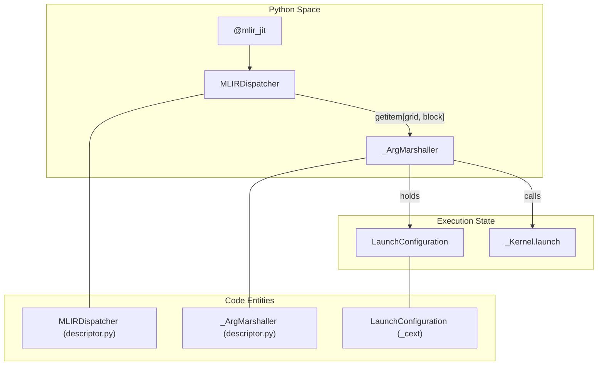
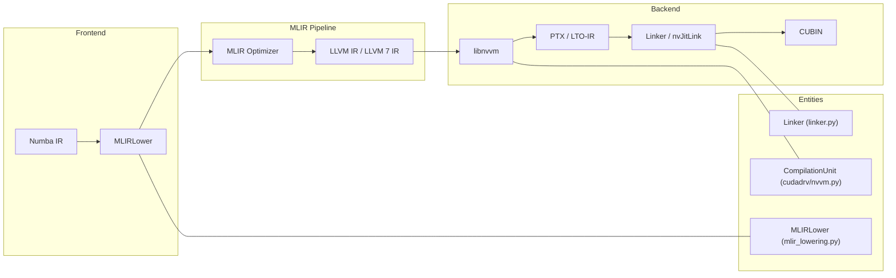

<!-- source: DeepWiki mcp.deepwiki.com · repo NVIDIA/numba-cuda-mlir · page 2.1 Decorators and Dispatchers · fetched 2026-10-26 -->

# Decorators and Dispatchers

Relevant source files

The following files were used as context for generating this wiki page:

- [src/numba_cuda_mlir/caching.py](src/numba_cuda_mlir/caching.py)
- [src/numba_cuda_mlir/decorators.py](src/numba_cuda_mlir/decorators.py)
- [src/numba_cuda_mlir/descriptor.py](src/numba_cuda_mlir/descriptor.py)
- [src/numba_cuda_mlir/linker.py](src/numba_cuda_mlir/linker.py)
- [src/numba_cuda_mlir/memory_management/__init__.py](src/numba_cuda_mlir/memory_management/__init__.py)
- [src/numba_cuda_mlir/memory_management/nrt.py](src/numba_cuda_mlir/memory_management/nrt.py)
- [src/numba_cuda_mlir/mlir_compiler.py](src/numba_cuda_mlir/mlir_compiler.py)
- [src/numba_cuda_mlir/mlir_optimization.py](src/numba_cuda_mlir/mlir_optimization.py)
- [src/numba_cuda_mlir/numba_cuda/codegen.py](src/numba_cuda_mlir/numba_cuda/codegen.py)
- [src/numba_cuda_mlir/numba_cuda/cudadrv/driver.py](src/numba_cuda_mlir/numba_cuda/cudadrv/driver.py)
- [src/numba_cuda_mlir/numba_cuda/dispatcher.py](src/numba_cuda_mlir/numba_cuda/dispatcher.py)
- [src/numba_cuda_mlir/numba_cuda/memory_management/nrt.py](src/numba_cuda_mlir/numba_cuda/memory_management/nrt.py)
- [tests/test_cuda_array_interface_launch_cache.py](tests/test_cuda_array_interface_launch_cache.py)
- [tests/test_descriptor_launch_config.py](tests/test_descriptor_launch_config.py)

The `@cuda.jit` and `@mlir_jit` decorators are the entry points for the `numba-cuda-mlir` compilation pipeline. They transform Python functions into `Dispatcher` objects that manage the lifecycle of a kernel: from AST transformation and type inference to MLIR lowering, compilation into PTX/CUBIN, and finally, execution on the GPU.

## The Decorator Entry Points

There are two primary decorators used to define GPU kernels and device functions:

1.  **`@mlir_jit`**: The primary decorator for the MLIR-based pipeline. It initializes an `MLIRDispatcher` which uses the MLIR lowering engine [src/numba_cuda_mlir/decorators.py:101-200]().
2.  **`@cuda.jit`**: A compatibility wrapper. In `numba-cuda-mlir`, this is typically aliased to `@mlir_jit` or provides a similar interface to ensure existing Numba CUDA code works with the MLIR backend [src/numba_cuda_mlir/decorators.py:10-10]().

### Configuration Options
Both decorators accept a variety of `targetoptions` via the `MLIRJITOption` schema [src/numba_cuda_mlir/decorators.py:18-33](). Key options include:
*   `opt_level`: Optimization level (0-3) [src/numba_cuda_mlir/decorators.py:103-109]().
*   `chip`: Target GPU compute capability (e.g., `"sm_80"`) [src/numba_cuda_mlir/decorators.py:136-141]().
*   `inline`: Inlining strategy (`"always"`, `"never"`, `"auto"`) [src/numba_cuda_mlir/decorators.py:117-122]().
*   `debug`/`lineinfo`: Generation of DWARF debug info or line mapping [src/numba_cuda_mlir/decorators.py:202-213]().

## Dispatcher Architecture

The `MLIRDispatcher` is responsible for specialized compilation. When a decorated function is called, the dispatcher inspects the types of the arguments and either retrieves a previously compiled kernel from its cache or triggers a new compilation [src/numba_cuda_mlir/numba_cuda/dispatcher.py:84-123]().

### Specialized Compilation Path
The dispatcher orchestrates the following flow:
1.  **Type Inference**: Resolves the Numba types of the input arguments [src/numba_cuda_mlir/mlir_compiler.py:67-112]().
2.  **MLIR Backend**: Invokes `MLIRLower` to translate Numba IR to MLIR [src/numba_cuda_mlir/mlir_compiler.py:139-195]().
3.  **Optimization**: Runs the MLIR pass pipeline (e.g., `one-shot-bufferize`, `gpu-kernel-outlining`) [src/numba_cuda_mlir/mlir_optimization.py:45-96]().
4.  **Translation**: Converts MLIR to LLVM IR (or LLVM 7 IR for older GPUs) and then to PTX via `libnvvm` [src/numba_cuda_mlir/mlir_optimization.py:99-107]().

### Kernel Launch Configuration
Kernels are configured using the `[grid, block]` syntax. This returns an `_ArgMarshaller` object [src/numba_cuda_mlir/descriptor.py:13-14]().

**Entity Relationship: Dispatcher to Execution**
Title: Dispatcher and Marshaller Entity Mapping

Sources: [src/numba_cuda_mlir/descriptor.py:39-54](), [src/numba_cuda_mlir/numba_cuda/dispatcher.py:84-123]()

## Argument Marshalling and the `_ArgMarshaller`

The `_ArgMarshaller` is a transient object created for a specific kernel launch. Its primary role is to prepare Python objects (like NumPy arrays or CuPy arrays) for the C++ kernel launcher [src/numba_cuda_mlir/descriptor.py:80-100]().

### The Execution Path
When the `_ArgMarshaller` is called:
1.  **Thread-Local Storage**: It stores the `LaunchConfiguration` in a thread-local variable `_compile_arg_types.launch_config`. This allows the compiler to access launch-time constants (like block size) if needed during JIT [src/numba_cuda_mlir/descriptor.py:59-60](), [tests/test_descriptor_launch_config.py:80-103]().
2.  **Array Handling**: It detects `__cuda_array_interface__` (CAI) providers. It synchronizes streams if required by the CAI version [src/numba_cuda_mlir/descriptor.py:136-162]().
3.  **NRT Management**: If the kernel uses the Numba Runtime (NRT), the marshaller ensures the `TheMSys` device global is initialized via a post-load callback [src/numba_cuda_mlir/mlir_optimization.py:29-38]().
4.  **C++ Dispatch**: It passes the flattened, cleaned arguments to the C++ `LaunchConfiguration` object, which performs the actual `cuLaunchKernel` call [src/numba_cuda_mlir/descriptor.py:54-54]().

### Signature Caching
To avoid expensive type inference on every launch, the marshaller maintains an `_array_sig_cache`. This cache tracks metadata like `dtype`, `ndim`, and `readonly` status for CAI-compatible objects [tests/test_cuda_array_interface_launch_cache.py:33-44]().

## Compilation and Linking

The dispatcher uses the `Linker` class to manage PTX and LTO-IR (Link Time Optimization Intermediate Representation) [src/numba_cuda_mlir/linker.py:94-135]().

### Resolved Link Plan
Before linking, the system resolves a `ResolvedLinkPlan` to determine if it should produce PTX or LTO-IR based on the presence of external libraries or requested optimization levels [src/numba_cuda_mlir/linker.py:28-91]().

**Data Flow: Compilation to CUBIN**
Title: Compilation Data Flow

Sources: [src/numba_cuda_mlir/mlir_compiler.py:183-188](), [src/numba_cuda_mlir/mlir_optimization.py:45-96](), [src/numba_cuda_mlir/linker.py:94-135]()

## Caching Mechanisms

The `numba-cuda-mlir` system employs two levels of caching:
1.  **Dispatcher Cache**: An in-memory cache within `MLIRDispatcher` that maps argument types to `_Kernel` objects [src/numba_cuda_mlir/numba_cuda/dispatcher.py:21-48]().
2.  **Persistent MLIR Cache**: Controlled by `MLIRCache`, this persists compiled artifacts to disk to speed up subsequent executions of the same process [src/numba_cuda_mlir/descriptor.py:48-48]().

If `NullCache` is used, every unique signature will trigger a full compilation from Python source [src/numba_cuda_mlir/descriptor.py:48-48]().

Sources:
- [src/numba_cuda_mlir/decorators.py:18-213]()
- [src/numba_cuda_mlir/descriptor.py:13-162]()
- [src/numba_cuda_mlir/linker.py:28-135]()
- [src/numba_cuda_mlir/mlir_compiler.py:67-195]()
- [src/numba_cuda_mlir/mlir_optimization.py:29-107]()
- [src/numba_cuda_mlir/numba_cuda/dispatcher.py:21-123]()
- [tests/test_descriptor_launch_config.py:80-103]()
- [tests/test_cuda_array_interface_launch_cache.py:33-44]()

---

