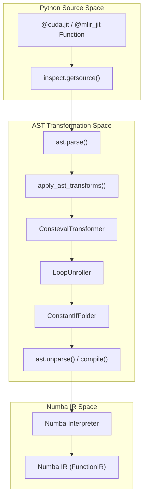
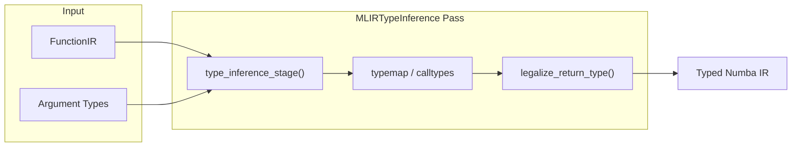

<!-- source: DeepWiki mcp.deepwiki.com · repo NVIDIA/numba-cuda-mlir · page 2.2 AST Transforms and Numba IR · fetched 2026-10-26 -->

# AST Transforms and Numba IR

Relevant source files

The following files were used as context for generating this wiki page:

- [src/numba_cuda_mlir/caching.py](src/numba_cuda_mlir/caching.py)
- [src/numba_cuda_mlir/decorators.py](src/numba_cuda_mlir/decorators.py)
- [src/numba_cuda_mlir/linker.py](src/numba_cuda_mlir/linker.py)
- [src/numba_cuda_mlir/mlir_compiler.py](src/numba_cuda_mlir/mlir_compiler.py)
- [src/numba_cuda_mlir/mlir_optimization.py](src/numba_cuda_mlir/mlir_optimization.py)
- [src/numba_cuda_mlir/numba_cuda/core/typed_passes.py](src/numba_cuda_mlir/numba_cuda/core/typed_passes.py)
- [src/numba_cuda_mlir/numba_cuda/cudadrv/driver.py](src/numba_cuda_mlir/numba_cuda/cudadrv/driver.py)
- [tests/ast_transforms/test_ast_transform_examples.py](tests/ast_transforms/test_ast_transform_examples.py)
- [tests/ast_transforms/test_device_func.py](tests/ast_transforms/test_device_func.py)

The `numba-cuda-mlir` compilation pipeline begins with a series of pre-compilation Python AST (Abstract Syntax Tree) transformations. These transformations enable compile-time evaluation and specialized code generation before the code is converted into Numba IR. Once in IR form, the compiler performs type inference and additional optimizations before lowering to MLIR.

## AST Transformation Pipeline

Before the standard Numba compilation process takes over, `numba-cuda-mlir` applies several experimental AST-level passes. These passes are primarily used to implement compile-time features that are difficult to express in standard Numba IR, such as loop unrolling of `range` objects and conditional compilation based on compile-time constants.

### Key Transformation Passes
The entry point for these transforms is `apply_ast_transforms` [src/numba_cuda_mlir/ast_transforms.py:1-5]().

1.  **Consteval (Compile-time Evaluation):** Evaluates expressions wrapped in `consteval()` at compile time. This allows for meta-programming where Python logic executes during compilation to generate the final kernel code [tests/ast_transforms/test_ast_transform_examples.py:8-40]().
2.  **Constant-If Elimination:** Resolves `if` statements where the condition is a compile-time constant (often resulting from a `consteval` check). The branch not taken is pruned from the AST [tests/ast_transforms/test_device_func.py:34-41]().
3.  **Comprehension Unrolling:** Expands list or generator comprehensions into explicit loops or static sequences if the bounds are known at compile time.
4.  **Loop Unrolling:** Specifically targets `for i in consteval(range(N))` patterns, replacing the loop with N repeated blocks of code [tests/ast_transforms/test_ast_transform_examples.py:30-31]().

### AST Transformation Flow
The following diagram illustrates how the Python source code is mutated before reaching the Numba Interpreter.

**Title: AST Pre-processing Pipeline**

Sources: [src/numba_cuda_mlir/mlir_compiler.py:58-58](), [src/numba_cuda_mlir/decorators.py:191-195]()

## Numba IR Generation

After AST transformations, the code is passed to the Numba Interpreter to generate Numba IR. This IR is a linear, block-based representation of the function's control flow.

### Custom IR Passes
The `MLIRBackend` class manages the transition from Numba IR to MLIR. Before lowering, it can invoke specialized IR-level passes [src/numba_cuda_mlir/mlir_compiler.py:139-144]().

*   **NumbaCudaMlirLiteralUnroll:** A specialized version of Numba's literal unrolling tailored for MLIR compatibility [src/numba_cuda_mlir/mlir_compiler.py:50-51]().
*   **NumbaCudaMlirInlineInlinables:** Handles inlining of functions marked as inlinable, ensuring that device-side calls are resolved before MLIR lowering [src/numba_cuda_mlir/mlir_compiler.py:52-53]().

## Type Inference Customizations

The compiler uses a specialized `MLIRTypeInference` pass [src/numba_cuda_mlir/mlir_compiler.py:66-68](). This pass extends the standard Numba type inference to handle CUDA-specific requirements and MLIR-based lowering constraints.

### Type Inference Stage
The core logic resides in `type_inference_stage`, which performs the following:
1.  **Seed Arguments:** Maps input Python types to Numba types [numba_cuda_mlir/numba_cuda/core/typed_passes.py:98-99]().
2.  **Constraint Building:** Generates type constraints based on IR operations [numba_cuda_mlir/numba_cuda/core/typed_passes.py:109-109]().
3.  **Propagation:** Iteratively resolves types until a fixed point is reached [numba_cuda_mlir/numba_cuda/core/typed_passes.py:111-111]().
4.  **Legalization:** Ensures that the resulting types are valid for the MLIR backend (e.g., rejecting function object returns in nopython mode) [src/numba_cuda_mlir/mlir_compiler.py:98-112]().

**Title: Type Inference and IR Legalization**

Sources: [src/numba_cuda_mlir/mlir_compiler.py:66-112](), [numba_cuda_mlir/numba_cuda/core/typed_passes.py:78-114]()

## Data Flow: From Source to Typed IR

The data flow involves capturing the function metadata, applying AST transforms, generating IR, and performing type inference.

| Stage | Entity | Role |
| :--- | :--- | :--- |
| **AST Transform** | `apply_ast_transforms` | Mutates Python AST for compile-time logic [src/numba_cuda_mlir/mlir_compiler.py:58-58]() |
| **IR Generation** | `Numba Interpreter` | Translates transformed AST to `FunctionIR` |
| **Type Inference** | `MLIRTypeInference` | Populates `typemap` and `calltypes` [src/numba_cuda_mlir/mlir_compiler.py:67-68]() |
| **Backend Entry** | `MLIRBackend` | Prepares `fndesc` and initiates MLIR lowering [src/numba_cuda_mlir/mlir_compiler.py:139-140]() |

### IR Inspection and Debugging
Users can inspect the state of the Numba IR and the associated type map by setting the `dump_numba_ir` or `dump` options in the `@cuda.jit` decorator [src/numba_cuda_mlir/mlir_compiler.py:175-180](). This outputs the linear IR and the inferred types for every variable to `stderr`.

Sources: [src/numba_cuda_mlir/mlir_compiler.py:1-200](), [src/numba_cuda_mlir/decorators.py:101-165](), [numba_cuda_mlir/numba_cuda/core/typed_passes.py:1-120]()

---

