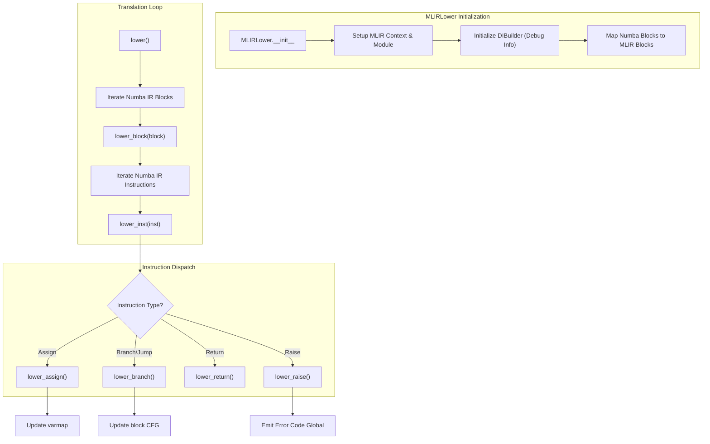
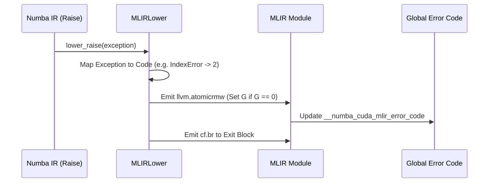

<!-- source: DeepWiki mcp.deepwiki.com · repo NVIDIA/numba-cuda-mlir · page 2.3 MLIR Lowering Engine · fetched 2026-10-26 -->

# MLIR Lowering Engine

Relevant source files

The following files were used as context for generating this wiki page:

- [src/numba_cuda_mlir/mlir_debuginfo.py](src/numba_cuda_mlir/mlir_debuginfo.py)
- [src/numba_cuda_mlir/mlir_lowering.py](src/numba_cuda_mlir/mlir_lowering.py)
- [src/numba_cuda_mlir/numba_cuda/datamodel/models.py](src/numba_cuda_mlir/numba_cuda/datamodel/models.py)
- [tests/test_debuginfo.py](tests/test_debuginfo.py)
- [tests/test_kernel_exceptions.py](tests/test_kernel_exceptions.py)
- [tests/test_tuple.py](tests/test_tuple.py)

The MLIR Lowering Engine is the core component responsible for transforming Numba Intermediate Representation (IR) into MLIR operations. This process involves mapping Python-level semantics, captured by Numba's type system and IR, into structured MLIR dialects such as `arith`, `memref`, `scf`, and `llvm`. The engine handles complex tasks including SSA variable management, shared memory allocation, exception propagation via error codes, and the generation of DWARF-compatible debug information.

## MLIRLower Implementation

The primary entry point for the lowering process is the `MLIRLower` class [src/numba_cuda_mlir/mlir_lowering.py:129-132](). It orchestrates the translation by iterating through Numba IR blocks and emitting corresponding MLIR operations into a target module.

### Core Components and Data Flow

The lowering engine maintains several internal registries and state objects to track the translation progress:

*   **SSA Variable Mapping**: The `varmap` dictionary tracks the mapping between Numba IR variables and their corresponding MLIR `Value` objects [src/numba_cuda_mlir/mlir_lowering.py:241-241]().
*   **Block Mapping**: The `blockmap` associates Numba IR block labels with MLIR `Block` objects [src/numba_cuda_mlir/mlir_lowering.py:242-242]().
*   **Builder**: An instance of `numba_cuda_mlir.annotations.Builder` is used to emit operations into the current MLIR block [src/numba_cuda_mlir/mlir_lowering.py:237-237]().

### Lowering Workflow Diagram

The following diagram illustrates how the `MLIRLower` engine processes Numba IR to produce MLIR.

**Numba IR to MLIR Translation Flow**

Sources: [src/numba_cuda_mlir/mlir_lowering.py:129-245](), [src/numba_cuda_mlir/mlir_lowering.py:534-554](), [src/numba_cuda_mlir/mlir_lowering.py:612-635]()

## SSA Spilling and Variable Management

Unlike LLVM IR, which often relies on `alloca` for mutable variables, the MLIR lowering engine attempts to maintain values in SSA form as much as possible. However, certain Python semantics require "spilling" or specialized handling:

1.  **Phi Nodes**: When multiple Numba IR blocks converge, the engine handles variable merging by passing values as block arguments in MLIR, effectively implementing SSA Phi nodes [src/numba_cuda_mlir/mlir_lowering.py:644-668]().
2.  **Global/Static Variables**: Constants and globals are lowered using `arith.constant` or `llvm.mlir.addressof` for global symbols [src/numba_cuda_mlir/mlir_lowering.py:1016-1044]().

## Shared Memory Management

Shared memory in CUDA kernels is managed through `cuda.shared.array`. The lowering engine translates these into MLIR `memref` allocations with specific address spaces.

*   **Static Shared Memory**: If the size is known at compile time, it is lowered to a `memref.alloca` or a global `memref` with `memory_space = 3` (CUDA Shared Memory) [src/numba_cuda_mlir/mlir_lowering.py:116-122]().
*   **Type Validation**: The engine ensures that `memref` element types are valid MLIR builtin types; LLVM-specific types (like pointers or structs) are rejected for direct `memref` usage and must use LLVM dialect operations instead [src/numba_cuda_mlir/mlir_lowering.py:116-122]().

## Exception Handling and Error Codes

Since GPU hardware does not support standard CPU-style exceptions, `numba-cuda-mlir` implements an "Error Code" mechanism.

*   **Global Error State**: A global variable named `__numba_cuda_mlir_error_code` is defined in the module [src/numba_cuda_mlir/mlir_lowering.py:87-87]().
*   **Error Mapping**: Python exceptions are mapped to specific integer codes (e.g., `AssertionError: 1`, `IndexError: 2`) [src/numba_cuda_mlir/mlir_lowering.py:88-94]().
*   **Lowering `raise`**: When a `raise` instruction is encountered, the engine emits an atomic update to the global error code (if it is currently 0) and then terminates the thread or returns early [src/numba_cuda_mlir/mlir_lowering.py:1260-1286]().
*   **Host-Side Check**: After kernel launch, the runtime checks this global variable to re-raise the appropriate Python exception [tests/test_kernel_exceptions.py:21-37]().

**Exception Lowering Logic**

Sources: [src/numba_cuda_mlir/mlir_lowering.py:87-94](), [src/numba_cuda_mlir/mlir_lowering.py:1260-1286](), [tests/test_kernel_exceptions.py:52-61]()

## Debug Information Emission

The engine supports DWARF debug info generation via the `DIBuilder` class [src/numba_cuda_mlir/mlir_debuginfo.py:201-205]().

### Debug Levels
*   **Full Debug (`debug=True`)**: Emits `Full` emission kind, including local variables, type metadata, and subprogram descriptors [tests/test_debuginfo.py:35-49]().
*   **Line Info (`lineinfo=True`)**: Emits only `DebugDirectivesOnly`, providing file and line mappings without variable inspection [tests/test_debuginfo.py:52-62]().

### Type Mapping to DWARF
The `mlir_debuginfo` module maps Numba types to DWARF basic types:
*   **Integers/Floats**: Mapped to `DW_ATE_signed`, `DW_ATE_unsigned`, or `DW_ATE_float` with appropriate bitwidths [src/numba_cuda_mlir/mlir_debuginfo.py:34-39]().
*   **Complex Numbers**: Lowered as a `DICompositeType` (struct) with `real` and `imag` members [src/numba_cuda_mlir/mlir_debuginfo.py:65-82]().
*   **Boolean Workaround**: Boolean arguments use `llvm.intr.dbg.value` instead of `dbg.declare` to avoid specific NVVM translation issues [tests/test_debuginfo.py:202-217]().

## Key Functions and Classes

| Entity | Role | Source |
| :--- | :--- | :--- |
| `MLIRLower` | Main class for lowering Numba IR to MLIR. | [src/numba_cuda_mlir/mlir_lowering.py:129]() |
| `lower()` | Top-level method to trigger lowering of all blocks. | [src/numba_cuda_mlir/mlir_lowering.py:534]() |
| `lower_inst()` | Dispatches individual Numba IR instructions to specific handlers. | [src/numba_cuda_mlir/mlir_lowering.py:612]() |
| `DIBuilder` | Helper for creating MLIR debug information attributes. | [src/numba_cuda_mlir/mlir_debuginfo.py:201]() |
| `to_mlir_type()` | Utility to convert Numba types to MLIR IR types. | [src/numba_cuda_mlir/lowering_utilities/type_conversions.py]() |

Sources: [src/numba_cuda_mlir/mlir_lowering.py:129-1300](), [src/numba_cuda_mlir/mlir_debuginfo.py:1-210]()

---

