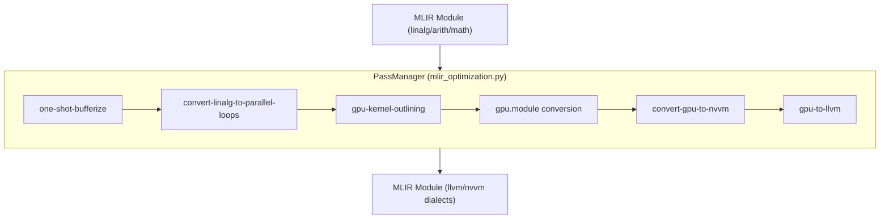
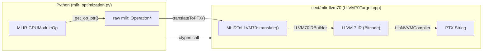
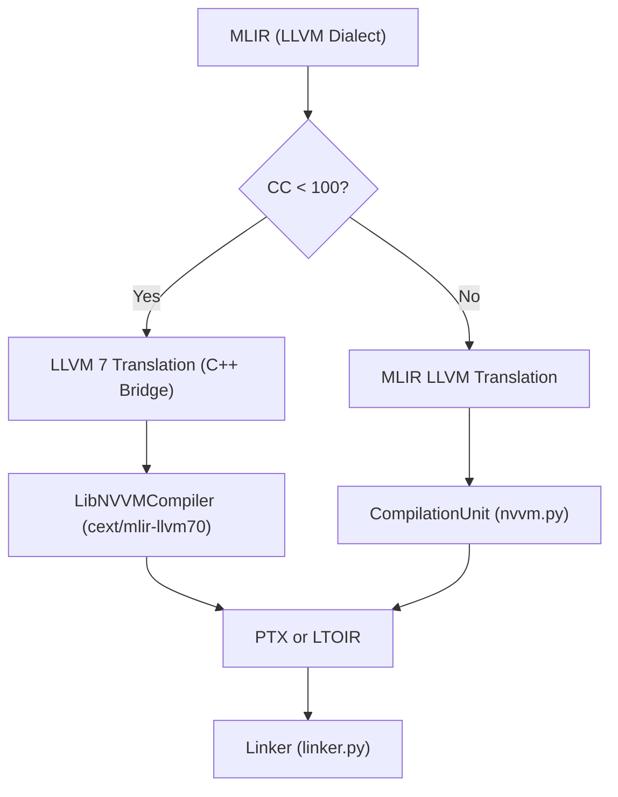

<!-- source: DeepWiki mcp.deepwiki.com · repo NVIDIA/numba-cuda-mlir · page 2.4 MLIR Optimization and Target Translation · fetched 2026-10-26 -->

# MLIR Optimization and Target Translation

Relevant source files

The following files were used as context for generating this wiki page:

- [cext/launcher/llvm_downgrade.cpp](cext/launcher/llvm_downgrade.cpp)
- [cext/mlir-llvm70/include/llvm70/LLVM70Target.h](cext/mlir-llvm70/include/llvm70/LLVM70Target.h)
- [cext/mlir-llvm70/lib/CAPI.cpp](cext/mlir-llvm70/lib/CAPI.cpp)
- [cext/mlir-llvm70/lib/LLVM70Target.cpp](cext/mlir-llvm70/lib/LLVM70Target.cpp)
- [cext/mlir-modern/ModernBridge.cpp](cext/mlir-modern/ModernBridge.cpp)
- [cext/mlir-modern/ModernBridgeSmoke.cpp](cext/mlir-modern/ModernBridgeSmoke.cpp)
- [cext/mlir-modern/include/ModernBridge.h](cext/mlir-modern/include/ModernBridge.h)
- [ci/tools/run-expensive-tests](ci/tools/run-expensive-tests)
- [ci/tools/run-tests](ci/tools/run-tests)
- [ci/windows-llvm-container-build.ps1](ci/windows-llvm-container-build.ps1)
- [src/numba_cuda_mlir/__init__.py](src/numba_cuda_mlir/__init__.py)
- [src/numba_cuda_mlir/caching.py](src/numba_cuda_mlir/caching.py)
- [src/numba_cuda_mlir/decorators.py](src/numba_cuda_mlir/decorators.py)
- [src/numba_cuda_mlir/linker.py](src/numba_cuda_mlir/linker.py)
- [src/numba_cuda_mlir/lowering_utilities/llvm_utils.py](src/numba_cuda_mlir/lowering_utilities/llvm_utils.py)
- [src/numba_cuda_mlir/mlir_compiler.py](src/numba_cuda_mlir/mlir_compiler.py)
- [src/numba_cuda_mlir/mlir_optimization.py](src/numba_cuda_mlir/mlir_optimization.py)
- [src/numba_cuda_mlir/numba_cuda/cudadrv/driver.py](src/numba_cuda_mlir/numba_cuda/cudadrv/driver.py)
- [tests/data/Makefile](tests/data/Makefile)
- [tests/data/fake_mlir_shim.c](tests/data/fake_mlir_shim.c)
- [tests/test_dynamic_shared_memory.py](tests/test_dynamic_shared_memory.py)
- [tests/test_jit_compat.py](tests/test_jit_compat.py)
- [tests/test_symbol_isolation.py](tests/test_symbol_isolation.py)

This page describes the MLIR pass pipeline, the translation of MLIR modules to LLVM IR, and the specialized compilation paths required for different NVIDIA GPU architectures, including the legacy LLVM 7 compatibility path for pre-Blackwell hardware.

## MLIR Pass Pipeline

The optimization process transforms high-level MLIR (including `linalg`, `math`, and `gpu` dialects) into the `nvvm` and `llvm` dialects. This is managed by the `PassManager` in `mlir_optimization.py`.

### Pipeline Stages
The pipeline is constructed in `get_base_pipeline()` and follows these key phases:
1.  **Bufferization**: `one-shot-bufferize` converts tensor-based operations to memref-based operations [src/numba_cuda_mlir/mlir_optimization.py:52-52]().
2.  **Linalg Lowering**: `convert-linalg-to-parallel-loops` lowers structured ops to SCF loops [src/numba_cuda_mlir/mlir_optimization.py:56-56]().
3.  **Kernel Outlining**: `gpu-kernel-outlining` identifies code blocks to be moved into a `gpu.module` [src/numba_cuda_mlir/mlir_optimization.py:64-64]().
4.  **Dialect Conversion**:
    *   `convert-nvgpu-to-nvvm` and `convert-math-to-nvvm` target NVIDIA-specific intrinsics [src/numba_cuda_mlir/mlir_optimization.py:59-63]().
    *   `convert-gpu-to-nvvm` transforms the outlined GPU module into the NVVM dialect [src/numba_cuda_mlir/mlir_optimization.py:73-73]().
5.  **LLVM Lowering**: Final conversion of host and device code to the `llvm` dialect via `gpu-to-llvm` and `convert-func-to-llvm` [src/numba_cuda_mlir/mlir_optimization.py:68-88]().

### Pipeline Implementation Flow
The following diagram illustrates how the `PassManager` orchestrates these transformations.

**MLIR Pipeline Execution**

**Sources:** [src/numba_cuda_mlir/mlir_optimization.py:45-96]()

## Target Translation Paths

The compiler chooses between two translation paths based on the target GPU Compute Capability (CC).

| Path | Target CC | Implementation | Description |
| :--- | :--- | :--- | :--- |
| **Modern** | sm_100+ (Blackwell) | `translate_to_llvmir` | Direct translation from MLIR `llvm` dialect to modern LLVM IR [src/numba_cuda_mlir/mlir_optimization.py:102-107](). |
| **Legacy (LLVM 7)** | < sm_100 | `_call_llvm70_capi` | Translates MLIR to LLVM 7 compatible IR for consumption by `libnvvm` versions requiring older IR [src/numba_cuda_mlir/mlir_optimization.py:183-189](). |

### LLVM 7 Compatibility Path
Because `libnvvm` for older architectures expects an IR dialect compatible with LLVM 7.0, the compiler utilizes a specialized C++ extension (`libMLIRToLLVM70.so`).

1.  **Operation Extraction**: The raw `mlir::Operation*` is extracted from the Python capsule [src/numba_cuda_mlir/mlir_optimization.py:174-180]().
2.  **C-API Invocation**: `llvm70_translate_gpu_module_from_op` is called from the `_llvm70_capi` bridge [src/numba_cuda_mlir/mlir_optimization.py:214-230]().
3.  **Manual IR Building**: The `MLIRToLLVM70` class in C++ walks the MLIR module and uses a legacy `LLVM70IRBuilder` to construct LLVM 7 IR [cext/mlir-llvm70/lib/LLVM70Target.cpp:41-45]().
4.  **BFloat16 Emulation**: Since LLVM 7 lacks native `bfloat16` support, `MLIRToLLVM70::bf16ToF32` and `f32ToBf16` implement manual bit-manipulation for these types [cext/mlir-llvm70/lib/LLVM70Target.cpp:136-151]().

**LLVM 7 Translation Architecture**

**Sources:** [src/numba_cuda_mlir/mlir_optimization.py:174-230](), [cext/mlir-llvm70/lib/LLVM70Target.cpp:30-46]()

## PTX and LTOIR Generation via libnvvm

Final machine code (PTX) or Link-Time Optimization IR (LTOIR) is generated using `libnvvm`.

### libnvvm Integration
The `CompilationUnit` class in `nvvm.py` interfaces with the NVIDIA NVVM library.
- **PTX Generation**: Default output for standard kernel compilation.
- **LTOIR Generation**: Enabled when `gen_lto=True` is passed to the translation functions. This produces bitcode suitable for `nvJitLink` [cext/mlir-llvm70/lib/LLVM70Target.cpp:104-104]().
- **Verification**: `libnvvm` performs verification of the IR before lowering. Errors are captured and raised as `CudaAPIError` [src/numba_cuda_mlir/numba_cuda/cudadrv/driver.py:140-148]().

### Data Flow to Executable
The translation process ends with a `LinkableCode` object (either `PTXSource` or `LTOIR`) that is passed to the Linker.

**Target Translation Data Flow**

**Sources:** [src/numba_cuda_mlir/mlir_optimization.py:99-107](), [src/numba_cuda_mlir/linker.py:94-135](), [cext/mlir-llvm70/lib/LLVM70Target.cpp:48-108]()

## LLVM Downgrade Subsystem

For the modern path, the `llvm_downgrade.cpp` extension provides runtime semantic patching of LLVM IR to ensure compatibility with `libnvvm`.

- **Atomic Downgrade**: Converts modern `atomicrmw fadd` instructions to compatible forms for older `libnvvm` versions [cext/launcher/llvm_downgrade.cpp:123-124]().
- **Attribute Stripping**: Removes LLVM attributes that `libnvvm` does not recognize, preventing verification failures [cext/launcher/llvm_downgrade.cpp:99-100]().
- **Metadata Injection**: Adds required NVVM metadata, such as `nvvm-reflect-ftz` and kernel calling conventions [cext/launcher/llvm_downgrade.cpp:56-58]().

**Sources:** [cext/launcher/llvm_downgrade.cpp:44-161]()

---

